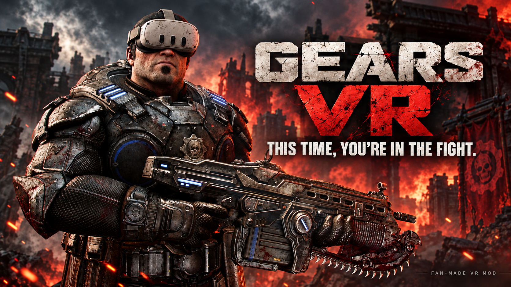

# GearsVR

VR mod for Gears of War: Reloaded.

[**Download v0.0.2**](https://github.com/gjc9620/gears-vr/releases/download/v0.0.2/GearsVR-0.0.2.zip)

0.0.2 fixes Windows startup-script blocking, Steam process handoff, multiple-account settings, EXE discovery, and non-English paths. Startup diagnostics now include stage timings and component fingerprints. See [CHANGELOG.md](CHANGELOG.md) for the full changes.

**Updating:** close the game and launcher, then extract the complete new ZIP into the same location and replace the previous mod files. Keep `runtime` and `tools` together with the launcher.

## Install and play

1. **Before installing, open the game normally.** Set **Display mode** to **Windowed / Borderless**, **Frame rate limit** to **Unlimited**, and **DLSS / DLAA** to **Off**. Apply the settings, then **exit the game completely**. Keep Steam running and signed in.
2. Extract **everything** from the mod ZIP directly into the **game's root folder**. **GearsVR Launcher.exe and the Binaries_x64 folder must be next to each other.** Keep `runtime` and `tools` with the launcher.

```text
Gears of War Reloaded/
├── GearsVR Launcher.exe
├── Binaries_x64/
│   └── GOWDE-Steam.exe
├── WarGame/
├── runtime/
└── tools/
```

The launcher also supports placement beside the game EXE, or in one GearsVR subfolder under either location. If the path is empty, use **Browse** to select `Binaries_x64/GOWDE-Steam.exe`.

3. Connect your headset and open **GearsVR Launcher.exe**. Game path should fill in automatically. **System OpenXR runtime** is the default; VD users can select **Quest 3 / Virtual Desktop (VDXR)** if needed.
4. Click **Start VR** and play with your keyboard/mouse or gamepad.

## Quick notes

- **Tested:** retail startup and simulator menu submission for 0.0.2; startup fixes also passed user testing. Act 1, KRVR + Apple Vision Pro, and VD + Quest 3 results come from the unchanged 0.0.1 renderer. A separate 0.0.2 physical-headset regression remains pending. Supported game EXE: `1.0.381.6947`.
- **Adjust:** lower **Render scale** if it feels choppy; try **Camera closer = 0.4** for a closer view. Restart the game after changing these.
- **Known issues:** mounted machine-gun entry/exit may pause for about 2 seconds. Keep DLSS / DLAA off. Later chapters have not all been verified.
- **Bugs:** click **Export logs** and send the ZIP with your headset, GPU, and what happened. It includes a readable `startup-summary.txt` and the latest three startup attempts, even if VR never started. For startup failures, also include `analysis/runtime/vr-launcher-session.reserve.log` from the mod folder.

<details>
<summary>简体中文</summary>

0.0.2 修复下载脚本拦截、Steam 进程交接、多账号设置、EXE 查找和中文路径问题，并增强启动阶段耗时、组件指纹和退出状态记录。完整更新内容见 [CHANGELOG.md](CHANGELOG.md)。

更新前关闭游戏与启动器，将新版整包解压到原位置并覆盖 Mod 文件。

### 安装与启动

1. **安装前先正常打开游戏**：显示模式改为**窗口化或无边框窗口**，帧率限制改为**不限制**，**DLSS / DLAA 完全关闭**。应用并保存设置，然后**彻底退出游戏**，保持 Steam 运行并登录。
2. 将压缩包的**全部内容直接解压到游戏根目录**，目录结构见上图。**推荐让 GearsVR Launcher.exe 和 Binaries_x64 文件夹并排**；也支持 EXE 同目录或上述位置下的一层 GearsVR 子目录。`runtime`、`tools` 要一起保留。
3. 连好头显，打开启动器。游戏路径会自动填入，默认使用**系统 OpenXR**；VD 用户也可手动选择 VDXR。
4. 点 **Start VR**，使用键鼠或手柄游玩。

卡顿就降低 **Render scale**；想拉近镜头可试 **Camera closer = 0.4**，修改后重启游戏。第一幕、KRVR + AVP、VD + Quest 3 的既有结果属于 0.0.1；0.0.2 已验证正版启动且用户反馈实测正常，独立真头显回归仍待复测。机枪进入/退出仍可能延迟约 2 秒，后续章节未全部验证。遇到 Bug，请用 **Export logs** 导出 ZIP，附上头显、显卡和问题描述；尚未进入 VR 也能导出最近三次启动记录及 `startup-summary.txt`。启动失败时请额外附上 Mod 目录的 `analysis/runtime/vr-launcher-session.reserve.log`。

</details>

[Building from source](BUILDING.md)
