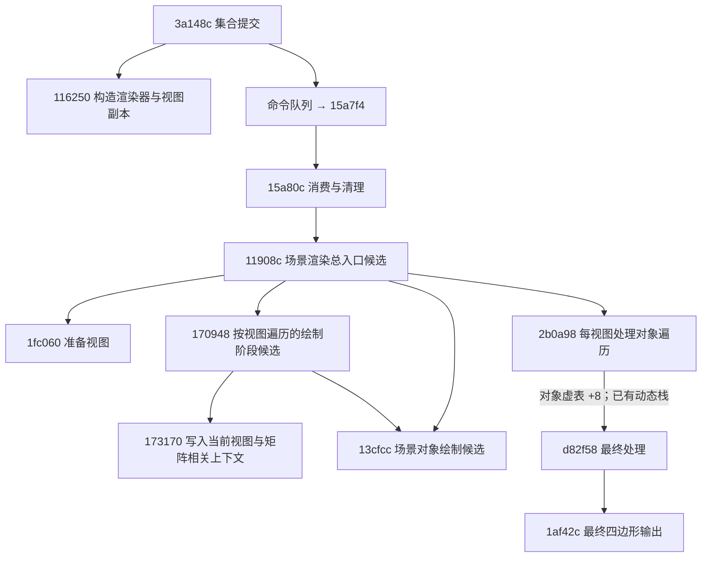

# Double-Diagnosis Shifting to Ghidra Analysis

2026-10-13. Conclusion: Keeps the current view construction and camera results, suspends the adjustment of final output parameters; checkes each view landscape drawing and colour resource first. The correct desktop SBS has not been achieved, and the right side black screen root is yet to be confirmed.

See you for follow-up review. [Documents 54](54-render-route-review-and-geometry-limits.md)：`13cfcc` The range of observations does not represent a complete mapping, and the road map on this page only opens one of its optional branches; subsequent measurements do not prove that the right eye lacks world geometry.

## Facts and additional evidence for the current round

1. The current malfunction is the right-hand anomaly of the desktop double view output. Two separate game eye maps have not yet been connected to OpenXR, and cannot be described as a direct XR right exchange chain failure.
2. 2026-10-11 The Red and Blue Cross has every eye GPU back-reading and Quest 3 User can be confirmed in visible form, see document 08、11. The game 2D panel is also validated. The latter is `XrCompositionLayerQuad`, does not amount to copying the same image to two separate projects.
3. 1,531 The call to the final output only proves that the final processing is done around. There are run-time stacks that link them to `15a80c → 11908c → 2b0a98 → d82f58 → 1af42c`This does not justify geometric mapping in every eye.
4. This session is directly accessible to Ghidra MCP, read `gears` In projects `GOWDE-Steam.exe`Yeah. `140d82f58` , and then the translation returns the funcing or integration not found;`14015a80c` , the list is undefined bytes, beginning `fb b0 a4 e7 …`。
5. Normal Start PID 16812 Read-only validation of EXE SHA 256 Yes `bdc6705d18ddb335b767df0b38e256ba5da0f49449c8970b302118bb7a4a8fa4`, module base `140000000`。10 Before running an entry 32 Bytes are all different from disks to read. `d82f58` unread raw data; the remaining nine are bytes different. Run-time `15a80c` Start `48 89 5c 24 10 55 48 8b ec 48 83 ec 70`, consistent with the existing life cycle Hook signature.
6. Therefore, the current round uses a separate Gidra headless project to analyse running snapshots. The original Ghidra program is retained; the disk bytes are not defined as a function in the original program.6 General non-written savings 29.15 MiB;per 64 KiB block read two consecutive times the same, save sections SHA 256. This is a partial snapshot, not process atoms.
7. Orientation definition 10 The most direct calls are made at the entrance and at the first floor of the scene. 80 individual;actual 80 I'm sorry.79 One of the successful creations of pseudocodes.`1741d0` , the function is not marked as successful.

No new or active game Hook, no dynamic re-engineering of the double view, and no new single frame gPU capture. The snapshot is taken from a normal startup image, only for code analysis, not as level or second view to execute evidence.

## Recreate Rendering Path

The function below is used for a job name supported by evidence and not an official symbol that has been restored. The arrow contains static direct calls and existing running validation; the call is not referenced separately.

The judgement that needs to be corrected is that the current scheme does not simply repeat Present or the last one. It has already allowed a retrofitting object with two views into the overall entrance; however, there is no dynamic evidence between “the object contains two views” and “both images generate valid geometric pixels”.

New discoveries can be used for the next round of precision validation:

| RVA / Field | The elements that are supported by the pseudocode and compilation | Not proven |
| --- | --- | --- |
| `11908c` | Call view preparation, multiple drawing candidates and finally call every view to process objects through the clock | Which stage is the first time you lose a right colour? |
| `170948` | From Renderer `+68` taking view arrays; pressing `+70` Number,`D30` Step through the loop; each round uses an integer rectangle of views, binds the context of the view and can be called `13cfcc` | Which sub-conditions are the right view dynamic walking through? |
| `173170` | Write the current view to context `+14C0`, copy matrix/position-related data | Final GPU constant correct or not to be subsequently overwritten |
| `13cfcc` | Accept renderer, view, stage parameters and another mode parameter; run through the view list of connections, check for visible position and filter results, then call on the object's false method | Number of Draws, Draws and Pixels per Eye |
| view `+450/+460` | `13cfcc` , and there is a pointer and inline storage selection | The formal structure type, the justification of the two-eye content |
| view `+470/+4E0`、`+570 + stage*10` | Participate in filtering/drawing candidate calls and phased list access | complete type and semantics; cannot be modified directly by these deviations |
| `2b0a98` | Walk through the view `+C84/+C8C` Object array, false call after matching phase | Shadow input resource contains right-hand content |

Revealable original assembly point:

- `170B8F` Check for renderer `+70`；`170BAC` Read `+68`；`170CE4` Call `13CFCC`；`171003` Increase `D30`；`171014` Compares the number of views.
- `11A1E7` Call `173170`Right away. `11A1FB` Call `13CFCC`；`11A20D/11A214` Checks for view step bands and count.
- `11A5E9` Call Phase Processing `2B0A98`；`11A604` ..the outer layer count and constant 4 Compare. This stage of the cycle cannot be interpreted as a circle of left and right eyes.
- `11A6F4` By Phase Parameters 4 Call `2B0A98`, Return Point `11A6F9` With Document 48 The actual output post is consistent.

There are clearly incomplete items in the pseudocode prototype, for example `1af42c` The lack of known stack parameters for some of the inversions is not a problem.`170948` Return type extrapolation cannot be used as ABI directly. The new Hook must determine the signature based on a compiler repository, stack layout and self-measurement.

## Fault assumptions and minimal experiments

The two segments between the creation of the scene and the final shadow input are currently the most deserving of verification; there is insufficient evidence to determine the sole root cause in both.

| Assumptions | Minimum authentication and judgement |
| --- | --- |
| Right View Visibility/Pile List Empty, or Skip Right View at scene stage | Yes. `13cfcc` Within the same rendering consumption range, only the view address, phase, rectangular, matrix summary, list number and visible position summaries are recorded, differentiated by first/second view. The entry count is used as evidence of execution only; the relationship continues to be maintained with actual D 3D 12 Draw and Resource Content |
| Two views share the target, but screens, status or reprocessing loses right | Saves the same frame resource map for scene colour, end of each view stage, final shadow input, Backbuffer to record the first right-hand invalid boundary. The phase has valid right pixels before disappearing to support over/copying assumptions |
| OpenXR Two-System Copy Error | Independent A/B/C diagnostic; it is separated from the current desktop black screen |

Experiment A has a history of Red and Blue Cross GPUs and user acceptance; strict pure colour variant is not done on the current wheel. Experiment B's "Two separate XR images receive the same frame" and C's'Independent Right RT Test Chart XR' are both pending, and cannot be replaced by an already 2D Quad panel. The real desktop view of Experiment D remains the target for receiving and inspection on the main line.

PIX Officially Provides Command Line GPU Capture, Event Export and Resource Export. See [Pixtool Document](https://devblogs.microsoft.com/pix/pixtool/)This is another one. 2026-10-12 PIX smoke `.wpix`, CSV and PNG; Game Start Logs only go to failed foreground picture file without game capture files. These records do not constitute successful capture of the current round. RenderDoc does not try again with old failures.

## Next steps in scope and structure judgement

- Reservations `source_eye_args.h`, source view structure, independent state and life cycle tracking. First, you will diagnose the path of multiple viewing scenarios that already exist, without evidence to push back reconstruction.
- Modify only the next round if you need to add a new observation point `native-capture/capture.cpp`, access sign/ preset, self-measure and corresponding analyser. Target is limited to each view phase. Do not modify the camera, visual area, final quad and XR submissions simultaneously.
- Priority is given to collecting CPU view evidence and GPU scene colour evidence. The simultaneous refilling is assessed only if you confirm that the engine's existing multiview path does not produce two valid scenarios.
- Synchronization of double-spinning requires the same logical state, historical resources and GPU life cycle, which does not directly clean up objects `15a80c` Call again.
- Do not claim success with stereo rendering, SBS or complete VR until a credible geometric difference has occurred in the left and right image.

## Recurrence and evidence

Add tools:`tools/package-inspector/snapshot_render_code.py`、`DecompileRenderSnapshot.java`. See boxage-inspector README for snapshot and backcompilator only `analysis/ghidra/render-16812-verified/`; stand-alone projects in `analysis/ghidra/runtime-project/render-16812.gpr`. The original Ghidra MCP is still connected to the original project, and this round successfully re-compiled from the independent headless project, not known as the original project MCP, which has been able to reverse these entry points directly.

Git checkpoint:`analysis/backups/diagnostic-20261013-010746/`, which contains the original version of the HEAD, status, modification patch and user interactive design document. `docs/10-vr-interaction-design.md` Modify the reservation.

---

## 中文

# 双目诊断转向与运行时 Ghidra 分析

2026-10-13。结论：保留当前视图构造和相机成果，暂停调整最终输出参数；先核对每视图场景绘制和颜色资源。正确的桌面 SBS 尚未实现，右侧黑屏根因尚未确认。

后续复审见 [文档 54](54-render-route-review-and-geometry-limits.md)：`13cfcc` 的观察范围不代表完整场景绘制，本页路径图只展开了其中一个可选分支；后续实测没有证明右眼缺少世界几何。

## 事实与本轮新增证据

1. 当前故障是桌面双视图输出右侧异常。两个独立游戏眼图尚未接入 OpenXR，不能把它直接描述成 XR 右交换链故障。
2. 2026-10-11 的红蓝十字测试已有每眼 GPU 回读和 Quest 3 用户可见确认，见文档 08、11。游戏二维面板也已有验证。后者是 `XrCompositionLayerQuad`，不等同于把同一张图复制到两个独立 projection swapchain。
3. 1,531 对最终输出调用只证明左右最终处理执行。已有运行时调用栈把它们关联到 `15a80c → 11908c → 2b0a98 → d82f58 → 1af42c`，不能据此证明每眼世界几何绘制有效。
4. 本会话已可直接调用 Ghidra MCP，读取到 `gears` 项目中的 `GOWDE-Steam.exe`。对 `140d82f58` 的反编译返回 function or instruction not found；`14015a80c` 的 listing 是未定义字节，开头 `fb b0 a4 e7 …`。
5. 正常启动 PID 16812，只读校验 EXE SHA256 为 `bdc6705d18ddb335b767df0b38e256ba5da0f49449c8970b302118bb7a4a8fa4`，模块基址 `140000000`。10 个入口的运行时前 32 字节全部与磁盘读取不同。其中磁盘 `d82f58` 无可读原始数据；其余九处均有不同字节。运行时 `15a80c` 开头 `48 89 5c 24 10 55 48 8b ec 48 83 ec 70`，与现有生命周期 Hook 签名相符。
6. 因此本轮使用单独 Ghidra headless 项目分析运行时快照。保留原始 Ghidra 程序；没有在原程序上把磁盘字节强行定义成函数。6 个普通非写入节约 29.15 MiB；每个 64 KiB 块连续读取两次一致，保存各节 SHA256。这是分块快照，不是进程原子快照。
7. 定向定义 10 个入口及场景候选的一层直接被调用者，最多 80 个；实际 80 个，79 个成功产生伪代码。`1741d0` 的反编译器退出，保留失败记录和汇编，没有把该函数标成成功。

本轮没有新增或激活游戏 Hook，没有动态重做双视图，也没有产生新的 GPU 单帧捕获。快照取自正常启动后的映像，只用于代码分析，不作为关卡或第二视图执行证据。

## 重新建立的渲染路径

下面函数用途是证据支持的工作名称，并非恢复出的官方符号。箭头包含静态直接调用和既有运行时验证；虚调用另行标注。

需要修正的判断是：现有方案并非只重复 Present 或最后一张图。它已经让包含两份视图的渲染对象进入场景总入口；但“该对象包含两视图”与“两视图都生成了有效几何像素”之间还缺动态证据。

新发现可用于下一轮精确验证：

| RVA / 字段 | 伪代码与汇编共同支持的内容 | 尚未证明 |
| --- | --- | --- |
| `11908c` | 调用视图准备、多个绘制候选，最后调用每视图处理对象遍历 | 哪个阶段首次丢失右侧颜色 |
| `170948` | 从渲染器 `+68` 取视图数组；按 `+70` 数量、`D30` 步幅遍历；每轮使用各视图整数矩形、绑定视图上下文，并可调用 `13cfcc` | 右视图动态走过哪些条件分支 |
| `173170` | 把当前视图写入上下文 `+14C0`，复制矩阵/位置相关数据 | 最终 GPU 常量是否正确、是否被后续覆盖 |
| `13cfcc` | 接受 renderer、view、阶段参数及另一模式参数；遍历视图关联列表、检查可见性位和过滤结果，再调用对象虚方法 | 每眼实际 Draw 数、绘制资源与像素 |
| view `+450/+460` | `13cfcc` 中参与可见性位读取，存在指针与内联存储选择 | 正式结构类型、两眼内容是否合理 |
| view `+470/+4E0`、`+570 + stage*10` | 参与过滤/绘制候选调用和分阶段列表访问 | 完整类型与语义；不能照这些偏移直接修改 |
| `2b0a98` | 按视图遍历 `+C84/+C8C` 对象数组，匹配阶段后虚调用 | shader 输入资源是否包含右侧内容 |

可核对的原始汇编点：

- `170B8F` 检查 renderer `+70`；`170BAC` 读取 `+68`；`170CE4` 调用 `13CFCC`；`171003` 增加 `D30`；`171014` 比较视图数。
- `11A1E7` 调用 `173170`，紧接 `11A1FB` 调用 `13CFCC`；`11A20D/11A214` 为视图步幅及计数检查。
- `11A5E9` 调用阶段处理 `2B0A98`；`11A604` 的外层计数与常量 4 比较。该阶段循环不能解释为左右眼循环。
- `11A6F4` 以阶段参数 4 调用 `2B0A98`，返回点 `11A6F9` 与文档 48 的实测最终输出栈一致。

伪代码原型存在明显不完整项，例如 `1af42c` 在部分反编译调用处缺少已知栈参数，`170948` 返回类型推断也不能直接作为 ABI。新增 Hook 必须依据汇编寄存器、栈布局及自测确定签名。

## 故障假设及最小实验

目前最值得优先验证的是场景生成至最终 shader 输入之间的两段；证据不足以在两者中确定唯一根因。

| 假设 | 最小验证与判断 |
| --- | --- |
| 右视图可见性/绘制列表为空，或场景阶段跳过右视图 | 在 `13cfcc` 同一渲染消费范围内，只记录 view 地址、阶段、矩形、矩阵摘要、列表数量与有界可见位摘要，并按第一/第二视图区分。入口计数仅作为执行证据；继续关联实际 D3D12 Draw 与资源内容 |
| 两视图共享目标，但清屏、状态或后处理使右侧丢失 | 对场景颜色、每视图阶段末、最终 shader 输入、backbuffer 保存同一帧资源图，记录第一个右侧失效边界。阶段中有有效右像素、之后消失才支持覆盖/复制假设 |
| OpenXR 双独立目标复制有误 | 独立 A/B/C 诊断；它与当前桌面右侧黑屏分开验收 |

实验 A 已有“红蓝十字”的历史 GPU 与用户验收；严格纯色变体本轮未做。实验 B 的“两张独立 XR projection 图像都接收同一游戏帧”和 C 的“独立右侧 RT 测试图 → XR”均待实现，不能拿已有二维 quad 面板替代。实验 D 的桌面真实视差 SBS 仍是主线验收目标。

PIX 官方提供命令行 GPU 捕获、事件导出与资源导出，参见 [pixtool 文档](https://devblogs.microsoft.com/pix/pixtool/)。本机另有 2026-10-12 的 PIX smoke `.wpix`、事件 CSV 与 PNG；游戏启动日志只到 foreground privilege 失败信息，没有游戏捕获文件。这些既存记录不构成本轮游戏捕获成功。RenderDoc 的旧失败也不重复尝试。

## 下一步改动范围与架构判断

- 保留 `source_eye_args.h`、源视图构造、独立状态与生命周期跟踪。先沿已存在的多视图场景路径诊断，暂无证据要求推倒重建。
- 下一轮如需新增观察点，仅修改 `native-capture/capture.cpp`、入口签名/预留、自测和对应分析器，目标限定于每视图场景阶段。不要同时修改相机、视区、最终 quad 和 XR 提交。
- 优先按一帧收集 CPU 视图证据与 GPU 场景颜色证据。只有确认引擎现有多视图路径无法产生两个有效场景结果，才评估同步顺序双渲染。
- 同步顺序双渲染需保证同一逻辑状态、历史资源和 GPU 生命周期，不能直接把会清理对象的 `15a80c` 再调用一次。
- 在左右图像出现可信几何视差之前，不宣称立体渲染、SBS 或完整 VR 成功。

## 复现与证据

新增工具：`tools/package-inspector/snapshot_render_code.py`、`DecompileRenderSnapshot.java`。使用方法见 package-inspector README。快照与反编译仅留本机 `analysis/ghidra/render-16812-verified/`；独立项目在 `analysis/ghidra/runtime-project/render-16812.gpr`。原 Ghidra MCP 仍连接原项目，本轮成功反编译来自独立 headless 项目，不能称为原项目 MCP 已能直接反编译这些入口。

Git 检查点：`analysis/backups/diagnostic-20261013-010746/`，包含 HEAD、状态、修改补丁及用户原有交互设计文档副本。原有 `docs/10-vr-interaction-design.md` 修改保留。
