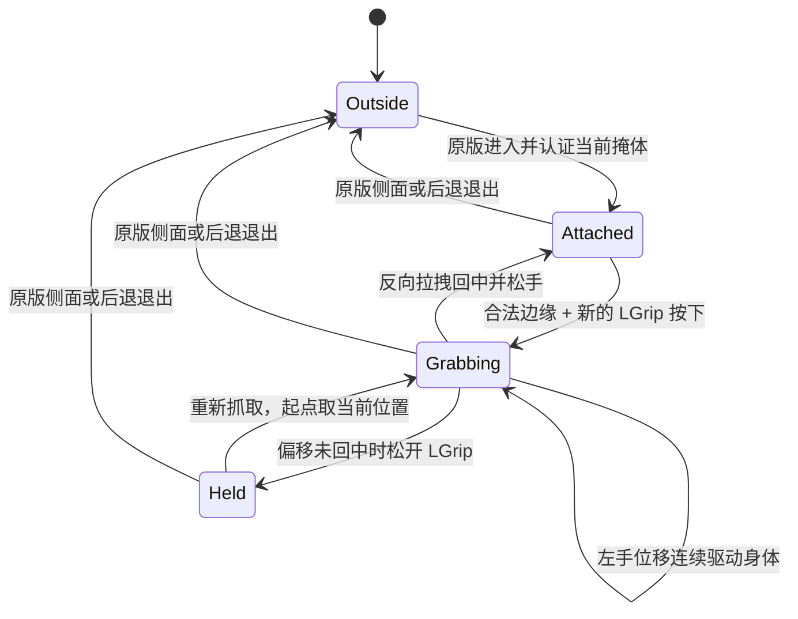

# GearsVR 6 DoF bunker interaction and specification for realization

2026-10-24.2026-10-26 Update. Functional branch and independent worktree is`6dof-cover`, at this stage achieves reconciliation. This specification is fully interactive and does not replace final exposure with an early isolation test or CPU check. The only writing end for the shared body/hand has been verified in a positive backstage test to move free hands and return eligibility.[Native47 + EP Positive Backstage Validation](6dof-body-native47-ep-runtime-20261026.md)Pass original 40 Minor/6 The second master holds the door and completes two shifts with the actual bones; the images follow, authoritative sighting and firing are not accepted.[Independent master-source contract](6dof-body-main-mount-source-contract-20261026.md)Access to real Tick tracking, original Scene/Equip Link and current C 0 Benchmark, not to renew or modify old sources. The grab edge offset and share left hand interfaces have been realized with CPUs, and early quarantine tests cover uptick, low neutral and semi-prospecting fire; they have not yet formed the final LGrip/Bed Body Interlock loop. Run candidates have been active SM 4 In the medium application, normal running, stop/entry bunker connections, and final eye and body perception remain to be verified. The complete replacement of old keys, physical walls, actual LGrip grabs, collision/shooting/gunshot consistency, weapons streaming and head-to-head inspection are retained as unfinished items.[Development progress](releases/0.0.4/PROGRESS.md)。

This specification is based on the current user request.**Untie LGrip and keep the pull body position, grab the edge and move back to the left hand.**. The following is marked as “Accomplishing Default” to complete the details of the project and does not mean that it has been received by hand.

## 1 Playplay experience

Keep the original version for bunkers, adsorbing, moving along them, side exit and back-out. After entering, the body is facing the shelter, with neutral eye spots on its side. Players can stand up in reality, crouch down, lean around or scrutinise to the right, and let the view point move out or back to the real position; they can also grab the edge with their left hand and pull their own virtual bodies backwards. Real body actions and pulling hands can be used to observe and shoot under cover, and can be used in combination.

Removes the original "Land Left On Left, Right on RT Automatic Right" and original buttons from automatic search. LT/RT still undertakes to aim/shoot at weapons that apply; they can no longer place the player's body or lens in a bunker with them.

| scene | Player Operations | Result |
| --- | --- | --- |
| Get in the bunker. | Use original access/sorption | Enter the original active bunker, face to cover; no automatic head opening |
| Move along the bunker. | Move Input Using Original | Follow the bunker to reach available edges, retain original adsorption and collision |
| Run/sprint | Use original running input | Camera moves with people, removes extra movement of games; real head-to-face activity continues. |
| Direct left/right spot | Shifting to the left/right side, sideways in reality, changing position of head | Move point of view out with real status; back to back, not ask for keys or grab edges |
| Real standing/down | Stand up, raise your body, or fall down and bend over your head in reality. | LGrip is not required to detect or retrace the point of view with actual altitude changes; physical exposure and impact must also correspond |
| Left side to the side. | To the left edge, to the left hand near the edge. Hold LGrip, move right. | The body and the sight point to the left. |
| Left Zoom | Keep scratching, move left hand to the left; release and then recapture and move left | Body and vision point to right, back to cover. |
| Right side to the right. | To the right edge, hold on to the left hand. LGrip, grab the edge, move left hand to the left. | Body and vision point to right. |
| Zoom Right | Keep scratching, move left hand to the right; release and then recapture and move right | Body and vision point back to the left. |
| Short bunkers. | Where the original version allows LT to go up, use LGrip to grab the edge and push down. | Body and sight rise, open up and shoot. |
| Up Zoom | Grab the upper edge and move your left hand up. | The body and the sight drops to a shaded position. |
| Untie me, LGrip. | Release Left Hold key | Release capture, retain current virtual body deviation; left hand can re-assume the carrying of a gun or other actions |
| Exiting bunker | Quit/ Step Back Quit Input | Get out of there. Unlock the side, lock it in. |

The side and upshow must be a continuous shift, not a full sounding of the animation over a certain threshold. You can either find only one spot or stop shooting in the middle.**Left hand LGrip**- Not with the right hand holding.

## 2 Rule prioritization and old options

This specification replaces[Early VR Interactive Scheme](10-vr-interaction-design.md)The following bunker rules are included:

- Replace "uninvolved/outline bunker status" with "in-format, adsorption and specified exit mode".
- Replace the words “right-stumping, unwinding and recovery” with the words “real horizontal movement of head and left hand grabs”; no right-shocking poles already in place are used to turn around.
- Replace the words “to unload the edge of the grip” with the words “to keep the current position”.
- Replace the words “the edge of the grab is only a successor” with the clear scope of this function, which is achieved along with the upper edge.
- The neutral eye point after the low bunker enters must be hidden and cannot follow the first person's description of the entry default higher than the shelter. The upper probe is created by a change in real location or pull-and-pull, not automatically by an angle of header, LT or RT.

This time, no normal moving speed and collision, free standing, flying or complete weapon systems are redesigned; additional running/sprint cameras are added to stabilize as required by the user's follow-up. The right-hand swinger of the old scheme does not serve as an uplink for this bunker; it cannot be used in a bunker to create another set of buttons that will be used to cross this specification.

## 3. Capture, maintain and retake

The capture must be satisfied at the same time: it is in a valid bunker, allowed to exit in the direction it follows, effective tracking with the left hand, close to the edge of the gripable edge of the grab, and new push-downs have been found on LGrip.

Left/Right with**Player heads in the local right and left direction as he moves to the current bunker**Define; "up/down" is defined in the game 's gravity direction. Turning, head and lower head do not flip or pull. A grab locks a edge and an operating axis, and cannot jump to the other side by frame near the corner.

Press to record the current body deviation and the position of the left hand in real tracking space. When you hold, calculates the physical shift by moving the hand position relative to that starting point. The body, eyes and non-arranged right hand/weapons are converted with the same body; the grasp of the left hand is shown as holding the edge and connecting with real time hands.

**User confirmed maintenance rules:**Release the hand and stop pulling, but not automatically recapturing, removing body deviations or demanaging bunkers. Retake reset from current physical position; reverse pull on the same edge can be gradually retracted. The old starting point of first capture cannot be used to cause a shot to beat again.

Default: single-takes only horizontally or vertically; re-carves must be carried out loosely. Other axle shifts that are retained still need to be checked geometrically through the current bunker, and cannot accumulate beyond the scope of the shelter by hand change, recapturing or re-engineer. Ending old grabs when moving along the new slot, depending on where the new slot is connected, allows re-graving.

LGrip shares the left hand with auxiliary arms, picks up bullets, loads and grabs mechanical parts. Default is achieved: the held object continues to have a left hand, which must be released before scratching the bunker; when the left hand is empty and closes the edge of the legal shelter, it can hold side. The same time presses only one hit operation, while the edge cannot be seized without simultaneous aid or ammunition.

## 4...head, body, eye and collision

**Real standing, crouching down, bending and leaning/prospecting to the right and left must be effective.**The game points follow as long as the head is in physical space; when you actually stand, you can be found above the bunker, you can actually reduce your body, and you can actually see or take back your right or left. These moves do not require LGrip or extra buttons.

Only**The headline is completely unchanged, only the rotation angles are changed.**When looking up, turning down or turning around only changes the direction of observation and does not generate an additional procedurally elevated, crouching or side-proximation. The shift in reality is accompanied by a change in head position, which must be preserved in its entirety and cannot be ignored because the action is called “turning back” or “heading up”.

The left-hand grip is an additional virtual shift, which coexists with the actual move. Players can stand up/right and right to their own feet, pull only by left hand or pull a stretch before continuing to detect with the real body; both shifts are applied once. Unleashing LGrip keeps only the pull-in virtual deviation, while the real head continues to rise, move around and shrink, without being locked in its state.

The body is facing the bunker, and free observation of its head is two conditions. Natural front is a bunker when it approaches; entering the process does not allow the body to be directly directed against the wall. Players can still see freely when looking on the side, and cannot force their view back in order to get the body towards the wall.

The neutral eye must be built on the current bunker, person posture and space balance. Virtual neutral eye under a dwarf shelter should follow the top and retain the necessary collision surplus; it cannot be fixed at all shelters or addressed by lowering the general walk-by-view point in the global context. This requirement is directed to the basic eye point, not permanently limiting the final header's sight to the top: players must be able to see the outside after they have actually stood up or scrutinised across legitimate edges, and cannot offset real shift through each frame, fixed altitude or pressure back.

Real head moves and left hand pulls are two independent inputs, one stacked. Body movements cannot be recalculated as a hand input into the next frame; they cannot be driven by virtual hand coordinates that have been converted to world space or can be replaced by “relationship of hands” in order to actually track spatial shifts.

Virtual body pull must be subjected to continuous collision inspection and cut in the current bunker range. Real head moves continue to follow; if you try to cross a physical wall, you need to hide your vision and ask for return to a legal area, not to display it directly from behind walls or to force a head-to-head position.

The detection is not a mobile camera. Virtual body/top exposure, area under attack, gun-scraping and actual shooting must be matched; using the original adsorption does not automatically match the original fire or firing conditions. No “eyes are outside but the original version is protected by complete hiding” can occur, nor can sorbence be destroyed to complete the sidewalk directly to transport the entire person's collision body out of the wall.

### 4.1 Run and sprint camera stabilization (user add)

User feedback is too high, and explicitly requires that the camera be not moved while running. This is a mandatory camera repair for this branch, covering ordinary outside of the bunker, low-pressure punches, and games allowed to run along the mask; it is not only used when scratching the edges.

- Remove the top-down bumps, left-and-right swings, nods, head-shapes, rollers and additional lens swings that are being applied to the game. When a real head is still running in a straight line, the point of view should move steadily along the person's moving path, with the horizon shaking around without moving at the pace.
- Keep head-to-head real rotation and peaceful migration without locking the sight, lowering the head to track response or smoothing raw head-to-face data to mask running.
- Physical movement of persons, high and low terrain, active diversion and necessary attitude changes; cameras cannot be fixed to a certain world height or can be used to resolve the shaking by changing the speed of running.
- When starting, stopping, running, running and sprinting, stabbing to the bunkers and exiting from them, the basic eye point and direction are linked consecutively, without suddenly retrieving back to the original dithering camera or generating additional jumps or lens swings.
- Only the motion of the camera caused by running is separated.

Prior to achieving this, you will need to record a stable personal movement reference, original camera position/direction, EyeHeight/portal, HMD raw position and final eye-eye point separately, identifying which layer of movement comes from. Priority is given to removing the explicit growth of the running camera or creating basic view points without that increase, superseding the real header; no filtering can be made for the ultimate camera containing active shift, recoil power and tracking.

## 5 Aim, fire and original action.

In the VR bunker context, remove the automatic probe/spectrum shift branch triggered by LT/RT while retaining lawful targeting, opening and shooting. Exiting the shelter, menu and non-modern input is still handled according to their existing rules and cannot swallow the triggers globally.

If a original shooting requires a certain CoverAction/Advance Licence, it should be driven by the actual verified exposure and weapon state and inhibit any corresponding additional automatic camera movement; no single aim or shoot can be disabled to resolve automatic detection. Specific primary entry, call order and recovery matters require evidence, and this paper does not treat candidate functions as direct write-off interfaces.

The target must be a weapons-authority line and its scene intersection. HMD only changes the observation/show, not automatically turning the viewing position into a weapon ray. When the gun is behind the wall, even if the eye has been found, it must be observed as a real gun cover; whether blind shooting without showing its head can be determined by the proven original weapon rules cannot be used to implicitly ban all firing because of the cancellation of automatic probes.

The right hand can shoot with one hand when the left hand grabs the side; the body remains open after LGrip is released, and the left hand can re-engage. Weapons models must be verified in the direction of a star, gunpoint, random dispersal and final impact. Only the shot or HUD cache on the image does not prove this link.

## 6 Status and interruption

The following is the status of the new interactive layer, which still holds a bunker validity, adsorption and exit determination. The state is called the proposed interface, not indicating that there are codes in place.



`Attached` and `Held` All allow for real head movement; they are only differences between virtual body deviations and whether or not to return. All capture states retain the original exit capability. Release the scratch side first, connect the active body/eye with the original move transition, do not make a zero shift in instantaneous form, nor can it be immediately re-insorted by the still held LGrip.

Real head moves or left hand pulls across the edge of a bunker are per se props, and do not in itself mean that the original side exits; these two shifts cannot automatically inject walk/exit input. The player takes the initiative to reverse or back-off the original side before submitting the original exit decision.

| Interrupt | Defaults are achieved |
| --- | --- |
| Left hand lost track/input samples old | Stop pulling, unlock the arm anchor and retain legal physical deviation; continue to observe when headline tracking is effective; retake needs to be released before press |
| Headline lost tracker/XR session not available | Continue existing tracking recovery, stop new captures; continue moving bodies without old hand samples |
| Pause/menu | Pause interaction; return to the same valid bunker to preserve position and capture must be re-established |
| Recenter/Track space epoch changes | Rebuild the head, hand, body and weapon together to remove old captures; effective world position continuous, no epoch margin calculation |
| Manual smoothing/Snap shift to body change reference | End old grabs, move to the review bunker and legal deviation in new bodies before they are allowed; no left hand pulls with reference axis changes |
| Original round corner/shelter slot change | End old grabs and review new slots and directions; old edge anchors cannot continue to pull the body |
| Death/checkpoint reloading/charts/person replacement | Clearing old bunkers, capturing anchor points and sustaining deviation; new scene re-certification |
| Story/machine gun/special action takeover | Return the action control; do not release normal bunker offsets to other cameras or characters |

Exit and original special action take-overs take precedence over grabside. Normal terminations and midway failures must return the changes that are available to the function, review the identity of the object and current value and not revert to the object that has been replaced by other systems.

## 7 Existing realized and evidence boundaries reconciled

| Item | Existing evidence | Meaning of this achievement |
| --- | --- | --- |
| First person, preview. | `tools/native-capture/first_person_view.h::prepare` Use `Pawn.Location + EyeHeight`, horizontally forward 0.35 M, lift up 0.10m；`first_person_live.inl::prepare` No bunker height branch. | To add a dedicated base eye for the bunker; fixed deviation is an explicit pending entry, but it has not yet been demonstrated in this run sample as the only reason for overloading of all shelters |
| Run camera steady. | Same `prepare` Remove the original camera roll and position animation, but still extract forward from the original view using real-time Pawn/eyeHeight;[History shake analysis](19-first-person-motion-and-recoil.md)Recording old bag running-phase motorized drawings not uniformly deleted | The preview is not considered as running stabilization; the run angle increment, person/eye high change and active mode switch needs to be distinguished. Currently only user phenomena and source access are available for reasons that are not certified while running |
| Synthesis of Vision Points | `capture.cpp` First, I'll get you ready. `stereo_matrices`；`camera_closer` There's a separate branch. | Select a single, effective base eye point, synthesize body deviations, HMD, right-and-right eyes; avoid first person designation, closeness and bunkers each one again |
| Old first person bag. | [First person analysis](12-first-person-mod-analysis.md)Record old packages `WarCam_Cover` It's... `PawnRelativeOffset=[80,0,50]`；[Preview Record](first-person-preview-20261021.md)Description of the current preview using a stand-alone rendering point policy | The old high-level bunker is not targeted, nor can the current preview be used to assert that third-party packages have been integrated; actual retail package identities need to be checked prior to testing |
| Default Head Input | Current `pose_probe.cpp`、`pose_bridge.h`、`stereo_frame.h` Path provides HMD/eye samples; this baseline does not have access to left-hand grab side input | Not directly HMD as left hand; access to a sample handle with identity, time sequence and valid position |
| Independent weapons work | `codex/weapon-6dof` Existing `controller_input_bridge.h`、`controller_continuity_bridge.h`、`hand_world_continuity_bridge.h`, its interactive document gives LGrip multiple mutually exclusive uses | Priority is given to re-use of input/continuing contracts on a clear version, establishing shared left hand operational attribution; the branch has not yet joined the weapons candidate and cannot be said to have completed its arms control |
| Hold your gun, HUD. | [The bunker is locked and repaired.](cover-aim-lock-20261022.md)Dissociate the scene from the hit point query reply. | Retain existing repairs; not authenticating bunkers or firing status with old HUD cache |
| Original bunker candidate | Used `tools/re-kb/kb.py` Search `Cover`、`CoverAction`、`CoverSlot`、`CoverSlip`、`WarCam_Cover` and related class names | Script/object entries and historical strings found, control interfaces, memory layouts or terminologies for current retail processes not yet certified |

The knowledge base candidate includes `WarPawn.SetCoverAction`、`PickClosestCoverSlot`、`ReachedCoverSlot`、`WarPC.CoverAcquired`、`TryToCoverSlip`and `WarCam_Cover`／`WarCam_CoverTargeting` . They are used only to narrow down the scope of the investigation;`CoverSlip` . The qualifying search does not return to the named native function, nor does it mean that there is no birthright.

Two other actions are assigned to the old script that need to be checked separately:`WarPC.PlayerTakingCover.DetermineLeanDirection`(History export SHA)256 `11c412d0…b2`) Written by bunker position, aim/fire and swing `OutPawnCA`／`OutPawnCD`，`WarPC.PlayerTakingCover_Stationary.DetermineLeanDirection`（`33ea50c8…4e`) also write up the probe. The current regular short bunker was visible when it was actually targeted `CoverAction=7`／`CoverDirection=3`, but export undeconstructed script operators and do not prove which function is currently being executed. The removal of autopsies must confirm the actual entry, action status and subsequent camera/image effects separately in the current process, and cannot be completed by one field or shielding LT/RT.

Original Retrieval Reply in ignored `analysis/6dof-cover-planning-20261024/kb-*.json`. Script entries, historical run-time strings and disk EXE are different sources; press later[Knowledge Bank Rules](58-reverse-engineering-knowledge-base.md)Checks the source Hashi, module base address, caller and current process identity, and conducts minimum IDA investigations when necessary. This round does not open IDA or export new game pseudocodes.

## 8 Development of a structure for realization

Data stream:**Current bunker authentication + hands sample of the same tracking space grab, grab, and stay in position legitimate body shift Eye point/hand/arms/exposure status Submission of the same frame eyes**。

It is proposed to separate pure interactive mathematics from game connections: pure logic enters a shelter allowing direction, edge geometry, capture input and tracking position, output with boundary body deviation and clear state; the game thread authenticates original objects, handle action permissions and restores, and the rendering of lines only consumes non-variable results that have been submitted and that match identity. The specific new file name is determined when it is achieved.

The side probe uses the local right-hand axis of the bunker fixed at the time of capture, and the upper shaft is set up in the world. `Dg` To capture instant body deviations,`Lg` The government has been able to track the coordinates for the moment.`L(t)` As the current coordinates,`A` For this time, the freeze is traced to the bunker local axis map, and:

```text
D(t) = ProjectLegalCoverRange(Dg - gain * ProjectGrabAxis(A * (L(t) - Lg)))
```

Initial Default `gain=1`, converted to the ratio of existing millimeters/play units. The right axis is positive, with the left hand moving the body to the left; the upper axis is positive, with the left hand moving the body up. The lawful range is not calculated by retrieving the maximum process per recaption compared to the current bunker.

The formula defines only virtual pull, and does not include head-to-head shifts; HMD applies to each of the left and right eye in subsequent geometry. Rotation maps cannot follow real-time head-in. Postures, body deviations, bunker sub-generations and eyes must be submitted in the same way, avoiding new eye bias and old eye deviations.

Near-access grab distance, capture/release delay, maximum side/uptance process, body and wall residuals, hand-dithered filtering, dilution time for dilution requires scene measurement and actual interactive calibration. Unmeasured pre-measured not coding to " original value " ; HMD raw tracking does not pull filters without a hand pull.

## 9 Order of implementation and conditions for completion

| Phase | Work | Completion Conditions |
| --- | --- | --- |
| P 0(This time) | Specifications, independent worktree, current default baseline and input-dependent inventory | Documents are available for review, original work catalogue maintained and source frozen retroactively |
| P 1 | Read-only observation bunker entry/sink/left/uptrow permission/exit; confirmation of LT/RT assignment and camera offset source | Item-by-line status and actions in the actual scene; script name or single screenshot not sufficient |
| P 2 | Reuse/access left hand input, complete grab edges, reverse position, hold, recap, lock edge and restore pure logic | CPU checks for direction symbols, rotation coordinates, limit points, no feedback, old samples and life cycle pass |
| P 3 | Body reference, eye-covering and head free observation in front of the bunker; no automatic search by key | The actual bunker view does not exceed the LT/RT should have a masked topline, does not generate additional camera moves, original adsorption and exit are still working |
| R (Independent camera repair) | Read only the source of running and moving, then separate the normal motion/sprint camera increment, connect to stop and enter the bunker. | R 01–R 04 Pass, real head moves and normal movements; independent integration after necessary checks can be completed without waiting for all grab-side interaction |
| P 4 | Real standing/right and left perforation and left/right/top-cap pull access, head/hand/eye unity continuity and collision | Simulator tracks and real games read back to verify true penetration when unheld, double-placed supersing, two-way action, hand-to-hand maintenance, recapturing non-jumping and legitimate edge constraints |
| P 5 | Arms branch sharing LGrip belonging; aiming/fire permit, gun-face cover, body attack and exposure | Confirm authoritative shooting chains and attack behaviour; pure camera presentation cannot be delivered as complete functionality |
| P 6 | Life cycle, special status, latest default increments combined and integrated | Access to the current default starter after necessary automatic check; separate records of physical appearance and complete playbook |

P 1 First forensic slice: The same positive scene records the entry/station/targeting/fire-off of high bunkers to their left edge, right edge and upper detectable dwarf shelters; read only links to current Pawn/Controller, cover slot, camera, original action and input. Use these evidence to determine change points and then act Hook.

## 10 The acceptance scene

The following are all outstanding criteria and cannot be considered as adopted.

| Numbering | Conditions and Operations | Results to be observed |
| --- | --- | --- |
| C 01 | Walk from normal walk to high/short bunker | The original sorbent is in place, the body is facing the bunker; the short bunker neutral eye spot is indeed covered. |
| C 02 | Press LT/RT without moving head and hand | Aim/fire response according to weapons rules, no automatic left, right, top scouts |
| C 03 | Real flat on the left and right edges, then back. | Continuous observation and retrenching; no LGrip, no change in authority orientation |
| C 04 | Left edge grab, left hand right/ left | Left scout/retract right. |
| C 05 | Right edge grab, left hand move/right move | Right scout/retract right. Left hand still. |
| C 06 | Legitimate short bunkers, upper edge, lower/up left hand | Prospect/deposition is reversible; no uplifting of the header per se |
| C 07 | Left/right/up-to-half and free to move left hand | Virtual body position maintained, hand moves removed from the body |
| C 08 | Retouch and reverse at the same location. Repeat again. | Recapable, retraceable; multiple grabs cannot break the total process limit |
| C 09 | The bunker is moving in the direction. 90°／180°, turn around when you're picking up | Local left and right symbols and upward orientation stable, independent of world fixation X or real-time head forward |
| C 10 | Non-margin, top of wall, back of edge, unreachable grab | No false grabs, no walls, no automatic selection to the other side. |
| C 11 | Hold on to the steady hand input for a long time, folding head motion | Accumulated drift without frame, no body-to-body feedback and head-to-head horizontal transfer only once |
| C 12 | Execute side/ back exit while keeping capture or deflection | Exit is still complete. The eye links are continuous, old captures do not pull people back to the bunker. |
| C 13 | Capture left hand drop tracking, centering, XR space change, pause recovery | No old samples jump; retake before recovery, with a continuous connection at the same valid position |
| C 14 | Death, heavy load, alter, change of role, bunker failure or special camera takeover | Old objects and old offsets are all disabled, original controls can be restored |
| C 15 | Left hand-handed gun/ball near edge press LGrip | The left hand operation has a unique attribution, not to pull the body and change the weapon/ammunition status at the same time |
| C 16 | Eye-detected, gun post behind wall; shot at gun post | The gun was masked and the actual shooting matched; free observation of non-redirective weapons on the head |
| C 17 | We're under hostile fire as we gradually expose and retrenched. | The range of the attack is consistent with actual physical exposure and cannot be protected by moving images only. |
| C 18 | Check for double-eye and default return during continuous search, shooting and recovery | The same attitude is used by both eyes, with the independent left eye history, original colours, bunkers, HUD restoration and support logs maintained |
| C 19 | Stand up real after a short bunker and fall down/wow down to the head without pressing LGrip; lean on the side, side or move across | The point of view moves up/sidetector/backward, and the point of view is not fixed to neutral height; physical exposure, impact and fire shield |
| C 20 | Enter a single head rotation with fixed positions and a true horizontal head rotation | Pure rotation does not generate additional programmable probes; the rotation and peaceful movement of combined actions takes effect without discarding the real shift of direction/head/side-side tilt |
| C 21 | And then you pull your left hand and you keep it open, and then you get up, down or you go around and you get back to the physical position. | Virtual pull-off is maintained, real moves continue to be detected and retraced, and remain virtual shifts after returning to their original posture; two are not separate or cumulative |
| R 01 | Fixed real/simulation head-on posture, flat line ordinary running, impulse, available running along bunkers | Stable forward of point of view along the mobile path without step-in top/ left/right or angle-shaking; still available for one/ three-person VR mode to verify separately |
| R 02 | Start, stop, run and sprint, sprint into the bunker and exit. | The sight points are continuous, without sudden recovery of shaking, jumping, swinging or generating a shift jump |
| R 03 | Real turn, side-sliding, top-down and horizontal movement headline in running | Real tracking continues, with identical eyes, without head-activation locks, additional filters or duplicate superstitions caused by camera stabilization |
| R 04 | Run and turn on the slope/stair, stop and aim. | Legitimate terrain and attitude height, diversion, person/gun animation and pre-existing shooting/backshow behaviour maintained without mistaking them as running noise |

The CPU, simulator input, real game reading back, GPU image and physical header results are recorded by evidence. `render_scale=0.4`, configure only before the isolation instance starts; do not modify normal play rendering settings. Backstage testing continues with validated bend-windows games/simulators,`GEARSVR_TEST_WINDOWS_BEHIND=1`、`GEARSVR_TEST_TINY_OUTPUT_OBSERVE_ONLY=1` and only test with silent sound; do not focus, do not adjust the user window, do not open the physical controller backstage input, protect and restore existing archive/set.

## 11 Branches and freeze baselines

Workspace:`C:\Users\11\.codex\worktrees\6dof-cover\gearsVr`From `codex/0.0.4` It's... `9ffa710d5428f270a2ee7e6d7c8e9a930dbb7b81` Create precise name `6dof-cover` Branch.

Because of the root directory 0.0.4 Rehabilitation not yet submitted, creating local baseline submission in new branch `85fc2b31c9f294e1726d192dd5c5af365acc3e01`,Reserve 29 A relevant source code, diagnosis, checklist and log file. The tracking file that does not modify the root work directory does not include another Discord tool or personal game path/historical configuration change in the submission.

Copying actual frozen source, construction, source confirmation and limited knowledge base search results by bytes, 1,196 Local files; absolute paths from original sources remain available for retroactive use. Local maps and Hash lists are signed `analysis/6dof-cover-planning-20261024/baseline-copy.json`。

| Default component when branch is created (historical baseline) | SHA 256 |
| --- | --- |
| `tools/native-capture/build-support1/GearsCaptureSupport1.dll` | `5e78c2a736526b3bf22a87023959d1635d82d8bcec80ddd05ed24fede4d6fe7a` |
| `tools/openxr-probe/build-support1/OpenXRPoseProbe.exe` | `df54d17c03068f46cad60f43c5b17114dcc61bf612321efc85611822cd181b48` |

The working area source snapshot and the actual frozen builder are two distinct sets of evidence. `analysis/support-instrumentation-20261024/native-source`／`xr-source` The actual default freeze source is used to minimize the increment, maintain the original build switch, independent left eye history and original colour, and not make a default package of all workspaces mixed with other experiments. The default baseline is rechecked and moved forward before integration is completed if it is newly repaired.

The branch initially established passive bunker candidate from the freezing source and validated with an example of quarantine test; regular list retained at that time 1. The camera stabilization settings have a visible candidate and continuous session cleanup process, which is yet to be checked for running. Copy binary, CPU check and individual scenes have separate evidentiary ranges that are not equal to full playtime acceptance. 0.0.4 Release packages or tags. Achievement and validation continue to be recorded[0.0.4 Development records](releases/0.0.4/PROGRESS.md)The entity ' s head retains the receipt and inspection as a clear follow-up stage.

As of the AN dynamic test, the body has been detected.0.4 9 paragraphs close to the original instance 1 Simulate HMD validation: a fixed position turns/heads up without raising the body, and the real position moves upward to drive continuous bone postures to zero. Left and right horizontal shifts do not trigger an uptick; side props are yet unverified. Unity left hand owner has taken all valid Scene, and only submitted deviations and current HMDs are kept when weapons fail, and this failure is not published.8 Candidates for completion of offline construction are still pending. LGrip grab is not open, surface/crash, mirror and complete 2D posture, Mesh against wall, hit with gun. Current root default has moved to supportport 2／menu-modal 1, above 1 The table retains the history of branch creation and the final integration must recheck the latest source of the freeze.

AO completes the original left CA 3/Right CA 4/ Up CA 7 With the center CA 0 And the four bones and actual slot getter.5, original flip also relates to the upper Master and Pawn mirror requests; local Child 5 Images are still available.1 XR input bench has returned to LGrip by pressing, maintaining, releasing and restoring the full posture.01–C 21 The latest concrete evidence and incomplete items are based on the development record.

Native 12 The complete 3D physical target of the same Scene/XR sample has been frozen, with real standing, crouching, right, left and back-and-forward access independently maintained; virtual LGrip does not require a true stand to start. This module currently provides only solver input, which cannot be considered as full body after it or already has a single axle animated weight. Nutslot geometry is read back in AR's actual session, and legal grabs, final posturing and collisions continue. The final integrated baseline is available for support.3 Native／menu-modal 1 XR, preserves the historical composition table when the above branch is created.

RO 2 The same call would change the Local data of six arm bones, so that pre-call postures cannot be considered final and new animations cannot be covered unconditionally in the next frame.The body and arms are used by the same mative final gesture owner and shared arm solver;The only reading of the Rig interface does not grant skeletal writing permission, nor is the recovery entrance to the PG a substitute for final writing.(a) The limited test saves the original input, the primary output and the current writing values respectively, with withdrawal permitted only if it is clearly in the field of this writing;Any unreconfirmed recovery fields continue to retain responsibility.The current pure IO draft is still dealing with this factual discrepancy and partial writing, stage loss and array symmetry, which is not yet a viable game candidate.Full controllers and hands must also be marked with the location of grip to wrist and full rotation, so original grip cannot be directly targeted for handbone.

Native 24 b Congener Core/Authored wrist target has been advanced to a continuous uuterTick-only, regular game 411 The subbone is updated and read the Core once, of which 394 Four plans completed on a series of occasions; the closure of the old manual Pose incident is sustainable and complete 96 This time, the diagnosis is based on a complete data link, not to mention normal arm lengths, bone writing, bunker body or collision inspection. The shared matrix policy still defaults on strict, and the visible bounded appears to have failed to resolve the deviation of the physical/vision point coordinates. The original person's first name is preview and the eye reference pivot shift, shoulder orientation and natural body stem control continue to be checked; detailed freezing of sources, failures and acceptance borders are recorded in development records.

Native 25 Four sets of actual post-water empty scale/weight read back 1 Output and association with the original control line. The bone is still unmodified.26 b Further current bone.4 Map the continuous reading-only view of native Recoil, end of static scene 32 The rule is no_natural_call, without taking unread zero matrix as a gesture; then the actual natural action will be required to cover the follow-up. The fixed personal upper/lower arm ratio interface is aligned with the weapon session and reset locally, defaulting 1. The above progress does not change C 01–C 21／R 01–R 04 The acceptance requirement; final body of the grab/real search, collision/hit/gunshot and running transition are still incomplete.

---

## 中文

# GearsVR 6DoF 掩体交互与实现规格

2026-10-24制定，2026-10-26更新。功能分支及独立worktree为`6dof-cover`，当前阶段为实现和联调。本规格保留完整最终交互，不以早期隔离试验或CPU检查代替最终掩体验收。共用身体／手部唯一写入端已在正版后台测试中验证自由双手移动和资格交还。装备Lancer后的[Native47 + EP 正版后台验证](6dof-body-native47-ep-runtime-20261026.md)通过原40次／6秒连续主握门，并完成两段移手与实际骨骼读回；画面跟随、权威瞄准和开火尚未据此接受。新来源按[独立主握来源合同](6dof-body-main-mount-source-contract-20261026.md)接入真实Tick追踪、原Scene／设备关联和当前C0基准，不续时或修改旧来源。抓边偏移和共享左手接口已有CPU实现，早期隔离测试也覆盖过上探、低位中立及半探开火；它们尚未组成最终LGrip／双侧身体交互闭环。跑步候选曾在实际SM4中应用，普通跑动、起停／进出掩体衔接、最终双眼和体感仍待验证。旧按键完整替换、身体面墙、实际LGrip抓边、碰撞／受击／枪口一致性、武器合流和头显验收均保留为未完成项。默认native／XR未据这些私有候选替换，详见[开发进度](releases/0.0.4/PROGRESS.md)。

本规格以本次用户要求为准。用户已补充确认：**松开 LGrip 后保持拉拽产生的身体位置，再抓住边缘并反向移动左手才缩回**。下面标注“实现默认”的内容用于补齐工程细节，不表示已经通过手感验收。

## 1. 玩家体验

保留原版进入掩体、吸附、沿掩体移动、侧面退出和后退退出。进入后，身体正面朝向掩体，中立眼点处于掩体的遮蔽侧。玩家可以在现实中站起、蹲下、侧倾或向左右探身，让视点随真实位移探出或缩回；也可以用左手抓住边缘，反向拉动自己的虚拟身体。真实身体动作和左手拉拽都能用于掩体观察与射击，可以组合使用。

取消原有“在左侧按 LT 自动左探、在右侧按 RT 自动右探”及原版按键自动上探的行为。LT／RT 仍承担适用武器的瞄准／射击；它们不能再顺带把玩家的身体或镜头推出掩体。

| 场景 | 玩家操作 | 结果 |
| --- | --- | --- |
| 进入掩体 | 使用原版进入／吸附方式 | 进入原版有效掩体，身体面朝掩体；不自动露头 |
| 沿掩体移动 | 使用原版移动输入 | 沿掩体到达可用边缘，保留原版吸附和碰撞 |
| 跑步／冲刺 | 使用原版跑动输入 | 相机随人物移动，去掉游戏额外施加的跑动晃动；真实头显运动持续生效 |
| 直接左／右探头 | 现实中向左／右侧身、侧倾或横移，使头显位置发生变化 | 视点随真实位移探出；移回来就缩回，不要求按键或抓边缘 |
| 真实站起／蹲下 | 现实中站起、抬高身体，或蹲下、弯腰降低头的位置 | 视点随实际高度变化上探或缩回，不要求 LGrip；身体暴露与受击也须对应 |
| 左侧扒边探身 | 到左边缘，左手靠近边缘，按住 LGrip，左手向右移动 | 身体和视点向左探出 |
| 左侧缩回 | 保持抓取，左手向左移；已松手则重新抓住再向左移 | 身体和视点向右退回掩体内 |
| 右侧扒边探身 | 到右边缘，左手按住 LGrip 抓住边缘，左手向左移动 | 身体和视点向右探出 |
| 右侧缩回 | 保持抓取，左手向右移；已松手则重新抓住再向右移 | 身体和视点向左退回掩体内 |
| 矮掩体上探 | 在原版允许 LT 上探的地方，左手用 LGrip 抓上边缘，向下压手 | 身体和视点向上升起，露出后可射击 |
| 上探缩回 | 抓住上边缘，把左手向上移 | 身体和视点下降到遮蔽位置 |
| 松开 LGrip | 释放左握持键 | 释放抓取，保留当前虚拟身体偏移；左手可重新辅助持枪或做其他动作 |
| 退出掩体 | 原版侧面退出／后退退出输入 | 正常退出，解除抓边，不被抓边状态锁住 |

侧探和上探都必须是连续位移，而不是越过某个阈值就播放一次完整探头动画。可以只探出一点，也可以停在中间位置射击。右探同样使用**左手 LGrip**，不改成右手握持。

## 2. 规则优先级与旧方案替换

本规格替换[早期 VR 交互方案](10-vr-interaction-design.md)中以下掩体规则：

- “交互上没有进入／退出掩体状态”改为保留原版进入、吸附与指定退出方式。
- “右摇杆左右推住探身、松开收回”改为头显真实平移和左手抓边拉拽；不占用武器分支已有的右摇杆左右转向。
- “抓上边缘松手恢复原姿态”改为松手保持当前位置。
- “抓侧边缘只是后续候选”改为本功能的明确范围，与上边缘一同实现。
- 低掩体进入后的中立眼点必须在可遮蔽范围内，不能沿用进入后默认高于掩体的第一人称表现。上探由真实位置变化或抓边拉拽产生，不能由抬头角度、LT 或 RT 自动产生。

本次不重新设计普通移动速度与碰撞、自由站蹲、飞扑或完整武器系统；按用户后续要求，额外加入跑步／冲刺相机稳定。旧方案的右摇杆上下站蹲不作为本次掩体上探入口；在掩体中不能绕过本规格产生另一套按键上探。与武器分支合流时统一输入上下文。

## 3. 抓取、保持与重新抓取

抓取必须同时满足：已处于有效掩体、相应方向允许探出、左手追踪有效、左手靠近可抓边缘、LGrip 出现新的按下沿。空中按握持、抓普通墙面或抓不可上探的高墙，不能凭空移动身体。

“左／右”以**玩家正面朝向当前掩体时的局部左右方向**定义；“上／下”以游戏重力方向定义。转头、抬头和低头不会翻转拉拽方向。一次抓取锁定一个边缘和一个操作轴，不能在角落附近逐帧跳到另一边。

按下时记录当前身体偏移和左手在真实追踪空间中的位置。按住后以相对该起点的手部位移计算身体位移。身体、双眼和非锚定的右手／武器使用同一身体变换；抓住的左手表现为贴住该边缘，松开时再与实时手位衔接。

**用户已确认的保持规则：**松手停止拉拽，但不自动收回、不取消身体偏移、不自动解除掩体。再次抓取从当前身体位置重新建立起点；同一边缘反向拉动可以逐步缩回。不得重用第一次抓取的旧起点造成镜头跳动。

实现默认：单次抓取只驱动横向或竖向；换边缘必须松手重抓。保留的其他轴偏移仍需通过当前掩体的几何检查，不能借换手、重抓或换轴累计到掩体允许范围之外。沿掩体移动到新槽位时结束旧抓取，依据新槽位衔接身体位置，再允许重新抓边。

LGrip 与辅助持枪、取弹、装填和抓机械部件共用左手。实现默认：已持有的对象继续拥有左手，必须释放后再抓掩体；左手空闲且接近合法掩体边缘时可以抓边。同一次按下只能命中一个操作，抓边期间不能同时辅助枪械或取弹。右手保持持枪和射击能力。

## 4. 头显、身体、眼点与碰撞

**真实站起、蹲下、弯腰以及向左右侧倾／探身都必须生效。**只要头显在物理空间中的位置发生变化，游戏视点就跟随该变化；实际站起可以从掩体上方探出，实际降低身体可以缩回，实际左右探身可以从侧面探出或收回。这些动作不要求 LGrip，也不要求额外按键。

仅在**头显位置完全不变、只改变旋转角度**时，抬头、低头或转头只改变观察方向，不额外生成一段程序化的升高、下蹲或侧探位移。现实中的转头、抬头、侧倾常会同时带来头部位置变化，这部分真实位移必须完整保留，不能因为动作被称为“转头”或“抬头”就忽略。

左手抓边是额外的虚拟身体位移方式，与真实动作并存。玩家可以自己站起／左右探身，可以只靠左手拉拽，也可以先拉拽一段再用真实身体继续探出；两种位移各应用一次。松开 LGrip 保持的只是拉拽产生的虚拟偏移，真实头部仍可继续升降、左右移动和缩回，不被保持状态锁住。

身体面朝掩体，与头显自由观察是两个条件。正面接近时自然前方就是掩体；进入过程不能把原版背靠墙的身体转向直接施加给头显。玩家向侧面看时仍可自由观察，不能为了让身体朝向墙而强制把视野扭回墙面。

中立眼点必须依据当前掩体、人物姿态与空间余量建立。矮掩体下的虚拟中立眼点应在顶沿以下，并保留必要的碰撞余量；不能给所有掩体套一个固定高度，也不能通过全局压低普通行走视点解决。这一要求针对基础眼点，不是将最终头显视点永久限制在顶沿下：玩家真实站起或探身越过合法边缘后必须能够看到外侧，不能通过每帧回中、固定高度或压回掩体的方式抵消真实位移。

真实头动与左手拉拽是两项独立输入，只各叠加一次。身体移动不能被重新算成下一帧的手部输入；不能用已经变换到世界空间的虚拟手坐标反馈驱动身体，也不能用“手相对头的位置变化”代替实际追踪空间位移。

虚拟身体拉拽必须经过连续碰撞检查和当前掩体合法范围裁剪。真实头部移动继续跟踪；如试图穿过实体墙面，需遮蔽受阻视野并要求回到合法区域，不能直接从墙后眼点显示场景，也不能强制弹回真实头部姿态。具体遮蔽过渡属于后续头显舒适度验证项目。

探头不是只移动摄像机。虚拟身体／上身暴露、受击区域、枪口遮挡与实际射击必须对应；沿用原版吸附并不代表原版受击或射击条件已经自动匹配新姿态。不能出现“眼睛已在外面但原版仍按完全藏好给予保护”，也不能为了完成侧探直接把整个人物碰撞体传送到墙外而破坏吸附。

### 4.1 跑步与冲刺相机稳定（用户追加）

用户反馈当前跑步镜头太晃，明确要求跑步时镜头不要晃动。这是本分支的必做相机修复，覆盖掩体外普通跑动、压低身姿冲刺，以及游戏允许的沿掩体跑动；不是只在抓边时启用。

- 去掉游戏跑动动作额外施加的上下颠簸、左右摆动、点头、摇头、滚转和附加镜头甩动。真实头显静止、平地直线跑动时，视点应沿人物移动路径稳定前进，地平线不随步伐抖动。
- 保留头显真实旋转和平移，不用锁死视点、降低头部追踪响应或平滑原始头显数据掩盖跑动晃动。
- 保留人物的实际移动、地形高低、主动转向和必要的姿态高度变化；不能把相机固定在某个世界高度，也不能通过改变跑步速度解决晃动。
- 起跑、停跑、普通跑动与冲刺切换、冲刺吸附掩体及退出掩体时，基础眼点和朝向要连续衔接，不突然切回原版抖动相机，不产生额外跳变或镜头甩动。
- 只分离跑动造成的观看相机运动。人物／武器正常动画、武器后坐力与射击规则仍按各自既有要求处理，不全局关闭骨骼控制或全部相机效果。

实现前需分别记录稳定的人物移动参照、原相机位置／朝向、EyeHeight／姿态、HMD 原始位姿和最终双眼视点，辨别晃动来自哪一层。优先从明确的跑动相机增量中移除，或建立不含该增量的基础视点，再叠加真实头显位姿；不能对包含主动转向、后坐力和追踪的最终相机一律滤波。

## 5. 瞄准、开火与原版动作

在 VR 掩体上下文中，取消 LT／RT 引发的自动探身／镜头偏移分支，同时保留合法的瞄准、开镜和射击行为。退出掩体、菜单以及非本模式输入仍按各自现有规则处理，不能全局吞掉扳机。

如果原版射击需要某个 CoverAction／姿态许可，应由已经验证的实际暴露与武器状态驱动，并抑制对应的额外自动镜头位移；不能简单禁用瞄准或射击解决自动探头。具体原生入口、调用顺序和恢复事务需要取证，本文不把候选函数名当作可直接写入的接口。

准星必须对应武器权威瞄准线及其场景交点。HMD 只改变观察／投影，不能把看向的位置自动变成武器射线。枪口仍在墙后时，即使眼睛已经探出，也必须遵守真实枪口遮挡；未露头时是否可盲射由已验证的原版武器规则决定，不能因为取消自动探头而默认禁止所有开火。

左手抓边时右手可单手射击；松开 LGrip 后身体保持，左手可重新辅助瞄准。武器模型朝向、准星、枪口、随机散布与最终弹着点必须分开验证。仅有画面中的枪身或 HUD 命中缓存不足以证明这条链路。

## 6. 状态与中断

以下是新交互层的状态，原版仍持有掩体有效性、吸附及退出判定。状态名为拟定接口，不表示已有代码。


`Attached` 和 `Held` 都允许真实头显移动；它们只是虚拟身体偏移是否回中的区别。所有抓取状态都保留原版退出能力。退出时先释放抓边，按原移动过渡衔接有效身体／眼点，不能把清零偏移表现成瞬移，也不能由仍按住的 LGrip 立即重新吸附。

真实头动或左手拉拽越过掩体边缘属于探身，本身不等于原版侧面退出；不能借由这两种位移自动注入行走／退出输入。玩家主动执行原版侧退或后退操作时，再交给原版退出判定。

| 中断 | 实现默认 |
| --- | --- |
| 左手失去追踪／输入样本陈旧 | 停止拉拽，解除手部锚定，保留仍合法的身体偏移；头显追踪有效时继续观察；重新抓取需先释放再按下 |
| 头显失去追踪／XR 会话不可用 | 沿用现有追踪恢复显示，停止新抓取；不拿旧手部样本继续移动身体 |
| 暂停／菜单 | 暂停交互；返回同一有效掩体可保留位置，抓取必须重新建立 |
| Recenter／追踪空间 epoch 改变 | 头、手、身体和武器共同重建参照，解除旧抓取；有效世界位置连续，禁止跨 epoch 计算手位差 |
| 人工平滑／Snap 转向改变身体参照 | 结束旧抓取，在新的身体朝向复核掩体和合法偏移，再允许抓取；不把参考轴改变当作左手拉动 |
| 原版转角／掩体槽位改变 | 结束旧抓取，复核新槽位与方向；旧边缘锚点不得继续牵引身体 |
| 死亡／检查点重载／换图／人物替换 | 清理旧掩体身份、抓取锚点和持久偏移；新场景重新认证 |
| 剧情／机枪／特殊动作接管 | 交还该动作控制；不将普通掩体偏移泄漏给其他相机或角色 |

退出和原版特殊动作接管优先于抓边。正常结束与中途失败都必须交还本功能拥有的修改，并复核对象身份及当前值，不能恢复到已被其他系统替换的对象上。

## 7. 已核对的现有实现与证据边界

| 项目 | 现有证据 | 对本次实现的意义 |
| --- | --- | --- |
| 第一人称预览眼点 | `tools/native-capture/first_person_view.h::prepare` 使用 `Pawn.Location + EyeHeight`，再水平前移 0.35m、抬高 0.10m；`first_person_live.inl::prepare` 没有掩体高度分支 | 要加入掩体专用基础眼点；固定偏移是明确待改入口，但尚未用本次运行样本证明它是所有掩体过高现象的唯一原因 |
| 跑动相机稳定 | 同一 `prepare` 去掉原相机滚转和位置动画，但仍从原视图提取 forward，使用实时 Pawn／EyeHeight；[历史晃动分析](19-first-person-motion-and-recoil.md)记录旧包的跑动相机动画未被统一删除 | 不能把已有预览当成跑步稳定已完成；需区分跑动角度增量、人物／眼高变化与有效模式切换。当前仅有用户现象及源码入口，尚未认证运行时原因 |
| 视点合成 | `capture.cpp` 先执行第一人称准备，再执行 `stereo_matrices`；`camera_closer` 有独立分支 | 统一选择一个有效基础眼点，再合成身体偏移、HMD、左右眼；避免第一人称、拉近和掩体各自再抬高一次 |
| 旧第一人称包 | [第一人称分析](12-first-person-mod-analysis.md)记录旧包 `WarCam_Cover` 的 `PawnRelativeOffset=[80,0,50]`；[预览记录](first-person-preview-20261021.md)说明当前预览采用独立渲染视点策略 | 不将旧包高位掩体偏移当目标，也不能仅凭当前预览存在就断言第三方包已融合；测试前需核对实际零售包身份 |
| 默认头部输入 | 当前 `pose_probe.cpp`、`pose_bridge.h`、`stereo_frame.h` 路径提供 HMD／双眼样本；本基线没有已接入的左手抓边输入 | 不能直接拿 HMD 当左手；需接入带身份、时序和有效位的手柄样本 |
| 独立武器工作 | `codex/weapon-6dof` 已有 `controller_input_bridge.h`、`controller_continuity_bridge.h`、`hand_world_continuity_bridge.h`，其交互文档给 LGrip 多种互斥用途 | 优先在明确版本上复用输入／连续性契约，建立共享左手操作归属；本分支尚未合入武器候选，不能称武器控制已完成 |
| 掩体举枪 HUD | [掩体瞄准锁定修复](cover-aim-lock-20261022.md)将场景举枪状态与命中点查询回执分开 | 保留现有修复；不以旧 HUD 缓存认证掩体或射击状态 |
| 原版掩体候选 | 已用 `tools/re-kb/kb.py` 检索 `Cover`、`CoverAction`、`CoverSlot`、`CoverSlip`、`WarCam_Cover` 及相关类名 | 找到脚本／对象条目和历史字符串，尚未认证当前零售进程的控制接口、内存布局或调用语义 |

知识库候选包括 `WarPawn.SetCoverAction`、`PickClosestCoverSlot`、`ReachedCoverSlot`、`WarPC.CoverAcquired`、`TryToCoverSlip`，以及 `WarCam_Cover`／`WarCam_CoverTargeting` 的相机入口。它们只用于缩小调查范围；`CoverSlip` 的命名不能直接证明它就是用户所说的普通侧面退出。限定搜索没有返回已命名 native 函数，也不意味着不存在原生实现。

旧脚本另有两条需要分别核对的动作分派：`WarPC.PlayerTakingCover.DetermineLeanDirection`（历史导出SHA256 `11c412d0…b2`）按掩体槽位、瞄准／开火和摇杆方向写出 `OutPawnCA`／`OutPawnCD`，`WarPC.PlayerTakingCover_Stationary.DetermineLeanDirection`（`33ea50c8…4e`）也可写出上探动作。当前正版矮掩体实测瞄准时曾出现 `CoverAction=7`／`CoverDirection=3`，与脚本候选相符，但导出仍有未解析的脚本运算符，也未证明当前执行的是哪一个函数。取消自动探身必须在当前进程分别确认实际入口、动作状态和后续相机／动画效应，不能只清零一个字段或屏蔽 LT／RT。

原始检索回执放在 ignored `analysis/6dof-cover-planning-20261024/kb-*.json`。脚本条目、历史运行时字符串与磁盘 EXE 是不同来源；后续按[知识库规则](58-reverse-engineering-knowledge-base.md)核对来源哈希、模块基址、调用者和当前进程身份，必要时才开展最小 IDA 调查。本轮没有打开 IDA 或导出新的游戏伪代码。

## 8. 拟定实现结构

数据流：**当前掩体认证 + 同一追踪空间的头／手样本 → 抓取与保持状态 → 合法身体位移 → 眼点／手／武器／暴露状态 → 同一帧双眼提交**。

拟将纯交互数学与游戏接线分离：纯逻辑输入掩体允许方向、边缘几何、抓取输入和追踪位姿，输出有界身体偏移与明确状态；游戏线程负责认证原版对象、处理动作许可及恢复，渲染线程只消费已提交且身份匹配的不可变结果。具体新文件名在实现时确定。

侧探采用抓取时固定的掩体局部右轴，上探采用世界上轴。设 `Dg` 为抓取瞬间身体偏移、`Lg` 为该时刻左手真实追踪坐标，`L(t)` 为当前坐标，`A` 为该次抓取冻结的追踪到掩体局部轴映射，则：

```text
D(t) = ProjectLegalCoverRange(Dg - gain * ProjectGrabAxis(A * (L(t) - Lg)))
```

初始实现默认 `gain=1`，按已有米／游戏单位比例换算。右轴为正时，左手向右使身体向左；上轴为正时，左手向下使身体向上。合法范围相对于当前掩体的统一身体基准计算，不能每次重抓重置最大行程。

公式仅定义虚拟拉拽，不包含头显位移；HMD 与左右眼在后续统一几何中各应用一次。旋转映射不能跟随实时头朝向。姿态、身体偏移、掩体代次和双眼必须属于同一提交，避免一只眼使用新偏移、另一只眼使用旧偏移。

近边抓取距离、抓取／释放滞回、最大侧探／上探行程、身体与墙的余量、手部抖动滤波、遮蔽淡入淡出时间需要场景测量和实际交互调校。未测量前不硬编码成“原版数值”；HMD 原始追踪不套手部拉拽滤波。

## 9. 实施顺序与完成条件

| 阶段 | 工作 | 完成条件 |
| --- | --- | --- |
| P0（本次） | 规格、独立 worktree、当前默认基线及输入依赖盘点 | 文档可审阅，原工作目录保持，冻结来源可追溯 |
| P1 | 只读观察掩体进入／槽位／左右／上探许可／退出；确认 LT／RT 分派与相机偏移来源 | 在正版实际场景逐项关联状态和动作；脚本名或单张截图不足以完成 |
| P2 | 复用／接入左手输入，完成抓边、反向位移、保持、重抓、边缘锁定和恢复纯逻辑 | 针对方向符号、旋转坐标、限位、无反馈、旧样本和生命周期的 CPU 检查通过 |
| P3 | 面朝掩体的身体参照、遮蔽眼点与头部自由观察；取消按键自动探身 | 实际入掩体视点不高于应遮蔽顶沿，LT／RT 不产生额外镜头位移，原版吸附与退出仍工作 |
| R（独立相机修复） | 先只读定位跑动晃动来源，再分离普通跑动／冲刺的相机增量，衔接起停和进出掩体 | R01–R04 通过，真实头动与正常移动保持；可独立完成必要检查后集成，不必等待全部抓边交互完成 |
| P4 | 真实站蹲／左右探身与左／右／上抓边拉拽接入，头／手／双眼统一连续性与碰撞 | 模拟器轨迹和真实游戏读回验证无握持时真实探身、两种位移叠加、双向动作、松手保持、重抓无跳变和合法边缘约束 |
| P5 | 武器分支共享 LGrip 归属；瞄准／开火许可、枪口遮挡、身体受击与暴露一致 | 证实权威射击链和受击行为；纯摄像机演示不能作为完整功能交付 |
| P6 | 生命周期、特殊状态、最新默认增量合并与集成 | 必要自动检查通过后接入当时最新默认启动器；实体头显与完整玩法验收单独记录 |

P1 首个取证切片：同一正版场景分别记录高掩体左边缘、右边缘和可上探矮掩体的进入／静止／瞄准／开火／退出；只读关联当前 Pawn／Controller、cover slot、相机、原版动作和输入。用这些证据确定修改点，再做行为 Hook。

## 10. 验收场景

以下均为待执行标准，不能把本文列出视为已通过。

| 编号 | 条件与操作 | 必须观察到的结果 |
| --- | --- | --- |
| C01 | 从普通行走进入高／矮掩体 | 原版吸附成立，身体面朝掩体；矮掩体中立眼点确实受遮蔽 |
| C02 | 不移动头和手，单独按 LT／RT | 瞄准／开火按武器规则响应，视点／身体没有自动左、右、上探 |
| C03 | 在左右边缘真实平移头显，随后移回 | 连续观察与缩回；无需 LGrip，不会改变权威瞄准方向 |
| C04 | 左边缘抓取，左手右移／左移 | 左探／缩回方向正确，能停在中间位置 |
| C05 | 右边缘抓取，左手左移／右移 | 右探／缩回方向正确，仍使用左手 |
| C06 | 合法矮掩体上边缘，下压／上抬左手 | 上探／下降连续可逆；抬头角度本身不会升高身体 |
| C07 | 左／右／上探到一半后松开并自由移动左手 | 虚拟身体位置保持，非抓取手部移动不再牵动身体 |
| C08 | 在保持位置重抓再反向移动，多次重复 | 重抓无跳变，可缩回；多次抓取不能突破总行程限制 |
| C09 | 掩体朝向相差 90°／180°，抓取时自由转头 | 局部左右符号和上探方向稳定，不依赖世界固定 X 或实时头朝向 |
| C10 | 非边缘、高墙顶部、边缘背面、不可达距离抓取 | 不发生虚假抓取，不透墙，不自动选到另一侧 |
| C11 | 固定手输入长时间按住，再叠加头部运动 | 无逐帧累计漂移，无身体→手→身体反馈，头部平移只应用一次 |
| C12 | 保持抓取或保持偏移时执行侧面／后退退出 | 退出仍能完成，眼点衔接连续，旧抓取不把人拉回掩体 |
| C13 | 抓取中左手丢追踪、回中、XR 空间变更、暂停恢复 | 无旧样本跳变；恢复前需重新抓取，同一有效位置可连续衔接 |
| C14 | 死亡、重载、换图、换角色、掩体失效或特殊相机接管 | 旧对象和旧偏移全部失效，原版控制可恢复 |
| C15 | 左手辅助握枪／拿弹时靠近边缘按 LGrip | 左手操作有唯一归属，不同时拉身体与改武器／弹药状态 |
| C16 | 眼睛探出、枪口仍在墙后；随后枪口探出射击 | 枪口遮挡和实际射击一致；头部自由观察不重定向武器 |
| C17 | 逐步暴露与缩回时受到敌方射击 | 受击范围与实际身体暴露一致，不能只移动画面而保留错误保护 |
| C18 | 连续探身、射击和恢复期间检查双目与默认回归 | 双眼使用同一姿态，独立左眼历史、原色彩、掩体 HUD 修复和支持日志均保持 |
| C19 | 不按 LGrip，在矮掩体后真实站起，再蹲下／弯腰降低头部；在侧边真实侧倾、侧身或横移 | 视点随实际位移上探／侧探／缩回，最终视点不被固定在中立高度；身体暴露、受击与射击遮挡对应 |
| C20 | 分别输入位置固定的纯头部旋转，以及旋转伴随真实平移的头部动作 | 纯旋转不额外生成程序化探身；组合动作的旋转和平移都生效，不丢弃转头／抬头／侧倾伴随的真实位移 |
| C21 | 左手拉拽后松开保持，再真实站起、蹲下或左右探身并回到原身体姿态 | 虚拟拉拽偏移保持，真实动作可继续探出和缩回，回到原真实姿态后仍处于原虚拟偏移；两项不互相清零或重复累计 |
| R01 | 固定真实／模拟头显姿态，平地直线普通跑动、冲刺、可用的沿掩体跑动 | 视点沿移动路径稳定前进，没有步伐引入的上下／左右抖动或角度晃动；仍可使用的一／三人称 VR 模式分别验证 |
| R02 | 起跑、停跑、跑动与冲刺切换、冲刺进入掩体及随后退出 | 视点连续，不突然恢复晃动、跳高、甩动或产生转向跳变 |
| R03 | 跑动中真实转头、侧倾、上下及横向移动头显 | 真实追踪继续生效，双眼一致，没有相机稳定造成的头动锁定、额外滤波或重复叠加 |
| R04 | 在坡面／台阶跑动并主动转向，停止后瞄准射击 | 合法地形与姿态高度、转向、人物／枪械动画和原有射击／后坐力行为保持，不把它们误当跑动噪声消除 |

按证据分别记录 CPU、模拟器输入、正版游戏读回、GPU 图像与实体头显结果。按用户追加要求，后续自动游戏测试使用 `render_scale=0.4`，只在隔离实例启动前配置；不修改正常游玩的渲染设置。后台测试继续使用已验证的 behind-windows 游戏／模拟器、`GEARSVR_TEST_WINDOWS_BEHIND=1`、`GEARSVR_TEST_TINY_OUTPUT_OBSERVE_ONLY=1` 和仅测试用静音；不抢焦点，不调整用户窗口，不开启物理控制器后台输入，保护并恢复现有存档／设置。

## 11. 分支与冻结基线

工作区：`C:\Users\11\.codex\worktrees\6dof-cover\gearsVr`，从 `codex/0.0.4` 的 `9ffa710d5428f270a2ee7e6d7c8e9a930dbb7b81` 建立精确名称 `6dof-cover` 分支。

由于根目录的 0.0.4 修复尚未提交，在新分支创建本地基线提交 `85fc2b31c9f294e1726d192dd5c5af365acc3e01`，保留 29 个相关源码、诊断、清单和记录文件。没有修改根工作目录的已跟踪文件，没有将另一项 Discord 工具或个人游戏路径／历史配置变更纳入该提交。

已按字节校验复制实际冻结 native／XR 源、构建、来源回执和有限知识库检索结果，共 1,196 个本地文件；原始来源中的绝对路径仍保留以供追溯。本地映射和哈希清单在 ignored `analysis/6dof-cover-planning-20261024/baseline-copy.json`。

| 分支建立时的默认组件（历史基线） | SHA256 |
| --- | --- |
| `tools/native-capture/build-support1/GearsCaptureSupport1.dll` | `5e78c2a736526b3bf22a87023959d1635d82d8bcec80ddd05ed24fede4d6fe7a` |
| `tools/openxr-probe/build-support1/OpenXRPoseProbe.exe` | `df54d17c03068f46cad60f43c5b17114dcc61bf612321efc85611822cd181b48` |

工作区源码快照与实际冻结构建源是两套明确区分的证据。后续候选继续从 `analysis/support-instrumentation-20261024/native-source`／`xr-source` 对应的实际默认冻结源做最小增量，保留原构建开关、独立左眼历史和原色彩，不直接把混有其他实验的整份工作区源码编成默认包。默认基线若有新修复，集成前先重新核对并前移。

分支初期从冻结源建立了被动掩体调用候选，并以隔离测试实例验证；当时正常清单保留 support1。相机稳定设置已有显式候选能力及持续会话清理流程，尚待疾跑检查后启用默认能力。复制二进制、CPU 检查与单个场景各有独立证据范围，均不等同于完整玩法验收。没有创建 0.0.4 发布包或发布标签。实现与验证继续记入[0.0.4 开发记录](releases/0.0.4/PROGRESS.md)，实体头显验收保留为明确的后续阶段。

截至AN动态测试，上探身体目标已在0.4隔离正版实例完成九段source1模拟HMD验证：固定位置转头／抬头不抬高身体，真实位置上移驱动连续骨姿态，归零恢复。左右平移没有误触发上探；侧探身体尚未验证。统一左手owner已接所有有效Scene，武器失败时只保留已提交偏移和当前HMD，不发布本次失败拉拽。Native8候选完成离线构建，实际PG联调仍待进行。LGrip抓边暂未开放，表面／碰撞、镜像与完整二维姿态、Mesh朝墙、受击与枪口一致性继续实现。当前根默认已前移到support2／menu-modal1，以上support1表保留分支创建历史，最终集成必须重新核对最新冻结源。

AO补齐原版左CA3／右CA4／上CA7与中间CA0、四骨和实际slot getter对照。左右共用child5，原版翻转还涉及上层Master及Pawn镜像请求；局部child5镜像仍属待实测候选。独立source1 XR输入bench已回读LGrip按下、保持、释放和完整姿态恢复，尚不能替代C01–C21的真实抓边、碰撞与身体验收。最新具体证据与未完成项以开发记录为准。

Native12已冻结同一Scene／XR样本的完整三维身体目标，真实站起、下蹲、左右和前后探身均独立保留；虚拟LGrip上探不要求真实站起。该模块目前只提供求解输入，不能把它或已有单轴动画权重当成完整身体跟随。原生slot几何已在AR实际会话读回，合法抓边、最终骨姿态发布与碰撞仍继续实现。最终集成基线现为support3 Native／menu-modal1 XR，保留以上分支创建时的历史组件表。

RO2和BV进一步确认原生Compose输入与输出不同：同一次调用会改变六个手臂骨的Local数据，因此不能把调用前姿态当作最终姿态，也不能在下一帧无条件覆盖新动画。身体和武器双手采用同一Native最终姿态所有者与共用手臂solver；只读Rig接口不授予骨骼写入权限，PG的恢复入口也不替代最终写入阶段。有限试验分别保存原生输入、原生输出和本次写入值，只有明确属于本次写入的字段才允许撤回；任何未确认恢复的字段继续保留责任。当前纯IO草案仍在处理这项实测差异及部分写入、阶段丢失和数组别名问题，尚不是可启用的游戏候选。完整控制器跟手还须加入grip到wrist的位置与完整旋转标定，原始grip不能直接当手骨目标。

Native24b已将同源Core／authored手腕目标推进到连续只读outerTick通路，正版游戏411次骨骼更新各读取一次Core，其中394次完成四份计划；关闭旧手动Pose事件仍可持续工作，完整96项清理／恢复通过。此次采用adaptive诊断，仅完成数据关联，不等同正常臂长、骨骼写入、掩体身体或碰撞验收。共享矩阵政策仍默认strict，显式bounded近似不解决身体／视点坐标偏差。原第一人称preview与眼部参考pivot的偏移、肩部朝向及原生躯干控制继续核对；详细冻结来源、失败和验收边界见开发记录。

Native25已读回四组实际post-weight空scale／权重1输出并与原控制行关联，仍未改骨骼。Native26b进一步在当前骨4映射上连续只读观察原生Recoil，静止场景末尾32条为明确no_natural_call，没有拿未读取的零矩阵当姿态；后续需真实自然动作覆盖。固定个人上／下臂比例接口已与武器会话统一并本地重编，默认1，玩家测量与保存尚未接入。以上进展不改变C01–C21／R01–R04的验收要求；抓边／真实探身的最终身体、碰撞／受击／枪口和跑步过渡仍未完成。
