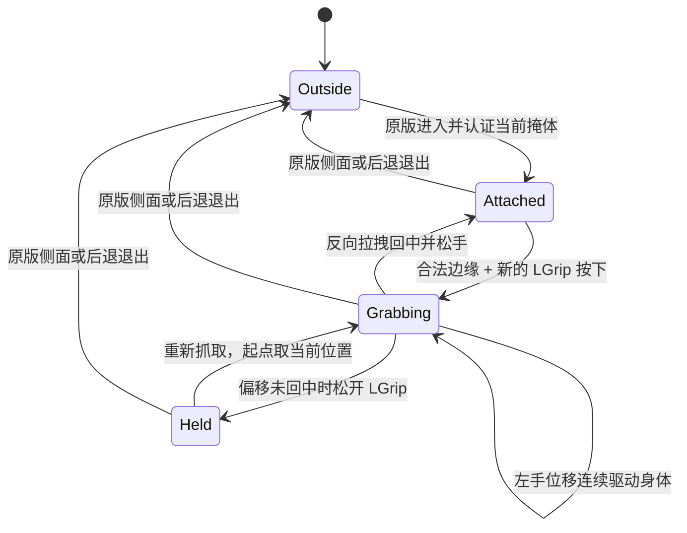

# GearsVR 6DoF 掩体交互与实现规格

2026-10-24制定，2026-10-26更新。功能分支及独立worktree为`6dof-cover`，当前阶段为实现和联调。本规格保留完整最终交互，不以早期隔离试验或CPU检查代替最终掩体验收。共用身体／手部唯一写入端已在正版后台测试中验证自由双手移动和资格交还。装备Lancer后的[Native47 + EP 正版后台验证](6dof-body-native47-ep-runtime-20261026.md)通过原40次／6秒连续主握门，并完成两段移手与实际骨骼读回；画面跟随、权威瞄准和开火尚未据此接受。新来源按[独立主握来源合同](6dof-body-main-mount-source-contract-20261026.md)接入真实Tick追踪、原Scene／设备关联和当前C0基准，不续时或修改旧来源。抓边偏移和共享左手接口已有CPU实现，早期隔离测试也覆盖过上探、低位中立及半探开火；它们尚未组成最终LGrip／双侧身体交互闭环。跑步候选曾在实际SM4中应用，普通跑动、起停／进出掩体衔接、最终双眼和体感仍待验证。旧按键完整替换、身体面墙、实际LGrip抓边、碰撞／受击／枪口一致性、武器合流和头显验收均保留为未完成项。默认native／XR未据这些私有候选替换，详见[开发进度](releases/0.0.4/PROGRESS.md)。

本规格以本次用户要求为准。用户已补充确认：**松开 LGrip 后保持拉拽产生的身体位置，再抓住边缘并反向移动左手才缩回**。下面标注“实现默认”的内容用于补齐工程细节，不表示已经通过手感验收。

## 1. 玩家体验

保留原版进入掩体、吸附、沿掩体移动、侧面退出和后退退出。进入后，身体正面朝向掩体，中立眼点处于掩体的遮蔽侧。玩家可以在现实中站起、蹲下、侧倾或向左右探身，让视点随真实位移探出或缩回；也可以用左手抓住边缘，反向拉动自己的虚拟身体。真实身体动作和左手拉拽都能用于掩体观察与射击，可以组合使用。

取消原有“在左侧按 LT 自动左探、在右侧按 RT 自动右探”及原版按键自动上探的行为。LT／RT 仍承担适用武器的瞄准／射击；它们不能再顺带把玩家的身体或镜头推出掩体。

| 场景 | 玩家操作 | 结果 |
| --- | --- | --- |
| 进入掩体 | 使用原版进入／吸附方式 | 进入原版有效掩体，身体面朝掩体；不自动露头 |
| 沿掩体移动 | 使用原版移动输入 | 沿掩体到达可用边缘，保留原版吸附和碰撞 |
| 跑步／冲刺 | 使用原版跑动输入 | 相机随人物移动，去掉游戏额外施加的跑动晃动；真实头显运动持续生效 |
| 直接左／右探头 | 现实中向左／右侧身、侧倾或横移，使头显位置发生变化 | 视点随真实位移探出；移回来就缩回，不要求按键或抓边缘 |
| 真实站起／蹲下 | 现实中站起、抬高身体，或蹲下、弯腰降低头的位置 | 视点随实际高度变化上探或缩回，不要求 LGrip；身体暴露与受击也须对应 |
| 左侧扒边探身 | 到左边缘，左手靠近边缘，按住 LGrip，左手向右移动 | 身体和视点向左探出 |
| 左侧缩回 | 保持抓取，左手向左移；已松手则重新抓住再向左移 | 身体和视点向右退回掩体内 |
| 右侧扒边探身 | 到右边缘，左手按住 LGrip 抓住边缘，左手向左移动 | 身体和视点向右探出 |
| 右侧缩回 | 保持抓取，左手向右移；已松手则重新抓住再向右移 | 身体和视点向左退回掩体内 |
| 矮掩体上探 | 在原版允许 LT 上探的地方，左手用 LGrip 抓上边缘，向下压手 | 身体和视点向上升起，露出后可射击 |
| 上探缩回 | 抓住上边缘，把左手向上移 | 身体和视点下降到遮蔽位置 |
| 松开 LGrip | 释放左握持键 | 释放抓取，保留当前虚拟身体偏移；左手可重新辅助持枪或做其他动作 |
| 退出掩体 | 原版侧面退出／后退退出输入 | 正常退出，解除抓边，不被抓边状态锁住 |

侧探和上探都必须是连续位移，而不是越过某个阈值就播放一次完整探头动画。可以只探出一点，也可以停在中间位置射击。右探同样使用**左手 LGrip**，不改成右手握持。

## 2. 规则优先级与旧方案替换

本规格替换[早期 VR 交互方案](10-vr-interaction-design.md)中以下掩体规则：

- “交互上没有进入／退出掩体状态”改为保留原版进入、吸附与指定退出方式。
- “右摇杆左右推住探身、松开收回”改为头显真实平移和左手抓边拉拽；不占用武器分支已有的右摇杆左右转向。
- “抓上边缘松手恢复原姿态”改为松手保持当前位置。
- “抓侧边缘只是后续候选”改为本功能的明确范围，与上边缘一同实现。
- 低掩体进入后的中立眼点必须在可遮蔽范围内，不能沿用进入后默认高于掩体的第一人称表现。上探由真实位置变化或抓边拉拽产生，不能由抬头角度、LT 或 RT 自动产生。

本次不重新设计普通移动速度与碰撞、自由站蹲、飞扑或完整武器系统；按用户后续要求，额外加入跑步／冲刺相机稳定。旧方案的右摇杆上下站蹲不作为本次掩体上探入口；在掩体中不能绕过本规格产生另一套按键上探。与武器分支合流时统一输入上下文。

## 3. 抓取、保持与重新抓取

抓取必须同时满足：已处于有效掩体、相应方向允许探出、左手追踪有效、左手靠近可抓边缘、LGrip 出现新的按下沿。空中按握持、抓普通墙面或抓不可上探的高墙，不能凭空移动身体。

“左／右”以**玩家正面朝向当前掩体时的局部左右方向**定义；“上／下”以游戏重力方向定义。转头、抬头和低头不会翻转拉拽方向。一次抓取锁定一个边缘和一个操作轴，不能在角落附近逐帧跳到另一边。

按下时记录当前身体偏移和左手在真实追踪空间中的位置。按住后以相对该起点的手部位移计算身体位移。身体、双眼和非锚定的右手／武器使用同一身体变换；抓住的左手表现为贴住该边缘，松开时再与实时手位衔接。

**用户已确认的保持规则：**松手停止拉拽，但不自动收回、不取消身体偏移、不自动解除掩体。再次抓取从当前身体位置重新建立起点；同一边缘反向拉动可以逐步缩回。不得重用第一次抓取的旧起点造成镜头跳动。

实现默认：单次抓取只驱动横向或竖向；换边缘必须松手重抓。保留的其他轴偏移仍需通过当前掩体的几何检查，不能借换手、重抓或换轴累计到掩体允许范围之外。沿掩体移动到新槽位时结束旧抓取，依据新槽位衔接身体位置，再允许重新抓边。

LGrip 与辅助持枪、取弹、装填和抓机械部件共用左手。实现默认：已持有的对象继续拥有左手，必须释放后再抓掩体；左手空闲且接近合法掩体边缘时可以抓边。同一次按下只能命中一个操作，抓边期间不能同时辅助枪械或取弹。右手保持持枪和射击能力。

## 4. 头显、身体、眼点与碰撞

**真实站起、蹲下、弯腰以及向左右侧倾／探身都必须生效。**只要头显在物理空间中的位置发生变化，游戏视点就跟随该变化；实际站起可以从掩体上方探出，实际降低身体可以缩回，实际左右探身可以从侧面探出或收回。这些动作不要求 LGrip，也不要求额外按键。

仅在**头显位置完全不变、只改变旋转角度**时，抬头、低头或转头只改变观察方向，不额外生成一段程序化的升高、下蹲或侧探位移。现实中的转头、抬头、侧倾常会同时带来头部位置变化，这部分真实位移必须完整保留，不能因为动作被称为“转头”或“抬头”就忽略。

左手抓边是额外的虚拟身体位移方式，与真实动作并存。玩家可以自己站起／左右探身，可以只靠左手拉拽，也可以先拉拽一段再用真实身体继续探出；两种位移各应用一次。松开 LGrip 保持的只是拉拽产生的虚拟偏移，真实头部仍可继续升降、左右移动和缩回，不被保持状态锁住。

身体面朝掩体，与头显自由观察是两个条件。正面接近时自然前方就是掩体；进入过程不能把原版背靠墙的身体转向直接施加给头显。玩家向侧面看时仍可自由观察，不能为了让身体朝向墙而强制把视野扭回墙面。

中立眼点必须依据当前掩体、人物姿态与空间余量建立。矮掩体下的虚拟中立眼点应在顶沿以下，并保留必要的碰撞余量；不能给所有掩体套一个固定高度，也不能通过全局压低普通行走视点解决。这一要求针对基础眼点，不是将最终头显视点永久限制在顶沿下：玩家真实站起或探身越过合法边缘后必须能够看到外侧，不能通过每帧回中、固定高度或压回掩体的方式抵消真实位移。

真实头动与左手拉拽是两项独立输入，只各叠加一次。身体移动不能被重新算成下一帧的手部输入；不能用已经变换到世界空间的虚拟手坐标反馈驱动身体，也不能用“手相对头的位置变化”代替实际追踪空间位移。

虚拟身体拉拽必须经过连续碰撞检查和当前掩体合法范围裁剪。真实头部移动继续跟踪；如试图穿过实体墙面，需遮蔽受阻视野并要求回到合法区域，不能直接从墙后眼点显示场景，也不能强制弹回真实头部姿态。具体遮蔽过渡属于后续头显舒适度验证项目。

探头不是只移动摄像机。虚拟身体／上身暴露、受击区域、枪口遮挡与实际射击必须对应；沿用原版吸附并不代表原版受击或射击条件已经自动匹配新姿态。不能出现“眼睛已在外面但原版仍按完全藏好给予保护”，也不能为了完成侧探直接把整个人物碰撞体传送到墙外而破坏吸附。

### 4.1 跑步与冲刺相机稳定（用户追加）

用户反馈当前跑步镜头太晃，明确要求跑步时镜头不要晃动。这是本分支的必做相机修复，覆盖掩体外普通跑动、压低身姿冲刺，以及游戏允许的沿掩体跑动；不是只在抓边时启用。

- 去掉游戏跑动动作额外施加的上下颠簸、左右摆动、点头、摇头、滚转和附加镜头甩动。真实头显静止、平地直线跑动时，视点应沿人物移动路径稳定前进，地平线不随步伐抖动。
- 保留头显真实旋转和平移，不用锁死视点、降低头部追踪响应或平滑原始头显数据掩盖跑动晃动。
- 保留人物的实际移动、地形高低、主动转向和必要的姿态高度变化；不能把相机固定在某个世界高度，也不能通过改变跑步速度解决晃动。
- 起跑、停跑、普通跑动与冲刺切换、冲刺吸附掩体及退出掩体时，基础眼点和朝向要连续衔接，不突然切回原版抖动相机，不产生额外跳变或镜头甩动。
- 只分离跑动造成的观看相机运动。人物／武器正常动画、武器后坐力与射击规则仍按各自既有要求处理，不全局关闭骨骼控制或全部相机效果。

实现前需分别记录稳定的人物移动参照、原相机位置／朝向、EyeHeight／姿态、HMD 原始位姿和最终双眼视点，辨别晃动来自哪一层。优先从明确的跑动相机增量中移除，或建立不含该增量的基础视点，再叠加真实头显位姿；不能对包含主动转向、后坐力和追踪的最终相机一律滤波。

## 5. 瞄准、开火与原版动作

在 VR 掩体上下文中，取消 LT／RT 引发的自动探身／镜头偏移分支，同时保留合法的瞄准、开镜和射击行为。退出掩体、菜单以及非本模式输入仍按各自现有规则处理，不能全局吞掉扳机。

如果原版射击需要某个 CoverAction／姿态许可，应由已经验证的实际暴露与武器状态驱动，并抑制对应的额外自动镜头位移；不能简单禁用瞄准或射击解决自动探头。具体原生入口、调用顺序和恢复事务需要取证，本文不把候选函数名当作可直接写入的接口。

准星必须对应武器权威瞄准线及其场景交点。HMD 只改变观察／投影，不能把看向的位置自动变成武器射线。枪口仍在墙后时，即使眼睛已经探出，也必须遵守真实枪口遮挡；未露头时是否可盲射由已验证的原版武器规则决定，不能因为取消自动探头而默认禁止所有开火。

左手抓边时右手可单手射击；松开 LGrip 后身体保持，左手可重新辅助瞄准。武器模型朝向、准星、枪口、随机散布与最终弹着点必须分开验证。仅有画面中的枪身或 HUD 命中缓存不足以证明这条链路。

## 6. 状态与中断

以下是新交互层的状态，原版仍持有掩体有效性、吸附及退出判定。状态名为拟定接口，不表示已有代码。



`Attached` 和 `Held` 都允许真实头显移动；它们只是虚拟身体偏移是否回中的区别。所有抓取状态都保留原版退出能力。退出时先释放抓边，按原移动过渡衔接有效身体／眼点，不能把清零偏移表现成瞬移，也不能由仍按住的 LGrip 立即重新吸附。

真实头动或左手拉拽越过掩体边缘属于探身，本身不等于原版侧面退出；不能借由这两种位移自动注入行走／退出输入。玩家主动执行原版侧退或后退操作时，再交给原版退出判定。

| 中断 | 实现默认 |
| --- | --- |
| 左手失去追踪／输入样本陈旧 | 停止拉拽，解除手部锚定，保留仍合法的身体偏移；头显追踪有效时继续观察；重新抓取需先释放再按下 |
| 头显失去追踪／XR 会话不可用 | 沿用现有追踪恢复显示，停止新抓取；不拿旧手部样本继续移动身体 |
| 暂停／菜单 | 暂停交互；返回同一有效掩体可保留位置，抓取必须重新建立 |
| Recenter／追踪空间 epoch 改变 | 头、手、身体和武器共同重建参照，解除旧抓取；有效世界位置连续，禁止跨 epoch 计算手位差 |
| 人工平滑／Snap 转向改变身体参照 | 结束旧抓取，在新的身体朝向复核掩体和合法偏移，再允许抓取；不把参考轴改变当作左手拉动 |
| 原版转角／掩体槽位改变 | 结束旧抓取，复核新槽位与方向；旧边缘锚点不得继续牵引身体 |
| 死亡／检查点重载／换图／人物替换 | 清理旧掩体身份、抓取锚点和持久偏移；新场景重新认证 |
| 剧情／机枪／特殊动作接管 | 交还该动作控制；不将普通掩体偏移泄漏给其他相机或角色 |

退出和原版特殊动作接管优先于抓边。正常结束与中途失败都必须交还本功能拥有的修改，并复核对象身份及当前值，不能恢复到已被其他系统替换的对象上。

## 7. 已核对的现有实现与证据边界

| 项目 | 现有证据 | 对本次实现的意义 |
| --- | --- | --- |
| 第一人称预览眼点 | `tools/native-capture/first_person_view.h::prepare` 使用 `Pawn.Location + EyeHeight`，再水平前移 0.35m、抬高 0.10m；`first_person_live.inl::prepare` 没有掩体高度分支 | 要加入掩体专用基础眼点；固定偏移是明确待改入口，但尚未用本次运行样本证明它是所有掩体过高现象的唯一原因 |
| 跑动相机稳定 | 同一 `prepare` 去掉原相机滚转和位置动画，但仍从原视图提取 forward，使用实时 Pawn／EyeHeight；[历史晃动分析](19-first-person-motion-and-recoil.md)记录旧包的跑动相机动画未被统一删除 | 不能把已有预览当成跑步稳定已完成；需区分跑动角度增量、人物／眼高变化与有效模式切换。当前仅有用户现象及源码入口，尚未认证运行时原因 |
| 视点合成 | `capture.cpp` 先执行第一人称准备，再执行 `stereo_matrices`；`camera_closer` 有独立分支 | 统一选择一个有效基础眼点，再合成身体偏移、HMD、左右眼；避免第一人称、拉近和掩体各自再抬高一次 |
| 旧第一人称包 | [第一人称分析](12-first-person-mod-analysis.md)记录旧包 `WarCam_Cover` 的 `PawnRelativeOffset=[80,0,50]`；[预览记录](first-person-preview-20261021.md)说明当前预览采用独立渲染视点策略 | 不将旧包高位掩体偏移当目标，也不能仅凭当前预览存在就断言第三方包已融合；测试前需核对实际零售包身份 |
| 默认头部输入 | 当前 `pose_probe.cpp`、`pose_bridge.h`、`stereo_frame.h` 路径提供 HMD／双眼样本；本基线没有已接入的左手抓边输入 | 不能直接拿 HMD 当左手；需接入带身份、时序和有效位的手柄样本 |
| 独立武器工作 | `codex/weapon-6dof` 已有 `controller_input_bridge.h`、`controller_continuity_bridge.h`、`hand_world_continuity_bridge.h`，其交互文档给 LGrip 多种互斥用途 | 优先在明确版本上复用输入／连续性契约，建立共享左手操作归属；本分支尚未合入武器候选，不能称武器控制已完成 |
| 掩体举枪 HUD | [掩体瞄准锁定修复](cover-aim-lock-20261022.md)将场景举枪状态与命中点查询回执分开 | 保留现有修复；不以旧 HUD 缓存认证掩体或射击状态 |
| 原版掩体候选 | 已用 `tools/re-kb/kb.py` 检索 `Cover`、`CoverAction`、`CoverSlot`、`CoverSlip`、`WarCam_Cover` 及相关类名 | 找到脚本／对象条目和历史字符串，尚未认证当前零售进程的控制接口、内存布局或调用语义 |

知识库候选包括 `WarPawn.SetCoverAction`、`PickClosestCoverSlot`、`ReachedCoverSlot`、`WarPC.CoverAcquired`、`TryToCoverSlip`，以及 `WarCam_Cover`／`WarCam_CoverTargeting` 的相机入口。它们只用于缩小调查范围；`CoverSlip` 的命名不能直接证明它就是用户所说的普通侧面退出。限定搜索没有返回已命名 native 函数，也不意味着不存在原生实现。

旧脚本另有两条需要分别核对的动作分派：`WarPC.PlayerTakingCover.DetermineLeanDirection`（历史导出SHA256 `11c412d0…b2`）按掩体槽位、瞄准／开火和摇杆方向写出 `OutPawnCA`／`OutPawnCD`，`WarPC.PlayerTakingCover_Stationary.DetermineLeanDirection`（`33ea50c8…4e`）也可写出上探动作。当前正版矮掩体实测瞄准时曾出现 `CoverAction=7`／`CoverDirection=3`，与脚本候选相符，但导出仍有未解析的脚本运算符，也未证明当前执行的是哪一个函数。取消自动探身必须在当前进程分别确认实际入口、动作状态和后续相机／动画效应，不能只清零一个字段或屏蔽 LT／RT。

原始检索回执放在 ignored `analysis/6dof-cover-planning-20261024/kb-*.json`。脚本条目、历史运行时字符串与磁盘 EXE 是不同来源；后续按[知识库规则](58-reverse-engineering-knowledge-base.md)核对来源哈希、模块基址、调用者和当前进程身份，必要时才开展最小 IDA 调查。本轮没有打开 IDA 或导出新的游戏伪代码。

## 8. 拟定实现结构

数据流：**当前掩体认证 + 同一追踪空间的头／手样本 → 抓取与保持状态 → 合法身体位移 → 眼点／手／武器／暴露状态 → 同一帧双眼提交**。

拟将纯交互数学与游戏接线分离：纯逻辑输入掩体允许方向、边缘几何、抓取输入和追踪位姿，输出有界身体偏移与明确状态；游戏线程负责认证原版对象、处理动作许可及恢复，渲染线程只消费已提交且身份匹配的不可变结果。具体新文件名在实现时确定。

侧探采用抓取时固定的掩体局部右轴，上探采用世界上轴。设 `Dg` 为抓取瞬间身体偏移、`Lg` 为该时刻左手真实追踪坐标，`L(t)` 为当前坐标，`A` 为该次抓取冻结的追踪到掩体局部轴映射，则：

```text
D(t) = ProjectLegalCoverRange(Dg - gain * ProjectGrabAxis(A * (L(t) - Lg)))
```

初始实现默认 `gain=1`，按已有米／游戏单位比例换算。右轴为正时，左手向右使身体向左；上轴为正时，左手向下使身体向上。合法范围相对于当前掩体的统一身体基准计算，不能每次重抓重置最大行程。

公式仅定义虚拟拉拽，不包含头显位移；HMD 与左右眼在后续统一几何中各应用一次。旋转映射不能跟随实时头朝向。姿态、身体偏移、掩体代次和双眼必须属于同一提交，避免一只眼使用新偏移、另一只眼使用旧偏移。

近边抓取距离、抓取／释放滞回、最大侧探／上探行程、身体与墙的余量、手部抖动滤波、遮蔽淡入淡出时间需要场景测量和实际交互调校。未测量前不硬编码成“原版数值”；HMD 原始追踪不套手部拉拽滤波。

## 9. 实施顺序与完成条件

| 阶段 | 工作 | 完成条件 |
| --- | --- | --- |
| P0（本次） | 规格、独立 worktree、当前默认基线及输入依赖盘点 | 文档可审阅，原工作目录保持，冻结来源可追溯 |
| P1 | 只读观察掩体进入／槽位／左右／上探许可／退出；确认 LT／RT 分派与相机偏移来源 | 在正版实际场景逐项关联状态和动作；脚本名或单张截图不足以完成 |
| P2 | 复用／接入左手输入，完成抓边、反向位移、保持、重抓、边缘锁定和恢复纯逻辑 | 针对方向符号、旋转坐标、限位、无反馈、旧样本和生命周期的 CPU 检查通过 |
| P3 | 面朝掩体的身体参照、遮蔽眼点与头部自由观察；取消按键自动探身 | 实际入掩体视点不高于应遮蔽顶沿，LT／RT 不产生额外镜头位移，原版吸附与退出仍工作 |
| R（独立相机修复） | 先只读定位跑动晃动来源，再分离普通跑动／冲刺的相机增量，衔接起停和进出掩体 | R01–R04 通过，真实头动与正常移动保持；可独立完成必要检查后集成，不必等待全部抓边交互完成 |
| P4 | 真实站蹲／左右探身与左／右／上抓边拉拽接入，头／手／双眼统一连续性与碰撞 | 模拟器轨迹和真实游戏读回验证无握持时真实探身、两种位移叠加、双向动作、松手保持、重抓无跳变和合法边缘约束 |
| P5 | 武器分支共享 LGrip 归属；瞄准／开火许可、枪口遮挡、身体受击与暴露一致 | 证实权威射击链和受击行为；纯摄像机演示不能作为完整功能交付 |
| P6 | 生命周期、特殊状态、最新默认增量合并与集成 | 必要自动检查通过后接入当时最新默认启动器；实体头显与完整玩法验收单独记录 |

P1 首个取证切片：同一正版场景分别记录高掩体左边缘、右边缘和可上探矮掩体的进入／静止／瞄准／开火／退出；只读关联当前 Pawn／Controller、cover slot、相机、原版动作和输入。用这些证据确定修改点，再做行为 Hook。

## 10. 验收场景

以下均为待执行标准，不能把本文列出视为已通过。

| 编号 | 条件与操作 | 必须观察到的结果 |
| --- | --- | --- |
| C01 | 从普通行走进入高／矮掩体 | 原版吸附成立，身体面朝掩体；矮掩体中立眼点确实受遮蔽 |
| C02 | 不移动头和手，单独按 LT／RT | 瞄准／开火按武器规则响应，视点／身体没有自动左、右、上探 |
| C03 | 在左右边缘真实平移头显，随后移回 | 连续观察与缩回；无需 LGrip，不会改变权威瞄准方向 |
| C04 | 左边缘抓取，左手右移／左移 | 左探／缩回方向正确，能停在中间位置 |
| C05 | 右边缘抓取，左手左移／右移 | 右探／缩回方向正确，仍使用左手 |
| C06 | 合法矮掩体上边缘，下压／上抬左手 | 上探／下降连续可逆；抬头角度本身不会升高身体 |
| C07 | 左／右／上探到一半后松开并自由移动左手 | 虚拟身体位置保持，非抓取手部移动不再牵动身体 |
| C08 | 在保持位置重抓再反向移动，多次重复 | 重抓无跳变，可缩回；多次抓取不能突破总行程限制 |
| C09 | 掩体朝向相差 90°／180°，抓取时自由转头 | 局部左右符号和上探方向稳定，不依赖世界固定 X 或实时头朝向 |
| C10 | 非边缘、高墙顶部、边缘背面、不可达距离抓取 | 不发生虚假抓取，不透墙，不自动选到另一侧 |
| C11 | 固定手输入长时间按住，再叠加头部运动 | 无逐帧累计漂移，无身体→手→身体反馈，头部平移只应用一次 |
| C12 | 保持抓取或保持偏移时执行侧面／后退退出 | 退出仍能完成，眼点衔接连续，旧抓取不把人拉回掩体 |
| C13 | 抓取中左手丢追踪、回中、XR 空间变更、暂停恢复 | 无旧样本跳变；恢复前需重新抓取，同一有效位置可连续衔接 |
| C14 | 死亡、重载、换图、换角色、掩体失效或特殊相机接管 | 旧对象和旧偏移全部失效，原版控制可恢复 |
| C15 | 左手辅助握枪／拿弹时靠近边缘按 LGrip | 左手操作有唯一归属，不同时拉身体与改武器／弹药状态 |
| C16 | 眼睛探出、枪口仍在墙后；随后枪口探出射击 | 枪口遮挡和实际射击一致；头部自由观察不重定向武器 |
| C17 | 逐步暴露与缩回时受到敌方射击 | 受击范围与实际身体暴露一致，不能只移动画面而保留错误保护 |
| C18 | 连续探身、射击和恢复期间检查双目与默认回归 | 双眼使用同一姿态，独立左眼历史、原色彩、掩体 HUD 修复和支持日志均保持 |
| C19 | 不按 LGrip，在矮掩体后真实站起，再蹲下／弯腰降低头部；在侧边真实侧倾、侧身或横移 | 视点随实际位移上探／侧探／缩回，最终视点不被固定在中立高度；身体暴露、受击与射击遮挡对应 |
| C20 | 分别输入位置固定的纯头部旋转，以及旋转伴随真实平移的头部动作 | 纯旋转不额外生成程序化探身；组合动作的旋转和平移都生效，不丢弃转头／抬头／侧倾伴随的真实位移 |
| C21 | 左手拉拽后松开保持，再真实站起、蹲下或左右探身并回到原身体姿态 | 虚拟拉拽偏移保持，真实动作可继续探出和缩回，回到原真实姿态后仍处于原虚拟偏移；两项不互相清零或重复累计 |
| R01 | 固定真实／模拟头显姿态，平地直线普通跑动、冲刺、可用的沿掩体跑动 | 视点沿移动路径稳定前进，没有步伐引入的上下／左右抖动或角度晃动；仍可使用的一／三人称 VR 模式分别验证 |
| R02 | 起跑、停跑、跑动与冲刺切换、冲刺进入掩体及随后退出 | 视点连续，不突然恢复晃动、跳高、甩动或产生转向跳变 |
| R03 | 跑动中真实转头、侧倾、上下及横向移动头显 | 真实追踪继续生效，双眼一致，没有相机稳定造成的头动锁定、额外滤波或重复叠加 |
| R04 | 在坡面／台阶跑动并主动转向，停止后瞄准射击 | 合法地形与姿态高度、转向、人物／枪械动画和原有射击／后坐力行为保持，不把它们误当跑动噪声消除 |

按证据分别记录 CPU、模拟器输入、正版游戏读回、GPU 图像与实体头显结果。按用户追加要求，后续自动游戏测试使用 `render_scale=0.4`，只在隔离实例启动前配置；不修改正常游玩的渲染设置。后台测试继续使用已验证的 behind-windows 游戏／模拟器、`GEARSVR_TEST_WINDOWS_BEHIND=1`、`GEARSVR_TEST_TINY_OUTPUT_OBSERVE_ONLY=1` 和仅测试用静音；不抢焦点，不调整用户窗口，不开启物理控制器后台输入，保护并恢复现有存档／设置。

## 11. 分支与冻结基线

工作区：`C:\Users\11\.codex\worktrees\6dof-cover\gearsVr`，从 `codex/0.0.4` 的 `9ffa710d5428f270a2ee7e6d7c8e9a930dbb7b81` 建立精确名称 `6dof-cover` 分支。

由于根目录的 0.0.4 修复尚未提交，在新分支创建本地基线提交 `85fc2b31c9f294e1726d192dd5c5af365acc3e01`，保留 29 个相关源码、诊断、清单和记录文件。没有修改根工作目录的已跟踪文件，没有将另一项 Discord 工具或个人游戏路径／历史配置变更纳入该提交。

已按字节校验复制实际冻结 native／XR 源、构建、来源回执和有限知识库检索结果，共 1,196 个本地文件；原始来源中的绝对路径仍保留以供追溯。本地映射和哈希清单在 ignored `analysis/6dof-cover-planning-20261024/baseline-copy.json`。

| 分支建立时的默认组件（历史基线） | SHA256 |
| --- | --- |
| `tools/native-capture/build-support1/GearsCaptureSupport1.dll` | `5e78c2a736526b3bf22a87023959d1635d82d8bcec80ddd05ed24fede4d6fe7a` |
| `tools/openxr-probe/build-support1/OpenXRPoseProbe.exe` | `df54d17c03068f46cad60f43c5b17114dcc61bf612321efc85611822cd181b48` |

工作区源码快照与实际冻结构建源是两套明确区分的证据。后续候选继续从 `analysis/support-instrumentation-20261024/native-source`／`xr-source` 对应的实际默认冻结源做最小增量，保留原构建开关、独立左眼历史和原色彩，不直接把混有其他实验的整份工作区源码编成默认包。默认基线若有新修复，集成前先重新核对并前移。

分支初期从冻结源建立了被动掩体调用候选，并以隔离测试实例验证；当时正常清单保留 support1。相机稳定设置已有显式候选能力及持续会话清理流程，尚待疾跑检查后启用默认能力。复制二进制、CPU 检查与单个场景各有独立证据范围，均不等同于完整玩法验收。没有创建 0.0.4 发布包或发布标签。实现与验证继续记入[0.0.4 开发记录](releases/0.0.4/PROGRESS.md)，实体头显验收保留为明确的后续阶段。

截至AN动态测试，上探身体目标已在0.4隔离正版实例完成九段source1模拟HMD验证：固定位置转头／抬头不抬高身体，真实位置上移驱动连续骨姿态，归零恢复。左右平移没有误触发上探；侧探身体尚未验证。统一左手owner已接所有有效Scene，武器失败时只保留已提交偏移和当前HMD，不发布本次失败拉拽。Native8候选完成离线构建，实际PG联调仍待进行。LGrip抓边暂未开放，表面／碰撞、镜像与完整二维姿态、Mesh朝墙、受击与枪口一致性继续实现。当前根默认已前移到support2／menu-modal1，以上support1表保留分支创建历史，最终集成必须重新核对最新冻结源。

AO补齐原版左CA3／右CA4／上CA7与中间CA0、四骨和实际slot getter对照。左右共用child5，原版翻转还涉及上层Master及Pawn镜像请求；局部child5镜像仍属待实测候选。独立source1 XR输入bench已回读LGrip按下、保持、释放和完整姿态恢复，尚不能替代C01–C21的真实抓边、碰撞与身体验收。最新具体证据与未完成项以开发记录为准。

Native12已冻结同一Scene／XR样本的完整三维身体目标，真实站起、下蹲、左右和前后探身均独立保留；虚拟LGrip上探不要求真实站起。该模块目前只提供求解输入，不能把它或已有单轴动画权重当成完整身体跟随。原生slot几何已在AR实际会话读回，合法抓边、最终骨姿态发布与碰撞仍继续实现。最终集成基线现为support3 Native／menu-modal1 XR，保留以上分支创建时的历史组件表。

RO2和BV进一步确认原生Compose输入与输出不同：同一次调用会改变六个手臂骨的Local数据，因此不能把调用前姿态当作最终姿态，也不能在下一帧无条件覆盖新动画。身体和武器双手采用同一Native最终姿态所有者与共用手臂solver；只读Rig接口不授予骨骼写入权限，PG的恢复入口也不替代最终写入阶段。有限试验分别保存原生输入、原生输出和本次写入值，只有明确属于本次写入的字段才允许撤回；任何未确认恢复的字段继续保留责任。当前纯IO草案仍在处理这项实测差异及部分写入、阶段丢失和数组别名问题，尚不是可启用的游戏候选。完整控制器跟手还须加入grip到wrist的位置与完整旋转标定，原始grip不能直接当手骨目标。

Native24b已将同源Core／authored手腕目标推进到连续只读outerTick通路，正版游戏411次骨骼更新各读取一次Core，其中394次完成四份计划；关闭旧手动Pose事件仍可持续工作，完整96项清理／恢复通过。此次采用adaptive诊断，仅完成数据关联，不等同正常臂长、骨骼写入、掩体身体或碰撞验收。共享矩阵政策仍默认strict，显式bounded近似不解决身体／视点坐标偏差。原第一人称preview与眼部参考pivot的偏移、肩部朝向及原生躯干控制继续核对；详细冻结来源、失败和验收边界见开发记录。

Native25已读回四组实际post-weight空scale／权重1输出并与原控制行关联，仍未改骨骼。Native26b进一步在当前骨4映射上连续只读观察原生Recoil，静止场景末尾32条为明确no_natural_call，没有拿未读取的零矩阵当姿态；后续需真实自然动作覆盖。固定个人上／下臂比例接口已与武器会话统一并本地重编，默认1，玩家测量与保存尚未接入。以上进展不改变C01–C21／R01–R04的验收要求；抓边／真实探身的最终身体、碰撞／受击／枪口和跑步过渡仍未完成。
