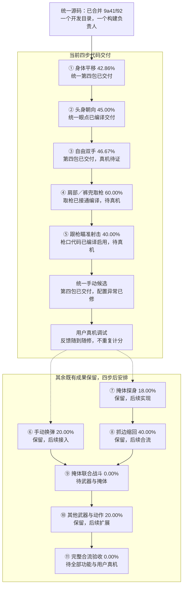

## 2026-11-06 13:39 67624 Group review and game continued: C rules passed, double-check failed

Fixed entrancev 71 No change: hold on to the head and keep running, one turn after first actual release 3 seconds, then pull off. Normal closed-quantity private 125544 The first execution was passed, but the second C grip failed (token)12 Ambiguous. No false timing defects or repair.

Do not restart the game, same 67624 Keep holding on token.13/14 Two different versions of the original enemy execution, restoration of authority shooting and suspension/B return pass. Read-and-read observation has not failed to eliminate it; it does not relax protection from handouts, prescriptions, identity and monographers.19 Double-Stamp Full Page Range and 8 Zhang action view; start engagement 3 The third person in seconds claims exposure, complete alignment/hands/walking/HUD is still incomplete. Game/Native/Input/entry/XR exit normal; two video segments of the code, media retention mission completed. Passive reader failed at last reading on normal unloading (exit).1) Separate records, non-play failures.

The latest three sessions.67624/47468/67428 and 48 Hourly media strategy implemented. All Lancer and entity header acceptances are still incomplete and fixed 11/64 Mature 36.47%，+0.00; no new deliveries were made during this cycle.[solo-lancer-combined-67624-20261106.json](J:/gearsVr/analysis/6dof-progress/solo-lancer-combined-67624-20261106.json)。

## 2026-11-06 12:49 47468 Private matching: correcting the loss of master attitude

Fixed candidatev 71 C holding hands/one-time release 3 Keep the second. This round is privately compiled only for C 0 The master hands closed to the real right Grip.0→1→0 The same control position, weapon identity,36 Bones observation and 28 The CPU constant observation was then opened/closed/open after the Queue/Primary upload.44.55/49.48/54.35 The actual mirror of the second also allows for change.3 Double-Stamp and Full Page Range 9 The Zhang phase has been examined.

The final five-part alignment, natural wrists and all angles are still unaccepted; CPU constant is not hardware-by-draw. Next check model/monster mirroring and actual contact geometry, with an open view, without repeating samples for the unchanged transfer chain. Private observation scripts have been changed to default closing off red debug volume in the hand cover, with a visible scope review still available and user debug function retained.

Diagnosis switch successfully re-compiled OFF, regular Native and internal running directory restored 114342,Purposev 71 Document Hash maintains. Game/XR/record/code is properly completed; media only keep the latest three sessions 47468/67428/71560 and not exceeding 48 Hours. Full Lancer/real machine acceptance is still incomplete, maturity 36.47%，+0.00 Evidence:[solo-lancer-main-grip-ab-47468-20261106.json](J:/gearsVr/analysis/6dof-progress/solo-lancer-main-grip-ab-47468-20261106.json)。

## 2026-11-06 12:18 Master's Posture: Visible coupling failed, correcting the lost postage assumption

Fixed entrances stillv 71: Push to the front end and hold on to continuous running, once after first release 3 Seconds later, pull off. No new candidate is announced this time.

49384 It's...24 The main player, CPU,71560 It's...19 A CPU/Corporate Monpe observation and 67428 It's...18 The CPU constants after the upload of a CPU/Queue/PRIMARY match the closed-handing posture.67428 Maximum deviation of matrix 1.65344e-5；71560/67428- Yeah, I do.1460/1432♪ I'm gonna pass the old certified ♪0 The video still shows that the master hand does not fit the handle, so it can no longer be used as a reason for “disclosed postures lost in these passages” or to equate the source of CPU constants with hardware buffers or actual drawings at each time.5 Double-Stamp Full Page Range,6 The Zhang action profile was checked; the reloading/reactivation of fire/stopping of return passage and non-adoption of hand positions.

Next check the actual GripPoint, wrist and model reference geometry without adding second boneswriters, not guessing corner or repeating unchanged observations. All games/XR/recording/codes are normal end; old generated media are now following the last three sessions and 48 Hourly strategy clean-up. All Lancer and real machine confirmation is still not fixed.11/64 Growing up.36.47%，+0.00。

Evidence:[solo-lancer-private-main-grip-67428-20261106.json](J:/gearsVr/analysis/6dof-progress/solo-lancer-private-main-grip-67428-20261106.json)。

## 2026-11-06 11:02 Internal portfolio review 39172: Move passed, full hand still missing

Fixed start-up entrance still stands **v 71**, retain "C push continues to hold on to running and first actual release and then one after the next"3. No candidate is replaced this time.

Internal freeze 104020 COMPILated: Consumer of original input/publishing person retained by Native for the same Scene, original time stamp and 100 ms limit unchanged; unknown cartridge observation in place 100 The millisecond window allows the previously undelivered pressure to finish the grab when it is deconstructed into a unique log contact.280 And the owner of the Line,25/16 Entry,23 Group Support and 611 The binding check passed.39172 Actual original copy 60 FL R 2 Observation; the line of wood is known to have been physically travelled to the delayed branch of the log and cannot be reproduced as a part of the branch ' s actual running through.

39172 The same game completes the Grip/Finger grab, actual gun turn, each.4 Two-shot, release.4/3 Reactivate single-handed fire; original cartridge index finger and replacement box Grip is fully inserted, the empty warehouse E is real pull/spill/back and resume firing, pause/B back through.9 Double-way timeline and 8 The physical phase of the scenery has been examined;155.02 One second for the VR frame card, and keep it as defective.

**The government has been unable to pass the law by hand:**125.08/205.62 The main hand opens up when the second is changed. E and support stages are in place.36 A primary bone observation matches the gun-shaping posture and is not a substitute for real pixels at the magazine stage; the next step is to check that actual master-care gestures are written into/consumer chains.53016 Action Undo Accurate Source, Old 2572, walk flash/HUD/start third person is still retained. Native/entry/XR/play exit normally; acceptance is not visible for all Lancer and entity heads. **36.47%，+0.00**，11/64 The denominator remains unchanged.

Evidence:[39172 internal portfolio records](J:/gearsVr/analysis/6dof-progress/solo-lancer-private-hand-fit-39172-20261106.json). No more games for unchanged C behaviour, no other guns/conferences/assistants.

## 2026-11-06 v 71: Chainsaw holding and loose-knit

Current Fixed Candidate **6dof-unified-20261106-71**. Push back to the front end and hold on; first real release and then continue again one time 3 seconds; then pull off voluntarily and push again before holding the same hold.

68424 I'm sorry.828 Frame is positioned to specific return: the handle remains valid and held, but the C-C grips are missing from the branch where the cartridge is to be observed. Only the original holding of the handshake has been restored and removed before it is expanded 250 milliseconds of wrong handshake; new contact, actual schedule, completed action 250 msec interface, tracking/identity/release protection maintained.

52548 Same game 11 Division C is cleared:20 Keep the second and turn around, pull it off, shake it up and push it loose.0.43 Seconds still spinning/3.52 The seconds have been stopped, the handle has been seized and actual firing resumed.5 Full page span double-way timeline and 6(a) A physical action view;12 A C-finger observation now matches the exclusive attitude. Compiled, packaged, properly exited, Native/entry/XR restored and configured bytes maintained.

**Not completed:**All five parts fit and natural.69160 The finger's hand entered the exact source of the revocation, old 2572 Accurate source, walk flash, HUD and start third person; no claim that Lancer is completed or physical pass.11/64 Delivery maturity maintained **36.47%（+0.00）**. Next, the current Lancer posture is of high quality and no other guns/conferences/assistants are fired.

Records:`J:\gearsVr\analysis\6dof-progress\solo-lancer-C-incumbent-52548-20261106.json`;starting entrance:`J:/gearsVr/candidates/6dof-unified/GearsVR Launcher.exe`。

## 2026-11-06 v 70: narrow-separated frame of the cartridge, keeping chainsaws holding and loose rules

Fixed access is updatedv 70,Purpose, scale 1 and 4 Second reload configuration maintains original bytes, v 69 Roll back. PG clearly delivers the observation status when current pressure is not ready/ still old; only re-use existing 100 msec is intended to wait. No contact, timeout and identity/tracking/release protection is known.4 And synchronized the production of Native/PG, actual controller GVC 4 No change.

53800 The same game completes the original cartridge index finger and is not unbroken, new clip Grip does not untie, first empty box grabs, actual air silo bolt/disturbing/return; C pushes to hold more than his head 3 Seconds do not stop, then pull off/and shake hard, first release one time 3 Seconds continue/take/reactivate firing.9 Double-Stamp Full Page Range and 12 A fixed action view has been checked, video encoding completed and the Native/entry/XR/play is duly exited. The first script was missing PIL before input, failed and continued in the same game; this round does not re-certify to start the transition completely.

The first silo capture of this run is currently in contact and has not entered the observational branch; it is checked through CPU's old pressure-renewal and negative. Unrecovered cases cannot be considered as proof 2572 The old C hold period is still pending.212.68 The second C finger/surface alignment still needs to be modified; the full attitude of five parts, scintillation by walking, HUD/start third person is retained with waiting cards, physical header receipt and acceptance. Next delivery point: first fix this round 212.68 The actual finger/surface of the sec handle and re-entry of unproven holding period with a first invalid line position is cancelled;2572 The exact source of the missing first airbase frame contact is open. The source code is built into a COHERENTbatch and then centralized, without running C for change.

Growing up.36.47%，+0.00(b) Percentage points;11/64 The denominator and weights remain unchanged, no new count of molecules.`J:/gearsVr/analysis/6dof-progress/solo-lancer-mag-cohort-53800-20261106.json`。

## 2026-11-06 v 69: wood-shaping rotational adjustments, hand-to-hand and saw review

Fixed entrance `J:/gearsVr/candidates/6dof-unified/GearsVR Launcher.exe` Updatedv 69,Purpose/scale 1/4 Second reload configuration bytes, v 68 Returnable. The logs remain the same contact point/hand sign and fixed bone length, with only a fixed wrist around the axis of the gun being turned around.45 Decline to 20 Degrees;real controller tracks, capture range/attribution and firing authority remain unchanged.1016 Adopted.

8368 The Grip/FoP both handheld, moving the gun, each in the actual game 4 The rest of the group will keep their hands open and recover.24 Sub-bone observation against wood preforming, with the average joint most likely to be wrong 0.0000068 degrees; this only proves that the bone shape has actually been accessed, not full-angle surface/comfort acceptance.7 Double-way timeline and 6 The frame view of the log has been checked and the full video coded; the wood is attached to the selected perspective without any previous addition 90 Keep up the wrist axis. C-hold on.20 Second, head move, back pull off/same grab-and-shock push, first one break 3 Seconds continue/take/return to firing, Native/entry/XR/play is duly completed.

Adds a new frozen field to the current stoppage that is not valid for the first service, saves it and then finishes it in its original form, avoiding subsequent uncovering.8368 Record normal renewal period is stop_reasons 256、lifetime_failure 0; last-disarmm may come from earlier events and cannot be considered as the cause of this normal expiry.2572 The continued holding of the early stop and the first airbag box, Neds_release, were not located for repair and the failure to re-establish this round is not a solution.

The next point is to find out why the first airbag box was asked to try again. Source C records leave it for a specific batch; continue Lancer five-point alignment, walk flash, HUD/start short third person and waiting card. No assistant/other gun extension.36.47%current round+0.00(b) Percentage points;11/64 The denominator, weight and weight are unchanged.`J:/gearsVr/analysis/6dof-progress/solo-lancer-foreend20-8368-20261106.json`。

## 2026-11-03 11:07：v 45 Bug-in frame correction with first person shoulder armor

## 2026-11-03 12:48：v 46 Original hint correction delivered

v 46 Development candidate delivered: original Drawaactions & DrawActionInfo suggests using the current object identity context without misrecording the render-only record as an action, Frame;599 Sub-draw/recovery, debt 0。60576(b) Short-checking to retain the gun, cancellation of magazines, opening of fire and suspension;18124 Complete 326.83 Second waist/shoulder,4 The second round of reloading/storage/air storage is passed through the original launch handle.11 Pages Time Axes and 6 Details are available. Hand-type precision, physical cover, start-up hand-to-hand and real machine still not accepted.

Fixed entrance:`J:/gearsVr/candidates/6dof-unified/GearsVR Launcher.exe`。9 V Change files left 45 Back off.751 Distribution document reconciliation, configuration/4 Second reload INI. No new timers, assistants, second-writers or other guns are added.

- 18124: Complete 326.83 Second double-track recording; waist/shoulder firing, turn-gun/turn-over authorization separation, cancellation/insert/stocking/4 The second reward/silo is actually dialed and the original saw is activated.11 Pages 3 Time axis of the second 6 Chang.1280 Px details; not frame-by-frame or real-time.45440 Values/text evidence, the old media has been cut in line with the last three policies.
- 60576: amended for HUD 99 Short check around seconds, physical position adjustment/restoration 599 Debt liquidation 0; gun pick-up, cartridge cancellation, resumption of fire, pause/B return to hold.4* The full pages of the page are available for consultation.2 Zoom details; text moved above the magazine/crash area, but the gun could overlap when raised and the complete HUD layout was not completed.
- Could not close temporary folder: %s 24500 Raw locator DrawText Call 0 No image improved; withdrawn.18124 The actual HUDLocators array is empty, while the DrawActions & Drawaction Info does call. New realization only retains a HUD/role/arms/holder status, which Canvas reads when drawing; no longer uses render carrier without action clock as a fresh hand handle sample or synthmic time stamp.
- HUD original call nesting, partial writing/failure recovery, abnormal exit, external writer protection and existing recall protocols 4 scene and offline 6 The scene is passed. The command error to call the protocol program without parameters for the first time was identified and then used 4 A clear model; failure as a product or evidence.
- Growing up.36.47%,incident+0.00pp；11 Father/64 Molecular items/192 The operational point remains unchanged. No additional points are obtained from the number of repairs or re-checks.
- Next: continue with the same Lancer: batch correction of lower neck/forearms shield and scratch point/finger alignment; first retainer 18124/60576 Video, original skin-skin/contact location position specific defects, recoded and compiled for centralized recording review. HUD tips have been moved up but may still overlap with them; no other guns are parallel or re-routing to cover the deficiencies.

Evidence:`C:\Users\11\.codex\worktrees\6dof-single\gearsVr\analysis\solo-m1-20261028\paired-output-60576-review-receipt.json`;complete process:`C:\Users\11\.codex\worktrees\6dof-single\gearsVr\analysis\solo-m1-20261028\paired-output-18124-review-receipt.json`。

Delivery v 45 Development candidate, fixed entrance still `J:/gearsVr/candidates/6dof-unified/GearsVR Launcher.exe`; retaining replaced v 44 Total 10 The blog is a very popular one.751 Review of distribution documents, original configuration/4 Second reload INI as it is.

- 45440 Same 166.7 Second recording: withdrawal of original cartridges to cancel reloading stocks and resume firing; original bone 4 The actual pull-out is ready to engage a saw gun/head exercise with the same real original enemy. One of these shows a genuine posture deficit, independently certified arms are retained and the power is not stopped by mistake.100 The input of ms, identity, life cycle and gun exchange protection remain the same, inventory entry is still suspended and old pressure pressure is discarded.
- - Oh, Marcus.1 A lod; bone 7/31 Each 562 A hard vertex.814 A triangle, with no mixed weight or cross-arms. Only the local GPU hides two separate shoulder armors;2327 Subreal palette application, writing failed 0...head/eye, arm, bone length, physical and genuine interactive determination of retention.2878 Relevant CPU inspections and 102 Example/1367 The item is checked while running and cannot replace play/real machine acceptance.
- Full read 6 Pages 3 Double window time axis and 8 Chang.1280 Px Key Capture Frame. Original execution video 137.76–140.89 seconds;started with 1.82 Second game capture slot, emulator maximum 100 ms; catch slots are not directly frozen. Full tactical/air storage 4 Second reload and back/shoulder evidence to follow.34208/v 44 There's no rerun set in this round.
- Could not close temporary folder: %s 52368、5264 Layout Experiments and 54304 The parameter was written successfully without removing the actual weapon position text, and the DrawActionInfo experiment was withdrawn from production call/frame-by-frame path. Text covers, neck/front arm lows, finger accurate contact and physical head opening are still incomplete; no complete Lancer is declared available/completed.
- This round resets the old test video/image around with existing media retention tools 8.12 GB, only three last completed sessions; source code, value/text log, archive/audio and back. Early media paths are already cut against the receipt mark, which does not mean that images can still be viewed.
- Growing up.36.47%, this event+0.00pp；11 Father/64 Sub-item/192 The operational points and fractions remain unchanged.`analysis/solo-m1-20261028/paired-output-45440-review-receipt.json`。
- Next: Continue with the same Lancer: verify the actual DrawLocator/DrawText mapping of consumer-based relationships to OwningHD; amend the text covers; then process a close frontal shield based on original skins and actual video. Keep this real attitude frame independently of sawing restoration, same eyepoint/C 0 The handle is determined. No change, no repetition of the actual running, and no parallel guns.

## 2026-11-03 09:33：v 44 Hand fixes and complete Lancer check

v 44 Development candidate delivered: adjust chainsaw grips to the original Marcus skin, synchronize fingers with wrists, and first hint of real empty space.34208 Same 349 Second batch actually completed waist/shoulder firing, complete reloading/cancellation/retest/stocking/4(b) Second prize/air silos for actual mobilization and release, original saw execution and resumption of fire;12 Pages full time axis and 11 Chang.1280 Px capture frame is viewed. There are still close body masks, native text-covered; not complete visual or real machine acceptances.

- Fixed entrance:`J:/gearsVr/candidates/6dof-unified/GearsVR Launcher.exe`；v 44 ZIP generated, saved replaced v 43 Total 10 One file for return.751 Distribution document review, user configuration and reloading of INI as it is.
- The actual video of the execution was in its original form:320.37–323.24 sec. Game capture has 1.97 Second-starting the switch slot, which does not allow for a game freeze; simulator captures the maximum slot 150 milliseconds.
- Separate records of code, compilation, simulation actions, video review and development candidate delivery; complete visual/physical header recognition incomplete. 36.47%,This Event +0.00pp，11/64/192 The scope and denominator remain unchanged.
- Evidence:`analysis/solo-m1-20261028/paired-output-34208-review-receipt.json`;Next: continue the same Lancer close appearance: amend the original text grab cover using a verified source of raw material/skin-positioning. Make up the next set of modifications based on evidence. Keep a single eye point/C 0 The real controller determined that the other guns were not covered by a remodeling position.

## 2026-11-03 08:43：v 43 Development candidate delivered

Delivery v 43 Development candidate: object circulator/container, original bone 4 The saws were activated, the flecked and locked guns repaired, the saws were used with their hands in contact with real blades/a first person in the original version was executed and resumed firing.70472 Actions and videos, normal clean-up passage; accurate hand-styles, close cover and real experience incomplete.

Fixed entrance:`J:/gearsVr/candidates/6dof-unified/GearsVR Launcher.exe`。ZIP：`J:/gearsVr/candidates/6dof-unified-20261103-43.zip`. Roll back:`J:\gearsVr\candidates\6dof-unified-20261103-43-rollback`,Reserve v 42 It's...17 Replaced files.751 The distribution file is reviewed by list, and the configuration and reloading of INI is maintained. Packing has not started the game/ XR.

The code is completed, compiled and developed for candidate delivery; complete visual acceptance of accurate hand/shields and physical header recognition is not completed. 36.47%,This Event +0.00pp；11/64/192 No change. Actual video recording of executions 109.02–112.28- Seconds. See you at the evidence. `analysis/solo-m1-20261028/paired-output-70472-review-receipt.json`。

Next: continue the same Lancer: interactive presentation based on existing video closes, combined natural drawback and existing reload/taw; retained v 43 The development candidate can be withdrawn from the model, not through physical headship inspection and not parallel weapons.

## 2026-11-03 08:35:Lancer fixes

70472 First actual completion of the original saw handle, start-up blade contact with the same enemy and request a copy of the original SM 34/35 The execution and the death of the enemy resumed gun-held/gun exchange and authority fire; normal clean-up passed. The first person to execute said that video footage had been viewed, and the full vision and physical appearance of Lancer was still incomplete.

Complete 138.7 Two-Side Time Axis and 5 The original execution/restoration frame was examined: the original execution took place in the first person ' s claim, ending with a return to the same gun and firing; the watchwork was repaired. Close shoulder armour/foreararms and parts/labels mask still exists. The empty wrist stop after the demonstration was released was too long and turned back after the actual exit point, but the script was rerecorded. The image was sampled, non-full frame/real machine check.

Public v 42 unchanged;maturity 36.47%,This Event +0.00pp，11/64/192 The denominator is unchanged. Next: as validated 082150 Freezing the construction of new development candidates and rollbacks, retaining visual limitations; continuing to adapt close appearances based on existing video, with the next combined recording incorporating natural retreats without restarting or shifting from assistants to other weapons.

Evidence:`C:\Users\11\.codex\worktrees\6dof-single\gearsVr\analysis\solo-m1-20261028\paired-output-70472-review-receipt.json`。

## 2026-11-03 08:21:Lancer fixes

65768 First time, walk through the practice target and actually start the original saw; confirm that the sawing phase is early back past the gun and blade contact movements. The restoration of the same gunholder/original contact adapter has been compiled and returned with permission only to fresh co-source SM 33，SM 34 Other animations are still being returned to the original version; operational review is pending.

Full Viewed 120.9 Two-second video.5 The line of time: stand-by target position, return route to the central steps, actual handles moved and secured, electric power activated visible; sawing positions were not consistent with input, close-to-war interruptions to players did not occur. Close shoulder armour/front arm mask was still unaccepted.

Public v 42 unchanged;maturity 36.47%,This Event +0.00pp，11/64/192 The denominator is unchanged. Next steps: use the same frozen batch to check sawn-gun movements, actual blade contact, original execution/freedom head movement and resumption of gun fire after completion; reuse existing operational windows for diagnosis when entering path problems arise without easing access or identity protection.

Evidence:`C:\Users\11\.codex\worktrees\6dof-single\gearsVr\analysis\solo-m1-20261028\paired-output-65768-review-receipt.json`。

## 2026-11-03 08:03:Lancer fixes

Refixed original AddDecal wrongly revokes the gun permission:41864 The actual originals, the left shoulder Lancer, authoritative fire and normal clean-up pass. It was subsequently confirmed that the practice target was static and that old routes were blocked by sandbags; the ready switch and rectification of available locations had been compiled and the execution had not yet been verified.

Full Viewed 71 Second recorded 3 The time axis of the page: the gun and fire is visible, game corresponds to the simulator eye map; the initial third person claims that a hand-over, shoulder/forearms mask still exists. Practiceing enemy movements and firing cannot be called standby targets; navigation is blocked by sandbags without opening up chainsaw contact and execution.

Public v 42 unchanged;maturity 36.47%,This Event +0.00pp，11/64/192 The denominator is unchanged. Next step: verify the compiled practice target/accessible correction, complete original chainsaw contact, animated and resumed fire; retain contact/wall/identity/a trigger protection without reruning unvariable bullets.

Evidence:`C:\Users\11\.codex\worktrees\6dof-single\gearsVr\analysis\solo-m1-20261028\paired-output-41864-review-receipt.json`。

## 2026-11-03 06:38：11124 Merge video doubledisk, actual high resolution output confirmed

Full body/shoulder shot authority, head gun independence, reloading/discarding/stockkeeping,4 Seconds perfect, late for normal reloading, space box block, partial dial-up block, full-body set-off release back to fire and original bone 4 The number of the chainsaw handles activated/dismissed/renewal of firing passes.0 Submitted: Box 300 Fill 84 Start the handle.15。

Check yourself.11 Full Time Axes Pages and 12 The original size action frame (non-frame-by-frame) has been improved: the new path is moving towards a better direction, filling and starting handles are no longer forced to the same side; the transition to containment/release is visible. Small parts are covered by hands, with too many images of close shoulder armour and forearm, and prototyping label folding still need to be repaired. The initial third person claims that there is still transient contact with XR waiting, and the real enemy is executed undetected. Values are not seen through visual or head-over.

scale 1 Actual GPU Read Back to 7320×3200(PPM Head and 70272017 bytes) XR actually assigned two 3660×3200 Eye image chain; this is the simulator size evidence, which is not modified for AVP real machine acceptance. Native cleanup/entry back through and XR exit with starter 0, the video code is finished.42 Unreplaced, mature 36.47%, this event+0.00pp，11/64/192 The denominator is unchanged. The next step is to narrow the close shouldernail/forearms shield and carry a gun label based on current eye/bones data saved, without any new round of guessaring hand-types or automatic matrices being pre-delivered and running without changes.`C:\Users\11\.codex\worktrees\6dof-single\gearsVr\analysis\solo-m1-20261028\paired-output-11124-review-receipt.json`。

## 2026-11-03 06:14：43524 Merge video doubledisk, actual high resolution output confirmed

Full body/shoulder shot authority, head gun independence, reloading/discarding/stockkeeping,4 Seconds perfect, late for normal reloading, space box block, partial dial-up block, full-body set-off release back to fire and original bone 4 The number of the chainsaw handles activated/dismissed/renewal of firing passes.0 Submitted: Box 297 Fill 82 Start the handle.16。

Check yourself.11 Full Time Axes Pages and 9 The original size action frame (non-scene-by-frame) is clearer than the previous one; clearly folded wrists, parts are covered by hands, and too many images of close forearms and chest armour remain to be repaired. Initially, a third person claimed that there was still transient contact with XR waiting times, and real enemies were executed undetected. Values do not represent visual or head-to-head approval.

scale 1 Actual GPU Read Back to 7320×3200(PPM Head and 70272017 bytes) XR actually assigned two 3660×3200 Eye image chain; this is the simulator size evidence, which is not modified for AVP real machine acceptance. Native cleanup/entry back through and XR exit with starter 0, the video code is finished.42 Unreplaced, mature 36.47%, this event+0.00pp，11/64/192 The denominator is unchanged. Next step is to fix the same Lancer object alignment, wrists and mask without repeating a change in operation.`C:\Users\11\.codex\worktrees\6dof-single\gearsVr\analysis\solo-m1-20261028\paired-output-43524-review-receipt.json`。

## 2026-11-03 05:26：16328 Full digital link passes, hand-caring and guide appearance still need repair

This round actually runs through the waist/guns, turns/stand alone, cancels the box, reloads new boxes and discards, late to normal rounds,4 Perfect re-loading of the second, continued firing into real empty space, unlocked plugins, half release un unlocked, full body dialling/release/restoration of fire and prebone 4 The chainsaw handles the arc, the turn-off, the break-in and the resumption of fire. Three new positions are actually entering C.0:Box 310 Loads, times 83 It's the original handle.15 Once again, the amended access is no longer a mere request.

Full contract 325.5 Two-second video is coded;11 Full Time Axes Pages (Pages)3 sill sampling) and 9 The original handle is visible and open to institutional action, but the hand/finger alignment of the object is not credible; hand-held hands cover the institution with a thicker forearm/brain, yellow frame thin and masked, original Playground tag folding. Initial third person names/waits on video contact, and 39 The second desktop waits and the simulator retains a momentous image of the game. Numerical processes pass, the whole vision is out, and real enemy execution/head-to-head feeling has not yet been accepted.

Next batch of hand fingers that are only fixed to the same Lancer, shielding the yellow box of current steps, retaining a complete machine/ammunition/cancellation recovery process that has been moved, and not running again without change or firing multiple rounds. Native clean-up, exit restoration, XR exit with starter 0; running/coding residue without own. Open v 42 Unreplaced, mature 36.47%, this event+0.00pp，11/64/192 No change. Evidence:`C:\Users\11\.codex\worktrees\6dof-single\gearsVr\analysis\solo-m1-20261028\paired-output-16328-review-receipt.json`。

## 2026-11-03 05:13: physical handle static geometry ready; capture interface re-engineered and compiled

57196 Recorded and reset all images in the same cycle 4 Time axis page (per 3 Scanning in seconds, not frame by frame.8 Number of value results adopted, original block 4 The static physical matrix is ready for the first time; but failed before we grabbed the cartridge, new gesture C 0 Submission still in progress 0. The close-covered, original label superimposed and initial third person interlocking is retained without the whole batch passing.

Determines that the read-hand-only search calls current when the cross-arbitration holds the Clenent door, triggers re-entry protection and cancels publication. The embedded query has been removed, maintains current source protection for double-reading matrix/object identity and common actions; does not relax time limits or exposure thresholds. W flips after the original decode has also been amended, with the original handle CPU 190/0, Native/PG compiled successfully, frozen`equipment-controls-prepared-20261103-051151`. The latest source code is yet to be reviewed in a complete and purposeful joint, public v 42 Not replaced, entity not accepted.36.47%, Event+0.00pp，11/64/192 No change. Normal exit/Native clean-up/entry recovery/XR exit 0 All confirmed. Media is reserved for the latest three rounds, and the old generation media are now engaged in this cleanup 0.87 GB, source document/log/assets unamended.

## 2026-11-03 05:00：17552 Double-photo reset, actual functional failure has been transferred to fix

Steam has recovered from the outside and this round has successfully entered the game. Actual waist, gun-shot, rerouting, fixed-directional, original cartridge cancellation and resumption of fire obtained numerical evidence; no new magazines were removed after a second round 3→4, complete process failed and has not reached the new loading point and original chainsaw handle.5 Full Time Axis Page (Page)3 The focus frames are checked and not received by frame.0 Commit as 0 Not valid for handband adhesion; the original handle is always the same as 0。

Source code has been identified and modified: error ratio of two coordinate version fields, unnecessary decode writing of the static handle, failure to read temporary frames triggers resource release. Follow-up is still required to check the original decoded path and remove new magazines, with only one purposely combined review done after full batch compilation. Close cover, yellow box overlap and label are listed as visible defects. Native normal clean-up, exit restoration, XR exit.0; these do not amount to playing by the game. Open v 42 Not replaced, entity does not appear to have received or accepted.36.47%, this event+0.00 pp, fixed 11/64/192 Evidence:`C:\Users\11\.codex\worktrees\6dof-single\gearsVr\analysis\solo-m1-20261028\paired-output-17552-review-receipt.json`。

## 2026-11-03 04:34: cuddle-tip patches compiled; Steam waiting to change

The previous target wheel is effective: original driver/triple grab integration, compilation and CPU geometry, and positioning to the pre-injection birth of Steam hint. This round rereads real Steam processes and registration information, which are still inconsistent; no new restart permission, no restarting games. Independent source review found that a bulletbox grip may have been tied in advance of the creation of old parts long enough to lead to subsequent attachments.7 cm border continues to be rejected. The component has been changed to actually save the deviation at hand and completes the binding of registration/life cycle/world/reference space/input/hand-held/left-tracking sources; uncut manual failure clearance; filling gestures only use actual loading leases. PG compiles successfully, Native remains unchanged; no new tests or reruns have been added.`equipment-controls-prepared-20261103-043444`. Videos or real machines in the game have not been confirmed, open packages are unchanged and maturity is obtained 36.47%current round+0.00 pp. The current user is still authorized to restart the original Steam or the client is able to restore the client itself, and then do the same complete Lancer batch recording.

## 2026-11-03 04:26: Code compiled; video blocked by original game starter Steam

The original model interactive map has been updated to `docs/diagrams/lancer-interaction-map-20261103.png`, identify the original Receiver, the original saw handle and the location of the withdrawn temporary zip. Three visible hand types, wrists, most of them 3 Cm position correction with 120 The ms transition is already C-C.0 Boneswriter; independent physical hand palms for original arc-shaped actions, unmodified. Native/PG compiled, original handle CPU 186/0 Pixel/arc passed, original bone geometry 4228/0; the game's internal and external appearance and headlight acceptance are still pending.

This round first fixes the visible selection of multiple files for private cases, without moving the real user settings. Also fixes pre-screening query error reading public simulator configuration: latest pre-check confirmed as scale 1♪ Every eye ♪3660×3200 Eyes.7320×3200;not a validated GPU output. Actual game 4188/46540 None loadedd 3d 12/dxgi，46540 The original text of the reminder, “Neative to execute Steam for play”, is not activated and normal WM_CLOSE has been completed without any trace. The actual discrepancy between the Steam process and registration path/PID is a observed thread that has not yet been repaired or declared as the only reason. There are no changes to the STetam registration information or restarting the client; according to the borders where the user had previously operated only on the simulation handle, a request has been made to reopen the client's permission once, or again after the user wakes up.

No new video currently available for claimable adoption; public v 42 Not replaced. Total maturity 36.47%, this event+0.00 pp, fixed 11/64/192. Next step is to record the same consolidated recording only after the client has recovered and no change is repeated; the original first person claims to be handing over/low-out/shield risk retention.

# History:6 DIF 1237 Detailed Implementation Table v 2

## 2026-11-03 04:08: The whole series of codes for the original saw handle and objects to match hand gestures have been compiled and are awaiting video recording on the same round

The user indicates that the grab cannot be a general fistshake, and then authorize to continue during sleep. Add visible hand/ wrist patches: box hold, filling agency grip, original horizontal chainsaw handle ring; selection is only made after the actual current object Grip lease has been established.3 Cm, over.7♪ And don't suck, about ♪120 ms enter/release transition. It connects to the original single C 0 Bones writer, do not modify controller input; V 4 Read both visible hands and independent unsorted physical palms, which are read by the saw to avoid visual adsorption of a false pull. Fixed bone length, LOD, identity/time limits/stocking/restoration protection reservation.

Old b-r-r-r-r-r-r-r-r-r-r-l-d-r-n-r-r-r-r-r-r-r-r-r-r-r-r-r-r-r-r-r-r-r-r-r-r-r-r-r-r-r-r-r-r-r-r-r-r-r-r-r-r-r-r-r-r-r-r-r-h-r-r-r-r-r-r-r-r-e-m-r-r-r-r-r-r-r-r-r-r-r-r-r-r-r-r-d-r-r-d-d-d-d-d-d-d.4 The original handles are to be arc-drived by the real axis; the hand arc and actual original bones must be in place before applying for the original chainsaw action.10836 The actual dialling/release/institutional return is required in the airlock and the completed tips continue to be withdrawn.

Native and PG compiled successfully, frozen`equipment-controls-prepared-20261103-040722`;original handles CPU 186/0, adhesive/restoration and arc action check passed, original model C 0 Geometry 4228/0. An old Core device ABI failed to read 49 The following failed, the original record is kept and cannot be traced back or currently passed; the new geometry check clearly uses only real reference bones and synthetic hand targets. The current batch has not yet been physically run or visualized, open v 42 Load not replaced. Progress caliber 36.47%, this event+0.00pp，11/64/192 No change. Next: One standard price 1/3660x 3200 paired recording: tactical/empty original receiver charge plus contextual hands, original bone 4 chainsaw lever, release/recovery and authoritative return fire; inspect actual game and simulator output before promotion. Repair the concrete first failure, no per-helper game launches.

## 2026-11-03 00:02: Correct the original widget identity by user image; interactive diagram and AVP size configuration

Users request to see all Lancer interface points, question the yellow box and indicate a horizontal chainsaw handle. Original export Hash df 356ff 3...vespect independentb_AR_Chainsaw_Handle has 685 Top Point 2230–2914;Receiver/Receiver_Spin is a separate bone group. The small end cap next to the old loading point 18 The top point is ROOT, which cannot be independently loaded by proximity or name. The extra pull handle is currently designed as a temporary VR and not an original evidence.0 Geometrical mapping and review of interactive maps:`docs/diagrams/lancer-interaction-map-20261102.png`; follow-up corrections to grab points/actions are still pending and running, not declared completed.

67404 Successful patrilineal binding, actual submission/consumption 2 Morph, but regular blades are split.0; the user is out of the game because of the original blade material.0x 13a 3c 0 In the vtable method equals 0x 35b 9a 0 The inside branch, the entrance detour, will be bypassed. No re-routing continues.000102 Public v 42 No change; not a finished rip.67404 Full-time line 7 Page 3 The second interval) has been observed, without frame by frame, close cover, start third person / waiting card and left eye display are kept separately, run unsuccessfully and Native ends unverified.

New user instruction overwrites old 0.4 Dimensions: private starter scale 0.4→1, the simulator every eye 1280×1400→3660×3200(AVP panel size simulation; expected eyes)7320×3200; only old private startup resolution keys are restored without touching the real archive/user desktop. The official manual candidate is already scale 1;entity OpenXR continues to use its own recommended size. XR/play is not started, and does not claim actual output validation. Backup and reply`C:\Users\11\.codex\worktrees\6dof-single\gearsVr\analysis\solo-m1-20261028\owner-avp-resolution.json`. The maturity 36.47%, this event+0.00pp，11/64/192 No change.Next step: reacting the original Lancer part happening: moving on origami heated Receiver, chainsaw action on an original Chainsaw_handle instead of an assessed extra cod; fully empty empty egypty/release/retruing and custom withdrawal./animation correspondence before implementation, then one coherent combined scale 1/3660x 3200 check. No small-cap Morph activation or unchanged run.

## 2026-11-02 23:17: side handle partition drawings are connected; original dynamic material patrilineal correction has been compiled and no new transformations have yet been implemented

Original data identification 18 Side handle vertex with 8756 The main material supports Morph, independent.192 The surface saw blades are not supported. A copy of the only read-in canal has been accessed for two original examples, allowing the blades to remain in regular factories and guns using Morph; no changes are made to shared models, actual GPS loads or materials.286 The detached inspection does not represent physical movement.

62556 and 65004 All set 4 Seconds incentive/empty/airbox lock fire/part and full original release/backfire, but module stopped for binding inspection without being submitted to the new Morph.65004 Read-only physical inspection confirmed that both tanks were packaged in original dynamic MIC and Parent returned to the correct source; strict direct guidance was equally rejected by error.231330 The new source code is not running.

62556(b) Independent reversion of inspections is denied because they are not included in the new entrance and cannot be traced back;65004 Complete function/tail branch fixed Hash to verify all returns and Native/Virtual Handel/XR exits normally.62556 Full-time line 8 The page is visible and close cover is still in place;65004 Encoding Process 32900/exec 62584 Confirms that this round is owned and will be completed and reviewed before new parental corrections are tested. No game is currently available.42 No change, maturity.36.47%, this event+0.00pp，11/64/192 No change. Reply:`C:\Users\11\.codex\worktrees\6dof-single\gearsVr\analysis\solo-m1-20261028\lancer-handle-factory-state.json`。

## 2026-11-02 21:59: The experiment was disabled by the side handle Morph, which ran off without raw material Shader;42 Guide to remove reservations

Completed 18 Private Morph input at the original vertex, actual object creation/coupling, actual Recever relative angle and origin FIFO retreat into access;269 Macro/Step,2277 block and 3 The item extraction check is only offline.67012 Unarmed/life cycle before second unplugging 7→8 And protect the hang up. Restore.2.5 seconds;before 4 The sept UI is in effect and cannot be recorded as configuration not connected. This round exits normally/Native/entry/virtual handle resumes, does not reach the loaded, does not pass through the complete process.

67112 The airlock is loaded.4 The second perfect reward/empty/box still locks the fire, and the actual Reciver just moved.0.00101114836 Game exits when playing. The error text of the dump engine is clearly identified as FDeptthOnlyPixelShader, VF=FGPUSkinMurphVertexFactory, VF ShouldCache=0. System 0xc 000000 d and PlayFab, which were from the end of the retreat, are not sufficient to attribute it alone; there is no guess about stack/CFG problems. The original material and shared model has not been replaced. Native did not obtain normal clean-up confirmation and video exit 1, the process has disappeared; XR destruction completed and Game_exited's reply cannot be written as normal recovery.

Two complete video time lines, one each.6/7 Pages 3 Seconds reviewed (non-framework/intensity) and TPS/waiting and close arm/gun mask still in place. No side handle visible movement or physical appearance accepted. Morph path disabled twice before PG construction and Native bound entry, compiled and frozen 215657;no running or delivering. Next step is to check the original example of GPU/division/vertical path only, choosing to retain the raw material and only affect 18 Compatibility of toppoints, save 67012 Enter the hangup gap.

Open entrance remains v 42 Loaded and reset box frame, actual dialing/dismissed/return position completed, all guided 48472 Evidence maintained. Public documents reviewed consistently and matured.36.47%, this event+0.00pp，11/64/192 No change. No running games/XR/recording/compilation; retaining 67112/67012/48472 Media, the rest cleaned and marked as old media by original Helper, source/log/value/archive/roll-back.`C:\Users\11\.codex\worktrees\6dof-single\gearsVr\analysis\solo-m1-20261028\lancer-handle-morph-crash-67112-receipt.json`。

## 2026-11-02 20:39：v 42 Delivery. Reloading complete and de-direction removed.

The unified entrance remains as `J:\gearsVr\candidates\6dof-unified\GearsVR Launcher.exe`Version `6dof-unified-20261102-42`. This installation 193737 Freezed building matching Native/Playground/PhysicalXR to fill in original weapon components from existing white lists; does not pack original game extraction models, private simulators or test media. Original user game path/photoset/altering configuration is maintained by bytes.34 V for change 41 Backtracking. Packs are separated from Python pre-check, full inventory of Hashi and ZIP round-trip verification pass, and packs do not start the game.

Direct removal of the following 48472 Practical video evidence: the box is packed and only a body alert is kept in the empty space; all of it is hidden when the actual dialling, hand release and agency return to position. The remaining cartridges are also uninhabited after completion. Not a new playout was passed, the entity head was not checked.12.9/s Actual Game Flow and Historical Perspectives do not synchronize to continue as gaps.36.47%, this event+0.00pp，11/64/192 No change.

The side handle research is only active.51304 Quitped, not injected into Native/not entered level/unbuilt object; launcher exited 0, virtual handle recovery, no residue game, XR exits when initiating cancellation 1 Read the original version.12 Byte Active Morph and 20 Byte LED array evidence; incremental format, consumer end and life cycle are not certified and do not include guess layouts or shared models. Next step is to continue with the same Lancer side handle and mask without repeating unchanged full-chain tests.

Delivery letter:`C:\Users\11\.codex\worktrees\6dof-single\gearsVr\analysis\solo-m1-20261028\candidate-delivery-v42.json`；v 41 Back:`J:\gearsVr\candidates\6dof-unified-20261102-42-rollback`。

## 2026-11-02 19:57: Auto-disable bullet guide after completion, actual video confirmation

Modify to the user's latest request: no longer reside in the alarm box. The new actual outlet shows the current steps; only the empty container/closure removes the cartridge boxes and keeps the institution box/direction when the empty warehouse is actually loaded; all drawings are stopped after the actual pull, release and return position has been completed. Still a non-permanent line does not add any action or inventory permission.

193737 The blog is a video of the event.48472 The whole process is through,101 The actual gun tracks were sourced in the same way; Native/entry/virtual handle restoration, XR and video exits were normal.328 The full time line of the second double circuit 11 Pages, institutions 8 Pages and two differences 20 For Viewed (not frame-by-frame): approximately 3:30(a) Unboxed after re-barrel;4:30–4:48(b) The removal of cartridge boxes from the empty box and their conversion to institutional tips;5:18–5:22 When the load is completed and the shot resumed, there are no yellow boxes/arrows. The wrist moves with the same body axis and runs live, avoiding a slide of the original script in position and direction.

Side handle 18 Original vertex/16 The face has been extracted separately, not with the next gun.0/UV/colour/repeated data are kept in private; originals have not been hidden or accessed by example, and preparation data or existing Receiver flipping cannot be completed into side-hand animation. Arms/capture masks remain. No new certified Morph is found to write to ABI without adding guess layout/global resource modification.

Public v 41 Unreplaced, entity unaccepted, maturity 36.47%, this event+0.00 pp, fixed 11/64/192. Start a third person/waiting, first person on the two tracks of history claiming inconsistency and low actual yield rate to remain in place.`C:\Users\11\.codex\worktrees\6dof-single\gearsVr\analysis\solo-m1-20261028\paired-output-48472-review-receipt.json`. Next step continues to be visible movement/arms contact with the same Lancer agency, without starting a gun-by-gun parallel.

## 2026-11-02 19:06: The cross-checking of the handle and yellow hint chain is completed, and the visual gap continues to be maintained

40340 Use 184215 Freezing version, cancelled/stocked/released, left cartridges unstuck,4 Seconds can be configured with incentives, space case boxes remain locked, side handles are still locked, full original flip/back-fired, and saw start/cancellation, equipment switching and pause return.97 The actual authoritative firing point is the actual shot, with a consistent source field; normal Native/entry/virtual handle restoration and XR/video exit check has been made. Code/value flow passes without representation of visual or physical acceptance.

Actual pairing of videos 328 Seconds, full time line 11 Pages, institutional intensity 8 Pages, sports differences and overall differences 20 Read; not frame-by-frame. The yellow box, the lifting arrow and the side handle box/directional tip are actually visible and with the gun;4:48–4:54 Visible sidehand tips,4:54–5:12 The arm shield is still visible. The original model has a small side handle.16 The face is tied to ROOT, the current right side handle surface grab drive the original Receiver flip; the independent movement of the handler has not been achieved and cannot be written as a true gun embolism.

185514 Repositioning only the next private demonstration of the rifle surface towards a physical side handle + X, passing off-line trajectory and not yet running; producing binary 184215 Same.60–300 Middle of the actual stereo outlet for seconds 12.85 Group/second, last round 12.87, no confirmed speed boost; XR 90 Hz does not replace the actual presentation. The question of initiating a third person ' s id/waiting and first person ' s image from different histories is still pending.41 Unreplaced, mature 36.47%, this event+0.00pp，11/64/192 Fixed.

The last three rounds.40340/5656/10316 The media has been retained, the old media cleaned up as an existing assistant; the original model location audit JPG has been cleared with a retention strategy and its JSON/source code is still in place and no longer claims that the picture is available.`C:\Users\11\.codex\worktrees\6dof-single\gearsVr\analysis\solo-m1-20261028\paired-output-40340-review-receipt.json`. Next step is to supplement the side handle/institutional visible action and mask, and a whole batch of reviews is recorded; no other guns are extended or user games are operated.

## 2026-11-02 18:44: Yellow interactive frame and handle correction compiled, whole video reconciliation

User Supplement TF 2 The yellow box and loading position guide of the cartridge; then provide side-train/handle reference, require self-checking and no longer hand over this realization to the user. The original model Hash validates and triangulation reviews reveal small handles 16 Face bound ROOT; previously the original Receiver's upper-side grab point was not a standalone handle. Exposure/private demonstration has been moved to the actual side handle external 5.066,32.50145,9.42102. Keep the original flip-filling body ' s real action/show/back check; independent handler animation is not confirmed and cannot claim that the true bolt movement has been completed.156 The original surface boundary is generated with the yellow frame of the actual gun and the pull/insert arrow; the space storage unit shows the box and dial direction, suggesting that access/stocking/fire-fire permits are not granted.

10316 and 5656 Two rounds of old scratch points passed through the full process.93/98 The actual gun tracks were sourced in the same way; full time line 12 The differences between the pages and the campaign have been reviewed.5656 Alternative 8 The text is also available on the web page of the Working Group.60–300 Middle of the actual stereo outlet for the second window 11.85/12.87 Group, fluid per second; XR 90 Hz is not a separate game output. Continuous inter-entry access and double check check is done; this query local identity is closed before all originals are finished.8590 Checks for metadata and other data 42 A client case passed.

184215 Freeze 985 Start of file and current compilation 40340 The whole video, which has not yet been announced.41 Unreplaced, mature 36.47%, this event+0.00 pp, fixed 11/64/192 No change. There are still side-skin appearances/motion, masking, low-out maps, mid-history TPS/different first person and actual PP SM 34/heads up to check and check.`C:\Users\11\.codex\worktrees\6dof-single\gearsVr\analysis\solo-m1-20261028\side-handle-guide-batch-progress.json`。

## 2026-11-02 17:19: Starting the handle/transaction and “Fixer-See-System” has been achieved in batches, but it is not possible to get a better picture of the body.11872 Full chain passed, showing appearance unaccepted

42608 First subdivision later sample clearly starts with the handle.28.5057 The blogger says that the government is not a good idea.19 And actually pull it out, but get 15 Refusal to enter continuity before dispatch of original power; different from 68088 Stop after startup. The static starting handle then combines three original transformations that are fully identical to the transformation into a rigid one (in which case, the original conversion is not a single conversion).2112 Retains the vertex by word, index/material partitioning, border outsourcing) with three actual pull/reverses remaining independent; retains original components, physical matrix reading back, contact/owner/cleanup. The first hand-over completed by a ripping point and updated shows that it is not relaxed 100ms/50ms/250 Ms rule.44580 The chains passed, but the first token was caught.2/decision 12 lease 0/sample 2 Failure, so the whole round passed.1:46.732 The reason for the co-capture of QPC is not confirmed.

As the user requests, simulation moves first turn around the barrel side and keep the gun mouth in direction, then look to the actual body, then move/release; pull a bolt no longer resets the cartridge positions, and then reread the actual contact position. Real play is still controlled by player handles without forcing automatic turn-off. Keep all physical geometry and ease check until the same authorized load/stamp input is shown on empty starter.

165036 Freezing source 11872 Full controlled process passes: menu/first person called takeover, backshot/shoulder/head move without changing gun authority, trigger handle/SM 33 Maintenance/cancellation/returner, cancellation of original cartridges, discard/release retrieving, regular/4(b) Perfect change of second, continuous emptying, still flame retardation in the empty warehouse box, partial pull-in locks and full body pull back fire after release;92 The value is recorded separately from the image/headlight.3 Second total time line,20 Group movements,8 Page 0.75 The sept action chart has been reviewed and not received on a frame-by-frame basis;1:48–2:01 and 5:32–6:03 The first-hand gun/watching body/cracker is available, but general finger contact, partial institutional cover and close cover/tips remain unchanged.4:09.747 Desktop waiting card while XR retains first person 's name (recent catch difference)16.6663 ms); start TPS/SBS, low-out, historical TPS and actual PP SM 34 Not resolved.60–300 Middle of the actual 2 seconds game independent stereo 11.83/ sec, cannot be recycled with XR 90 Hz is fluent.

Normal exit, Native/entry/virtual handle restoration, XR/video exit 0;detected externally 62248 Manual process, only offline source/compilation, without stopping or controlling it. Media retain 11872/44580/42608 Three most recent; old 48508 Open V.41 Unreplaced, maturity 36.47%, Event+0.00 pp, fixed 11/64/192 No change. One by not closing 50708/44580 Capture lost 68088 The next step is to reduce the physical display/performance and exposure to visual defects, without adding new guns or reruning the process. The overall objective remains incomplete.

Reply:`C:\Users\11\.codex\worktrees\6dof-single\gearsVr\analysis\solo-m1-20261028\human-presentation-11872-receipt.json`;full double-track video:`C:\Users\11\.codex\worktrees\6dof-single\gearsVr\analysis\solo-m1-20261028\menu-firstperson-11872-165432\dual-output\paired-output.mp4`。

## 2026-11-02 15:53：48508 Full process passed but not synchronized; SPU sampling is unavailable and equipment phases are compiled and broken down

48508（152800 Data check of the fully controlled firing/replacement/starter -- original power -- release/return chain passed, actual gun tracks 93 All sources are consistent; not covered 50708 Second unloaded cartridge failed or 68088 The power kept failing.308.13 Two-second video.11 Pages 3 Second full time line,20 The group movement differences and anomalies were reviewed and not accepted on a frame-by-frame basis.2:01.665 Same capture of QPC, desktop waiting card, emulator to retain first person;ticket 1483 Source age 108.5923 ms, confirm again the display difference, not a third person. Start TPS/SBS, low-out map, close cover/tip/cap, and FP SM 34 And the head-on experience is still not complete.

For prepositioning PG 14.9 ms, equipment 40.3 ms, try using the example of a separate name WPR 12 scrutinized CPU sampling;starting is returning 0xc 5585011(No systematic sampling strategy enabled), no sample was obtained, no system strategy changed or the game interfered. Normal operations continue to close and it is confirmed that the name WPR is not in records, Native/entry/virtual handle recovery, XR/video exit 0. The function address Map has been saved and the texture of the mative/PG machine code fields around the re-linking is consistent; this preparation cannot be considered a performance repair.

154020 Compiled, further broken down by the largest amount of existing 16 The equipment is retrofitted: draw/saw condition/starter/reload/observers, without changing the order of operation, source/geometric/invalidity authorization and cleanup protection; the current breakdown has not yet run. Next step is to use this subdivision only for specific time-consuming and batch repair, instead of repeating WPR under unchanged strategic conditions, no more testing for micro-optimization of undetected gains.36.47%, Event+0.00 pp, public v 41 No change.11/64/192 The scope remains unchanged.48508/50708/67484 The last three media, old 29292, and the media reference mark is cleared, text/value/source code/archive/roll-back retention.

Reply:`C:\Users\11\.codex\worktrees\6dof-single\gearsVr\analysis\solo-m1-20261028\wpr-unavailable-and-stage-detail-48508-receipt.json`; double-track video:`C:\Users\11\.codex\worktrees\6dof-single\gearsVr\analysis\solo-m1-20261028\menu-firstperson-48508-152932\dual-output\paired-output.mp4`。

## 2026-11-02 15:18 Time-consuming prepositioning PG processing/equipment; no profit from page reading of name withdrawn 50708 Second unloaded cartridge failed to remain

The source code changes retained in this round are broken down only by the stages of a time-consuming exercise with limited quantities,4 Early and maximum 12 A later sample.67484 Full chain of control through,89 A true shot/source consistent trajectory, all clean-up normal; intermediate front processing of later samples 14.899 ms, original PlayerTick 1.339 ms, equipment 40.296 ms, total 57.516 ms. The evidence is located in our processing path and has not yet proven that specific internal functions or the rest of Native is time-consuming.

145053 The test is to change the common name reading to continuous copying in a page.8456 The entry contains a page of protection for border checks to pass; actual 50708 No apparent frame rate gain. Before the second tactical outlet.0→1 Not reached, token 3 decision 12（lease_lost）、sample_failure 2. The old contact or lost authorization cannot be replaced by a success. Production code has been restored verbatim due to lack of revenue 143610 Version and compiled 151144, test source/test/fail video is in 145053 Keep; failure and the optimised causal link are not established. Actual shooting 25 The entire source was identical, sent from the gun and the complete subsequent re-barrel failed.

67484 Double 303.88 seconds,11 Pages 3 Second full time line and 20 The movement is different.50708 Double 165.73 seconds,6 Pages and 20 The group movement differences have been reviewed; they are not passed manually by frame. Two rounds of full-scale candidates for a new stabilization period are missing, and TPS/SBS is activated, close cover/tip/cap 29292 Unsynchronised is confirmed to remain. Native/entry/virtual handle resumes and XR/video exits normally. Next step, using WPR as a proxy CPU function sample, stop guessing for generic name optimization; WPR has been checked for no other current records and no sampling has yet been started.34 And head-over acceptances are not reduced.

Mature 36.47%, this event+0.00 pp; publicv 41 No change. Recently, the media retained 50708/67484/29292, the rest of the old generated media icons are cleared, source code, text, value and rollback.`C:\Users\11\.codex\worktrees\6dof-single\gearsVr\analysis\solo-m1-20261028\tick-cost-and-name-rejection-50708-receipt.json`。

## 2026-11-02 14:30：29292 Full controlled process passed; synchronized video confirmation that the old first person on the desktop/XR is not synchronized and the low-output chart is still unrepaired

135604 Freezing Source/PG 76a 667...has completed the current round of operational operations,89 The whole source of the shooting is consistent and from the point of departure of the real gun.68088 The current cycle of the occasional generator ' s source is not repeated, and all successful paths to add original limited-status fields 0; this does not close the old failure or prove that the failure branch has been repaired. Group identity reads no credible overall frame rate gain.

About 303.55 Second game + actual window video of simulator, QPC alignment; full time line 11 Pages 3 seconds,20 The group movement differences and specific anomalies were reviewed and not manually accepted on a frame-by-frame basis.4:38.747 The same capture QPC: Desktop “WAITING FOR VR FRAME”, XR still shows that there is a first person called Eye. It is waiting card, not a third person. Original limited mirror rejects line ticket 2989 Show source age 106.3011 ms, while caught 15.1348 ms, capture to Precent 91.1663 ms;desktops 100 ms and continuous XR new maps 1 sec/retention 2 The second rule is different, explaining that there is no synchronization here and that specific CPU bottlenecks are not proven. The classification is originally reserved and manually determined without forging a third person's approval; the TPS/SBS is activated and history is not supported.59520 The question remains.

30–295.58 Centered by the actual new eye view of the second window 9.930 Second/second, XR approximation 90 Hz duplicate submission does not amount to a game 90 fps. The image is similar to a high level of time, correctness or head-over. Close arms/breath cover, undocumented reasons on the brown surface, tip-scrap, left hand grab and actual first person SM 34 Still to be completed. Next steps are based on the existing 91 Physical display/output problems for meslink and linear cost evidence; no time limits for moving to Tibetan Cardon, no no change cycle initiated.

Run, XR, video exit normal and Native/entry/virtual handle restored.v 41 Unupdated, maturity 36.47%, this event+0.00pp，11/64/192 The scope and denominator remain unchanged.29292/68088/39316 The last three times,52292 Once the old generation media is cleared with the available assistants, this round cleans up.1419334761 bytes; old reference markers have been cleared and source code, text, values, archive and rollback are maintained.

Reply:`C:\Users\11\.codex\worktrees\6dof-single\gearsVr\analysis\solo-m1-20261028\display-parity-and-full-flow-29292-receipt.json`;full double-track video:`C:\Users\11\.codex\worktrees\6dof-single\gearsVr\analysis\solo-m1-20261028\menu-firstperson-29292-140149\dual-output\paired-output.mp4`。

## 2026-11-02 13:57：68088 Actual 322 Msra handles open bridges passing through; normal turn-gun/turned chainsaw source protected shut down, complete chain not passed

Newly adopted evidence in this round: actual geometric space 322 ms is connected by the existing input continuity to witness bridge, input_bridged_samples 1 The ripper is actually done.19cm，SM 33/ Original power confirmed active; no longer running offline results.33 All of you!0, the original limited number returns stop_reasons 2, previously accepted input age 61.9033 ms. This is a multi-source/life cycle/50 ms affairs/100 ms input and verification, etc., is less than 100 These are not proof of which failure is specific, let alone a direct relaxation of the time limit. The complete reloading does not follow and does not use the previous round to cover the current round.

Compiled 135604 The only act is to give the highest amount of action.32 Line status back to refine source phase, read failure code and established transaction time; control order,50ms/100 ms/identity/epoch/stop/restoration remains unchanged, no new collector/action privileges are available and currently not running.134617 The site ran, but no credible frame rate returns were yet concluded.87.77 Seconds, two windows actually aligned to QPC;3 Pages 3 Second full time line and 20 The movement is not the same as the other side of the world.24.08–30.40 The second is still waiting for the desktop TPS/XR, no new TPS candidate in the Stable Area, history 59520 Do not close. Motion difference/near-covering/tip/caption with first person name SM 34 Keep it going.

This round is normal and has been re-established as a Native/entry/virtual handle, XR and video exit 0. The maturity 36.47%,incident+0.00 pp; the original limited control is retained without declaring stability/vision/headprint completion.41 No change.11/64/192 The scope remains unchanged.68088/39316/52292, clean up older generated media 421640314 Byte tags the old references are cleared, source code/text/value/archive/roll back. Next steps will be to check only the actual first source maintained by this generator and restore the full chain and the established road map.

Reply:`C:\Users\11\.codex\worktrees\6dof-single\gearsVr\analysis\solo-m1-20261028\motor-source-68088-receipt.json`;failure video:`C:\Users\11\.codex\worktrees\6dof-single\gearsVr\analysis\solo-m1-20261028\menu-firstperson-68088-134905\dual-output\paired-output.mp4`。

## 2026-11-02 13:48：39316 Full process re-adoption; reading unimprovised actual exit maps by cold name has been retreated and narrows down to GT body/equipment path

This round is progress: a complete controlled joint inspection with specific performance assumptions,302.81 Two-second video,11 Pages 3 Second timelines and 20 The group movement differences are reviewed; they are not accepted by frame or head.4 The second average/perfect and the airlock actually pulls release through,88 The actual ballistics source was consistent and started with the real shot.30–295.58 Medium bits of second new stereo release 9.93/s, and 52292 It's...9.95/s approach; head 8 Sub-unit position 22.651ms/22.837 ms does not show any tangible gain. The cold-name block reading has been accurately retraced against the baseline and is not retained as a Carden repair.

Read only OS snapshots when active, actual PG log GT 62292 Cumulative CPU 224484 ms, Native consumption thread 38284 Cumulative 29828 ms; this gives priority to GT work, but cannot be attributed to a specific function. Identity-type body is read in conjunction with the existing Controller/Weapon group scan, retaining the original final identity/structure/relationship/mark/table; compile and reread 30 Border passes, current 134617 Build unrun, can't put 39316 The video is assigned to it. Name border check.8423 Repeats unchanged results by not running a new game.

Start treaty.21.58–28.20 The second is still visible on the desktop, where third person /SBS and XR wait; waiting card does not mean a third person. Stabilization is no new TPS candidate, history 59520 Still not closed. Close cover, overlap of white-word tips, capture alignment/motion differences still exist; the actual first person is SM 34 Without coverage, the existing range targets are not Controller, while victims read it and require that they be supplemented by supported original behaviour and must not bypass contact certification.

Normal exit and Native/entry/hand handle restoration; open v 41 No change, maturity.36.47%, this event+0.00pp，11/64/192 No change. The latest media 39316/52292/59276 Keep, clean older generated media 701049311 bytes, old reference marker cleanup, source/text/value/archive/rollback. Next step is frozen only 134617 The new group is read for a joint check with the process; it continues to be repaired on the basis of real GT expenses and visual failure, retaining the complete sequence road map.

Reply:`C:\Users\11\.codex\worktrees\6dof-single\gearsVr\analysis\solo-m1-20261028\mainthread-performance-39316-receipt.json`;video:`C:\Users\11\.codex\worktrees\6dof-single\gearsVr\analysis\solo-m1-20261028\menu-firstperson-39316-133027\dual-output\paired-output.mp4`。

## 2026-11-02 13:05：52292 Full Lancer numerical process passed; two-way video confirmed that the start-up perspective interface and low new image output remained to be repaired

Recorded 302.21 Second complete game window + simulator eyes, physically collecting QPC alignment by WCC; unactivated, moving or adjusting user windows.11 Pages 3♪ The second full time line,3 Page Action Details and 20 Group movements differ, not by frame or entity.21.30–27.45 Seconds still see third person/SBS and simulator waiting for transition; stabilization has not detected a new third person candidate and cannot close history 59520 Or to rule out short flashes.30–295.58 Medium number of secs new stereo release 9.95 Second/second, XR cycle 90 Hz is a duplicate submission; there are differences in the collection pairs in the sports area, and no time series/window capture/performance causes for all sources have been isolated.0.997 Not equal to 99.7%Correct or low delay.

Source code addition of current input with a permitted handle, without geometry or movement authorization and without propulsion/engine; retain 100 The real posturing,7 cm contact, identity/epoch/freedom/time-out protection.28(a) Passes the narrow strategy;311 The ms branch is only passing in offline recurrence, with actual spacing of the current round 200 ms, no false runback. The new frame of previous box access did work and the round was retested early and it was actually a date 0。52292 Complete original chainsaw start/cancellation, change of gun with Grip and resumption of firing, back-to-side/shoring/shoulder-fire/fixed gun turn, de-location/discard,4(b) Second average/perfect and airlock release following firing;90 The actual ballistics were of a consistent origin and the starting point was the actual gun.

Visualization remains off-limits: close arm/brain armor/gun mask, cross-word tips by gun; left hand grabs need to be accurately aligned and steady.273.98 The second screenshot is in squeeze.0→1、284.05 Seconds in 1→0 The material is not a visual inspection.34 The first person claimed execution, wall/one-time recovery and the demonstration of user head is still pending.

This round is normal and has been re-enacted by Native, access, virtual handles, XR and video exit.0 Public.v 41 No change, maturity.36.47%, this event+0.00pp，11/64/192 The fixed denominator remains unchanged. Helper has been retained as it is.52292/59276/58484 Three rounds, clean up older media.343190239 bytes, source code/value/text/archive/rollback.

Next move: Cross-link/continuing out of perspective based on this video and the release of record fixes to distinguish between capture deviations; focus on gripping/shielding/HUD after verification of steady holding, before completing first person ' s SM 34 And in sequence. Evidence:`C:\Users\11\.codex\worktrees\6dof-single\gearsVr\analysis\solo-m1-20261028\paired-output-52292-review-receipt.json`;full video:`C:\Users\11\.codex\worktrees\6dof-single\gearsVr\analysis\solo-m1-20261028\menu-firstperson-52292-123429\dual-output\paired-output.mp4`。

> 2026-10-28 From now on, this document is kept in its entirety as old demand, fractions and evidence files.[Three road maps](6dof-implementation-roadmap-20261025.md)Push: First person calls  ⁇  free hands,  ⁇  touch back/pants for guns; each basic self-measure continues with the next item and user's real sense of skill is in place. All of the following are "new" and four steps continue without waiting for H 1, completely stop simulator and 64 Item/192 The point-of-implementation arrangements are of an ongoing historical nature and no longer serve as a basis for assignment or testing in this round.

<!-- manual-startup-current -->
**Newest Coverage (2026-10-28T 08:02:09+08:00: Unique branch `codex/6dof-single`Source `9e0ad18`; the ninth package has been updated to the same entry point. The new gun is replaced and restored to the actual GT role code; three slots, free hands/barrel and real Lancer hold side moves are visible, equipment transition stability and physical maturity awaiting feedback.31.02%, this event+0.00;completed by[- The board.](6dof-progress-dashboard.md)Yes.**
<!-- /manual-startup-current -->

Dynamic status update:2026-10-28T 02:10:45+08:00; fourth package repairs duplicate configuration and delivery, user real-time waiting, HUD quasi-satellite not accessed.30.23%, Event Incremental 0.00；64 and 192 Maintain the operational point.

Recent direct user requirements (%)2026-10-28T 00:25:22+08:00）：**Two worktrees are combined as a development lead, the first person calls it free hands, shoulder and pants, gun-plug fire; each has been compiled to update the same version for user real machine debugging.** Now, you're going to write code in four steps without waiting for H.1 Feedback. The first unified package is not pre-empted by four steps full or automatic, the compiled results are delivered and the same entry is updated after that. Users are responsible for all games/XR/headprint tests; developers write codes, compile/links, pack packages, do not initiate automatic testing or add new diagnostic doors.

Unified Directory:`C:/Users/11/.codex/worktrees/6dof-cover/gearsVr`; branch:`codex/6dof-unified`. The two branches have actually been merged into`9a41f92`，13 Conflict is dealt with. Both parents are`37de6ef`and`f397f9b`Second bage 38a 2b 2 Access to the gun. Third pack.183cb 10 Refurbish the manual start-up of environmental doors; four-step code/compilation results vary from machine to machine.

Body only maintains shared Native/Choose/Bones and has the exclusive possession of Git temporary storage/submission, integration and packaging; Weapon only writes directly agreed stand alone equipment/spot/gun-held/fired consumers. Both parties use a single catalogue later on. Old Weapon directories, history and old candidates are retained back, and the master directory is not submitted to support uncompleted tree cover. Existing repair and original integrity requirements are maintained.

Fixed access:`J:/gearsVr/candidates/6dof-unified/GearsVR Launcher.exe`。**The fourth bag was packed:6dof-unified-20261028-4(The fixed entrance has been updated).** [Starter](</J:/gearsVr/candidates/6dof-unified/GearsVR Launcher.exe>)；[Full description](/J:/gearsVr/candidates/6dof-unified/CANDIDATE.md)First person claims that the free hands, shoulder/pants RT Grip and Lancer gun openings have been plugged in and finished. Fourth bag retains the active Lancer VR firing in the actual direction/shoot/hand perception of the user ' s real machine. HUD-associated star has not yet received new rays; left hand-to-hand tracking has led to unknown 's suspension of fire, and normal single-handed holding is still allowed. The old candidate and ZIP are back on the table.

## Current order of implementation (v)69 Overrided)

1. Check 2572 First break of the first airbag box, Neds_release: actual release/new pressure with Native arbitration/delayed observation logs, fix specific sources without re-routing or re-examining. C Initial service failure records are repeated with the next necessary batch and do not run repeatedly for no new change.
2. Continue with the same Lancer five-point alignment/reverse wrist, walk scintillation and HUD/start first person; use existing data and a centralized recording without restarting for each small point.
3. Reservations v 69 Hands on each side.4 Single-handed hair and loose hands; C push running on a continuous basis, with the first actual one-off 3 seconds, after pull off;v 68 The single-eyed focus of executions continues to be maintained.
4. The current Lancer is completed and returns to the reserved menu X/hand grenade locking and other gun routes; no assistant/other session/parallel new guns.

### Historical Implementation Table (Hyctic Performance Sheet)2026-10-28, is covered by the order above)

| Order | Current code state | Next |
| --- | --- | --- |
| 1 First | Harmonization of the fourth package delivered | User-based observation, modified by feedback |
| 2 Free hands. | Harmonization of the fourth package delivered | User check independent location/complete rotation and naturality |
| 3 Shoulder/pants rounding guns | Normal entrance is connected and compiled for delivery | User RGrip collects actual weapons in stock; armless display first makes real Tpose |
| 4 Fire! | Lancer gun code compiled and enabled in fourth package | Users check direction/bulb; HUD-associated stars are not receiving new rays |
| Unity of candidatures | Delivery 6dof-unified-20261028-4 | Update with subsequent entry, old bag is reserved for retreat |
| It's a real thing. | By the user | Do not use source code, merge or compile as a play method |

## How to take into account the big progress

11 The right to continue with the big nodes.14 Item 2,12 Item 3 18 Item 7 20 item, average power in the internal sub-sections of each major point; remaining 7 This time, no big points will be opened and the original tranches will remain.192 An operational point is used to execute the error between the item and the judgement, and no separate points are added. The unknown item does not receive a score but it is clearly marked “foreseeable” on which the code cannot be asserted that it does not exist.

Like three of those little things.40→60 Three more.20÷18=1.11 Percentage points, total increase 20÷18÷11≈0.10 Percentage point. No more waiting for the whole 3-way 60 Jump to 80 Only when changes are seen. The old evidence that is newly discovered is marked as “recognizing evidence”; the new run is marked as “new results”.

| Fractions | Evidentiary requirements |
| ---: | --- |
| 0% | There is insufficient evidence to verify the stage of realization of the sub-section; unknown and clearly identified markers are not equal to determining that there is no code. |
| 20% | A relevant achievement or connection to a positionable location already exists; this small action has not yet formed complete offline passage. |
| 40% | The core realization/main module of this sub-item is targeted offline evidence or partially run, but the action as a whole was not passed. |
| 60% | A clearly limited action is passed and properly closed with the purchase of version + controlled simulation; a record of candidate and range. |
| 80% | The action is passed by the same deliverable candidate, with both eyes visible, necessary for return, start-up exit and operational instructions. |
| 100% | The local validation and physical head-over approvals required for the sub-item were passed; only actual actions were covered by a short check. |

Update: The table above and the “controlled simulation/offline” in historical evidence describe that no automated rerun is authorized. In future, evidence of behaviour for the same player action is provided by a head-check of the user entity and recorded on the basis of actual coverage; source code and compilation results support only the corresponding stage of realization and cannot pass as an act.

## Current source code and candidate evidence

Merge Submission 9a 41f 92 Reservations 37de 6 ef and f 397f 9 b Two histories; old first person ' s handbags delivered and first package unified delivered.38a 2b 2 Connect and compile delivery; currently awaiting specific real machine feedback; user-real device confirmation of alternate logout cannot increase maturity by consolidation.

## Implementation and acceptance of each sub-item

The following three actions are carried out sequentially, defining the range of adoptions for this subparagraph together; they cannot be adopted for the whole item by just doing the first one. The old evidence only retains the part that is already written and the new candidate/assembly action referred to in step 3 still needs new evidence accordingly. The full set of acceptances is not complete at present.

## 1 Around, moving up and down:42.86%

14 Sub-sections, each internal weight 1/14 The big node is the whole thing.1/11。

| Numbering | Minor | Current | Prefix | Current certified and gap |
| --- | --- | ---: | --- | --- |
| B 1.01 | Set the correct physical neutrality benchmark when entering the game | 60% | Pre-established scene | The same physical position captures eye points, head, pelvis and feet, the body and hands for continuous submission; fixed standing and small area of head movement. |
| B 1.02 | Realism is the same distance, the same direction. | 40% | B 1.01 | Six-way conversion offline; no model bone distance impersonating human dimensions, the latest concourse still pending against the game. |
| B 1.03 | Body follows when moving right | 60% | B 1.01、B 1.02 | Old B 9 Shift right 3 cm controlled body is read-backed; it does not equal the latest benchmark or natural mass cross-sectional passage. |
| B 1.04 | Follow the body when moving left | 60% | B 1.01、B 1.02 | Old B 9 Shift left 3 cm passes; the right move cannot replace the left acceptance. |
| B 1.05 | When you actually lift your body, you move your eyes and bodies up. | 60% | B 1.01、B 1.02 | Old B 9 Up 2 cm passes; the full amount of natural rises is not within the old range of this item. |
| B 1.06 | When you actually lower your body, you move your eyes and body down. | 60% | B 1.01、B 1.02 | Old B 9 Down 2 cm passes; full range of bottoming and shelter cover is tested separately. |
| B 1.07 | The distance and direction of the exterior and forward. | 40% | B 1.01、B 1.02 | The six-way horizontal adaptation has been offline; the old run at the first three nodes did not form the full pass of the previous movement. |
| B 1.08 | Only once the tilt and group offsets are applied | 40% | B 1.03、B 1.04、B 1.05、B 1.06、B 1.07 | The adaptor and backfill offline results are maintained; the latest trans-shipments and lifts are still pending. |
| B 1.09 | Head and pelvis relative motion. | 60% | B 1.01、B 1.02 | Old B 9(b) Limiting small motion to head/pelvic response;14 The single point does not justify the new neutral benchmark in its entirety. |
| B 1.10 | The upper body and the shoulder positions allow normal arm length. | 40% | B 1.01、B 1.09 | The fixed arm length and body search for delineation base exists; the latest visible stream of cameras/shoulder/hands is not passed. |
| B 1.11 | The foot restraints are not quietly broken when the body moves. | 40% | B 1.09 | Fixed foot and complete output playback passed; actual natural postures and final images are pending. |
| B 1.12 | The body benchmark is correctly moved when the original person moves | 20% | B 1.01、B 1.09 | The baseline handling connection is located; no full results are available for the current set that remains correct after actual walk. |
| B 1.13 | You can't jump after you've returned or tracked the reference changes. | 40% | B 1.01 | Offline reference rule and controlled control are reinstated; HR does not prove that HMD/hard reference changes were fully passed. |
| B 1.14 | Gradually, it's expanding to natural crouching and excursion. | 0% Pending | B 1.03、B 1.04、B 1.05、B 1.06、B 1.07、B 1.10、B 1.11 | There is currently no certified natural full-scale joint adoption;0 It is stated that no evidence was available at the stage of this item and that there were no relevant codes for the assertion. |

### B 1.01 Set the correct physical neutrality benchmark when entering the game

This round of reviews (No.47 In the case of the most recent common benchmark, the neutral stand-off is still pending and will be called upon for real failure.[Hour 47](J:/gearsVr/analysis/6dof-progress/hour47-h1-first-rejection-pending-reviewed.json)。

**Current 40% :: Offline/local evidence.** Head: Bottom of body and bunker. Forward: Preset scene.

Evidence of common benchmarking and single points is available; the real source of initialization to the latest body set has not yet been passed.

1. **B 1.01.1** Fixed station position view, recording original HMD, role, body benchmark and baseline setting.

2. **B 1.01.2** Put the eye, skull and pelvis in the same benchmark; the baseline shall not be taken from the previous frame of superseding deviation.

3. **B 1.01.3** Keep your head still and start moving again, confirming that the first frame does not jump and continues without repeating.

Evidence:[Base Offline](C:/Users/11/.codex/worktrees/6dof-cover/gearsVr/analysis/cover-implementation-20261024/body-goal-view-tracked-receiver1/cpu-1792925368609010900/receipt.json)、[B14](C:/Users/11/.codex/worktrees/6dof-cover/gearsVr/analysis/cover-implementation-20261024/body-live-standing14/runtime-c0-boundary-review1.json)、[Scope review](J:/gearsVr/analysis/6dof-progress/first-three-node-scope-and-hu-reviewed.json). The latest complete stream/entity profile: to be tested.

### B 1.02 Realism is the same distance, the same direction.

**Current 40% :: Offline/local evidence.** Head: Bottom of body and bunker. Forward: B 1.01。

Six-way conversion offline; no model bone distance impersonating human dimensions, the latest concourse still pending against the game.

1. **B 1.02.1** Use a fixed millimeter of rice/play units and axle, upper-down, back-up and forward.

2. **B 1.02.2** The difference in body is filled by a comparison game shift with known centimetres input, without changing the IPD or headscale.

3. **B 1.02.3** Return to the starting point, confirm that conversion is not cumulatively biased; and have a cross-reference rate in the same candidate.

Evidence:[Base Offline](C:/Users/11/.codex/worktrees/6dof-cover/gearsVr/analysis/cover-implementation-20261024/body-goal-view-tracked-receiver1/cpu-1792925368609010900/receipt.json). The latest complete stream/entity profile: to be tested.

### B 1.03 Body follows when moving right

**Current 60% • Limiting the purchase of the version to run.** Head: Bottom of body and bunker. Forward: B 1.01、B 1.02。

Old B 9 Shift right 3 cm controlled body is read-backed; it does not equal the latest benchmark or natural mass cross-sectional passage.

1. **B 1.03.1** Keep your head on the right.3 Centimeters.

2. **B 1.03.2** Check the right movement of eye points, head and pelvis and the same body results.

3. **B 1.03.3** Right move back to your place; latest set of candidate visibilitys.

Evidence:[B9](C:/Users/11/.codex/worktrees/6dof-cover/gearsVr/analysis/cover-implementation-20261024/body-live-standing9/runtime-motion-review1.json)、[Scope review](J:/gearsVr/analysis/6dof-progress/first-three-node-scope-and-hu-reviewed.json). The latest complete stream/entity profile: to be tested.

### B 1.04 Follow the body when moving left

**Current 60% • Limiting the purchase of the version to run.** Head: Bottom of body and bunker. Forward: B 1.01、B 1.02。

Old B 9 Shift left 3 cm passes; the right move cannot replace the left acceptance.

1. **B 1.04.1** Keep it moving. Move left.3 Centimeters.

2. **B 1.04.2** Check left shift symbols, eye spots and pelvis responses without mirror reverses.

3. **B 1.04.3** Left move back to your place; latest set of candidate visibilitys.

Evidence:[B9](C:/Users/11/.codex/worktrees/6dof-cover/gearsVr/analysis/cover-implementation-20261024/body-live-standing9/runtime-motion-review1.json)、[Scope review](J:/gearsVr/analysis/6dof-progress/first-three-node-scope-and-hu-reviewed.json). The latest complete stream/entity profile: to be tested.

### B 1.05 When you actually lift your body, you move your eyes and bodies up.

**Current 60% • Limiting the purchase of the version to run.** Head: Bottom of body and bunker. Forward: B 1.01、B 1.02。

Old B 9 Up 2 cm passes; the full amount of natural rises is not within the old range of this item.

1. **B 1.05.1** Keep the rotations unchanged, and raise your profile.2 Centimeters.

2. **B 1.05.2** Confirms that the up-to-date movement is from a real location input, with the same eye point as the body using the same result.

3. **B 1.05.3** Maintaining altitude and returning to its original position without leaving an additional base eye high.

Evidence:[B9](C:/Users/11/.codex/worktrees/6dof-cover/gearsVr/analysis/cover-implementation-20261024/body-live-standing9/runtime-motion-review1.json)、[Scope review](J:/gearsVr/analysis/6dof-progress/first-three-node-scope-and-hu-reviewed.json). The latest complete stream/entity profile: to be tested.

### B 1.06 When you actually lower your body, you move your eyes and body down.

**Current 60% • Limiting the purchase of the version to run.** Head: Bottom of body and bunker. Forward: B 1.01、B 1.02。

Old B 9 Down 2 cm passes; full range of bottoming and shelter cover is tested separately.

1. **B 1.06.1** Keep the rotations unchanged and keep your head down.2 Centimeters.

2. **B 1.06.2** Recognition of point of view and body decline, without a header/header angle being used to replace height.

3. **B 1.06.3** Back to the original altitude, the check benchmark was not re-corrected at low levels.

Evidence:[B9](C:/Users/11/.codex/worktrees/6dof-cover/gearsVr/analysis/cover-implementation-20261024/body-live-standing9/runtime-motion-review1.json)、[Scope review](J:/gearsVr/analysis/6dof-progress/first-three-node-scope-and-hu-reviewed.json). The latest complete stream/entity profile: to be tested.

### B 1.07 The distance and direction of the exterior and forward.

**Current 40% :: Offline/local evidence.** Head: Bottom of body and bunker. Forward: B 1.01、B 1.02。

The six-way horizontal adaptation has been offline; the old run at the first three nodes did not form the full pass of the previous movement.

1. **B 1.07.1** Keeps the game below your feet, moving forward and back in small amounts.

2. **B 1.07.2** Compare head, upper body and final eye point without turning the probe into a game walk-in.

3. **B 1.07.3** One back and then, confirming that there is no additional accumulation or directional reversal.

Evidence:[Base Offline](C:/Users/11/.codex/worktrees/6dof-cover/gearsVr/analysis/cover-implementation-20261024/body-goal-view-tracked-receiver1/cpu-1792925368609010900/receipt.json). The latest complete stream/entity profile: to be tested.

### B 1.08 Only once the tilt and group offsets are applied

**Current 40% :: Offline/local evidence.** Head: Bottom of body and bunker. Forward: B 1.03、B 1.04、B 1.05、B 1.06、B 1.07。

The adaptor and backfill offline results are maintained; the latest trans-shipments and lifts are still pending.

1. **B 1.08.1** Enter the top-right and bottom-left position first.

2. **B 1.08.2** Compares the results by axis, and the body results are no longer reciprocated to the next frame input.

3. **B 1.08.3** Revert and repeat, cumulative deviation should be zero.

Evidence:[Base Offline](C:/Users/11/.codex/worktrees/6dof-cover/gearsVr/analysis/cover-implementation-20261024/body-goal-view-tracked-receiver1/cpu-1792925368609010900/receipt.json)、[I'm out of line.](C:/Users/11/.codex/worktrees/6dof-cover/gearsVr/analysis/cover-implementation-20261024/full-body-c0-absolute-tracked-receiver1/cpu-1792922639039692300/receipt.json). The latest complete stream/entity profile: to be tested.

### B 1.09 Head and pelvis relative motion.

This round of reviews (No.46 Copies, fractions unchanged: retain the old limit 60%;ad physical target actually submitted not equal to the skull/bone/eye relationship.[Hour 46](J:/gearsVr/analysis/6dof-progress/hour46-first-person-and-h1-runtime-reviewed.json)。

**Current 60% • Limiting the purchase of the version to run.** Head: Bottom of body and bunker. Forward: B 1.01、B 1.02。

Old B 9(b) Limiting small motion to head/pelvic response;14 The single point does not justify the new neutral benchmark in its entirety.

1. **B 1.09.1** The goal eye, skull and pelvis are preserved at the same time.

2. **B 1.09.2** A smaller range of body homogenization is generated by the same input, with a fixed deviation for the head eye.

3. **B 1.09.3** The latest re-cantonment of the affected range avoids full passage by reading at the end.

Evidence:[B9](C:/Users/11/.codex/worktrees/6dof-cover/gearsVr/analysis/cover-implementation-20261024/body-live-standing9/runtime-motion-review1.json)、[B14](C:/Users/11/.codex/worktrees/6dof-cover/gearsVr/analysis/cover-implementation-20261024/body-live-standing14/runtime-c0-boundary-review1.json)、[Scope review](J:/gearsVr/analysis/6dof-progress/first-three-node-scope-and-hu-reviewed.json). The latest complete stream/entity profile: to be tested.

### B 1.10 The upper body and the shoulder positions allow normal arm length.

This round of reviews (No.47 In the form of a copy, the score remains unchanged:41 Group shoulder line/arms long condition analysis delivered; not accurately called, but single-line neutral gestures still failed.[Hour 47](J:/gearsVr/analysis/6dof-progress/hour47-h1-first-rejection-pending-reviewed.json)。

**Current 40% :: Offline/local evidence.** Head: Bottom of body and bunker. Forward: B 1.01、B 1.09。

The fixed arm length and body search for delineation base exists; the latest visible stream of cameras/shoulder/hands is not passed.

1. **B 1.10.1** First, the shoulder lines, head-eyes and characters are aligned in a direction rather than stretching their arms.

2. **B 1.10.2** Check the right-hand target with the same neutral attitude as normal reach.

3. **B 1.10.3** Hands are fixed when moving and cannot reach the target by frame.

Evidence:[I'm out of line.](C:/Users/11/.codex/worktrees/6dof-cover/gearsVr/analysis/cover-implementation-20261024/full-body-c0-absolute-tracked-receiver1/cpu-1792922639039692300/receipt.json)、[Arms are out of line.](C:/Users/11/.codex/worktrees/6dof-cover/gearsVr/analysis/cover-implementation-20261024/fixed-length-receiver1/attempt-1792907100878442400/receipt.json)、[♪ Butt back on ♪](C:/Users/11/.codex/worktrees/6dof-cover/gearsVr/analysis/body-c0-hands-candidate3/B13-reach-replay1/receipt.json). The latest complete stream/entity profile: to be tested.

### B 1.11 The foot restraints are not quietly broken when the body moves.

**Current 40% :: Offline/local evidence.** Head: Bottom of body and bunker. Forward: B 1.09。

Fixed foot and complete output playback passed; actual natural postures and final images are pending.

1. **B 1.11.1** Enter a small area head position change after the reference below the fixed foot.

2. **B 1.11.2** The observation of feet, pelvis and upper body is not intended to be concealed by moving foot or whole person transmission.

3. **B 1.11.3** Keep explicit failure or surrender, without presenting half the result, beyond the current proximate posture.

Evidence:[I'm out of line.](C:/Users/11/.codex/worktrees/6dof-cover/gearsVr/analysis/cover-implementation-20261024/full-body-c0-absolute-tracked-receiver1/cpu-1792922639039692300/receipt.json). The latest complete stream/entity profile: to be tested.

### B 1.12 The body benchmark is correctly moved when the original person moves

**Current 20% • Source code/wiring.** Head: Bottom of body and bunker. Forward: B 1.01、B 1.09。

The baseline handling connection is located; no full results are available for the current set that remains correct after actual walk.

1. **B 1.12.1** First, we get the stand-up benchmark and then we move the role in short slots.

2. **B 1.12.2** The real head moves are then superimposed only as the valid person changes the moving benchmark.

3. **B 1.12.3** Repeat a small stride after discontinuation to confirm that the benchmark is not in the old world position.

Evidence:[Body Source](C:/Users/11/.codex/worktrees/6dof-cover/gearsVr/tools/native-capture/body_goal_view_adapter.h)、[Specification B](C:/Users/11/.codex/worktrees/6dof-cover/gearsVr/docs/6dof-cover-interaction-design-20261024.md). The latest complete stream/entity profile: to be tested.

### B 1.13 You can't jump after you've returned or tracked the reference changes.

**Current 40% :: Offline/local evidence.** Head: Bottom of body and bunker. Forward: B 1.01。

Offline reference rule and controlled control are reinstated; HR does not prove that HMD/hard reference changes were fully passed.

1. **B 1.13.1** List L separately 3 Remedial, track space changes and general controller recovery.

2. **B 1.13.2** The old margin is discarded when reference changes occur, and the head, body and hand references are re-established together.

3. **B 1.13.3** Recheck station and small level shifts after recovery; changes not actually covered continue to be pending.

Evidence:[Base Offline](C:/Users/11/.codex/worktrees/6dof-cover/gearsVr/analysis/cover-implementation-20261024/body-goal-view-tracked-receiver1/cpu-1792925368609010900/receipt.json)、[HR](J:/gearsVr/analysis/6dof-progress/hr-controller-loss-recovery-reviewed.json)、[Specification W](C:/Users/11/.codex/worktrees/weapon-6dof/gearsVr/docs/weapon-6dof-interaction-design-20261022.md). The latest complete stream/entity profile: to be tested.

### B 1.14 Gradually, it's expanding to natural crouching and excursion.

**Current 0% :: Pending.** Head: Bottom of body and bunker. Forward: B 1.03、B 1.04、B 1.05、B 1.06、B 1.07、B 1.10、B 1.11。

There is currently no certified natural full-scale joint adoption;0 It is stated that no evidence was available at the stage of this item and that there were no relevant codes for the assertion.

1. **B 1.14.1** After the small action was adopted, it was scaled up to take into account existing availability and clearly documented support.

2. **B 1.14.2** The first failure of the observation posts, their landings, forward visits and sidewalks stopped the scope.

3. **B 1.14.3** Develop a stable range of support and then give users short-term experience.

Evidence:[Scope review](J:/gearsVr/analysis/6dof-progress/first-three-node-scope-and-hu-reviewed.json)、[Specification B](C:/Users/11/.codex/worktrees/6dof-cover/gearsVr/docs/6dof-cover-interaction-design-20261024.md). The latest complete stream/entity profile: to be tested.

## 2 Physical stability when turning and looking up:45.00%

12 Sub-sections, each internal weight 1/12 The big node is the whole thing.1/11。

| Numbering | Minor | Current | Prefix | Current certified and gap |
| --- | --- | ---: | --- | --- |
| B 2.01 | Neutral direction and eye-turn center right. | 60% | B 1.01 | The actual first person is known to have visible left and right eyes, with access to the centre of the authored head-eye and common body benchmarks;10 Doyaw/6 Cm-Step Shift to 0.15 radians are crooked to the limit of this round. |
| B 2.02 | Turn right and change the direction of observation. | 60% | B 2.01 | Old B 9 Normal yaw+10; complete natural reverses. |
| B 2.03 | The symbol and response to the left head is correct | 40% | B 2.01 | Left- and right-rotation math has offline base; old B 9+10 The results do not pretend to be left-turned. |
| B 2.04 | You don't have to raise your head. | 60% | B 2.01 | Old B 9 pitch +10 degrees and returns; new benchmarks are pending. |
| B 2.05 | Keep your head down, and you don't need to lower your body. | 40% | B 2.01 | The offline check of positive and negative rotations is reserved; the latest game of low-head action, the evidence for both eyes, remains to be filled. |
| B 2.06 | The right twist of the side-drive is correct. | 40% | B 2.01 | Full attitude math passed; actual roll and eyes comfort failed. |
| B 2.07 | Pure rotation does not duplicate body shift | 60% | B 2.02、B 2.04 | B only 9 The small corner yaw/pitch is controlled; the larger corner, roll and the latest stream are pending. |
| B 2.08 | And when you turn around with real flattening, both of them will be preserved. | 40% | B 1.08、B 2.01 | Combining target is offline; real position changes cannot be lost by calling a turn-over. |
| B 2.09 | No residual offset after rotation | 60% | B 2.02、B 2.04 | Old B 9 Passed after normal yaw/pitch; does not amount to a re-initiation baseline. |
| B 2.10 | Turning head and multiaxis without jumping. | 40% | B 2.03、B 2.05、B 2.06、B 2.08 | Multiple sets of attitude travels to mathematics already; current continuous game images are not accepted. |
| B 2.11 | Swing poles to or back in sync with the header | 20% | B 2.01、B 1.13 | Continuous contract source code is repositionable; new real smooth/snap and front-hand body flow check not yet complete. |
| B 2.12 | Expand normal observation angles and validate horizons | 40% | B 2.03、B 2.05、B 2.06、B 2.10 | Broader mathematical domains are offline on a basis, with actual support angles and ultimately visible vision not certified. |

### B 2.01 Neutral direction and eye-turn center right.

This round of reviews (No.47 In the first person ' s case, the switch is valid; ae eyes are still under close geometry and correctly usable view points are not passed.[Hour 47](J:/gearsVr/analysis/6dof-progress/hour47-h1-first-rejection-pending-reviewed.json)。

**Current 40% :: Offline/local evidence.** Head: Bottom of body and bunker. Forward: B 1.01。

Static head-eye positioning and rounding through mathematics; author configuration is not a physical determination.

1. **B 2.01.1** Records HMD observational direction and fixed eye deviation.

2. **B 2.01.2** The rims rotate around the actual eye point, and the staved skull is moved by fixed deviations to the arc and the body.

3. **B 2.01.3** The latest candidate has checked the body for direction, actual first person eye and observation; with real XR eyes, there is no substitute for capability flag or old animation.

Evidence:[Head off the line.](C:/Users/11/.codex/worktrees/6dof-cover/gearsVr/analysis/cover-implementation-20261024/body-head-authored-tracked-receiver1/cpu-1792919063575648600/receipt.json)、[Base Offline](C:/Users/11/.codex/worktrees/6dof-cover/gearsVr/analysis/cover-implementation-20261024/body-goal-view-tracked-receiver1/cpu-1792925368609010900/receipt.json). The latest complete stream/entity profile: to be tested.

### B 2.02 Turn right and change the direction of observation.

**Current 60% • Limiting the purchase of the version to run.** Head: Bottom of body and bunker. Forward: B 2.01。

Old B 9 Normal yaw+10; complete natural reverses.

1. **B 2.02.1** Fixed HMD position, enter+10 Doyaw.

2. **B 2.02.2** Confirm angle to be approximately 0.17453 radians, observation direction is consistent with input.

3. **B 2.02.3** Keeps the back-backing and does not rotate as an additional transverse or body shift command.

Evidence:[B9](C:/Users/11/.codex/worktrees/6dof-cover/gearsVr/analysis/cover-implementation-20261024/body-live-standing9/runtime-motion-review1.json)、[Scope review](J:/gearsVr/analysis/6dof-progress/first-three-node-scope-and-hu-reviewed.json). The latest complete stream/entity profile: to be tested.

### B 2.03 The symbol and response to the left head is correct

**Current 40% :: Offline/local evidence.** Head: Bottom of body and bunker. Forward: B 2.01。

Left- and right-rotation math has offline base; old B 9+10 The results do not pretend to be left-turned.

1. **B 2.03.1** Fixed position, enter-10 Doyaw.

2. **B 2.03.2** Checking the left direction, and physical homogenization cannot be reversed to compensate.

3. **B 2.03.3** Saves evidence of this actual game in a center and right symmetry.

Evidence:[Head off the line.](C:/Users/11/.codex/worktrees/6dof-cover/gearsVr/analysis/cover-implementation-20261024/body-head-authored-tracked-receiver1/cpu-1792919063575648600/receipt.json)、[Base Offline](C:/Users/11/.codex/worktrees/6dof-cover/gearsVr/analysis/cover-implementation-20261024/body-goal-view-tracked-receiver1/cpu-1792925368609010900/receipt.json). The latest complete stream/entity profile: to be tested.

### B 2.04 You don't have to raise your head.

**Current 60% • Limiting the purchase of the version to run.** Head: Bottom of body and bunker. Forward: B 2.01。

Old B 9 pitch +10 degrees and returns; new benchmarks are pending.

1. **B 2.04.1** Position fixed, enter+10 Dopitch.

2. **B 2.04.2** Confirm that the header changes the direction of observation and does not process up or up.

3. **B 2.04.3** The back-end benchmark is maintained without additional height.

Evidence:[B9](C:/Users/11/.codex/worktrees/6dof-cover/gearsVr/analysis/cover-implementation-20261024/body-live-standing9/runtime-motion-review1.json)、[Scope review](J:/gearsVr/analysis/6dof-progress/first-three-node-scope-and-hu-reviewed.json). The latest complete stream/entity profile: to be tested.

### B 2.05 Keep your head down, and you don't need to lower your body.

**Current 40% :: Offline/local evidence.** Head: Bottom of body and bunker. Forward: B 2.01。

The offline check of positive and negative rotations is reserved; the latest game of low-head action, the evidence for both eyes, remains to be filled.

1. **B 2.05.1** Position fixed, enter-10 Dopitch.

2. **B 2.05.2** Confirm that the head is only changed in direction and does not automatically crouch down or push the camera out of the body.

3. **B 2.05.3** Check head eye deviation and pelvis position back.

Evidence:[Head off the line.](C:/Users/11/.codex/worktrees/6dof-cover/gearsVr/analysis/cover-implementation-20261024/body-head-authored-tracked-receiver1/cpu-1792919063575648600/receipt.json)、[Base Offline](C:/Users/11/.codex/worktrees/6dof-cover/gearsVr/analysis/cover-implementation-20261024/body-goal-view-tracked-receiver1/cpu-1792925368609010900/receipt.json). The latest complete stream/entity profile: to be tested.

### B 2.06 The right twist of the side-drive is correct.

**Current 40% :: Offline/local evidence.** Head: Bottom of body and bunker. Forward: B 2.01。

Full attitude math passed; actual roll and eyes comfort failed.

1. **B 2.06.1** Fixed position, small round and right.

2. **B 2.06.2** Keeps the real side crooked head and does not remove it as a game run.

3. **B 2.06.3** (c) The direction, eyes and body position of the check-in back.

Evidence:[Head off the line.](C:/Users/11/.codex/worktrees/6dof-cover/gearsVr/analysis/cover-implementation-20261024/body-head-authored-tracked-receiver1/cpu-1792919063575648600/receipt.json). The latest complete stream/entity profile: to be tested.

### B 2.07 Pure rotation does not duplicate body shift

**Current 60% • Limiting the purchase of the version to run.** Head: Bottom of body and bunker. Forward: B 2.02、B 2.04。

B only 9 The small corner yaw/pitch is controlled; the larger corner, roll and the latest stream are pending.

1. **B 2.07.1** Keep the real position completely fixed and change direction.

2. **B 2.07.2** Arcs from brain oscillation cannot be added to the pelvis or physical position transfer again.

3. **B 2.07.3** Compare the body benchmark before and after rotation, confirming that no cumulative probes are available.

Evidence:[B9](C:/Users/11/.codex/worktrees/6dof-cover/gearsVr/analysis/cover-implementation-20261024/body-live-standing9/runtime-motion-review1.json)、[Scope review](J:/gearsVr/analysis/6dof-progress/first-three-node-scope-and-hu-reviewed.json). The latest complete stream/entity profile: to be tested.

### B 2.08 And when you turn around with real flattening, both of them will be preserved.

**Current 40% :: Offline/local evidence.** Head: Bottom of body and bunker. Forward: B 1.08、B 2.01。

Combining target is offline; real position changes cannot be lost by calling a turn-over.

1. **B 2.08.1** Turn your head separately and add a small transverse/uplift at the same angle.

2. **B 2.08.2** Check the rotation and peace move separately, without locking down HMD positions.

3. **B 2.08.3** Returns the original corner of the position and validates each application.

Evidence:[Base Offline](C:/Users/11/.codex/worktrees/6dof-cover/gearsVr/analysis/cover-implementation-20261024/body-goal-view-tracked-receiver1/cpu-1792925368609010900/receipt.json). The latest complete stream/entity profile: to be tested.

### B 2.09 No residual offset after rotation

**Current 60% • Limiting the purchase of the version to run.** Head: Bottom of body and bunker. Forward: B 2.02、B 2.04。

Old B 9 Passed after normal yaw/pitch; does not amount to a re-initiation baseline.

1. **B 2.09.1** Restore zero-point input from yaw or pitch.

2. **B 2.09.2** Waiting for the original stable judgement to compare the head and body benchmarks.

3. **B 2.09.3** Repeating the same action does not increase bias; preserves the original adopted result and only evaluates the affected increment.

Evidence:[B9](C:/Users/11/.codex/worktrees/6dof-cover/gearsVr/analysis/cover-implementation-20261024/body-live-standing9/runtime-motion-review1.json)、[Scope review](J:/gearsVr/analysis/6dof-progress/first-three-node-scope-and-hu-reviewed.json). The latest complete stream/entity profile: to be tested.

### B 2.10 Turning head and multiaxis without jumping.

**Current 40% :: Offline/local evidence.** Head: Bottom of body and bunker. Forward: B 2.03、B 2.05、B 2.06、B 2.08。

Multiple sets of attitude travels to mathematics already; current continuous game images are not accepted.

1. **B 2.10.1** From yaw to pitch, add a small roll and keep input continuous.

2. **B 2.10.2** There was no intermediate change of benchmark between the direction, body and hands of the examination.

3. **B 2.10.3** Saves the whole section instead of selecting a stabilization frame, marking the first jump.

Evidence:[Head off the line.](C:/Users/11/.codex/worktrees/6dof-cover/gearsVr/analysis/cover-implementation-20261024/body-head-authored-tracked-receiver1/cpu-1792919063575648600/receipt.json)、[Base Offline](C:/Users/11/.codex/worktrees/6dof-cover/gearsVr/analysis/cover-implementation-20261024/body-goal-view-tracked-receiver1/cpu-1792925368609010900/receipt.json). The latest complete stream/entity profile: to be tested.

### B 2.11 Swing poles to or back in sync with the header

**Current 20% • Source code/wiring.** Head: Bottom of body and bunker. Forward: B 2.01、B 1.13。

Continuous contract source code is repositionable; new real smooth/snap and front-hand body flow check not yet complete.

1. **B 2.11.1** Reuses the established smooth or Snap to move settings without adding a new shift to the rule.

2. **B 2.11.2** The shift is to update the body reference and hand world transformation.

3. **B 2.11.3** Maintain a real hand posture and confirm that no wave or scouting is mistaken for the reference shift.

Evidence:[Hand-continuing source code](C:/Users/11/.codex/worktrees/weapon-6dof/gearsVr/tools/vr-common/hand_world_continuity_bridge.h)、[Specification W](C:/Users/11/.codex/worktrees/weapon-6dof/gearsVr/docs/weapon-6dof-interaction-design-20261022.md). The latest complete stream/entity profile: to be tested.

### B 2.12 Expand normal observation angles and validate horizons

**Current 40% :: Offline/local evidence.** Head: Bottom of body and bunker. Forward: B 2.03、B 2.05、B 2.06、B 2.10。

Broader mathematical domains are offline on a basis, with actual support angles and ultimately visible vision not certified.

1. **B 2.12.1** The small corner is then scaled up to a normal left-hand, head-up and down angle.

2. **B 2.12.2** The body and scene are examined to avoid the head geometry covering the view.

3. **B 2.12.3** Confirm the range of support and hand it over to H.1 Experience, not using the mathematical corner as an area to play.

Evidence:[Head off the line.](C:/Users/11/.codex/worktrees/6dof-cover/gearsVr/analysis/cover-implementation-20261024/body-head-authored-tracked-receiver1/cpu-1792919063575648600/receipt.json)、[I'm out of line.](C:/Users/11/.codex/worktrees/6dof-cover/gearsVr/analysis/cover-implementation-20261024/full-body-c0-absolute-tracked-receiver1/cpu-1792922639039692300/receipt.json)、[Scope review](J:/gearsVr/analysis/6dof-progress/first-three-node-scope-and-hu-reviewed.json). The latest complete stream/entity profile: to be tested.

## 3 Free hands to exchange the original animation:46.67%

18 Sub-sections, each internal weight 1/18 The big node is the whole thing.1/11。

| Numbering | Minor | Current | Prefix | Current certified and gap |
| --- | --- | ---: | --- | --- |
| B 3.01 | Left-hand input allows for independent entry into a common posture. | 60% | B 1.01 | Only left/right is moved in the same precise XR input instrument, with each of the final wristbone and actual right-and-right eye variations; the other hand remains independent. |
| B 3.02 | Control points correctly converted to wristbone. | 40% | B 3.01、B 1.02 | Authors with complete attitude are created by default grip gibbwist configuration and offline check; physical adhesion to be adjusted. |
| B 3.03 | Left hand follows position within limits. | 60% | B 3.02、B 1.10 | B 17 Quiet, B.18 The hand-limited movement of the fixed head passes; new head flow is still pending. |
| B 3.04 | Right hand follows position within limits. | 60% | B 3.02、B 1.10 | Old candidate restricted right hand movement; gun after gun belonged to W 2。 |
| B 3.05 | And your hands are not controlled by each other. | 60% | B 3.03、B 3.04 | B 18 The scope of the stage IX controlled movement is retained; genuine arbitrary actions and new benchmarks are not adopted accordingly. |
| B 3.06 | Wrist-to-hand and pressure-up are right. | 60% | B 3.02 | The right-hands change yaw/pitch separately, the actual wrist/visible pistol posture corresponds to the change; the full natural range of roll remains on track. |
| B 3.07 | The whole roll can be passed to the palm. | 40% | B 3.02 | Full four-digit target is in place; acceptance and inspection at running time are still clearly missing. |
| B 3.08 | When you turn around or move, the hands of the world are not towed. | 60% | B 1.08、B 2.08、B 3.03、B 3.04 | Control Raw World Posture, head side crooked.0.15 radians; ultimately, the wrists are only about mm class acceptable changes without any visible drag-on. |
| B 3.09 | Player arms are fixed and do not stretch by frame | 40% | B 1.10、B 3.02 | Fixed upper/lower arm ratio module passed offline; real chain of individuals to be tested. |
| B 3.10 | First arm stretch measurements, preservation consistent with next reading | 20% | B 3.09 | The source code for measuring, configuration and startup is available; the entity measures that the final bracelet has not been accepted. |
| B 3.11 | Safe passage when the target is not within reach. | 40% | B 3.09 | Unable to play back and qualify for return; natural limit action still not accepted. |
| B 3.12 | Update hands while standing normally | 60% | B 3.03、B 3.04、B 3.05 | Old B 18 There is a continuous controlled trajectory, limiting head/stand range; the latest set of continuous visible effects has not passed. |
| B 3.13 | Return the original action correctly when it is controlled | 60% | B 3.12 | B only 19 Qualificational transfer and original control paths passed; not all animations and precise return postures have been tested. |
| B 3.14 | Re-engage after the original takeover. | 60% | B 3.13、B 3.11 | B 19 Limiting the back-control pass; menus, dramas and all special actions are not included in the old results. |
| B 3.15 | Controls are recovered after they've been dropped. | 60% | B 3.12 | HR only overconstrol valid position 15→0→15 HMD and hard reference unchanged; not extended to all trace recovery. |
| B 3.16 | Expired samples, reconnection and new scenes don't come together. | 40% | B 3.15、B 1.13 | There is a continuous check-up base; HR does not cover hard reference, remix and new generation of HMD. |
| B 3.17 | Free hands can continue working after the interaction has stopped. | 60% | B 3.12、B 3.14 | The stoppage of the controlled stock, the continuation of the body/freelance and normal recovery have passed; the failure to start HZ is not evidence of this return. |
| B 3.18 | Head and hands are flowing and the menu is properly handled. | 60% | B 1.09、B 2.10、B 3.07、B 3.08、B 3.12、B 3.14、B 3.16 | The hands, independent movements, head-to-heads, suspension of theatre menus and restoration games are all supported by actual eyes; physical appearances and natural large-scale manoeuvres remain untested. |

### B 3.01 Left-hand input allows for independent entry into a common posture.

Current code evidence (No.48 E: new stand-alone module fcff 82 c Completes the target of independent integrity at the right and right point of the first person, with MSVC object compiled exit 0;to be completed by the date of the completion of the integration/final link/user-realization, without the upgrade of the slotting. Current score 40%; next is the integration with candidate and subsequent user-level machine.

This round of reviews (No.46 Copy, fraction unchanged: Left-to-right fixed hand commands and restoration are provided by Sourse 1 Read; final hand solver and surrender still 0, complete hands entered into the armbone unpassed.[Hour 46](J:/gearsVr/analysis/6dof-progress/hour46-first-person-and-h1-runtime-reviewed.json)。

**Current 40% :: Offline/local evidence.** Head: Bottom of body and bunker. Forward: B 1.01。

Samples of Scene's hands entered and fixed posture are available; complete independent movement must also be linked to the final armbone.

1. **B 3.01.1** The same effective tracking identifies the right hand and the left hand, without rereading the frame to put your hands together.

2. **B 3.01.2** Only left hand, only right hand, check no strings or co-moments.

3. **B 3.01.3** The loss of one side does not forge the validity of the other.

Evidence:[Specification W](C:/Users/11/.codex/worktrees/weapon-6dof/gearsVr/docs/weapon-6dof-interaction-design-20261022.md)、[B17](C:/Users/11/.codex/worktrees/6dof-cover/gearsVr/analysis/cover-implementation-20261024/body-live-standing17/runtime-hands-review1.json). The latest complete stream/entity profile: to be tested.

### B 3.02 Control points correctly converted to wristbone.

Current code evidence (No.48 E: new stand-alone module fcff 82 c Completes the target of independent integrity at the right and right point of the first person, with MSVC object compiled exit 0;to be completed by the date of the completion of the integration/final link/user-realization, without the upgrade of the slotting. Current score 40%; next is the integration with candidate and subsequent user-level machine.

This round of reviews (No.47 In the case of ae, fixed left and right hand commands have arrived, all hands are inaccessible, targets to wrist bones and visible hands remain unreached.[Hour 47](J:/gearsVr/analysis/6dof-progress/hour47-h1-first-rejection-pending-reviewed.json)。

**Current 40% :: Offline/local evidence.** Head: Bottom of body and bunker. Forward: B 3.01、B 1.02。

Authors with complete attitude are created by default grip gibbwist configuration and offline check; physical adhesion to be adjusted.

1. **B 3.02.1** Select the right and right wrist position that matches the model, including location and complete direction.

2. **B 3.02.2** The same grip input is converted to a wrist target, with the body and wrist rotated.

3. **B 3.02.3** Unknown model maintains the original animation without automatic marking by any animation gesture.

Evidence:[Specification W](C:/Users/11/.codex/worktrees/weapon-6dof/gearsVr/docs/weapon-6dof-interaction-design-20261022.md)、[Head off the line.](C:/Users/11/.codex/worktrees/6dof-cover/gearsVr/analysis/cover-implementation-20261024/body-head-authored-tracked-receiver1/cpu-1792919063575648600/receipt.json). The latest complete stream/entity profile: to be tested.

### B 3.03 Left hand follows position within limits.

**Current 60% • Limiting the purchase of the version to run.** Head: Bottom of body and bunker. Forward: B 3.02、B 1.10。

B 17 Quiet, B.18 The hand-limited movement of the fixed head passes; new head flow is still pending.

1. **B 3.03.1** Hold your head, small movement of left hand, right hand.

2. **B 3.03.2** Checks the target of the left wrist, actual wrist position and the entire sequence of actions.

3. **B 3.03.3** Go back to your place and check that the right hand was not dragged away together.

Evidence:[B17](C:/Users/11/.codex/worktrees/6dof-cover/gearsVr/analysis/cover-implementation-20261024/body-live-standing17/runtime-hands-review1.json)、[B18](C:/Users/11/.codex/worktrees/6dof-cover/gearsVr/analysis/cover-implementation-20261024/body-live-standing18/runtime-hands-review1.json)、[Scope review](J:/gearsVr/analysis/6dof-progress/first-three-node-scope-and-hu-reviewed.json). The latest complete stream/entity profile: to be tested.

### B 3.04 Right hand follows position within limits.

**Current 60% • Limiting the purchase of the version to run.** Head: Bottom of body and bunker. Forward: B 3.02、B 1.10。

Old candidate restricted right hand movement; gun after gun belonged to W 2。

1. **B 3.04.1** Hold your head, small right hand move, left hand hold.

2. **B 3.04.2** Check the actual position of the right wrist for continuous updating, without replacing the hand with a gun.

3. **B 3.04.3** Go back to your place and check for stability of the left hand and body benchmark.

Evidence:[B17](C:/Users/11/.codex/worktrees/6dof-cover/gearsVr/analysis/cover-implementation-20261024/body-live-standing17/runtime-hands-review1.json)、[B18](C:/Users/11/.codex/worktrees/6dof-cover/gearsVr/analysis/cover-implementation-20261024/body-live-standing18/runtime-hands-review1.json)、[Scope review](J:/gearsVr/analysis/6dof-progress/first-three-node-scope-and-hu-reviewed.json). The latest complete stream/entity profile: to be tested.

### B 3.05 And your hands are not controlled by each other.

**Current 60% • Limiting the purchase of the version to run.** Head: Bottom of body and bunker. Forward: B 3.03、B 3.04。

B 18 The scope of the stage IX controlled movement is retained; genuine arbitrary actions and new benchmarks are not adopted accordingly.

1. **B 3.05.1** The group has been able to reach out to the locals and the right and left hands in two supported positions.

2. **B 3.05.2** Continuous observation of independent targets and actual output on both sides cannot be limited to the last frame.

3. **B 3.05.3** Return to confirm ownership and maintain the baseline.

Evidence:[B18](C:/Users/11/.codex/worktrees/6dof-cover/gearsVr/analysis/cover-implementation-20261024/body-live-standing18/runtime-hands-review1.json)、[Scope review](J:/gearsVr/analysis/6dof-progress/first-three-node-scope-and-hu-reviewed.json). The latest complete stream/entity profile: to be tested.

### B 3.06 Wrist-to-hand and pressure-up are right.

Current code evidence (No.48 E: new stand-alone module fcff 82 c Completes the target of independent integrity at the right and right point of the first person, with MSVC object compiled exit 0;to be completed by the date of the completion of the integration/final link/user-realization, without the upgrade of the slotting. Current score 40%; next is the integration with candidate and subsequent user-level machine.

**Current 40% :: Offline/local evidence.** Head: Bottom of body and bunker. Forward: B 3.02。

Full attitude configuration and mathematical presence; position trajectory does not automatically prove all the rotations of wristbone.

1. **B 3.06.1** Fixed grip position, change yaw and pitch respectively.

2. **B 3.06.2** Check the wrists in the direction of the palm of the hand and not just look at the wrist point coordinates.

3. **B 3.06.3** Rotating back, check that the homing was not destroyed.

Evidence:[Specification W](C:/Users/11/.codex/worktrees/weapon-6dof/gearsVr/docs/weapon-6dof-interaction-design-20261022.md)、[B18](C:/Users/11/.codex/worktrees/6dof-cover/gearsVr/analysis/cover-implementation-20261024/body-live-standing18/runtime-hands-review1.json). The latest complete stream/entity profile: to be tested.

### B 3.07 The whole roll can be passed to the palm.

Current code evidence (No.48 E: new stand-alone module fcff 82 c Completes the target of independent integrity at the right and right point of the first person, with MSVC object compiled exit 0;to be completed by the date of the completion of the integration/final link/user-realization, without the upgrade of the slotting. Current score 40%; next is the integration with candidate and subsequent user-level machine.

**Current 40% :: Offline/local evidence.** Head: Bottom of body and bunker. Forward: B 3.02。

Full four-digit target is in place; acceptance and inspection at running time are still clearly missing.

1. **B 3.07.1** (b) Fixed hand position, with a separate internal and outward stroke of wrists.

2. **B 3.07.2** The direction of the observation hand changes with the roll and cannot be erased by the original animation.

3. **B 3.07.3** Check hands and palms back and do not flip.

Evidence:[Specification W](C:/Users/11/.codex/worktrees/weapon-6dof/gearsVr/docs/weapon-6dof-interaction-design-20261022.md)、[Scope review](J:/gearsVr/analysis/6dof-progress/first-three-node-scope-and-hu-reviewed.json). The latest complete stream/entity profile: to be tested.

### B 3.08 When you turn around or move, the hands of the world are not towed.

**Current 40% :: Offline/local evidence.** Head: Bottom of body and bunker. Forward: B 1.08、B 2.08、B 3.03、B 3.04。

Common pre-HMD transformation is offline based;18 The fixed header does not support this.

1. **B 3.08.1** Both hands remain in real space, turning their heads and moving around.

2. **B 3.08.2** Change only the observation projection and a rational response, with world targets on their hands.

3. **B 3.08.3** Back to the head, hand, shoulder and body are used with the same reference.

Evidence:[Base Offline](C:/Users/11/.codex/worktrees/6dof-cover/gearsVr/analysis/cover-implementation-20261024/body-goal-view-tracked-receiver1/cpu-1792925368609010900/receipt.json)、[Specification W](C:/Users/11/.codex/worktrees/weapon-6dof/gearsVr/docs/weapon-6dof-interaction-design-20261022.md). The latest complete stream/entity profile: to be tested.

### B 3.09 Player arms are fixed and do not stretch by frame

**Current 40% :: Offline/local evidence.** Head: Bottom of body and bunker. Forward: B 1.10、B 3.02。

Fixed upper/lower arm ratio module passed offline; real chain of individuals to be tested.

1. **B 3.09.1** This fixed arm length is obtained from a valid personal record or an explicit default value.

2. **B 3.09.2** The reach changes the target only, and keeps both arms constant.

3. **B 3.09.3** Old records are rejected when invalid records or models are replaced without compensating the head or the world.

Evidence:[Arms are out of line.](C:/Users/11/.codex/worktrees/6dof-cover/gearsVr/analysis/cover-implementation-20261024/fixed-length-receiver1/attempt-1792907100878442400/receipt.json)、[Specification W](C:/Users/11/.codex/worktrees/weapon-6dof/gearsVr/docs/weapon-6dof-interaction-design-20261022.md). The latest complete stream/entity profile: to be tested.

### B 3.10 First arm stretch measurements, preservation consistent with next reading

**Current 20% • Source code/wiring.** Responsible: Arms interaction (configuration)/body bottom and bunkers (consumption). Forward: B 3.09。

The source code for measuring, configuration and startup is available; the entity measures that the final bracelet has not been accepted.

1. **B 3.10.1** Effective hand-to-hand data collection through established start-up portals.

2. **B 3.10.2** Atoms in their original form are preserved, making it clear that they are arm-expanding estimates rather than human shoulder width measurements.

3. **B 3.10.3** Re-launch reading of the same records, checking valid objects and wrist targets, and bad data following established back paths.

Evidence:[Arm spread source](C:/Users/11/.codex/worktrees/weapon-6dof/gearsVr/tools/vr-launcher/armspan_startup.py)、[Specification W](C:/Users/11/.codex/worktrees/weapon-6dof/gearsVr/docs/weapon-6dof-interaction-design-20261022.md). The latest complete stream/entity profile: to be tested.

### B 3.11 Safe passage when the target is not within reach.

**Current 40% :: Offline/local evidence.** Head: Bottom of body and bunker. Forward: B 3.09。

Unable to play back and qualify for return; natural limit action still not accepted.

1. **B 3.11.1** Gradually move the wrist target beyond this support.

2. **B 3.11.2** Keep your arm fixed and do not submit half a set of results or limitless stretches.

3. **B 3.11.3** Removable to reach, ready to regain control and retain the first reason for refusal.

Evidence:[♪ Butt back on ♪](C:/Users/11/.codex/worktrees/6dof-cover/gearsVr/analysis/body-c0-hands-candidate3/B13-reach-replay1/receipt.json)、[B19](C:/Users/11/.codex/worktrees/6dof-cover/gearsVr/analysis/cover-implementation-20261024/body-live-standing19/runtime-hands-review1.json). The latest complete stream/entity profile: to be tested.

### B 3.12 Update hands while standing normally

This round of reviews (No.46 Copies, fractions unchanged: old limit 60%Reservations; latest candidate continues to be physically updated but submitted successfully by free hands 0 Evidence:[Hour 46](J:/gearsVr/analysis/6dof-progress/hour46-first-person-and-h1-runtime-reviewed.json)。

**Current 60% • Limiting the purchase of the version to run.** Head: Bottom of body and bunker. Forward: B 3.03、B 3.04、B 3.05。

Old B 18 There is a continuous controlled trajectory, limiting head/stand range; the latest set of continuous visible effects has not passed.

1. **B 3.12.1** Move hands and plug in static with short tracks already available.

2. **B 3.12.2** Each section checks the actual handbone update and cannot only count backs or sample numbers.

3. **B 3.12.3** Save the entire paragraph and the success range, release into liability after normal withdrawal.

Evidence:[B18](C:/Users/11/.codex/worktrees/6dof-cover/gearsVr/analysis/cover-implementation-20261024/body-live-standing18/runtime-hands-review1.json)、[Scope review](J:/gearsVr/analysis/6dof-progress/first-three-node-scope-and-hu-reviewed.json). The latest complete stream/entity profile: to be tested.

### B 3.13 Return the original action correctly when it is controlled

**Current 60% • Limiting the purchase of the version to run.** Head: Bottom of body and bunker. Forward: B 3.12。

B only 19 Qualificational transfer and original control paths passed; not all animations and precise return postures have been tested.

1. **B 3.13.1** Initiating an accredited original take-over in a stand-up supported situation.

2. **B 3.13.2** VR hands stop having output that no longer belongs to themselves and retain the original action control.

3. **B 3.13.3** Actual attitude against the original post-return; remaining beyond old eligibility.

Evidence:[B19](C:/Users/11/.codex/worktrees/6dof-cover/gearsVr/analysis/cover-implementation-20261024/body-live-standing19/runtime-hands-review1.json)、[Scope review](J:/gearsVr/analysis/6dof-progress/first-three-node-scope-and-hu-reviewed.json). The latest complete stream/entity profile: to be tested.

### B 3.14 Re-engage after the original takeover.

**Current 60% • Limiting the purchase of the version to run.** Head: Bottom of body and bunker. Forward: B 3.13、B 3.11。

B 19 Limiting the back-control pass; menus, dramas and all special actions are not included in the old results.

1. **B 3.14.1** One original version was taken over before the end of the period and effective same-generation tracking was reestablished.

2. **B 3.14.2** Recover from the current posture and do not include the old temporary writings again.

3. **B 3.14.3** Move your hands again to confirm that return can indeed be followed by a resumption of work.

Evidence:[B19](C:/Users/11/.codex/worktrees/6dof-cover/gearsVr/analysis/cover-implementation-20261024/body-live-standing19/runtime-hands-review1.json)、[Scope review](J:/gearsVr/analysis/6dof-progress/first-three-node-scope-and-hu-reviewed.json). The latest complete stream/entity profile: to be tested.

### B 3.15 Controls are recovered after they've been dropped.

**Current 60% • Limiting the purchase of the version to run.** Head: Bottom of body and bunker. Forward: B 3.12。

HR only overconstrol valid position 15→0→15 HMD and hard reference unchanged; not extended to all trace recovery.

1. **B 3.15.1** Sets other conditions, only to render the tracking of the coloner ineffective.

2. **B 3.15.2** Stop using hand samples and retain valid head and body behaviour.

3. **B 3.15.3** Recover the same generation valid sample, confirm re-entry and no jump.

Evidence:[HR](J:/gearsVr/analysis/6dof-progress/hr-controller-loss-recovery-reviewed.json). The latest complete stream/entity profile: to be tested.

### B 3.16 Expired samples, reconnection and new scenes don't come together.

**Current 40% :: Offline/local evidence.** Head: Bottom of body and bunker. Forward: B 3.15、B 1.13。

There is a continuous check-up base; HR does not cover hard reference, remix and new generation of HMD.

1. **B 3.16.1** Distinguishing between controller recovery and center/tracking spatial/role changes only.

2. **B 3.16.2** Old generations of subsamples and old objects may not continue to be written into the current body.

3. **B 3.16.3** Re-access controls under new valid references, leaving separate uncovered types.

Evidence:[Hand-continuing source code](C:/Users/11/.codex/worktrees/weapon-6dof/gearsVr/tools/vr-common/hand_world_continuity_bridge.h)、[Specification W](C:/Users/11/.codex/worktrees/weapon-6dof/gearsVr/docs/weapon-6dof-interaction-design-20261022.md)、[HR](J:/gearsVr/analysis/6dof-progress/hr-controller-loss-recovery-reviewed.json). The latest complete stream/entity profile: to be tested.

### B 3.17 Free hands can continue working after the interaction has stopped.

**Current 60% • Limiting the purchase of the version to run.** Head: Bottom of body and bunker. Forward: B 3.12、B 3.14。

The stoppage of the controlled stock, the continuation of the body/freelance and normal recovery have passed; the failure to start HZ is not evidence of this return.

1. **B 3.17.1** Stop supporting holding interactions and maintain effective free-hand tracking.

2. **B 3.17.2** Confirms that the interactive no-submission is discontinued and that the freelancer remains updated with new inputs.

3. **B 3.17.3** The recording function is discontinued and the overall recovery is completed on a normal life cycle basis.

Evidence:[HR](J:/gearsVr/analysis/6dof-progress/hr-controller-loss-recovery-reviewed.json)、[HW](J:/gearsVr/analysis/6dof-progress/hw-weapon-mesh-boundary-reviewed.json). The latest complete stream/entity profile: to be tested.

### B 3.18 Head and hands are flowing and the menu is properly handled.

This round of reviews (No.47 Copies, fractions unchanged: the latest whole paragraph remains in a fixed free-hand visible phase; combined movement/transaction and H 1 Not adopted.[Hour 47](J:/gearsVr/analysis/6dof-progress/hour47-h1-first-rejection-pending-reviewed.json)。

**Current 20% • Source code/wiring.** Head: Bottom of body and bunker. Forward: B 1.09、B 2.10、B 3.07、B 3.08、B 3.12、B 3.14、B 3.16。

Modules and restricted handovers already exist; the entire header hand, menu and visible hands are not fully passed and HW images remain blocked.

1. **B 3.18.1** First, confirm that the actual first person's eye point is clearly visible with fixed free hands and then combine manual turn/small move to get a corresponding XR eye action.

2. **B 3.18.2** Do another explicitly supported menu/action takeover and resume; unsupported plays or special actions keep to-do.

3. **B 3.18.3** The same frozen candidate for H 1 Three action experience sheets; no requirement to complete W first 2 All guns followed and fired.

Evidence:[Specification W](C:/Users/11/.codex/worktrees/weapon-6dof/gearsVr/docs/weapon-6dof-interaction-design-20261022.md)、[HW](J:/gearsVr/analysis/6dof-progress/hw-weapon-mesh-boundary-reviewed.json)、[Scope review](J:/gearsVr/analysis/6dof-progress/first-three-node-scope-and-hu-reviewed.json). The latest complete stream/entity profile: to be tested.

## 7 Real location, bunker access and stabilization perspective:18.00%

20 Sub-sections, each internal weight 1/20 The big node is the whole thing.1/11。

| Numbering | Minor | Current | Prefix | Current certified and gap |
| --- | --- | ---: | --- | --- |
| C 1.01 | Current state of service and slot authentication for short bunkers | 60% | Pre-established scene | CT 3–CT 5 The original version of the fixed short bunker, CoverType/state and geometric reading, was supported by evidence; no collisions or probes were established. |
| C 1.02 | High bunkers are equally authentic with different slots. | 0% Pending | C 1.01 | The CT evidence read covers only the fixed short bunker; complete certification of high bunkers and trans-truck locations is unknown. |
| C 1.03 | The neutral eye of the short bunker is really hidden beneath the top. | 40% | B 1.01、C 1.01 | The old ai applied low-eyed points, but the only candidate was on top of them and did not prove that the bunker scene was blind; the target was not fully running through. |
| C 1.04 | High bunker neutral eye point based on actual geometry | 0% Pending | C 1.02、B 1.01 | Nuclear pass through evidence without high-level bunker neutral cover cannot be applied to short shelter results. |
| C 1.05 | Face the wall, but not head-to-head. | 0% Pending | C 1.01、B 1.09、B 2.01 | Common heating is not the C.1 Repeated scores; not sufficiently substantiated during the actual bunker line phase of this item. |
| C 1.06 | The real ones can go on and on. | 60% | C 1.03、B 1.05 | Old An.0.15／0.30／0.55 The miomic uplift is read back to the upper body/bone; non-atom, final image and current benchmark not confirmed. |
| C 1.07 | Real body reduction can be back in a row. | 60% | C 1.06、B 1.06 | Old AN is down/zero response reservation; current full set of collisions, hits and eye effects are not observed. |
| C 1.08 | Real left-hand look and take it back. | 0% Pending | C 1.03、C 1.05、B 1.04 | Common holographic targets do not repeat scores; AN-right input only proves that it does not miss the probe, C 1 The real left-link phase is pending. |
| C 1.09 | Real right look and take it back. | 0% Pending | C 1.03、C 1.05、B 1.03 | Common holographic targets do not repeat scores; right-hand body/image lines and actual results are pending, and the conclusion on the left cannot be followed. |
| C 1.10 | The cover is a pure turning. | 60% | C 1.03、B 2.07 | Old AN position fixed yaw 15 degrees/pitch 10 The upper angle is zero; coverage only is not mistook and not all side probes/images pass. |
| C 1.11 | The different walls are right down. | 0% Pending | C 1.05、C 1.08、C 1.09、C 1.10 | Missing current benchmark in 90／180 Real access to the wall; C 2 The grab axis is not recounted in this entry. |
| C 1.12 | The triggers remain on fire without automatic detection. | 0% Pending | C 1.03、C 1.08、C 1.09、W 2 | The original action assignment is for the nuclear candidate; maintenance of low-eye or prototype detonating bullet does not support the entry replacement phase. |
| C 1.13 | Move along the bunker and switch the slots. | 0% Pending | C 1.01、C 1.02、C 1.03、C 1.05 | Fixed slot reading cannot replace evidence of continuity along the edge, corner and new neutral benchmarks. |
| C 1.14 | The original side exit and back exit are not blocked | 0% Pending | C 1.03、C 1.08、C 1.09、C 1.13 | Early withdrawal from record retention in original; two-way exit phase of new common body and semi-prospecting state to be validated without recounting the original capability. |
| C 1.15 | The head crosses the wall without revealing behind it. | 0% Pending | C 1.03、C 1.08、C 1.09、B 1.09 | CT 5 Space Trace and collisión_verified=false, without proof of body/head collision. |
| C 1.16 | Physical exposure is consistent with the range protected. | 0% Pending | C 1.06、C 1.07、C 1.08、C 1.09、C 1.15、W 2 | No physical body exposure/closure rings exist; no outward eye movement or semi-detection bombs can prove it. |
| C 1.17 | Remove game-side shakes when running normally | 20% | B 1.12、B 2.10 | Stable camera candidate; AQ 6 Overwrite SM only 4 Apply, normal running stability to be tested. |
| C 1.18 | Sprinting and stable view of running along the bunker. | 40% | C 1.17 | AQ 6 In actual SM 4 Yes.54 Sub-application, but camera_stability_accidented=false; run undocumented along bunker. |
| C 1.19 | Run-off, terrain and access to bunkers for continuous transition | 0% Pending | C 1.14、C 1.17、C 1.18、B 2.08 | R 02–R 04 The required combination transition, slopes and real head start were not fully supported. |
| C 1.20 | Revert the position and visual point after the breach. | 20% | C 1.03、C 1.06、C 1.08、C 1.09、C 1.14、B 3.16 | Recover the contract and the normal clean-up reserve of the old bureau; successful clearance does not amount to a shelter suspension, mid-range, redraw or binocular acceptance. |

### C 1.01 Current state of service and slot authentication for short bunkers

**Current 60% • Limiting the purchase of the version to run.** Head: Bottom of body and bunker. Forward: Preset scene.

CT 3–CT 5 The original version of the fixed short bunker, CoverType/state and geometric reading, was supported by evidence; no collisions or probes were established.

1. **C 1.01.1** Access to known short bunkers through original operation.

2. **C 1.01.2** Links the current player, role, bunker and slot to reject the old object or empty identity.

3. **C 1.01.3** The reservation is actually read by reading and failure, without using a single space Trace as an effective surface.

Evidence:[CT3](C:/Users/11/.codex/worktrees/6dof-cover/gearsVr/analysis/cover-trace-diagnostic-candidate1/ct3-runtime.json)、[CT4](C:/Users/11/.codex/worktrees/6dof-cover/gearsVr/analysis/cover-trace-diagnostic-candidate1/ct4-runtime.json)、[CT5](C:/Users/11/.codex/worktrees/6dof-cover/gearsVr/analysis/cover-trace-diagnostic-candidate1/ct5-runtime.json). The latest complete stream/entity profile: to be tested.

### C 1.02 High bunkers are equally authentic with different slots.

**Current 0% :: Pending.** Head: Bottom of body and bunker. Forward: C 1.01。

The CT evidence read covers only the fixed short bunker; complete certification of high bunkers and trans-truck locations is unknown.

1. **C 1.02.1** Select a high bunker and another effective slot, which continues to use the original access mode.

2. **C 1.02.2** Check the type, permitted direction and current geometry of the scene and do not copy the short bunker constant.

3. **C 1.02.3** The old identity is disabled after switching the slot, and new slot data are used later.

Evidence:[Specification B](C:/Users/11/.codex/worktrees/6dof-cover/gearsVr/docs/6dof-cover-interaction-design-20261024.md)、[CT3](C:/Users/11/.codex/worktrees/6dof-cover/gearsVr/analysis/cover-trace-diagnostic-candidate1/ct3-runtime.json)、[CT5](C:/Users/11/.codex/worktrees/6dof-cover/gearsVr/analysis/cover-trace-diagnostic-candidate1/ct5-runtime.json). The latest complete stream/entity profile: to be tested.

### C 1.03 The neutral eye of the short bunker is really hidden beneath the top.

**Current 40% :: Offline/local evidence.** Head: Bottom of body and bunker. Forward: B 1.01、C 1.01。

The old ai applied low-eyed points, but the only candidate was on top of them and did not prove that the bunker scene was blind; the target was not fully running through.

1. **C 1.03.1** The short bunkers were still entering, without pressing the grip and making real contact.

2. **C 1.03.2** A neutral eye point based on certified top and residual levels, which does not systematically lower normal walking.

3. **C 1.03.3** The government has also been able to identify the presence of a single person who is not automatically visible and can continue to stand in reality against the geometrics and eyes that are masked.

Evidence:[- Al, keep your eyes down.](C:/Users/11/.codex/worktrees/6dof-cover/gearsVr/analysis/cover-implementation-20261024/body5b-ai-runtime-review1.json)、[Specification B](C:/Users/11/.codex/worktrees/6dof-cover/gearsVr/docs/6dof-cover-interaction-design-20261024.md). The latest complete stream/entity profile: to be tested.

### C 1.04 High bunker neutral eye point based on actual geometry

**Current 0% :: Pending.** Head: Bottom of body and bunker. Forward: C 1.02、B 1.01。

Nuclear pass through evidence without high-level bunker neutral cover cannot be applied to short shelter results.

1. **C 1.04.1** Get a legal cover for the high bunker.

2. **C 1.04.2** Benchmarks are established by character and geometry, without all walls being used for fixed heights.

3. **C 1.04.3** (c) The static and turning-over inspection to cover, while retaining legal side-scan capability.

Evidence:[Specification B](C:/Users/11/.codex/worktrees/6dof-cover/gearsVr/docs/6dof-cover-interaction-design-20261024.md). The latest complete stream/entity profile: to be tested.

### C 1.05 Face the wall, but not head-to-head.

**Current 0% :: Pending.** Head: Bottom of body and bunker. Forward: C 1.01、B 1.09、B 2.01。

Common heating is not the C.1 Repeated scores; not sufficiently substantiated during the actual bunker line phase of this item.

1. **C 1.05.1** When entering the bunker, take a wall direction and generate body orientation.

2. **C 1.05.2** Only the body references are adjusted and no back-to-wall shifts are imposed to the top.

3. **C 1.05.3** The right and left look freely, confirming that the body is still walled and that its vision is not being pulled back.

Evidence:[I'm out of line.](C:/Users/11/.codex/worktrees/6dof-cover/gearsVr/analysis/cover-implementation-20261024/full-body-c0-absolute-tracked-receiver1/cpu-1792922639039692300/receipt.json)、[Specification B](C:/Users/11/.codex/worktrees/6dof-cover/gearsVr/docs/6dof-cover-interaction-design-20261024.md). The latest complete stream/entity profile: to be tested.

### C 1.06 The real ones can go on and on.

**Current 60% • Limiting the purchase of the version to run.** Head: Bottom of body and bunker. Forward: C 1.03、B 1.05。

Old An.0.15／0.30／0.55 The miomic uplift is read back to the upper body/bone; non-atom, final image and current benchmark not confirmed.

1. **C 1.06.1** Gradually, from the shaded position to the real headline instead of LGrip.

2. **C 1.06.2** Observe a continuous upper body response from a small amount of head-on to higher positions, rather than an entire animation.

3. **C 1.06.3** Stop at the middle height and keep the real shift rather than press back to neutral eye.

Evidence:[An scout.](C:/Users/11/.codex/worktrees/6dof-cover/gearsVr/analysis/cover-implementation-20261024/body7-an-motion-summary1.json)、[AN cleanup](C:/Users/11/.codex/worktrees/6dof-cover/gearsVr/analysis/cover-implementation-20261024/cover-host-1024an-camera-final1.json). The latest complete stream/entity profile: to be tested.

### C 1.07 Real body reduction can be back in a row.

**Current 60% • Limiting the purchase of the version to run.** Head: Bottom of body and bunker. Forward: C 1.06、B 1.06。

Old AN is down/zero response reservation; current full set of collisions, hits and eye effects are not observed.

1. **C 1.07.1** It's a low profile from the top of the field.

2. **C 1.07.2** Keep your body and eyes down, without asking for scratches or keys.

3. **C 1.07.3** Return to the original real posture and check for shaded positions to be restored without the benchmark being rewrited.

Evidence:[An scout.](C:/Users/11/.codex/worktrees/6dof-cover/gearsVr/analysis/cover-implementation-20261024/body7-an-motion-summary1.json)、[AN cleanup](C:/Users/11/.codex/worktrees/6dof-cover/gearsVr/analysis/cover-implementation-20261024/cover-host-1024an-camera-final1.json). The latest complete stream/entity profile: to be tested.

### C 1.08 Real left-hand look and take it back.

**Current 0% :: Pending.** Head: Bottom of body and bunker. Forward: C 1.03、C 1.05、B 1.04。

Common holographic targets do not repeat scores; AN-right input only proves that it does not miss the probe, C 1 The real left-link phase is pending.

1. **C 1.08.1** To the legitimate left edge, not to press LGrip, move head-to-left.

2. **C 1.08.2** Left-hand probes with upper body and point of view can be stopped in half, with the original adhesion to retention.

3. **C 1.08.3** Move back to the original location and cannot misdirect the probes into the original side.

Evidence:[Base Offline](C:/Users/11/.codex/worktrees/6dof-cover/gearsVr/analysis/cover-implementation-20261024/body-goal-view-tracked-receiver1/cpu-1792925368609010900/receipt.json)、[Specification B](C:/Users/11/.codex/worktrees/6dof-cover/gearsVr/docs/6dof-cover-interaction-design-20261024.md). The latest complete stream/entity profile: to be tested.

### C 1.09 Real right look and take it back.

**Current 0% :: Pending.** Head: Bottom of body and bunker. Forward: C 1.03、C 1.05、B 1.03。

Common holographic targets do not repeat scores; right-hand body/image lines and actual results are pending, and the conclusion on the left cannot be followed.

1. **C 1.09.1** To the right edge of the legitimate, not to press LGrip, and really move head-over to the right.

2. **C 1.09.2** Checks right direction, body posture and continuous middle position.

3. **C 1.09.3** Move back to the position, check adsorb and dots.

Evidence:[Base Offline](C:/Users/11/.codex/worktrees/6dof-cover/gearsVr/analysis/cover-implementation-20261024/body-goal-view-tracked-receiver1/cpu-1792925368609010900/receipt.json)、[Specification B](C:/Users/11/.codex/worktrees/6dof-cover/gearsVr/docs/6dof-cover-interaction-design-20261024.md). The latest complete stream/entity profile: to be tested.

### C 1.10 The cover is a pure turning.

**Current 60% • Limiting the purchase of the version to run.** Head: Bottom of body and bunker. Forward: C 1.03、B 2.07。

Old AN position fixed yaw 15 degrees/pitch 10 The upper angle is zero; coverage only is not mistook and not all side probes/images pass.

1. **C 1.10.1** Fixed HMD position, only turning around or heading.

2. **C 1.10.2** The direction of the observation is confirmed, but not the angles are used to generate upward elevation.

3. **C 1.10.3** Re-rotational horizontally and retention of the true shift; the latter has yet to produce new results.

Evidence:[An scout.](C:/Users/11/.codex/worktrees/6dof-cover/gearsVr/analysis/cover-implementation-20261024/body7-an-motion-summary1.json). The latest complete stream/entity profile: to be tested.

### C 1.11 The different walls are right down.

**Current 0% :: Pending.** Head: Bottom of body and bunker. Forward: C 1.05、C 1.08、C 1.09、C 1.10。

Missing current benchmark in 90／180 Real access to the wall; C 2 The grab axis is not recounted in this entry.

1. **C 1.11.1** Repeated right and left access to legal bunkers in different directions.

2. **C 1.11.2** The direction is determined by the current wall and real location, with no fixed use of the world X axis or a real-time head-on.

3. **C 1.11.3** Turn around and repeat it again. The same real move cannot suddenly reverse.

Evidence:[Specification B](C:/Users/11/.codex/worktrees/6dof-cover/gearsVr/docs/6dof-cover-interaction-design-20261024.md). The latest complete stream/entity profile: to be tested.

### C 1.12 The triggers remain on fire without automatic detection.

**Current 0% :: Pending.** Head: Bottom of body and bunker. Forward: C 1.03、C 1.08、C 1.09、W 2。

The original action assignment is for the nuclear candidate; maintenance of low-eye or prototype detonating bullet does not support the entry replacement phase.

1. **C 1.12.1** Fixed header, LT and RT respectively, recording actual sight/fire assignments.

2. **C 1.12.2** To suppress the additional left, right and upper locator movement in this context, it cannot swallow the trigger.

3. **C 1.12.3** Review of legitimate weapon movements remains in force; authoritative hit accuracy continues to be W 2 Receiving and Inspection.

Evidence:[- Al, keep your eyes down.](C:/Users/11/.codex/worktrees/6dof-cover/gearsVr/analysis/cover-implementation-20261024/body5b-ai-runtime-review1.json)、[Specification B](C:/Users/11/.codex/worktrees/6dof-cover/gearsVr/docs/6dof-cover-interaction-design-20261024.md). The latest complete stream/entity profile: to be tested.

### C 1.13 Move along the bunker and switch the slots.

**Current 0% :: Pending.** Head: Bottom of body and bunker. Forward: C 1.01、C 1.02、C 1.03、C 1.05。

Fixed slot reading cannot replace evidence of continuity along the edge, corner and new neutral benchmarks.

1. **C 1.13.1** Use the original to move input along the bunker to a neighbouring slot or a legal corner.

2. **C 1.13.2** Re-certify new slots and benchmarks to avoid old bias pulling people back.

3. **C 1.13.3** A small probe after the stop, confirming that the original adsorption and new references continue to take effect.

Evidence:[Specification B](C:/Users/11/.codex/worktrees/6dof-cover/gearsVr/docs/6dof-cover-interaction-design-20261024.md)、[CT3](C:/Users/11/.codex/worktrees/6dof-cover/gearsVr/analysis/cover-trace-diagnostic-candidate1/ct3-runtime.json). The latest complete stream/entity profile: to be tested.

### C 1.14 The original side exit and back exit are not blocked

**Current 0% :: Pending.** Head: Bottom of body and bunker. Forward: C 1.03、C 1.08、C 1.09、C 1.13。

Early withdrawal from record retention in original; two-way exit phase of new common body and semi-prospecting state to be validated without recounting the original capability.

1. **C 1.14.1** Implement back/back side of the original version, respectively in neutral, semi-prospecting and retrenchment states.

2. **C 1.14.2** The exit is successful and the point of view continues, and a true search itself cannot automatically send an exit.

3. **C 1.14.3** Checking of old slots outside bunkers without residual; holding the grip to exit by C 2 Check.

Evidence:[Specification B](C:/Users/11/.codex/worktrees/6dof-cover/gearsVr/docs/6dof-cover-interaction-design-20261024.md)、[Body progress](C:/Users/11/.codex/worktrees/6dof-cover/gearsVr/docs/releases/0.0.4/PROGRESS.md). The latest complete stream/entity profile: to be tested.

### C 1.15 The head crosses the wall without revealing behind it.

**Current 0% :: Pending.** Head: Bottom of body and bunker. Forward: C 1.03、C 1.08、C 1.09、B 1.09。

CT 5 Space Trace and collisión_verified=false, without proof of body/head collision.

1. **C 1.15.1** Consumption of certified wall geometry and gradual movement of real head to physical walls.

2. **C 1.15.2** The true headline continues to be tracked, with the established cover strategy limiting the use of restricted visions and not using a real posture.

3. **C 1.15.3** Returning to the legitimate areas restored sight and confirmed that no rear scenes were shown.

Evidence:[Specification B](C:/Users/11/.codex/worktrees/6dof-cover/gearsVr/docs/6dof-cover-interaction-design-20261024.md)、[CT5](C:/Users/11/.codex/worktrees/6dof-cover/gearsVr/analysis/cover-trace-diagnostic-candidate1/ct5-runtime.json). The latest complete stream/entity profile: to be tested.

### C 1.16 Physical exposure is consistent with the range protected.

**Current 0% :: Pending.** Head: Bottom of body and bunker. Forward: C 1.06、C 1.07、C 1.08、C 1.09、C 1.15、W 2。

No physical body exposure/closure rings exist; no outward eye movement or semi-detection bombs can prove it.

1. **C 1.16.1** Step-by-step detection and retrenching, recording actual exposure to the upper body and the original condition of the attack.

2. **C 1.16.2** Check for the presence of eyes and the protection of body from errors, and maintain a sorbence in its original form.

3. **C 1.16.3** The gun is still blocked; the full battle and the hit chain are returned to I, respectively.1／W 2, do not repeat scores.

Evidence:[Specification B](C:/Users/11/.codex/worktrees/6dof-cover/gearsVr/docs/6dof-cover-interaction-design-20261024.md). The latest complete stream/entity profile: to be tested.

### C 1.17 Remove game-side shakes when running normally

**Current 20% • Source code/wiring.** Head: Bottom of body and bunker. Forward: B 1.12、B 2.10。

Stable camera candidate; AQ 6 Overwrite SM only 4 Apply, normal running stability to be tested.

1. **C 1.17.1** Fixed HMD, ordinary run in the short flat.

2. **C 1.17.2** Separate the person ' s move from the place/angle of the game, and only remove the latter.

3. **C 1.17.3** Checks the horizon for stable, real paths and speed retention, not filtering the final camera.

Evidence:[Specification B](C:/Users/11/.codex/worktrees/6dof-cover/gearsVr/docs/6dof-cover-interaction-design-20261024.md)、[AQ6 Border](C:/Users/11/.codex/worktrees/6dof-cover/gearsVr/analysis/cover-implementation-20261024/sm4-aq6-acceptance-boundaries1.json). The latest complete stream/entity profile: to be tested.

### C 1.18 Sprinting and stable view of running along the bunker.

**Current 40% :: Offline/local evidence.** Head: Bottom of body and bunker. Forward: C 1.17。

AQ 6 In actual SM 4 Yes.54 Sub-application, but camera_stability_accidented=false; run undocumented along bunker.

1. **C 1.18.1** The regular running candidate is entering the SM.4 Sprint, then cover the game to run along the bunkers.

2. **C 1.18.2** Distinguishing the camera by mode with a shake and real path, not just counting the number of applications.

3. **C 1.18.3** Keep the final eye stability and failed borders.4 The result was all running.

Evidence:[AQ6](C:/Users/11/.codex/worktrees/6dof-cover/gearsVr/analysis/cover-implementation-20261024/sm4-aq6-summary1.json)、[AQ6 Border](C:/Users/11/.codex/worktrees/6dof-cover/gearsVr/analysis/cover-implementation-20261024/sm4-aq6-acceptance-boundaries1.json). The latest complete stream/entity profile: to be tested.

### C 1.19 Run-off, terrain and access to bunkers for continuous transition

**Current 0% :: Pending.** Head: Bottom of body and bunker. Forward: C 1.14、C 1.17、C 1.18、B 2.08。

R 02–R 04 The required combination transition, slopes and real head start were not fully supported.

1. **C 1.19.1** Run, stop, general/sprint switch, burst into the bunker and exit.

2. **C 1.19.2** Keep real height and turn in the slope/stair and active shift, superimpose real head moves.

3. **C 1.19.3** (c) Aim after stopping, confirming that no high jumps, swings, locks or restoration of old run-off vibrating.

Evidence:[Specification B](C:/Users/11/.codex/worktrees/6dof-cover/gearsVr/docs/6dof-cover-interaction-design-20261024.md)、[AQ6 Border](C:/Users/11/.codex/worktrees/6dof-cover/gearsVr/analysis/cover-implementation-20261024/sm4-aq6-acceptance-boundaries1.json). The latest complete stream/entity profile: to be tested.

### C 1.20 Revert the position and visual point after the breach.

**Current 20% • Source code/wiring.** Head: Bottom of body and bunker. Forward: C 1.03、C 1.06、C 1.08、C 1.09、C 1.14、B 3.16。

Recover the contract and the normal clean-up reserve of the old bureau; successful clearance does not amount to a shelter suspension, mid-range, redraw or binocular acceptance.

1. **C 1.20.1** Distinction between the same scene and the change in pattern during a search, respectively, suspended/restored, neutralized or tracked.

2. **C 1.20.2** Ending old identities and transgenerational deviations and re-establishing reference in the current state of effectiveness.

3. **C 1.20.3** Post-recovered inspection of the probe and eye contact; death-file joint combat with default flow still back to I 1／I 2。

Evidence:[Specification B](C:/Users/11/.codex/worktrees/6dof-cover/gearsVr/docs/6dof-cover-interaction-design-20261024.md)、[AN cleanup](C:/Users/11/.codex/worktrees/6dof-cover/gearsVr/analysis/cover-implementation-20261024/cover-host-1024an-camera-final1.json). The latest complete stream/entity profile: to be tested.

## How to move work so that it doesn't turn into a lot of documents and tests.

The body session is only about one visible player action at present; the weapon session is only about delivering the independent consumer or narrow diagnosis needed to block it.1 Fixed-position independent movement grouping resumed once; retrofitting/authorization of gun remains at W 2"H shall not be considered as a matter of law unless there is factual evidence that the same issue has prevented free hands from being held up.1 Extra prefix.

Each subitem returns first to the existing source code and offline results, and only redos the part that is affected by this change. Increase direct return for specific errors; do not return for this 192 New Action Point 192 Set test or start 192 Game. The same scene can cover multiple actions in a continuous trajectory, but the results must be recorded separately without adding points to the neighbour ' s score.

Report only " Change subID, old new fractions, observationable actions, initial failure, next small step, waiting window" per hour; no new function is written through 0, do not repeat the old decoded records. Effective work and external waiting times are unknown without reliable time. Two consecutive attempts to fix the entry without reaching the target action; fixed input is pre-required when it remains abnormal, without continuing to expand the scope.

H 1 Candidates must provide frozen identity, verified start/normal exit, maximum 3 An action, expected phenomena and the location of an Export logs. Users only give feedback on experience, not take over a check-up of the test script. This is not yet ready.

All default integrations keep the latest Junker, Focus 1 The latest freeze default is the minimum increment to be proven.0.4 The original start/time/cleaning door and the only Native writer remain unchanged.

Machine Recording:[breakdown-v2.json](J:/gearsVr/analysis/6dof-progress/breakdown-v2.json). Current summary table:[Overall progress chart](J:/gearsVr/docs/6dof-progress-dashboard.md)Old snapshot:[Last snapshot of v1](J:/gearsVr/analysis/6dof-progress/history/2026-10-27T171217+0800.json)；[Full hour filing of v1 report](J:/gearsVr/analysis/6dof-progress/history/dashboard-v1-2026-10-27T171217+0800.md)。

### 2026-11-04 18:00 - Frag Visible Code Connector (no game review)

The special finger bag is in the only C.0 Bones mix path; current Frag type, model, attachment and hold check through independent reading branch.5 Visible transfer visible holding type with old Rig/ Hand/main-mount V 1 Separate; Native and Playground are compiled. Existing only component writer can be used for actual C 0 The handheld moves the original Frag model, using a stand-alone preliminary handshake without rifle openings or firing permission. The original chain animation is maintained; static grip points have yet to check the actual animation with the hand appearance.

The compilation and existing data check were approved: BodyhandsContext 7708/0、BodyMainMountSender 503、BodyMainMountProvider 344、BodyMountMetadata 30、WeaponHandBroker 2338/0、WeaponMeshFollow（3 The objects are scaled/rotated. These are code/CPU evidence, not game throws, visible patches or head-over approvals.

Open entrance remains v 54;no new game started, no new candidates deployed and maturity maintained 36.47%. Freezing source code:`C:\Users\11\.codex\worktrees\6dof-single\gearsVr\analysis\solo-m1-20261028\equipment-controls-prepared-20261104-175945`. Details:`analysis/solo-m1-20261028/frag-visual-hold-integration-20261104.json`. The next delivery point is the continuous sampling of the real controller and preparation/showing/delay call to the original version, which resolves the one-time generation and re-renewal of the animation notification, followed by a full video review.

### 2026-11-04 18:28 - Frag original trajectory and actual loose frame (complete run-off connection to be completed)

Re-entry the existing controller loop to keep the original sample time, source and location; no new input publisher or forged Stereo/hand/Rig frame. The grenade model logic calculates the position, speed and deadline by real release frames in the record, excluding subsequent hand movements; no trace/source change, duplicate and lost input, or extra press loop can be released.

Compiled and coded evidence: Native, Playground, Entity XR, Simulation XR all compiled successfully; GlenadeThrow, Real Self-Map Continuity Bridge passed; Bolo 1410;existing Smoke 1713(Sharing logic regression); Current Tracking Reader 273/0. These do not prove that the original version of the game is prepared/generated/capable/filled, dynamically held or head-on experience passes.

Next step is to go directly to normal GT 's real holdings, original calls and ownership restored, and resolve animation notifications to re-resize, and then the whole video. This round does not start the game, the public version is maintained v 54♪ Growing up and still 36.47%. Middle code saves incremental `frag-motion-code-20261104-182741`based on full source code `equipment-controls-prepared-20261104-175945`;records `analysis/solo-m1-20261028/frag-motion-history-integration-20261104.json`。

### 2026-11-04 19:27 - Original Frag call and prepare the closing code check point

Original preparation/stopping, release notification, drop point/start speed and completion of access check with actual reflection declared access type; new target and rotation readiness pair release, pre-cut/receiving gun, and normal GT stop cleaning, compiled and approved. Amend the pre-position name bSpinningGrende and original embedded set to return to the door control position for observation. 1410 The entry Bolo core check is passed and neither of them is equal to the game throw pass.

Currently only the interfaces and cleanup are compiled: normal GT grenade movement, actual generated/detonated bomb callback, post-drop access and old animation notifications remain to be completed. Open entrance is maintained v 54- The maturity is maintained. 36.47%, no new game or evidence of head-on;The current FPS/user running window is not operated.Next step: the actual emergency-GT Frag own: current action plus the investigating Raw ring/trigger opserver and co-enter Nativebasis, real original receptors before the auto-equip, and cancellation/switch review. compiled but are not yet called by a live throw dispatcher.

Records:C:\Users\11\.codex\worktrees\6dof-single\gearsVr\analysis\solo-m1-20261028\frag-original-preparation-integration-20261104.json;Incremental source and binary:C:\Users\11\.codex\worktrees\6dof-single\gearsVr\analysis\solo-m1-20261028\frag-original-preparation-code-20261104-192737。

---

## 中文

## 2026-11-06 13:39 67624组合复查与同游戏继续：C规则通过，二次抓握失败保留

固定入口v71不变：推到头持续握住持续运行，首次实际松手后单次余转3秒，后拉关闭。普通闭合量的私有125544完成Grip/食指双持、实际转向/双持开火/单手恢复，原弹匣食指与替换弹匣Grip全程保持插入，空仓E实际动作/松手/回位/恢复射击，以及C核心动作。首个原版处决通过，但第二次C抓握启动失败（token12 ambiguous）。未伪称计时缺陷或修复。

不重启游戏，同一67624继续实际食指抓握token13/14，两个不同原版敌人处决、恢复权威射击与暂停/B返回通过。只读双读观察没有重现原失败，不能据此消除它；不放松松手、时效、身份与单写者保护。19页完整跨度双路抽帧及8张动作近景已看；启动约3秒的第三人称暴露、完整贴合/手腕/走路/HUD仍未完成。游戏/Native/输入/入口/XR正常退出；两段录像编码、媒体保留任务完成。被动读取器在正常卸载时末次读取失败（退出1）单列记录，非游戏故障。

最新三会话67624/47468/67428及48小时媒体策略已执行。全Lancer和实体头显验收仍未完成，固定11/64成熟度36.47%，+0.00；本轮没有新交付。证据：[solo-lancer-combined-67624-20261106.json](J:/gearsVr/analysis/6dof-progress/solo-lancer-combined-67624-20261106.json)。

## 2026-11-06 12:49 47468私有张合对照：纠正主手姿态丢失判断

固定候选仍v71，C持续握持/首次松手3秒余转保持。本轮私有编译仅让原有C0的主手闭合量暂随真实右Grip做0→1→0对照；同一控制器位姿、武器身份，36份骨骼观察及28份排队/PRIMARY上传后CPU常量观察随之张开/闭合/张开。44.55/49.48/54.35秒实际镜像也能看到变化。3页完整跨度双路抽帧和9张阶段近景均已检查。

因此撤回“主手张开/姿态丢失已经定位”的过强判断。完整五部位贴合、自然手腕和全部角度仍未验收；CPU常量不是硬件逐Draw证明。下一步核对模型/蒙皮对应及实际接触几何，用无遮挡视角检查，不为未变化的传递链重复采样。私有观察脚本已改为默认关闭遮挡手部的红色调试体积，显式范围复查仍可开启，用户调试功能保留。

诊断编译开关已OFF、普通Native重编译成功，内部运行目录恢复114342，用户v71文件哈希保持。游戏/XR/录制/编码正常结束；媒体仅保留最新三会话47468/67428/71560且不超过48小时。全Lancer/真机验收仍未完成，成熟度36.47%，+0.00。证据：[solo-lancer-main-grip-ab-47468-20261106.json](J:/gearsVr/analysis/6dof-progress/solo-lancer-main-grip-ab-47468-20261106.json)。

## 2026-11-06 12:18 主握姿态补证：可见贴合未通过，纠正丢姿态推断

固定入口仍v71：推到前端持续握住持续运行，首次松手后单次3秒余转，后拉关闭。本次未发布新候选。

49384的24份主手CPU观察、71560的19份CPU/排队蒙皮观察以及67428的18份CPU/排队/PRIMARY上传后CPU常量数组均匹配闭合握枪姿态。67428矩阵最大差1.65344e-5；71560/67428分别有1460/1432次通过原有认证的LOD0头部区段处理。录像仍显示主手与握把不贴合，因此不能再把“闭合姿态在这几段传递中丢失”作为已定位原因，也不能把CPU常量来源等同硬件缓冲或每次实际绘制。内部两轮各5页完整跨度双路抽帧、6张动作近景已检查；换弹/恢复射击/暂停返回通过，手姿未通过。

下一步核对实际GripPoint、手腕与模型参考几何，不增加第二骨骼写者、不猜转角或重复未改变的观察。所有游戏/XR/录制/编码正常结束；旧生成媒体已按最近三个会话及48小时策略清理。全Lancer和真机确认仍未完成。固定11/64成熟度保持36.47%，+0.00。

证据：[solo-lancer-private-main-grip-67428-20261106.json](J:/gearsVr/analysis/6dof-progress/solo-lancer-private-main-grip-67428-20261106.json)。

## 2026-11-06 11:02 内部组合复查39172：动作通过，完整手姿仍未通过

固定启动入口仍为 **v71**，保留“C推到底持续握住持续运行、首次实际松手后单次余转3秒、后拉关闭”。本次未替换用户候选。

内部冻结104020已编译：消费Native为同一次Scene保留的原始输入/发布者，原时间戳与100毫秒限制不变；未知弹匣观察在原100毫秒窗口内解析成唯一护木接触时，允许原来尚未交付的按压完成抓取。280项所有者、25/16项接入、23组支撑及611项绑定检查通过。39172实际使用原始副本60条R2观察；本轮护木首帧已知，未实跑到延迟护木分支，不能把CPU重现写成该分支实跑通过。

39172同一游戏完成Grip/食指两种副手抓取、实际枪身转向、各4发双持射击、松开后4/3发恢复单手射击；原弹匣食指和替换弹匣Grip全程不松手插入、空仓E真实拉动/松手/回位及恢复射击、暂停/B返回通过。完整跨度9页双路时间线和8张实际阶段近景已检查；其中155.02秒一张为等待VR帧卡，保留为缺陷。

**仍不能判为完整手姿通过：**125.08/205.62秒换弹时主手在握把旁张开。E阶段和支撑阶段共36份主手骨骼观察匹配握枪姿态，不能替代弹匣阶段真实像素；下一步查实际主手姿态写入/消费链。53016动作撤销准确来源、旧2572、走路闪烁/HUD/启动第三人称仍保留。Native/入口/XR/游戏正常退出；全Lancer和实体头显验收仍否。成熟度 **36.47%，+0.00**，11/64分母不变。

证据：[39172内部组合记录](J:/gearsVr/analysis/6dof-progress/solo-lancer-private-hand-fit-39172-20261106.json)。不为未改变的C行为再开游戏，不扩展其他枪/会话/助手。

## 2026-11-06 v71：电锯持续握持与松手续转

当前固定候选 **6dof-unified-20261106-71**。推到前端后持续握住便持续运行；首次真正松手后单次续转3秒；后拉主动关闭，同一握持再前推可重新启动。

68424第828帧定位到具体回归：手柄仍有效且按住，但弹匣位置待观察的分支漏报了已获得的C握把。已只恢复该握把的原有持有关系，并移除展开前250毫秒误丢握把；新接触、实际行程、完成动作的250毫秒交接、追踪/身份/释放保护保持。

52548同一游戏11项C检查通过：20秒保持并转头、后拉关闭、同握再推、松手0.43秒仍转/3.52秒已停、收柄及恢复实际射击。已检查5页完整跨度双路时间线和6张实际动作近景；12份C手指观察现在匹配专属姿态。编译、包装、正常退出、Native/入口/XR恢复通过，配置字节保持。

**仍未完成：**五部位全部贴合和自然手姿、69160食指双手输入撤销的准确来源、旧2572准确来源、走路闪烁、HUD和启动第三人称；不宣称Lancer完成或实体头显通过。固定11/64交付成熟度保持 **36.47%（+0.00）**。下一步先继续当前Lancer手姿质量，不开其他枪/会话/助手。

记录：`J:\gearsVr\analysis\6dof-progress\solo-lancer-C-incumbent-52548-20261106.json`；启动入口：`J:/gearsVr/candidates/6dof-unified/GearsVR Launcher.exe`。

## 2026-11-06 v70：弹匣首帧交接窄修，保持电锯持握与松手续转规则

固定入口已更新v70，用户配置、scale1和4秒换弹配置保持原字节，v69可回滚。当前按压的实际手部姿态尚未就绪/仍是旧按压时，PG明确交接待观测状态；仅复用现有100毫秒意图等待，已知无接触、超时和身份/追踪/释放保护不变。内部手部接口升至4并同步编译Native/PG，实际控制器GVC4不变。

53800同一游戏完成原弹匣食指不松手插回、新弹匣Grip不松手吸附、首次空弹匣抓取、实际空仓拉栓/松手/回位和恢复射击；C推到头握住超过3秒不停止、后拉关闭/同握重推、首次松手单次3秒续转/收柄/恢复射击通过。9页完整跨度双路抽帧及12张固定动作近景已检查，录像编码完成，Native/入口/XR/游戏正常退出。首轮脚本在输入前缺PIL，已保留失败并在同一游戏继续；本轮不重新认证完整启动过渡。

本次实跑首个空仓抓取已是当前接触，未进入待观测分支；该分支通过CPU旧按压重现与负例检查。不能把未复现当作已证明2572准确缺失来源。旧C握持期撤销仍待证，212.68秒C手指/表面贴合仍需改；五部位完整姿态、走路闪烁、HUD/启动第三人称与等待卡、实体头显验收均保留。下一交付点：先修本轮212.68秒C握柄的实际手指/表面贴合，并复用既有首次失效行定位仍未证明的握持期输入撤销；保留2572首次空仓首帧接触缺失的准确来源为待证。源码修成 coherent batch 后再一次集中录制，不为无变化重复跑C。

成熟度保持36.47%，+0.00个百分点；11/64分母和权重不变，无新计分子项。证据：`J:/gearsVr/analysis/6dof-progress/solo-lancer-mag-cohort-53800-20261106.json`。

## 2026-11-06 v69：护木握姿转角调整，双手连发与电锯复查

固定入口 `J:/gearsVr/candidates/6dof-unified/GearsVR Launcher.exe` 已更新v69，用户配置/scale1/4秒换弹配置字节保留，v68可回滚。护木仍是原版同一接触点/掌心标记和固定骨长，仅把绕枪轴的固定手腕转角45度减至20度；真实控制器轨迹、抓取范围/归属及射击权威不变。CPU坐标检查1016项通过。

8368实际游戏中Grip/食指两种副手握持均转动枪体、各4发静止连发保持双手、松开恢复单手。共24次手骨观察对应护木预设形状，平均关节误差最大约0.0000068度；这只证明骨骼形状已实际接入，不是全角度表面/舒适性验收。全7页双路时间线及6张护木近景已检查、完整录像已编码；选取视角中护木保持附着，没有原先额外90度朝上的腕轴。C保持20秒、头动、后拉关闭/同次抓握重推、首次松手单次3秒续转/收柄/回到开火通过，Native/入口/XR/游戏正常结束。

现有停机行新增首次服务失效的冻结字段，先保存再做原版松键/收尾，避免之后的撤销覆盖。8368记录正常续转到期为stop_reasons256、lifetime_failure0；last-disarm可能来自更早事件，不能当成这次正常到期的根因。2572仍握住提前停机及首次空仓弹匣needs_release均未定位修复，本轮未复现不等于解决。

下一点查首次空仓弹匣被要求松手重试的实际原因，C来源记录留待下个有具体目的的批次复用；继续Lancer五部位全角度贴合、走路闪烁、HUD/启动短暂第三人称与等待卡。无助手/其他枪扩展。成熟度仍36.47%，本轮+0.00个百分点；11/64分母、权重不变，实体头显验收未完成。证据：`J:/gearsVr/analysis/6dof-progress/solo-lancer-foreend20-8368-20261106.json`。

## 2026-11-03 11:07：v45 缺帧误停与第一人称肩甲修正

## 2026-11-03 12:48：v46 原版提示位置修正已交付

v46开发候选已交付：原版DrawActions→DrawActionInfo提示使用当前对象身份上下文，未再把render-only记录误作动作Frame；599次绘制/恢复、债务0。60576短检查保留取枪、弹匣取消、开火和暂停；18124完整326.83秒腰/肩射、4秒换弹/库存/空仓机构与原版启动柄通过，11页时间轴和6张细节已查看。手型精确贴合、本体遮挡、启动交接及真机仍未验收。

固定入口：`J:/gearsVr/candidates/6dof-unified/GearsVR Launcher.exe`。9个变更文件留有v45回退，751个分发文件核对，配置/4秒换弹INI保留。未新增计时器、助手、第二写者或其他枪并行。

- 18124：完整326.83秒双路记录；腰/肩射、转枪/转头权限分离、取消/插入/库存/4秒奖励/空仓实际拨动释放及原版电锯启动通过。已查看11页每3秒全段时间轴与6张1280px细节；不是逐帧或真机验收。原版敌人处决沿用45440数值/文本证据，该旧媒体已按最近三次政策裁剪。
- 60576：针对HUD修正的99秒左右短检查，实际位置调整/恢复各599次、清理债务0；取枪、弹匣取消、恢复开火、暂停/B返回保留。已查看4页完整时间轴及2张细节；文字移到弹匣/扳机区域上方，但枪抬高时仍可重叠，完整HUD布局未完成。
- 失败保留：24500原生定位器DrawText实际调用0，无画面改善；已经撤掉。18124实际HUDLocators数组为空，而DrawActions→DrawActionInfo确有调用。新实现仅保留HUD/角色/武器/持有代次等身份，Canvas在绘制时读取；不再把没有动作时钟的render carrier当作新鲜手柄样本，也不合成时间戳。临时只读采集不进生产路径。
- HUD原调用嵌套、部分写入/失败恢复、异常退出、外部写者保护，以及现有回调协议4场景和离线6场景通过。首次无参数调用协议程序的命令错误已识别，随后使用其4个明确模式；不作为产品失败或通过证据。
- 成熟度保持36.47%，事件+0.00pp；11父项/64计分子项/192操作点不变。本轮没有凭修复次数或重新检查加分。
- 下一步：继续同一Lancer：批量修正低头胸颈/前臂遮挡和抓点/手指贴合；先用保留的18124/60576录像、原版蒙皮/接触位置定位具体缺陷，再改代码，编译后集中录制复核。HUD提示已上移但抬高枪身仍可能与之重叠；不并行其他枪，不靠改模拟轨迹遮掩缺陷。

证据：`C:\Users\11\.codex\worktrees\6dof-single\gearsVr\analysis\solo-m1-20261028\paired-output-60576-review-receipt.json`；完整流程：`C:\Users\11\.codex\worktrees\6dof-single\gearsVr\analysis\solo-m1-20261028\paired-output-18124-review-receipt.json`。

已交付 v45 开发候选，固定入口仍为 `J:/gearsVr/candidates/6dof-unified/GearsVR Launcher.exe`；保留被替换的 v44 共10个文件供回退，751个分发文件复核，原配置/4秒换弹 INI 原样保留。

- 45440 同一166.7秒录制：抽出原弹匣→取消装回→库存守恒→恢复开火；原骨4实际拉动→就绪持锯→枪/头运动→接触同一真实原版敌人→一次处决→恢复持枪与开火。出现一次真实姿态缺帧，已独立验证的持枪归属保留，电机没有再误停。原100ms输入、身份、生命周期和换枪保护不变，库存输入仍暂停且旧按压丢弃。
- 原 Marcus 只有1个LOD；骨7/31各562个刚性顶点、814个三角形，没有混合权重或跨手臂面。仅本地GPU隐藏两块独立肩甲；2327次实际调色板应用，写入失败0。头/眼点、手臂、骨长、物理和真实交互判定保留。2878项相关CPU检查与102例/1367项设备运行时检查通过，不能代替玩法/真机验收。
- 已看完整6页每3秒双窗口时间轴和8张1280px关键捕获帧。原版处决视频137.76–140.89秒；启动有1.82秒游戏捕获空档，模拟器最长100ms；捕获空档不直接判为游戏冻结。完整战术/空仓4秒换弹与腰/肩射证据沿用34208/v44，本轮没有重跑整套。
- 失败保留：52368、5264布局实验和54304电锯误停。参数写入成功没有移走实际武器定位文字，错误 DrawActionInfo 实验已撤出生产调用/逐帧路径。文字盖枪、胸颈/前臂低头遮挡、手指准确接触及实体头显验收仍未完成；不宣称完整 Lancer 可用/完成。
- 本轮复用既有媒体保留工具清理旧测试视频/图像约8.12 GB，仅保留最近三次完成会话；源码、数值/文本日志、存档/音频及回退不删。早期媒体路径已在对应回执标记裁剪，不表示图像仍可查看。
- 成熟度保持36.47%，本事件+0.00pp；11个父项/64子项/192操作点及分数不变。证据：`analysis/solo-m1-20261028/paired-output-45440-review-receipt.json`。
- 下一步：继续同一 Lancer：先核实原生武器定位文字的实际 DrawLocator/DrawText 绘制消费端和 OwningHUD 关系，修正文字盖枪；再依据原蒙皮和实际录像处理胸颈/前臂近身遮挡。保留本次真实姿态缺帧独立持锯归属修复、同一眼点/C0和实际手柄判定。无改动不重复实跑，不并行其他枪。

## 2026-11-03 09:33：v44 手型修正与完整 Lancer 合并检查

v44 开发候选已交付：依据原版 Marcus 蒙皮调整电锯包握、手指与手腕同步贴合、真实空仓首步提示。34208 同一349秒批次实际完成腰/肩射、完整换弹/取消/重试/库存/4秒奖励/空仓实际拨动与释放、原版电锯处决及恢复开火；12页全段时间轴和11张1280px捕获帧已查看。仍有近身本体遮挡、原生拾取文字覆盖；不是完整视觉或真机验收。

- 固定入口：`J:/gearsVr/candidates/6dof-unified/GearsVR Launcher.exe`；v44 ZIP 已生成，保留被替换的 v43 共10个文件供回退。751个分发文件复核，用户配置和换弹 INI 原样保留。
- 本次原版处决实际视频区间：320.37–323.24秒。游戏捕获有1.97秒启动交接空档，不能据此断言游戏冻结；模拟器捕获最长空档150毫秒。
- 代码、编译、模拟动作、录像审阅及开发候选交付分别记录；完整视觉/实体头显验收未完成。成熟度 36.47%，本事件 +0.00pp，11/64/192 范围及分母不变。
- 证据：`analysis/solo-m1-20261028/paired-output-34208-review-receipt.json`；下一步：继续同一 Lancer 的近身呈现：利用已核验原版材质/蒙皮定位本体前景来源，修正原版拾取文字覆盖；依据证据组成下一批修改。保留单一眼点/C0与真实控制器判定，不靠改模拟姿势遮掩，不并行其他枪。

## 2026-11-03 08:43：v43 开发候选已交付

已交付 v43 开发候选：物体对应转掌/包握、原 bone4 电锯启动柄、贴花误锁取枪修复、持锯枪随手与真实刀刃接触/一次原版第一人称处决及恢复开火。70472 动作与录像、正常清理通过；准确手型、近身遮挡和真机体验未完成。

固定入口：`J:/gearsVr/candidates/6dof-unified/GearsVR Launcher.exe`。ZIP：`J:/gearsVr/candidates/6dof-unified-20261103-43.zip`。回滚：`J:\gearsVr\candidates\6dof-unified-20261103-43-rollback`，保留 v42 的17个被替换文件。751个分发文件按清单复核，配置与换弹 INI 原样保留。打包未启动游戏/XR。

代码实现、编译、开发候选交付已完成；准确手型/遮挡的完整视觉验收与实体头显验收未完成。成熟度 36.47%，本事件 +0.00pp；11/64/192 不变。处决实际录像区间109.02–112.28秒，证据见 `analysis/solo-m1-20261028/paired-output-70472-review-receipt.json`。

下一步：继续同一 Lancer：依据已有录像修近身交互呈现，合并录制自然退手与现有换弹/电锯；保留 v43 可回退开发候选，不把模拟通过当实体头显验收，不并行其他武器。

## 2026-11-03 08:35：Lancer 定点修复

70472 首次实际完成原电锯手柄启动→刀刃接触同一敌人→一次原版请求→SM34/35 成对处决及敌人死亡→恢复持枪/换枪与权威开火；正常清理通过。处决第一人称录像已查看，完整 Lancer 的视觉与实体头显验收仍未完成。

完整138.7秒双画面时间轴及5张原尺寸处决/恢复帧已查看：原版处决发生在第一人称，结束回到同一持枪与开火；待锯跟随/真实接触调度修复有效。近身肩甲/前臂和部件/标签遮挡仍存在。原演示松手后空腕停留扭转姿态过久，已改为实际退出抓点后顺势退手，但该脚本调整未重录。画面对应已抽样查看，非全帧/真机验收。

公开 v42 保持不变；成熟度 36.47%，本事件 +0.00pp，11/64/192 分母不变。下一步：以已验证的 082150 冻结构建整理新的开发候选与回滚，保留视觉限制；继续依据现有录像修近身交互呈现，下一次合并录制纳入自然退手，不逐助手重启或转向其他武器。

证据：`C:\Users\11\.codex\worktrees\6dof-single\gearsVr\analysis\solo-m1-20261028\paired-output-70472-review-receipt.json`。

## 2026-11-03 08:21：Lancer 定点修复

65768 首次走通练习靶接近并实际启动原版电锯；确认持锯阶段提前返回跳过了枪体跟随和刀刃接触调度。已编译接回同一持枪写者/原接触适配器的修复，仅准许新鲜同源 SM33，SM34与其他动画仍交还原版；运行复核待做。

已查看完整120.9秒双画面录像的5页时间轴：待命靶保持位置，返程与中央台阶路线走通，实际原手柄拨动及包握、电机启动可见；原待锯枪姿与输入存在不一致，接近后玩家受近战打断，未发生处决。近身肩甲/前臂遮挡与准确手型表面贴合仍未验收。

公开 v42 保持不变；成熟度 36.47%，本事件 +0.00pp，11/64/192 分母不变。下一步：使用同一已冻结修复批次核对持锯枪体随手移动、实际刀刃接触、原版成对处决/自由头动及结束后恢复持枪开火；出现输入路径问题时复用已有自有运行窗口诊断，不放宽接触或身份保护。

证据：`C:\Users\11\.codex\worktrees\6dof-single\gearsVr\analysis\solo-m1-20261028\paired-output-65768-review-receipt.json`。

## 2026-11-03 08:03：Lancer 定点修复

已修复原版 AddDecal 误撤销枪械收起权限：41864 实际原版拾枪、左肩取 Lancer、权威开火和正常清理通过。随后确认练习靶非静止且旧路线被沙袋挡住；已编译待命开关及可达位置修正，尚未验证处决。

已查看完整71秒录制的3页时间轴：取枪和开火可见、游戏与模拟器眼图对应；初始第三人称交接、肩部/前臂遮挡仍存在。练习敌人移位并开火，不能称为待命靶；导航被沙袋挡住，未开始电锯接触和处决。实体头显未验收。

公开 v42 保持不变；成熟度 36.47%，本事件 +0.00pp，11/64/192 分母不变。下一步：先验证已编译的练习靶待命/可达位置修正，再沿真实控制器轨迹完成原版电锯接触、成对动画和恢复持枪开火；保留接触/墙面/身份/一次触发保护，不重跑未变换弹。

证据：`C:\Users\11\.codex\worktrees\6dof-single\gearsVr\analysis\solo-m1-20261028\paired-output-41864-review-receipt.json`。

## 2026-11-03 06:38：11124合并录像复盘，实际高分辨率输出确认

完整腰射/肩射枪口权威射击、头枪独立、换弹取消/丢弃重取/库存守恒、4秒完美奖励、迟到普通换弹、空仓插匣阻挡、部分拨动阻挡、完整原机构拨动释放回位恢复开火，以及原bone4电锯手柄启动/松手停止/恢复开火数值通过。新抓姿实际C0提交：弹匣300、装填84、启动手柄15。

亲自检查11张完整时间轴页及12张原尺寸动作重点帧（非逐帧验收）：新径向转掌已有可见改善，装填与启动手柄不再强制同一侧面角度；包握/释放过渡可见。小部件被手掌遮住、近身肩甲和前臂占据过多画面、原生标签叠加仍需修复。初始第三人称与XR等待交接仍有瞬态，真实敌人处决未查。数值通过不代表视觉或头显通过。

scale1实际GPU读回为7320×3200（PPM头及70272017字节），XR实际分配两个3660×3200眼图像链；这是模拟器尺寸证据，光学配置未改，不代表AVP真机验收。Native清理/入口恢复通过，XR与启动器退出0，录像编码结束，无自有游戏残留。公开v42未替换，成熟度36.47%、本事件+0.00pp，11/64/192分母不变。下一步依据已保存的当前眼点/骨骼数据收窄修近身肩甲/前臂遮挡及持枪标签，不把新一轮猜测手型或自动矩阵当交付前置，不重复无变化运行。证据：`C:\Users\11\.codex\worktrees\6dof-single\gearsVr\analysis\solo-m1-20261028\paired-output-11124-review-receipt.json`。

## 2026-11-03 06:14：43524合并录像复盘，实际高分辨率输出确认

完整腰射/肩射枪口权威射击、头枪独立、换弹取消/丢弃重取/库存守恒、4秒完美奖励、迟到普通换弹、空仓插匣阻挡、部分拨动阻挡、完整原机构拨动释放回位恢复开火，以及原bone4电锯手柄启动/松手停止/恢复开火数值通过。新抓姿实际C0提交：弹匣297、装填82、启动手柄16。

亲自检查11张完整时间轴页及9张原尺寸动作重点帧（非逐帧验收）：黄框比上一批清楚；手腕明显折弯、部件被手掌遮住、近身前臂和胸甲占据过多画面仍需修复。初始第三人称与XR等待交接仍有瞬态，真实敌人处决未查。数值通过不代表视觉或头显通过。

scale1实际GPU读回为7320×3200（PPM头及70272017字节），XR实际分配两个3660×3200眼图像链；这是模拟器尺寸证据，光学配置未改，不代表AVP真机验收。Native清理/入口恢复通过，XR与启动器退出0，录像编码结束，无自有游戏残留。公开v42未替换，成熟度36.47%、本事件+0.00pp，11/64/192分母不变。下一步修同一Lancer的物件贴合、手腕和遮挡，不重复无变化运行。证据：`C:\Users\11\.codex\worktrees\6dof-single\gearsVr\analysis\solo-m1-20261028\paired-output-43524-review-receipt.json`。

## 2026-11-03 05:26：16328完整数值链路通过，手型贴合和引导外观仍需修复

本轮实际走通腰射/举枪枪口射击、枪转向/独立头看、原匣取消、换新匣与丢弃重取、迟到普通换弹、4秒完美换弹原版奖励、持续开火到真实空仓、插匣不解锁、半拨释放不解锁、完整原机构拨动/释放/回位/恢复开火，以及原bone4电锯手柄弧形拨动启动、松手停止和恢复开火。三类新抓姿已实际进入C0：弹匣310次、装填83次、原手柄15次，修正的接入不再只是发出请求。

完整约325.5秒双画面录像已编码；11张全时间轴页（3秒采样）和9张原尺寸重点帧亲自检查，非逐帧通过。原手柄可见张开→包握与机构动作，但手掌/手指对物件的贴合仍不够可信；装填手掌遮住机构，近身前臂/胸甲遮挡较重，黄框薄且被遮挡，原Playground标签叠加。初始第三人称/等待画面交接，以及约39秒桌面等待而模拟器保留游戏图像的瞬态仍存在。数值流程通过，整体视觉不通过，真实敌人处决/头显手感尚未验收。

下一批只修同一Lancer的手掌手指接触、遮挡与当前步骤黄框，保留已走通的完整机械/弹药/取消恢复流程，不重跑无变化项目，不开多枪并行。Native清理、入口恢复、XR与启动器退出0；无自有运行/编码残留。公开v42未替换，成熟度36.47%、本事件+0.00pp，11/64/192不变。证据：`C:\Users\11\.codex\worktrees\6dof-single\gearsVr\analysis\solo-m1-20261028\paired-output-16328-review-receipt.json`。

## 2026-11-03 05:13：实际手柄静止几何已就绪；抓取接口重入已修正并编译

57196已在同轮双画面记录并复盘全部4张时间轴页（每3秒取样，非逐帧）。腰射/举枪及转枪、固定枪转头的8项数值结果通过，原版bone4静止实际矩阵首次ready；但抓弹匣前失败，新手势C0提交仍为0。录像中近身遮挡、原标签叠加和初始第三人称交接保留，整批不通过。

确定原因是只读手柄查询在交互仲裁已持有Client门时又调用current，触发重入保护并撤销发布。现已移除该嵌套查询，保留双读矩阵/对象身份和普通动作的当前来源保护；不放宽时效或接触阈值。另已修正原解码之后的W翻转处理，原手柄CPU190/0，Native/PG编译成功，冻结`equipment-controls-prepared-20261103-051151`。最新源码尚待一次有目的的完整合并复查，公开v42未替换，实体头显未验收。36.47%、事件+0.00pp，11/64/192不变。正常退出/Native清理/入口恢复/XR退出0均确认。媒体按最新三轮保留，旧生成媒体本次清理约0.87GB，源文件/日志/资产未删。

## 2026-11-03 05:00：17552双画面复盘，实际功能失败已转入修复

Steam已由外部恢复，本轮成功进入游戏。实际腰射、举枪射击、转枪改变弹道、固定枪转头不改射向、原弹匣取消与恢复开火取得数值证据；第二次拔匣后取新弹匣没有到达3→4，完整流程失败，尚未到新装填抓点与原电锯手柄动作。5张完整时间轴页（3秒采样）和换弹重点帧已检查，非逐帧验收。实际新手势C0提交为0，不能称手势贴合生效；原手柄ready也始终为0。

已发现并修改源码：两种坐标版本字段误比、静止原手柄不必要地等待解码写、临时读帧失败误触发整资源释放。后续仍需核对原解码后处理与取新弹匣路径，整批编译后只做一次有目的的合并复查。近身遮挡、薄黄框与标签重叠列入可见缺陷。Native正常清理、入口恢复、XR退出0；这些不等于玩法完成。公开v42未替换，实体头显未验收。成熟度36.47%，本事件+0.00pp，固定11/64/192。证据：`C:\Users\11\.codex\worktrees\6dof-single\gearsVr\analysis\solo-m1-20261028\paired-output-17552-review-receipt.json`。

## 2026-11-03 04:34：抓姿绑定补修已编译；Steam等待未变化

前一目标轮为有效进展：原件驱动/三种抓姿整合、编译与CPU几何证据，并定位到注入前的原生Steam提示。本轮重新读取真实Steam进程和登记信息，仍不一致；没有新的重启许可，不重复启动游戏。独立源码复查发现弹匣抓姿可能在新弹匣尚未创建时提前绑定远处旧部件，导致后续贴合被7cm边界持续拒绝。已改成部件实际到手边才保存偏移，并补齐注册/生命周期/世界/参考空间/输入/持枪/左手跟踪来源的绑定；松手失效清除；装填手势只使用实际装填租约。PG编译成功，Native未变；没有新增测试或重跑旧结果。冻结`equipment-controls-prepared-20261103-043444`。尚未游戏内录像或真机确认，公开包未改，成熟度36.47%、本轮+0.00pp。当前仍待用户授权重启正版Steam或用户自行恢复客户端，然后做同一完整Lancer批次录制。

## 2026-11-03 04:26：代码已编译；录像被游戏原生 Steam 启动提示阻断

原模型交互图已更新为 `docs/diagrams/lancer-interaction-map-20261103.png`，明确原 Receiver、原电锯手柄和已撤下的临时拉绳位置。三种可见手型、手腕贴合、最多3cm位置修正与120ms过渡已接原C0骨骼写者；独立物理手掌用于原电锯弧形动作，未改输入。Native/PG已编译，原手柄CPU186/0，贴合/弧形检查通过，原骨骼几何4228/0；游戏内外观与头显验收仍待证。

本轮先修复私有实例多设置文件的显式选择，不动真实用户设置。又修复预检查询误读公共模拟器配置：最新预检确认为scale1，每眼3660×3200、双眼7320×3200；不是已验证GPU输出。实际游戏4188/46540均未加载d3d12/dxgi，46540自有提示原文“需要執行 Steam 才能遊玩”，Native未激活，正常WM_CLOSE收尾且无残留。实际Steam进程与登记路径/PID不一致是已观察线索，尚未修复或宣称唯一原因。没有修改Steam注册信息或重启客户端；按用户此前只操作模拟手柄的边界，已一次请求重启客户端许可，也可由用户醒来后重启。

当前没有可宣称通过的新录像；公开v42未替换。总成熟度36.47%，本事件+0.00pp，固定11/64/192。下一步只在客户端恢复后做同一批合并录制，不再无变化重复启动；原第一人称交接/低出图/遮挡风险保留。

# 历史：6DoF ①②③⑦细化执行表 v2

## 2026-11-03 04:08：原电锯手柄与物件贴合手势整批代码已编译，等待同轮录像

用户指出抓具体物件不能只是通用握拳，随后授权睡觉期间继续。新增可见手掌/手腕贴合层：弹匣包握、装填机构抓姿、原横向电锯手柄环握；只在实际当前物件Grip租约成立后选择。位置修正最多3cm、超过7cm不吸附，约120ms进入/释放过渡。它接入原单一C0骨骼写者，不修改控制器输入；V4读回同时保留可见手与独立未吸附物理手掌，电锯拨动读取后者，避免视觉吸附虚构拉动。固定骨长、LOD、身份/时效/库存/恢复保护保留。

原b_AR_Chainsaw_Handle骨4通过既有解码出口驱动，不再绘制新增T柄/拉绳，也不启用旧ROOT端盖Morph。原手柄按真实枢轴作弧形拨动；必须手部弧线和实际原骨骼到位后才申请原电锯动作。装填黄框/抓点共用原Receiver表面三角形10836，空仓才要求实际拨动/释放/机构回位，已完成的提示继续撤下。

Native与PG编译成功，冻结`equipment-controls-prepared-20261103-040722`；原手柄CPU186/0、贴合/恢复与弧形动作检查通过、原模型C0几何4228/0。一次旧Core夹具ABI读取失败导致49条后续失败，原记录保留，不能当运行回归或当前跟踪通过；新几何检查明确只用真实参考骨骼与合成手目标。当前整批尚未实跑或视觉验收，公开v42载荷未替换。进度口径36.47%、本事件+0.00pp，11/64/192不变。下一步：One coherent private scale1/3660x3200 paired recording: tactical/empty original receiver charge plus contextual hands, original bone4 chainsaw lever, release/recovery and authoritative return fire; inspect actual game and simulator output before promotion. Repair the concrete first failure, no per-helper game launches.

## 2026-11-03 00:02：按用户图片纠正原部件身份；交互图与AVP尺寸配置

用户要求看全部Lancer交互点、质疑黄框并指出横向电锯手柄。原导出hash df356ff3…核实独立b_AR_Chainsaw_Handle有685顶点2230–2914；Receiver/Receiver_Spin为独立骨组。旧上膛抓点旁的小端盖18顶点属于ROOT，不能凭接近或名称当成独立上膛拉柄。当前额外拉绳把手是临时VR设计，不是原件证据。已用实际LOD0几何绘制并审阅交互图：`docs/diagrams/lancer-interaction-map-20261102.png`；抓点/动作的后续纠正仍待实现与运行，未宣称完成。

67404父链绑定成功、实际提交/消费各2次Morph，但regular刀片分流为0；拉动时因原刀片材质缺少Morph深度shader退出。已有消费者0x13a3c0在vtable方法等于0x35b9a0时内联分支，入口detour会被绕过。未继续同版重复运行。已停用小端盖变形并编译Native/Playground，冻结000102，公开v42不变；不是完成的拉柄。67404全时间线7页（3秒间隔）已看，未逐帧，近身遮挡、启动第三人称/等待卡及左右眼呈现仍分别保留，运行失败且Native收尾未验证。

用户新指示覆盖旧0.4尺寸：私有启动器scale0.4→1，模拟器每眼1280×1400→3660×3200（AVP面板尺寸模拟；预期双眼7320×3200）；只恢复旧私有启动分辨率键，不触碰真实存档/用户桌面。正式手动候选本来已是scale1；实体OpenXR继续使用其自身建议尺寸。未启动XR/游戏，不声称实际输出验证。备份与回执`C:\Users\11\.codex\worktrees\6dof-single\gearsVr\analysis\solo-m1-20261028\owner-avp-resolution.json`。成熟度36.47%、本事件+0.00pp，11/64/192不变。下一步：Correct the original Lancer part mapping: loading cue/contact on original hinged Receiver, chainsaw action on original Chainsaw_Handle instead of an assumed extra cord; preserve full empty-only charge/release/return and cue withdrawal. Review original bone/animation correspondence before implementation, then one coherent combined scale1/3660x3200 check. No small-cap Morph activation or unchanged run.

## 2026-11-02 23:17：侧柄分区绘制已接入；原版动态材质父链修正已编译，尚未执行新变形

原数据查明18个侧柄顶点与8756个其他顶点共用ROOT槽，不能整槽替换。主材质父级支持Morph，独立192面电锯刀片材质不支持。已对两个原版实例lookup接入只读栈副本，让刀片保持regular工厂、枪体使用Morph；不改共享模型、实际GPU载荷或材质。286项离线检查通过不代表实际运动。

62556和65004均完成限定4秒奖励/打空/空仓插匣锁火/部分及完整原版拨动释放/回枪，但模块停在绑定检查，没有提交新Morph。65004只读实物检查确认两槽都有原版动态MIC包装，Parent各自回到正确原材质；严格直接指针相等误拒绝。231330已修为有限、当前身份及前后重读的精确父链验证，未放宽为任意材质。新源码未实跑。

62556的独立还原检查因未列入新入口而拒绝，不能追认还原通过；65004已逐完整函数/尾分支固定hash验证还原全部一致，Native/虚拟手柄/XR正常退出。62556全时间线8页已看，近身遮挡仍在；65004编码进程32900/exec62584确认为本轮所有，待完成并审阅后再测新父链修正。当前无游戏。公开v42不变，成熟度36.47%、本事件+0.00pp，11/64/192不变。回执：`C:\Users\11\.codex\worktrees\6dof-single\gearsVr\analysis\solo-m1-20261028\lancer-handle-factory-state.json`。

## 2026-11-02 21:59：侧柄Morph实跑缺原材质Shader而退出，已禁用该实验；v42引导撤除保留

完成18原始顶点的私有Morph输入、实际对象创建/绑定、实际Receiver相对角度和原生FIFO清退接入；269项数学/布局、2277项broker和3项提取检查通过只属离线。67012在第二次拔匣前因输入未armed/生命周期7→8而保护挂起，恢复原2.5秒；此前4秒UI已生效，不能记为配置未接入。此轮正常退出/Native/入口/虚拟手柄恢复，未到上膛，未通过完整流程。

67112针对空仓上膛，4秒完美奖励/打空/插匣仍锁火到达，实际Receiver刚动到0.00101114836rad时游戏退出。转储引擎错误文本明确为原BlurringBlades_Delta_MAT缺FDepthOnlyPixelShader，VF=FGPUSkinMorphVertexFactory、VF ShouldCache=0。系统0xc000000d及PlayFab栈来自末期清退，单独不足以归因；没有猜测堆/CFG问题。原材质和共享模型未更换。Native未取得正常清理确认、录像退出1，进程已消失；XR销毁完成，game_exited回执不能写成正常恢复。

两轮完整录像时间线分别6/7页每3秒已审阅（非逐帧/密集机构验收），启动TPS/等待及近身手臂/枪体遮挡仍在。未接受侧柄可见运动或实体头显。已在PG构造前和Native绑定入口双向禁用该Morph路径，并编译冻结215657；未重跑或交付。下一步仅离线查原实例GPU/分区/顶点路径，选择保留原材质、只影响18顶点的兼容接法，另保留67012输入挂起缺口。

公开入口仍为v42，装匣后撤弹匣框、实际拨动/松手/回位完成后撤全部引导的48472证据保持。公开文件哈希复核一致，成熟度36.47%、本事件+0.00pp，11/64/192不变。现无运行的游戏/XR/录制/编译；保留67112/67012/48472媒体，其余按原helper清理并标旧媒体已清理，源码/日志/数值/存档/回滚不删。回执：`C:\Users\11\.codex\worktrees\6dof-single\gearsVr\analysis\solo-m1-20261028\lancer-handle-morph-crash-67112-receipt.json`。

## 2026-11-02 20:39：v42已交付，换弹完成后撤除引导

统一入口仍为 `J:\gearsVr\candidates\6dof-unified\GearsVR Launcher.exe`，版本 `6dof-unified-20261102-42`。本次安装193737冻结的匹配Native/Playground/物理XR构建，补齐现有白名单的原创武器部件输入；不打包原游戏提取模型、私有模拟器或测试媒体。原用户游戏路径/画面设置/换弹配置逐字节保留，34个变化文件留有v41回退记录。便携包隔离Python预检、完整库存哈希和ZIP往返校验通过，打包不启动游戏。

引导撤除沿用48472实际录像证据：装匣收起弹匣框，空仓只保留机构提示；实际拨动、松手与机构回位完成后全部隐藏。余弹插匣完成后同样无常驻黄框。发布不是新的玩法通过，实体头显未验收。侧面小拉柄独立运动、手臂遮挡、约12.9/s实际游戏出图和历史视角不同步继续保留为缺口。成熟度36.47%，本事件+0.00pp，11/64/192不变。

侧柄研究只读启动51304已退出，未注入Native/未进关卡/未构造对象；launcher退出0、虚拟手柄恢复、无残留游戏，XR在主动启动取消时退出1并完成销毁，不能算玩法或VR启动通过。读到原版12字节ActiveMorph及20字节LOD数组证据；增量格式、消费端与生命周期尚未认证，未写入猜测布局或共享模型。下一步继续同一Lancer的侧柄和遮挡，不重复未改变的全链测试。

交付回执：`C:\Users\11\.codex\worktrees\6dof-single\gearsVr\analysis\solo-m1-20261028\candidate-delivery-v42.json`；v41回退：`J:\gearsVr\candidates\6dof-unified-20261102-42-rollback`。

## 2026-11-02 19:57：完成后自动撤除换弹引导，实际录像确认

按用户最新要求修改：ready/idle不再常驻拔弹匣提示。新的实际拔匣才显示当前步骤；装匣/闭合撤掉弹匣框，只有空仓实际欠上膛时保留机构小框/方向；实际拉动、松手、回位完成后全部停止绘制。仍为一帧非持久线，不新增动作或库存许可。

193737冻结编译，48472整批流程通过，101条实际枪口轨迹来源一致；Native/入口/虚拟手柄恢复、XR和录像正常退出。328秒双路完整时间线11页、机构8页及两种差异各20对已查看（非逐帧全检）：约3:30余弹换弹后无框；4:30–4:48空仓插匣撤除弹匣框并转为机构提示；5:18–5:22上膛完成恢复射击后无黄框/箭头。手腕随同一机构轴转动已实跑，避免原脚本只转位置、不转朝向的滑动。

侧柄18原始顶点/16面已单独提取，与旁边枪体不共用顶点，原材质0/UV/颜色/绕序保留在私有数据；原件尚未按实例隐藏或接入独立运动，不能把准备数据或既有Receiver翻转写成侧柄动画完成。手臂/抓握遮挡仍存在。未找到已认证的新Morph写入ABI，未增加猜测布局/全局资源修改。

公开v41未替换，实体头显未验收，成熟度36.47%、本事件+0.00pp，固定11/64/192。启动第三人称/等待、历史两路第一人称不一致与低实际出图率继续保留。证据：`C:\Users\11\.codex\worktrees\6dof-single\gearsVr\analysis\solo-m1-20261028\paired-output-48472-review-receipt.json`。下一步继续同一Lancer的机构可见动作/手臂接触，不启动逐枪并行。

## 2026-11-02 19:06：侧柄抓点和黄色提示整链核对完成，外观缺口继续保留

40340使用184215冻结版本，完成弹匣取消/库存守恒/丢弃重取、余弹插匣不拉、4秒可配置奖励、空仓插匣仍锁火、侧柄部分拨动松手仍锁火、完整原版翻转动作/回位再射击，以及电锯启动/取消、装备切换和暂停返回。97条实际权威射击起点均为实际枪口，来源字段一致；正常Native/入口/虚拟手柄恢复和XR/录像退出已核对。代码/数值流程通过，不代表视觉或实体头显验收。

实际配对录像328秒，完整时间线11页、机构密集图8页、运动差异及整体差异各20对已审阅；不是逐帧全检。弹匣黄框、拔插箭头和侧柄小框/方向提示实际可见且随枪；4:48–4:54可见侧柄提示，4:54–5:12手臂遮挡仍明显。原模型小侧柄16面绑定ROOT，当前正确侧柄表面抓点驱动既有原版Receiver翻转；柄本体独立运动尚未实现，不能写成真实枪栓动画完成。

185514仅调整下一轮私有演示的转枪表面朝向为实际侧柄+X，离线轨迹检查通过，尚未实跑；生产二进制与184215相同。60–300秒实际立体出图中位数12.85组/秒，上一轮12.87，无已证实提速；XR90Hz不替代实际出图。启动第三人称/等待和历史不同第一人称画面问题仍未结案。公开v41未替换，成熟度36.47%，本事件+0.00pp，11/64/192固定。

最近三轮40340/5656/10316媒体已保留，旧媒体按既有助手清理；原模型定位审计JPG已被留存策略清理，其JSON/源码仍在，不再宣称该图片可用。回执：`C:\Users\11\.codex\worktrees\6dof-single\gearsVr\analysis\solo-m1-20261028\paired-output-40340-review-receipt.json`。下一步补侧柄/机构可见动作及遮挡，整批录制复查；不扩展其他枪，不操作用户游戏。

## 2026-11-02 18:44：黄色交互框与侧柄位置校正已编译，整批录像核对中

用户补充TF2式弹匣黄框和上膛位置引导；随后提供侧面槽/柄参考，要求自行查询核对，不再把这种实现选择交给用户。原模型hash验证和逐三角分区复核发现，小侧柄16面绑定ROOT；此前原版Receiver上侧抓点不是独立侧柄。已将接触/私有演示改到实际侧柄外端5.066,32.50145,9.42102。保留原版翻转装填机构的真实动作/松手/回位检查；柄本体独立动画尚未证实，不能宣称真实枪栓运动已完成。弹匣156面原始界限生成随实际枪体的黄色框及拔出/插入箭头；空仓机构显示小框与拨动方向，提示不授予接触/库存/开火许可。

10316与5656两轮旧抓点完整流程通过，分别93/98条实际枪口轨迹来源一致；全时间线12页和运动差异已审阅，5656另审8页机构密集图。相同60–300秒窗口实际立体出图中位数分别11.85/12.87组每秒，仍不流畅；XR90Hz不是独立游戏出图率。连续内存读取及显示重复校验已整批核对；本次查询局部身份复用在所有原结束复读前关闭，8590项元数据故障检查与42个客户端案例通过。

184215冻结985文件和当前编译版本开始40340整批录像，尚未宣布通过。公开v41未替换，成熟度36.47%、本事件+0.00pp，固定11/64/192不变。当前仍有侧柄外观/运动、遮挡、低出图、历史中途TPS/不同第一人称及实际FP SM34/头显验收缺口。回执：`C:\Users\11\.codex\worktrees\6dof-single\gearsVr\analysis\solo-m1-20261028\side-handle-guide-batch-progress.json`。

## 2026-11-02 17:19：启动柄合件/交接与“先看清机构再拉”已整批实现，11872完整链通过，显示与外观仍未验收

42608首次细分后期样本明确启动柄28.5057ms（仅单样本），19cm实际拉动完成，但gate15在原版电机派发前拒绝输入连续性；不同于68088启动后停止。随后静止启动柄把三个完全同变换的原始转换件合为一个刚性件（2112个顶点逐字节保留、索引/材质分区重排、边界外包），实际拉动/回弹仍独立三件；保留原版组件、实际矩阵回读、接触/owner/清理。完成拉柄先派发原版交接再更新显示，未放宽100ms/50ms/250ms规则。44580电锯链通过，但第一次抓弹匣token2/decision12 lease0/sample2失败，故未判整轮通过。它1:46.732同捕获QPC出现桌面另一幅第一人称SBS、XR当前Lancer，非第三人称、非等待卡，原因未证实。

按用户新要求，模拟动作先围绕枪管侧转、保持枪口方向，看向实际机构，再靠近/新Grip/拉动/释放；拉栓不再复用弹匣握姿，转枪后重读实际接触位置。真实游玩仍由玩家手柄控制枪，不强制自动转枪。并将同一已授权弹匣/拉栓输入消费移到空闲启动柄显示之前，保留全部实际几何和lease检查。离线几何与动作矩阵/连续路径检查、编译成功。

165036冻结源的11872完整受控流程通过：菜单/第一人称接管、腰射/肩射/头动不改枪口权威、启动柄/SM33保持/取消/回枪、原弹匣取消、丢弃/新匣释放重取、普通/4秒完美换弹、连续打空、空仓插匣仍阻火、部分拉动不解锁、完整原机构拉动释放后恢复火力；92条实际枪口轨迹全来源一致。数值通过与图像/头显分别记录。双路全录像与每3秒总时间线、20组运动差异、8页0.75秒机构动作图已审阅，非逐帧验收；1:48–2:01和5:32–6:03能见先转枪/看机构/抓拉，但通用手指接触、机构部分遮挡、近身遮挡/提示仍待改。4:09.747桌面等待卡而XR保留第一人称（最近捕获相差16.6663ms）；启动TPS/SBS、低出图、历史TPS和实际FP SM34未解决。60–300秒实际游戏独立立体出图中位数11.83/秒，不能以XR循环90Hz称流畅。

正常退出，Native/入口/虚拟手柄恢复、XR/录像退出0；曾检测到外部62248手动进程，只继续离线源码/编译，未停止或控制它。媒体保留11872/44580/42608最近三次；旧48508等媒体引用标清理、文本/数值/源/存档/回滚保留。公开v41未更换，成熟度36.47%、事件+0.00pp，固定11/64/192不变。一个通过不关闭50708/44580抓取丢lease或68088电机偶发失败。下一步按实际显示/性能和接触外观缺陷收敛，不新增枪支、不重跑未改全流程。当前总目标仍未完成。

回执：`C:\Users\11\.codex\worktrees\6dof-single\gearsVr\analysis\solo-m1-20261028\human-presentation-11872-receipt.json`；完整双路录像：`C:\Users\11\.codex\worktrees\6dof-single\gearsVr\analysis\solo-m1-20261028\menu-firstperson-11872-165432\dual-output\paired-output.mp4`。

## 2026-11-02 15:53：48508完整流程通过但等待/保留不同步复现；系统CPU采样不可用，已编译既有装备阶段细分

48508（152800冻结源）完整受控射击/换弹/启动柄-原版电机-释放/回枪链的数据检查通过，实际枪口轨迹93条全来源一致；不覆盖50708第二次拔弹匣失败或68088电机保持失败。约308.13秒双路录像的11页每3秒全时间线、20组运动差异与异常原图均已审阅，非逐帧验收。2:01.665同一捕获QPC，桌面等待卡、模拟器保留第一人称；ticket1483来源年龄108.5923ms，再次证实显示差异，非第三人称。启动TPS/SBS、低出图、近身遮挡/提示/抓握以及FP SM34和头显体验仍未完成。

为定位PG前处理14.9ms、装备40.3ms，使用独立命名WPR实例尝试12秒CPU采样；启动即返回0xc5585011（无法启用系统性能采样策略），没有拿到采样，未更改系统策略或干扰游戏。正常运行继续收尾，已确认命名WPR不在记录、Native/入口/虚拟手柄恢复、XR/录像退出0。函数地址MAP已保存，MAP重链接前后Native/PG机器代码段逐字一致；不能把该准备工作当作性能修复。

154020已编译，进一步细分原有最多16条装备回执：draw/saw contact/starter/reload/observers，不改操作顺序、来源/几何/失效授权和清理保护；当前细分尚未实跑。下一步只用这一细分定位具体耗时再成批修复，不在未改变的策略条件下反复尝试WPR，不再试无实测收益的通用名称微优化。成熟度36.47%、事件+0.00pp，公开v41不变，11/64/192范围不变。保留48508/50708/67484最近三次媒体，旧29292等媒体引用标已清理，文本/数值/源代码/存档/回滚保留。

回执：`C:\Users\11\.codex\worktrees\6dof-single\gearsVr\analysis\solo-m1-20261028\wpr-unavailable-and-stage-detail-48508-receipt.json`；双路录像：`C:\Users\11\.codex\worktrees\6dof-single\gearsVr\analysis\solo-m1-20261028\menu-firstperson-48508-152932\dual-output\paired-output.mp4`。

## 2026-11-02 15:18：定位PG前处理/装备耗时；名称页读取无收益已撤回，50708第二次拔弹匣失败保留

本轮保留的源码改动只有既有限量PlayerTick耗时行的阶段细分，4个早期和最多12个后期样本。67484完整受控链通过、89条真实枪口/来源一致轨迹，全部正常清理；后期样本中位前处理14.899ms、原版PlayerTick1.339ms、装备40.296ms，总计57.516ms。该证据定位到我们的处理路径，尚未证明具体内部函数或其余Native耗时。

145053试验把通用name读取改为页内连续复制，8456项含保护页边界检查通过；实际50708没有明显帧率收益，第二次战术拔弹匣前0→1未到达，token3 decision12（lease_lost）、sample_failure2。不能从旧接触或丢失授权补一个成功。因缺少收益已把生产源码逐字恢复到143610版本并编译151144，试验源码/测试/失败录像在145053保留；失败与该优化的因果关系未证。实际射击25条全部来源一致、从枪口发出，后续完整换弹未通过。

67484双路303.88秒、11页每3秒全时间线与20组运动差异，50708双路165.73秒、6页与20组运动差异均已审阅；不是逐帧人工通过。两轮未见新的稳定期全宽候选，启动TPS/SBS、近身遮挡/提示/抓握和29292已确认不同步仍保留。Native/入口/虚拟手柄恢复，XR/录像正常退出。下一步用已有WPR做有归属的CPU函数采样，停止继续猜测通用名称微优化；已检查WPR当前无其他记录，尚未启动采样。既定玩法、FP SM34和头显验收不缩减。

成熟度36.47%，本事件+0.00pp；公开v41不变。最近媒体保留50708/67484/29292，其余旧生成媒体标清理，源代码、文字、数值和回滚保留。回执：`C:\Users\11\.codex\worktrees\6dof-single\gearsVr\analysis\solo-m1-20261028\tick-cost-and-name-rejection-50708-receipt.json`。

## 2026-11-02 14:30：29292完整受控流程通过；同步录像确认桌面等待卡/XR旧第一人称不同步，低出图仍未修好

135604冻结源/PG76a667…已完成本轮实际运行，89条射击全部来源一致且从真实枪口起点发出。腰射、肩射、固定枪转头、原版电锯启动/正常释放/回枪以及完整战术/取消/丢新弹匣/完美/空仓实际拉动并释放/回枪流程的既有检查通过。68088偶发电机来源停机本轮未复现，新增原有限量状态字段成功路径均0；这不能关闭旧失败或证明失败分支已修好。分组身份读取无可信整体帧率收益。

约303.55秒游戏+模拟器实际窗口录像，QPC对齐；全时间线11页每3秒、20组运动差异与具体异常原图已审阅，并非逐帧人工验收。4:38.747同一捕获QPC：桌面“WAITING FOR VR FRAME”，XR仍显示已有第一人称双眼。它是等待卡，不是第三人称。原有限量镜像拒绝行ticket2989显示来源年龄106.3011ms、捕获时15.1348ms、捕获到Present91.1663ms；桌面100ms与连续XR新图1秒/保留2秒规则不同，解释此处不同步，不证明具体CPU瓶颈。分类器原候选保留并补人工判定，不伪造第三人称通过；启动TPS/SBS与历史59520仍保留问题。

30–295.58秒窗口实际新双眼画面中位9.930次/秒，XR约90Hz重复提交不等于游戏90fps。画面相似度高不能代替时效、正确性或头显接受。近身枪臂/胸部遮挡、下沿褐色表面原因未证、提示片段盖枪、左手抓握和实际第一人称SM34仍待修。下一步依据已有91ms链路和线程成本证据修实际显示/出图问题；不为藏卡顿放宽动作时效，不启动无变化循环。

运行、XR、录像正常退出，Native/入口/虚拟手柄恢复。公开v41未更新，成熟度36.47%、本事件+0.00pp，11/64/192范围和分母不变。保留29292/68088/39316最近三次，52292等旧生成媒体已按现有助手清理，本轮清理1419334761字节；旧引用标已清理，源码、文字、数值、存档和回滚保留。

回执：`C:\Users\11\.codex\worktrees\6dof-single\gearsVr\analysis\solo-m1-20261028\display-parity-and-full-flow-29292-receipt.json`；完整双路录像：`C:\Users\11\.codex\worktrees\6dof-single\gearsVr\analysis\solo-m1-20261028\menu-firstperson-29292-140149\dual-output\paired-output.mp4`。

## 2026-11-02 13:57：68088实际322ms拉柄空档桥接通过；正常转枪/转头后电锯来源保护停机，完整链未通过

本轮新通过证据：实际几何间距322ms由原有当前输入连续性见证桥接，input_bridged_samples1，拉柄实际完成19cm，SM33/原版电机确认启动；不是再把离线结果当实跑。随后正常枪/头运动后B、电机、近战和SM33全退到0，原有限量回执stop_reasons2，之前已接受输入年龄61.9033ms。该位包含多个来源/生命周期/50ms事务/100ms输入等校验，年龄小于100ms不能证明具体哪项失败，更不能直接放宽时效。完整换弹后续未到达，不复用上一轮通过覆盖本轮失败。

已编译135604，唯一行为是给原有最多32行状态回执细化来源阶段、读取失败码和既有事务耗时；控制顺序、50ms/100ms/身份/epoch/停止/恢复均不改，没有新采集器/动作权限，当前增补未实跑。分组身份读取的134617已实跑，但尚无可信帧率收益结论。录像87.77秒，两窗口实际QPC对齐；3页每3秒全时间线与20组运动差异已审阅，24.08–30.40秒仍见桌面TPS/XR等待，稳定区无新TPS候选，历史59520不关闭。运动差异/近身遮挡/提示/抓握与第一人称SM34继续待修。

本轮正常退出并恢复Native/入口/虚拟手柄，XR和录像退出0。成熟度36.47%，事件+0.00pp；原有受控有限通过保留，不宣称稳定/视觉/头显完成。公开v41不变，11/64/192范围不变。保留68088/39316/52292，清理更旧生成媒体421640314字节并标旧引用已清理，源代码/文字/数值/存档/回滚保留。下一步只查这次电机保持的实际首个来源失败，再恢复完整链和既定路线图。

回执：`C:\Users\11\.codex\worktrees\6dof-single\gearsVr\analysis\solo-m1-20261028\motor-source-68088-receipt.json`；失败录像：`C:\Users\11\.codex\worktrees\6dof-single\gearsVr\analysis\solo-m1-20261028\menu-firstperson-68088-134905\dual-output\paired-output.mp4`。

## 2026-11-02 13:48：39316完整流程再通过；冷名称读取未改善实际出图，已回退，收窄至GT身体/装备路径

本轮是进展：一次有具体性能假设的完整受控联合检查，302.81秒双路录像、11页每3秒时间线与20组运动差异已审阅；并非逐帧或头显接受。原版电锯启动/取消、换枪恢复、腰射/肩射、4秒普通/完美与空仓实际拉动释放均通过，88条实际弹道来源一致且从真实枪口开始。30–295.58秒新立体发布中位约9.93/s，和52292的9.95/s接近；首8次装备段中位22.651ms/22.837ms也未显示明显收益。冷名称块读取已按基线精确回退，不作为卡顿修复保留。

活跃时只读OS快照中，实际PG日志GT62292累计CPU224484ms，Native消费线程38284累计29828ms；这使GT工作优先，但不能归因到某个具体函数。已将身份型身体接合读取复用现有Controller/Weapon分组扫描，保留原有最终身份/结构/属性/关系/标志/表重读；编译与30项边界通过，当前134617构建未实跑，不能把39316录像归给它。名称边界检查8423通过，未运行新游戏来重复未改变结果。

启动约21.58–28.20秒仍可见桌面第三人称/SBS与XR等待；等待卡不等于头显第三人称。稳定玩法无新TPS候选，历史59520仍未关闭。近身遮挡、白字提示重叠、抓握贴合/运动差异仍在；实际第一人称SM34未覆盖，现有靶场目标无Controller，而受害者读取要求Controller，须通过受支持原版行为补齐，不可绕过接触验证。

正常退出及Native/入口/手柄恢复均通过；公开v41不变，成熟度36.47%，本事件+0.00pp，11/64/192不变。最新媒体39316/52292/59276保留，清理更旧生成媒体701049311字节，旧引用标清理，源码/文字/数值/存档/回滚保留。下一步只对已冻结134617的新分组读取做一次同流程联合核对；随后依真实GT开销和视觉失败继续修复，保留完整顺序路线图。

回执：`C:\Users\11\.codex\worktrees\6dof-single\gearsVr\analysis\solo-m1-20261028\mainthread-performance-39316-receipt.json`；录像：`C:\Users\11\.codex\worktrees\6dof-single\gearsVr\analysis\solo-m1-20261028\menu-firstperson-39316-133027\dual-output\paired-output.mp4`。

## 2026-11-02 13:05：52292完整Lancer数值流程通过；双路录像确认启动视角交接和低新画面产出仍待修

已录制302.21秒完整游戏窗口＋模拟器双眼，按WGC实际采集QPC对齐；未激活、移动或调整用户窗口。检查11页每3秒完整时间线、3页动作细节和20组运动差异，并非逐帧全量或实体头显验收。录像21.30–27.45秒仍见游戏第三人称/SBS与模拟器等待过渡；稳定玩法未检出新第三人称候选，不能关闭历史59520或排除短闪。30–295.58秒新立体发布中位数9.95次/秒，XR循环90Hz是重复提交；运动部位存在采集配对差异，尚未隔离所有来源时序/窗口采集/性能原因。静态相关度0.997不等于99.7%正确或低延迟。

源码加入已获准拉柄的当前输入伴随连续性，不含几何或动作授权，不推进拉程/电机；保留100ms实际姿态、7cm接触、身份/epoch/松手/超时保护。28项窄策略检查通过；311ms分支只在离线复现中通过，本轮实际间距约200ms，没有伪称实跑重现。此前弹匣接入的新帧提前重试本轮确实执行且gate0。52292完成原版电锯启动/取消、同Grip换枪及恢复射击、腰射/转枪/肩射/固定枪转头、取消归位/丢新匣、4秒普通/完美及空仓拉动释放后开火；90条实际弹道均来源一致且起点为实际枪口。

视觉仍不通过：近身手臂/胸甲/枪体遮挡，枪旁白字提示重叠；左手抓握贴合需精确对齐稳定握持时段。273.98秒截图处于squeeze0→1、284.05秒处于1→0，不能仅凭两张过渡图断定稳定握持手指程序错误，也未证明LOD原因。材质已有纹理，不等于外观验收。实际受害者SM34第一人称处决、墙体/一次性/恢复及用户头显仍待做。

本轮正常退出并恢复Native、入口、虚拟手柄，XR及录像退出0。公开v41不变，成熟度36.47%，本事件+0.00pp，11/64/192固定分母不变。已依既有helper保留52292/59276/58484三轮，清理更旧生成媒体343190239字节，源代码/数值/文字/存档/回滚保留。

下一动作：基于本录像及已有发布记录修启动视角交接/持续出图，区分采集偏差；核实稳定握持后集中修抓握/遮挡/HUD，再完成第一人称SM34并顺序推进。证据：`C:\Users\11\.codex\worktrees\6dof-single\gearsVr\analysis\solo-m1-20261028\paired-output-52292-review-receipt.json`；完整录像：`C:\Users\11\.codex\worktrees\6dof-single\gearsVr\analysis\solo-m1-20261028\menu-firstperson-52292-123429\dual-output\paired-output.mp4`。

> 2026-10-28 起，本文件完整保留为旧需求、分数和证据档案。当前只按[三项路线图](6dof-implementation-roadmap-20261025.md)推进：第一人称 → 自由双手 → 摸背后／裤兜换枪；每项基本自测可用后继续下一项，用户真机手感另列。以下所有“当前”“最新”、四步继续、不等待 H1、完全停模拟器以及 64 项／192 点执行安排均为当时历史，不再作为本轮派工或测试依据。

<!-- manual-startup-current -->
**最新覆盖（2026-10-28T08:02:09+08:00）：唯一分支 `codex/6dof-single`，源码 `9e0ad18`；第九包已更新同一入口。新增换枪后恢复与实际GT角色状态代码；三槽、自由手／附着枪体及实际Lancer握持侧移已有画面，装备过渡稳定性和实体头显待反馈。成熟度31.02%，本事件+0.00；完整状态以[总看板](6dof-progress-dashboard.md)为准。**
<!-- /manual-startup-current -->

动态状态更新：2026-10-28T02:10:45+08:00；第四包修复重复配置并交付，用户真机待证、HUD准星未接入。成熟度30.23%，事件增量0.00；64项与192操作点保持。

用户最新直接要求（2026-10-28T00:25:22+08:00）：**两个worktree合为一条开发主线，第一人称 → 自由双手 → 肩部和裤兜取枪 → 开火；各已编译阶段更新同一个版本供用户真机调试。** 当前四步继续写代码，不等待H1反馈。 第一份统一包不以四步全齐或自动认证为前置，已编译成果先交付，后续仍更新同一入口。用户负责所有游戏／XR／头显测试；开发方只写代码、编译／链接、打包，不启动自动测试或新增诊断门。

统一目录：`C:/Users/11/.codex/worktrees/6dof-cover/gearsVr`；分支：`codex/6dof-unified`。两分支已实际合并为`9a41f92`，13处冲突已处理，双亲为`37de6ef`和`f397f9b`。第二包e38a2b2接入枪口开火，第三包183cb10修复手动启动环境门；四步代码/编译结果不等同真机效果。

Body唯一维护共享Native／相机／骨骼，并独占Git暂存／提交、整合编译和打包；Weapon只写直接约定的非重叠装备／槽位／持枪／开火消费者。后续双方都使用统一目录。旧Weapon目录、两侧历史与旧候选保留回退，主目录未提交支持工作不整树覆盖。现有修复与原完整需求保留。

固定体验入口：`J:/gearsVr/candidates/6dof-unified/GearsVR Launcher.exe`。**第四包已打包：6dof-unified-20261028-4（固定入口已更新）。** [启动器](</J:/gearsVr/candidates/6dof-unified/GearsVR Launcher.exe>)；[完整说明](/J:/gearsVr/candidates/6dof-unified/CANDIDATE.md)。第一人称、自由双手、肩部/裤兜RGrip取枪和Lancer枪口开火已接入并完成编译打包。第四包保留已启用的Lancer VR开火，实际方向/命中/手感待用户真机。HUD准星尚未接新射线；左手丢跟踪导致unknown时暂拒开火，正常单手握持仍允许。旧候选与本版ZIP均保留回退。

## 当前执行顺序（v69覆盖）

1. 核对2572首次空仓弹匣needs_release的首次阻断：实际松手/新按压与Native仲裁/延迟观察记录，修具体来源，不以改模拟轨迹或再次松手重试当修复。C首次服务失效记录随下个必要批次复用，不为无新变化反复跑C。
2. 继续同一Lancer五部位贴合/反腕、走路闪烁及HUD/启动第一人称；使用现有数据与一次集中录制，不为每个小点重新启动。
3. 保留v69双手跟随/两组各4发连发与松回单手；C前推保持持续运行，首次实际松手单次续转3秒，后拉关闭；v68处决单一眼点继续保留。
4. 当前Lancer完成后才回到保留的菜单X/手雷锁定及其他枪路线；无助手/其他会话/并行新枪。

### 历史执行表（2026-10-28，已由上述顺序覆盖）

| 顺序 | 当前代码状态 | 下一步 |
| --- | --- | --- |
| 1 第一人称 | 统一第四包已交付 | 用户真机观察，按反馈修正 |
| 2 自由双手 | 统一第四包已交付 | 用户检查独立位置／完整旋转与自然程度 |
| 3 肩部／裤兜取枪 | 正常入口已接通并编译交付 | 用户RGrip取实际库存武器；缺臂展先做真实Tpose |
| 4 开火 | Lancer枪口代码已编译并在第四包保留启用 | 用户检查方向/弹着；HUD准星未接新射线 |
| 统一候选 | 已交付6dof-unified-20261028-4 | 后续同入口更新，旧包保留回退 |
| 真机确认 | 由用户进行 | 不把源码、合并或编译当成玩法通过 |

## 如何计入大进度

11个大节点继续等权。①包含14项、②12项、③18项、⑦20项，各大节点内部子项等权平均；其余7个大节点本次不拆，保留原分档。192个操作点用于执行与判断子项是否跨档，不再单独加一遍分。未知项没有获得分数，但明确标“待证”，不能据此断言代码不存在。

例如③某一小项40→60，③增加20÷18=1.11个百分点，总分增加20÷18÷11≈0.10个百分点。以后不用等待整个③从60跳到80才看到变化。新发现的旧证据要标“补录证据”；新实跑通过才标“新增成果”。

| 小项分数 | 证据要求 |
| ---: | --- |
| 0% | 没有足够证据认证本子项的实现阶段；未知明确标未知，不等于确定没有代码。 |
| 20% | 可定位的相关实现或接线已存在；这一个小动作尚未形成完整离线通过。 |
| 40% | 本子项核心实现／主要模块有针对性离线证据或部分实跑，但小动作整体未通过。 |
| 60% | 明确限定范围的小动作在购买版＋受控模拟输入通过并正常收尾；记录候选与范围。 |
| 80% | 同一可交付候选中该小动作通过，双眼可见效果、必要回归、启动退出和操作说明齐备。 |
| 100% | 该小项要求的本地验证及实体头显验收通过；一次短检查只覆盖实际做过的动作。 |

最新执行补充：上表与历史证据中的“受控模拟／离线通过”描述不授权重新运行自动测试。今后相同玩家动作的行为证据由用户实体头显检查提供，按实际覆盖范围记录；源码与编译结果只支持相应实现阶段，不能冒充行为通过。

## 当前源码与候选证据

合并提交9a41f92保留37de6ef和f397f9b两条历史；旧第一人称/双手包已交付，统一首包已交付。枪口开火已在e38a2b2接线并编译交付；当前等待具体真机反馈；用户真机确认另记，不能以合并提高成熟度。

## 每个小项的执行与验收

下列三个动作按顺序执行，合起来定义该小项的通过范围；不能只做第一个动作就给整项通过。旧证据只保留已写明部分，第三步提及的新候选／组合动作仍需相应新证据。全套头显接受目前均未完成。

## ① 左右、上下移动带动身体：42.86%

14个子项，内部每项权重1/14，该大节点占整体1/11。

| 编号 | 小项 | 当前 | 前置 | 当前已证及缺口 |
| --- | --- | ---: | --- | --- |
| B1.01 | 进入游戏时建立正确的身体中立基准 | 60% | 既定场景 | 同一实际站姿捕获眼点、头、骨盆和脚，身体与双手求解持续提交；固定站立和小幅头动范围。 |
| B1.02 | 现实距离与游戏距离、方向一致 | 40% | B1.01 | 六向换算离线通过；不以模型骨距冒充人体尺寸，最新合流仍待游戏对照。 |
| B1.03 | 向右移动时身体跟随 | 60% | B1.01、B1.02 | 旧B9右移3厘米的受控身体读回通过；不等于最新基准或自然大幅横移通过。 |
| B1.04 | 向左移动时身体跟随 | 60% | B1.01、B1.02 | 旧B9左移3厘米通过；不能由右移结果替代左侧验收。 |
| B1.05 | 真实抬高身体时视点和身体上移 | 60% | B1.01、B1.02 | 旧B9向上2厘米通过；自然站起的全幅不是本项旧通过范围。 |
| B1.06 | 真实降低身体时视点和身体下移 | 60% | B1.01、B1.02 | 旧B9向下2厘米通过；下蹲全幅及掩体遮蔽另验。 |
| B1.07 | 前后探身的距离与方向一致 | 40% | B1.01、B1.02 | 六向平移适配已有离线检查；前三节点旧实跑没有形成此前后动作的完整通过。 |
| B1.08 | 斜向和组合平移只应用一次 | 40% | B1.03、B1.04、B1.05、B1.06、B1.07 | 适配器和防回灌离线结果保留；最新同时横移与升降实跑待验。 |
| B1.09 | 头与骨盆相对运动保持一致 | 60% | B1.01、B1.02 | 旧B9限定小运动有头／骨盆响应；B14单点不能证明新中立基准全部正确。 |
| B1.10 | 上身和双肩位置允许正常臂长 | 40% | B1.01、B1.09 | 固定臂长和身体求解离线基础存在；相机／肩／双手最新可见合流未通过。 |
| B1.11 | 身体移动时脚部约束不被悄悄破坏 | 40% | B1.09 | 固定脚和完整输出回放已通过；实际自然姿态与最终画面待验。 |
| B1.12 | 人物原版移动后身体基准正确搬运 | 20% | B1.01、B1.09 | 基准搬运接线已定位；未见当前整套在实际行走后仍正确的充分结果。 |
| B1.13 | 回中或追踪参照变化后不跳身体 | 40% | B1.01 | 离线参照规则与受控controller恢复保留；HR不证明HMD／硬参照变化完整通过。 |
| B1.14 | 逐步扩大到自然站蹲和探身范围 | 0% 待证 | B1.03、B1.04、B1.05、B1.06、B1.07、B1.10、B1.11 | 当前没有可认证的自然全幅联合通过；0表示本项未获得阶段证据，非断言没有相关代码。 |

### B1.01 进入游戏时建立正确的身体中立基准

本轮审阅（第47份，分数不变）：最新共同基准仍待证；中立姿态候选已实跑未解决，待真实失败调用眼点／参考。 证据：[小时47](J:/gearsVr/analysis/6dof-progress/hour47-h1-first-rejection-pending-reviewed.json)。

**当前40% · 离线／局部证据。** 负责人：身体底层与掩体。前置：既定场景。

共同基准适配和单静点已有证据；真实初始化来源到最新整套身体尚未通过。

1. **B1.01.1** 固定站立场景，记录原始HMD、角色、身体基准和基准建立时刻。

2. **B1.01.2** 把眼点、头骨、骨盆放到同一基准；基准不得取自已叠加偏移的上一帧。

3. **B1.01.3** 保持头显静止再开始移动，确认第一帧不跳位、后续不反复回中。

证据：[基准离线](C:/Users/11/.codex/worktrees/6dof-cover/gearsVr/analysis/cover-implementation-20261024/body-goal-view-tracked-receiver1/cpu-1792925368609010900/receipt.json)、[B14](C:/Users/11/.codex/worktrees/6dof-cover/gearsVr/analysis/cover-implementation-20261024/body-live-standing14/runtime-c0-boundary-review1.json)、[范围审阅](J:/gearsVr/analysis/6dof-progress/first-three-node-scope-and-hu-reviewed.json)。最新完整合流／实体头显：待验。

### B1.02 现实距离与游戏距离、方向一致

**当前40% · 离线／局部证据。** 负责人：身体底层与掩体。前置：B1.01。

六向换算离线通过；不以模型骨距冒充人体尺寸，最新合流仍待游戏对照。

1. **B1.02.1** 使用固定的米／游戏单位倍率和左右、上下、前后轴。

2. **B1.02.2** 用已知厘米数输入比较游戏位移，不改IPD或头手尺度来补身体误差。

3. **B1.02.3** 回到起点，确认换算无累计偏差；在同一候选交接倍率。

证据：[基准离线](C:/Users/11/.codex/worktrees/6dof-cover/gearsVr/analysis/cover-implementation-20261024/body-goal-view-tracked-receiver1/cpu-1792925368609010900/receipt.json)。最新完整合流／实体头显：待验。

### B1.03 向右移动时身体跟随

**当前60% · 限定购买版实跑。** 负责人：身体底层与掩体。前置：B1.01、B1.02。

旧B9右移3厘米的受控身体读回通过；不等于最新基准或自然大幅横移通过。

1. **B1.03.1** 头手保持朝向，向右移动3厘米。

2. **B1.03.2** 核对眼点、头和骨盆的右移量及同一次身体结果。

3. **B1.03.3** 右移保持后回原位；最新整套候选补可见效果。

证据：[B9](C:/Users/11/.codex/worktrees/6dof-cover/gearsVr/analysis/cover-implementation-20261024/body-live-standing9/runtime-motion-review1.json)、[范围审阅](J:/gearsVr/analysis/6dof-progress/first-three-node-scope-and-hu-reviewed.json)。最新完整合流／实体头显：待验。

### B1.04 向左移动时身体跟随

**当前60% · 限定购买版实跑。** 负责人：身体底层与掩体。前置：B1.01、B1.02。

旧B9左移3厘米通过；不能由右移结果替代左侧验收。

1. **B1.04.1** 保持朝向，向左移动3厘米。

2. **B1.04.2** 核对左移符号、眼点和骨盆响应，不出现镜像反向。

3. **B1.04.3** 左移保持后回原位；最新整套候选补可见效果。

证据：[B9](C:/Users/11/.codex/worktrees/6dof-cover/gearsVr/analysis/cover-implementation-20261024/body-live-standing9/runtime-motion-review1.json)、[范围审阅](J:/gearsVr/analysis/6dof-progress/first-three-node-scope-and-hu-reviewed.json)。最新完整合流／实体头显：待验。

### B1.05 真实抬高身体时视点和身体上移

**当前60% · 限定购买版实跑。** 负责人：身体底层与掩体。前置：B1.01、B1.02。

旧B9向上2厘米通过；自然站起的全幅不是本项旧通过范围。

1. **B1.05.1** 保持旋转不变，将头显位置提高2厘米。

2. **B1.05.2** 确认上移来自真实位置输入，眼点与身体使用同一结果。

3. **B1.05.3** 维持高度后回原位，不留下额外基础眼高。

证据：[B9](C:/Users/11/.codex/worktrees/6dof-cover/gearsVr/analysis/cover-implementation-20261024/body-live-standing9/runtime-motion-review1.json)、[范围审阅](J:/gearsVr/analysis/6dof-progress/first-three-node-scope-and-hu-reviewed.json)。最新完整合流／实体头显：待验。

### B1.06 真实降低身体时视点和身体下移

**当前60% · 限定购买版实跑。** 负责人：身体底层与掩体。前置：B1.01、B1.02。

旧B9向下2厘米通过；下蹲全幅及掩体遮蔽另验。

1. **B1.06.1** 保持旋转不变，将头显降低2厘米。

2. **B1.06.2** 确认视点与身体下降，未用抬头／低头角度代替高度。

3. **B1.06.3** 回原高度，检查基准没有被低位重新校准。

证据：[B9](C:/Users/11/.codex/worktrees/6dof-cover/gearsVr/analysis/cover-implementation-20261024/body-live-standing9/runtime-motion-review1.json)、[范围审阅](J:/gearsVr/analysis/6dof-progress/first-three-node-scope-and-hu-reviewed.json)。最新完整合流／实体头显：待验。

### B1.07 前后探身的距离与方向一致

**当前40% · 离线／局部证据。** 负责人：身体底层与掩体。前置：B1.01、B1.02。

六向平移适配已有离线检查；前三节点旧实跑没有形成此前后动作的完整通过。

1. **B1.07.1** 保持脚下游戏位置，分别向前、向后小幅移动头显。

2. **B1.07.2** 比较头、上身和最终眼点，不把探身变成游戏行走输入。

3. **B1.07.3** 前后回位各一次，确认无额外累计或方向翻转。

证据：[基准离线](C:/Users/11/.codex/worktrees/6dof-cover/gearsVr/analysis/cover-implementation-20261024/body-goal-view-tracked-receiver1/cpu-1792925368609010900/receipt.json)。最新完整合流／实体头显：待验。

### B1.08 斜向和组合平移只应用一次

**当前40% · 离线／局部证据。** 负责人：身体底层与掩体。前置：B1.03、B1.04、B1.05、B1.06、B1.07。

适配器和防回灌离线结果保留；最新同时横移与升降实跑待验。

1. **B1.08.1** 先做右上和左下等组合位置输入。

2. **B1.08.2** 逐轴比较组合结果，身体结果不再反过来当下一帧输入。

3. **B1.08.3** 回中并重复一次，累计偏移应归零。

证据：[基准离线](C:/Users/11/.codex/worktrees/6dof-cover/gearsVr/analysis/cover-implementation-20261024/body-goal-view-tracked-receiver1/cpu-1792925368609010900/receipt.json)、[全身离线](C:/Users/11/.codex/worktrees/6dof-cover/gearsVr/analysis/cover-implementation-20261024/full-body-c0-absolute-tracked-receiver1/cpu-1792922639039692300/receipt.json)。最新完整合流／实体头显：待验。

### B1.09 头与骨盆相对运动保持一致

本轮审阅（第46份，分数不变）：保留旧限定60%；ad身体目标实际提交不等于头／骨盆／眼点关系已正确。 证据：[小时46](J:/gearsVr/analysis/6dof-progress/hour46-first-person-and-h1-runtime-reviewed.json)。

**当前60% · 限定购买版实跑。** 负责人：身体底层与掩体。前置：B1.01、B1.02。

旧B9限定小运动有头／骨盆响应；B14单点不能证明新中立基准全部正确。

1. **B1.09.1** 同一时刻保存目标眼点、头骨与骨盆。

2. **B1.09.2** 比较小范围身体平移是否按同一份输入产生，分清头眼固定偏移。

3. **B1.09.3** 最新候选重核受影响范围，避免只读到头到位就宣称全身通过。

证据：[B9](C:/Users/11/.codex/worktrees/6dof-cover/gearsVr/analysis/cover-implementation-20261024/body-live-standing9/runtime-motion-review1.json)、[B14](C:/Users/11/.codex/worktrees/6dof-cover/gearsVr/analysis/cover-implementation-20261024/body-live-standing14/runtime-c0-boundary-review1.json)、[范围审阅](J:/gearsVr/analysis/6dof-progress/first-three-node-scope-and-hu-reviewed.json)。最新完整合流／实体头显：待验。

### B1.10 上身和双肩位置允许正常臂长

本轮审阅（第47份，分数不变）：41组肩线／臂长条件分析已交付；不是精确失败调用，单行中立姿态实跑仍失败。 证据：[小时47](J:/gearsVr/analysis/6dof-progress/hour47-h1-first-rejection-pending-reviewed.json)。

**当前40% · 离线／局部证据。** 负责人：身体底层与掩体。前置：B1.01、B1.09。

固定臂长和身体求解离线基础存在；相机／肩／双手最新可见合流未通过。

1. **B1.10.1** 先校对肩线、头眼和角色朝向，不先拉长手臂。

2. **B1.10.2** 用同一中立姿态检查左右腕目标是否在正常可达范围。

3. **B1.10.3** 手移动时臂长固定，不能逐帧伸长来追到目标。

证据：[全身离线](C:/Users/11/.codex/worktrees/6dof-cover/gearsVr/analysis/cover-implementation-20261024/full-body-c0-absolute-tracked-receiver1/cpu-1792922639039692300/receipt.json)、[臂长离线](C:/Users/11/.codex/worktrees/6dof-cover/gearsVr/analysis/cover-implementation-20261024/fixed-length-receiver1/attempt-1792907100878442400/receipt.json)、[可达回放](C:/Users/11/.codex/worktrees/6dof-cover/gearsVr/analysis/body-c0-hands-candidate3/B13-reach-replay1/receipt.json)。最新完整合流／实体头显：待验。

### B1.11 身体移动时脚部约束不被悄悄破坏

**当前40% · 离线／局部证据。** 负责人：身体底层与掩体。前置：B1.09。

固定脚和完整输出回放已通过；实际自然姿态与最终画面待验。

1. **B1.11.1** 固定脚下参照后输入小范围头部位置变化。

2. **B1.11.2** 观察脚、骨盆和上身，不以搬动脚或整个人物传送掩盖不可达。

3. **B1.11.3** 超出当前可支持姿态时保留明确失败或交还，不提交半套结果。

证据：[全身离线](C:/Users/11/.codex/worktrees/6dof-cover/gearsVr/analysis/cover-implementation-20261024/full-body-c0-absolute-tracked-receiver1/cpu-1792922639039692300/receipt.json)。最新完整合流／实体头显：待验。

### B1.12 人物原版移动后身体基准正确搬运

**当前20% · 源码／接线。** 负责人：身体底层与掩体。前置：B1.01、B1.09。

基准搬运接线已定位；未见当前整套在实际行走后仍正确的充分结果。

1. **B1.12.1** 先完成站立基准，再让角色进行短段原版移动。

2. **B1.12.2** 只随有效人物变换搬运基准，头部真实位移仍叠加一次。

3. **B1.12.3** 停止后重复一个小横移，确认基准未留在旧世界位置。

证据：[身体源码](C:/Users/11/.codex/worktrees/6dof-cover/gearsVr/tools/native-capture/body_goal_view_adapter.h)、[规格B](C:/Users/11/.codex/worktrees/6dof-cover/gearsVr/docs/6dof-cover-interaction-design-20261024.md)。最新完整合流／实体头显：待验。

### B1.13 回中或追踪参照变化后不跳身体

**当前40% · 离线／局部证据。** 负责人：身体底层与掩体。前置：B1.01。

离线参照规则与受控controller恢复保留；HR不证明HMD／硬参照变化完整通过。

1. **B1.13.1** 分别列出L3回中、追踪空间改变与普通controller恢复。

2. **B1.13.2** 发生参照变化时丢弃跨代旧差值，共同重建头、身体和手参照。

3. **B1.13.3** 恢复后复验站立与小平移；未实际覆盖的变化继续待验。

证据：[基准离线](C:/Users/11/.codex/worktrees/6dof-cover/gearsVr/analysis/cover-implementation-20261024/body-goal-view-tracked-receiver1/cpu-1792925368609010900/receipt.json)、[HR](J:/gearsVr/analysis/6dof-progress/hr-controller-loss-recovery-reviewed.json)、[规格W](C:/Users/11/.codex/worktrees/weapon-6dof/gearsVr/docs/weapon-6dof-interaction-design-20261022.md)。最新完整合流／实体头显：待验。

### B1.14 逐步扩大到自然站蹲和探身范围

**当前0% · 待证。** 负责人：身体底层与掩体。前置：B1.03、B1.04、B1.05、B1.06、B1.07、B1.10、B1.11。

当前没有可认证的自然全幅联合通过；0表示本项未获得阶段证据，非断言没有相关代码。

1. **B1.14.1** 小幅动作通过后，按现有可达性逐级扩大，记录明确支持范围。

2. **B1.14.2** 分别观察站起、蹲下、前探、侧身，遇首个失败停止扩幅定位。

3. **B1.14.3** 形成可见稳定的支持范围，再交用户短头显体验。

证据：[范围审阅](J:/gearsVr/analysis/6dof-progress/first-three-node-scope-and-hu-reviewed.json)、[规格B](C:/Users/11/.codex/worktrees/6dof-cover/gearsVr/docs/6dof-cover-interaction-design-20261024.md)。最新完整合流／实体头显：待验。

## ② 转头、抬头时身体稳定：45.00%

12个子项，内部每项权重1/12，该大节点占整体1/11。

| 编号 | 小项 | 当前 | 前置 | 当前已证及缺口 |
| --- | --- | ---: | --- | --- |
| B2.01 | 中立朝向与头眼旋转中心正确 | 60% | B1.01 | 实际第一人称左右眼清楚可见， authored头眼中心与共同身体基准接入；10度yaw/6厘米平移及0.15弧度侧歪为本轮限定范围。 |
| B2.02 | 向右转头只改变观察方向 | 60% | B2.01 | 旧B9正常yaw +10度通过，已按弧度正确输入；完整自然转头另验。 |
| B2.03 | 向左转头的符号和响应正确 | 40% | B2.01 | 左右旋转数学已有离线基础；旧B9的+10度结果不冒充左转实跑。 |
| B2.04 | 抬头不额外抬高身体 | 60% | B2.01 | 旧B9 pitch +10度及回中通过；新基准合流待验。 |
| B2.05 | 低头不额外降低身体 | 40% | B2.01 | 正负旋转的离线检查保留；最新低头动作的游戏、双眼证据待补。 |
| B2.06 | 侧歪头的旋转正确 | 40% | B2.01 | 完整姿态数学通过；实际roll与双眼舒适度未通过。 |
| B2.07 | 纯旋转不重复制造身体位移 | 60% | B2.02、B2.04 | 仅保留B9小角yaw／pitch受控范围；更大角、roll及最新合流待验。 |
| B2.08 | 转头伴随真实平移时两者都保留 | 40% | B1.08、B2.01 | 组合目标离线接线存在；不能因动作叫转头就丢掉真实位置变化。 |
| B2.09 | 旋转回中后不残留偏移 | 60% | B2.02、B2.04 | 旧B9正常yaw／pitch后的neutral通过；不等于重新初始化基准。 |
| B2.10 | 连续转头和多轴动作不跳姿态 | 40% | B2.03、B2.05、B2.06、B2.08 | 多组姿态往返数学已有；当前连续游戏画面尚未接受。 |
| B2.11 | 摇杆转向或回中与头手同步 | 20% | B2.01、B1.13 | 连续性契约源码可定位；新的真实平滑／Snap与头手身体合流验收未齐。 |
| B2.12 | 扩大正常观察角度并验证视野 | 40% | B2.03、B2.05、B2.06、B2.10 | 更宽数学域离线有基础，实际支持角度和最终可见视野未认证。 |

### B2.01 中立朝向与头眼旋转中心正确

本轮审阅（第47份，分数不变）：第一人称开关已生效；ae双眼仍有近处几何遮挡，正确可用视点未通过。 证据：[小时47](J:/gearsVr/analysis/6dof-progress/hour47-h1-first-rejection-pending-reviewed.json)。

**当前40% · 离线／局部证据。** 负责人：身体底层与掩体。前置：B1.01。

静态头眼定位及往返数学通过；作者配置不是个人物理标定。

1. **B2.01.1** 记录HMD观察方向和固定头眼偏移。

2. **B2.01.2** 围绕实际眼点旋转，分开头骨因固定偏移走弧与身体真实平移。

3. **B2.01.3** 最新候选中核对身体朝向、实际第一人称眼点与观察方向；以实际XR双眼留证，能力flag和旧动画姿态不替代。

证据：[头眼离线](C:/Users/11/.codex/worktrees/6dof-cover/gearsVr/analysis/cover-implementation-20261024/body-head-authored-tracked-receiver1/cpu-1792919063575648600/receipt.json)、[基准离线](C:/Users/11/.codex/worktrees/6dof-cover/gearsVr/analysis/cover-implementation-20261024/body-goal-view-tracked-receiver1/cpu-1792925368609010900/receipt.json)。最新完整合流／实体头显：待验。

### B2.02 向右转头只改变观察方向

**当前60% · 限定购买版实跑。** 负责人：身体底层与掩体。前置：B2.01。

旧B9正常yaw +10度通过，已按弧度正确输入；完整自然转头另验。

1. **B2.02.1** 固定HMD位置，输入+10度yaw。

2. **B2.02.2** 确认角度换算为约0.17453弧度，观察方向与输入一致。

3. **B2.02.3** 保持后回中，不把旋转当额外横移或身体转向指令。

证据：[B9](C:/Users/11/.codex/worktrees/6dof-cover/gearsVr/analysis/cover-implementation-20261024/body-live-standing9/runtime-motion-review1.json)、[范围审阅](J:/gearsVr/analysis/6dof-progress/first-three-node-scope-and-hu-reviewed.json)。最新完整合流／实体头显：待验。

### B2.03 向左转头的符号和响应正确

**当前40% · 离线／局部证据。** 负责人：身体底层与掩体。前置：B2.01。

左右旋转数学已有离线基础；旧B9的+10度结果不冒充左转实跑。

1. **B2.03.1** 固定位置，输入-10度yaw。

2. **B2.03.2** 核对左转方向，身体平移不能反向产生补偿。

3. **B2.03.3** 回中并与右转对称比较，保存本项实际游戏证据。

证据：[头眼离线](C:/Users/11/.codex/worktrees/6dof-cover/gearsVr/analysis/cover-implementation-20261024/body-head-authored-tracked-receiver1/cpu-1792919063575648600/receipt.json)、[基准离线](C:/Users/11/.codex/worktrees/6dof-cover/gearsVr/analysis/cover-implementation-20261024/body-goal-view-tracked-receiver1/cpu-1792925368609010900/receipt.json)。最新完整合流／实体头显：待验。

### B2.04 抬头不额外抬高身体

**当前60% · 限定购买版实跑。** 负责人：身体底层与掩体。前置：B2.01。

旧B9 pitch +10度及回中通过；新基准合流待验。

1. **B2.04.1** 位置固定，输入+10度pitch。

2. **B2.04.2** 确认抬头改变观察方向，未程序化站起或上探。

3. **B2.04.3** 回中后头眼基准保持，不留下额外高度。

证据：[B9](C:/Users/11/.codex/worktrees/6dof-cover/gearsVr/analysis/cover-implementation-20261024/body-live-standing9/runtime-motion-review1.json)、[范围审阅](J:/gearsVr/analysis/6dof-progress/first-three-node-scope-and-hu-reviewed.json)。最新完整合流／实体头显：待验。

### B2.05 低头不额外降低身体

**当前40% · 离线／局部证据。** 负责人：身体底层与掩体。前置：B2.01。

正负旋转的离线检查保留；最新低头动作的游戏、双眼证据待补。

1. **B2.05.1** 位置固定，输入-10度pitch。

2. **B2.05.2** 确认低头只改变方向，不自动蹲下或把相机推出身体。

3. **B2.05.3** 回中检查头眼偏移和骨盆位置。

证据：[头眼离线](C:/Users/11/.codex/worktrees/6dof-cover/gearsVr/analysis/cover-implementation-20261024/body-head-authored-tracked-receiver1/cpu-1792919063575648600/receipt.json)、[基准离线](C:/Users/11/.codex/worktrees/6dof-cover/gearsVr/analysis/cover-implementation-20261024/body-goal-view-tracked-receiver1/cpu-1792925368609010900/receipt.json)。最新完整合流／实体头显：待验。

### B2.06 侧歪头的旋转正确

**当前40% · 离线／局部证据。** 负责人：身体底层与掩体。前置：B2.01。

完整姿态数学通过；实际roll与双眼舒适度未通过。

1. **B2.06.1** 固定位置，分别左右小幅roll。

2. **B2.06.2** 保留真实侧歪头，不把它当游戏跑动晃动删除。

3. **B2.06.3** 回正后检查方向、双眼和身体位置。

证据：[头眼离线](C:/Users/11/.codex/worktrees/6dof-cover/gearsVr/analysis/cover-implementation-20261024/body-head-authored-tracked-receiver1/cpu-1792919063575648600/receipt.json)。最新完整合流／实体头显：待验。

### B2.07 纯旋转不重复制造身体位移

**当前60% · 限定购买版实跑。** 负责人：身体底层与掩体。前置：B2.02、B2.04。

仅保留B9小角yaw／pitch受控范围；更大角、roll及最新合流待验。

1. **B2.07.1** 保持真实位置完全固定，只改变朝向。

2. **B2.07.2** 头骨因头眼偏移产生的弧线不能再次加到骨盆或物理位移。

3. **B2.07.3** 比较旋转前后身体基准，确认无累积探身。

证据：[B9](C:/Users/11/.codex/worktrees/6dof-cover/gearsVr/analysis/cover-implementation-20261024/body-live-standing9/runtime-motion-review1.json)、[范围审阅](J:/gearsVr/analysis/6dof-progress/first-three-node-scope-and-hu-reviewed.json)。最新完整合流／实体头显：待验。

### B2.08 转头伴随真实平移时两者都保留

**当前40% · 离线／局部证据。** 负责人：身体底层与掩体。前置：B1.08、B2.01。

组合目标离线接线存在；不能因动作叫转头就丢掉真实位置变化。

1. **B2.08.1** 先单独转头，再在同一角度加入小横移／升降。

2. **B2.08.2** 分别核对旋转和平移，不锁死HMD位置。

3. **B2.08.3** 返回原位原角，验证两部分各应用一次。

证据：[基准离线](C:/Users/11/.codex/worktrees/6dof-cover/gearsVr/analysis/cover-implementation-20261024/body-goal-view-tracked-receiver1/cpu-1792925368609010900/receipt.json)。最新完整合流／实体头显：待验。

### B2.09 旋转回中后不残留偏移

**当前60% · 限定购买版实跑。** 负责人：身体底层与掩体。前置：B2.02、B2.04。

旧B9正常yaw／pitch后的neutral通过；不等于重新初始化基准。

1. **B2.09.1** 从小角yaw或pitch恢复零角输入。

2. **B2.09.2** 等待原有稳定判据，比较回中前后的头、身体基准。

3. **B2.09.3** 重复同一动作不增加偏移；保留原通过结果，只验受影响增量。

证据：[B9](C:/Users/11/.codex/worktrees/6dof-cover/gearsVr/analysis/cover-implementation-20261024/body-live-standing9/runtime-motion-review1.json)、[范围审阅](J:/gearsVr/analysis/6dof-progress/first-three-node-scope-and-hu-reviewed.json)。最新完整合流／实体头显：待验。

### B2.10 连续转头和多轴动作不跳姿态

**当前40% · 离线／局部证据。** 负责人：身体底层与掩体。前置：B2.03、B2.05、B2.06、B2.08。

多组姿态往返数学已有；当前连续游戏画面尚未接受。

1. **B2.10.1** 由yaw过渡到pitch，再加入小幅roll，保持输入连续。

2. **B2.10.2** 检查方向、身体和双手之间没有中途换基准。

3. **B2.10.3** 保存整段而非挑选稳定帧，标出第一次跳变。

证据：[头眼离线](C:/Users/11/.codex/worktrees/6dof-cover/gearsVr/analysis/cover-implementation-20261024/body-head-authored-tracked-receiver1/cpu-1792919063575648600/receipt.json)、[基准离线](C:/Users/11/.codex/worktrees/6dof-cover/gearsVr/analysis/cover-implementation-20261024/body-goal-view-tracked-receiver1/cpu-1792925368609010900/receipt.json)。最新完整合流／实体头显：待验。

### B2.11 摇杆转向或回中与头手同步

**当前20% · 源码／接线。** 负责人：身体底层与掩体。前置：B2.01、B1.13。

连续性契约源码可定位；新的真实平滑／Snap与头手身体合流验收未齐。

1. **B2.11.1** 复用既定平滑或Snap转向设置，不新增转向规则。

2. **B2.11.2** 转向后统一更新身体参照和手部世界变换。

3. **B2.11.3** 保持手部真实姿态，确认不因参照转向被误当挥手或探身。

证据：[手连续源码](C:/Users/11/.codex/worktrees/weapon-6dof/gearsVr/tools/vr-common/hand_world_continuity_bridge.h)、[规格W](C:/Users/11/.codex/worktrees/weapon-6dof/gearsVr/docs/weapon-6dof-interaction-design-20261022.md)。最新完整合流／实体头显：待验。

### B2.12 扩大正常观察角度并验证视野

**当前40% · 离线／局部证据。** 负责人：身体底层与掩体。前置：B2.03、B2.05、B2.06、B2.10。

更宽数学域离线有基础，实际支持角度和最终可见视野未认证。

1. **B2.12.1** 小角通过后逐级扩大正常左右看、抬头和低头角度。

2. **B2.12.2** 检查可见身体与场景，避免头部几何遮住视野。

3. **B2.12.3** 确认支持范围再交H1体验，不把数学角域直接当可玩角域。

证据：[头眼离线](C:/Users/11/.codex/worktrees/6dof-cover/gearsVr/analysis/cover-implementation-20261024/body-head-authored-tracked-receiver1/cpu-1792919063575648600/receipt.json)、[全身离线](C:/Users/11/.codex/worktrees/6dof-cover/gearsVr/analysis/cover-implementation-20261024/full-body-c0-absolute-tracked-receiver1/cpu-1792922639039692300/receipt.json)、[范围审阅](J:/gearsVr/analysis/6dof-progress/first-three-node-scope-and-hu-reviewed.json)。最新完整合流／实体头显：待验。

## ③ 自由双手与原动画交还：46.67%

18个子项，内部每项权重1/18，该大节点占整体1/11。

| 编号 | 小项 | 当前 | 前置 | 当前已证及缺口 |
| --- | --- | ---: | --- | --- |
| B3.01 | 左右手输入能独立进入共同姿态 | 60% | B1.01 | 同一精确XR输入票据中只动左/只动右，最终腕骨和实际左右眼各自变化；另一手保持独立。 |
| B3.02 | 控制器握点正确换算到腕骨 | 40% | B3.01、B1.02 | 已制作具完整姿态的作者默认grip→wrist配置及离线检查；物理贴合待调。 |
| B3.03 | 左手在限定范围内跟随位置 | 60% | B3.02、B1.10 | B17静点、B18固定头位的限定手部运动通过；新头身合流仍待验。 |
| B3.04 | 右手在限定范围内跟随位置 | 60% | B3.02、B1.10 | 旧候选限定右手运动通过；持枪后的枪体跟随属于W2。 |
| B3.05 | 双手同时运动不相互抢控制 | 60% | B3.03、B3.04 | B18九阶段受控运动范围保留；真实任意动作和新基准未据此通过。 |
| B3.06 | 手腕左右转和抬压姿态正确 | 60% | B3.02 | 左右手分别改变yaw/pitch，实际手腕/可见手枪姿态对应变化；完整roll自然范围仍待真机。 |
| B3.07 | 翻腕完整roll能传到手掌 | 40% | B3.02 | 已有完整四元数目标；运行时roll验收仍明确缺失。 |
| B3.08 | 转头或移头时世界中的手不被拖跑 | 60% | B1.08、B2.08、B3.03、B3.04 | 控制器raw世界姿态保持，头部侧歪0.15弧度；最终腕骨仅约毫米级可达性变化，无明显随头拖跑。 |
| B3.09 | 玩家臂长比例固定且不会逐帧拉伸 | 40% | B1.10、B3.02 | 固定上／下臂比例模块与离线接收通过；个人真实整链待验。 |
| B3.10 | 首次臂展测量、保存与下次读取一致 | 20% | B3.09 | 测量、配置和启动接线已有源码；实体测量到最终手骨链未验收。 |
| B3.11 | 目标不可达时安全让位 | 40% | B3.09 | 不可达回放和限定资格交还保留；自然极限动作仍未接受。 |
| B3.12 | 正常站立时连续更新双手 | 60% | B3.03、B3.04、B3.05 | 旧B18有连续受控轨迹，限定头位／站立范围；最新整套连续可见效果未通过。 |
| B3.13 | 原版动作获得控制时双手正确交还 | 60% | B3.12 | 仅B19限定资格让位和原控制路径通过；不是所有动画和精确原返回姿态已验。 |
| B3.14 | 原版接管结束后重新跟手 | 60% | B3.13、B3.11 | B19限定恢复控制通过；菜单、剧情和所有特殊动作不在旧结果内。 |
| B3.15 | 控制器丢追踪后恢复 | 60% | B3.12 | HR只覆盖controller有效位15→0→15，HMD和硬参照不变；不可扩成所有追踪恢复。 |
| B3.16 | 过期样本、回中和新场景不会串代 | 40% | B3.15、B1.13 | 既有连续性校验基础保留；HR没有覆盖硬参照、换图和HMD新代次。 |
| B3.17 | 停止交互后自由双手仍能继续工作 | 60% | B3.12、B3.14 | 受控Stop后held停止、body／自由手继续及正常恢复已有通过；HZ启动失败不是本项回归证据。 |
| B3.18 | 头身双手整段合流并正确处理菜单接管 | 60% | B1.09、B2.10、B3.07、B3.08、B3.12、B3.14、B3.16 | 无遮挡第一人称双手、独立动作、头动、暂停剧院菜单和恢复游戏均有实际双眼证据；物理头显与自然大幅动作未验。 |

### B3.01 左右手输入能独立进入共同姿态

本轮代码证据（第48份）：新独立模块fcff82c完成同一第一人称眼点下的左右独立完整pose→腕目标，既有MSVC对象编译exit0；尚待Body整合/最终链接/用户真机，不提升分档。 当前分数40%保持；下一步为同候选整合后交用户真机。

本轮审阅（第46份，分数不变）：左右固定手指令及恢复均被Source1读取；最终手部求解和提交仍为0，完整双手输入到手骨未通过。 证据：[小时46](J:/gearsVr/analysis/6dof-progress/hour46-first-person-and-h1-runtime-reviewed.json)。

**当前40% · 离线／局部证据。** 负责人：身体底层与掩体。前置：B1.01。

同Scene双手输入和固定姿态已有样本；完整独立动作还须连到最终手骨。

1. **B3.01.1** 同一份有效追踪中分别认定左右手，不重读不同帧来拼双手。

2. **B3.01.2** 只动左手、只动右手，核对没有串位或同动。

3. **B3.01.3** 丢失一侧输入不伪造另一侧有效性。

证据：[规格W](C:/Users/11/.codex/worktrees/weapon-6dof/gearsVr/docs/weapon-6dof-interaction-design-20261022.md)、[B17](C:/Users/11/.codex/worktrees/6dof-cover/gearsVr/analysis/cover-implementation-20261024/body-live-standing17/runtime-hands-review1.json)。最新完整合流／实体头显：待验。

### B3.02 控制器握点正确换算到腕骨

本轮代码证据（第48份）：新独立模块fcff82c完成同一第一人称眼点下的左右独立完整pose→腕目标，既有MSVC对象编译exit0；尚待Body整合/最终链接/用户真机，不提升分档。 当前分数40%保持；下一步为同候选整合后交用户真机。

本轮审阅（第47份，分数不变）：ae固定左右手指令已到达，手部全部不可达，目标到腕骨与清楚可见手仍未通过。 证据：[小时47](J:/gearsVr/analysis/6dof-progress/hour47-h1-first-rejection-pending-reviewed.json)。

**当前40% · 离线／局部证据。** 负责人：身体底层与掩体。前置：B3.01、B1.02。

已制作具完整姿态的作者默认grip→wrist配置及离线检查；物理贴合待调。

1. **B3.02.1** 选择匹配模型的左右腕定位，包含位置和完整朝向。

2. **B3.02.2** 将同一次grip输入转换成腕目标，肢体与腕旋转共用目标。

3. **B3.02.3** 未知模型保留原动画，不借任意动画姿态自动标定。

证据：[规格W](C:/Users/11/.codex/worktrees/weapon-6dof/gearsVr/docs/weapon-6dof-interaction-design-20261022.md)、[头眼离线](C:/Users/11/.codex/worktrees/6dof-cover/gearsVr/analysis/cover-implementation-20261024/body-head-authored-tracked-receiver1/cpu-1792919063575648600/receipt.json)。最新完整合流／实体头显：待验。

### B3.03 左手在限定范围内跟随位置

**当前60% · 限定购买版实跑。** 负责人：身体底层与掩体。前置：B3.02、B1.10。

B17静点、B18固定头位的限定手部运动通过；新头身合流仍待验。

1. **B3.03.1** 固定头位，左手小幅移动，右手不动。

2. **B3.03.2** 核对左腕目标、实际腕位置和整个动作序列。

3. **B3.03.3** 回原位，检查右手没有被一起拖走。

证据：[B17](C:/Users/11/.codex/worktrees/6dof-cover/gearsVr/analysis/cover-implementation-20261024/body-live-standing17/runtime-hands-review1.json)、[B18](C:/Users/11/.codex/worktrees/6dof-cover/gearsVr/analysis/cover-implementation-20261024/body-live-standing18/runtime-hands-review1.json)、[范围审阅](J:/gearsVr/analysis/6dof-progress/first-three-node-scope-and-hu-reviewed.json)。最新完整合流／实体头显：待验。

### B3.04 右手在限定范围内跟随位置

**当前60% · 限定购买版实跑。** 负责人：身体底层与掩体。前置：B3.02、B1.10。

旧候选限定右手运动通过；持枪后的枪体跟随属于W2。

1. **B3.04.1** 固定头位，右手小幅移动，左手不动。

2. **B3.04.2** 检查右腕实际位置持续更新，不以枪的读回代替手。

3. **B3.04.3** 回原位，检查左手和身体基准稳定。

证据：[B17](C:/Users/11/.codex/worktrees/6dof-cover/gearsVr/analysis/cover-implementation-20261024/body-live-standing17/runtime-hands-review1.json)、[B18](C:/Users/11/.codex/worktrees/6dof-cover/gearsVr/analysis/cover-implementation-20261024/body-live-standing18/runtime-hands-review1.json)、[范围审阅](J:/gearsVr/analysis/6dof-progress/first-three-node-scope-and-hu-reviewed.json)。最新完整合流／实体头显：待验。

### B3.05 双手同时运动不相互抢控制

**当前60% · 限定购买版实跑。** 负责人：身体底层与掩体。前置：B3.03、B3.04。

B18九阶段受控运动范围保留；真实任意动作和新基准未据此通过。

1. **B3.05.1** 让左右手分别进入两个已支持位置。

2. **B3.05.2** 连续观察两边的独立目标与实际输出，不能只保存最后一帧。

3. **B3.05.3** 两手回位，确认所有权与基准保持。

证据：[B18](C:/Users/11/.codex/worktrees/6dof-cover/gearsVr/analysis/cover-implementation-20261024/body-live-standing18/runtime-hands-review1.json)、[范围审阅](J:/gearsVr/analysis/6dof-progress/first-three-node-scope-and-hu-reviewed.json)。最新完整合流／实体头显：待验。

### B3.06 手腕左右转和抬压姿态正确

本轮代码证据（第48份）：新独立模块fcff82c完成同一第一人称眼点下的左右独立完整pose→腕目标，既有MSVC对象编译exit0；尚待Body整合/最终链接/用户真机，不提升分档。 当前分数40%保持；下一步为同候选整合后交用户真机。

**当前40% · 离线／局部证据。** 负责人：身体底层与掩体。前置：B3.02。

完整姿态配置和数学存在；位置轨迹通过不自动证明腕骨所有旋转。

1. **B3.06.1** 固定grip位置，分别改变yaw和pitch。

2. **B3.06.2** 核对腕朝向与手掌方向，不能只看腕点坐标。

3. **B3.06.3** 旋转回中，检查平移未被破坏。

证据：[规格W](C:/Users/11/.codex/worktrees/weapon-6dof/gearsVr/docs/weapon-6dof-interaction-design-20261022.md)、[B18](C:/Users/11/.codex/worktrees/6dof-cover/gearsVr/analysis/cover-implementation-20261024/body-live-standing18/runtime-hands-review1.json)。最新完整合流／实体头显：待验。

### B3.07 翻腕完整roll能传到手掌

本轮代码证据（第48份）：新独立模块fcff82c完成同一第一人称眼点下的左右独立完整pose→腕目标，既有MSVC对象编译exit0；尚待Body整合/最终链接/用户真机，不提升分档。 当前分数40%保持；下一步为同候选整合后交用户真机。

**当前40% · 离线／局部证据。** 负责人：身体底层与掩体。前置：B3.02。

已有完整四元数目标；运行时roll验收仍明确缺失。

1. **B3.07.1** 固定手部位置，分别向内、向外翻腕。

2. **B3.07.2** 观察掌心方向随roll变化，不能被原动画抹掉。

3. **B3.07.3** 回正后检查手掌贴合和骨骼无翻转。

证据：[规格W](C:/Users/11/.codex/worktrees/weapon-6dof/gearsVr/docs/weapon-6dof-interaction-design-20261022.md)、[范围审阅](J:/gearsVr/analysis/6dof-progress/first-three-node-scope-and-hu-reviewed.json)。最新完整合流／实体头显：待验。

### B3.08 转头或移头时世界中的手不被拖跑

**当前40% · 离线／局部证据。** 负责人：身体底层与掩体。前置：B1.08、B2.08、B3.03、B3.04。

共同pre-HMD变换有离线依据；B18固定头位不能证明此项。

1. **B3.08.1** 两手在真实空间保持不动，先转头后横移头。

2. **B3.08.2** 只改变观察投影和合理上身响应，手的世界目标不随视线走。

3. **B3.08.3** 头回位，检查手、肩和身体使用同一参照。

证据：[基准离线](C:/Users/11/.codex/worktrees/6dof-cover/gearsVr/analysis/cover-implementation-20261024/body-goal-view-tracked-receiver1/cpu-1792925368609010900/receipt.json)、[规格W](C:/Users/11/.codex/worktrees/weapon-6dof/gearsVr/docs/weapon-6dof-interaction-design-20261022.md)。最新完整合流／实体头显：待验。

### B3.09 玩家臂长比例固定且不会逐帧拉伸

**当前40% · 离线／局部证据。** 负责人：身体底层与掩体。前置：B1.10、B3.02。

固定上／下臂比例模块与离线接收通过；个人真实整链待验。

1. **B3.09.1** 从有效个人记录或明确默认值取得本次固定臂长。

2. **B3.09.2** 伸手时只改变目标，保持两段臂长不随目标改变。

3. **B3.09.3** 记录无效或模型更换时拒用旧记录，不缩放头部或世界来补偿。

证据：[臂长离线](C:/Users/11/.codex/worktrees/6dof-cover/gearsVr/analysis/cover-implementation-20261024/fixed-length-receiver1/attempt-1792907100878442400/receipt.json)、[规格W](C:/Users/11/.codex/worktrees/weapon-6dof/gearsVr/docs/weapon-6dof-interaction-design-20261022.md)。最新完整合流／实体头显：待验。

### B3.10 首次臂展测量、保存与下次读取一致

**当前20% · 源码／接线。** 负责人：武器交互（配置）／身体底层与掩体（消费）。前置：B3.09。

测量、配置和启动接线已有源码；实体测量到最终手骨链未验收。

1. **B3.10.1** 通过既有启动入口采集有效双手展开数据。

2. **B3.10.2** 按原格式原子保存，明确其是臂展估计而非人体肩宽测量。

3. **B3.10.3** 重新启动读取同一记录，核对生效对象和腕目标，坏数据走既定退路。

证据：[臂展源码](C:/Users/11/.codex/worktrees/weapon-6dof/gearsVr/tools/vr-launcher/armspan_startup.py)、[规格W](C:/Users/11/.codex/worktrees/weapon-6dof/gearsVr/docs/weapon-6dof-interaction-design-20261022.md)。最新完整合流／实体头显：待验。

### B3.11 目标不可达时安全让位

**当前40% · 离线／局部证据。** 负责人：身体底层与掩体。前置：B3.09。

不可达回放和限定资格交还保留；自然极限动作仍未接受。

1. **B3.11.1** 逐步把腕目标移到本次支持范围之外。

2. **B3.11.2** 保持固定臂长，不提交半套结果或无限拉伸。

3. **B3.11.3** 移回可达范围，准备重新获取控制，保留第一处拒绝原因。

证据：[可达回放](C:/Users/11/.codex/worktrees/6dof-cover/gearsVr/analysis/body-c0-hands-candidate3/B13-reach-replay1/receipt.json)、[B19](C:/Users/11/.codex/worktrees/6dof-cover/gearsVr/analysis/cover-implementation-20261024/body-live-standing19/runtime-hands-review1.json)。最新完整合流／实体头显：待验。

### B3.12 正常站立时连续更新双手

本轮审阅（第46份，分数不变）：旧限定60%保留；最新候选持续身体更新存在，但自由手成功提交0。 证据：[小时46](J:/gearsVr/analysis/6dof-progress/hour46-first-person-and-h1-runtime-reviewed.json)。

**当前60% · 限定购买版实跑。** 负责人：身体底层与掩体。前置：B3.03、B3.04、B3.05。

旧B18有连续受控轨迹，限定头位／站立范围；最新整套连续可见效果未通过。

1. **B3.12.1** 用已有短轨迹连续移动双手并穿插静止。

2. **B3.12.2** 每段都核对实际手骨更新，不能只统计回调或源样本数。

3. **B3.12.3** 保存整段失败与成功范围，正常退出后释放写入责任。

证据：[B18](C:/Users/11/.codex/worktrees/6dof-cover/gearsVr/analysis/cover-implementation-20261024/body-live-standing18/runtime-hands-review1.json)、[范围审阅](J:/gearsVr/analysis/6dof-progress/first-three-node-scope-and-hu-reviewed.json)。最新完整合流／实体头显：待验。

### B3.13 原版动作获得控制时双手正确交还

**当前60% · 限定购买版实跑。** 负责人：身体底层与掩体。前置：B3.12。

仅B19限定资格让位和原控制路径通过；不是所有动画和精确原返回姿态已验。

1. **B3.13.1** 在已支持站立情形触发一个已认证的原版接管。

2. **B3.13.2** VR手部停止拥有不再属于自己的输出，保留原动作控制。

3. **B3.13.3** 实际对照交还后的原版姿态；超出旧资格范围另留待验。

证据：[B19](C:/Users/11/.codex/worktrees/6dof-cover/gearsVr/analysis/cover-implementation-20261024/body-live-standing19/runtime-hands-review1.json)、[范围审阅](J:/gearsVr/analysis/6dof-progress/first-three-node-scope-and-hu-reviewed.json)。最新完整合流／实体头显：待验。

### B3.14 原版接管结束后重新跟手

**当前60% · 限定购买版实跑。** 负责人：身体底层与掩体。前置：B3.13、B3.11。

B19限定恢复控制通过；菜单、剧情和所有特殊动作不在旧结果内。

1. **B3.14.1** 结束前一项原版接管，重新获得有效同代追踪。

2. **B3.14.2** 从当前姿态恢复，不把旧临时写入再次盖回去。

3. **B3.14.3** 再次移动双手，确认交还后确实能重新工作。

证据：[B19](C:/Users/11/.codex/worktrees/6dof-cover/gearsVr/analysis/cover-implementation-20261024/body-live-standing19/runtime-hands-review1.json)、[范围审阅](J:/gearsVr/analysis/6dof-progress/first-three-node-scope-and-hu-reviewed.json)。最新完整合流／实体头显：待验。

### B3.15 控制器丢追踪后恢复

**当前60% · 限定购买版实跑。** 负责人：身体底层与掩体。前置：B3.12。

HR只覆盖controller有效位15→0→15，HMD和硬参照不变；不可扩成所有追踪恢复。

1. **B3.15.1** 固定其他条件，只让controller追踪失效。

2. **B3.15.2** 停止用旧手样本驱动，保留有效头部和身体行为。

3. **B3.15.3** 恢复同代有效样本，确认重新跟手且没有位置跳变。

证据：[HR](J:/gearsVr/analysis/6dof-progress/hr-controller-loss-recovery-reviewed.json)。最新完整合流／实体头显：待验。

### B3.16 过期样本、回中和新场景不会串代

**当前40% · 离线／局部证据。** 负责人：身体底层与掩体。前置：B3.15、B1.13。

既有连续性校验基础保留；HR没有覆盖硬参照、换图和HMD新代次。

1. **B3.16.1** 区分仅controller恢复与回中／追踪空间／角色变化。

2. **B3.16.2** 旧代次样本和旧对象不得继续写入当前身体。

3. **B3.16.3** 在新有效参照下重新取得控制，分别留下未覆盖类型。

证据：[手连续源码](C:/Users/11/.codex/worktrees/weapon-6dof/gearsVr/tools/vr-common/hand_world_continuity_bridge.h)、[规格W](C:/Users/11/.codex/worktrees/weapon-6dof/gearsVr/docs/weapon-6dof-interaction-design-20261022.md)、[HR](J:/gearsVr/analysis/6dof-progress/hr-controller-loss-recovery-reviewed.json)。最新完整合流／实体头显：待验。

### B3.17 停止交互后自由双手仍能继续工作

**当前60% · 限定购买版实跑。** 负责人：身体底层与掩体。前置：B3.12、B3.14。

受控Stop后held停止、body／自由手继续及正常恢复已有通过；HZ启动失败不是本项回归证据。

1. **B3.17.1** 停止已支持的持有交互，保持有效自由手追踪。

2. **B3.17.2** 确认已停交互不再提交，自由手仍随新输入更新。

3. **B3.17.3** 按正常生命周期结束，分别记录功能停止与全局恢复。

证据：[HR](J:/gearsVr/analysis/6dof-progress/hr-controller-loss-recovery-reviewed.json)、[HW](J:/gearsVr/analysis/6dof-progress/hw-weapon-mesh-boundary-reviewed.json)。最新完整合流／实体头显：待验。

### B3.18 头身双手整段合流并正确处理菜单接管

本轮审阅（第47份，分数不变）：最新整段仍停在固定自由手可见阶段；组合运动／交还与H1未通过。 证据：[小时47](J:/gearsVr/analysis/6dof-progress/hour47-h1-first-rejection-pending-reviewed.json)。

**当前20% · 源码／接线。** 负责人：身体底层与掩体。前置：B1.09、B2.10、B3.07、B3.08、B3.12、B3.14、B3.16。

模块和限定交还已存在；整段头身双手、菜单与清楚可见的手尚无完整通过，HW画面仍遮挡。

1. **B3.18.1** 先确认实际第一人称眼点与固定自由双手清楚可见，再组合手动→转头／小移头，取得对应XR双眼动作。

2. **B3.18.2** 再做一次明确支持的菜单／动作接管并恢复；未支持的剧情或特殊动作保留待办。

3. **B3.18.3** 同一冻结候选给H1三动作体验单；不要求先完成W2全枪跟随和射击。

证据：[规格W](C:/Users/11/.codex/worktrees/weapon-6dof/gearsVr/docs/weapon-6dof-interaction-design-20261022.md)、[HW](J:/gearsVr/analysis/6dof-progress/hw-weapon-mesh-boundary-reviewed.json)、[范围审阅](J:/gearsVr/analysis/6dof-progress/first-three-node-scope-and-hu-reviewed.json)。最新完整合流／实体头显：待验。

## ⑦ 真实探身、掩体进出和稳定视角：18.00%

20个子项，内部每项权重1/20，该大节点占整体1/11。

| 编号 | 小项 | 当前 | 前置 | 当前已证及缺口 |
| --- | --- | ---: | --- | --- |
| C1.01 | 当前矮掩体的有效状态和槽位认证 | 60% | 既定场景 | CT3–CT5固定矮掩体的原版CoverType／状态及几何读取有证据；未证明碰撞或探身。 |
| C1.02 | 高掩体与不同槽位同样能认证 | 0% 待证 | C1.01 | 所读CT证据只覆盖固定矮掩体槽；高掩体和跨槽位完整认证未知。 |
| C1.03 | 矮掩体的中立眼点真正藏在顶沿下 | 40% | B1.01、C1.01 | 旧ai应用了低眼点，但顶沿仅候选，未证明掩体场景双眼遮蔽；目标未完整实跑通过。 |
| C1.04 | 高掩体中立眼点按实际几何建立 | 0% 待证 | C1.02、B1.01 | 没有高掩体中立遮蔽的已核通过证据，不能套用矮掩体结果。 |
| C1.05 | 身体正面朝墙但不强扭头显 | 0% 待证 | C1.01、B1.09、B2.01 | 共同heading基础不在C1重复计分；本项实际掩体接线阶段未有足够证据。 |
| C1.06 | 真实站起可以连续上探 | 60% | C1.03、B1.05 | 旧AN的0.15／0.30／0.55米模拟上移有上身／头骨读回；非原子、最终画面与当前基准未证。 |
| C1.07 | 真实降低身体可以连续缩回 | 60% | C1.06、B1.06 | 旧AN下降／归零响应保留；当前整套碰撞、受击和双眼效果未验。 |
| C1.08 | 真实向左探身及收回 | 0% 待证 | C1.03、C1.05、B1.04 | 共同全维目标不重复计分；AN左右输入只证明不误触上探，C1真实左探接线阶段待证。 |
| C1.09 | 真实向右探身及收回 | 0% 待证 | C1.03、C1.05、B1.03 | 共同全维目标不重复计分；右侧身体／镜像接线和实际结果待证，不能沿用左侧结论。 |
| C1.10 | 掩体内纯转头不额外探身 | 60% | C1.03、B2.07 | 旧AN位置固定yaw15度／pitch10度时上探量为零；只覆盖top不误触，非所有侧探／画面通过。 |
| C1.11 | 不同墙面朝向下探身方向正确 | 0% 待证 | C1.05、C1.08、C1.09、C1.10 | 缺当前基准在90／180度墙面方向的真实探身验收；C2抓边轴不在本项重计。 |
| C1.12 | 扳机保留瞄准开火而不自动探头 | 0% 待证 | C1.03、C1.08、C1.09、W2 | 原版动作分派是待核候选；低眼点保持或原型扣弹不证明本项输入替换实现阶段。 |
| C1.13 | 沿掩体移动与转角换槽连续 | 0% 待证 | C1.01、C1.02、C1.03、C1.05 | 固定slot的读取不能替代沿边、转角和新中立基准连续性证据。 |
| C1.14 | 原版侧面退出与后退退出不被阻塞 | 0% 待证 | C1.03、C1.08、C1.09、C1.13 | 早期原版后退退出记录保留；新共同身体和半探状态的双向退出实现阶段待证，不把原版能力重计。 |
| C1.15 | 头部越墙时不泄露墙后视野 | 0% 待证 | C1.03、C1.08、C1.09、B1.09 | CT5空Trace且collision_verified=false，不证明身体／头部碰撞。 |
| C1.16 | 身体暴露与被保护范围相符 | 0% 待证 | C1.06、C1.07、C1.08、C1.09、C1.15、W2 | 尚无实际身体暴露／受击闭环；眼点外移和半探扣弹都不能证明。 |
| C1.17 | 普通跑动时去除游戏附加晃动 | 20% | B1.12、B2.10 | 已有稳定相机候选；AQ6只覆盖SM4应用，普通跑动稳定性待验。 |
| C1.18 | 冲刺及可用沿掩体跑动视角稳定 | 40% | C1.17 | AQ6在实际SM4有54次应用，但camera_stability_accepted=false；沿掩体跑动未证。 |
| C1.19 | 跑动起停、地形和进出掩体过渡连续 | 0% 待证 | C1.14、C1.17、C1.18、B2.08 | R02–R04所需组合过渡、坡面和真实头动未获得充分证据。 |
| C1.20 | 探身中断后恢复正确位置与视点 | 20% | C1.03、C1.06、C1.08、C1.09、C1.14、B3.16 | 恢复契约及旧局正常清理保留；清理成功不等于掩体暂停、回中、换图或双眼验收。 |

### C1.01 当前矮掩体的有效状态和槽位认证

**当前60% · 限定购买版实跑。** 负责人：身体底层与掩体。前置：既定场景。

CT3–CT5固定矮掩体的原版CoverType／状态及几何读取有证据；未证明碰撞或探身。

1. **C1.01.1** 通过原版操作进入已知矮掩体。

2. **C1.01.2** 关联当前玩家、角色、掩体和槽位，拒绝旧对象或空身份。

3. **C1.01.3** 保留实际通过读取与失败读取，不把一次空Trace当有效表面。

证据：[CT3](C:/Users/11/.codex/worktrees/6dof-cover/gearsVr/analysis/cover-trace-diagnostic-candidate1/ct3-runtime.json)、[CT4](C:/Users/11/.codex/worktrees/6dof-cover/gearsVr/analysis/cover-trace-diagnostic-candidate1/ct4-runtime.json)、[CT5](C:/Users/11/.codex/worktrees/6dof-cover/gearsVr/analysis/cover-trace-diagnostic-candidate1/ct5-runtime.json)。最新完整合流／实体头显：待验。

### C1.02 高掩体与不同槽位同样能认证

**当前0% · 待证。** 负责人：身体底层与掩体。前置：C1.01。

所读CT证据只覆盖固定矮掩体槽；高掩体和跨槽位完整认证未知。

1. **C1.02.1** 选高掩体及另一个有效槽位，继续使用原版进入方式。

2. **C1.02.2** 核对该场景的类型、允许方向和当前几何，不复制矮掩体常量。

3. **C1.02.3** 切换槽位后旧身份失效，后续使用新槽数据。

证据：[规格B](C:/Users/11/.codex/worktrees/6dof-cover/gearsVr/docs/6dof-cover-interaction-design-20261024.md)、[CT3](C:/Users/11/.codex/worktrees/6dof-cover/gearsVr/analysis/cover-trace-diagnostic-candidate1/ct3-runtime.json)、[CT5](C:/Users/11/.codex/worktrees/6dof-cover/gearsVr/analysis/cover-trace-diagnostic-candidate1/ct5-runtime.json)。最新完整合流／实体头显：待验。

### C1.03 矮掩体的中立眼点真正藏在顶沿下

**当前40% · 离线／局部证据。** 负责人：身体底层与掩体。前置：B1.01、C1.01。

旧ai应用了低眼点，但顶沿仅候选，未证明掩体场景双眼遮蔽；目标未完整实跑通过。

1. **C1.03.1** 静止进入矮掩体，不按抓边也不做真实探身。

2. **C1.03.2** 依据已认证顶沿和余量设中立眼点，不全局压低普通行走。

3. **C1.03.3** 对照遮蔽几何及双眼，确认没有自动露头且可继续真实站起。

证据：[AI低眼点](C:/Users/11/.codex/worktrees/6dof-cover/gearsVr/analysis/cover-implementation-20261024/body5b-ai-runtime-review1.json)、[规格B](C:/Users/11/.codex/worktrees/6dof-cover/gearsVr/docs/6dof-cover-interaction-design-20261024.md)。最新完整合流／实体头显：待验。

### C1.04 高掩体中立眼点按实际几何建立

**当前0% · 待证。** 负责人：身体底层与掩体。前置：C1.02、B1.01。

没有高掩体中立遮蔽的已核通过证据，不能套用矮掩体结果。

1. **C1.04.1** 取得本处高掩体合法遮蔽范围。

2. **C1.04.2** 按人物姿态和几何建立基准，不使用所有墙通用固定高度。

3. **C1.04.3** 静止与转头检查遮蔽，同时保留合法侧探能力。

证据：[规格B](C:/Users/11/.codex/worktrees/6dof-cover/gearsVr/docs/6dof-cover-interaction-design-20261024.md)。最新完整合流／实体头显：待验。

### C1.05 身体正面朝墙但不强扭头显

**当前0% · 待证。** 负责人：身体底层与掩体。前置：C1.01、B1.09、B2.01。

共同heading基础不在C1重复计分；本项实际掩体接线阶段未有足够证据。

1. **C1.05.1** 进入掩体时取得墙面方向并生成身体朝向。

2. **C1.05.2** 只调整身体参照，不把原版背靠墙转向强加到头显。

3. **C1.05.3** 左右自由看，确认身体仍面墙且视野不被拉回。

证据：[全身离线](C:/Users/11/.codex/worktrees/6dof-cover/gearsVr/analysis/cover-implementation-20261024/full-body-c0-absolute-tracked-receiver1/cpu-1792922639039692300/receipt.json)、[规格B](C:/Users/11/.codex/worktrees/6dof-cover/gearsVr/docs/6dof-cover-interaction-design-20261024.md)。最新完整合流／实体头显：待验。

### C1.06 真实站起可以连续上探

**当前60% · 限定购买版实跑。** 负责人：身体底层与掩体。前置：C1.03、B1.05。

旧AN的0.15／0.30／0.55米模拟上移有上身／头骨读回；非原子、最终画面与当前基准未证。

1. **C1.06.1** 不按LGrip，从遮蔽位置逐步提高真实头显位置。

2. **C1.06.2** 观察从少量露头到更高位置的连续上身响应，而非一次完整动画。

3. **C1.06.3** 停在中间高度，保留真实位移而非压回中立眼高。

证据：[AN上探](C:/Users/11/.codex/worktrees/6dof-cover/gearsVr/analysis/cover-implementation-20261024/body7-an-motion-summary1.json)、[AN清理](C:/Users/11/.codex/worktrees/6dof-cover/gearsVr/analysis/cover-implementation-20261024/cover-host-1024an-camera-final1.json)。最新完整合流／实体头显：待验。

### C1.07 真实降低身体可以连续缩回

**当前60% · 限定购买版实跑。** 负责人：身体底层与掩体。前置：C1.06、B1.06。

旧AN下降／归零响应保留；当前整套碰撞、受击和双眼效果未验。

1. **C1.07.1** 从已上探位置降低头显。

2. **C1.07.2** 让身体和眼点连续降低，不要求抓边或按键。

3. **C1.07.3** 回到原真实姿态，检查遮蔽位置恢复而基准未被改写。

证据：[AN上探](C:/Users/11/.codex/worktrees/6dof-cover/gearsVr/analysis/cover-implementation-20261024/body7-an-motion-summary1.json)、[AN清理](C:/Users/11/.codex/worktrees/6dof-cover/gearsVr/analysis/cover-implementation-20261024/cover-host-1024an-camera-final1.json)。最新完整合流／实体头显：待验。

### C1.08 真实向左探身及收回

**当前0% · 待证。** 负责人：身体底层与掩体。前置：C1.03、C1.05、B1.04。

共同全维目标不重复计分；AN左右输入只证明不误触上探，C1真实左探接线阶段待证。

1. **C1.08.1** 到合法左边缘，不按LGrip，真实向左移动头显。

2. **C1.08.2** 上身和视点连续左探并可停在一半，原吸附保留。

3. **C1.08.3** 移回原位，不能把探身误转成原版侧退。

证据：[基准离线](C:/Users/11/.codex/worktrees/6dof-cover/gearsVr/analysis/cover-implementation-20261024/body-goal-view-tracked-receiver1/cpu-1792925368609010900/receipt.json)、[规格B](C:/Users/11/.codex/worktrees/6dof-cover/gearsVr/docs/6dof-cover-interaction-design-20261024.md)。最新完整合流／实体头显：待验。

### C1.09 真实向右探身及收回

**当前0% · 待证。** 负责人：身体底层与掩体。前置：C1.03、C1.05、B1.03。

共同全维目标不重复计分；右侧身体／镜像接线和实际结果待证，不能沿用左侧结论。

1. **C1.09.1** 到合法右边缘，不按LGrip，真实向右移动头显。

2. **C1.09.2** 核对右侧方向、身体姿态和连续中间位置。

3. **C1.09.3** 移回原位，检查吸附和视点不跳。

证据：[基准离线](C:/Users/11/.codex/worktrees/6dof-cover/gearsVr/analysis/cover-implementation-20261024/body-goal-view-tracked-receiver1/cpu-1792925368609010900/receipt.json)、[规格B](C:/Users/11/.codex/worktrees/6dof-cover/gearsVr/docs/6dof-cover-interaction-design-20261024.md)。最新完整合流／实体头显：待验。

### C1.10 掩体内纯转头不额外探身

**当前60% · 限定购买版实跑。** 负责人：身体底层与掩体。前置：C1.03、B2.07。

旧AN位置固定yaw15度／pitch10度时上探量为零；只覆盖top不误触，非所有侧探／画面通过。

1. **C1.10.1** 固定HMD位置，仅转头或抬头。

2. **C1.10.2** 确认观察方向变化，但不凭角度生成上探高度。

3. **C1.10.3** 再做旋转伴平移，保留真实位移部分；后者尚须新结果。

证据：[AN上探](C:/Users/11/.codex/worktrees/6dof-cover/gearsVr/analysis/cover-implementation-20261024/body7-an-motion-summary1.json)。最新完整合流／实体头显：待验。

### C1.11 不同墙面朝向下探身方向正确

**当前0% · 待证。** 负责人：身体底层与掩体。前置：C1.05、C1.08、C1.09、C1.10。

缺当前基准在90／180度墙面方向的真实探身验收；C2抓边轴不在本项重计。

1. **C1.11.1** 在方向不同的合法掩体重复左右探身。

2. **C1.11.2** 以当前墙面和真实位置确定方向，不固定使用世界X轴或实时头朝向。

3. **C1.11.3** 转头后再重复，同一真实动作不能突然反向。

证据：[规格B](C:/Users/11/.codex/worktrees/6dof-cover/gearsVr/docs/6dof-cover-interaction-design-20261024.md)。最新完整合流／实体头显：待验。

### C1.12 扳机保留瞄准开火而不自动探头

**当前0% · 待证。** 负责人：身体底层与掩体。前置：C1.03、C1.08、C1.09、W2。

原版动作分派是待核候选；低眼点保持或原型扣弹不证明本项输入替换实现阶段。

1. **C1.12.1** 固定头手，分别按LT和RT，记录实际瞄准／开火分派。

2. **C1.12.2** 抑制这条上下文中的额外左、右、上探位移，不能全局吞掉扳机。

3. **C1.12.3** 复核合法武器动作仍生效；权威命中精度继续由W2验收。

证据：[AI低眼点](C:/Users/11/.codex/worktrees/6dof-cover/gearsVr/analysis/cover-implementation-20261024/body5b-ai-runtime-review1.json)、[规格B](C:/Users/11/.codex/worktrees/6dof-cover/gearsVr/docs/6dof-cover-interaction-design-20261024.md)。最新完整合流／实体头显：待验。

### C1.13 沿掩体移动与转角换槽连续

**当前0% · 待证。** 负责人：身体底层与掩体。前置：C1.01、C1.02、C1.03、C1.05。

固定slot的读取不能替代沿边、转角和新中立基准连续性证据。

1. **C1.13.1** 使用原版移动输入沿掩体到邻槽或合法转角。

2. **C1.13.2** 重新认证新槽位与基准，避免旧偏移把人拉回。

3. **C1.13.3** 停止后做小探身，确认原版吸附和新参照继续生效。

证据：[规格B](C:/Users/11/.codex/worktrees/6dof-cover/gearsVr/docs/6dof-cover-interaction-design-20261024.md)、[CT3](C:/Users/11/.codex/worktrees/6dof-cover/gearsVr/analysis/cover-trace-diagnostic-candidate1/ct3-runtime.json)。最新完整合流／实体头显：待验。

### C1.14 原版侧面退出与后退退出不被阻塞

**当前0% · 待证。** 负责人：身体底层与掩体。前置：C1.03、C1.08、C1.09、C1.13。

早期原版后退退出记录保留；新共同身体和半探状态的双向退出实现阶段待证，不把原版能力重计。

1. **C1.14.1** 分别在中立、半探和缩回状态执行原版侧退／后退。

2. **C1.14.2** 退出成功且视点连续，真实探身本身不得自动发送退出。

3. **C1.14.3** 在掩体外检查旧槽身份和偏移没有残留；抓边保持退出由C2验。

证据：[规格B](C:/Users/11/.codex/worktrees/6dof-cover/gearsVr/docs/6dof-cover-interaction-design-20261024.md)、[Body进度](C:/Users/11/.codex/worktrees/6dof-cover/gearsVr/docs/releases/0.0.4/PROGRESS.md)。最新完整合流／实体头显：待验。

### C1.15 头部越墙时不泄露墙后视野

**当前0% · 待证。** 负责人：身体底层与掩体。前置：C1.03、C1.08、C1.09、B1.09。

CT5空Trace且collision_verified=false，不证明身体／头部碰撞。

1. **C1.15.1** 消费经认证的墙面几何，逐步把真实头部移向实体墙。

2. **C1.15.2** 继续追踪真实头位，用既定遮蔽策略限制受阻视野，不强弹真实姿态。

3. **C1.15.3** 退回合法区域后恢复视野，确认没有显示墙后场景。

证据：[规格B](C:/Users/11/.codex/worktrees/6dof-cover/gearsVr/docs/6dof-cover-interaction-design-20261024.md)、[CT5](C:/Users/11/.codex/worktrees/6dof-cover/gearsVr/analysis/cover-trace-diagnostic-candidate1/ct5-runtime.json)。最新完整合流／实体头显：待验。

### C1.16 身体暴露与被保护范围相符

**当前0% · 待证。** 负责人：身体底层与掩体。前置：C1.06、C1.07、C1.08、C1.09、C1.15、W2。

尚无实际身体暴露／受击闭环；眼点外移和半探扣弹都不能证明。

1. **C1.16.1** 逐步探出与缩回，记录上身实际暴露与原版受击状态。

2. **C1.16.2** 核对眼睛外露而身体仍受错误全保护的情况，保持原版吸附。

3. **C1.16.3** 枪口仍被挡时保留遮挡；完整战斗及命中链分别归I1／W2，不重复记分。

证据：[规格B](C:/Users/11/.codex/worktrees/6dof-cover/gearsVr/docs/6dof-cover-interaction-design-20261024.md)。最新完整合流／实体头显：待验。

### C1.17 普通跑动时去除游戏附加晃动

**当前20% · 源码／接线。** 负责人：身体底层与掩体。前置：B1.12、B2.10。

已有稳定相机候选；AQ6只覆盖SM4应用，普通跑动稳定性待验。

1. **C1.17.1** 固定HMD，在平地短段普通跑动。

2. **C1.17.2** 分开人物移动与游戏附加位置／角度晃动，只移除后者。

3. **C1.17.3** 检查地平线稳定、真实路径与速度保留，不全局滤波最终相机。

证据：[规格B](C:/Users/11/.codex/worktrees/6dof-cover/gearsVr/docs/6dof-cover-interaction-design-20261024.md)、[AQ6边界](C:/Users/11/.codex/worktrees/6dof-cover/gearsVr/analysis/cover-implementation-20261024/sm4-aq6-acceptance-boundaries1.json)。最新完整合流／实体头显：待验。

### C1.18 冲刺及可用沿掩体跑动视角稳定

**当前40% · 离线／局部证据。** 负责人：身体底层与掩体。前置：C1.17。

AQ6在实际SM4有54次应用，但camera_stability_accepted=false；沿掩体跑动未证。

1. **C1.18.1** 普通跑动候选通过后进入SM4冲刺，再覆盖游戏允许的沿掩体跑动。

2. **C1.18.2** 逐模式区分相机附加晃动与真实路径，不只统计应用次数。

3. **C1.18.3** 保存最终双眼稳定性及失败边界，不能把SM4结果扩成所有跑动。

证据：[AQ6](C:/Users/11/.codex/worktrees/6dof-cover/gearsVr/analysis/cover-implementation-20261024/sm4-aq6-summary1.json)、[AQ6边界](C:/Users/11/.codex/worktrees/6dof-cover/gearsVr/analysis/cover-implementation-20261024/sm4-aq6-acceptance-boundaries1.json)。最新完整合流／实体头显：待验。

### C1.19 跑动起停、地形和进出掩体过渡连续

**当前0% · 待证。** 负责人：身体底层与掩体。前置：C1.14、C1.17、C1.18、B2.08。

R02–R04所需组合过渡、坡面和真实头动未获得充分证据。

1. **C1.19.1** 依次起跑、停跑、普通／冲刺切换、冲刺入掩体和退出。

2. **C1.19.2** 在坡面／台阶及主动转向时保留真实高度和转向，再叠加真实头动。

3. **C1.19.3** 停止后瞄准，确认没有跳高、甩动、锁头或恢复旧跑动抖动。

证据：[规格B](C:/Users/11/.codex/worktrees/6dof-cover/gearsVr/docs/6dof-cover-interaction-design-20261024.md)、[AQ6边界](C:/Users/11/.codex/worktrees/6dof-cover/gearsVr/analysis/cover-implementation-20261024/sm4-aq6-acceptance-boundaries1.json)。最新完整合流／实体头显：待验。

### C1.20 探身中断后恢复正确位置与视点

**当前20% · 源码／接线。** 负责人：身体底层与掩体。前置：C1.03、C1.06、C1.08、C1.09、C1.14、B3.16。

恢复契约及旧局正常清理保留；清理成功不等于掩体暂停、回中、换图或双眼验收。

1. **C1.20.1** 探身过程中分别暂停／恢复、回中或追踪失效，区分同场景与换图。

2. **C1.20.2** 结束旧身份和跨代偏移，在当前有效状态重新建立参照。

3. **C1.20.3** 恢复后检查探身和双眼一致；死亡读档联合战斗与默认合流仍归I1／I2。

证据：[规格B](C:/Users/11/.codex/worktrees/6dof-cover/gearsVr/docs/6dof-cover-interaction-design-20261024.md)、[AN清理](C:/Users/11/.codex/worktrees/6dof-cover/gearsVr/analysis/cover-implementation-20261024/cover-host-1024an-camera-final1.json)。最新完整合流／实体头显：待验。

## 怎样调工作，避免又变成大量文档和测试

身体会话只主攻当前一个可见玩家动作；武器会话只交付当前阻碍所需的独立消费者或窄诊断。当前已有XR启动诊断交接先正常完成，不中断、不另开相同调查。启动恢复后，身体会话先完成H1固定姿态→独立运动→组合→一次交还恢复；枪体更新／权威射击留在W2，除非有实际证据说明同一问题阻断自由双手，否则不得作为H1额外前置。

每个子项先复用已有源码与离线结果，只重做被本次变化影响的部分。对具体错误增加直接回归；不要为这192个操作点新写192套测试或启动192局游戏。同一场景可在一段连续轨迹内覆盖多个相关动作，但必须分别记录结果，不因一项通过替邻项加分。

每小时只报告“变化的子项ID、旧→新分数、可观察动作、首失败、下一小步、是否等待窗口”；无新功能通过就写0，不重复解码旧记录。有效工作与外部等待没有可靠计时就写未知。连续两次未到目标动作先修入口；固定输入仍异常时先修该动作，不继续扩大范围。

H1候选必须提供冻结身份、已经验证的启动／正常退出、最多3个动作、预期现象与Export logs位置。用户只做体验反馈，不能承担排查测试脚本。现阶段尚未就绪。

所有默认集成保留最新Junker、focus1、菜单、原色彩和独立左眼历史，按最新冻结默认做有证据的最小增量。既有购买版、0.4、behind-windows、observe-only、自动静音及恢复、存档保护、原启动／时效／清理门和唯一Native写入者不变。

机器记录：[breakdown-v2.json](J:/gearsVr/analysis/6dof-progress/breakdown-v2.json)。当前总表：[进度总图](J:/gearsVr/docs/6dof-progress-dashboard.md)。旧快照：[v1最后快照](J:/gearsVr/analysis/6dof-progress/history/2026-10-27T171217+0800.json)；[v1完整小时报告归档](J:/gearsVr/analysis/6dof-progress/history/dashboard-v1-2026-10-27T171217+0800.md)。

### 2026-11-04 18:00 — Frag 可见握持代码接线（未进行游戏复查）

专用手指包握已进入唯一 C0 骨骼组合路径；当前 Frag 的类型、模型、挂接与持有代次通过独立读取分支核对。Body mount v5 显式传递可见握持类型，与旧 Rig/Hand/main-mount V1 分开；Native 与 Playground 已一起编译。现有唯一组件写入者可用实际 C0 手掌结果移动原版 Frag 模型，使用独立的初稿握点，不借用步枪枪口或开火权限。原版链条动画保留；静态握点尚须核对实际动画与手部外观。

本批编译与现有数据检查通过：BodyHandsContext 7708/0、BodyMainMountSender 503、BodyMainMountProvider 344、BodyMountMetadata 30、WeaponHandBroker 2338/0、WeaponMeshFollow（3种物体缩放/旋转）。这些是代码/CPU 证据，不是游戏投掷、可见贴合或头显验收通过。

公开入口仍为 v54；未启动新游戏、未部署新候选、成熟度保持36.47%。冻结源码：`C:\Users\11\.codex\worktrees\6dof-single\gearsVr\analysis\solo-m1-20261028\equipment-controls-prepared-20261104-175945`。明细：`analysis/solo-m1-20261028/frag-visual-hold-integration-20261104.json`。下一交付点为真实控制器连续采样与原版准备/投出/补雷调用，解决一次性生成与动画通知去重，随后整批录像复查。

### 2026-11-04 18:28 — Frag 原始轨迹与实际松手帧（完整运行接线待完成）

复用现有控制器环形记录，保留原采样时间、来源和位置；没有新输入发布者或伪造的 Stereo/Hand/Rig 帧。手雷模型逻辑按记录中真实松手帧计算位置、速度和截止时间，排除后续手部移动；追踪/来源变化、重复与丢失输入、额外按放循环均不能投出。

编译与代码证据：Native、Playground、实体 XR、模拟 XR 均编译成功；GrenadeThrow、真实自有映射 ControllerContinuityBridge 通过；Bolo 1410；既有 Smoke 1713（共享逻辑回归）；CurrentTrackingReader 273/0。这些没有证明游戏里的原版准备/生成/扣弹/补雷、动态握点或头显体验通过。

下一步直接接正常 GT 中的真实持有、原版调用与所有权恢复，解决动画通知去重，然后整批录像。本轮未启动游戏，公开版本保持 v54，成熟度保持36.47%。中间代码保存增量 `frag-motion-code-20261104-182741`，基于完整源码 `equipment-controls-prepared-20261104-175945`；记录 `analysis/solo-m1-20261028/frag-motion-history-integration-20261104.json`。

### 2026-11-04 19:27 — Frag 原版调用与准备收尾代码检查点

原版准备/停止、投出通知、取投出点/初速度及完成入口已按实际反射声明接入类型检查；新增瞄准与旋转准备的成对释放、切枪/收枪前释放及正常 GT 停止清理，编译通过。修正准备字段名 bSpinningGrenade 和原版嵌套返回观察的门控位置。现有轨迹核心及 1410 项 Bolo 核心检查通过，均不等于游戏投掷通过。

当前仅是已编译接口与清理接线：正常 GT 手雷调度、实际生成/扣弹回执、投后取用与旧动画通知去重仍待完成。公开入口保持 v54，成熟度维持 36.47%，没有新游戏或头显通过证据；当前 FPS/用户运行窗口不受操作。下一步：Implement the actual normal-GT Frag owner: current held actor plus the existing raw ring/trigger observer and coherent Native basis, real original receipts before auto-re-equip, and cancellation/switch reconciliation. The typed preparation/launch APIs are compiled but are not yet called by a live throw dispatcher.

记录：C:\Users\11\.codex\worktrees\6dof-single\gearsVr\analysis\solo-m1-20261028\frag-original-preparation-integration-20261104.json；增量源码与二进制：C:\Users\11\.codex\worktrees\6dof-single\gearsVr\analysis\solo-m1-20261028\frag-original-preparation-code-20261104-192737。
