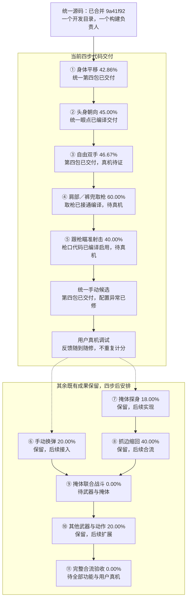

# 历史：6DoF ①②③⑦细化执行表 v2

> 2026-10-28 起，本文件完整保留为旧需求、分数和证据档案。当前只按[三项路线图](6dof-implementation-roadmap-20261025.md)推进：第一人称 → 自由双手 → 摸背后／裤兜换枪；每项基本自测可用后继续下一项，用户真机手感另列。以下所有“当前”“最新”、四步继续、不等待 H1、完全停模拟器以及 64 项／192 点执行安排均为当时历史，不再作为本轮派工或测试依据。

<!-- manual-startup-current -->
**最新覆盖（2026-10-28T08:02:09+08:00）：唯一分支 `codex/6dof-single`，源码 `9e0ad18`；第九包已更新同一入口。新增换枪后恢复与实际GT角色状态代码；三槽、自由手／附着枪体及实际Lancer握持侧移已有画面，装备过渡稳定性和实体头显待反馈。成熟度31.02%，本事件+0.00；完整状态以[总看板](6dof-progress-dashboard.md)为准。**
<!-- /manual-startup-current -->

动态状态更新：2026-10-28T02:10:45+08:00；第四包修复重复配置并交付，用户真机待证、HUD准星未接入。成熟度30.23%，事件增量0.00；64项与192操作点保持。

用户最新直接要求（2026-10-28T00:25:22+08:00）：**两个worktree合为一条开发主线，第一人称 → 自由双手 → 肩部和裤兜取枪 → 开火；各已编译阶段更新同一个版本供用户真机调试。** 当前四步继续写代码，不等待H1反馈。 第一份统一包不以四步全齐或自动认证为前置，已编译成果先交付，后续仍更新同一入口。用户负责所有游戏／XR／头显测试；开发方只写代码、编译／链接、打包，不启动自动测试或新增诊断门。

统一目录：`C:/Users/11/.codex/worktrees/6dof-cover/gearsVr`；分支：`codex/6dof-unified`。两分支已实际合并为`9a41f92`，13处冲突已处理，双亲为`37de6ef`和`f397f9b`。第二包e38a2b2接入枪口开火，第三包183cb10修复手动启动环境门；四步代码/编译结果不等同真机效果。

Body唯一维护共享Native／相机／骨骼，并独占Git暂存／提交、整合编译和打包；Weapon只写直接约定的非重叠装备／槽位／持枪／开火消费者。后续双方都使用统一目录。旧Weapon目录、两侧历史与旧候选保留回退，主目录未提交支持工作不整树覆盖。现有修复与原完整需求保留。

固定体验入口：`J:/gearsVr/candidates/6dof-unified/GearsVR Launcher.exe`。**第四包已打包：6dof-unified-20261028-4（固定入口已更新）。** [启动器](</J:/gearsVr/candidates/6dof-unified/GearsVR Launcher.exe>)；[完整说明](/J:/gearsVr/candidates/6dof-unified/CANDIDATE.md)。第一人称、自由双手、肩部/裤兜RGrip取枪和Lancer枪口开火已接入并完成编译打包。第四包保留已启用的Lancer VR开火，实际方向/命中/手感待用户真机。HUD准星尚未接新射线；左手丢跟踪导致unknown时暂拒开火，正常单手握持仍允许。旧候选与本版ZIP均保留回退。

## 当前执行顺序

| 顺序 | 当前代码状态 | 下一步 |
| --- | --- | --- |
| 1 第一人称 | 统一第四包已交付 | 用户真机观察，按反馈修正 |
| 2 自由双手 | 统一第四包已交付 | 用户检查独立位置／完整旋转与自然程度 |
| 3 肩部／裤兜取枪 | 正常入口已接通并编译交付 | 用户RGrip取实际库存武器；缺臂展先做真实Tpose |
| 4 开火 | Lancer枪口代码已编译并在第四包保留启用 | 用户检查方向/弹着；HUD准星未接新射线 |
| 统一候选 | 已交付6dof-unified-20261028-4 | 后续同入口更新，旧包保留回退 |
| 真机确认 | 由用户进行 | 不把源码、合并或编译当成玩法通过 |

## 如何计入大进度

11个大节点继续等权。①包含14项、②12项、③18项、⑦20项，各大节点内部子项等权平均；其余7个大节点本次不拆，保留原分档。192个操作点用于执行与判断子项是否跨档，不再单独加一遍分。未知项没有获得分数，但明确标“待证”，不能据此断言代码不存在。

例如③某一小项40→60，③增加20÷18=1.11个百分点，总分增加20÷18÷11≈0.10个百分点。以后不用等待整个③从60跳到80才看到变化。新发现的旧证据要标“补录证据”；新实跑通过才标“新增成果”。

| 小项分数 | 证据要求 |
| ---: | --- |
| 0% | 没有足够证据认证本子项的实现阶段；未知明确标未知，不等于确定没有代码。 |
| 20% | 可定位的相关实现或接线已存在；这一个小动作尚未形成完整离线通过。 |
| 40% | 本子项核心实现／主要模块有针对性离线证据或部分实跑，但小动作整体未通过。 |
| 60% | 明确限定范围的小动作在购买版＋受控模拟输入通过并正常收尾；记录候选与范围。 |
| 80% | 同一可交付候选中该小动作通过，双眼可见效果、必要回归、启动退出和操作说明齐备。 |
| 100% | 该小项要求的本地验证及实体头显验收通过；一次短检查只覆盖实际做过的动作。 |

最新执行补充：上表与历史证据中的“受控模拟／离线通过”描述不授权重新运行自动测试。今后相同玩家动作的行为证据由用户实体头显检查提供，按实际覆盖范围记录；源码与编译结果只支持相应实现阶段，不能冒充行为通过。

## 当前源码与候选证据

合并提交9a41f92保留37de6ef和f397f9b两条历史；旧第一人称/双手包已交付，统一首包已交付。枪口开火已在e38a2b2接线并编译交付；当前等待具体真机反馈；用户真机确认另记，不能以合并提高成熟度。

## 每个小项的执行与验收

下列三个动作按顺序执行，合起来定义该小项的通过范围；不能只做第一个动作就给整项通过。旧证据只保留已写明部分，第三步提及的新候选／组合动作仍需相应新证据。全套头显接受目前均未完成。

## ① 左右、上下移动带动身体：42.86%

14个子项，内部每项权重1/14，该大节点占整体1/11。

| 编号 | 小项 | 当前 | 前置 | 当前已证及缺口 |
| --- | --- | ---: | --- | --- |
| B1.01 | 进入游戏时建立正确的身体中立基准 | 60% | 既定场景 | 同一实际站姿捕获眼点、头、骨盆和脚，身体与双手求解持续提交；固定站立和小幅头动范围。 |
| B1.02 | 现实距离与游戏距离、方向一致 | 40% | B1.01 | 六向换算离线通过；不以模型骨距冒充人体尺寸，最新合流仍待游戏对照。 |
| B1.03 | 向右移动时身体跟随 | 60% | B1.01、B1.02 | 旧B9右移3厘米的受控身体读回通过；不等于最新基准或自然大幅横移通过。 |
| B1.04 | 向左移动时身体跟随 | 60% | B1.01、B1.02 | 旧B9左移3厘米通过；不能由右移结果替代左侧验收。 |
| B1.05 | 真实抬高身体时视点和身体上移 | 60% | B1.01、B1.02 | 旧B9向上2厘米通过；自然站起的全幅不是本项旧通过范围。 |
| B1.06 | 真实降低身体时视点和身体下移 | 60% | B1.01、B1.02 | 旧B9向下2厘米通过；下蹲全幅及掩体遮蔽另验。 |
| B1.07 | 前后探身的距离与方向一致 | 40% | B1.01、B1.02 | 六向平移适配已有离线检查；前三节点旧实跑没有形成此前后动作的完整通过。 |
| B1.08 | 斜向和组合平移只应用一次 | 40% | B1.03、B1.04、B1.05、B1.06、B1.07 | 适配器和防回灌离线结果保留；最新同时横移与升降实跑待验。 |
| B1.09 | 头与骨盆相对运动保持一致 | 60% | B1.01、B1.02 | 旧B9限定小运动有头／骨盆响应；B14单点不能证明新中立基准全部正确。 |
| B1.10 | 上身和双肩位置允许正常臂长 | 40% | B1.01、B1.09 | 固定臂长和身体求解离线基础存在；相机／肩／双手最新可见合流未通过。 |
| B1.11 | 身体移动时脚部约束不被悄悄破坏 | 40% | B1.09 | 固定脚和完整输出回放已通过；实际自然姿态与最终画面待验。 |
| B1.12 | 人物原版移动后身体基准正确搬运 | 20% | B1.01、B1.09 | 基准搬运接线已定位；未见当前整套在实际行走后仍正确的充分结果。 |
| B1.13 | 回中或追踪参照变化后不跳身体 | 40% | B1.01 | 离线参照规则与受控controller恢复保留；HR不证明HMD／硬参照变化完整通过。 |
| B1.14 | 逐步扩大到自然站蹲和探身范围 | 0% 待证 | B1.03、B1.04、B1.05、B1.06、B1.07、B1.10、B1.11 | 当前没有可认证的自然全幅联合通过；0表示本项未获得阶段证据，非断言没有相关代码。 |

### B1.01 进入游戏时建立正确的身体中立基准

本轮审阅（第47份，分数不变）：最新共同基准仍待证；中立姿态候选已实跑未解决，待真实失败调用眼点／参考。 证据：[小时47](J:/gearsVr/analysis/6dof-progress/hour47-h1-first-rejection-pending-reviewed.json)。

**当前40% · 离线／局部证据。** 负责人：身体底层与掩体。前置：既定场景。

共同基准适配和单静点已有证据；真实初始化来源到最新整套身体尚未通过。

1. **B1.01.1** 固定站立场景，记录原始HMD、角色、身体基准和基准建立时刻。

2. **B1.01.2** 把眼点、头骨、骨盆放到同一基准；基准不得取自已叠加偏移的上一帧。

3. **B1.01.3** 保持头显静止再开始移动，确认第一帧不跳位、后续不反复回中。

证据：[基准离线](C:/Users/11/.codex/worktrees/6dof-cover/gearsVr/analysis/cover-implementation-20261024/body-goal-view-tracked-receiver1/cpu-1792925368609010900/receipt.json)、[B14](C:/Users/11/.codex/worktrees/6dof-cover/gearsVr/analysis/cover-implementation-20261024/body-live-standing14/runtime-c0-boundary-review1.json)、[范围审阅](J:/gearsVr/analysis/6dof-progress/first-three-node-scope-and-hu-reviewed.json)。最新完整合流／实体头显：待验。

### B1.02 现实距离与游戏距离、方向一致

**当前40% · 离线／局部证据。** 负责人：身体底层与掩体。前置：B1.01。

六向换算离线通过；不以模型骨距冒充人体尺寸，最新合流仍待游戏对照。

1. **B1.02.1** 使用固定的米／游戏单位倍率和左右、上下、前后轴。

2. **B1.02.2** 用已知厘米数输入比较游戏位移，不改IPD或头手尺度来补身体误差。

3. **B1.02.3** 回到起点，确认换算无累计偏差；在同一候选交接倍率。

证据：[基准离线](C:/Users/11/.codex/worktrees/6dof-cover/gearsVr/analysis/cover-implementation-20261024/body-goal-view-tracked-receiver1/cpu-1792925368609010900/receipt.json)。最新完整合流／实体头显：待验。

### B1.03 向右移动时身体跟随

**当前60% · 限定购买版实跑。** 负责人：身体底层与掩体。前置：B1.01、B1.02。

旧B9右移3厘米的受控身体读回通过；不等于最新基准或自然大幅横移通过。

1. **B1.03.1** 头手保持朝向，向右移动3厘米。

2. **B1.03.2** 核对眼点、头和骨盆的右移量及同一次身体结果。

3. **B1.03.3** 右移保持后回原位；最新整套候选补可见效果。

证据：[B9](C:/Users/11/.codex/worktrees/6dof-cover/gearsVr/analysis/cover-implementation-20261024/body-live-standing9/runtime-motion-review1.json)、[范围审阅](J:/gearsVr/analysis/6dof-progress/first-three-node-scope-and-hu-reviewed.json)。最新完整合流／实体头显：待验。

### B1.04 向左移动时身体跟随

**当前60% · 限定购买版实跑。** 负责人：身体底层与掩体。前置：B1.01、B1.02。

旧B9左移3厘米通过；不能由右移结果替代左侧验收。

1. **B1.04.1** 保持朝向，向左移动3厘米。

2. **B1.04.2** 核对左移符号、眼点和骨盆响应，不出现镜像反向。

3. **B1.04.3** 左移保持后回原位；最新整套候选补可见效果。

证据：[B9](C:/Users/11/.codex/worktrees/6dof-cover/gearsVr/analysis/cover-implementation-20261024/body-live-standing9/runtime-motion-review1.json)、[范围审阅](J:/gearsVr/analysis/6dof-progress/first-three-node-scope-and-hu-reviewed.json)。最新完整合流／实体头显：待验。

### B1.05 真实抬高身体时视点和身体上移

**当前60% · 限定购买版实跑。** 负责人：身体底层与掩体。前置：B1.01、B1.02。

旧B9向上2厘米通过；自然站起的全幅不是本项旧通过范围。

1. **B1.05.1** 保持旋转不变，将头显位置提高2厘米。

2. **B1.05.2** 确认上移来自真实位置输入，眼点与身体使用同一结果。

3. **B1.05.3** 维持高度后回原位，不留下额外基础眼高。

证据：[B9](C:/Users/11/.codex/worktrees/6dof-cover/gearsVr/analysis/cover-implementation-20261024/body-live-standing9/runtime-motion-review1.json)、[范围审阅](J:/gearsVr/analysis/6dof-progress/first-three-node-scope-and-hu-reviewed.json)。最新完整合流／实体头显：待验。

### B1.06 真实降低身体时视点和身体下移

**当前60% · 限定购买版实跑。** 负责人：身体底层与掩体。前置：B1.01、B1.02。

旧B9向下2厘米通过；下蹲全幅及掩体遮蔽另验。

1. **B1.06.1** 保持旋转不变，将头显降低2厘米。

2. **B1.06.2** 确认视点与身体下降，未用抬头／低头角度代替高度。

3. **B1.06.3** 回原高度，检查基准没有被低位重新校准。

证据：[B9](C:/Users/11/.codex/worktrees/6dof-cover/gearsVr/analysis/cover-implementation-20261024/body-live-standing9/runtime-motion-review1.json)、[范围审阅](J:/gearsVr/analysis/6dof-progress/first-three-node-scope-and-hu-reviewed.json)。最新完整合流／实体头显：待验。

### B1.07 前后探身的距离与方向一致

**当前40% · 离线／局部证据。** 负责人：身体底层与掩体。前置：B1.01、B1.02。

六向平移适配已有离线检查；前三节点旧实跑没有形成此前后动作的完整通过。

1. **B1.07.1** 保持脚下游戏位置，分别向前、向后小幅移动头显。

2. **B1.07.2** 比较头、上身和最终眼点，不把探身变成游戏行走输入。

3. **B1.07.3** 前后回位各一次，确认无额外累计或方向翻转。

证据：[基准离线](C:/Users/11/.codex/worktrees/6dof-cover/gearsVr/analysis/cover-implementation-20261024/body-goal-view-tracked-receiver1/cpu-1792925368609010900/receipt.json)。最新完整合流／实体头显：待验。

### B1.08 斜向和组合平移只应用一次

**当前40% · 离线／局部证据。** 负责人：身体底层与掩体。前置：B1.03、B1.04、B1.05、B1.06、B1.07。

适配器和防回灌离线结果保留；最新同时横移与升降实跑待验。

1. **B1.08.1** 先做右上和左下等组合位置输入。

2. **B1.08.2** 逐轴比较组合结果，身体结果不再反过来当下一帧输入。

3. **B1.08.3** 回中并重复一次，累计偏移应归零。

证据：[基准离线](C:/Users/11/.codex/worktrees/6dof-cover/gearsVr/analysis/cover-implementation-20261024/body-goal-view-tracked-receiver1/cpu-1792925368609010900/receipt.json)、[全身离线](C:/Users/11/.codex/worktrees/6dof-cover/gearsVr/analysis/cover-implementation-20261024/full-body-c0-absolute-tracked-receiver1/cpu-1792922639039692300/receipt.json)。最新完整合流／实体头显：待验。

### B1.09 头与骨盆相对运动保持一致

本轮审阅（第46份，分数不变）：保留旧限定60%；ad身体目标实际提交不等于头／骨盆／眼点关系已正确。 证据：[小时46](J:/gearsVr/analysis/6dof-progress/hour46-first-person-and-h1-runtime-reviewed.json)。

**当前60% · 限定购买版实跑。** 负责人：身体底层与掩体。前置：B1.01、B1.02。

旧B9限定小运动有头／骨盆响应；B14单点不能证明新中立基准全部正确。

1. **B1.09.1** 同一时刻保存目标眼点、头骨与骨盆。

2. **B1.09.2** 比较小范围身体平移是否按同一份输入产生，分清头眼固定偏移。

3. **B1.09.3** 最新候选重核受影响范围，避免只读到头到位就宣称全身通过。

证据：[B9](C:/Users/11/.codex/worktrees/6dof-cover/gearsVr/analysis/cover-implementation-20261024/body-live-standing9/runtime-motion-review1.json)、[B14](C:/Users/11/.codex/worktrees/6dof-cover/gearsVr/analysis/cover-implementation-20261024/body-live-standing14/runtime-c0-boundary-review1.json)、[范围审阅](J:/gearsVr/analysis/6dof-progress/first-three-node-scope-and-hu-reviewed.json)。最新完整合流／实体头显：待验。

### B1.10 上身和双肩位置允许正常臂长

本轮审阅（第47份，分数不变）：41组肩线／臂长条件分析已交付；不是精确失败调用，单行中立姿态实跑仍失败。 证据：[小时47](J:/gearsVr/analysis/6dof-progress/hour47-h1-first-rejection-pending-reviewed.json)。

**当前40% · 离线／局部证据。** 负责人：身体底层与掩体。前置：B1.01、B1.09。

固定臂长和身体求解离线基础存在；相机／肩／双手最新可见合流未通过。

1. **B1.10.1** 先校对肩线、头眼和角色朝向，不先拉长手臂。

2. **B1.10.2** 用同一中立姿态检查左右腕目标是否在正常可达范围。

3. **B1.10.3** 手移动时臂长固定，不能逐帧伸长来追到目标。

证据：[全身离线](C:/Users/11/.codex/worktrees/6dof-cover/gearsVr/analysis/cover-implementation-20261024/full-body-c0-absolute-tracked-receiver1/cpu-1792922639039692300/receipt.json)、[臂长离线](C:/Users/11/.codex/worktrees/6dof-cover/gearsVr/analysis/cover-implementation-20261024/fixed-length-receiver1/attempt-1792907100878442400/receipt.json)、[可达回放](C:/Users/11/.codex/worktrees/6dof-cover/gearsVr/analysis/body-c0-hands-candidate3/B13-reach-replay1/receipt.json)。最新完整合流／实体头显：待验。

### B1.11 身体移动时脚部约束不被悄悄破坏

**当前40% · 离线／局部证据。** 负责人：身体底层与掩体。前置：B1.09。

固定脚和完整输出回放已通过；实际自然姿态与最终画面待验。

1. **B1.11.1** 固定脚下参照后输入小范围头部位置变化。

2. **B1.11.2** 观察脚、骨盆和上身，不以搬动脚或整个人物传送掩盖不可达。

3. **B1.11.3** 超出当前可支持姿态时保留明确失败或交还，不提交半套结果。

证据：[全身离线](C:/Users/11/.codex/worktrees/6dof-cover/gearsVr/analysis/cover-implementation-20261024/full-body-c0-absolute-tracked-receiver1/cpu-1792922639039692300/receipt.json)。最新完整合流／实体头显：待验。

### B1.12 人物原版移动后身体基准正确搬运

**当前20% · 源码／接线。** 负责人：身体底层与掩体。前置：B1.01、B1.09。

基准搬运接线已定位；未见当前整套在实际行走后仍正确的充分结果。

1. **B1.12.1** 先完成站立基准，再让角色进行短段原版移动。

2. **B1.12.2** 只随有效人物变换搬运基准，头部真实位移仍叠加一次。

3. **B1.12.3** 停止后重复一个小横移，确认基准未留在旧世界位置。

证据：[身体源码](C:/Users/11/.codex/worktrees/6dof-cover/gearsVr/tools/native-capture/body_goal_view_adapter.h)、[规格B](C:/Users/11/.codex/worktrees/6dof-cover/gearsVr/docs/6dof-cover-interaction-design-20261024.md)。最新完整合流／实体头显：待验。

### B1.13 回中或追踪参照变化后不跳身体

**当前40% · 离线／局部证据。** 负责人：身体底层与掩体。前置：B1.01。

离线参照规则与受控controller恢复保留；HR不证明HMD／硬参照变化完整通过。

1. **B1.13.1** 分别列出L3回中、追踪空间改变与普通controller恢复。

2. **B1.13.2** 发生参照变化时丢弃跨代旧差值，共同重建头、身体和手参照。

3. **B1.13.3** 恢复后复验站立与小平移；未实际覆盖的变化继续待验。

证据：[基准离线](C:/Users/11/.codex/worktrees/6dof-cover/gearsVr/analysis/cover-implementation-20261024/body-goal-view-tracked-receiver1/cpu-1792925368609010900/receipt.json)、[HR](J:/gearsVr/analysis/6dof-progress/hr-controller-loss-recovery-reviewed.json)、[规格W](C:/Users/11/.codex/worktrees/weapon-6dof/gearsVr/docs/weapon-6dof-interaction-design-20261022.md)。最新完整合流／实体头显：待验。

### B1.14 逐步扩大到自然站蹲和探身范围

**当前0% · 待证。** 负责人：身体底层与掩体。前置：B1.03、B1.04、B1.05、B1.06、B1.07、B1.10、B1.11。

当前没有可认证的自然全幅联合通过；0表示本项未获得阶段证据，非断言没有相关代码。

1. **B1.14.1** 小幅动作通过后，按现有可达性逐级扩大，记录明确支持范围。

2. **B1.14.2** 分别观察站起、蹲下、前探、侧身，遇首个失败停止扩幅定位。

3. **B1.14.3** 形成可见稳定的支持范围，再交用户短头显体验。

证据：[范围审阅](J:/gearsVr/analysis/6dof-progress/first-three-node-scope-and-hu-reviewed.json)、[规格B](C:/Users/11/.codex/worktrees/6dof-cover/gearsVr/docs/6dof-cover-interaction-design-20261024.md)。最新完整合流／实体头显：待验。

## ② 转头、抬头时身体稳定：45.00%

12个子项，内部每项权重1/12，该大节点占整体1/11。

| 编号 | 小项 | 当前 | 前置 | 当前已证及缺口 |
| --- | --- | ---: | --- | --- |
| B2.01 | 中立朝向与头眼旋转中心正确 | 60% | B1.01 | 实际第一人称左右眼清楚可见， authored头眼中心与共同身体基准接入；10度yaw/6厘米平移及0.15弧度侧歪为本轮限定范围。 |
| B2.02 | 向右转头只改变观察方向 | 60% | B2.01 | 旧B9正常yaw +10度通过，已按弧度正确输入；完整自然转头另验。 |
| B2.03 | 向左转头的符号和响应正确 | 40% | B2.01 | 左右旋转数学已有离线基础；旧B9的+10度结果不冒充左转实跑。 |
| B2.04 | 抬头不额外抬高身体 | 60% | B2.01 | 旧B9 pitch +10度及回中通过；新基准合流待验。 |
| B2.05 | 低头不额外降低身体 | 40% | B2.01 | 正负旋转的离线检查保留；最新低头动作的游戏、双眼证据待补。 |
| B2.06 | 侧歪头的旋转正确 | 40% | B2.01 | 完整姿态数学通过；实际roll与双眼舒适度未通过。 |
| B2.07 | 纯旋转不重复制造身体位移 | 60% | B2.02、B2.04 | 仅保留B9小角yaw／pitch受控范围；更大角、roll及最新合流待验。 |
| B2.08 | 转头伴随真实平移时两者都保留 | 40% | B1.08、B2.01 | 组合目标离线接线存在；不能因动作叫转头就丢掉真实位置变化。 |
| B2.09 | 旋转回中后不残留偏移 | 60% | B2.02、B2.04 | 旧B9正常yaw／pitch后的neutral通过；不等于重新初始化基准。 |
| B2.10 | 连续转头和多轴动作不跳姿态 | 40% | B2.03、B2.05、B2.06、B2.08 | 多组姿态往返数学已有；当前连续游戏画面尚未接受。 |
| B2.11 | 摇杆转向或回中与头手同步 | 20% | B2.01、B1.13 | 连续性契约源码可定位；新的真实平滑／Snap与头手身体合流验收未齐。 |
| B2.12 | 扩大正常观察角度并验证视野 | 40% | B2.03、B2.05、B2.06、B2.10 | 更宽数学域离线有基础，实际支持角度和最终可见视野未认证。 |

### B2.01 中立朝向与头眼旋转中心正确

本轮审阅（第47份，分数不变）：第一人称开关已生效；ae双眼仍有近处几何遮挡，正确可用视点未通过。 证据：[小时47](J:/gearsVr/analysis/6dof-progress/hour47-h1-first-rejection-pending-reviewed.json)。

**当前40% · 离线／局部证据。** 负责人：身体底层与掩体。前置：B1.01。

静态头眼定位及往返数学通过；作者配置不是个人物理标定。

1. **B2.01.1** 记录HMD观察方向和固定头眼偏移。

2. **B2.01.2** 围绕实际眼点旋转，分开头骨因固定偏移走弧与身体真实平移。

3. **B2.01.3** 最新候选中核对身体朝向、实际第一人称眼点与观察方向；以实际XR双眼留证，能力flag和旧动画姿态不替代。

证据：[头眼离线](C:/Users/11/.codex/worktrees/6dof-cover/gearsVr/analysis/cover-implementation-20261024/body-head-authored-tracked-receiver1/cpu-1792919063575648600/receipt.json)、[基准离线](C:/Users/11/.codex/worktrees/6dof-cover/gearsVr/analysis/cover-implementation-20261024/body-goal-view-tracked-receiver1/cpu-1792925368609010900/receipt.json)。最新完整合流／实体头显：待验。

### B2.02 向右转头只改变观察方向

**当前60% · 限定购买版实跑。** 负责人：身体底层与掩体。前置：B2.01。

旧B9正常yaw +10度通过，已按弧度正确输入；完整自然转头另验。

1. **B2.02.1** 固定HMD位置，输入+10度yaw。

2. **B2.02.2** 确认角度换算为约0.17453弧度，观察方向与输入一致。

3. **B2.02.3** 保持后回中，不把旋转当额外横移或身体转向指令。

证据：[B9](C:/Users/11/.codex/worktrees/6dof-cover/gearsVr/analysis/cover-implementation-20261024/body-live-standing9/runtime-motion-review1.json)、[范围审阅](J:/gearsVr/analysis/6dof-progress/first-three-node-scope-and-hu-reviewed.json)。最新完整合流／实体头显：待验。

### B2.03 向左转头的符号和响应正确

**当前40% · 离线／局部证据。** 负责人：身体底层与掩体。前置：B2.01。

左右旋转数学已有离线基础；旧B9的+10度结果不冒充左转实跑。

1. **B2.03.1** 固定位置，输入-10度yaw。

2. **B2.03.2** 核对左转方向，身体平移不能反向产生补偿。

3. **B2.03.3** 回中并与右转对称比较，保存本项实际游戏证据。

证据：[头眼离线](C:/Users/11/.codex/worktrees/6dof-cover/gearsVr/analysis/cover-implementation-20261024/body-head-authored-tracked-receiver1/cpu-1792919063575648600/receipt.json)、[基准离线](C:/Users/11/.codex/worktrees/6dof-cover/gearsVr/analysis/cover-implementation-20261024/body-goal-view-tracked-receiver1/cpu-1792925368609010900/receipt.json)。最新完整合流／实体头显：待验。

### B2.04 抬头不额外抬高身体

**当前60% · 限定购买版实跑。** 负责人：身体底层与掩体。前置：B2.01。

旧B9 pitch +10度及回中通过；新基准合流待验。

1. **B2.04.1** 位置固定，输入+10度pitch。

2. **B2.04.2** 确认抬头改变观察方向，未程序化站起或上探。

3. **B2.04.3** 回中后头眼基准保持，不留下额外高度。

证据：[B9](C:/Users/11/.codex/worktrees/6dof-cover/gearsVr/analysis/cover-implementation-20261024/body-live-standing9/runtime-motion-review1.json)、[范围审阅](J:/gearsVr/analysis/6dof-progress/first-three-node-scope-and-hu-reviewed.json)。最新完整合流／实体头显：待验。

### B2.05 低头不额外降低身体

**当前40% · 离线／局部证据。** 负责人：身体底层与掩体。前置：B2.01。

正负旋转的离线检查保留；最新低头动作的游戏、双眼证据待补。

1. **B2.05.1** 位置固定，输入-10度pitch。

2. **B2.05.2** 确认低头只改变方向，不自动蹲下或把相机推出身体。

3. **B2.05.3** 回中检查头眼偏移和骨盆位置。

证据：[头眼离线](C:/Users/11/.codex/worktrees/6dof-cover/gearsVr/analysis/cover-implementation-20261024/body-head-authored-tracked-receiver1/cpu-1792919063575648600/receipt.json)、[基准离线](C:/Users/11/.codex/worktrees/6dof-cover/gearsVr/analysis/cover-implementation-20261024/body-goal-view-tracked-receiver1/cpu-1792925368609010900/receipt.json)。最新完整合流／实体头显：待验。

### B2.06 侧歪头的旋转正确

**当前40% · 离线／局部证据。** 负责人：身体底层与掩体。前置：B2.01。

完整姿态数学通过；实际roll与双眼舒适度未通过。

1. **B2.06.1** 固定位置，分别左右小幅roll。

2. **B2.06.2** 保留真实侧歪头，不把它当游戏跑动晃动删除。

3. **B2.06.3** 回正后检查方向、双眼和身体位置。

证据：[头眼离线](C:/Users/11/.codex/worktrees/6dof-cover/gearsVr/analysis/cover-implementation-20261024/body-head-authored-tracked-receiver1/cpu-1792919063575648600/receipt.json)。最新完整合流／实体头显：待验。

### B2.07 纯旋转不重复制造身体位移

**当前60% · 限定购买版实跑。** 负责人：身体底层与掩体。前置：B2.02、B2.04。

仅保留B9小角yaw／pitch受控范围；更大角、roll及最新合流待验。

1. **B2.07.1** 保持真实位置完全固定，只改变朝向。

2. **B2.07.2** 头骨因头眼偏移产生的弧线不能再次加到骨盆或物理位移。

3. **B2.07.3** 比较旋转前后身体基准，确认无累积探身。

证据：[B9](C:/Users/11/.codex/worktrees/6dof-cover/gearsVr/analysis/cover-implementation-20261024/body-live-standing9/runtime-motion-review1.json)、[范围审阅](J:/gearsVr/analysis/6dof-progress/first-three-node-scope-and-hu-reviewed.json)。最新完整合流／实体头显：待验。

### B2.08 转头伴随真实平移时两者都保留

**当前40% · 离线／局部证据。** 负责人：身体底层与掩体。前置：B1.08、B2.01。

组合目标离线接线存在；不能因动作叫转头就丢掉真实位置变化。

1. **B2.08.1** 先单独转头，再在同一角度加入小横移／升降。

2. **B2.08.2** 分别核对旋转和平移，不锁死HMD位置。

3. **B2.08.3** 返回原位原角，验证两部分各应用一次。

证据：[基准离线](C:/Users/11/.codex/worktrees/6dof-cover/gearsVr/analysis/cover-implementation-20261024/body-goal-view-tracked-receiver1/cpu-1792925368609010900/receipt.json)。最新完整合流／实体头显：待验。

### B2.09 旋转回中后不残留偏移

**当前60% · 限定购买版实跑。** 负责人：身体底层与掩体。前置：B2.02、B2.04。

旧B9正常yaw／pitch后的neutral通过；不等于重新初始化基准。

1. **B2.09.1** 从小角yaw或pitch恢复零角输入。

2. **B2.09.2** 等待原有稳定判据，比较回中前后的头、身体基准。

3. **B2.09.3** 重复同一动作不增加偏移；保留原通过结果，只验受影响增量。

证据：[B9](C:/Users/11/.codex/worktrees/6dof-cover/gearsVr/analysis/cover-implementation-20261024/body-live-standing9/runtime-motion-review1.json)、[范围审阅](J:/gearsVr/analysis/6dof-progress/first-three-node-scope-and-hu-reviewed.json)。最新完整合流／实体头显：待验。

### B2.10 连续转头和多轴动作不跳姿态

**当前40% · 离线／局部证据。** 负责人：身体底层与掩体。前置：B2.03、B2.05、B2.06、B2.08。

多组姿态往返数学已有；当前连续游戏画面尚未接受。

1. **B2.10.1** 由yaw过渡到pitch，再加入小幅roll，保持输入连续。

2. **B2.10.2** 检查方向、身体和双手之间没有中途换基准。

3. **B2.10.3** 保存整段而非挑选稳定帧，标出第一次跳变。

证据：[头眼离线](C:/Users/11/.codex/worktrees/6dof-cover/gearsVr/analysis/cover-implementation-20261024/body-head-authored-tracked-receiver1/cpu-1792919063575648600/receipt.json)、[基准离线](C:/Users/11/.codex/worktrees/6dof-cover/gearsVr/analysis/cover-implementation-20261024/body-goal-view-tracked-receiver1/cpu-1792925368609010900/receipt.json)。最新完整合流／实体头显：待验。

### B2.11 摇杆转向或回中与头手同步

**当前20% · 源码／接线。** 负责人：身体底层与掩体。前置：B2.01、B1.13。

连续性契约源码可定位；新的真实平滑／Snap与头手身体合流验收未齐。

1. **B2.11.1** 复用既定平滑或Snap转向设置，不新增转向规则。

2. **B2.11.2** 转向后统一更新身体参照和手部世界变换。

3. **B2.11.3** 保持手部真实姿态，确认不因参照转向被误当挥手或探身。

证据：[手连续源码](C:/Users/11/.codex/worktrees/weapon-6dof/gearsVr/tools/vr-common/hand_world_continuity_bridge.h)、[规格W](C:/Users/11/.codex/worktrees/weapon-6dof/gearsVr/docs/weapon-6dof-interaction-design-20261022.md)。最新完整合流／实体头显：待验。

### B2.12 扩大正常观察角度并验证视野

**当前40% · 离线／局部证据。** 负责人：身体底层与掩体。前置：B2.03、B2.05、B2.06、B2.10。

更宽数学域离线有基础，实际支持角度和最终可见视野未认证。

1. **B2.12.1** 小角通过后逐级扩大正常左右看、抬头和低头角度。

2. **B2.12.2** 检查可见身体与场景，避免头部几何遮住视野。

3. **B2.12.3** 确认支持范围再交H1体验，不把数学角域直接当可玩角域。

证据：[头眼离线](C:/Users/11/.codex/worktrees/6dof-cover/gearsVr/analysis/cover-implementation-20261024/body-head-authored-tracked-receiver1/cpu-1792919063575648600/receipt.json)、[全身离线](C:/Users/11/.codex/worktrees/6dof-cover/gearsVr/analysis/cover-implementation-20261024/full-body-c0-absolute-tracked-receiver1/cpu-1792922639039692300/receipt.json)、[范围审阅](J:/gearsVr/analysis/6dof-progress/first-three-node-scope-and-hu-reviewed.json)。最新完整合流／实体头显：待验。

## ③ 自由双手与原动画交还：46.67%

18个子项，内部每项权重1/18，该大节点占整体1/11。

| 编号 | 小项 | 当前 | 前置 | 当前已证及缺口 |
| --- | --- | ---: | --- | --- |
| B3.01 | 左右手输入能独立进入共同姿态 | 60% | B1.01 | 同一精确XR输入票据中只动左/只动右，最终腕骨和实际左右眼各自变化；另一手保持独立。 |
| B3.02 | 控制器握点正确换算到腕骨 | 40% | B3.01、B1.02 | 已制作具完整姿态的作者默认grip→wrist配置及离线检查；物理贴合待调。 |
| B3.03 | 左手在限定范围内跟随位置 | 60% | B3.02、B1.10 | B17静点、B18固定头位的限定手部运动通过；新头身合流仍待验。 |
| B3.04 | 右手在限定范围内跟随位置 | 60% | B3.02、B1.10 | 旧候选限定右手运动通过；持枪后的枪体跟随属于W2。 |
| B3.05 | 双手同时运动不相互抢控制 | 60% | B3.03、B3.04 | B18九阶段受控运动范围保留；真实任意动作和新基准未据此通过。 |
| B3.06 | 手腕左右转和抬压姿态正确 | 60% | B3.02 | 左右手分别改变yaw/pitch，实际手腕/可见手枪姿态对应变化；完整roll自然范围仍待真机。 |
| B3.07 | 翻腕完整roll能传到手掌 | 40% | B3.02 | 已有完整四元数目标；运行时roll验收仍明确缺失。 |
| B3.08 | 转头或移头时世界中的手不被拖跑 | 60% | B1.08、B2.08、B3.03、B3.04 | 控制器raw世界姿态保持，头部侧歪0.15弧度；最终腕骨仅约毫米级可达性变化，无明显随头拖跑。 |
| B3.09 | 玩家臂长比例固定且不会逐帧拉伸 | 40% | B1.10、B3.02 | 固定上／下臂比例模块与离线接收通过；个人真实整链待验。 |
| B3.10 | 首次臂展测量、保存与下次读取一致 | 20% | B3.09 | 测量、配置和启动接线已有源码；实体测量到最终手骨链未验收。 |
| B3.11 | 目标不可达时安全让位 | 40% | B3.09 | 不可达回放和限定资格交还保留；自然极限动作仍未接受。 |
| B3.12 | 正常站立时连续更新双手 | 60% | B3.03、B3.04、B3.05 | 旧B18有连续受控轨迹，限定头位／站立范围；最新整套连续可见效果未通过。 |
| B3.13 | 原版动作获得控制时双手正确交还 | 60% | B3.12 | 仅B19限定资格让位和原控制路径通过；不是所有动画和精确原返回姿态已验。 |
| B3.14 | 原版接管结束后重新跟手 | 60% | B3.13、B3.11 | B19限定恢复控制通过；菜单、剧情和所有特殊动作不在旧结果内。 |
| B3.15 | 控制器丢追踪后恢复 | 60% | B3.12 | HR只覆盖controller有效位15→0→15，HMD和硬参照不变；不可扩成所有追踪恢复。 |
| B3.16 | 过期样本、回中和新场景不会串代 | 40% | B3.15、B1.13 | 既有连续性校验基础保留；HR没有覆盖硬参照、换图和HMD新代次。 |
| B3.17 | 停止交互后自由双手仍能继续工作 | 60% | B3.12、B3.14 | 受控Stop后held停止、body／自由手继续及正常恢复已有通过；HZ启动失败不是本项回归证据。 |
| B3.18 | 头身双手整段合流并正确处理菜单接管 | 60% | B1.09、B2.10、B3.07、B3.08、B3.12、B3.14、B3.16 | 无遮挡第一人称双手、独立动作、头动、暂停剧院菜单和恢复游戏均有实际双眼证据；物理头显与自然大幅动作未验。 |

### B3.01 左右手输入能独立进入共同姿态

本轮代码证据（第48份）：新独立模块fcff82c完成同一第一人称眼点下的左右独立完整pose→腕目标，既有MSVC对象编译exit0；尚待Body整合/最终链接/用户真机，不提升分档。 当前分数40%保持；下一步为同候选整合后交用户真机。

本轮审阅（第46份，分数不变）：左右固定手指令及恢复均被Source1读取；最终手部求解和提交仍为0，完整双手输入到手骨未通过。 证据：[小时46](J:/gearsVr/analysis/6dof-progress/hour46-first-person-and-h1-runtime-reviewed.json)。

**当前40% · 离线／局部证据。** 负责人：身体底层与掩体。前置：B1.01。

同Scene双手输入和固定姿态已有样本；完整独立动作还须连到最终手骨。

1. **B3.01.1** 同一份有效追踪中分别认定左右手，不重读不同帧来拼双手。

2. **B3.01.2** 只动左手、只动右手，核对没有串位或同动。

3. **B3.01.3** 丢失一侧输入不伪造另一侧有效性。

证据：[规格W](C:/Users/11/.codex/worktrees/weapon-6dof/gearsVr/docs/weapon-6dof-interaction-design-20261022.md)、[B17](C:/Users/11/.codex/worktrees/6dof-cover/gearsVr/analysis/cover-implementation-20261024/body-live-standing17/runtime-hands-review1.json)。最新完整合流／实体头显：待验。

### B3.02 控制器握点正确换算到腕骨

本轮代码证据（第48份）：新独立模块fcff82c完成同一第一人称眼点下的左右独立完整pose→腕目标，既有MSVC对象编译exit0；尚待Body整合/最终链接/用户真机，不提升分档。 当前分数40%保持；下一步为同候选整合后交用户真机。

本轮审阅（第47份，分数不变）：ae固定左右手指令已到达，手部全部不可达，目标到腕骨与清楚可见手仍未通过。 证据：[小时47](J:/gearsVr/analysis/6dof-progress/hour47-h1-first-rejection-pending-reviewed.json)。

**当前40% · 离线／局部证据。** 负责人：身体底层与掩体。前置：B3.01、B1.02。

已制作具完整姿态的作者默认grip→wrist配置及离线检查；物理贴合待调。

1. **B3.02.1** 选择匹配模型的左右腕定位，包含位置和完整朝向。

2. **B3.02.2** 将同一次grip输入转换成腕目标，肢体与腕旋转共用目标。

3. **B3.02.3** 未知模型保留原动画，不借任意动画姿态自动标定。

证据：[规格W](C:/Users/11/.codex/worktrees/weapon-6dof/gearsVr/docs/weapon-6dof-interaction-design-20261022.md)、[头眼离线](C:/Users/11/.codex/worktrees/6dof-cover/gearsVr/analysis/cover-implementation-20261024/body-head-authored-tracked-receiver1/cpu-1792919063575648600/receipt.json)。最新完整合流／实体头显：待验。

### B3.03 左手在限定范围内跟随位置

**当前60% · 限定购买版实跑。** 负责人：身体底层与掩体。前置：B3.02、B1.10。

B17静点、B18固定头位的限定手部运动通过；新头身合流仍待验。

1. **B3.03.1** 固定头位，左手小幅移动，右手不动。

2. **B3.03.2** 核对左腕目标、实际腕位置和整个动作序列。

3. **B3.03.3** 回原位，检查右手没有被一起拖走。

证据：[B17](C:/Users/11/.codex/worktrees/6dof-cover/gearsVr/analysis/cover-implementation-20261024/body-live-standing17/runtime-hands-review1.json)、[B18](C:/Users/11/.codex/worktrees/6dof-cover/gearsVr/analysis/cover-implementation-20261024/body-live-standing18/runtime-hands-review1.json)、[范围审阅](J:/gearsVr/analysis/6dof-progress/first-three-node-scope-and-hu-reviewed.json)。最新完整合流／实体头显：待验。

### B3.04 右手在限定范围内跟随位置

**当前60% · 限定购买版实跑。** 负责人：身体底层与掩体。前置：B3.02、B1.10。

旧候选限定右手运动通过；持枪后的枪体跟随属于W2。

1. **B3.04.1** 固定头位，右手小幅移动，左手不动。

2. **B3.04.2** 检查右腕实际位置持续更新，不以枪的读回代替手。

3. **B3.04.3** 回原位，检查左手和身体基准稳定。

证据：[B17](C:/Users/11/.codex/worktrees/6dof-cover/gearsVr/analysis/cover-implementation-20261024/body-live-standing17/runtime-hands-review1.json)、[B18](C:/Users/11/.codex/worktrees/6dof-cover/gearsVr/analysis/cover-implementation-20261024/body-live-standing18/runtime-hands-review1.json)、[范围审阅](J:/gearsVr/analysis/6dof-progress/first-three-node-scope-and-hu-reviewed.json)。最新完整合流／实体头显：待验。

### B3.05 双手同时运动不相互抢控制

**当前60% · 限定购买版实跑。** 负责人：身体底层与掩体。前置：B3.03、B3.04。

B18九阶段受控运动范围保留；真实任意动作和新基准未据此通过。

1. **B3.05.1** 让左右手分别进入两个已支持位置。

2. **B3.05.2** 连续观察两边的独立目标与实际输出，不能只保存最后一帧。

3. **B3.05.3** 两手回位，确认所有权与基准保持。

证据：[B18](C:/Users/11/.codex/worktrees/6dof-cover/gearsVr/analysis/cover-implementation-20261024/body-live-standing18/runtime-hands-review1.json)、[范围审阅](J:/gearsVr/analysis/6dof-progress/first-three-node-scope-and-hu-reviewed.json)。最新完整合流／实体头显：待验。

### B3.06 手腕左右转和抬压姿态正确

本轮代码证据（第48份）：新独立模块fcff82c完成同一第一人称眼点下的左右独立完整pose→腕目标，既有MSVC对象编译exit0；尚待Body整合/最终链接/用户真机，不提升分档。 当前分数40%保持；下一步为同候选整合后交用户真机。

**当前40% · 离线／局部证据。** 负责人：身体底层与掩体。前置：B3.02。

完整姿态配置和数学存在；位置轨迹通过不自动证明腕骨所有旋转。

1. **B3.06.1** 固定grip位置，分别改变yaw和pitch。

2. **B3.06.2** 核对腕朝向与手掌方向，不能只看腕点坐标。

3. **B3.06.3** 旋转回中，检查平移未被破坏。

证据：[规格W](C:/Users/11/.codex/worktrees/weapon-6dof/gearsVr/docs/weapon-6dof-interaction-design-20261022.md)、[B18](C:/Users/11/.codex/worktrees/6dof-cover/gearsVr/analysis/cover-implementation-20261024/body-live-standing18/runtime-hands-review1.json)。最新完整合流／实体头显：待验。

### B3.07 翻腕完整roll能传到手掌

本轮代码证据（第48份）：新独立模块fcff82c完成同一第一人称眼点下的左右独立完整pose→腕目标，既有MSVC对象编译exit0；尚待Body整合/最终链接/用户真机，不提升分档。 当前分数40%保持；下一步为同候选整合后交用户真机。

**当前40% · 离线／局部证据。** 负责人：身体底层与掩体。前置：B3.02。

已有完整四元数目标；运行时roll验收仍明确缺失。

1. **B3.07.1** 固定手部位置，分别向内、向外翻腕。

2. **B3.07.2** 观察掌心方向随roll变化，不能被原动画抹掉。

3. **B3.07.3** 回正后检查手掌贴合和骨骼无翻转。

证据：[规格W](C:/Users/11/.codex/worktrees/weapon-6dof/gearsVr/docs/weapon-6dof-interaction-design-20261022.md)、[范围审阅](J:/gearsVr/analysis/6dof-progress/first-three-node-scope-and-hu-reviewed.json)。最新完整合流／实体头显：待验。

### B3.08 转头或移头时世界中的手不被拖跑

**当前40% · 离线／局部证据。** 负责人：身体底层与掩体。前置：B1.08、B2.08、B3.03、B3.04。

共同pre-HMD变换有离线依据；B18固定头位不能证明此项。

1. **B3.08.1** 两手在真实空间保持不动，先转头后横移头。

2. **B3.08.2** 只改变观察投影和合理上身响应，手的世界目标不随视线走。

3. **B3.08.3** 头回位，检查手、肩和身体使用同一参照。

证据：[基准离线](C:/Users/11/.codex/worktrees/6dof-cover/gearsVr/analysis/cover-implementation-20261024/body-goal-view-tracked-receiver1/cpu-1792925368609010900/receipt.json)、[规格W](C:/Users/11/.codex/worktrees/weapon-6dof/gearsVr/docs/weapon-6dof-interaction-design-20261022.md)。最新完整合流／实体头显：待验。

### B3.09 玩家臂长比例固定且不会逐帧拉伸

**当前40% · 离线／局部证据。** 负责人：身体底层与掩体。前置：B1.10、B3.02。

固定上／下臂比例模块与离线接收通过；个人真实整链待验。

1. **B3.09.1** 从有效个人记录或明确默认值取得本次固定臂长。

2. **B3.09.2** 伸手时只改变目标，保持两段臂长不随目标改变。

3. **B3.09.3** 记录无效或模型更换时拒用旧记录，不缩放头部或世界来补偿。

证据：[臂长离线](C:/Users/11/.codex/worktrees/6dof-cover/gearsVr/analysis/cover-implementation-20261024/fixed-length-receiver1/attempt-1792907100878442400/receipt.json)、[规格W](C:/Users/11/.codex/worktrees/weapon-6dof/gearsVr/docs/weapon-6dof-interaction-design-20261022.md)。最新完整合流／实体头显：待验。

### B3.10 首次臂展测量、保存与下次读取一致

**当前20% · 源码／接线。** 负责人：武器交互（配置）／身体底层与掩体（消费）。前置：B3.09。

测量、配置和启动接线已有源码；实体测量到最终手骨链未验收。

1. **B3.10.1** 通过既有启动入口采集有效双手展开数据。

2. **B3.10.2** 按原格式原子保存，明确其是臂展估计而非人体肩宽测量。

3. **B3.10.3** 重新启动读取同一记录，核对生效对象和腕目标，坏数据走既定退路。

证据：[臂展源码](C:/Users/11/.codex/worktrees/weapon-6dof/gearsVr/tools/vr-launcher/armspan_startup.py)、[规格W](C:/Users/11/.codex/worktrees/weapon-6dof/gearsVr/docs/weapon-6dof-interaction-design-20261022.md)。最新完整合流／实体头显：待验。

### B3.11 目标不可达时安全让位

**当前40% · 离线／局部证据。** 负责人：身体底层与掩体。前置：B3.09。

不可达回放和限定资格交还保留；自然极限动作仍未接受。

1. **B3.11.1** 逐步把腕目标移到本次支持范围之外。

2. **B3.11.2** 保持固定臂长，不提交半套结果或无限拉伸。

3. **B3.11.3** 移回可达范围，准备重新获取控制，保留第一处拒绝原因。

证据：[可达回放](C:/Users/11/.codex/worktrees/6dof-cover/gearsVr/analysis/body-c0-hands-candidate3/B13-reach-replay1/receipt.json)、[B19](C:/Users/11/.codex/worktrees/6dof-cover/gearsVr/analysis/cover-implementation-20261024/body-live-standing19/runtime-hands-review1.json)。最新完整合流／实体头显：待验。

### B3.12 正常站立时连续更新双手

本轮审阅（第46份，分数不变）：旧限定60%保留；最新候选持续身体更新存在，但自由手成功提交0。 证据：[小时46](J:/gearsVr/analysis/6dof-progress/hour46-first-person-and-h1-runtime-reviewed.json)。

**当前60% · 限定购买版实跑。** 负责人：身体底层与掩体。前置：B3.03、B3.04、B3.05。

旧B18有连续受控轨迹，限定头位／站立范围；最新整套连续可见效果未通过。

1. **B3.12.1** 用已有短轨迹连续移动双手并穿插静止。

2. **B3.12.2** 每段都核对实际手骨更新，不能只统计回调或源样本数。

3. **B3.12.3** 保存整段失败与成功范围，正常退出后释放写入责任。

证据：[B18](C:/Users/11/.codex/worktrees/6dof-cover/gearsVr/analysis/cover-implementation-20261024/body-live-standing18/runtime-hands-review1.json)、[范围审阅](J:/gearsVr/analysis/6dof-progress/first-three-node-scope-and-hu-reviewed.json)。最新完整合流／实体头显：待验。

### B3.13 原版动作获得控制时双手正确交还

**当前60% · 限定购买版实跑。** 负责人：身体底层与掩体。前置：B3.12。

仅B19限定资格让位和原控制路径通过；不是所有动画和精确原返回姿态已验。

1. **B3.13.1** 在已支持站立情形触发一个已认证的原版接管。

2. **B3.13.2** VR手部停止拥有不再属于自己的输出，保留原动作控制。

3. **B3.13.3** 实际对照交还后的原版姿态；超出旧资格范围另留待验。

证据：[B19](C:/Users/11/.codex/worktrees/6dof-cover/gearsVr/analysis/cover-implementation-20261024/body-live-standing19/runtime-hands-review1.json)、[范围审阅](J:/gearsVr/analysis/6dof-progress/first-three-node-scope-and-hu-reviewed.json)。最新完整合流／实体头显：待验。

### B3.14 原版接管结束后重新跟手

**当前60% · 限定购买版实跑。** 负责人：身体底层与掩体。前置：B3.13、B3.11。

B19限定恢复控制通过；菜单、剧情和所有特殊动作不在旧结果内。

1. **B3.14.1** 结束前一项原版接管，重新获得有效同代追踪。

2. **B3.14.2** 从当前姿态恢复，不把旧临时写入再次盖回去。

3. **B3.14.3** 再次移动双手，确认交还后确实能重新工作。

证据：[B19](C:/Users/11/.codex/worktrees/6dof-cover/gearsVr/analysis/cover-implementation-20261024/body-live-standing19/runtime-hands-review1.json)、[范围审阅](J:/gearsVr/analysis/6dof-progress/first-three-node-scope-and-hu-reviewed.json)。最新完整合流／实体头显：待验。

### B3.15 控制器丢追踪后恢复

**当前60% · 限定购买版实跑。** 负责人：身体底层与掩体。前置：B3.12。

HR只覆盖controller有效位15→0→15，HMD和硬参照不变；不可扩成所有追踪恢复。

1. **B3.15.1** 固定其他条件，只让controller追踪失效。

2. **B3.15.2** 停止用旧手样本驱动，保留有效头部和身体行为。

3. **B3.15.3** 恢复同代有效样本，确认重新跟手且没有位置跳变。

证据：[HR](J:/gearsVr/analysis/6dof-progress/hr-controller-loss-recovery-reviewed.json)。最新完整合流／实体头显：待验。

### B3.16 过期样本、回中和新场景不会串代

**当前40% · 离线／局部证据。** 负责人：身体底层与掩体。前置：B3.15、B1.13。

既有连续性校验基础保留；HR没有覆盖硬参照、换图和HMD新代次。

1. **B3.16.1** 区分仅controller恢复与回中／追踪空间／角色变化。

2. **B3.16.2** 旧代次样本和旧对象不得继续写入当前身体。

3. **B3.16.3** 在新有效参照下重新取得控制，分别留下未覆盖类型。

证据：[手连续源码](C:/Users/11/.codex/worktrees/weapon-6dof/gearsVr/tools/vr-common/hand_world_continuity_bridge.h)、[规格W](C:/Users/11/.codex/worktrees/weapon-6dof/gearsVr/docs/weapon-6dof-interaction-design-20261022.md)、[HR](J:/gearsVr/analysis/6dof-progress/hr-controller-loss-recovery-reviewed.json)。最新完整合流／实体头显：待验。

### B3.17 停止交互后自由双手仍能继续工作

**当前60% · 限定购买版实跑。** 负责人：身体底层与掩体。前置：B3.12、B3.14。

受控Stop后held停止、body／自由手继续及正常恢复已有通过；HZ启动失败不是本项回归证据。

1. **B3.17.1** 停止已支持的持有交互，保持有效自由手追踪。

2. **B3.17.2** 确认已停交互不再提交，自由手仍随新输入更新。

3. **B3.17.3** 按正常生命周期结束，分别记录功能停止与全局恢复。

证据：[HR](J:/gearsVr/analysis/6dof-progress/hr-controller-loss-recovery-reviewed.json)、[HW](J:/gearsVr/analysis/6dof-progress/hw-weapon-mesh-boundary-reviewed.json)。最新完整合流／实体头显：待验。

### B3.18 头身双手整段合流并正确处理菜单接管

本轮审阅（第47份，分数不变）：最新整段仍停在固定自由手可见阶段；组合运动／交还与H1未通过。 证据：[小时47](J:/gearsVr/analysis/6dof-progress/hour47-h1-first-rejection-pending-reviewed.json)。

**当前20% · 源码／接线。** 负责人：身体底层与掩体。前置：B1.09、B2.10、B3.07、B3.08、B3.12、B3.14、B3.16。

模块和限定交还已存在；整段头身双手、菜单与清楚可见的手尚无完整通过，HW画面仍遮挡。

1. **B3.18.1** 先确认实际第一人称眼点与固定自由双手清楚可见，再组合手动→转头／小移头，取得对应XR双眼动作。

2. **B3.18.2** 再做一次明确支持的菜单／动作接管并恢复；未支持的剧情或特殊动作保留待办。

3. **B3.18.3** 同一冻结候选给H1三动作体验单；不要求先完成W2全枪跟随和射击。

证据：[规格W](C:/Users/11/.codex/worktrees/weapon-6dof/gearsVr/docs/weapon-6dof-interaction-design-20261022.md)、[HW](J:/gearsVr/analysis/6dof-progress/hw-weapon-mesh-boundary-reviewed.json)、[范围审阅](J:/gearsVr/analysis/6dof-progress/first-three-node-scope-and-hu-reviewed.json)。最新完整合流／实体头显：待验。

## ⑦ 真实探身、掩体进出和稳定视角：18.00%

20个子项，内部每项权重1/20，该大节点占整体1/11。

| 编号 | 小项 | 当前 | 前置 | 当前已证及缺口 |
| --- | --- | ---: | --- | --- |
| C1.01 | 当前矮掩体的有效状态和槽位认证 | 60% | 既定场景 | CT3–CT5固定矮掩体的原版CoverType／状态及几何读取有证据；未证明碰撞或探身。 |
| C1.02 | 高掩体与不同槽位同样能认证 | 0% 待证 | C1.01 | 所读CT证据只覆盖固定矮掩体槽；高掩体和跨槽位完整认证未知。 |
| C1.03 | 矮掩体的中立眼点真正藏在顶沿下 | 40% | B1.01、C1.01 | 旧ai应用了低眼点，但顶沿仅候选，未证明掩体场景双眼遮蔽；目标未完整实跑通过。 |
| C1.04 | 高掩体中立眼点按实际几何建立 | 0% 待证 | C1.02、B1.01 | 没有高掩体中立遮蔽的已核通过证据，不能套用矮掩体结果。 |
| C1.05 | 身体正面朝墙但不强扭头显 | 0% 待证 | C1.01、B1.09、B2.01 | 共同heading基础不在C1重复计分；本项实际掩体接线阶段未有足够证据。 |
| C1.06 | 真实站起可以连续上探 | 60% | C1.03、B1.05 | 旧AN的0.15／0.30／0.55米模拟上移有上身／头骨读回；非原子、最终画面与当前基准未证。 |
| C1.07 | 真实降低身体可以连续缩回 | 60% | C1.06、B1.06 | 旧AN下降／归零响应保留；当前整套碰撞、受击和双眼效果未验。 |
| C1.08 | 真实向左探身及收回 | 0% 待证 | C1.03、C1.05、B1.04 | 共同全维目标不重复计分；AN左右输入只证明不误触上探，C1真实左探接线阶段待证。 |
| C1.09 | 真实向右探身及收回 | 0% 待证 | C1.03、C1.05、B1.03 | 共同全维目标不重复计分；右侧身体／镜像接线和实际结果待证，不能沿用左侧结论。 |
| C1.10 | 掩体内纯转头不额外探身 | 60% | C1.03、B2.07 | 旧AN位置固定yaw15度／pitch10度时上探量为零；只覆盖top不误触，非所有侧探／画面通过。 |
| C1.11 | 不同墙面朝向下探身方向正确 | 0% 待证 | C1.05、C1.08、C1.09、C1.10 | 缺当前基准在90／180度墙面方向的真实探身验收；C2抓边轴不在本项重计。 |
| C1.12 | 扳机保留瞄准开火而不自动探头 | 0% 待证 | C1.03、C1.08、C1.09、W2 | 原版动作分派是待核候选；低眼点保持或原型扣弹不证明本项输入替换实现阶段。 |
| C1.13 | 沿掩体移动与转角换槽连续 | 0% 待证 | C1.01、C1.02、C1.03、C1.05 | 固定slot的读取不能替代沿边、转角和新中立基准连续性证据。 |
| C1.14 | 原版侧面退出与后退退出不被阻塞 | 0% 待证 | C1.03、C1.08、C1.09、C1.13 | 早期原版后退退出记录保留；新共同身体和半探状态的双向退出实现阶段待证，不把原版能力重计。 |
| C1.15 | 头部越墙时不泄露墙后视野 | 0% 待证 | C1.03、C1.08、C1.09、B1.09 | CT5空Trace且collision_verified=false，不证明身体／头部碰撞。 |
| C1.16 | 身体暴露与被保护范围相符 | 0% 待证 | C1.06、C1.07、C1.08、C1.09、C1.15、W2 | 尚无实际身体暴露／受击闭环；眼点外移和半探扣弹都不能证明。 |
| C1.17 | 普通跑动时去除游戏附加晃动 | 20% | B1.12、B2.10 | 已有稳定相机候选；AQ6只覆盖SM4应用，普通跑动稳定性待验。 |
| C1.18 | 冲刺及可用沿掩体跑动视角稳定 | 40% | C1.17 | AQ6在实际SM4有54次应用，但camera_stability_accepted=false；沿掩体跑动未证。 |
| C1.19 | 跑动起停、地形和进出掩体过渡连续 | 0% 待证 | C1.14、C1.17、C1.18、B2.08 | R02–R04所需组合过渡、坡面和真实头动未获得充分证据。 |
| C1.20 | 探身中断后恢复正确位置与视点 | 20% | C1.03、C1.06、C1.08、C1.09、C1.14、B3.16 | 恢复契约及旧局正常清理保留；清理成功不等于掩体暂停、回中、换图或双眼验收。 |

### C1.01 当前矮掩体的有效状态和槽位认证

**当前60% · 限定购买版实跑。** 负责人：身体底层与掩体。前置：既定场景。

CT3–CT5固定矮掩体的原版CoverType／状态及几何读取有证据；未证明碰撞或探身。

1. **C1.01.1** 通过原版操作进入已知矮掩体。

2. **C1.01.2** 关联当前玩家、角色、掩体和槽位，拒绝旧对象或空身份。

3. **C1.01.3** 保留实际通过读取与失败读取，不把一次空Trace当有效表面。

证据：[CT3](C:/Users/11/.codex/worktrees/6dof-cover/gearsVr/analysis/cover-trace-diagnostic-candidate1/ct3-runtime.json)、[CT4](C:/Users/11/.codex/worktrees/6dof-cover/gearsVr/analysis/cover-trace-diagnostic-candidate1/ct4-runtime.json)、[CT5](C:/Users/11/.codex/worktrees/6dof-cover/gearsVr/analysis/cover-trace-diagnostic-candidate1/ct5-runtime.json)。最新完整合流／实体头显：待验。

### C1.02 高掩体与不同槽位同样能认证

**当前0% · 待证。** 负责人：身体底层与掩体。前置：C1.01。

所读CT证据只覆盖固定矮掩体槽；高掩体和跨槽位完整认证未知。

1. **C1.02.1** 选高掩体及另一个有效槽位，继续使用原版进入方式。

2. **C1.02.2** 核对该场景的类型、允许方向和当前几何，不复制矮掩体常量。

3. **C1.02.3** 切换槽位后旧身份失效，后续使用新槽数据。

证据：[规格B](C:/Users/11/.codex/worktrees/6dof-cover/gearsVr/docs/6dof-cover-interaction-design-20261024.md)、[CT3](C:/Users/11/.codex/worktrees/6dof-cover/gearsVr/analysis/cover-trace-diagnostic-candidate1/ct3-runtime.json)、[CT5](C:/Users/11/.codex/worktrees/6dof-cover/gearsVr/analysis/cover-trace-diagnostic-candidate1/ct5-runtime.json)。最新完整合流／实体头显：待验。

### C1.03 矮掩体的中立眼点真正藏在顶沿下

**当前40% · 离线／局部证据。** 负责人：身体底层与掩体。前置：B1.01、C1.01。

旧ai应用了低眼点，但顶沿仅候选，未证明掩体场景双眼遮蔽；目标未完整实跑通过。

1. **C1.03.1** 静止进入矮掩体，不按抓边也不做真实探身。

2. **C1.03.2** 依据已认证顶沿和余量设中立眼点，不全局压低普通行走。

3. **C1.03.3** 对照遮蔽几何及双眼，确认没有自动露头且可继续真实站起。

证据：[AI低眼点](C:/Users/11/.codex/worktrees/6dof-cover/gearsVr/analysis/cover-implementation-20261024/body5b-ai-runtime-review1.json)、[规格B](C:/Users/11/.codex/worktrees/6dof-cover/gearsVr/docs/6dof-cover-interaction-design-20261024.md)。最新完整合流／实体头显：待验。

### C1.04 高掩体中立眼点按实际几何建立

**当前0% · 待证。** 负责人：身体底层与掩体。前置：C1.02、B1.01。

没有高掩体中立遮蔽的已核通过证据，不能套用矮掩体结果。

1. **C1.04.1** 取得本处高掩体合法遮蔽范围。

2. **C1.04.2** 按人物姿态和几何建立基准，不使用所有墙通用固定高度。

3. **C1.04.3** 静止与转头检查遮蔽，同时保留合法侧探能力。

证据：[规格B](C:/Users/11/.codex/worktrees/6dof-cover/gearsVr/docs/6dof-cover-interaction-design-20261024.md)。最新完整合流／实体头显：待验。

### C1.05 身体正面朝墙但不强扭头显

**当前0% · 待证。** 负责人：身体底层与掩体。前置：C1.01、B1.09、B2.01。

共同heading基础不在C1重复计分；本项实际掩体接线阶段未有足够证据。

1. **C1.05.1** 进入掩体时取得墙面方向并生成身体朝向。

2. **C1.05.2** 只调整身体参照，不把原版背靠墙转向强加到头显。

3. **C1.05.3** 左右自由看，确认身体仍面墙且视野不被拉回。

证据：[全身离线](C:/Users/11/.codex/worktrees/6dof-cover/gearsVr/analysis/cover-implementation-20261024/full-body-c0-absolute-tracked-receiver1/cpu-1792922639039692300/receipt.json)、[规格B](C:/Users/11/.codex/worktrees/6dof-cover/gearsVr/docs/6dof-cover-interaction-design-20261024.md)。最新完整合流／实体头显：待验。

### C1.06 真实站起可以连续上探

**当前60% · 限定购买版实跑。** 负责人：身体底层与掩体。前置：C1.03、B1.05。

旧AN的0.15／0.30／0.55米模拟上移有上身／头骨读回；非原子、最终画面与当前基准未证。

1. **C1.06.1** 不按LGrip，从遮蔽位置逐步提高真实头显位置。

2. **C1.06.2** 观察从少量露头到更高位置的连续上身响应，而非一次完整动画。

3. **C1.06.3** 停在中间高度，保留真实位移而非压回中立眼高。

证据：[AN上探](C:/Users/11/.codex/worktrees/6dof-cover/gearsVr/analysis/cover-implementation-20261024/body7-an-motion-summary1.json)、[AN清理](C:/Users/11/.codex/worktrees/6dof-cover/gearsVr/analysis/cover-implementation-20261024/cover-host-1024an-camera-final1.json)。最新完整合流／实体头显：待验。

### C1.07 真实降低身体可以连续缩回

**当前60% · 限定购买版实跑。** 负责人：身体底层与掩体。前置：C1.06、B1.06。

旧AN下降／归零响应保留；当前整套碰撞、受击和双眼效果未验。

1. **C1.07.1** 从已上探位置降低头显。

2. **C1.07.2** 让身体和眼点连续降低，不要求抓边或按键。

3. **C1.07.3** 回到原真实姿态，检查遮蔽位置恢复而基准未被改写。

证据：[AN上探](C:/Users/11/.codex/worktrees/6dof-cover/gearsVr/analysis/cover-implementation-20261024/body7-an-motion-summary1.json)、[AN清理](C:/Users/11/.codex/worktrees/6dof-cover/gearsVr/analysis/cover-implementation-20261024/cover-host-1024an-camera-final1.json)。最新完整合流／实体头显：待验。

### C1.08 真实向左探身及收回

**当前0% · 待证。** 负责人：身体底层与掩体。前置：C1.03、C1.05、B1.04。

共同全维目标不重复计分；AN左右输入只证明不误触上探，C1真实左探接线阶段待证。

1. **C1.08.1** 到合法左边缘，不按LGrip，真实向左移动头显。

2. **C1.08.2** 上身和视点连续左探并可停在一半，原吸附保留。

3. **C1.08.3** 移回原位，不能把探身误转成原版侧退。

证据：[基准离线](C:/Users/11/.codex/worktrees/6dof-cover/gearsVr/analysis/cover-implementation-20261024/body-goal-view-tracked-receiver1/cpu-1792925368609010900/receipt.json)、[规格B](C:/Users/11/.codex/worktrees/6dof-cover/gearsVr/docs/6dof-cover-interaction-design-20261024.md)。最新完整合流／实体头显：待验。

### C1.09 真实向右探身及收回

**当前0% · 待证。** 负责人：身体底层与掩体。前置：C1.03、C1.05、B1.03。

共同全维目标不重复计分；右侧身体／镜像接线和实际结果待证，不能沿用左侧结论。

1. **C1.09.1** 到合法右边缘，不按LGrip，真实向右移动头显。

2. **C1.09.2** 核对右侧方向、身体姿态和连续中间位置。

3. **C1.09.3** 移回原位，检查吸附和视点不跳。

证据：[基准离线](C:/Users/11/.codex/worktrees/6dof-cover/gearsVr/analysis/cover-implementation-20261024/body-goal-view-tracked-receiver1/cpu-1792925368609010900/receipt.json)、[规格B](C:/Users/11/.codex/worktrees/6dof-cover/gearsVr/docs/6dof-cover-interaction-design-20261024.md)。最新完整合流／实体头显：待验。

### C1.10 掩体内纯转头不额外探身

**当前60% · 限定购买版实跑。** 负责人：身体底层与掩体。前置：C1.03、B2.07。

旧AN位置固定yaw15度／pitch10度时上探量为零；只覆盖top不误触，非所有侧探／画面通过。

1. **C1.10.1** 固定HMD位置，仅转头或抬头。

2. **C1.10.2** 确认观察方向变化，但不凭角度生成上探高度。

3. **C1.10.3** 再做旋转伴平移，保留真实位移部分；后者尚须新结果。

证据：[AN上探](C:/Users/11/.codex/worktrees/6dof-cover/gearsVr/analysis/cover-implementation-20261024/body7-an-motion-summary1.json)。最新完整合流／实体头显：待验。

### C1.11 不同墙面朝向下探身方向正确

**当前0% · 待证。** 负责人：身体底层与掩体。前置：C1.05、C1.08、C1.09、C1.10。

缺当前基准在90／180度墙面方向的真实探身验收；C2抓边轴不在本项重计。

1. **C1.11.1** 在方向不同的合法掩体重复左右探身。

2. **C1.11.2** 以当前墙面和真实位置确定方向，不固定使用世界X轴或实时头朝向。

3. **C1.11.3** 转头后再重复，同一真实动作不能突然反向。

证据：[规格B](C:/Users/11/.codex/worktrees/6dof-cover/gearsVr/docs/6dof-cover-interaction-design-20261024.md)。最新完整合流／实体头显：待验。

### C1.12 扳机保留瞄准开火而不自动探头

**当前0% · 待证。** 负责人：身体底层与掩体。前置：C1.03、C1.08、C1.09、W2。

原版动作分派是待核候选；低眼点保持或原型扣弹不证明本项输入替换实现阶段。

1. **C1.12.1** 固定头手，分别按LT和RT，记录实际瞄准／开火分派。

2. **C1.12.2** 抑制这条上下文中的额外左、右、上探位移，不能全局吞掉扳机。

3. **C1.12.3** 复核合法武器动作仍生效；权威命中精度继续由W2验收。

证据：[AI低眼点](C:/Users/11/.codex/worktrees/6dof-cover/gearsVr/analysis/cover-implementation-20261024/body5b-ai-runtime-review1.json)、[规格B](C:/Users/11/.codex/worktrees/6dof-cover/gearsVr/docs/6dof-cover-interaction-design-20261024.md)。最新完整合流／实体头显：待验。

### C1.13 沿掩体移动与转角换槽连续

**当前0% · 待证。** 负责人：身体底层与掩体。前置：C1.01、C1.02、C1.03、C1.05。

固定slot的读取不能替代沿边、转角和新中立基准连续性证据。

1. **C1.13.1** 使用原版移动输入沿掩体到邻槽或合法转角。

2. **C1.13.2** 重新认证新槽位与基准，避免旧偏移把人拉回。

3. **C1.13.3** 停止后做小探身，确认原版吸附和新参照继续生效。

证据：[规格B](C:/Users/11/.codex/worktrees/6dof-cover/gearsVr/docs/6dof-cover-interaction-design-20261024.md)、[CT3](C:/Users/11/.codex/worktrees/6dof-cover/gearsVr/analysis/cover-trace-diagnostic-candidate1/ct3-runtime.json)。最新完整合流／实体头显：待验。

### C1.14 原版侧面退出与后退退出不被阻塞

**当前0% · 待证。** 负责人：身体底层与掩体。前置：C1.03、C1.08、C1.09、C1.13。

早期原版后退退出记录保留；新共同身体和半探状态的双向退出实现阶段待证，不把原版能力重计。

1. **C1.14.1** 分别在中立、半探和缩回状态执行原版侧退／后退。

2. **C1.14.2** 退出成功且视点连续，真实探身本身不得自动发送退出。

3. **C1.14.3** 在掩体外检查旧槽身份和偏移没有残留；抓边保持退出由C2验。

证据：[规格B](C:/Users/11/.codex/worktrees/6dof-cover/gearsVr/docs/6dof-cover-interaction-design-20261024.md)、[Body进度](C:/Users/11/.codex/worktrees/6dof-cover/gearsVr/docs/releases/0.0.4/PROGRESS.md)。最新完整合流／实体头显：待验。

### C1.15 头部越墙时不泄露墙后视野

**当前0% · 待证。** 负责人：身体底层与掩体。前置：C1.03、C1.08、C1.09、B1.09。

CT5空Trace且collision_verified=false，不证明身体／头部碰撞。

1. **C1.15.1** 消费经认证的墙面几何，逐步把真实头部移向实体墙。

2. **C1.15.2** 继续追踪真实头位，用既定遮蔽策略限制受阻视野，不强弹真实姿态。

3. **C1.15.3** 退回合法区域后恢复视野，确认没有显示墙后场景。

证据：[规格B](C:/Users/11/.codex/worktrees/6dof-cover/gearsVr/docs/6dof-cover-interaction-design-20261024.md)、[CT5](C:/Users/11/.codex/worktrees/6dof-cover/gearsVr/analysis/cover-trace-diagnostic-candidate1/ct5-runtime.json)。最新完整合流／实体头显：待验。

### C1.16 身体暴露与被保护范围相符

**当前0% · 待证。** 负责人：身体底层与掩体。前置：C1.06、C1.07、C1.08、C1.09、C1.15、W2。

尚无实际身体暴露／受击闭环；眼点外移和半探扣弹都不能证明。

1. **C1.16.1** 逐步探出与缩回，记录上身实际暴露与原版受击状态。

2. **C1.16.2** 核对眼睛外露而身体仍受错误全保护的情况，保持原版吸附。

3. **C1.16.3** 枪口仍被挡时保留遮挡；完整战斗及命中链分别归I1／W2，不重复记分。

证据：[规格B](C:/Users/11/.codex/worktrees/6dof-cover/gearsVr/docs/6dof-cover-interaction-design-20261024.md)。最新完整合流／实体头显：待验。

### C1.17 普通跑动时去除游戏附加晃动

**当前20% · 源码／接线。** 负责人：身体底层与掩体。前置：B1.12、B2.10。

已有稳定相机候选；AQ6只覆盖SM4应用，普通跑动稳定性待验。

1. **C1.17.1** 固定HMD，在平地短段普通跑动。

2. **C1.17.2** 分开人物移动与游戏附加位置／角度晃动，只移除后者。

3. **C1.17.3** 检查地平线稳定、真实路径与速度保留，不全局滤波最终相机。

证据：[规格B](C:/Users/11/.codex/worktrees/6dof-cover/gearsVr/docs/6dof-cover-interaction-design-20261024.md)、[AQ6边界](C:/Users/11/.codex/worktrees/6dof-cover/gearsVr/analysis/cover-implementation-20261024/sm4-aq6-acceptance-boundaries1.json)。最新完整合流／实体头显：待验。

### C1.18 冲刺及可用沿掩体跑动视角稳定

**当前40% · 离线／局部证据。** 负责人：身体底层与掩体。前置：C1.17。

AQ6在实际SM4有54次应用，但camera_stability_accepted=false；沿掩体跑动未证。

1. **C1.18.1** 普通跑动候选通过后进入SM4冲刺，再覆盖游戏允许的沿掩体跑动。

2. **C1.18.2** 逐模式区分相机附加晃动与真实路径，不只统计应用次数。

3. **C1.18.3** 保存最终双眼稳定性及失败边界，不能把SM4结果扩成所有跑动。

证据：[AQ6](C:/Users/11/.codex/worktrees/6dof-cover/gearsVr/analysis/cover-implementation-20261024/sm4-aq6-summary1.json)、[AQ6边界](C:/Users/11/.codex/worktrees/6dof-cover/gearsVr/analysis/cover-implementation-20261024/sm4-aq6-acceptance-boundaries1.json)。最新完整合流／实体头显：待验。

### C1.19 跑动起停、地形和进出掩体过渡连续

**当前0% · 待证。** 负责人：身体底层与掩体。前置：C1.14、C1.17、C1.18、B2.08。

R02–R04所需组合过渡、坡面和真实头动未获得充分证据。

1. **C1.19.1** 依次起跑、停跑、普通／冲刺切换、冲刺入掩体和退出。

2. **C1.19.2** 在坡面／台阶及主动转向时保留真实高度和转向，再叠加真实头动。

3. **C1.19.3** 停止后瞄准，确认没有跳高、甩动、锁头或恢复旧跑动抖动。

证据：[规格B](C:/Users/11/.codex/worktrees/6dof-cover/gearsVr/docs/6dof-cover-interaction-design-20261024.md)、[AQ6边界](C:/Users/11/.codex/worktrees/6dof-cover/gearsVr/analysis/cover-implementation-20261024/sm4-aq6-acceptance-boundaries1.json)。最新完整合流／实体头显：待验。

### C1.20 探身中断后恢复正确位置与视点

**当前20% · 源码／接线。** 负责人：身体底层与掩体。前置：C1.03、C1.06、C1.08、C1.09、C1.14、B3.16。

恢复契约及旧局正常清理保留；清理成功不等于掩体暂停、回中、换图或双眼验收。

1. **C1.20.1** 探身过程中分别暂停／恢复、回中或追踪失效，区分同场景与换图。

2. **C1.20.2** 结束旧身份和跨代偏移，在当前有效状态重新建立参照。

3. **C1.20.3** 恢复后检查探身和双眼一致；死亡读档联合战斗与默认合流仍归I1／I2。

证据：[规格B](C:/Users/11/.codex/worktrees/6dof-cover/gearsVr/docs/6dof-cover-interaction-design-20261024.md)、[AN清理](C:/Users/11/.codex/worktrees/6dof-cover/gearsVr/analysis/cover-implementation-20261024/cover-host-1024an-camera-final1.json)。最新完整合流／实体头显：待验。

## 怎样调工作，避免又变成大量文档和测试

身体会话只主攻当前一个可见玩家动作；武器会话只交付当前阻碍所需的独立消费者或窄诊断。当前已有XR启动诊断交接先正常完成，不中断、不另开相同调查。启动恢复后，身体会话先完成H1固定姿态→独立运动→组合→一次交还恢复；枪体更新／权威射击留在W2，除非有实际证据说明同一问题阻断自由双手，否则不得作为H1额外前置。

每个子项先复用已有源码与离线结果，只重做被本次变化影响的部分。对具体错误增加直接回归；不要为这192个操作点新写192套测试或启动192局游戏。同一场景可在一段连续轨迹内覆盖多个相关动作，但必须分别记录结果，不因一项通过替邻项加分。

每小时只报告“变化的子项ID、旧→新分数、可观察动作、首失败、下一小步、是否等待窗口”；无新功能通过就写0，不重复解码旧记录。有效工作与外部等待没有可靠计时就写未知。连续两次未到目标动作先修入口；固定输入仍异常时先修该动作，不继续扩大范围。

H1候选必须提供冻结身份、已经验证的启动／正常退出、最多3个动作、预期现象与Export logs位置。用户只做体验反馈，不能承担排查测试脚本。现阶段尚未就绪。

所有默认集成保留最新Junker、focus1、菜单、原色彩和独立左眼历史，按最新冻结默认做有证据的最小增量。既有购买版、0.4、behind-windows、observe-only、自动静音及恢复、存档保护、原启动／时效／清理门和唯一Native写入者不变。

机器记录：[breakdown-v2.json](J:/gearsVr/analysis/6dof-progress/breakdown-v2.json)。当前总表：[进度总图](J:/gearsVr/docs/6dof-progress-dashboard.md)。旧快照：[v1最后快照](J:/gearsVr/analysis/6dof-progress/history/2026-10-27T171217+0800.json)；[v1完整小时报告归档](J:/gearsVr/analysis/6dof-progress/history/dashboard-v1-2026-10-27T171217+0800.md)。
