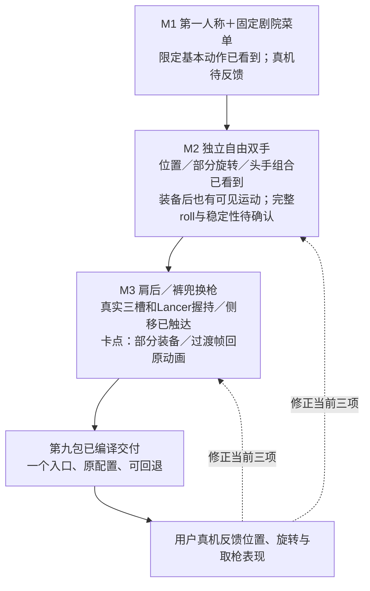
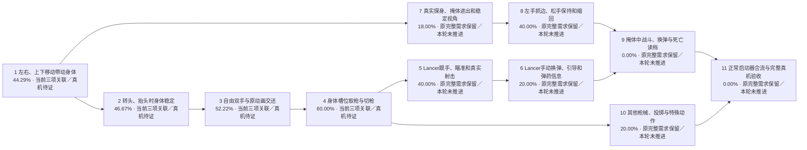

# GearsVR：第一人称、自由双手、身体换枪

更新：2026-10-28T09:02:29+08:00。仅当前会话实施、构建、运行和打包；其他实施／路线图会话已归档，不新增助手。候选源码 `9e0ad18`，工作区 `C:/Users/11/.codex/worktrees/6dof-single/gearsVr`。

**第九包已更新同一入口。** [GearsVR Launcher.exe](</J:/gearsVr/candidates/6dof-unified/GearsVR Launcher.exe>) · [完整说明](/J:/gearsVr/candidates/6dof-unified/README.txt) · [ZIP](/J:/gearsVr/candidates/6dof-unified-20261028-9.zip)。原配置逐字节保留；第八包及回退文件保留。

| 阶段 | 已有可验证结果 | 当前限制／下一步 | 真机 |
| --- | --- | --- | --- |
| M1 第一人称＋固定剧院菜单 | 左右眼第一人称、自身头遮挡移除、暂停大屏空间固定、继续后恢复；证据累计保留 | 未重复未改变的检查；按用户实际反馈修正 | 待反馈 |
| M2 独立自由双手 | 独立位置／部分旋转、固定骨长、头手分离已有画面；本轮装备后手与枪体可见侧移 | 完整翻腕、自然范围和过渡连续性尚未确认 | 待反馈 |
| M3 肩后／裤兜取枪 | 原游戏库存三槽；另一次先手枪再Lancer，实际VR握持48次提交，侧移图像有枪体随动 | 仍有装备／个别画面回原动画；不宣称每帧稳定或全部完成 | 待反馈 |
| 统一候选 | Native＋Playground同步编译 Body source ABI2，v9已交付；物理XR未换成私有模拟版 | 用户醒来按普通启动器体验，无需调试测试脚本 | 尚无用户新反馈 |

## 最新继续工作：未发布实验补丁

装备过渡时，已看到骨架捕获通过、旧 C0 写入等待实际覆盖回执；一段动作65次未提交中64次停在此处，另1次源复制未就绪。它是首个门禁，尚不能单凭计数认定为最终画面根因。稳定持手窗口此前112/112更新可提交。

已沿实际角色读取到 AnimTree → Synch → UpperBodyIKHack → Mirror_Master → **WarAnim_BlendPerBone（FACB0）**。顶层/base-blend 两个实验均未触发，已经从生产源码撤出并私下归档，未覆盖第九包。当前只保留现有状态摘要的首个拒绝计数，源码 `4f40816`，Native编译通过；不算新玩法完成，不增加31.02%的成熟度。所有已结束实验正常退出和恢复。下一步用已保存的聚焦证据核对 FACB0 实际输出覆盖，不再重复错误入口，不改原时效／回执／CAS／回退保护。

## 第九包实际改了什么

换枪后，旧age-only操作虽已回退结束，恢复门仍要求旧武器与旧输入代际不变，曾让身体更新永久停止；现只在完全结束且无回执债务的情况下，认证新角色捕获和当前武器。新操作仍通过完整身份、资产、存储、时效与回退检查，硬故障不恢复。

原渲染Scene与本帧实际角色读取此前共用旧场景时钟。现从首次真实GT角色读取前计时，原Scene时间保留，追踪／当前骨架捕获40ms、实际角色状态50ms、装备50ms；实际Compose入口、Native和Playground一致，旧V1不获续期。两模块90／17项构建定义对照保留，既有Junker、菜单、左眼历史、启动和清理保护保留。

本轮分类边界12项、发送端337项、供应端271项针对检查通过。购买版Source1实际动作／画面与编译证据分列，模拟器及清理通过均不等于用户头显确认。中间“原库存变更就代表VR握持接管”的判断已纠正；最后一局确认了真实VR握持，Lancer资产读取96次成功，侧移有实际画面。

[三槽与可见自由手／枪体运动](C:/Users/11/.codex/worktrees/6dof-single/gearsVr/analysis/solo-m1-20261028/m3-v2-compose-runtime-actions.json)；[VR握持确认](C:/Users/11/.codex/worktrees/6dof-single/gearsVr/analysis/solo-m1-20261028/m3-held-confirm-actions.json)；[实际Lancer侧移画面](C:/Users/11/.codex/worktrees/6dof-single/gearsVr/analysis/solo-m1-20261028/m3-held-confirm-lancer-moved.bmp)。两局均核对Native正常清理、入口恢复、XR exit0、装备参与者排空；本轮不再启动重复检查。

## 原完整需求成熟度

**31.02%；第九包事件 +0.00 个百分点。** 这是11父项／64子项的历史交付成熟度，当前新增集成画面仍落在已有阶段，未跨新分档；不是本轮没有代码成果。前一M1/M2事件 +0.79 已计入，不再重复加分。旧v1的36.36与v2首次30.23为口径重算历史，不能当作本轮倒退。

## 当前执行顺序

用户醒来从同一入口反馈第一人称／双手／取枪的实际表现；当前只收口这三项的过渡连续性和握持反馈，不扩展射击、换弹、掩体或逐枪功能，不重跑未改变的检查。

已知范围：本轮三槽使用私有Source1合成尺寸与受控输入、原游戏库存／拾取和切换；不保存为用户物理记录。手枪／Hammerburst仍沿用自由掌映射，Lancer另有实际握持接管。完整翻腕、各枪自然握持朝向、枪口命中、换弹和完整头显验收均待证。本次没有扩展这些功能。

第九包 Native `041df8394774bf39726d29374a213e9f6ab39c86d8166e3c9d0e9207552a0718`；Playground `4d163c7c7e4ab0c20d8e70a3e7f8ae5e24766ae1686f1f6c8c8a22031c3654ad`；物理XR `cb74d05c3dce128672f86cbeae1108518ecbc3740e5cc8667a3d920c96254237`。ZIP SHA256 `63078f2428bbadb990607f2ce43463085d107184c662cfcfdb6d225815640dfc`。详细[事件记录](/J:/gearsVr/analysis/6dof-progress/solo-v9-20261028.json)，旧看板完整存于history本次快照。

## 每小时复盘执行协议

已有小时任务保持暂停，不新建计时器、不向归档会话派工。后续如用户重新启用，只审阅当前会话新增代码／构建／实际动作证据，优先报告三阶段和首个实际卡点；不得因报表启动游戏、重复全量检查、虚增百分比或把Source1当实体头显。继续保留购买版、后台置后、observe-only、0.4、测试静音／恢复、私有存档／设置和唯一共享写者。
