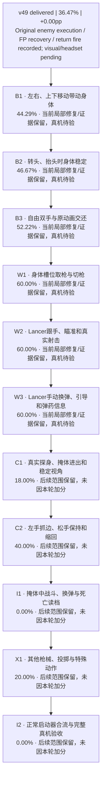
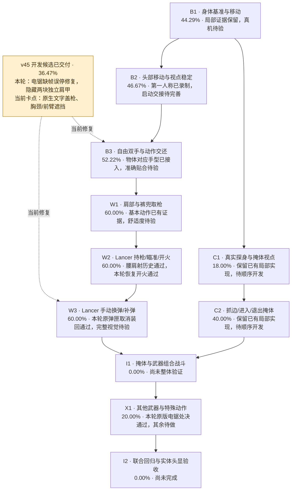
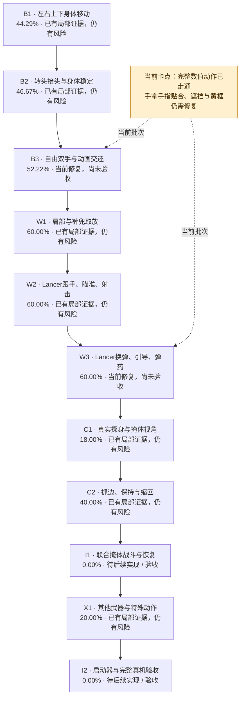
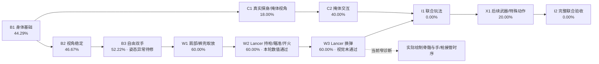
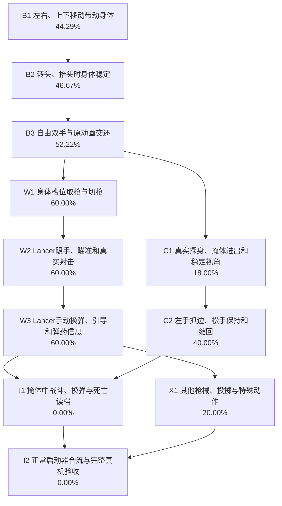
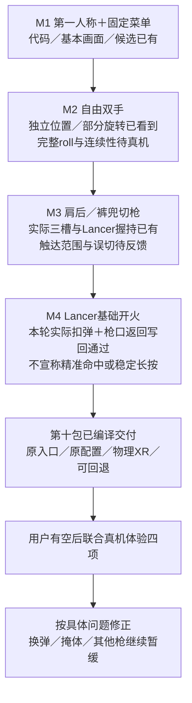
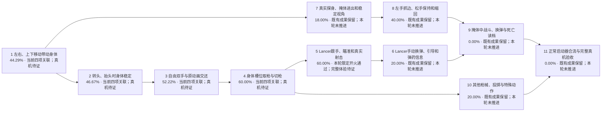

## 2026-11-06 13:39 67624组合复查与同游戏继续：C规则通过，二次抓握失败保留

固定入口v71不变：推到头持续握住持续运行，首次实际松手后单次余转3秒，后拉关闭。普通闭合量的私有125544完成Grip/食指双持、实际转向/双持开火/单手恢复，原弹匣食指与替换弹匣Grip全程保持插入，空仓E实际动作/松手/回位/恢复射击，以及C核心动作。首个原版处决通过，但第二次C抓握启动失败（token12 ambiguous）。未伪称计时缺陷或修复。

不重启游戏，同一67624继续实际食指抓握token13/14，两个不同原版敌人处决、恢复权威射击与暂停/B返回通过。只读双读观察没有重现原失败，不能据此消除它；不放松松手、时效、身份与单写者保护。19页完整跨度双路抽帧及8张动作近景已看；启动约3秒的第三人称暴露、完整贴合/手腕/走路/HUD仍未完成。游戏/Native/输入/入口/XR正常退出；两段录像编码、媒体保留任务完成。被动读取器在正常卸载时末次读取失败（退出1）单列记录，非游戏故障。

最新三会话67624/47468/67428及48小时媒体策略已执行。全Lancer和实体头显验收仍未完成，固定11/64成熟度36.47%，+0.00；本轮没有新交付。证据：[solo-lancer-combined-67624-20261106.json](J:/gearsVr/analysis/6dof-progress/solo-lancer-combined-67624-20261106.json)。

## 2026-11-06 12:49 47468私有张合对照：纠正主手姿态丢失判断

固定候选仍v71，C持续握持/首次松手3秒余转保持。本轮私有编译仅让原有C0的主手闭合量暂随真实右Grip做0→1→0对照；同一控制器位姿、武器身份，36份骨骼观察及28份排队/PRIMARY上传后CPU常量观察随之张开/闭合/张开。44.55/49.48/54.35秒实际镜像也能看到变化。3页完整跨度双路抽帧和9张阶段近景均已检查。

因此撤回“主手张开/姿态丢失已经定位”的过强判断。完整五部位贴合、自然手腕和全部角度仍未验收；CPU常量不是硬件逐Draw证明。下一步核对模型/蒙皮对应及实际接触几何，用无遮挡视角检查，不为未变化的传递链重复采样。私有观察脚本已改为默认关闭遮挡手部的红色调试体积，显式范围复查仍可开启，用户调试功能保留。

诊断编译开关已OFF、普通Native重编译成功，内部运行目录恢复114342，用户v71文件哈希保持。游戏/XR/录制/编码正常结束；媒体仅保留最新三会话47468/67428/71560且不超过48小时。全Lancer/真机验收仍未完成，成熟度36.47%，+0.00。证据：[solo-lancer-main-grip-ab-47468-20261106.json](J:/gearsVr/analysis/6dof-progress/solo-lancer-main-grip-ab-47468-20261106.json)。

## 2026-11-06 12:18 主握姿态补证：可见贴合未通过，纠正丢姿态推断

固定入口仍v71：推到前端持续握住持续运行，首次松手后单次3秒余转，后拉关闭。本次未发布新候选。

49384的24份主手CPU观察、71560的19份CPU/排队蒙皮观察以及67428的18份CPU/排队/PRIMARY上传后CPU常量数组均匹配闭合握枪姿态。67428矩阵最大差1.65344e-5；71560/67428分别有1460/1432次通过原有认证的LOD0头部区段处理。录像仍显示主手与握把不贴合，因此不能再把“闭合姿态在这几段传递中丢失”作为已定位原因，也不能把CPU常量来源等同硬件缓冲或每次实际绘制。内部两轮各5页完整跨度双路抽帧、6张动作近景已检查；换弹/恢复射击/暂停返回通过，手姿未通过。

下一步核对实际GripPoint、手腕与模型参考几何，不增加第二骨骼写者、不猜转角或重复未改变的观察。所有游戏/XR/录制/编码正常结束；旧生成媒体已按最近三个会话及48小时策略清理。全Lancer和真机确认仍未完成。固定11/64成熟度保持36.47%，+0.00。

证据：[solo-lancer-private-main-grip-67428-20261106.json](J:/gearsVr/analysis/6dof-progress/solo-lancer-private-main-grip-67428-20261106.json)。

## 2026-11-06 11:02 内部组合复查39172：动作通过，完整手姿仍未通过

固定启动入口仍为 **v71**，保留“C推到底持续握住持续运行、首次实际松手后单次余转3秒、后拉关闭”。本次未替换用户候选。

内部冻结104020已编译：消费Native为同一次Scene保留的原始输入/发布者，原时间戳与100毫秒限制不变；未知弹匣观察在原100毫秒窗口内解析成唯一护木接触时，允许原来尚未交付的按压完成抓取。280项所有者、25/16项接入、23组支撑及611项绑定检查通过。39172实际使用原始副本60条R2观察；本轮护木首帧已知，未实跑到延迟护木分支，不能把CPU重现写成该分支实跑通过。

39172同一游戏完成Grip/食指两种副手抓取、实际枪身转向、各4发双持射击、松开后4/3发恢复单手射击；原弹匣食指和替换弹匣Grip全程不松手插入、空仓E真实拉动/松手/回位及恢复射击、暂停/B返回通过。完整跨度9页双路时间线和8张实际阶段近景已检查；其中155.02秒一张为等待VR帧卡，保留为缺陷。

**仍不能判为完整手姿通过：**125.08/205.62秒换弹时主手在握把旁张开。E阶段和支撑阶段共36份主手骨骼观察匹配握枪姿态，不能替代弹匣阶段真实像素；下一步查实际主手姿态写入/消费链。53016动作撤销准确来源、旧2572、走路闪烁/HUD/启动第三人称仍保留。Native/入口/XR/游戏正常退出；全Lancer和实体头显验收仍否。成熟度 **36.47%，+0.00**，11/64分母不变。

证据：[39172内部组合记录](J:/gearsVr/analysis/6dof-progress/solo-lancer-private-hand-fit-39172-20261106.json)。不为未改变的C行为再开游戏，不扩展其他枪/会话/助手。

## 2026-11-06 v71：电锯持续握持与松手续转

当前固定候选 **6dof-unified-20261106-71**。推到前端后持续握住便持续运行；首次真正松手后单次续转3秒；后拉主动关闭，同一握持再前推可重新启动。

68424第828帧定位到具体回归：手柄仍有效且按住，但弹匣位置待观察的分支漏报了已获得的C握把。已只恢复该握把的原有持有关系，并移除展开前250毫秒误丢握把；新接触、实际行程、完成动作的250毫秒交接、追踪/身份/释放保护保持。

52548同一游戏11项C检查通过：20秒保持并转头、后拉关闭、同握再推、松手0.43秒仍转/3.52秒已停、收柄及恢复实际射击。已检查5页完整跨度双路时间线和6张实际动作近景；12份C手指观察现在匹配专属姿态。编译、包装、正常退出、Native/入口/XR恢复通过，配置字节保持。

**仍未完成：**五部位全部贴合和自然手姿、69160食指双手输入撤销的准确来源、旧2572准确来源、走路闪烁、HUD和启动第三人称；不宣称Lancer完成或实体头显通过。固定11/64交付成熟度保持 **36.47%（+0.00）**。下一步先继续当前Lancer手姿质量，不开其他枪/会话/助手。

记录：`J:\gearsVr\analysis\6dof-progress\solo-lancer-C-incumbent-52548-20261106.json`；启动入口：`J:/gearsVr/candidates/6dof-unified/GearsVR Launcher.exe`。

## 2026-11-06 v70：弹匣首帧交接窄修，保持电锯持握与松手续转规则

固定入口已更新v70，用户配置、scale1和4秒换弹配置保持原字节，v69可回滚。当前按压的实际手部姿态尚未就绪/仍是旧按压时，PG明确交接待观测状态；仅复用现有100毫秒意图等待，已知无接触、超时和身份/追踪/释放保护不变。内部手部接口升至4并同步编译Native/PG，实际控制器GVC4不变。

53800同一游戏完成原弹匣食指不松手插回、新弹匣Grip不松手吸附、首次空弹匣抓取、实际空仓拉栓/松手/回位和恢复射击；C推到头握住超过3秒不停止、后拉关闭/同握重推、首次松手单次3秒续转/收柄/恢复射击通过。9页完整跨度双路抽帧及12张固定动作近景已检查，录像编码完成，Native/入口/XR/游戏正常退出。首轮脚本在输入前缺PIL，已保留失败并在同一游戏继续；本轮不重新认证完整启动过渡。

本次实跑首个空仓抓取已是当前接触，未进入待观测分支；该分支通过CPU旧按压重现与负例检查。不能把未复现当作已证明2572准确缺失来源。旧C握持期撤销仍待证，212.68秒C手指/表面贴合仍需改；五部位完整姿态、走路闪烁、HUD/启动第三人称与等待卡、实体头显验收均保留。下一交付点：先修本轮212.68秒C握柄的实际手指/表面贴合，并复用既有首次失效行定位仍未证明的握持期输入撤销；保留2572首次空仓首帧接触缺失的准确来源为待证。源码修成 coherent batch 后再一次集中录制，不为无变化重复跑C。

成熟度保持36.47%，+0.00个百分点；11/64分母和权重不变，无新计分子项。证据：`J:/gearsVr/analysis/6dof-progress/solo-lancer-mag-cohort-53800-20261106.json`。

## 2026-11-06 v69：护木握姿转角调整，双手连发与电锯复查

固定入口 `J:/gearsVr/candidates/6dof-unified/GearsVR Launcher.exe` 已更新v69，用户配置/scale1/4秒换弹配置字节保留，v68可回滚。护木仍是原版同一接触点/掌心标记和固定骨长，仅把绕枪轴的固定手腕转角45度减至20度；真实控制器轨迹、抓取范围/归属及射击权威不变。CPU坐标检查1016项通过。

8368实际游戏中Grip/食指两种副手握持均转动枪体、各4发静止连发保持双手、松开恢复单手。共24次手骨观察对应护木预设形状，平均关节误差最大约0.0000068度；这只证明骨骼形状已实际接入，不是全角度表面/舒适性验收。全7页双路时间线及6张护木近景已检查、完整录像已编码；选取视角中护木保持附着，没有原先额外90度朝上的腕轴。C保持20秒、头动、后拉关闭/同次抓握重推、首次松手单次3秒续转/收柄/回到开火通过，Native/入口/XR/游戏正常结束。

现有停机行新增首次服务失效的冻结字段，先保存再做原版松键/收尾，避免之后的撤销覆盖。8368记录正常续转到期为stop_reasons256、lifetime_failure0；last-disarm可能来自更早事件，不能当成这次正常到期的根因。2572仍握住提前停机及首次空仓弹匣needs_release均未定位修复，本轮未复现不等于解决。

下一点查首次空仓弹匣被要求松手重试的实际原因，C来源记录留待下个有具体目的的批次复用；继续Lancer五部位全角度贴合、走路闪烁、HUD/启动短暂第三人称与等待卡。无助手/其他枪扩展。成熟度仍36.47%，本轮+0.00个百分点；11/64分母、权重不变，实体头显验收未完成。证据：`J:/gearsVr/analysis/6dof-progress/solo-lancer-foreend20-8368-20261106.json`。

## 2026-11-06 v66：电锯保持与3秒续转，双手连发回退已修复

已编译并更新固定启动入口 `J:/gearsVr/candidates/6dof-unified/GearsVR Launcher.exe`，候选 `6dof-unified-20261106-66`。实际推到C握柄前端并保持握住时持续运行，首次实际松手后单次续转3秒；主动后拉关闭及中断保护保留。

67776/source1的Grip和食指两组双手连发各3发，权威枪口方向跨度均0度，枪口位移分别0.000061和0.000484raw，松手恢复单手；C保持超过3秒、头动、后拉/同次握持重启、松手续转/停机/收柄及恢复射击均通过。已检查完整193秒双路时间线的7页抽帧与护木近景；不是实体头显验收或完整五部位手姿通过。保留64672的弹匣不松手吸附、空仓E拉栓及弹量证据。

实际根因：旧姿态约103毫秒过期时，同时清掉了护木逻辑抓握。修复后仍拒绝超过100毫秒的旧姿态与动作权限，只有下一帧重新确认身份、挂点、参考/输入epoch和真实按键才保留抓握。源码/检查/前序失败均保留。

成熟度仍为36.47%，本轮+0.00个百分点；11/64固定范围不变。本次是已有双手功能的回退修复，未因测试数量或排障加分。完整Lancer、五部位贴合、空手地面武器闪现、走路闪烁、第二次处决/眼点、HUD及实体头显手感仍有工作。下一步继续同一Lancer批次。证据：`analysis/6dof-progress/solo-lancer-formfit-burst-20261106.json`。

## Latest narrow recheck21312 and next source (2026-11-05)

-21312/creation134383634166344945, Nativef31f41a2 + PG7643d0ae, shippedPython scale1 Source1: held original-index/replacement-Grip Magwell and three walk-stop cycles passed in128 personally reviewed saved game frames. Five full-span paired overviews reviewed. Normal Native/entry/XR/launcher cleanup. This NON-REPRODUCTION does not clear confirmed63820 stock-pose flash; keep walking/complete Lancer OPEN.

- Existing palette journal found no44raw walking divergence in21312; one6.437raw uncomposed sample had consumer3/finish4/publication6/flags31. Next source equipment-controls-prepared-20261105-230840 (Native da181e33, PG7643d0ae) compiled, NOT RUN. It extends passive observation to same-mesh unselected Compose/caller/source-slot state, without changing guard/pose permissions. No further unchanged rerun.

- C private posture preparation now rejects retreat behind a forward10cm envelope. Normal side-on candidate and forward/central victim candidate are UNVERIFIED; do not assume side-on yaw aims at the opponent or reuse behind-eye input to pass reach. Keep actual blade/arm/contact constraints and inspect deployed grasp geometry before the next coherent C check.

- Publicv63 unchanged; goal remains active. No live owned game/XR/recording/encoder/build job. Review: analysis/solo-m1-20261028/lancer-render-publication-21312-review.json; prior failure: lancer-integrated-63820-review.json.

## Latest integrated Lancer review63820 (2026-11-05)

- Sole owner; publicv63 unchanged. Full integrated Nativea5a45333 + PG7643d0ae compiled and ran at scale1/4096x3288, shippedPython, Source1. Grip/index two-hand, sustained original-index/replacement-Grip Magwell seating, once-only ammunition, actual empty E pull/release/return, C on/off/restart/retraction, two original enemy executions and return fire, pause/B resume passed mechanically; normal Native/entry/XR/launcher/WGC cleanup.

- Full visual acceptance FAIL: all14 paired overviews and52 walking captures reviewed. game-01677.jpg (~140.03s) briefly returns to stock arm/gun pose. Actual palette35 at694286149584100 diverges44.19raw units from the physical target while native_compose404913 reported commit1; selected SpaceBases and GPU agree. Kernel_pending2 absent. The earlier18124 narrow pass remains valid only for that window. Do not call all walking flicker fixed.

- Reuse existing GPU palette journal with passive consumer/finish/publication/retained-rejection fields; compile passed. No freshness/identity/receipt relaxation or second writer. Next one focused integrated Magwell/walk-stop reproduction, then repair the actual cause. C behind-eye private pose is also a confirmed visual setup defect; offline natural plan pending actual review. No parallel weapons/helpers.

- Range UI/config/runtime and actual overlay wired; normal defaultoff. Dense simultaneous shapes remain a clarity limitation. Two private recording/import setup errors retained; same63820 game resumed without restart. Y was not exercised. Evidence: analysis/solo-m1-20261028/lancer-integrated-63820-review.json. Physical KRVR/headset acceptance remains pending.

## Latest walking repair and reviewed evidence (2026-11-05, game18124)

- All known owned game/XR/operator/recorder/encoder jobs are terminal; private inputs restored. Public v63 remains unchanged. Goal active, full Lancer/physical acceptance false. No helpers/other guns or owner startup-debugging requests.

- Actual47432 skipped frames selected a new depth16 full-weight child2FDE20; earlier depth18 F8AF4 records were from an older epoch. Existing bounded entry diagnostics now retain latest canonical identities and join them to pending-frame QPC. The first proposed FACB0->F8AF4 path never executed in19136 and was removed; do not claim it repaired anything. Corrected the kind2 observation call order as well.

- Pinned historical snapshot911ab9b contains actual2FDE20 and F6CBC/F6D8C hot+cold chunks. Current Native attests them plus F7858 and existing E08A0/decoder code. The first-full branch writes all desired atoms but returns WITHOUT advancing child epoch; positive partial blends initialize every desired atom from the first positive scratch pose and finish through F6D8C. Implement both exact contracts; no epoch-only/value-only retirement, debt reset, new skeletal writer or guard relaxation.46 source guard tests and7 code-range checks passed.

- Actual18124 creation134383567015323682, Nativea5a45333, PG3fac58a1(v63), shipped Python3.12, scale1/4096x3288 per eye, Source1: actual pickup/shoulder/fire (Y was not exercised), held walk/muzzle fire, pause/B resume and normal Native/entry/XR/launcher cleanup passed. sequence_set_started27/finished11; kernel_pending rejection2 absent/zero. An inner decoder may retire before an outer receipt returns, so finish count alone is not a store-failure count. Keep captures701/commits668 and one other rejection3 separate; not all-update acceptance.

- Reviewed all72 saved game captures in the actual37.94..43.94s held-walk bracket on3 dense pages,6 nearest simulator pairs and both full-span overview pages. Previous recurring hands/gun-down drop was not seen in those72 captures; focused recorded walking regression passes this run. Not every render, same source ticket, physical headset or comfort acceptance. Video encoded; capture window-closure finalization is separate from Native cleanup. See lancer-walking-sequence-set-18124-review.json.

- Startup TPS/theater exposure and original equip-transition mesh intrusion remain open. Startup prelaunch part preparation is source-only, physical KRVR startup still unverified. Next integrate existing sustained-grasp smooth Magwell and owner-requested range visualization into one coherent build/recorded Lancer check. Range drawing remains disabled/unwired WIP; do not claim delivered. Retain current source, failed attempts and protections; no new weapon expansion.

## Latest reviewed startup and walking status (2026-11-05, game5820)

- All known owned game/XR/operator/recorder/encoder jobs have ended; private inputs restored. Public v63 is unchanged. Owner withdrew manual testing; continue self-check/repair, no owner startup-debugging request or helpers.

- Renderer proof_failure/owned_error8 preceded the earlier69872 hand-registration rejection. Temporary Broker observer removed. Native5a83ec32 retains exact existing GPU-summary diagnostics only; no admission/state/identity protections relaxed.

- Actual5820, shipped Python3.12, scale1/4096x3288 per eye, Source1: first-person game/simulator output, original pickup/shoulder draw (Y was not exercised), authoritative walking muzzle fire, pause/B resume and normal Native/entry/XR/launcher cleanup passed. Authored default slot layout was used, not measured armspan. Memory minimum commit headroom improved from15MB in63560 to4.73GB; do not assert software-only startup causality or physical KRVR acceptance.

- Reviewed all7 sampled paired overview pages, all76 captured walking frames on4 dense sheets, and paired normal/drop/recovery image. Game03360..03365 at183.281..183.548s loses hand/gun pose while only left-stick input changes. Nearest simulator both-eye images show the same drop; capture time alignment does not prove identical source ticket or physical pixels. C0 skipped20 admissions; walking remains FAIL.

- Startup TPS exposure before settled first person and an equipment-transition mesh intrusion remain open. WGC target closure interrupted finalization (exit1); frames were recovered and paired video encoded/reviewed. This is separate from normal Native cleanup. See lancer-startup-5820-review.json. Next narrow task is actual original producer branch at pending walking frames, then its repair; no other weapon expansion.

<!-- lancer-walk-snap-61872 -->

## Current private Magwell and walking review (2026-11-05, game61872)

- Publicv63 remains unchanged. Private source160851, PGe6b5e59a..., Native391170e1... unchanged: 180ms bounded final Magwell seating after real approach, including diagonal shoulder reach; input can remain held throughout. Same seated grasp survives until real release; no repeat extraction/refill.143 assistance checks + existing insertion check, PG compile successful.

- Actual61872 original INDEX held:56/S360 unchanged after seat; real release then fire56->52. Replacement GRIP held:52/S360->60/S352 exactly once, continued hold stable, real release then fire60->56; pause/B resume and normal Native/entry/XR/launcher cleanup passed. All4 sampled paired overview pages and4 dense walking pages reviewed; video encoded. This is simulation evidence, not physical comfort/full Lancer acceptance.

- Walking remains FAIL. Actual game88 at4.516613s and102 at5.183274s show hands dropping then recovering. Existing render-palette observer binds those windows to held_outcome::NativeBegin4 = kernel_pending (NOT backend capture). First pending at4.4769566s has55 fields, covered0, installed epoch1343/current1344, same storage/metadata, no protocol/failure. Prior successful-C0-only32 receipts missed these skipped frames. Do not claim all-point checks prove walking normal. Render composed0 while moving is not alone a defect: actor component translation also makes the prior endpoint unavailable.

- Next narrow repair: establish the missing actual original cached/full-weight animation copy/overwrite receipt and close the sole C0 handoff. Do NOT clear pending debt, infer a write merely from epoch/value changes, weaken identity/freshness, add a second skeletal writer or start other weapons. F7940/F8AF4 cached-copy route is still a candidate, not yet a proved branch. Shared REA IDA provider is unconfigured and direct IDA worker lacks ida_nexus; no analysis setup/config was changed. Existing shared KB and byte-attested source remain usable.

- Preserve failed40032 initial wrong title precondition (already Playground) and same-game replacement diagonal-approach failure; original index path passed.143-check diagonal-distance witness repair then passed actual61872 without requiring another axial shove. No new diagnostics collector/base-entry observer:61872 explicitly reused existing bounded render-palette observations because first32 C0 returns could not locate the visual failure. See analysis/solo-m1-20261028/lancer-walk-magwell-61872-review.json.

<!-- lancer-walking-magwell-20261105 -->

> **最新阻断：** 用户指出走路手闪烁后，已逐张看70068录像3.2～8.5秒全部109张游戏捕获帧，确认手臂周期性掉到画面下方／切换姿态。桌面游戏镜像失败已确认，邻近模拟器采样未直接复现同帧，不能扩大为实体头显结论；根因和修复尚未证实。按用户新规则补“肩后拿匣→持续抓取→弹匣及手平滑吸入弹井→到位锁定”，不能要求松手才吸附。v63目前仍是侧向／角度辅助，自动轴向入座待实现，现有代码的提交已在按住状态执行。当前正式v63不变，不宣称整把Lancer已可用。交互范围表 `analysis/solo-m1-20261028/lancer-v63-interaction-volumes.json`；录像/退出/失败回执 `lancer-zero-reserve-70068-review.json`。无备用弹准备在原有128条弹道文字导出上限处中止，尚未到零备用，不记通过。媒体按48小时及最新三局双上限清理，已安排每两天现有流程清理。

<!-- /lancer-walking-magwell-20261105 -->

<!-- lancer-v63-20261105 -->

> **当前固定入口v63（2026-11-05 14:31）：** 补齐原有“满匣／无备用弹仍可检查原弹匣”范围内的恢复缺口：检查不应强迫创建原版补弹事务。64980实际录到满匣60／备用360，拔出、头部追踪中断恢复、真实松手重抓和放回后仍60／360，随后实际射击60→56、暂停返回。没有新增换弹计时或奖励。无备用弹20／0目前仅编译约束通过，未实跑，不能并称两种情况均验收。三页配对概览、两张关键近景已审阅，正常退出、安装身份、原配置与v62回退已核对。回执 `analysis/solo-m1-20261028/lancer-inspection-recovery-v63-delivery-review.json`。整把Lancer／自然贴合手感／实体头显与KRVR实际头部更新恢复仍待验收；成熟度不加分、分母不变。下方旧“当前”版本为历史。

<!-- /lancer-v63-20261105 -->

<!-- lancer-v62-20261105 -->

> **2026-11-05 14:03：固定入口已交付 v62，v61及更早内容为历史。** 本轮发现并修复：拔出的旧弹匣在头部追踪恢复后，被错误转入收存/拿新弹匣流程；重新抓取后的持有保持也一并修正。保留同一武器/弹匣/弹量和当前会话检查，恢复本身不授予动作，仍要求真实松手、重新抓取和插回。最终53768录到追踪中断/恢复后原弹匣放回，弹量56、备用360不变，随后实际开火56→52，暂停返回成功。Native未改，PG为e098f75b；保留用户配置、scale1、四秒时序与v61回退。

>

> 同批29360还录到半程E中断回位仍禁火、重新抓取完整拉栓后开火；C运行中断停机、旧按压不能重启、真实松手/重新抓柄/前推恢复及后拉关闭/松手收柄。最终构建保留11个机构源码，复用这段证据，未重跑完整E/C或敌人攻击。两次旧弹匣失败保留，四段录像全部13页概览和6张关键近景已看，正常清理完成。回执 `analysis/solo-m1-20261028/lancer-original-recovery-v62-delivery-review.json`，安装校验 `lancer-v62-installed-verification.json`。实体头显手感/完整皮肤贴合、KRVR真实头部数据中断原因与实际恢复仍待证；不称完整Lancer完成，不按检查次数加分，不改11父项/64子项范围。

<!-- /lancer-v62-20261105 -->

<!-- lancer-v61-head-recovery-20261105 -->

> **v61新增私有追踪恢复证据，正式版本未更换。** 同一18896游戏中，头部追踪实际15→3→15、双手保持15；等待提示后恢复第一人称双眼，枪继续跟手，新扳机开火3发且56→53扣弹一致、备用360不变，暂停返回成功。首次检查误用标题入口、在目标动作前退出，保留原片并在同一游戏续行；两段配对录像、四页概览和关键近景已核对，正常清理完成。

>

> 只改私有模拟器以覆盖原来无法复现的追踪分支；691个产品源码及正式二进制不变。回执 `analysis/solo-m1-20261028/lancer-head-recovery-v61-supplemental-review.json`。这不代表真机KRVR中断原因已解决，也不代替弹匣/E/C中途失踪、自然手姿或实体头显验收；不加成熟度、不改分母、不扩展其他枪。

<!-- /lancer-v61-head-recovery-20261105 -->

<!-- lancer-v61-supplement-20261105 -->

> **2026-11-05 v61补充验证，未更换产品二进制。** 右肩＝玩家武器槽1（原版索引3）已用实际原版X拾枪/替换流程准备，其他库存槽不重排。同一5780游戏录到右肩食指取枪/重新取枪、取枪按住不误射、Grip收枪、提前按住扫入不取枪、真实松开再按的枪口开火60→57→53，以及暂停返回。此前准备走位、引用匹配与状态文件读取失败共五段全部保留；实际走过的路径倒退恢复，复用现有稳定只读弹量器后续行通过，未重启游戏/修改产品/伪造输入或槽位。

>

> 六段配对录像、九页概览与关键近景已查看。暂停转换中捕获一张黑色模拟器画面，下一张约50毫秒后为菜单，随后恢复操作成功；不称全程无黑帧或复现了持续黑菜单。E新增离线核对69个持有采样：附着修正最大约8.15厘米，在既有上限内且按保存肩部未越臂长；这不是实画骨骼/皮肤或头显验收。补充回执 `analysis/solo-m1-20261028/lancer-right-index-v61-supplemental-review.json`。固定入口仍v61，所有生产源码/二进制与交付一致，正常清理完成；成熟度不加分、完整Lancer与实体头显待验收。

<!-- /lancer-v61-supplement-20261105 -->

<!-- lancer-current-20261105-v61 -->

> **2026-11-05 12:10 当前固定入口为 v61（6dof-unified-20261105-61）；下方 v60 及更早交付为历史。** 本次仅改 E 长槽拉栓的渐进末段辅助（6厘米→最多10厘米），保留约23.04模型单位的机构全行程、真实输入/到位/松手/回位要求。私有13248同一游戏完成有限弹药空仓换弹、12厘米短拉仍禁火、复现用户保存的约14.14厘米完整相对拉动后实际机构走完23.04并回位、恢复枪口开火与暂停返回。备用弹量300→240，恢复开火60→56。该路线重定位到当前抓点、固定持枪与初始手腕；不是原始世界/头部/双手完整回放或实体头显通过。

>

> 首次200毫秒独立抽样漏掉松手附近的短暂满行程，保留失败判定及整段录像；只加密现有只读观察，在同一个游戏中续行通过，未换产品二进制。全部4+3页配对概览及拉动/回位近景已看；手/前臂会遮住小拉柄，不宣称完美皮肤接触、全像素或手感验收。编译、打包身份、正常清理与回退见 `analysis/solo-m1-20261028/lancer-short-charge-v61-delivery-review.json` 和 `candidate-delivery-v61.json`。保留scale1、用户配置、四秒时序、既有双按键/五类手姿/弹匣/双持/C修复及v60回退；成熟度不加分、11父项/64子项分母不变。

<!-- /lancer-current-20261105-v61 -->

<!-- lancer-current-20261105-v60 -->

> **2026-11-05 11:21 当前固定入口已更新为 v60（6dof-unified-20261105-60）；下方 v59 及更早版本均为历史。** 空手从肩膀取 Lancer 增加真实食指新按压，保留 Grip；持枪后食指负责射击，取枪同一按压由现有唯一 R2 管理保持禁止开火直到真实松开。私有18364同场录制验证左肩取枪/重新取枪、按住不误射、Grip收枪、空中提前按住不扫入取枪，以及松开再按后的两次枪口开火（弹量60→56→52）和暂停恢复。右肩同类路由有代码检查，本轮未新增右肩Lancer实跑。首次录制脚本错误及原片保留，在同一游戏中修正续行；双路全部概览和关键近景已查看，正常清理完成。

>

> 交付与限制见 `analysis/solo-m1-20261028/lancer-index-v60-delivery-review.json`、`candidate-delivery-v60.json` 和最新 `lancer-repair-current.json`。设置、scale1、四秒时序及此前弹匣/E/C/双持/机瞄修复保留，并保存v59回退；未重新宣称整套换弹/电锯或实体头显通过。用户所贴建议中的获取/保持分离、独立附着姿态、渐进辅助和单轴机构原则采用；不能把VIS默认出碰撞盒松手、纯程序化无锚点或通用12厘米断开作为当前已证实根因。本更新不改11父项/64子项分母，不按检查次数加分。

<!-- /lancer-current-20261105-v60 -->

<!-- lancer-private-visual-20261104 -->

> **2026-11-04 当前：公开固定入口仍为 v53；本轮新代码在私人候选，整把 Lancer 与实体头显尚未验收。** Steam 缓存离线账号已实际启动正版游戏；ActiveUser=0／旧 Logged Off 不能证明退出登录，先前判断撤回。

>

> **已修并复查：** 模拟器最后一级 GDI 默认 BLACKONWHITE 缩图会把干净像素合成彩色横纹，已用保存的原图在内存中复现，改 COLORONCOLOR 编译后，64552／31860／67904 实际双路画面未再见同类横纹。此项仅私人模拟器，未改实体 XR 或缩小 scale1。

>

> **实际动作：** 64552 联合录制走通真实双手握持／枪口射击／取消／有余弹换弹／四秒完美换弹／空仓插匣与正确 E 拉柄回位；同一次 Grip 的 C 第二次前推失败，异常和录像保留。只保留既有抓握的独立新鲜输入确认接入过期 Frame 分支后，31860 定向复查前推开／后拉关／同握重启／松手折回／恢复射击通过；具体过期分支本轮未单独观察，不能宣布所有偶发问题已根除。

>

> **E 手型：** 小拉柄不再强迫采用 C 圆柱大幅旋腕，初次显示手型贴合最多30度，继续使用食指／拇指夹取；不修改真实输入、机械行程或弹药。PG 已编译，既有手型／单 C0 固定骨长检查通过；67904 完整空仓 E 部分拉动仍禁开火、完整拉动／松手／实际回位后开火通过。夹住后90.2–94秒遮挡改善，但89–89.8秒接近时仍有大袖子。两路真实末帧已确认暂停后恢复第一人称，不能只凭菜单树通过或最后一张3秒概览判断。

>

> **剩余卡点：** C 同握再次前推启动时短暂枪姿跳变（31860约72.995秒）；E 接近时的袖子／自然姿态。拾枪约0.5秒不见双手与现有原版 SM53 手臂交接政策相符，仍须分清原版动作与输入／显示故障，不能称早期弹匣闪烁已修。继续同一 Lancer 批次，不开助手、不扩其他枪、不重跑未变完整换弹；不隐藏整块胸甲。

>

> 私人源码冻结：`equipment-controls-prepared-20261104-092952`；PG `4ea34478213c…`，Native `21b38a88cd3f…` 与公开v53相同。64552／31860／67904 均正常 Native／入口恢复、XR及启动器退出0。审阅：`lancer-combined-64552-review.json`、`lancer-C-31860-review.json`、`lancer-E-67904-review.json`、`simulator-preview-color-repair-20261104.json`，均在 `analysis/solo-m1-20261028/`。成熟度36.47%不变，11父项／64子项分母不变；代码／编译／模拟录像不替代实体头显验收。

> **10:26逐帧更正与待复查代码：** 31860首轮后拉关闭70.146–71.546秒密集样本中枪体基本稳定；同握再次前推72.995秒，两路均出现短暂替代枪姿。此前约81秒已在松手／右手返回区间，不能单独证明关机故障。根因尚未确认。已复用现有最多64条手腕记录，新增仅私人模拟器可选的第二次实际ready33窗口；默认关闭，不变输入时钟／机械判定／写者。Native编译及窗口边沿／身份重置／上限检查通过，尚未实跑。E私人演示接近改为校准手腕的最短自然转动，不强加圆柱柄旋腕；保存67904几何离线检查通过，视觉待查。准备源码 equipment-controls-prepared-20261104-102542，公开v53未改；保留FPS对照进程49004的运行窗口，不新开游戏、不打断它。成熟度36.47%不变。

> **10:54实际失败与修复：** 13108已录制并查看完整3页双路时间轴，C完整前推在首次启动前因连续性判断取消；游戏侧两次读入相隔333.334毫秒，最新数据年龄47毫秒，记录中的来源／追踪世代／按压计数未变。没有到达第二次ready33，手腕记录为0，不能算枪姿复查通过。现已复用现有同物件抓握输入校验区分慢游戏读取与真实XR中断；仍保留100毫秒新鲜输入／几何、每同步来源世代、松手计数、生命周期与实际手／机构行程。PG／Native编译，42项相关模型情形和33项真实来源追踪器／抓握校验情形通过；游戏复查待进行。准备源码 equipment-controls-prepared-20261104-105253，PG 4703e34e778b；公开v53未改。13108正常清理，最近三局媒体13108／67904／31860；64552媒体按要求清理，文本与数值保留。FPS半尺寸进程62720已核实存活，保留它的运行窗口。成熟度36.47%不变。

> **11:39两次实际复查及下一窄修复：** 43412／11744的C前推开、后拉关、同Grip重启、松手收回与恢复开火均执行通过，四页整段双路时间轴及重启密集画面均已看；仍确认第二次启动短暂枪姿跳变。原生数据中右手腕与挂点52正确且稳定，实际枪体矩阵却短暂相差26.49／26.16厘米；第一条compose枪体状态11为未知，不能把零矩阵算成数十米跳动。未观察到实际长消费间隔修复分支，不声称偶发连续性问题全部根除。已编译同一写者下仅刷新当前武器自己的原版组件（不刷新整个人物），要求真实当前矩阵回执；源码equipment-controls-prepared-20261104-113839，游戏复查进行中。公开v53未改，36.47%不变。最近三局媒体11744／43412／13108；67904及更旧媒体已按要求清理，数值／文本保留。

> **11:49窄修复结果：** 56924的机械流程仍通过，但仅更新武器Actor没有更新当前挂接，真实矩阵回执拒绝，录像72.025秒仍跳变约27.48厘米；四页双路总览及密集帧已看，不能称修好。该尝试已归档并替换。下一源码equipment-controls-prepared-20261104-114711，改在C0事务结束后使用原有挂接拥有者的transform-only／collision-off更新，前后核对当前端点与实际矩阵；没有直接骨骼写入或动画求值请求，正在定向复查。公开v53和成熟度不变。

> **12:48实际进展：** 新源码equipment-controls-prepared-20261104-122855把原版枪体组件待更新工作移到视觉回调结束后的网格Tick返回点；62700拾枪开火、C前推开／后拉关／同握重启／松手收回／恢复开火通过，四页整段双路总览和两段密集帧已看。第二次重启原26厘米跳变已不再出现，21条实际记录的枪体／挂点位置差最多0.003293游戏单位（数值一致性，不是实体追踪精度）。但首次启动65.97秒游戏／66.07秒模拟器仍短暂跳动，整把Lancer仍未视觉验收。已准备更早的回调结束后更新机会及首次启动记录，40毫秒和所有身份／输入保护不变；两次编译因系统提交空间不足失败，当前外部游戏46316／XR71192正在运行，保留其窗口后再编译和做一次联合换弹／E／C复查。公开v53与成熟度36.47%不变。

<!-- /lancer-private-visual-20261104 -->

<!-- sixdof-v53-current-20261104 -->

> **2026-11-04 最新覆盖：固定入口已更新到 v53 开发候选。** 本会话唯一实现／编译／打包／运行；宽松交互、单一写者、身份与时效及资源保护继续保留。用户启动配置、换弹配置字节未变；回退目录 `J:/gearsVr/candidates/6dof-unified-20261104-53-rollback` 保存v52。

>

> **本轮代码：** 装备读取准确同一份数据时，复用现有最多3次即时锁重试，仅限真实传输占用；不重置输入时间、不放宽过期条件、不换新数据顶替旧帧。现有限量拒绝记录补齐连续性结果与原边沿时间。Playground手雷移到内侧，原版拾取／库存逻辑不变。读取器241项、装备输入1046项、装备状态1465项进程内检查通过，范围不等于游戏／头显。

>

> **1792实际成果：** 同一局VR捡雷库存1→3；后半段不重试地连续切雷→同一Lancer、收枪→原版X→拔枪、暂停→确认返回→拔枪、再收枪拔枪和4发实际枪口射击通过，子弹起点与实际枪口误差0，来源一致。前段私有脚本误用开局武器类别进入重复拾枪分支，被旧物件身份拒绝；异常保留，修正后在原局续行，不能写所有尝试一次通过。

>

> **审阅与限制：** 两段录像的7页双路QPC时间轴、暂停密集抽帧和真实末帧已看；两路都恢复第一人称，Native／入口清理确认、XR／启动器0且无遗留自有游戏。67672漏Grip本轮未复现，但准确成因及实际瞬时锁重试分支未被观察，不能说所有漏输入根除。模拟器前景彩色细横纹仍明显；一次菜单返回中模拟器比游戏晚约0.25秒，随后恢复。整套视觉和用户头显仍未验收。

>

> **下一步：** 在当前Lancer批次内定位彩色细横纹与交接画面来源，先复用现有录像和渲染链证据，不重跑无变化的全套换弹／电锯，不扩其他枪。此前Lancer双手、换弹、前拉柄、C柄和射击证据继续保留；成熟度36.47%不变，11父项／64子项分母不变，不以检查次数加分。

>

> 固定入口：`J:/gearsVr/candidates/6dof-unified/GearsVR Launcher.exe`。当前状态 `analysis/solo-m1-20261028/lancer-repair-current.json`；交付 `candidate-delivery-v53.json`；本轮审阅 `ground-grenade-1792-review.json`。Steam缓存离线账号已实际启动正版游戏，旧“退出登录／需重新登录”判断撤回。

<!-- /sixdof-v53-current-20261104 -->

<!-- lancer-body-seam-66092-current -->

> 2026-11-03 21:42：最新私有复核为66092；公开候选仍是v49，未新增v50。C握柄前推启动后，实际刀链接敌触发同一敌人的原版攻击、原版死亡、第一人称自由查看、恢复持枪及扳机开火均有本轮记录。完整正常前推／后拉／同握再推／松手折回沿用18068的数值与文本回执，其较早媒体按三会话保留规则清理。

>

> 本轮只修显示中的领口蒙皮接缝：身体绘制保留本次原始Neck矩阵，头部绘制继续隐藏；334个领口顶点／514个三角形，无手臂权重混入。Native编译、4284项相关离线检查及1871次本地实际绘制应用通过。但录像117.24–119.95秒的攻击起手仍有领口／胸甲遮挡、近眼干涉，因此视觉修复未通过，不据此发新候选或宣称Lancer完成。

>

> 已查看五页完整时间轴抽帧和七张全尺寸游戏／双眼攻击画面。下一步继续针对上胸／领口的本地绘制可见性修复，保留原版攻击、自由HMD、固定骨长、同一相机与单一写者。已有枪手姿态偶发中断、精细抓握与换弹松手问题保留。总成熟度36.47%，本事件+0.00pp；实体头显未验收。

<!-- /lancer-body-seam-66092-current -->

<!-- lancer-C-forward-on-v48-current -->

> 最新电锯交付（2026-11-03，v49）：C 平时收起，真实抓握展开；向枪口前推启动，向枪托后拉关闭；同握可再次前推。松手／追踪中断／收枪时停锯并回位。E 前方小拉柄仍只用于空仓上膛，B 翻转机构没有玩家交互。固定入口仍为 `J:/gearsVr/candidates/6dof-unified/GearsVR Launcher.exe`。

>

> 60944 定向复查已走通：真实 C 抓握／前推启动 → 保持抓握走向原版 AI 对手 → 实际锯刃接触 → 原版同一敌人的攻击与伤害 → 原版动作结束 → 恢复 6DoF → 新扳机恢复权威开火（第 7–12 发，枪口／轨迹来源一致）。攻击请求一次；攻击者 SM34、受害者 SM35、原版死亡与返回 SM0 均记录。普通 ON／OFF／同握再 ON／松手折叠沿用 18068 已通过记录，60944 没有冒充同轮重测全部动作或换弹。

>

> 已查看本轮全段时间轴 5 页，以及攻击开始／中段／结束的 6 张原尺寸游戏＋双眼画面；118.44–121.30 秒实际为第一人称动画，自由头动保留。明显未完成项：攻击起手仍有胸甲／肩部／前臂穿视野；不能宣布完整视觉或整把 Lancer 可用性验收通过。此前姿态闪回、精细抓姿、提示重叠、启动第三人称桌面／XR 等待交接、18068 的偶发持有生命周期中断及 28740 换弹释放仍待修。

>

> 本批修复：只读输入观察／缺姿态时用独立新鲜输入确认已有持枪，避免误清；模拟走动不再偷偷松开副手；未执行且仍按住的扳机请求最多等待 250ms，每次真正开火仍要求新的 ≤100ms 来源、相同按下／释放计数与追踪／发布者、20ms 调用余量，原始请求时钟不重置。CPU 输入边界 110 场景／1465 检查及 R2 838 检查通过，和游戏结果分开记。

>

> v49 已编译打包并更新统一入口，9 个变更文件有 v48 回退，751 个分发文件核对，用户配置／4 秒换弹 INI 原样保留。源码冻结为 `equipment-controls-prepared-20261103-211127`，PG SHA256 前缀 `749d3910`；正常退出、Native／入口恢复及 XR 退出 0。实体头显验收仍待用户反馈。

>

> 下一批先修实际录到的攻击起手本体穿视野和握持视觉，再查偶发中断；不并行其他枪，不重跑无变化的完整换弹。成熟度保持 36.47%，本轮 +0.00pp，固定 11 父项／64 子项／192 操作点不变。媒体保留 60944／680／18068 三次完成会话；更早媒体标记已清理，文本数值／源码／回退不删，本轮清理约 3.61GiB。

<!-- /lancer-C-forward-on-v48-current -->

> 最新原版电锯核对（2026-11-03）：15696/17508通过原版B按住/释放观察到电机与SM33启动/停止；C手柄相对枪身在91/69个有界采样中都未移动。原版枪械动画树唯一骨控为弹匣AmmoControl，既有C三段动画为静止键。先前90度C动作是自行设计的VR交互，不能称原版动画；体感动作与手型仍待完善。

>

> 前拉柄手型已解除对C电锯柄资源的错误依赖；Native已编译，17508实际前拉柄3.5→0后恢复射击通过。该轮双路画面取景明显不同，C近景仍有手臂/肩甲遮挡，视觉不得算通过；还发现原版VR B可以绕过体感启动，须保留菜单B同时修正玩法路径。公开候选仍v47，尚未发布本轮Native修改；成熟度36.47%不变，完整Lancer/真机未验收。保留最新17508/15696/20832媒体，其余数值文本不删。

> 最新交付（2026-11-03 16:35）：v47统一开发候选已更新到固定启动入口，收枪不补弹、不替代上膛。同一把Lancer空仓收放0/0/0发、备用356不变；插匣未上膛收放60/60/60发、备用296不变，取回后扳机仍被阻止（48540）。

>

> 正确前方小拉柄在20832走通实际3.5模型单位拉出→松手→实际回位0→恢复权威射击，完成前持续禁止空仓开火。B翻转机构没有玩家交互。8364端点浮点误差已修正，50484仍发生过动作帧中断安全取消；20832通过不代表偶发问题消失。五页完整双路时间轴及拉柄细节已查看；正常退出/入口恢复通过。原版C电锯启动动作、抓取贴合/前臂与胸肩遮挡、黄框可发现性及暂停恢复后的稳定XR投影仍待完善。历史“原版启动通过”不等于C手柄原版动画方向/行程已经核实。成熟度36.47%保持不变，完整视觉及实体头显未验收。

# 6DoF 开发进度

## 2026-11-03 16:35：v47 收枪保留状态与正确前拉柄已交付

固定入口：`J:/gearsVr/candidates/6dof-unified/GearsVR Launcher.exe`；版本`6dof-unified-20261103-47`。11个变更文件保留v46回退，751个分发文件逐项核对，用户配置和4秒换弹INI原样保留。便携导入/清单/PE核对通过；打包没有运行游戏或测试程序。

本轮可验证结果是收枪后的实际弹药/未上膛状态保留，以及正确前拉柄完整拉出、松手、回位后恢复射击；不能据此宣布完整Lancer、原版C启动动作、视觉或头显验收完成。50484失败、8364端点错误与20832通过分开保留。媒体仅保留20832/50484/8364三次会话，旧48540数值和文本仍在，其媒体已裁剪。

下一批：基于现有原版证据核对C启动动作，并一起修正记录中的手部/本体遮挡、引导和恢复问题，不并行其他枪、不新增管理会话。

## 2026-11-03 12:48：v46 原版提示位置修正已交付

v46开发候选已交付：原版DrawActions→DrawActionInfo提示使用当前对象身份上下文，未再把render-only记录误作动作Frame；599次绘制/恢复、债务0。60576短检查保留取枪、弹匣取消、开火和暂停；18124完整326.83秒腰/肩射、4秒换弹/库存/空仓机构与原版启动柄通过，11页时间轴和6张细节已查看。手型精确贴合、本体遮挡、启动交接及真机仍未验收。

固定入口：`J:/gearsVr/candidates/6dof-unified/GearsVR Launcher.exe`。9个变更文件留有v45回退，751个分发文件核对，配置/4秒换弹INI保留。未新增计时器、助手、第二写者或其他枪并行。

- 18124：完整326.83秒双路记录；腰/肩射、转枪/转头权限分离、取消/插入/库存/4秒奖励/空仓实际拨动释放及原版电锯启动通过。已查看11页每3秒全段时间轴与6张1280px细节；不是逐帧或真机验收。原版敌人处决沿用45440数值/文本证据，该旧媒体已按最近三次政策裁剪。

- 60576：针对HUD修正的99秒左右短检查，实际位置调整/恢复各599次、清理债务0；取枪、弹匣取消、恢复开火、暂停/B返回保留。已查看4页完整时间轴及2张细节；文字移到弹匣/扳机区域上方，但枪抬高时仍可重叠，完整HUD布局未完成。

- 失败保留：24500原生定位器DrawText实际调用0，无画面改善；已经撤掉。18124实际HUDLocators数组为空，而DrawActions→DrawActionInfo确有调用。新实现仅保留HUD/角色/武器/持有代次等身份，Canvas在绘制时读取；不再把没有动作时钟的render carrier当作新鲜手柄样本，也不合成时间戳。临时只读采集不进生产路径。

- HUD原调用嵌套、部分写入/失败恢复、异常退出、外部写者保护，以及现有回调协议4场景和离线6场景通过。首次无参数调用协议程序的命令错误已识别，随后使用其4个明确模式；不作为产品失败或通过证据。

- 成熟度保持36.47%，事件+0.00pp；11父项/64计分子项/192操作点不变。本轮没有凭修复次数或重新检查加分。

- 下一步：继续同一Lancer：批量修正低头胸颈/前臂遮挡和抓点/手指贴合；先用保留的18124/60576录像、原版蒙皮/接触位置定位具体缺陷，再改代码，编译后集中录制复核。HUD提示已上移但抬高枪身仍可能与之重叠；不并行其他枪，不靠改模拟轨迹遮掩缺陷。

证据：`C:\Users\11\.codex\worktrees\6dof-single\gearsVr\analysis\solo-m1-20261028\paired-output-60576-review-receipt.json`；完整流程：`C:\Users\11\.codex\worktrees\6dof-single\gearsVr\analysis\solo-m1-20261028\paired-output-18124-review-receipt.json`。

## 2026-11-03 11:07：v45 缺帧误停与第一人称肩甲修正

已交付 v45 开发候选，固定入口仍为 `J:/gearsVr/candidates/6dof-unified/GearsVR Launcher.exe`；保留被替换的 v44 共10个文件供回退，751个分发文件复核，原配置/4秒换弹 INI 原样保留。

- 45440 同一166.7秒录制：抽出原弹匣→取消装回→库存守恒→恢复开火；原骨4实际拉动→就绪持锯→枪/头运动→接触同一真实原版敌人→一次处决→恢复持枪与开火。出现一次真实姿态缺帧，已独立验证的持枪归属保留，电机没有再误停。原100ms输入、身份、生命周期和换枪保护不变，库存输入仍暂停且旧按压丢弃。

- 原 Marcus 只有1个LOD；骨7/31各562个刚性顶点、814个三角形，没有混合权重或跨手臂面。仅本地GPU隐藏两块独立肩甲；2327次实际调色板应用，写入失败0。头/眼点、手臂、骨长、物理和真实交互判定保留。2878项相关CPU检查与102例/1367项设备运行时检查通过，不能代替玩法/真机验收。

- 已看完整6页每3秒双窗口时间轴和8张1280px关键捕获帧。原版处决视频137.76–140.89秒；启动有1.82秒游戏捕获空档，模拟器最长100ms；捕获空档不直接判为游戏冻结。完整战术/空仓4秒换弹与腰/肩射证据沿用34208/v44，本轮没有重跑整套。

- 失败保留：52368、5264布局实验和54304电锯误停。参数写入成功没有移走实际武器定位文字，错误 DrawActionInfo 实验已撤出生产调用/逐帧路径。文字盖枪、胸颈/前臂低头遮挡、手指准确接触及实体头显验收仍未完成；不宣称完整 Lancer 可用/完成。

- 本轮复用既有媒体保留工具清理旧测试视频/图像约8.12 GB，仅保留最近三次完成会话；源码、数值/文本日志、存档/音频及回退不删。早期媒体路径已在对应回执标记裁剪，不表示图像仍可查看。

- 成熟度保持36.47%，本事件+0.00pp；11个父项/64子项/192操作点及分数不变。证据：`analysis/solo-m1-20261028/paired-output-45440-review-receipt.json`。

- 下一步：继续同一 Lancer：先核实原生武器定位文字的实际 DrawLocator/DrawText 绘制消费端和 OwningHUD 关系，修正文字盖枪；再依据原蒙皮和实际录像处理胸颈/前臂近身遮挡。保留本次真实姿态缺帧独立持锯归属修复、同一眼点/C0和实际手柄判定。无改动不重复实跑，不并行其他枪。

## 2026-11-03 09:33：v44 手型修正与完整 Lancer 合并检查

v44 开发候选已交付：依据原版 Marcus 蒙皮调整电锯包握、手指与手腕同步贴合、真实空仓首步提示。34208 同一349秒批次实际完成腰/肩射、完整换弹/取消/重试/库存/4秒奖励/空仓实际拨动与释放、原版电锯处决及恢复开火；12页全段时间轴和11张1280px捕获帧已查看。仍有近身本体遮挡、原生拾取文字覆盖；不是完整视觉或真机验收。

- 固定入口：`J:/gearsVr/candidates/6dof-unified/GearsVR Launcher.exe`；v44 ZIP 已生成，保留被替换的 v43 共10个文件供回退。751个分发文件复核，用户配置和换弹 INI 原样保留。

- 本次原版处决实际视频区间：320.37–323.24秒。游戏捕获有1.97秒启动交接空档，不能据此断言游戏冻结；模拟器捕获最长空档150毫秒。

- 代码、编译、模拟动作、录像审阅及开发候选交付分别记录；完整视觉/实体头显验收未完成。成熟度 36.47%，本事件 +0.00pp，11/64/192 范围及分母不变。

- 证据：`analysis/solo-m1-20261028/paired-output-34208-review-receipt.json`；下一步：继续同一 Lancer 的近身呈现：利用已核验原版材质/蒙皮定位本体前景来源，修正原版拾取文字覆盖；依据证据组成下一批修改。保留单一眼点/C0与真实控制器判定，不靠改模拟姿势遮掩，不并行其他枪。

## 2026-11-03 08:43：v43 开发候选已交付

已交付 v43 开发候选：物体对应转掌/包握、原 bone4 电锯启动柄、贴花误锁取枪修复、持锯枪随手与真实刀刃接触/一次原版第一人称处决及恢复开火。70472 动作与录像、正常清理通过；准确手型、近身遮挡和真机体验未完成。

固定入口：`J:/gearsVr/candidates/6dof-unified/GearsVR Launcher.exe`。ZIP：`J:/gearsVr/candidates/6dof-unified-20261103-43.zip`。回滚：`J:\gearsVr\candidates\6dof-unified-20261103-43-rollback`，保留 v42 的17个被替换文件。751个分发文件按清单复核，配置与换弹 INI 原样保留。打包未启动游戏/XR。

代码实现、编译、开发候选交付已完成；准确手型/遮挡的完整视觉验收与实体头显验收未完成。成熟度 36.47%，本事件 +0.00pp；11/64/192 不变。处决实际录像区间109.02–112.28秒，证据见 `analysis/solo-m1-20261028/paired-output-70472-review-receipt.json`。

下一步：继续同一 Lancer：依据已有录像修近身交互呈现，合并录制自然退手与现有换弹/电锯；保留 v43 可回退开发候选，不把模拟通过当实体头显验收，不并行其他武器。

## 2026-11-03 08:35：Lancer 定点修复

70472 首次实际完成原电锯手柄启动→刀刃接触同一敌人→一次原版请求→SM34/35 成对处决及敌人死亡→恢复持枪/换枪与权威开火；正常清理通过。处决第一人称录像已查看，完整 Lancer 的视觉与实体头显验收仍未完成。

完整138.7秒双画面时间轴及5张原尺寸处决/恢复帧已查看：原版处决发生在第一人称，结束回到同一持枪与开火；待锯跟随/真实接触调度修复有效。近身肩甲/前臂和部件/标签遮挡仍存在。原演示松手后空腕停留扭转姿态过久，已改为实际退出抓点后顺势退手，但该脚本调整未重录。画面对应已抽样查看，非全帧/真机验收。

公开 v42 保持不变；成熟度 36.47%，本事件 +0.00pp，11/64/192 分母不变。下一步：以已验证的 082150 冻结构建整理新的开发候选与回滚，保留视觉限制；继续依据现有录像修近身交互呈现，下一次合并录制纳入自然退手，不逐助手重启或转向其他武器。

证据：`C:\Users\11\.codex\worktrees\6dof-single\gearsVr\analysis\solo-m1-20261028\paired-output-70472-review-receipt.json`。

## 2026-11-03 08:21：Lancer 定点修复

65768 首次走通练习靶接近并实际启动原版电锯；确认持锯阶段提前返回跳过了枪体跟随和刀刃接触调度。已编译接回同一持枪写者/原接触适配器的修复，仅准许新鲜同源 SM33，SM34与其他动画仍交还原版；运行复核待做。

已查看完整120.9秒双画面录像的5页时间轴：待命靶保持位置，返程与中央台阶路线走通，实际原手柄拨动及包握、电机启动可见；原待锯枪姿与输入存在不一致，接近后玩家受近战打断，未发生处决。近身肩甲/前臂遮挡与准确手型表面贴合仍未验收。

公开 v42 保持不变；成熟度 36.47%，本事件 +0.00pp，11/64/192 分母不变。下一步：使用同一已冻结修复批次核对持锯枪体随手移动、实际刀刃接触、原版成对处决/自由头动及结束后恢复持枪开火；出现输入路径问题时复用已有自有运行窗口诊断，不放宽接触或身份保护。

证据：`C:\Users\11\.codex\worktrees\6dof-single\gearsVr\analysis\solo-m1-20261028\paired-output-65768-review-receipt.json`。

## 2026-11-03 08:03：Lancer 定点修复

已修复原版 AddDecal 误撤销枪械收起权限：41864 实际原版拾枪、左肩取 Lancer、权威开火和正常清理通过。随后确认练习靶非静止且旧路线被沙袋挡住；已编译待命开关及可达位置修正，尚未验证处决。

已查看完整71秒录制的3页时间轴：取枪和开火可见、游戏与模拟器眼图对应；初始第三人称交接、肩部/前臂遮挡仍存在。练习敌人移位并开火，不能称为待命靶；导航被沙袋挡住，未开始电锯接触和处决。实体头显未验收。

公开 v42 保持不变；成熟度 36.47%，本事件 +0.00pp，11/64/192 分母不变。下一步：先验证已编译的练习靶待命/可达位置修正，再沿真实控制器轨迹完成原版电锯接触、成对动画和恢复持枪开火；保留接触/墙面/身份/一次触发保护，不重跑未变换弹。

证据：`C:\Users\11\.codex\worktrees\6dof-single\gearsVr\analysis\solo-m1-20261028\paired-output-41864-review-receipt.json`。

## 2026-11-03 06:38：11124合并录像复盘，实际高分辨率输出确认

完整腰射/肩射枪口权威射击、头枪独立、换弹取消/丢弃重取/库存守恒、4秒完美奖励、迟到普通换弹、空仓插匣阻挡、部分拨动阻挡、完整原机构拨动释放回位恢复开火，以及原bone4电锯手柄启动/松手停止/恢复开火数值通过。新抓姿实际C0提交：弹匣300、装填84、启动手柄15。

亲自检查11张完整时间轴页及12张原尺寸动作重点帧（非逐帧验收）：新径向转掌已有可见改善，装填与启动手柄不再强制同一侧面角度；包握/释放过渡可见。小部件被手掌遮住、近身肩甲和前臂占据过多画面、原生标签叠加仍需修复。初始第三人称与XR等待交接仍有瞬态，真实敌人处决未查。数值通过不代表视觉或头显通过。

scale1实际GPU读回为7320×3200（PPM头及70272017字节），XR实际分配两个3660×3200眼图像链；这是模拟器尺寸证据，光学配置未改，不代表AVP真机验收。Native清理/入口恢复通过，XR与启动器退出0，录像编码结束，无自有游戏残留。公开v42未替换，成熟度36.47%、本事件+0.00pp，11/64/192分母不变。下一步依据已保存的当前眼点/骨骼数据收窄修近身肩甲/前臂遮挡及持枪标签，不把新一轮猜测手型或自动矩阵当交付前置，不重复无变化运行。证据：`C:\Users\11\.codex\worktrees\6dof-single\gearsVr\analysis\solo-m1-20261028\paired-output-11124-review-receipt.json`。

## 2026-11-03 06:14：43524合并录像复盘，实际高分辨率输出确认

完整腰射/肩射枪口权威射击、头枪独立、换弹取消/丢弃重取/库存守恒、4秒完美奖励、迟到普通换弹、空仓插匣阻挡、部分拨动阻挡、完整原机构拨动释放回位恢复开火，以及原bone4电锯手柄启动/松手停止/恢复开火数值通过。新抓姿实际C0提交：弹匣297、装填82、启动手柄16。

亲自检查11张完整时间轴页及9张原尺寸动作重点帧（非逐帧验收）：黄框比上一批清楚；手腕明显折弯、部件被手掌遮住、近身前臂和胸甲占据过多画面仍需修复。初始第三人称与XR等待交接仍有瞬态，真实敌人处决未查。数值通过不代表视觉或头显通过。

scale1实际GPU读回为7320×3200（PPM头及70272017字节），XR实际分配两个3660×3200眼图像链；这是模拟器尺寸证据，光学配置未改，不代表AVP真机验收。Native清理/入口恢复通过，XR与启动器退出0，录像编码结束，无自有游戏残留。公开v42未替换，成熟度36.47%、本事件+0.00pp，11/64/192分母不变。下一步修同一Lancer的物件贴合、手腕和遮挡，不重复无变化运行。证据：`C:\Users\11\.codex\worktrees\6dof-single\gearsVr\analysis\solo-m1-20261028\paired-output-43524-review-receipt.json`。

## 2026-11-03 05:26：16328完整数值链路通过，手型贴合和引导外观仍需修复

本轮实际走通腰射/举枪枪口射击、枪转向/独立头看、原匣取消、换新匣与丢弃重取、迟到普通换弹、4秒完美换弹原版奖励、持续开火到真实空仓、插匣不解锁、半拨释放不解锁、完整原机构拨动/释放/回位/恢复开火，以及原bone4电锯手柄弧形拨动启动、松手停止和恢复开火。三类新抓姿已实际进入C0：弹匣310次、装填83次、原手柄15次，修正的接入不再只是发出请求。

完整约325.5秒双画面录像已编码；11张全时间轴页（3秒采样）和9张原尺寸重点帧亲自检查，非逐帧通过。原手柄可见张开→包握与机构动作，但手掌/手指对物件的贴合仍不够可信；装填手掌遮住机构，近身前臂/胸甲遮挡较重，黄框薄且被遮挡，原Playground标签叠加。初始第三人称/等待画面交接，以及约39秒桌面等待而模拟器保留游戏图像的瞬态仍存在。数值流程通过，整体视觉不通过，真实敌人处决/头显手感尚未验收。

下一批只修同一Lancer的手掌手指接触、遮挡与当前步骤黄框，保留已走通的完整机械/弹药/取消恢复流程，不重跑无变化项目，不开多枪并行。Native清理、入口恢复、XR与启动器退出0；无自有运行/编码残留。公开v42未替换，成熟度36.47%、本事件+0.00pp，11/64/192不变。证据：`C:\Users\11\.codex\worktrees\6dof-single\gearsVr\analysis\solo-m1-20261028\paired-output-16328-review-receipt.json`。

## 2026-11-03 05:13：实际手柄静止几何已就绪；抓取接口重入已修正并编译

57196已在同轮双画面记录并复盘全部4张时间轴页（每3秒取样，非逐帧）。腰射/举枪及转枪、固定枪转头的8项数值结果通过，原版bone4静止实际矩阵首次ready；但抓弹匣前失败，新手势C0提交仍为0。录像中近身遮挡、原标签叠加和初始第三人称交接保留，整批不通过。

确定原因是只读手柄查询在交互仲裁已持有Client门时又调用current，触发重入保护并撤销发布。现已移除该嵌套查询，保留双读矩阵/对象身份和普通动作的当前来源保护；不放宽时效或接触阈值。另已修正原解码之后的W翻转处理，原手柄CPU190/0，Native/PG编译成功，冻结`equipment-controls-prepared-20261103-051151`。最新源码尚待一次有目的的完整合并复查，公开v42未替换，实体头显未验收。36.47%、事件+0.00pp，11/64/192不变。正常退出/Native清理/入口恢复/XR退出0均确认。媒体按最新三轮保留，旧生成媒体本次清理约0.87GB，源文件/日志/资产未删。

## 2026-11-03 05:00：17552双画面复盘，实际功能失败已转入修复

Steam已由外部恢复，本轮成功进入游戏。实际腰射、举枪射击、转枪改变弹道、固定枪转头不改射向、原弹匣取消与恢复开火取得数值证据；第二次拔匣后取新弹匣没有到达3→4，完整流程失败，尚未到新装填抓点与原电锯手柄动作。5张完整时间轴页（3秒采样）和换弹重点帧已检查，非逐帧验收。实际新手势C0提交为0，不能称手势贴合生效；原手柄ready也始终为0。

已发现并修改源码：两种坐标版本字段误比、静止原手柄不必要地等待解码写、临时读帧失败误触发整资源释放。后续仍需核对原解码后处理与取新弹匣路径，整批编译后只做一次有目的的合并复查。近身遮挡、薄黄框与标签重叠列入可见缺陷。Native正常清理、入口恢复、XR退出0；这些不等于玩法完成。公开v42未替换，实体头显未验收。成熟度36.47%，本事件+0.00pp，固定11/64/192。证据：`C:\Users\11\.codex\worktrees\6dof-single\gearsVr\analysis\solo-m1-20261028\paired-output-17552-review-receipt.json`。

## 2026-11-03 04:34：抓姿绑定补修已编译；Steam等待未变化

前一目标轮为有效进展：原件驱动/三种抓姿整合、编译与CPU几何证据，并定位到注入前的原生Steam提示。本轮重新读取真实Steam进程和登记信息，仍不一致；没有新的重启许可，不重复启动游戏。独立源码复查发现弹匣抓姿可能在新弹匣尚未创建时提前绑定远处旧部件，导致后续贴合被7cm边界持续拒绝。已改成部件实际到手边才保存偏移，并补齐注册/生命周期/世界/参考空间/输入/持枪/左手跟踪来源的绑定；松手失效清除；装填手势只使用实际装填租约。PG编译成功，Native未变；没有新增测试或重跑旧结果。冻结`equipment-controls-prepared-20261103-043444`。尚未游戏内录像或真机确认，公开包未改，成熟度36.47%、本轮+0.00pp。当前仍待用户授权重启正版Steam或用户自行恢复客户端，然后做同一完整Lancer批次录制。

## 2026-11-03 04:26：代码已编译；录像被游戏原生 Steam 启动提示阻断

原模型交互图已更新为 `docs/diagrams/lancer-interaction-map-20261103.png`，明确原 Receiver、原电锯手柄和已撤下的临时拉绳位置。三种可见手型、手腕贴合、最多3cm位置修正与120ms过渡已接原C0骨骼写者；独立物理手掌用于原电锯弧形动作，未改输入。Native/PG已编译，原手柄CPU186/0，贴合/弧形检查通过，原骨骼几何4228/0；游戏内外观与头显验收仍待证。

本轮先修复私有实例多设置文件的显式选择，不动真实用户设置。又修复预检查询误读公共模拟器配置：最新预检确认为scale1，每眼3660×3200、双眼7320×3200；不是已验证GPU输出。实际游戏4188/46540均未加载d3d12/dxgi，46540自有提示原文“需要執行 Steam 才能遊玩”，Native未激活，正常WM_CLOSE收尾且无残留。实际Steam进程与登记路径/PID不一致是已观察线索，尚未修复或宣称唯一原因。没有修改Steam注册信息或重启客户端；按用户此前只操作模拟手柄的边界，已一次请求重启客户端许可，也可由用户醒来后重启。

当前没有可宣称通过的新录像；公开v42未替换。总成熟度36.47%，本事件+0.00pp，固定11/64/192。下一步只在客户端恢复后做同一批合并录制，不再无变化重复启动；原第一人称交接/低出图/遮挡风险保留。

这些百分比是固定范围的交付成熟度，不表示剩余工时；源码、编译、录像和头显确认分别记录。

---

## 2026-11-02 08:34：54488双画面复查，启动第三人称、低新画面产出和拉柄中断仍未通过

## 2026-11-03 04:08：原电锯手柄与物件贴合手势整批代码已编译，等待同轮录像

用户指出抓具体物件不能只是通用握拳，随后授权睡觉期间继续。新增可见手掌/手腕贴合层：弹匣包握、装填机构抓姿、原横向电锯手柄环握；只在实际当前物件Grip租约成立后选择。位置修正最多3cm、超过7cm不吸附，约120ms进入/释放过渡。它接入原单一C0骨骼写者，不修改控制器输入；V4读回同时保留可见手与独立未吸附物理手掌，电锯拨动读取后者，避免视觉吸附虚构拉动。固定骨长、LOD、身份/时效/库存/恢复保护保留。

原b_AR_Chainsaw_Handle骨4通过既有解码出口驱动，不再绘制新增T柄/拉绳，也不启用旧ROOT端盖Morph。原手柄按真实枢轴作弧形拨动；必须手部弧线和实际原骨骼到位后才申请原电锯动作。装填黄框/抓点共用原Receiver表面三角形10836，空仓才要求实际拨动/释放/机构回位，已完成的提示继续撤下。

Native与PG编译成功，冻结`equipment-controls-prepared-20261103-040722`；原手柄CPU186/0、贴合/恢复与弧形动作检查通过、原模型C0几何4228/0。一次旧Core夹具ABI读取失败导致49条后续失败，原记录保留，不能当运行回归或当前跟踪通过；新几何检查明确只用真实参考骨骼与合成手目标。当前整批尚未实跑或视觉验收，公开v42载荷未替换。进度口径36.47%、本事件+0.00pp，11/64/192不变。下一步：One coherent private scale1/3660x3200 paired recording: tactical/empty original receiver charge plus contextual hands, original bone4 chainsaw lever, release/recovery and authoritative return fire; inspect actual game and simulator output before promotion. Repair the concrete first failure, no per-helper game launches.

## 2026-11-03 00:02：按用户图片纠正原部件身份；交互图与AVP尺寸配置

用户要求看全部Lancer交互点、质疑黄框并指出横向电锯手柄。原导出hash df356ff3…核实独立b_AR_Chainsaw_Handle有685顶点2230–2914；Receiver/Receiver_Spin为独立骨组。旧上膛抓点旁的小端盖18顶点属于ROOT，不能凭接近或名称当成独立上膛拉柄。当前额外拉绳把手是临时VR设计，不是原件证据。已用实际LOD0几何绘制并审阅交互图：`docs/diagrams/lancer-interaction-map-20261102.png`；抓点/动作的后续纠正仍待实现与运行，未宣称完成。

67404父链绑定成功、实际提交/消费各2次Morph，但regular刀片分流为0；拉动时因原刀片材质缺少Morph深度shader退出。已有消费者0x13a3c0在vtable方法等于0x35b9a0时内联分支，入口detour会被绕过。未继续同版重复运行。已停用小端盖变形并编译Native/Playground，冻结000102，公开v42不变；不是完成的拉柄。67404全时间线7页（3秒间隔）已看，未逐帧，近身遮挡、启动第三人称/等待卡及左右眼呈现仍分别保留，运行失败且Native收尾未验证。

用户新指示覆盖旧0.4尺寸：私有启动器scale0.4→1，模拟器每眼1280×1400→3660×3200（AVP面板尺寸模拟；预期双眼7320×3200）；只恢复旧私有启动分辨率键，不触碰真实存档/用户桌面。正式手动候选本来已是scale1；实体OpenXR继续使用其自身建议尺寸。未启动XR/游戏，不声称实际输出验证。备份与回执`C:\Users\11\.codex\worktrees\6dof-single\gearsVr\analysis\solo-m1-20261028\owner-avp-resolution.json`。成熟度36.47%、本事件+0.00pp，11/64/192不变。下一步：Correct the original Lancer part mapping: loading cue/contact on original hinged Receiver, chainsaw action on original Chainsaw_Handle instead of an assumed extra cord; preserve full empty-only charge/release/return and cue withdrawal. Review original bone/animation correspondence before implementation, then one coherent combined scale1/3660x3200 check. No small-cap Morph activation or unchanged run.

## 2026-11-02 23:17：侧柄分区绘制已接入；原版动态材质父链修正已编译，尚未执行新变形

原数据查明18个侧柄顶点与8756个其他顶点共用ROOT槽，不能整槽替换。主材质父级支持Morph，独立192面电锯刀片材质不支持。已对两个原版实例lookup接入只读栈副本，让刀片保持regular工厂、枪体使用Morph；不改共享模型、实际GPU载荷或材质。286项离线检查通过不代表实际运动。

62556和65004均完成限定4秒奖励/打空/空仓插匣锁火/部分及完整原版拨动释放/回枪，但模块停在绑定检查，没有提交新Morph。65004只读实物检查确认两槽都有原版动态MIC包装，Parent各自回到正确原材质；严格直接指针相等误拒绝。231330已修为有限、当前身份及前后重读的精确父链验证，未放宽为任意材质。新源码未实跑。

62556的独立还原检查因未列入新入口而拒绝，不能追认还原通过；65004已逐完整函数/尾分支固定hash验证还原全部一致，Native/虚拟手柄/XR正常退出。62556全时间线8页已看，近身遮挡仍在；65004编码进程32900/exec62584确认为本轮所有，待完成并审阅后再测新父链修正。当前无游戏。公开v42不变，成熟度36.47%、本事件+0.00pp，11/64/192不变。回执：`C:\Users\11\.codex\worktrees\6dof-single\gearsVr\analysis\solo-m1-20261028\lancer-handle-factory-state.json`。

## 2026-11-02 21:59：侧柄Morph实跑缺原材质Shader而退出，已禁用该实验；v42引导撤除保留

完成18原始顶点的私有Morph输入、实际对象创建/绑定、实际Receiver相对角度和原生FIFO清退接入；269项数学/布局、2277项broker和3项提取检查通过只属离线。67012在第二次拔匣前因输入未armed/生命周期7→8而保护挂起，恢复原2.5秒；此前4秒UI已生效，不能记为配置未接入。此轮正常退出/Native/入口/虚拟手柄恢复，未到上膛，未通过完整流程。

67112针对空仓上膛，4秒完美奖励/打空/插匣仍锁火到达，实际Receiver刚动到0.00101114836rad时游戏退出。转储引擎错误文本明确为原BlurringBlades_Delta_MAT缺FDepthOnlyPixelShader，VF=FGPUSkinMorphVertexFactory、VF ShouldCache=0。系统0xc000000d及PlayFab栈来自末期清退，单独不足以归因；没有猜测堆/CFG问题。原材质和共享模型未更换。Native未取得正常清理确认、录像退出1，进程已消失；XR销毁完成，game_exited回执不能写成正常恢复。

两轮完整录像时间线分别6/7页每3秒已审阅（非逐帧/密集机构验收），启动TPS/等待及近身手臂/枪体遮挡仍在。未接受侧柄可见运动或实体头显。已在PG构造前和Native绑定入口双向禁用该Morph路径，并编译冻结215657；未重跑或交付。下一步仅离线查原实例GPU/分区/顶点路径，选择保留原材质、只影响18顶点的兼容接法，另保留67012输入挂起缺口。

公开入口仍为v42，装匣后撤弹匣框、实际拨动/松手/回位完成后撤全部引导的48472证据保持。公开文件哈希复核一致，成熟度36.47%、本事件+0.00pp，11/64/192不变。现无运行的游戏/XR/录制/编译；保留67112/67012/48472媒体，其余按原helper清理并标旧媒体已清理，源码/日志/数值/存档/回滚不删。回执：`C:\Users\11\.codex\worktrees\6dof-single\gearsVr\analysis\solo-m1-20261028\lancer-handle-morph-crash-67112-receipt.json`。

## 2026-11-02 20:39：v42已交付，换弹完成后撤除引导

统一入口仍为 `J:\gearsVr\candidates\6dof-unified\GearsVR Launcher.exe`，版本 `6dof-unified-20261102-42`。本次安装193737冻结的匹配Native/Playground/物理XR构建，补齐现有白名单的原创武器部件输入；不打包原游戏提取模型、私有模拟器或测试媒体。原用户游戏路径/画面设置/换弹配置逐字节保留，34个变化文件留有v41回退记录。便携包隔离Python预检、完整库存哈希和ZIP往返校验通过，打包不启动游戏。

引导撤除沿用48472实际录像证据：装匣收起弹匣框，空仓只保留机构提示；实际拨动、松手与机构回位完成后全部隐藏。余弹插匣完成后同样无常驻黄框。发布不是新的玩法通过，实体头显未验收。侧面小拉柄独立运动、手臂遮挡、约12.9/s实际游戏出图和历史视角不同步继续保留为缺口。成熟度36.47%，本事件+0.00pp，11/64/192不变。

侧柄研究只读启动51304已退出，未注入Native/未进关卡/未构造对象；launcher退出0、虚拟手柄恢复、无残留游戏，XR在主动启动取消时退出1并完成销毁，不能算玩法或VR启动通过。读到原版12字节ActiveMorph及20字节LOD数组证据；增量格式、消费端与生命周期尚未认证，未写入猜测布局或共享模型。下一步继续同一Lancer的侧柄和遮挡，不重复未改变的全链测试。

交付回执：`C:\Users\11\.codex\worktrees\6dof-single\gearsVr\analysis\solo-m1-20261028\candidate-delivery-v42.json`；v41回退：`J:\gearsVr\candidates\6dof-unified-20261102-42-rollback`。

## 2026-11-02 19:57：完成后自动撤除换弹引导，实际录像确认

按用户最新要求修改：ready/idle不再常驻拔弹匣提示。新的实际拔匣才显示当前步骤；装匣/闭合撤掉弹匣框，只有空仓实际欠上膛时保留机构小框/方向；实际拉动、松手、回位完成后全部停止绘制。仍为一帧非持久线，不新增动作或库存许可。

193737冻结编译，48472整批流程通过，101条实际枪口轨迹来源一致；Native/入口/虚拟手柄恢复、XR和录像正常退出。328秒双路完整时间线11页、机构8页及两种差异各20对已查看（非逐帧全检）：约3:30余弹换弹后无框；4:30–4:48空仓插匣撤除弹匣框并转为机构提示；5:18–5:22上膛完成恢复射击后无黄框/箭头。手腕随同一机构轴转动已实跑，避免原脚本只转位置、不转朝向的滑动。

侧柄18原始顶点/16面已单独提取，与旁边枪体不共用顶点，原材质0/UV/颜色/绕序保留在私有数据；原件尚未按实例隐藏或接入独立运动，不能把准备数据或既有Receiver翻转写成侧柄动画完成。手臂/抓握遮挡仍存在。未找到已认证的新Morph写入ABI，未增加猜测布局/全局资源修改。

公开v41未替换，实体头显未验收，成熟度36.47%、本事件+0.00pp，固定11/64/192。启动第三人称/等待、历史两路第一人称不一致与低实际出图率继续保留。证据：`C:\Users\11\.codex\worktrees\6dof-single\gearsVr\analysis\solo-m1-20261028\paired-output-48472-review-receipt.json`。下一步继续同一Lancer的机构可见动作/手臂接触，不启动逐枪并行。

## 2026-11-02 19:06：侧柄抓点和黄色提示整链核对完成，外观缺口继续保留

40340使用184215冻结版本，完成弹匣取消/库存守恒/丢弃重取、余弹插匣不拉、4秒可配置奖励、空仓插匣仍锁火、侧柄部分拨动松手仍锁火、完整原版翻转动作/回位再射击，以及电锯启动/取消、装备切换和暂停返回。97条实际权威射击起点均为实际枪口，来源字段一致；正常Native/入口/虚拟手柄恢复和XR/录像退出已核对。代码/数值流程通过，不代表视觉或实体头显验收。

实际配对录像328秒，完整时间线11页、机构密集图8页、运动差异及整体差异各20对已审阅；不是逐帧全检。弹匣黄框、拔插箭头和侧柄小框/方向提示实际可见且随枪；4:48–4:54可见侧柄提示，4:54–5:12手臂遮挡仍明显。原模型小侧柄16面绑定ROOT，当前正确侧柄表面抓点驱动既有原版Receiver翻转；柄本体独立运动尚未实现，不能写成真实枪栓动画完成。

185514仅调整下一轮私有演示的转枪表面朝向为实际侧柄+X，离线轨迹检查通过，尚未实跑；生产二进制与184215相同。60–300秒实际立体出图中位数12.85组/秒，上一轮12.87，无已证实提速；XR90Hz不替代实际出图。启动第三人称/等待和历史不同第一人称画面问题仍未结案。公开v41未替换，成熟度36.47%，本事件+0.00pp，11/64/192固定。

最近三轮40340/5656/10316媒体已保留，旧媒体按既有助手清理；原模型定位审计JPG已被留存策略清理，其JSON/源码仍在，不再宣称该图片可用。回执：`C:\Users\11\.codex\worktrees\6dof-single\gearsVr\analysis\solo-m1-20261028\paired-output-40340-review-receipt.json`。下一步补侧柄/机构可见动作及遮挡，整批录制复查；不扩展其他枪，不操作用户游戏。

## 2026-11-02 18:44：黄色交互框与侧柄位置校正已编译，整批录像核对中

用户补充TF2式弹匣黄框和上膛位置引导；随后提供侧面槽/柄参考，要求自行查询核对，不再把这种实现选择交给用户。原模型hash验证和逐三角分区复核发现，小侧柄16面绑定ROOT；此前原版Receiver上侧抓点不是独立侧柄。已将接触/私有演示改到实际侧柄外端5.066,32.50145,9.42102。保留原版翻转装填机构的真实动作/松手/回位检查；柄本体独立动画尚未证实，不能宣称真实枪栓运动已完成。弹匣156面原始界限生成随实际枪体的黄色框及拔出/插入箭头；空仓机构显示小框与拨动方向，提示不授予接触/库存/开火许可。

10316与5656两轮旧抓点完整流程通过，分别93/98条实际枪口轨迹来源一致；全时间线12页和运动差异已审阅，5656另审8页机构密集图。相同60–300秒窗口实际立体出图中位数分别11.85/12.87组每秒，仍不流畅；XR90Hz不是独立游戏出图率。连续内存读取及显示重复校验已整批核对；本次查询局部身份复用在所有原结束复读前关闭，8590项元数据故障检查与42个客户端案例通过。

184215冻结985文件和当前编译版本开始40340整批录像，尚未宣布通过。公开v41未替换，成熟度36.47%、本事件+0.00pp，固定11/64/192不变。当前仍有侧柄外观/运动、遮挡、低出图、历史中途TPS/不同第一人称及实际FP SM34/头显验收缺口。回执：`C:\Users\11\.codex\worktrees\6dof-single\gearsVr\analysis\solo-m1-20261028\side-handle-guide-batch-progress.json`。

## 2026-11-02 17:19：启动柄合件/交接与“先看清机构再拉”已整批实现，11872完整链通过，显示与外观仍未验收

42608首次细分后期样本明确启动柄28.5057ms（仅单样本），19cm实际拉动完成，但gate15在原版电机派发前拒绝输入连续性；不同于68088启动后停止。随后静止启动柄把三个完全同变换的原始转换件合为一个刚性件（2112个顶点逐字节保留、索引/材质分区重排、边界外包），实际拉动/回弹仍独立三件；保留原版组件、实际矩阵回读、接触/owner/清理。完成拉柄先派发原版交接再更新显示，未放宽100ms/50ms/250ms规则。44580电锯链通过，但第一次抓弹匣token2/decision12 lease0/sample2失败，故未判整轮通过。它1:46.732同捕获QPC出现桌面另一幅第一人称SBS、XR当前Lancer，非第三人称、非等待卡，原因未证实。

按用户新要求，模拟动作先围绕枪管侧转、保持枪口方向，看向实际机构，再靠近/新Grip/拉动/释放；拉栓不再复用弹匣握姿，转枪后重读实际接触位置。真实游玩仍由玩家手柄控制枪，不强制自动转枪。并将同一已授权弹匣/拉栓输入消费移到空闲启动柄显示之前，保留全部实际几何和lease检查。离线几何与动作矩阵/连续路径检查、编译成功。

165036冻结源的11872完整受控流程通过：菜单/第一人称接管、腰射/肩射/头动不改枪口权威、启动柄/SM33保持/取消/回枪、原弹匣取消、丢弃/新匣释放重取、普通/4秒完美换弹、连续打空、空仓插匣仍阻火、部分拉动不解锁、完整原机构拉动释放后恢复火力；92条实际枪口轨迹全来源一致。数值通过与图像/头显分别记录。双路全录像与每3秒总时间线、20组运动差异、8页0.75秒机构动作图已审阅，非逐帧验收；1:48–2:01和5:32–6:03能见先转枪/看机构/抓拉，但通用手指接触、机构部分遮挡、近身遮挡/提示仍待改。4:09.747桌面等待卡而XR保留第一人称（最近捕获相差16.6663ms）；启动TPS/SBS、低出图、历史TPS和实际FP SM34未解决。60–300秒实际游戏独立立体出图中位数11.83/秒，不能以XR循环90Hz称流畅。

正常退出，Native/入口/虚拟手柄恢复、XR/录像退出0；曾检测到外部62248手动进程，只继续离线源码/编译，未停止或控制它。媒体保留11872/44580/42608最近三次；旧48508等媒体引用标清理、文本/数值/源/存档/回滚保留。公开v41未更换，成熟度36.47%、事件+0.00pp，固定11/64/192不变。一个通过不关闭50708/44580抓取丢lease或68088电机偶发失败。下一步按实际显示/性能和接触外观缺陷收敛，不新增枪支、不重跑未改全流程。当前总目标仍未完成。

回执：`C:\Users\11\.codex\worktrees\6dof-single\gearsVr\analysis\solo-m1-20261028\human-presentation-11872-receipt.json`；完整双路录像：`C:\Users\11\.codex\worktrees\6dof-single\gearsVr\analysis\solo-m1-20261028\menu-firstperson-11872-165432\dual-output\paired-output.mp4`。

## 2026-11-02 15:53：48508完整流程通过但等待/保留不同步复现；系统CPU采样不可用，已编译既有装备阶段细分

48508（152800冻结源）完整受控射击/换弹/启动柄-原版电机-释放/回枪链的数据检查通过，实际枪口轨迹93条全来源一致；不覆盖50708第二次拔弹匣失败或68088电机保持失败。约308.13秒双路录像的11页每3秒全时间线、20组运动差异与异常原图均已审阅，非逐帧验收。2:01.665同一捕获QPC，桌面等待卡、模拟器保留第一人称；ticket1483来源年龄108.5923ms，再次证实显示差异，非第三人称。启动TPS/SBS、低出图、近身遮挡/提示/抓握以及FP SM34和头显体验仍未完成。

为定位PG前处理14.9ms、装备40.3ms，使用独立命名WPR实例尝试12秒CPU采样；启动即返回0xc5585011（无法启用系统性能采样策略），没有拿到采样，未更改系统策略或干扰游戏。正常运行继续收尾，已确认命名WPR不在记录、Native/入口/虚拟手柄恢复、XR/录像退出0。函数地址MAP已保存，MAP重链接前后Native/PG机器代码段逐字一致；不能把该准备工作当作性能修复。

154020已编译，进一步细分原有最多16条装备回执：draw/saw contact/starter/reload/observers，不改操作顺序、来源/几何/失效授权和清理保护；当前细分尚未实跑。下一步只用这一细分定位具体耗时再成批修复，不在未改变的策略条件下反复尝试WPR，不再试无实测收益的通用名称微优化。成熟度36.47%、事件+0.00pp，公开v41不变，11/64/192范围不变。保留48508/50708/67484最近三次媒体，旧29292等媒体引用标已清理，文本/数值/源代码/存档/回滚保留。

回执：`C:\Users\11\.codex\worktrees\6dof-single\gearsVr\analysis\solo-m1-20261028\wpr-unavailable-and-stage-detail-48508-receipt.json`；双路录像：`C:\Users\11\.codex\worktrees\6dof-single\gearsVr\analysis\solo-m1-20261028\menu-firstperson-48508-152932\dual-output\paired-output.mp4`。

## 2026-11-02 15:18：定位PG前处理/装备耗时；名称页读取无收益已撤回，50708第二次拔弹匣失败保留

本轮保留的源码改动只有既有限量PlayerTick耗时行的阶段细分，4个早期和最多12个后期样本。67484完整受控链通过、89条真实枪口/来源一致轨迹，全部正常清理；后期样本中位前处理14.899ms、原版PlayerTick1.339ms、装备40.296ms，总计57.516ms。该证据定位到我们的处理路径，尚未证明具体内部函数或其余Native耗时。

145053试验把通用name读取改为页内连续复制，8456项含保护页边界检查通过；实际50708没有明显帧率收益，第二次战术拔弹匣前0→1未到达，token3 decision12（lease_lost）、sample_failure2。不能从旧接触或丢失授权补一个成功。因缺少收益已把生产源码逐字恢复到143610版本并编译151144，试验源码/测试/失败录像在145053保留；失败与该优化的因果关系未证。实际射击25条全部来源一致、从枪口发出，后续完整换弹未通过。

67484双路303.88秒、11页每3秒全时间线与20组运动差异，50708双路165.73秒、6页与20组运动差异均已审阅；不是逐帧人工通过。两轮未见新的稳定期全宽候选，启动TPS/SBS、近身遮挡/提示/抓握和29292已确认不同步仍保留。Native/入口/虚拟手柄恢复，XR/录像正常退出。下一步用已有WPR做有归属的CPU函数采样，停止继续猜测通用名称微优化；已检查WPR当前无其他记录，尚未启动采样。既定玩法、FP SM34和头显验收不缩减。

成熟度36.47%，本事件+0.00pp；公开v41不变。最近媒体保留50708/67484/29292，其余旧生成媒体标清理，源代码、文字、数值和回滚保留。回执：`C:\Users\11\.codex\worktrees\6dof-single\gearsVr\analysis\solo-m1-20261028\tick-cost-and-name-rejection-50708-receipt.json`。

## 2026-11-02 14:30：29292完整受控流程通过；同步录像确认桌面等待卡/XR旧第一人称不同步，低出图仍未修好

135604冻结源/PG76a667…已完成本轮实际运行，89条射击全部来源一致且从真实枪口起点发出。腰射、肩射、固定枪转头、原版电锯启动/正常释放/回枪以及完整战术/取消/丢新弹匣/完美/空仓实际拉动并释放/回枪流程的既有检查通过。68088偶发电机来源停机本轮未复现，新增原有限量状态字段成功路径均0；这不能关闭旧失败或证明失败分支已修好。分组身份读取无可信整体帧率收益。

约303.55秒游戏+模拟器实际窗口录像，QPC对齐；全时间线11页每3秒、20组运动差异与具体异常原图已审阅，并非逐帧人工验收。4:38.747同一捕获QPC：桌面“WAITING FOR VR FRAME”，XR仍显示已有第一人称双眼。它是等待卡，不是第三人称。原有限量镜像拒绝行ticket2989显示来源年龄106.3011ms、捕获时15.1348ms、捕获到Present91.1663ms；桌面100ms与连续XR新图1秒/保留2秒规则不同，解释此处不同步，不证明具体CPU瓶颈。分类器原候选保留并补人工判定，不伪造第三人称通过；启动TPS/SBS与历史59520仍保留问题。

30–295.58秒窗口实际新双眼画面中位9.930次/秒，XR约90Hz重复提交不等于游戏90fps。画面相似度高不能代替时效、正确性或头显接受。近身枪臂/胸部遮挡、下沿褐色表面原因未证、提示片段盖枪、左手抓握和实际第一人称SM34仍待修。下一步依据已有91ms链路和线程成本证据修实际显示/出图问题；不为藏卡顿放宽动作时效，不启动无变化循环。

运行、XR、录像正常退出，Native/入口/虚拟手柄恢复。公开v41未更新，成熟度36.47%、本事件+0.00pp，11/64/192范围和分母不变。保留29292/68088/39316最近三次，52292等旧生成媒体已按现有助手清理，本轮清理1419334761字节；旧引用标已清理，源码、文字、数值、存档和回滚保留。

回执：`C:\Users\11\.codex\worktrees\6dof-single\gearsVr\analysis\solo-m1-20261028\display-parity-and-full-flow-29292-receipt.json`；完整双路录像：`C:\Users\11\.codex\worktrees\6dof-single\gearsVr\analysis\solo-m1-20261028\menu-firstperson-29292-140149\dual-output\paired-output.mp4`。

## 2026-11-02 13:57：68088实际322ms拉柄空档桥接通过；正常转枪/转头后电锯来源保护停机，完整链未通过

本轮新通过证据：实际几何间距322ms由原有当前输入连续性见证桥接，input_bridged_samples1，拉柄实际完成19cm，SM33/原版电机确认启动；不是再把离线结果当实跑。随后正常枪/头运动后B、电机、近战和SM33全退到0，原有限量回执stop_reasons2，之前已接受输入年龄61.9033ms。该位包含多个来源/生命周期/50ms事务/100ms输入等校验，年龄小于100ms不能证明具体哪项失败，更不能直接放宽时效。完整换弹后续未到达，不复用上一轮通过覆盖本轮失败。

已编译135604，唯一行为是给原有最多32行状态回执细化来源阶段、读取失败码和既有事务耗时；控制顺序、50ms/100ms/身份/epoch/停止/恢复均不改，没有新采集器/动作权限，当前增补未实跑。分组身份读取的134617已实跑，但尚无可信帧率收益结论。录像87.77秒，两窗口实际QPC对齐；3页每3秒全时间线与20组运动差异已审阅，24.08–30.40秒仍见桌面TPS/XR等待，稳定区无新TPS候选，历史59520不关闭。运动差异/近身遮挡/提示/抓握与第一人称SM34继续待修。

本轮正常退出并恢复Native/入口/虚拟手柄，XR和录像退出0。成熟度36.47%，事件+0.00pp；原有受控有限通过保留，不宣称稳定/视觉/头显完成。公开v41不变，11/64/192范围不变。保留68088/39316/52292，清理更旧生成媒体421640314字节并标旧引用已清理，源代码/文字/数值/存档/回滚保留。下一步只查这次电机保持的实际首个来源失败，再恢复完整链和既定路线图。

回执：`C:\Users\11\.codex\worktrees\6dof-single\gearsVr\analysis\solo-m1-20261028\motor-source-68088-receipt.json`；失败录像：`C:\Users\11\.codex\worktrees\6dof-single\gearsVr\analysis\solo-m1-20261028\menu-firstperson-68088-134905\dual-output\paired-output.mp4`。

## 2026-11-02 13:48：39316完整流程再通过；冷名称读取未改善实际出图，已回退，收窄至GT身体/装备路径

本轮是进展：一次有具体性能假设的完整受控联合检查，302.81秒双路录像、11页每3秒时间线与20组运动差异已审阅；并非逐帧或头显接受。原版电锯启动/取消、换枪恢复、腰射/肩射、4秒普通/完美与空仓实际拉动释放均通过，88条实际弹道来源一致且从真实枪口开始。30–295.58秒新立体发布中位约9.93/s，和52292的9.95/s接近；首8次装备段中位22.651ms/22.837ms也未显示明显收益。冷名称块读取已按基线精确回退，不作为卡顿修复保留。

活跃时只读OS快照中，实际PG日志GT62292累计CPU224484ms，Native消费线程38284累计29828ms；这使GT工作优先，但不能归因到某个具体函数。已将身份型身体接合读取复用现有Controller/Weapon分组扫描，保留原有最终身份/结构/属性/关系/标志/表重读；编译与30项边界通过，当前134617构建未实跑，不能把39316录像归给它。名称边界检查8423通过，未运行新游戏来重复未改变结果。

启动约21.58–28.20秒仍可见桌面第三人称/SBS与XR等待；等待卡不等于头显第三人称。稳定玩法无新TPS候选，历史59520仍未关闭。近身遮挡、白字提示重叠、抓握贴合/运动差异仍在；实际第一人称SM34未覆盖，现有靶场目标无Controller，而受害者读取要求Controller，须通过受支持原版行为补齐，不可绕过接触验证。

正常退出及Native/入口/手柄恢复均通过；公开v41不变，成熟度36.47%，本事件+0.00pp，11/64/192不变。最新媒体39316/52292/59276保留，清理更旧生成媒体701049311字节，旧引用标清理，源码/文字/数值/存档/回滚保留。下一步只对已冻结134617的新分组读取做一次同流程联合核对；随后依真实GT开销和视觉失败继续修复，保留完整顺序路线图。

回执：`C:\Users\11\.codex\worktrees\6dof-single\gearsVr\analysis\solo-m1-20261028\mainthread-performance-39316-receipt.json`；录像：`C:\Users\11\.codex\worktrees\6dof-single\gearsVr\analysis\solo-m1-20261028\menu-firstperson-39316-133027\dual-output\paired-output.mp4`。

## 2026-11-02 13:05：52292完整Lancer数值流程通过；双路录像确认启动视角交接和低新画面产出仍待修

已录制302.21秒完整游戏窗口＋模拟器双眼，按WGC实际采集QPC对齐；未激活、移动或调整用户窗口。检查11页每3秒完整时间线、3页动作细节和20组运动差异，并非逐帧全量或实体头显验收。录像21.30–27.45秒仍见游戏第三人称/SBS与模拟器等待过渡；稳定玩法未检出新第三人称候选，不能关闭历史59520或排除短闪。30–295.58秒新立体发布中位数9.95次/秒，XR循环90Hz是重复提交；运动部位存在采集配对差异，尚未隔离所有来源时序/窗口采集/性能原因。静态相关度0.997不等于99.7%正确或低延迟。

源码加入已获准拉柄的当前输入伴随连续性，不含几何或动作授权，不推进拉程/电机；保留100ms实际姿态、7cm接触、身份/epoch/松手/超时保护。28项窄策略检查通过；311ms分支只在离线复现中通过，本轮实际间距约200ms，没有伪称实跑重现。此前弹匣接入的新帧提前重试本轮确实执行且gate0。52292完成原版电锯启动/取消、同Grip换枪及恢复射击、腰射/转枪/肩射/固定枪转头、取消归位/丢新匣、4秒普通/完美及空仓拉动释放后开火；90条实际弹道均来源一致且起点为实际枪口。

视觉仍不通过：近身手臂/胸甲/枪体遮挡，枪旁白字提示重叠；左手抓握贴合需精确对齐稳定握持时段。273.98秒截图处于squeeze0→1、284.05秒处于1→0，不能仅凭两张过渡图断定稳定握持手指程序错误，也未证明LOD原因。材质已有纹理，不等于外观验收。实际受害者SM34第一人称处决、墙体/一次性/恢复及用户头显仍待做。

本轮正常退出并恢复Native、入口、虚拟手柄，XR及录像退出0。公开v41不变，成熟度36.47%，本事件+0.00pp，11/64/192固定分母不变。已依既有helper保留52292/59276/58484三轮，清理更旧生成媒体343190239字节，源代码/数值/文字/存档/回滚保留。

下一动作：基于本录像及已有发布记录修启动视角交接/持续出图，区分采集偏差；核实稳定握持后集中修抓握/遮挡/HUD，再完成第一人称SM34并顺序推进。证据：`C:\Users\11\.codex\worktrees\6dof-single\gearsVr\analysis\solo-m1-20261028\paired-output-52292-review-receipt.json`；完整录像：`C:\Users\11\.codex\worktrees\6dof-single\gearsVr\analysis\solo-m1-20261028\menu-firstperson-52292-123429\dual-output\paired-output.mp4`。

## 2026-11-02 12:20：首发调度修复取得实际开火进展；完整Lancer仍受拉柄连续性和换弹接入阻断

已编译并执行145项原版首发脚本/循环timer/参数变异/250ms不续期/取消/一次性交还检查。真实BeginState带8字节参数，现按一次实际事件保留；身份/状态核验前置，随后紧接现有R2路径准备的当前枪口执行原版扣弹/开火，保留100ms实际来源寿命、20ms预算、原版射速/弹药和唯一GT。超时/松手不补射；未执行的初始状态保留原版无射击交还债务，不能越过债务换枪。

53520/66720保留为失败：首发成功捕获，但额外后置核验耗尽最后时效，立即交还也不应被当输入硬故障。58484完成原版电机/停止→同Grip换枪→取回Lancer→恢复射击，21发实际弹道均来源一致且从真实枪口开始。腰射、转枪腰射、肩射、固定枪转头四段扣弹与有效弹道匹配；转枪方向变化15.86度，固定枪转头的枪向变化约8.54e-7度。它证明的是受控模拟器数值行为，机瞄归零/人体手感/所有视觉与头显接受未证明。无效来源诊断不等于这些21发失败，需以逐发证据归属判断。

58484继续换弹时原弹匣视觉begin gate18后gate12，未建立完整抽出。已加入同次已获准抓取在下一份新姿态的提前重试；保留原有250ms事件期限/租约/身份，不扩大范围、不续旧姿态。最新59276验证去重后的首发4发来源与枪口正确，但拉柄从实际抓取拉到12.97cm后，下一有效几何样本间距311ms，event8中断。当前手势模型有真实producer/tracking伴随证据时允许250ms消费者间距，否则100ms；这不是100ms实际姿态寿命。仍须查明该次producer/epoch是否连续，不能直接断言追踪丢失或放宽来源保护。新换弹提前重试未走到，尚无实跑通过。

本轮4段录像均编码并审阅时间线；最新59276约79秒，3页每3秒全时间线与20组运动差异；58484约140秒、5页时间线。没有逐帧/头显接受声明。启动第三人称/等待出图、低新画面产出、运动差异和张开手指/近身遮挡仍在，历史59520不关闭。四轮均正常退出并恢复Native/入口/虚拟手柄；未改用户桌面窗口。公开v41不变，成熟度36.47%，事件+0.00pp，11/64/192固定范围不变。

下一动作：先以59276保留的实际来源和追踪证据解决311ms拉柄中断，再走完整取消/恢复射击/换弹；保留SM34真实第一人称处决和完整顺序路线图。最新三轮媒体59276/58484/66720保留，其余生成媒体依既有helper清理，旧引用标已清理。

证据：`C:\Users\11\.codex\worktrees\6dof-single\gearsVr\analysis\solo-m1-20261028\original-fire-order-batch-20261102-receipt.json`。完整139.97秒进展录像：`C:\Users\11\.codex\worktrees\6dof-single\gearsVr\analysis\solo-m1-20261028\menu-firstperson-58484-120059\dual-output\paired-output.mp4`。最新失败录像：`C:\Users\11\.codex\worktrees\6dof-single\gearsVr\analysis\solo-m1-20261028\menu-firstperson-59276-121201\dual-output\paired-output.mp4`。

## 2026-11-02 11:30：双路配对录像核对；电锯取消后同Grip换枪已推进，恢复首发仍失败

实际完成：68976到达原版B/电机/SM33并正常停止，但装备输入读取器被B占用暂停约12.6秒，丢失同一次肩部Grip。已修复为阻断动作期间仍观察同一输入来源，使用原有future槽保留一个原事件、原时间和250ms寿命，不抢动作执行、不新增按键或放宽100ms来源保护。66708实际右Grip2换到slot3、左Grip3取回原Lancer，原电机/近战/SM已静止。源码、编译及101项装备运行策略、119项输入组合策略和来源状态程序通过；不是完整玩法或真机接受。

当前首要卡点：恢复后的R2已进入原版按下，弹药减少，但没有新的有效权威弹道；实际射击入口记录render_age102.3843ms，超过100ms。这属于扣弹/实际发射与准备枪口来源之间的调度问题，尚未写完修复。下一步在原版ConsumeAmmo之前准备当前来源并保留原版事件一次性语义，禁止放宽时效、续旧时戳或用按钮/弹药变化冒充开火。完整换弹延续未走到，SM34真实受害者执行仍待做。

按用户要求已核对66708约103.07秒游戏与模拟器实际窗口录像。按WGC采集QPC对齐；4页全时间线、20组运动差异，另12页每0.5秒复核启动20–32秒、启动柄71–81秒、取消换枪84–101秒。不是逐帧或实体头显验收。视频约23–27.5秒游戏窗口实际第三人称、模拟器两眼仍为等待出图；约28–29秒游戏已变第一人称/立体，模拟器仍等待，约29.5秒两边进入场景。本轮未证明XR提交了第三人称；31秒后无新稳定第三人称候选，不关闭历史59520。

最后60–103.07秒新游戏/立体发布中位数12.50次/秒，XR循环约90Hz，后者含旧画面重复，不能当流畅证据。1123对对应眼图像整体相关度中位数0.9964，运动手/枪仍可错时，静态背景高相关不能说明动作正确；离线最佳匹配偏移也不是头显延迟。近身手指张开/抓握、部件外观和遮挡仍不接受。游戏采集20.15–22.20秒有2.05秒空档，但采集空档不等于已证实游戏冻结。

两轮均已正常停止并恢复Native/入口/虚拟手柄，未操作用户桌面窗口。公开v41不变；成熟度36.47%，本轮+0.00pp，固定11/64/192范围不变。保留最新66708/68976/55752三轮媒体，已删更旧生成媒体839234381字节，源码/文字/数值/回滚不删。

录像：`C:\Users\11\.codex\worktrees\6dof-single\gearsVr\analysis\solo-m1-20261028\menu-firstperson-66708-105826\dual-output\paired-output.mp4`。证据：`C:\Users\11\.codex\worktrees\6dof-single\gearsVr\analysis\solo-m1-20261028\paired-output-66708-review-receipt.json`。

## 2026-11-02 10:35：原版电锯取消、输入核验及显示时序修复已编译；首要卡点仍是稳定抓取

本轮有源码进展，未交付新功能通过：原版B松开后仍须退出近战/电机/开火模式，已加入一次性StopMeleeAttack(true,false)清理账本，SM34/异体/未知状态不打断，实际状态未证实则保留债务。策略程序通过原有按键保护、23项输入边界与新增22项取消边界；动态原版停止接口尚未在这批实跑中走到。另将精确输入证据前置，动作前核对最新发布者/追踪/会话及原Frame；8采样历史小于100ms是已确认时序风险，不能称为gate15唯一实测根因。

68468定位到启动柄matrix_gate4：每个有效帧先设visibility_revoke，接触检查与本帧显示更新互相影响。现分开weapon_pose_pending与实际撤销；本帧实际矩阵ACK才清pending，未更新仍在原版收尾前隐藏，NoFrame/身份变化仍撤销。55752已读到matrix_gate0，但手拉离7cm后接触gate7、decision needs_release3，仍无实际抓取完成。没有改脚本姿势躲问题、扩大范围、续旧时间戳或强制允许抓取。

4轮均完整同录和正常清理：69456启动柄观察失败；62424真实19cm完成但B前gate15拒绝；68468确认撤销标记；55752矩阵可读仍未建立初始抓取。后续取消换枪、实际取回、恢复开火和本轮整段换弹均未完成。下一步收窄到初始近身抓取/Native needs_release连续性，先用现有Frame-read证据区分候选变化与真正失效，再闭合取消→装备→射击→换弹。原完整范围保留。

最新55752双路录像约79.05秒，3页每3秒时间线、20组运动差异核对；并非逐帧或实体头显验收。启动第三人称/等待过渡、运动部位不同步仍在，稳定区无新候选不关闭历史59520。最后玩法窗口新立体发布中位数9.94次/秒；不能把XR重复提交当游戏FPS。手指/部件材质/遮挡与SM34第一人称处决仍未验收。公开v41不变，成熟度36.47%，事件+0.00pp，11/64/192固定范围不变。

证据：`C:\Users\11\.codex\worktrees\6dof-single\gearsVr\analysis\solo-m1-20261028\starter-cancel-repair-batch-20261102-receipt.json`。

录像：`C:\Users\11\.codex\worktrees\6dof-single\gearsVr\analysis\solo-m1-20261028\menu-firstperson-55752-102611\dual-output\paired-output.mp4`。

## 2026-11-02 09:48：游戏/模拟器双画面对照完成，原版电锯保持已有进展，取消后换枪仍失败

最新41108完整录像92.97秒，左游戏、右模拟器双眼；按采集QPC核对游戏镜像对应眼。检查4页每3秒完整时间线和20组运动差异，不宣称逐帧全量或实体头显验收。23.27–29.57秒启动候选仍可见第三人称/等待过渡，30秒样本已有第一人称；稳定区未检出新第三人称候选，历史59520问题未关闭。最后玩法窗口新立体发布中位数10.96次/秒，XR约90Hz重复提交不代表游戏FPS。静态整体高相关不能覆盖运动手臂/枪的差异，也不是正确率或头显延迟。

本批源码已编译：source-only观察不再重复产生接触候选；已持有原版B使用真实新输入与显式生命周期，不再借旧pose帧维持或把caller FFrame误当参数；ready33需实际状态确认。17984和41108实际拉柄后原版B/电机/SM33可保持通过枪动及独立头动。整Pawn组件更新破坏手部的假设未获证实，采样大多前后保持一致。已有源状态、42项实际适配器及23项新输入边界检查通过；这些不等于视觉验收或公开交付。

41108首个失败：B释放后，同次右肩Grip虽进入装备层，但frame1112/press2返回busy并消费，下一帧quiet；尚未完成实际其他枪持有、Lancer取回、恢复开火或本轮后续换弹。17984原来按武器class称“取回”的判断已纠正：实际上左肩把仍在手里的Lancer收起。现在脚本必须确认真实held回执。手指抓握/启动柄遮挡材质、SM34实际敌人第一人称处决、启动暴露和低新画面率仍开放。下一步只修已证实的B取消→装备busy交接，不重放过期Grip、不放宽100ms保护。

本轮正常清理：Native、入口恢复、虚拟pad恢复、XR exit0确认。其他性能实验61512在运行时未干预，退出后才启动41108。媒体仅留41108/17984/48116，旧图像按约定清理；本次删除840610868字节，文本/数值/源码/回退保留。公开手动包仍v41；成熟度36.47%，本事件+0.00pp，原11父项/64子项/192操作点不变。

证据：`C:\Users\11\.codex\worktrees\6dof-single\gearsVr\analysis\solo-m1-20261028\paired-output-41108-review-receipt.json`。

录像：`C:\Users\11\.codex\worktrees\6dof-single\gearsVr\analysis\solo-m1-20261028\menu-firstperson-41108-094021\dual-output\paired-output.mp4`。

完整78.97秒录像已形成，左侧实际游戏窗口、右侧实际模拟器双眼，按采集QPC对齐；不操作桌面。检查3页每3秒时间线、20组运动差异，以及20–29秒启动和72–76.5秒拉柄细节；不是逐帧全部视频或实体头显验收。21–25秒可见原版第三人称而模拟器等待；26秒过渡，27–29秒已有实际第一人称双眼。稳定玩法未检出第三人称候选，但历史59520中途露出未关闭。

最后约14秒的14个有效性能样本：新立体画面发布/游戏Present计数中位数9.94次/秒，范围7.91–10.94；XR提交约90Hz。不能把重复提交当成新游戏FPS。773组同眼比较整体相关性中位数0.9965，但运动部位仍不同；部分相似内容在之后约33–67ms采集帧出现，这不是头显延迟测量，也不是99.65%正确。72–76.5秒左手穿过枪/启动柄区域的抓握、手指和黑色部件可读性仍未验收。

本轮比上一轮更早失败：872/873连续两次有效手部观察缺失，874间隔311ms后事件8中断，未到原版B/电机交接。18428的18.914cm真实行程保留，但流程显然还不稳定；不能用放宽100ms输入或250ms消费者连续性掩盖。整Pawn组件更新/重复元数据开销只是待核实假设，不能写成根因。下一步先查手部观察具体过期/几何原因，再继续原版电机/取消恢复/换弹/第一人称处决。

54488正常清理：Native、入口恢复和XR exit0确认。另一个游戏29112/XR38088现正运行，未干预；自动开局和现有媒体保留助手均顺延。公开手动包仍v41，本轮无新源码/编译/包交付，成熟度36.47%，+0.00pp，原分母不变。

证据：`C:/Users/11/.codex/worktrees/6dof-single/gearsVr/analysis/solo-m1-20261028/paired-output-54488-review-receipt.json`。

录像：`C:/Users/11/.codex/worktrees/6dof-single/gearsVr/analysis/solo-m1-20261028/menu-firstperson-54488-081532/dual-output/paired-output.mp4`。

## 2026-11-02 08:13：启动柄实际拉动18.9厘米通过，电机接管仍未通过

本轮有具体功能进展：18428使用同一购买版、私有连续手柄输入和游戏/模拟器同录，实际原版X拾取、肩部取Lancer及一条权威开火轨迹通过；左手抓住实际可见T柄后，连续行程0.18914米，frame899出现完成事件2。没有用提交的输入冒充动作完成，也没有把它冒充电锯可用。

修复依据与实现：55244的8组连续差值表明，读取的实际位置精确等于上一帧请求；原先提交后立即确认的顺序错误。现改为三个部件先提交、调用原版ForceUpdateComponents（碰撞更新false、仅变换true）一次，再分别核对本帧实际矩阵。45672暴露了参数假设错误；原始Engine对象清单确认两个布尔字段，已经按实际字段/掩码/范围修正。40700位置确认正确，但分析三角函数与引擎旋转结果仍差约0.0003；现使用原版Core.Object.GetAxes对同一Rotator计算预期方向，仅缓存数学结果。实际矩阵已满足原有标准时跳过重复setter/更新，阈值和实际输入时间戳保持不变。

18428的矩阵差异记录为0，记录到的原版组件更新耗时2.21–2.42毫秒；这是8次接口观察，不是整帧性能或头显延迟测量。已有姿态检查程序通过，包括新增的反射/缩放混入/剪切/NaN/旧位置/反向拒绝。Native与实体XR没有此头文件依赖，按hash复用，只有Playground重编译。

当前真实卡点：原版ButtonPress调用成功，B持有日志status2，随后status3释放；稳定电机/SM33未保持，之后的取消/恢复、整段换弹复查及SM34处决尚未到达。旧gate13和gate2是最后执行阶段，不能据此误判参数或清理定时器失败。最新080707/Playground2eea...只增加现有终止分支的有界原因与动作前状态，未改变100ms输入、身份、持枪、上下文或清理保护；尚未运行该日志修正。下一步先据真实释放原因修此交接，不能跳去下一把枪或扩大测试矩阵。

完整80.30秒双路录像已检查3页完整时间线、各20组整眼/运动差异，以及70–76秒16张实际眼图动作细节；不是逐帧全视频或实体头显验收。启动第三人称/等待过渡、运动窗口不同步仍在，近身遮挡和抓握/指姿/启动件安装材质尚未验收。拉绳数值通过不能覆盖这些视觉和使用问题。

四轮55244/45672/40700/18428都正常收尾，Native/入口/虚拟输入恢复、武器排空及XR exit0确认。只留18428、40700、45672媒体，63592/55244等旧媒体已清理，旧文本/数值/源码/回退保留；原始共享IDA数据库hash也确认未变。公开手动包仍v41，成熟度36.47%，本轮+0.00个百分点。

完整证据：`C:/Users/11/.codex/worktrees/6dof-single/gearsVr/analysis/solo-m1-20261028/starter-component-update-batch-receipt.json`。

实际最新录像：`C:/Users/11/.codex/worktrees/6dof-single/gearsVr/analysis/solo-m1-20261028/menu-firstperson-18428-080021/dual-output/paired-output.mp4`。

## 2026-11-02 07:27：63592游戏/模拟器同录，启动第三人称与运动不同步仍未关闭

已形成78.93秒完整并排录像，左为实际游戏窗口，右为实际模拟器双眼；分别按采集QPC时间对齐，没有操作用户桌面。检查了3页全时间线每3秒概览、20组整眼差异、20组运动区域差异、22–30秒每0.5秒启动细节和44.8–45.6秒每0.05秒手部邻帧；不是逐帧看完全部运动，也不是实体头显验收。

确认：22–25.5秒抽帧可见游戏第三人称而模拟器等待；26–27秒游戏经历双眼过渡再到第一人称，模拟器到27.5秒抽帧才有实际玩法。模拟器19.40–26.97秒的相同图像为等待卡，不能当作冻结的玩法场景。45.15/45.20秒，游戏左手腕/前臂已移动，模拟器仍是此前姿势。797组同眼比较整体相关性中位数约0.996，但运动区域明显不同，不能称99.6%正确；窗口采集偏移也不等于头显延迟。稳定玩法未检出全宽第三人称候选，历史59520中途回退仍保持未关闭。

工具修正：原分类器从完整Native交接2.5秒后才检查，会漏掉启动暴露；现在把关卡选择到接管前后完整保留，并将启动候选与稳定玩法分列。使用现有63592、42800图像离线核对，未为工具再开游戏。42800的33.9329523秒仍保留原始候选，人工确认为等待提示，不冒充第三人称。后续每个完整功能批次沿用同一双路录像与运动区域审阅。

Lancer当前检查点也有推进：真实100/189ms消费者样本已连续接受，旧101ms误取消未重现。新的首个失败为实际启动件矩阵确认gate106（先柄、后绳），导致隐藏和观察中断，278ms后取消；具体是位置更新还是旋转/缩放差异仍未知，不扩大100ms当前输入、250ms有证据消费者连续性或矩阵/接触阈值。电机/SM33/SM34及本轮完整换弹恢复链均未通过。

63592正常退出，Native/入口/虚拟输入恢复、武器资源排空、XR exit0，无游戏/XR/录像/编码残留。媒体仅留63592、42800、69416；65604更早媒体已清理，文本/数值/源码/回退保留。公开手动包仍v41，成熟度36.47%，本轮+0.00个百分点，不因新录像或工具修正加分。

完整录像：`C:/Users/11/.codex/worktrees/6dof-single/gearsVr/analysis/solo-m1-20261028/menu-firstperson-63592-071519/dual-output/paired-output.mp4`。

证据：`C:/Users/11/.codex/worktrees/6dof-single/gearsVr/analysis/solo-m1-20261028/paired-output-63592-receipt.json`。

## 2026-11-02 03:15：游戏/模拟器同录核对，私有连射修复仍未通过

2026-11-02 03:15：双画面核对已形成完整142.12秒同录。接管后未复现第三人称露出，但102.382秒动作画面在模拟器约50ms后的采集帧才对上；这是窗口内容延后观察，不是实体头显延迟。完美换弹后耗弹6发/权威轨迹5条，持续扣扳机仍余17发，私有修复未通过；公开v41不变。当前不再为每个小问题开新运行，下一步合并处理临近过期的射击准入、重复枪口准备开销及首次开火/释放恢复，再录完整批次。

本轮把原版循环 RefireCheckTimer 识别、扣弹前只读枪口准备和现有持枪可视租约的共存接上了。57项原始字节码/边界检查及Playground编译通过。18592实际编码不匹配、55048新入口未启用、10420连射被旧可视租约规则阻断，都保留各自失败或局限；不能用55048数值通过证明新入口修复。62796有真实放行/暂缓记录，但临近100ms有效期的原版调用仍可过期，持续扳机未打空，未交付。

已检查最新完整142.12秒录像的5页全时间轴概览、20组最大同眼差异，并放大核对102.382秒与后50ms画面；未宣称逐帧看完全部运动。接管后第三人称分类区间为空；镜像过期拒绝只在26–27秒启动交接附近，历史59520中途露出未关闭。60秒后未检出>7UE手掌回跳，但贴身枪体遮挡和实际人体动作仍待修。

下一批先完整解决首次/持续射击的准入时效、重复准备成本、释放与恢复，再做一次完整联合录像，不为各小助手逐个启动游戏。原100ms/40ms/50ms、身份/单写者/存档/音频/背景保护不变。无游戏/XR/录像/编码进程残留。公开v41不变；总成熟度36.47%，本事件+0.00pp，11父项/64子项/192操作点不变。仅留62796、10420、55048三轮媒体，59520/68348/18592等旧媒体已清理，文本/数值/源码/回退保留。

完整证据：C:\Users\11\.codex\worktrees\6dof-single\gearsVr\analysis\solo-m1-20261028\paired-output-62796-receipt.json。

## 2026-11-02 02:25：完成传输占用处理与同录复查；仍有两项真实失败

本轮完成同一组代码：当前姿态只对明确的零等待锁占用，在首次锁定输入前最多尝试三次完整同源读取；坏包、来源变更、时间倒退和过期仍拒绝。镜像输出返回当次拒绝原因，合并同一 ticket 的重复拒绝，保留原来的 16 条上限。同步了实体/私有模拟 XR 的三个公共传输头文件；没有改输入 ABI 或实体输入边界。固定持枪动作移到换弹之前，失败标准与完整换弹流程均保留。

Native、Playground、实体 XR、私有模拟 XR 编译成功。当前输入读取 223 项相关边界检查通过，镜像 WARP 异步资源/像素/回执检查 13933 项通过；GPU debug layer 不可用，这些不冒充真实显卡或头显验收。冻结 021006：Native bedff8cf，PG 748779d0，实体 XR 958cdbad，模拟 XR cf157c02。

68348 实跑正常收尾：Native 与入口恢复、XR exit0、Playground drained。2499 次当前姿态取得中 2497 次成功，1 次持续 continuity 锁占用拒绝，1 次关闭阶段注册交接拒绝；没有新增旧场景格式拒绝。缺少旧场景 continuity 的分支实际接纳3次，无旧控制器记录分支仍未命中，不能宣称该未命中分支已运行验证。

已录完并审看完整 0–200.48 秒时间线的7页每3秒概览及差异最大的20对同眼画面；不是逐运动帧全看。中途第三人称分类区间为空，镜像拒绝仅出现在29.71–30.71秒启动接管期。这个结果是本轮没有复现59520那次49.9秒露出，不足以宣布所有场景永久修复。菜单、自由手、近身持枪、腕部转动、完美换弹、实际打空与拉动释放均保留在原片。

两项失败仍阻止交付：61.950秒 continuity 锁持续占用，61.952秒实际绘制手掌跳变50.74UE，62.011秒恢复；持续射击耗弹53发但权威轨迹50条。完美换弹后恢复开火、插入后空仓锁枪、部分拉动不放行、完整拉动释放后恢复开火有各自通过回执，整轮仍标未通过。贴身枪体遮挡左手/弹匣、人体姿态体验和实体头显确认仍未关闭。

复用既有共享研究确认：留存 Engine.Weapon.FireAmmunition 脚本先 ConsumeAmmo，再 InstantFire；当前 CallBoundaryV1 是无权取消原始调用的通知接口。当前枪口样本在原版 PlayerTick 前刷新，不是每次自动连射入口前刷新。这个先后关系解释了必须在扣弹前处理来源有效性的设计缺口；它不构成跳过实时 VM 调用或改弹药的许可，当前尚未实现新的射击门控。证据保存在 lancer-fire-admission-gap-20261102.json，共享知识库未改。

下一批保持两件事：解决明确传输占用时可见手掌回跳，并完成扣弹前的真实射击来源/释放/恢复路径；来源不可用不能落回原版瞄准开火。完成后再录同一联合流程。保留全部后续 Lancer 电锯、其他枪逐把、掩体、战役与实体验收范围，当前不扩展新枪。

公开 v41 未更新。本轮完整录像与记录见本工作树 analysis/solo-m1-20261028/paired-output-68348-receipt.json 及 menu-firstperson-68348-021102/dual-output/paired-output.mp4。媒体只留68348、59520、18184三轮；50776及更早媒体引用标为已清理，源码/数值/文本/回退保留。总成熟度 **36.47%，本事件 +0.00pp**，11父项/64子项/192操作点不变。

## 2026-11-02 01:55：双画面确认第三人称露出与模拟器旧帧；本轮未通过

按同一 QPC 时间轴录制游戏窗口与模拟器窗口，不操作用户桌面。59520 这轮保留了完整 163.95 秒并排视频；已逐页检查每 3 秒的完整时间线概览、差异最大的 20 对画面，并放大核对异常原帧，未宣称逐帧看完所有运动。

关键证据：49.899–49.949 秒，游戏窗口确实出现原版第三人称角色；模拟器仍显示第一人称。49.873、49.896、49.931 秒的镜像输出失败与此相邻。此时视角请求没有被证实主动切换，更符合第一人称镜像输出中断后露出原版窗口内容；其具体拒绝原因还未被现有前 16 条记录覆盖，不能把时间相关性冒充完整根因。第一人称缺基准拒绝为 0、头部遮挡拒绝仅启动时 1 次，不能继续把这段中途回退归给头部遮挡失败。模拟器与游戏画面仍会不同步，屏幕采集差值不能当成实体头显延迟。

本轮代码补上当前输入与旧场景控制器记录分离：旧场景无控制器时，必须匹配此前独立成功取得的同一角色、模型、坐标基准、会话、发布进程和输入域，才能锁定新姿态。没有复用旧姿态或刷新旧时间戳，40/50ms 及身份保护保留。Native/Playground 已编译，相关 122/492/287 项边界检查通过；本轮缺场景控制器分支计数为 0，因此尚无运行证据证明该分支修复有效。冻结版本 014253（Native b23566bd / PG 0f2c4b3a）。

59520 未通过：完美换弹后开火耗弹 6 发，但权威轨迹仅 5 条；附近存在姿态样本过期拒绝，不能直接当成日志漏记。实际打空、插入后仍锁枪、部分拉动不放行、完整拉动释放后恢复开火分别有通过回执；整体失败仍保留，后续稳定持枪/暂停阶段没有完成。另有跟踪读取中断和手部实际绘制闪回，贴身左手/弹匣可读性仍待修。18184 的完整 209.81 秒录像已另存数值通过、视觉失败回执，不能混用它替59520通过。

下一代码检查点：针对已经拍到的第一人称镜像输出缺口，区分并修复实际呈现/来源失败，保留原始时效和 GPU 资源保护；同时保留恢复开火耗弹/轨迹不一致缺陷。先完成这组一致性修复，再按原路线推进 Lancer 第一人称电锯及后续范围。没有创建新的会话、助手或计时器。

完整证据：本工作树 analysis/solo-m1-20261028/paired-output-59520-receipt.json；该轮 dual-output/paired-output.mp4 及 view-drop-48p8-50p9-slow4x.mp4。只保留最新 59520、18184、50776 三轮媒体；23604/34404 等旧媒体引用标为已清理，文本和数值证据保留。根目录支持会话已于01:01:56归还共享运行窗口，本次没有外部等待。公开 v41 未更新，实体头显未验收。

总成熟度仍为 **36.47%，本事件 +0.00pp**。11 个父项、64 个子项和权重不变。源码修复、边界检查、正常退出、图像相似度均不冒充功能验收。

## 2026-11-02：已将姿态闪变对齐到实际绘制数据，具体一致性条件待查

本轮针对性 23604 检查（冻结 232915，Native 183adec8 / PG a4464cb0）已正常结束：完美换弹、实际打空、空仓插入保持开火门禁、半程拉动不放行、完整拉动与释放、恢复开火和菜单返回均达到本轮数值检查。该轮是针对剩余异常的检查，不能替代 34404 的完整腰射/肩射/取消等范围。

新证据：

- 122.640870s：本次姿态源一致性检查拒绝输入；122.642791s：实际绘制的右手掌相邻更新间偏移 36.55 个游戏单位（本配置约 36.55cm）；122.682048s：游戏录像出现相应异常，下一次姿态更新恢复。

- 174.266491s：相同类型的源检查拒绝；174.268389s：右手掌偏移约 36.96cm；174.281500s：录像出现相应异常，随后恢复。

- 对应输入只有几毫秒龄，拒绝为 hard shape，不能简单写成超时。具体哪一个不变量触发尚未证明。

- 2622 个实际 GPU palette 观察中，Update 时的骨骼与重建出的绘制骨骼位置差最大约 0.0000284 个游戏单位。这支持“异常手骨确实被画了出来”，不证明姿态符合人体、也不证明所有相机切换正常。

- 208s 附近属于收尾/菜单边界，不把该处缺少手部授权自动算成同一种玩法缺陷。

- 一个较早遗留的 first-failure 二进制时间早于本次运行，已明确标为不适用于本轮，未当作新证据。

当前已冻结下一诊断版本 235138（Native c276f4b5 / PG a4464cb0）：仅在原一致性判定拒绝后，给现有拒绝记录补充具体条件位，不改判定、不重试、不续期、不授权旧输入。编译已通过，尚未执行这一版本。下一项先用它修清本次提交缺口，再继续 Lancer 实际电锯启动与第一人称动作及后续既定范围。

最近的完整 34404 联合检查仍是“数值通过、视觉未通过”；23604 则进一步证明了两处闪变与姿态源拒绝/提交缺口的时间对应。公开 v41 保留，未把私有版本冒充交付。总成熟度仍为 **36.47%，本事件 +0.00pp**，父项和子项分母未变。

证据：本工作树 analysis/solo-m1-20261028/late-palm-focused-23604-receipt.json；录像位于该轮 dual-output/paired-output.mp4，120–126s 异常片段与原始数值回执保留。录制/读取没有操作用户桌面。离线录像拼接已缓存重复显示的同一帧，减少重复 JPEG 解码，时间对齐和画面内容保持原逻辑。

## 2026-11-01 23:31：新增晚期持枪显示修复；数值通过，视觉仍未通过

本轮完成一组实际代码修改：在本地头像的 GPU 骨骼更新前，核对原版动画是否改动了已提交的手掌，再由同一个枪体写入者跟随实际手掌。保留原始输入、提交、返回时间戳和 40ms 新观察限制；仅供显示的结果不能授权开火、装备或换弹。58 项相关边界检查通过。

冻结版本 equipment-controls-prepared-20261101-230740（Native 815afd7f / PG a4464cb0）的 34404 联合实跑已正常收尾：腰射 8/8、转枪 7/7、肩射 7/7、固定枪转头 6/6，取消、普通换弹、4 秒完美奖励、实际打空、空仓插入不放行、实际拉动/释放及恢复开火均达到本轮数值检查；显示重新接管实际触发 19 次。上述数字只支持对应的受控动作，不能证明所有时刻均正确，初期来源拒绝仍单列。

已审看完整 0–309 秒时间线的 11 页连续概览和最不一致的 20 对画面。约 184s、188s 仍有短暂持枪姿态变化，贴身换弹的左手/弹匣遮挡明显，模拟器在部分变化处仍晚一两帧。没有把这些片段直接定性为第三人称，也没有宣布视觉、头显或 Lancer 完成。公开入口保留 v41，未交付本私有修复。

下一项是现有绘制骨骼记录的窄诊断：将记录预算覆盖到后段换弹，关联实际 palette、Update 时的骨骼、接管原因和原始端点编号。已编译冻结 Native 183adec8 / PG a4464cb0（232915），正在 23604 进行针对完美换弹/空仓/稳定持枪的检查；不是重复整套腰射/肩射验收。时效和动作权限保护不变。

总成熟度 **36.47%（本轮 +0.00 个百分点）**。11 个父项、64 个计分子项、192 个操作点和权重均未改变；没有因改代码、运行次数或诊断加分。当前实际收获是“新代码已运行、此轮动作数值通过”，当前卡点是“后段姿态跳变及近身操作可读性”。

证据：本工作树 analysis/solo-m1-20261028/late-palm-visual-34404-receipt.json。录制仅使用私有模拟输入和两个确切自有窗口的输出，没有控制桌面窗口。最近三轮媒体保留策略继续执行，旧媒体引用按已清理标记处理。

## 2026-11-01：V3显示跟手已编译，合并验证失败，公开v41保持

当前私有Native d5f1a276/PG a4464cb0，冻结源码equipment-controls-prepared-20261101-214733。新增V3“实际组合后手掌，仅供显示”用途：同次C0已正常消费、原始时效/身份仍通过时，枪体可跟实际读到的手掌；它不能通过原来的动作/换弹许可匹配。原版后坐力未全局关闭，原40/100ms与动作目标残差门槛未放宽。Native/PG已编译，48项用途/旧ABI/时效边界检查通过，但不是玩法通过。

29916实际双录268.35秒，游戏3795帧、模拟器5742帧；已复看完整跨度9张每3秒联系表及3118份同眼比较最差20组，不声称人工检查每个原始渲染帧。普通/取消/丢弃重拿、4秒完美原奖励、连续打空、空仓插入禁射、半拉禁射、实际完全拉动释放及恢复开火均触达。**整体仍失败**：腰射扣6/有效弹道4，转枪7/6，肩射6/5，完美后6/5；约103/110/225秒仍有短暂姿态闪变。不能把66次视觉结果发布或外层运行passed写成功能正确。来源超时拒绝在同轮有记录，但尚未逐发证明它解释所有缺口；下一步查实际射击入口至枪口/Trace的来源准入与重复处理耗时，不延长100ms、不改时间戳、不无变化重跑。

读取器已由游戏函数调用改为纯RPM：按已缓存原版getter脚本读MagSize/bInfiniteSpareAmmo，并双读SpaceBases和组件矩阵后相乘。新回执game_function_calls=0；闪变仍在，不能说旧GetBoneMatrix就是原因。15940中间失败也保留：完美后6/5、9秒连续仍剩10发，未到空仓；53724为有界诊断记录，8次原目标/实际手掌偏差集中在开火期间。所有这些运行Native/PG正常清理，29916启动器退出0且无遗留游戏。

成熟度36.47%保持，事件+0.00；现有W3的60档接受范围明确绑定先前Native854/PG408限定机械证据，**不代表当前V3私有候选已通过**。未更新公开入口/候选，完整Lancer、可见接触、射击连续正确与实体头显均未验收；继续原路线，先当前缺口，再第一人称电锯、逐枪与掩体/战役。

媒体按用户要求只保留最新29916/15940/53724三局；11664及更早视频/片段/图片已清理，源码、数值、文字回执和回退保留，旧媒体引用按已清理理解。另一个经人类授权的Chtiblue支持修复窗口已正常归还，释放回执已读取且进程库存为空；本6DoF checkout、公开v41未被覆盖。其parallel-view适配仅记录为上游待审合入项，未擅自替换当前XR实现。

证据：analysis/solo-m1-20261028/observed-hand-visual-29916-receipt.json；当前完整视频menu-firstperson-29916-214813/dual-output/paired-output.mp4；运行窗口J:/gearsVr/analysis/chtiblue-focus-retest-20261101/runtime-release.json。

## 2026-11-01：双画面逐帧补核——真实姿态闪变与预览时间差分开记录

复用11664完整279.76秒录像，无新游戏运行、无生产源码修改。已查看103秒前后实际相邻帧：游戏102.982秒短暂从横向持枪变为另一种向前下方的枪/手臂姿态；模拟器102.999–103.049秒也显示该姿态，103.099秒恢复。游戏103.049秒的恢复帧在模拟器约50ms后的画面中可匹配，不能继续把它归类为“模拟器完全没有收到该画面”。这仍是真实视觉失败，不能因时间对齐后相似就宣布修复；该段仍是第一人称，不足以证明切回第三人称。

邻近5份XR新图票据的头部输入完全相同，右手脚本在此段没有新运动命令；这是已提交输入证据，不等于最终相机/骨骼逐帧读回。具体原因尚未证明，只将原版骨骼组合、唯一枪体租约恢复和新提交视觉结果交接列为有界调查点，不放宽100ms或几何/身份保护，不盲调全组件强制刷新。该模拟器区间新图观察间隔中位约77.28ms（倒数12.94Hz），与编码30fps、XR循环频率分开；不据此推断实体头显表现。启动第三人称/等待交接和近身遮挡仍未关闭。

完整双路视频保留；另提供100–108秒原速摘录、同刻/后50ms三联图及相邻帧联系表。总成熟度36.47%保持，事件+0.00；只是定位证据，没有功能通过或候选更新。公开v41保持，下一步先修上述视觉连续性，再顺序推进第一人称电锯。证据：analysis/solo-m1-20261028/paired-pose-flash-11664-review.json。

## 2026-11-01：Lancer限定换弹机械流程通过，成熟度36.47%

总分由32.83%增加到36.47%（+3.64个百分点）。仅W3按既定“限定动作在购买版+受控输入通过并正常收尾”的60档从20升60；11父项/64子项分母及其他分数不变。这是交付成熟度，不是剩余工时；W3尚未到80视觉交付或100实体头显验收。

本轮Native854faa44/PG408e849f、源码冻结201903，约279.76秒完整双录。实际通过腰射/肩射枪口起点和转枪瞄准、头动不改固定枪方向、原弹匣取消、丢弃新匣不扣弹、重拿/普通晚完成、4秒完美结算、连续打空、插匣后仍禁火、半拉释放仍禁火、完整实际拉动释放后开火及暂停/B恢复。完美前后54→60发、备弹321→315、原奖励0→6，仅一次资格返回；原100ms、库存、计分和单写者保护保留。Native/PG正常清理。

**可见限制仍阻止声明基本好用**：约103.05秒两路最近采样姿态仍不同；近身换弹左手/弹匣/机构接触被枪体挡住，不能认证手指贴合或弹匣外观；启动仍有桌面第三人称/等待交接，0.4字形粗糙且真机性能未知。已复看全跨度每3秒联系表、三段每秒连续动作图、暂停原图及3300组对照最差20组，不声称人工逐帧看完原始渲染帧。中间50104暂停视觉失败明确保留；最终菜单独立路径恢复，82次菜单镜像。

公开入口仍为v41，本轮新代码尚未替换候选。下一步优先修近身动作可见性和剩余双路错位，再第一人称电锯，随后逐枪/掩体/战役。实体头显未验收，完整目标继续active。

证据：analysis/solo-m1-20261028/lancer-reload-11664-receipt.json；完整视频menu-firstperson-11664-202016/dual-output/paired-output.mp4。仅保留11664/50104/50696三局媒体；v41的10172及更早媒体已清理，历史文字/数值/源码/构建/回退保留。

## 2026-11-01：双路帧发布与完美奖励返回布局已修正，合并检查进行中

编译产物已冻结于equipment-controls-prepared-20261101-201903，Native854faa44、PG408e849f；公开v41保持。玩法镜像只在XR发布成功后更新；同帧认证的平面菜单保留独立WGC消费，避免暂停停止玩法消费时饿死剧院菜单。完整中间检查50104动作/清理通过但暂停画面失败，已明确拒绝，不将外层passed或1828次一致计数当视觉通过。

只读50104原版四函数元数据证实IsApplicableForARDamageBonus.ReturnValue实际flags0x580，而原代码要求0x480导致奖励预检拒绝。已修正为实际布局，并让dispatched只在真正尝试原版事件前置位；预检未发调用就不重置射击模式。没有弹药回拨、放宽时效或重复发奖。此为源码/编译证据，实际完美/空仓结果仍待当前合并检查。

双路录像提高到最高30Hz，保存宽度1280，并记录原始尺寸/QPC；实际采样频率、渲染频率、XR循环分开统计。完整中间录像已按动作联系表和异常暂停图复核；近身手臂遮挡/穿插与启动第三人称交接仍保留。成熟度32.83%不变，事件+0.00。当前已启动同一自有窗口的完整Lancer换弹与菜单复核，先正常完成/清理，再检查完整录像，不在观察等待时重启。

证据：analysis/solo-m1-20261028/publication-menu-reward-code-receipt.json、reload-reward-metadata-50104.json、mirror-publication-50104-rejected.json。

## 2026-11-01：游戏/模拟器双路录像核对，显示问题仍未全部关闭

复用50696已结束的实际录制，未为本次检查重开游戏或操作桌面。完整并排视频196.51秒，游戏1412帧、模拟器1425帧，以WGC采集QPC对齐；按固定已核对窗口布局比较同一左眼，剔除边框/黑边/顶端HUD。复看全跨度每3秒联系表、1188份玩法数值对照的最差20对，以及97秒前后11对；不声称人工逐帧查看所有原始渲染帧。

**实际发现**：启动时模拟器等待卡持续约22.28–30.78秒，桌面游戏已在部分时段显示载入后的第三人称。97.6656秒游戏镜像的枪/视角跳变而最近模拟器采样未对应，已保存前后帧；该帧仍是第一人称，来源未定，不能把8Hz单路漏采排除或直接认作XR停顿。玩法区间新双眼图中位14.11Hz，游戏Present观察14.10Hz，而XR循环90Hz；后者不能冒充新游戏图刷新率。1188采样没有全宽回退标记不等于排除短暂第三人称，相关性0.9934不等于99.34%功能正确。

**本轮私有Lancer检查仍失败**：已触达腰射/肩射/转枪/头动不改瞄准，以及取消、丢弃重拿、库存和迟完成普通换弹；练习完美结算进入恢复，空仓后续未到达。Native正常清理，但PG hand_stop_code4、drained=false，不能用外层passed标记写成全功能通过。公开v41入口保持，没有打包此私有PG。

成熟度32.83%保持，事件+0.00。下一窄工作核对错位/新图频率的现有时序与代码，保留Lancer完美奖励为具体代码卡点。仅保留最新50696/10172/18000媒体，40112及更早媒体引用按已清理理解，文本/数值/源码/构建/回退保留。

完整证据：`analysis/solo-m1-20261028/paired-output-50696-review.json`；完整视频在`menu-firstperson-50696-193021/dual-output/paired-output.mp4`，97.75秒对照截图在同目录。

## 2026-11-01：v41暂停菜单源重复缩放修复已交付，同一启动入口

公开候选已更新为 **6dof-unified-20261101-41**，入口仍为 `J:/gearsVr/candidates/6dof-unified/GearsVR Launcher.exe`。原配置、默认第一人称、生产缩放1.0、两种4秒换弹配置保留；武器复用公开v39，未完成奖励路径和私有模拟器不打包。727文件打包检查与安装身份核对通过，v40 ZIP和v41回退目录保留。

本次实际修复：旧代码把菜单文字送入游戏头部HUD面板，再由XR剧院屏显示，造成重复缩小。现按已有严格菜单包冻结每帧显示模式，简单文字、材料图片与镜像使用同一帧模式；菜单在双眼各自按完整二维画布绘制，桌面恢复原菜单比例，游戏时恢复原HUD与单眼比例。没有改变动作权限、GPU资源准入、原100ms画面期限或XR桥ABI。

10172的138.52秒双路录像已复看：游戏990帧、模拟器1003帧；标题/原菜单→第一人称头手→原版X拾取→四处身体槽→重取/开火→暂停/B恢复完成，Native正常清理。1476次平面菜单绘制、83次菜单镜像，退出后最后模式已恢复游戏；717个游戏阶段采样无回退标记，镜像拒绝0。全时间线每3秒对照，并看暂停原图前后对比；不声称每帧人工复看或排除更短闪回。

**仍有可见限制**：0.4录制下字形粗糙，暂停刚进入时短暂可见旧的小菜单；近身取枪有手臂遮挡/穿插。历史105.6467ms拒绝和间歇第三人称未宣称根治；真机清晰度、流畅度与手感未验收。Native WARP检查13924项通过，另有帧元数据/寿命与3项命令链检查通过；D3D调试层不可用，不虚报调试层通过。

保留失败18000：B未恢复、Native清理超时，最后自有进程已终止；其只读根观察路径已撤回，未交付，不能回填成正常清理。实际菜单表地址差异虽已读到，但本修复依据直接源码中的重复HUD放置，不靠放宽旧结构候选。

**成熟度32.83%不变，事件+0.00个百分点**：这是已交付的菜单可用性修复，完整Lancer/逐枪/掩体及实体头显要求未完成。下一代码点回到既有Lancer完整换弹/奖励/空仓机构，再第一人称电锯；上述显示缺陷结合下一有明确修改目的的合并录像复核，不逐小助手启动游戏。

证据：`analysis/solo-m1-20261028/flat-menu-v41-receipt.json`、`candidate-delivery-v41.json`、`v41-installed-check.json`。最新完整视频 `menu-firstperson-10172-190432/dual-output/paired-output.mp4`，菜单前后图 `pause-before-after.jpg`。媒体仅保留最新10172、18000、40112三局；62092/23044及更早媒体已清理，旧图像引用按已清理理解，数值/日志/源码/构建/回退保留。

## 2026-11-01：139秒双路完整控制器流程已录；间歇回退未复现，暂停源映射未修复

公开入口仍为 **6dof-unified-20261101-40**。当前 Native `7ea15233...` 编译成功，原100ms期限和所有动作/资源保护未放宽；只拆分既有镜像拒绝的拷贝/呈现时刻，并修正检查器复用旧对象身份的隐患。源码冻结 `equipment-controls-prepared-20261101-183003`，没有助手或新计时器。

40112完整录像139.48秒：游戏994帧、模拟器1010帧，同一QPC时钟；控制器标题/菜单→第一人称→头手运动→原版X拾取→四处身体槽→重取/开火→暂停/B恢复完成并正常收尾。全时间段每3秒匹配复看，游戏阶段707个固定黑边采样无满宽回退，镜像拒绝/外层遗漏0。**8Hz采样不能排除更短的间歇闪回，也不能代替头显刷新率、延迟与手感验收。** 先前105.6467ms拒绝仍是有效证据，不能因本轮没复现就关闭。

可见问题仍有：暂停UI文字小、近身体取枪的手臂遮挡与穿插；第一张自有投影前，桌面短暂原第三人称、模拟器等待画面。游戏采集有一次2.10秒缺口在24.53–26.63秒加载期，早于32.54秒投影接管，不误报成游戏内卡顿。暂停UI当前实例的绘制钩子实际进入222次，但旧结构候选全部拒绝，故没有取得可信矩阵行；CPU RenderBounds已按当前反射读取，不据它冒充GPU/裁切证明。下一步查这个具体拒绝并修UI源映射。

62092先前尝试在拾枪检查报Model后停止，后续未执行，完整失败录像保留。检查器扫描缓存确会跨对象地址复用；现已改为重新读取武器/类及当前注册槽并闭合复查。新一轮真实拾取通过；旧进程已停，不能追认旧Model结果一定是假失败。

本轮为代码/排障进展，**成熟度32.83%不变，事件+0.00个百分点**，没有新增玩法或头显完成分。最近三局媒体仅保留 **40112、62092、23044**；51096/36156及更早图片视频已清理，相关旧媒体引用按已清理理解，源代码/数值/日志/构建/回退保留。

证据：`analysis/solo-m1-20261028/paired-layout-checkpoint.json`；最新完整双路视频 `menu-firstperson-40112-183044/dual-output/paired-output.mp4`。视频32.54秒投影接管、53.67秒X拾取、133.37秒暂停、138.12秒恢复。当前无自有游戏/XR/录制/编码继续运行。

## 2026-11-01：镜像100ms拒绝已有时刻证据；错误菜单方案已撤回

当前公开入口仍为 **6dof-unified-20261101-40**。本轮在既有收尾记录加入最多16条镜像呈现拒绝、32条外层拒绝时刻；没有新日志流、计时器、骨骼/相机写者或超时放宽。源码/构建现已恢复到 `78e34a38...`，私有实例DLL与manifest也恢复；失败版本 `d6903e45...` 的源码/构建/录像仍保留。

36156的同源完整控制器流程实际回执通过并正常清理；全时间轴每3秒复看，未标出游戏过程第三人称，但暂停文字小、近身遮挡/穿插与完整手部姿态仍未完成。不能据一次没复现就关闭58476的单帧回退。

23044的收尾明确记录视频 **49.904秒**：镜像505号图像携带的原始追踪接收时间到呈现已 **105.6467ms**，超过原100ms期限，内部 `stale` 与外层 `present returned false` 对上。这不是WGC保存耗时或头显延迟测量。代码会因此未画镜像而进入原Present，是一个能漏出原画面的确定路径；58476旧单帧缺对应时间，不强行归因为同一原因。期限、输入与动作权限保持。

菜单实验实际失败：复用原有严格会话/进程身份与时效的菜单包，58次绕过镜像，原窗口却显示双眼世界，暂停UI消失；说明可直接使用的完整菜单不在该桌面画布中。四张“满宽”标记经原图复查属于此错误SBS路由，不能算作四张第三人称。实验已从源码、构建与私有实例撤回，不交付。首次51096在新增参数的未导入Path处失败，Native未启动；先修命令入口后才重查，未把失败算通过，也未把它误报为游戏崩溃。

下一步修实际UI渲染映射，并定位镜像发布/拷贝靠近100ms边界的时序；不续期旧追踪、不用裁图隐藏缺陷。随后继续完整Lancer换弹/奖励/实际空仓机构/电锯、逐枪、掩体及实体头显。成熟度 **32.83%不变，本事件+0.00个百分点**；本轮是有效排障进展，尚无新公开包。

证据：`analysis/solo-m1-20261028/display-latency-menu-investigation.json`、`menu-original-canvas-rejected.json`；失败完整视频和菜单逐段对照为 `menu-firstperson-23044-174716/dual-output/paired-output.mp4` / `menu-transition-detail.jpg`。按规则仅保留最新 **23044、51096、36156** 三局媒体，58476/47644及更早图片视频已清理，旧引用按已清理理解，文字/数值/源码/构建/回退保留。当前无自有游戏/XR或构建运行。

## 2026-11-01：新拾枪眼点已录制改善；左肩重取仍有一张桌面第三人称，公开v40不变

本轮仅改已有中立眼点的显示消费：当前同一玩家/网格的原版SM53拾枪，继续使用同一不可变基准与当前组件变换；实际姿态、资产/引用、XR/Native会话及收尾绑定重新验证。原SM0身体写者、武器/手/开火权限与时效不变，不额外前移相机或改输入姿势遮掩缺陷。Native `78a0fe5b...` 编译通过，公开v39武器DLL `1383cd96...` 复用。旧Goal Host测试夹具与后续Native接口已经脱节，编译失败未算通过；未进行全量测试修复。

58476双路WGC录像135.12秒，游戏963帧、模拟器978帧。实际完成标题/菜单→第一人称→头手运动→X拾取→四处身体槽→Lancer收回/重取/开火→暂停/B恢复；正常收尾、入口恢复通过。拾枪期间新眼点消费38次；51.5–55.5秒动作区间每0.25秒复看，两路持续第一人称，原肩部大面积遮挡已改善。完整过程每3秒复看，左肩重取另外每0.125秒复看；不能把动作回执或编译替代视觉结论。

**残余失败已确认**：视频 **126.615秒** `game-00900.jpg` 显示一张桌面第三人称，模拟器该时段仍为第一人称；最高8Hz取样不能确定实际回退持续时间。这里不是暂停画面，当前收尾所有Stereo拒绝0，游戏过程头部遮挡拒绝0，不能继续归因于已修的拾枪手部回执或追踪过期。桌面镜像具体拒绝原因仍待确认。离线分类现明确区分动作时钟126.926秒与视频时钟126.615秒，未为改报表额外启动游戏。

剧院/暂停文字偏小、启动短暂不同步、近肩遮挡/身体穿插、完整Lancer/逐枪/掩体及实体头显仍待完成。新源码和视频已保留，公开 **6dof-unified-20261101-40** 未替换，不宣称本轮相机完全通过。下一步先定位该镜像回退，再收口菜单显示及原有Lancer路线。成熟度32.83%不变，本事件+0.00个百分点。

证据：`analysis/solo-m1-20261028/paired-camera-pickup-review.json`；完整双路视频 `menu-firstperson-58476-170453/dual-output/paired-output.mp4`，失败细查 `redraw-defect-detail.jpg`。媒体仅保留最新58476、47644、53928三局；更早图片/视频已按规则清理，日志/数值/源码/构建/回退保留。无自有游戏/XR继续运行，无助手或新计时器。

## 2026-11-01：v40相机交接候选已交付，双路取样未见游戏过程回退

固定入口仍是 `J:/gearsVr/candidates/6dof-unified/GearsVR Launcher.exe`，版本 **6dof-unified-20261101-40**。Native为录像核对的 `eac30031...`；武器DLL保留v39 `1383cd96...`，实体XR/GUI和原配置不变，两种换弹仍为4秒。完整ZIP及v39被替换文件的回退目录均保留。安装后逐hash与配置核对通过；没有重启游戏来检查打包。

本轮修复两处并发误拒绝：准备新遮挡时不再预先清空仍有效的关联；相机读取与遮挡提交均只在短临界区复制POD状态，避免锁忙直接跳过遮挡。实际当前GPU/玩家/模型/头颈遮挡仍重新核对，100ms观察及所有追踪/动作时效保留。受限原子拒绝原因在既有收尾记录中保存，未新增游戏日志矩阵或新的骨骼/相机写者。

53928记录已证实游戏过程头部遮挡拒绝0，但追踪过期10，约92.3/97.85秒各取样到第三人称。两处附近仍有重复同步截图请求，等待约80–114ms。**保持同一Native/武器/模拟器二进制和动作流程**，47644只取消双路录像之外的重复同步截图，继续独立WGC游戏窗口+模拟器窗口及事件时间线。本轮129.67秒：游戏929帧、模拟器941帧，追踪过期0、游戏过程第三人称标记0；1822次本体更新均对应1822次遮挡提交，无写入失败。唯一头部遮挡未就绪发生在首次成功交接前。该对照支持录制额外负担是残余因素之一，不证明所有时刻/实体头显都不会卡顿。

已按完整时间轴每3秒复看，并对46.34–51.09秒拾枪每0.25秒加密复看。实际完成控制器标题/菜单→Playground→第一人称/手与头动→X拾取→左右肩/裤兜选择→Lancer收回/重取/开火→暂停/B恢复，正常清理。**完整视觉和真机仍未验收**：拾枪时自身肩部明显侵入视野；近肩枪体遮挡/身体穿插、标题菜单短暂不同步与0.4下暂停文字小仍待修；当前版本未重新覆盖按X同时开始头动的分支，旧原型下该分支失败不能据此写为已修。

下一步先完成这些已录到的显示问题的一批修复，再继续完整Lancer余弹/空仓/完美奖励/实际拉动回位/电锯、逐枪和掩体。完整Campaign和实体头显验收保留。项目成熟度32.83%不变，此事件+0.00个百分点，不因打包/录像或清理加分。

证据：当前工作树 `analysis/solo-m1-20261028/paired-camera-v40-receipt.json`、`candidate-delivery-v40.json`、`v40-installed-check.json`。最新完整视频为 `menu-firstperson-47644-162155/dual-output/paired-output.mp4`。按最新三局规则保留 **47644、53928、67580** 媒体，较早条目视频/图片已清理，文字/数值/源码/构建/回退保留。无新的计时器、会话或助手；当前无自有游戏/XR运行。

## 2026-11-01：双画面完整复核与相机解耦；仍有一处回退，未交付v40

按实际WGC捕获QPC对齐游戏原始窗口和模拟器双眼窗口，未操作桌面窗口。最新58032录像133.22秒，游戏953帧、模拟器968帧；完整过程每3秒复看，并复看全部标记的原图及对应双眼帧。最高8Hz是录制采样，不是游戏FPS或头显延迟测量；两路视野/裁切/双眼位置不同，不编造像素一致百分比。

本轮移除了失败的局部视觉读取原型，恢复原手部/开火/库存强校验。相机改为单独核对当前玩家/模型和实际GPU头颈遮挡；直接读取当前渲染数据、前后核对指针/数组/身份，并保留100ms观察预算，不因旧遮挡计时到期就把仍隐藏的头判为未隐藏，不延长或续期旧输入。源码已编译，当前Native `e5d52ba4...`；最终检查使用公开v39武器DLL `1383cd96...`，未使用开发版完美奖励路径。

- 58032实际完成标题/剧院菜单→Playground→第一人称/双手/头动→原版X拾取→左右肩/裤兜四处选择→Lancer收回/重取/开火→暂停/B恢复。Native/入口/XR/进程正常收尾。

- **仍未通过完整视觉验收**：视频约55.25秒仍有两张第三人称取样帧，间隔约100ms，实际回退持续时间和剩余原因未确认；已保留完整录像和原图，不裁掉失败。标题切主菜单时两路短暂不同步，暂停菜单文字仍偏小，近肩遮挡/身体穿插与手部姿态继续保留。1868次头部遮挡无写入失败；290次手部未合成包含原动画接管，不能当作290个独立缺陷或作为通过证明。

- 失败过程保留：41596新原型造成大量显示拒绝/黑屏（已移除）；24776并发头动的800ms X未拾取成功；12456完整动作通过但仍有5段短回退和黑帧。失败源码与文字/数值均保留，不能用编译或动作事件覆盖视觉失败。

公开固定入口仍是 **v39，未替换**。v40打包脚本只准备，`camera_default_stable_in_reviewed_batch=false`阻止安装；不把这轮残余问题称为修好。全项目成熟度32.83%不变，本事件+0.00个百分点。下一步先用现有来源定位55.25秒剩余回退，修复成批后复查，再继续完整Lancer/换弹/电锯/逐枪/掩体及实体头显验收。

证据：当前工作树 `analysis/solo-m1-20261028/paired-camera-v40-receipt.json`；最新视频 `menu-firstperson-58032-154517/dual-output/paired-output.mp4`。仅保留最新 **58032、12456、24776** 三局媒体；较早条目的图片/视频已滚动清理，旧路径仅作来源记录，源码/构建/存档/日志/数值证据不删除。未新建计时器、会话或助手。当前无自有游戏/XR运行。

## 2026-11-01：游戏窗口与模拟器双路录像，确认第一人称交接停画面

已按用户最新要求实现两个受保护窗口的独立录制：游戏原始窗口与模拟器窗口按各自 WGC 捕获 QPC 对齐，保留完整过程和采集间隔。未激活、移动或调整桌面窗口，操作仍仅使用私有模拟头显/手柄。视频最多每秒采样8次，不是游戏帧率测量，录制器的采集间隔也不能直接算作游戏卡顿。

- **确认失败：64872** 的约54–55秒，原版X拾枪使游戏窗口变第三人称，模拟器连续约1.25秒保持旧第一人称图像。正常手动动作与物品回执通过，不能掩盖此画面失败。

- **第一处调整仍失败：59872**。分离眼点与武器身份读取后，原版拾枪停画面依然存在；原始帧保留。该局 `authored_eye_rejected=0`、`missing_basis_rejected=0`，而 `uncomposed_view_rejected=340`，定位到未完成VR手部合成时的投影拒绝路径。

- **限定改善：63040**。原版SM53拾枪播放时，双臂本来由原动画接管，现通过同一头/颈遮挡写入者，在当前玩家/动作身份、已实际遮挡和原100ms时效下单列显示回执，不伪造VR手部或动作权限。约83.1–85.3秒的0.25秒配对帧显示拾枪仍为第一人称、模拟器持续更新，轻微头动及双手恢复已观察。此轮新增头动并使用150ms X按压，旧轮为800ms，严格同输入/长按回归与真机确认仍待完成。

- **剩余问题明确保留**：行走、原武器Active/装备交接仍有短暂回退/旧帧；菜单彩色细线、暂停文字及近身遮挡仍未验收。最新录制约100秒处两路存在约1.3秒采集间隔，原因未定，不直接归因为游戏卡顿。

源码已编译；FirstPersonViewTest通过，场景绑定683项检查通过。最新私有Native为 `680986c3...`；公开入口仍为 **v39，未覆盖**，因私有Playground还含尚未验证完成的完美换弹奖励修复。成熟度 **32.83%，本事件+0.00个百分点**；完整Lancer/后续武器/掩体与实体头显目标继续保留。

完整来源与限制见 `C:/Users/11/.codex/worktrees/6dof-single/gearsVr/analysis/solo-m1-20261028/paired-output-review-current.json`。录像为该目录下 `menu-firstperson-64872-142228/dual-output/paired-output.mp4` 和 `menu-firstperson-63040-145339/dual-output/paired-output.mp4`。两局及59872均正常清理，当前无自有游戏/XR运行。媒体保留已滚动为 **63040、59872、64872**；旧条目中的更早图片/视频已按保留策略清理，仅保留文字与数值来源，不能当作仍可打开的链接。

下一代码交付点：解决其余手部合成/原动画接管导致的画面拒绝，保持眼点、头部遮挡和动作授权各自真实，使用匹配输入复查；再合并可交付候选，不把未验证奖励代码一并发布。

## 2026-11-01：磁盘清理与最近三次测试媒体保留

按用户明确要求清理旧测试媒体及无用分支。已删除约280.68GiB旧录像/逐帧图片/原始PPM截图，保留最近三次游戏测试31832、49564、57044的录像、截图及原始帧，并逐项核对。源码、构建、存档、文字日志和数值回执保持。历史视频路径作为来源记录保留，但已清理的媒体不能再当作可打开的交付链接。

删除已合入当前历史的旧分支6dof-cover、codex/0.0.2、codex/0.0.3、codex/6dof-unified、codex/weapon-6dof；轻量恢复引用及清单保留。旧fps-120-010工作目录的2600个文件（含未提交与忽略内容）完整备份至J盘ZIP、核对后移除。保留codex/6dof-single、主工作副本codex/0.0.4和main。

已在现有私有运行器的正常收尾之后加入媒体保留规则：仅保留最新三次完成测试及当前活动录制，不再让旧媒体及其重复副本累积；不新增计时器。源码/资源/构建/存档/文字证据不在删除范围。详见analysis/solo-m1-20261028/storage-cleanup-summary.json。

Lancer仍未宣称全部完成：接下来继续腰射/抵肩枪口出弹、完整余弹/空仓换弹与完美成功奖励，以及PRD拉柄启动电锯/实际第一人称近战交接。其他枪逐把实现，各自机构不同，共用开火与完美奖励逻辑；按最新人类要求使用体感枪托敲击而不播原版近战动画。分数保持，本次磁盘清理不计功能进度。

## 2026-11-01：v39 四处真实库存取放与装备隐藏保持

固定入口 `J:/gearsVr/candidates/6dof-unified/GearsVR Launcher.exe` 已更新为 `6dof-unified-20261101-39`。本轮只重编译Playground；Native/physical XR/GUI保持v38哈希，私有模拟器不入包。727项载荷、原启动配置及4秒换弹配置逐项核对，v38完整包与本次替换文件回退保留。

- 代码：装备过渡的HiddenGame记录现在同样忽略严格认证为空的原版WarDroppedPickup.Pickup.Touch；不因无副作用的通知提前恢复/撤销隐藏。保留实际类别/状态/包、脚本入口、非Native/void及稳定040b53字节判断，真实拾取/切枪/未知处理的保护不变。

- 48548同版136.59秒、1255帧：手柄从标题进入Playground，实际走近按X拾取Lancer；左肩Lancer开火后，右肩Hammerburst、左裤兜手枪、右裤兜Frag、再回左肩Lancer；随后收回、重取、再次开火，暂停/B恢复，正常退出。未直接发枪或瞬移。前后分别7/5次Lancer射击。

- 已审阅完整时间线、拾枪/裤兜/收回密集帧及原尺寸画面；手枪、手雷、Lancer在手前可见，Lancer收回后消失并可重取。本次复查51—59秒拾取帧未见上一轮明显未持握露枪，但不由单一路径宣称全部过渡修完。

- 近肩大枪仍靠近眼点/视锥；近物/身体穿插、手部贴合、暂停文字偏小/低对比度仍待改。手雷选择不等于投掷已完成；本轮未覆盖完整换弹、全部武器开火、精确机瞄归零、战役全菜单或实体头显验收。后段无新follow日志是现有64条上限，不能据此把缺数据说成跟随失败或通过。

- Native、入口、武器日志均确认恢复，XR/启动器exit0，无遗留游戏。源码/构建冻结`equipment-controls-prepared-20261101-031756`，证据`equipment-tour-v39-receipt.json`、`candidate-delivery-v39.json`、`v39-installed-check.json`；完整录像`menu-firstperson-48548-031847/stereo-demo.mp4`。

下一批次：真实库存下Lancer完整换弹/取消/松手恢复/库存与返回射击，结合修近肩遮挡和暂停可读性。完整路线图继续；成熟度32.83%不变，本事件0.00个百分点，限定行为验证单列，不用测试数量加分。

## 2026-11-01：v38 已交付，原版X拾取后肩部取枪/开火交接通过

统一入口 `J:/gearsVr/candidates/6dof-unified/GearsVR Launcher.exe` 已更新为 `6dof-unified-20261101-38`。727项载荷逐hash核对；原配置及4秒换弹配置保持，v37完整ZIP和替换文件回退保留。Native/Playground为匹配新构建，XR/GUI复用；私有模拟器未进入真机包。

- 旧收纳记录在原版输入修改库存之前先在真实游戏线程恢复。Native只暂缓ABXY，不消耗被暂缓的短按，不延长原100ms时效；Menu暂停不受影响。NoAuth回调仍不调用引擎或恢复字段。

- 原正常Active收纳以前只检查bSwitchingWeapons，未像早期装备路径检查SpecialMove/DrivenVehicle，导致拾取动作结束时撤销提前建立的新枪记录。现两个阶段都要求原动作空闲，并在原收纳调用前再次检查。

- 同层任意Touch以前均撤销记录；原版WarDroppedPickup.Pickup.Touch实际上是040b53空脚本。只有当前类/状态/包、脚本入口、非Native/void条件及稳定3字节完全匹配才跳过该空通知。真正GiveTo/拾取/切枪、原生或未知处理继续保护。3028实际记录到该空通知认证，不使用离线文本代替运行时判断。

- 3028同版75.57秒/694帧：手柄从标题进入Playground、实际走近按X拾取Lancer、从左肩抽出、扳机开火、暂停/B返回。7次实际射击的射线起点与枪口数据一致，写入/追踪来源一致。检查脚本未调用GiveTo/瞬移/直接进关兜底；Native/入口/手柄/武器恢复，XR/启动器exit0，无遗留游戏。

- 保留失败：61200旧枪交接债务及错误的“Y应切枪”断言；29192/49092新枪EndSpecialMove撤销；61308空Touch撤销。Y在原版常规控制方案用于关注点，方向槽位负责原版切枪；不强改Y。本轮没有有效POI，故Y完整行为仍待验。

- 60336/30060在X之前遭私有文件传输竞争，未计玩法通过。私有模拟器改为持有所打开文件对象并在关闭时清理，发布仅对未提交的本地竞争做有界存活检查；不重发成功/不确定指令，也不放宽游戏输入时效。并发检查和后续实跑通过，仍不计功能分数。

- 已审阅完整流程、拾取/抽枪密集帧和原尺寸画面。仍见原拾取过渡短暂露枪、近脸抽枪遮挡，近物体穿插与暂停文字小/低对比度待改。右肩/全部裤兜、完整换弹/其他武器/战役、机瞄归零和实体头显未由本轮证明；不称全视觉/全项目完成。

下一批次：真实库存下右肩/左右裤兜切换与换弹，结合修过渡露枪、近脸遮挡和暂停可读性。原完整路线图保持。成熟度32.83%不变，本事件0.00个百分点；代码与限定玩家流程进展单列。

证据：`analysis/solo-m1-20261028/equipment-fence-v38-receipt.json`、`candidate-delivery-v38.json`、`v38-installed-check.json`。冻结源码/构建为`equipment-controls-prepared-20261101-030025`；录像为`menu-firstperson-3028-030102/stereo-demo.mp4`。

## 2026-11-01：v37 已交付，VR手柄从标题进入默认第一人称

统一入口 `J:/gearsVr/candidates/6dof-unified/GearsVR Launcher.exe` 已更新为 `6dof-unified-20261101-37`。727项载荷逐hash核对、10项更新；原配置及4秒换弹文件逐字节保留。Native与XR为匹配新构建，Playground/GUI复用；公开包使用physical XR，未混入私有模拟构建。v36 ZIP及被替换文件回退保留。

- 冷启动原始最终显示命令的0尺寸/NaN参数修复已默认整合，只作用于认证的原入口和精确错误形态。启动独占入口正常退还后才做原始字节预检，没有绕过校验或第二写者。46848实际修正12354次、拒绝0，正式Native正常接管。

- 剧院屏按实际左右眼姿态和非对称/倾斜视野拟合，同一菜单期间保持空间固定。完整录像双眼可见菜单，无上轮重复裁切。启动阶段已运行原有只读菜单观察，已知新鲜菜单内左摇杆转换成原生D-pad，保留回中/迟滞/失焦/时效隔离，扳机和Grip仍不转发原版。

- 46848录制46.83秒/428帧：VR A离开标题、确认服务提示、左摇杆逐项选择Playground、A经原菜单按钮进入关卡；默认第一人称534次实际应用、独立左右手/头动、Menu暂停/B恢复。没有键盘或直接进关API。Native/入口/虚拟手柄/武器正常恢复、XR/启动器exit0，无遗留自有游戏。

- 保留44212的真实失败：菜单已显示，但14次摇杆未移动焦点；据此补上启动期状态观察和方向导航后再检查，未用跳关兜底制造通过。新增定向CPU/10个主机生命周期检查通过；109个历史mock比较仍有同样36错误/3失败/2跳过，未声称全套通过。

- 视觉仍有缺口：暂停文字小/对比低、换关等待卡约9秒；旧装备动画露枪和近物体手枪穿插仍待修。本轮不覆盖原版X拾枪/Y所有玩法、射击/换弹全流程或实体头显。Lancer原模型已有后照门/前准星，按要求不加重复瞄具。

下一交付：继续原版X/Y和装备过渡连贯流程，集中修实际露枪/穿插与暂停可读性，再顺序推进原换弹/武器/掩体路线图。当前成熟度仍32.83%，本事件0.00个百分点；限定路径通过不代表全节点/真机完成。

证据：`analysis/solo-m1-20261028/menu-navigation-v37-receipt.json`、`candidate-delivery-v37.json`、`v37-installed-check.json`；冻结源码/构建在`menu-navigation-prepared-20261101-014915`，完整录像`menu-firstperson-46848-015002/stereo-demo.mp4`。

## 2026-11-01：私有候选恢复启动菜单，正式入口仍为v36

本轮取得实际画面进展：64112的原始GPU缓冲能看到Attract页面，随后Source1手柄A及原版服务错误确认进入主菜单，模拟器合成图也有菜单内容。原版最后合成命令曾收到0×0目标尺寸和NaN采样坐标，输入纹理实际为3840×2160；这与早先“引擎视口/交换链本身非零”的观察不矛盾。62760还记录了同一时间段37次完整Present之前的绘制链路，排除了将较早中间纹理与较晚交换链缓冲混比造成的误判。

修复目前仅在私有启动观察分支启用：复用唯一原版quad入口，核对7段原生字节、输入纹理、稳定待绑定状态、描述符来源和唯一当前自有显示缓冲，只恢复已记录的零尺寸/NaN形态，不修改窗口或引擎对象。有效构图保持原样。严格编译和相关有限回归通过；64112实际修正10056次，记录的拒绝为0，正常取消后入口字节、输入和读回资源恢复，启动器exit0且无遗留自有游戏。该轮只检查启动菜单，没有激活完整Native玩法会话。

**尚未交付，也不能称为VR菜单完成。** 早期quad与正式启动的入口校验交接仍待生产整合；此前63108/55976在主机原始入口预检处拒绝，完整Native清理不算通过。全层模拟器图还有重复/裁切表现，须看独立左右眼并修正剧院构图。不能把已有受控Playground/GiveTo步骤当作VR手柄标题导航或原版X拾枪验收。36144重复登记入口失败、55976修复未启用的失败均保留，未用于加分。

下一批次：正确整合早期唯一绘制入口的交接与恢复，核对剧院双眼构图，再做一次菜单到默认第一人称的连贯检查；随后继续保留的装备/输入/换弹/其他武器/掩体路线图。Lancer原模型机瞄保留，Snub实验换弹仍关闭。正式入口与载荷保持6dof-unified-20261031-36；11父项/64子项成熟度32.83%，本事件0.00个百分点，实体头显未验收。

证据：`analysis/solo-m1-20261028/startup-menu-geometry-receipt.json`，同目录`startup-menu-geometry-identity-20261101-003923`含匹配源码、DLL、缓存、原始缓冲和合成图。私有Native SHA256：`c4faff06be5d0eee779c330c7e40623503f97c3439721e33a7eb8430961bb971`。

## 2026-10-31：冷启动菜单定位推进，公开交付仍为v36

私有只读观察已取得12560的实际原版绘制证据：菜单具体子类的vtable不同于旧观察器只接受的通用UIScene表，但实际调用同一原版Render函数。私有观察单独核对原调用点、只读模块表及共享原生入口，没有放宽生产UI/几何/动作接管条件。Loading、确认框和主菜单产生了CPU绘制数据（例如220、136、852个追加顶点）；FCanvas透明度及返回后的透明度均为1，相关场景Opacity非零。实际合成图仍黑，不能把CPU数据当作GPU可见通过。

因此下一检查点由“是否进入菜单绘制”推进到“原Canvas数据经渲染线程Execute/Flush写入哪个目标缓冲”。矩阵/视口/透明度未出现已确认的零值问题，不重复此类猜测。较大的批次超出现有有界读取器范围时仍标未知，不扩大容量来制造通过。

新增观察仅由私有子进程环境显式启用，默认关闭；早期入口已正常交接到完整Native会话，原入口32字节纳入恢复清单，Native/入口/控制器/武器正常收尾。公开统一入口仍为v36，没有把排障版冒充黑屏修复或头显通过；历史评分32.83%保持。源码、实际Native和回执保存在`analysis/solo-m1-20261028/startup-ui-draw-receipt.json`引用的冻结目录。

## 2026-10-31：v36 装备动画显示修复，残余露枪与菜单黑图待修

统一入口 `J:/gearsVr/candidates/6dof-unified/GearsVR Launcher.exe` 已更新为 `6dof-unified-20261031-36`。727项载荷，6项更新；原配置与4秒换弹配置逐字节保留，v35替换文件已备份。只有Playground重编译，Native/XR/GUI逐hash复用。

- 64324的原版拾取前后对象与实际组件轨迹明确区分：地上拾取物克隆、用于供给的库存对象、新生成的玩家当前Lancer。原临时收枪成功后仍可被后续装备动画重新挂回，不能只看成功回执判断画面。

- 新代码在当前未持握枪的普通装备阶段通过原版SetHidden接口暂时隐藏主组件；完整身份/库存/组件键及原可见值认证，原装备状态与动画继续。恢复、外部setter撤销、换对象拒绝和清理使用原可恢复日志；取枪前先恢复显示，未增加相机或骨骼写者。

- 60680同版实际观察：新Lancer的HiddenGame连续观测约0.54秒为真，之后恢复，原库存装备流程继续；38.49秒/347帧联合录像中的暂停/B返回、肩部取枪、可见枪转动/开火及头动通过，正常退出Native/入口/控制器门限/武器恢复通过。受控进入与GiveTo库存准备仍不等于全VR标题导航/X拾枪。

- 视觉审阅仍不通过：完整取枪过渡有残余短暂露枪，暂停文字偏小/低对比度，靠近Troika时手枪穿插。保留完整录像，不裁去缺陷。原始冷启动菜单黑图仍未修复；64324只读观察显示缓存UI矩阵非零有限、原生视口3840×2160、LocalPlayer Origin=(0,0)/Size=(1,1)，这不证明实际SceneRender已经绘制。

- 下一步继续定位残余过渡的原版旧枪显示及菜单实际绘制路径，随后原版X/Y与完整既定路线图；不重复无变化检查，不开助手。Snub实验换弹仍关闭，实体头显与全功能仍待验收。历史11父项/64子项分数与分母不变，32.83%，本事件0.00个百分点。

证据：`analysis/solo-m1-20261028/equip-visibility-v36-receipt.json`、`pickup-transition-60680-213909/stereo-demo.mp4`、`vr-gameplay-chain-60680-213918/stereo-demo.mp4`，源码冻结在同目录`equip-visibility-v36-source-20261031-214316`。该版是明确限定的显示修复，不是浮空问题或整套体验完成的声明。

## 2026-10-31：v35 菜单切换按键连续性修复，保留未完成项

统一入口 `J:/gearsVr/candidates/6dof-unified/GearsVR Launcher.exe` 已更新为 `6dof-unified-20261031-35`，727项载荷校验，8项更新，原配置及4秒换弹文件逐字节保留；v34文件保存在旁边的v35 rollback目录。实体头显与全项目验收仍未完成。

- 修复真实源码问题：显示提示的菜单/剧院切换曾被当作追踪边界，把按着的ABXY/Menu屏蔽到松手。现在保留数字按键连续性，摇杆独立回中，失焦/过期/设备或追踪代际变化仍隔离旧输入，扳机/Grip不重复转发。新增定向检查与原有输入保护检查通过。

- 59800同版实际录像37.47秒/338帧：VR暂停/B恢复、旧切换事件后第一人称保持、角色移动约2.36米并停稳、独立手动作、左肩Lancer取枪/跟随/开火、8厘米/10度头动及退出。Native/入口、武器、控制器门限、音频和存档正常收尾。受控场景进入与GiveTo库存准备不等于全VR标题导航/X拾枪已通过。

- 收纳节奏不再继承上一件武器的冷却；已在严格普通装备状态、无特殊动作/载具时复用原版临时收枪接口。实际出现early_equipping回执，但录像开头约0.77–1秒仍有未持握/原版装备枪体，不能把该视觉问题标成修好。

- 冷启动菜单调查有新边界：55092/46716实际Present返回正常、无遮挡/失败；46716直接读取的游戏原始提交前缓冲也全黑，诊断GPU资源正常清理。50612认证读取的引擎视口、客户端和交换链均3840×2160；DPI裁剪或零尺寸不是已证实根因。继续查上游菜单绘制。

- 全段按动作回看仍确认暂停文字小/低对比度、前进路线靠近Troika后枪臂穿插。48920首次B未恢复的失败保留；其清理阶段第二次B才恢复。59800通过不支持“所有输入永不丢失”的宽泛结论。

- Lancer原模型已有后照门与前准星，按用户要求未另加瞄具；没有据此声称弹道归零已验收。Snub实验换弹仍关闭，完整路线图保留。

源码与三端构建已冻结到 `analysis/solo-m1-20261028/vr-input-v35-source-20261031-204750`；回执、完整录像和视觉问题清单在同目录工作记录。当前交付成熟度仍32.83%，本事件0.00个百分点，不因编译、排障或测试数量加分。当前会话继续唯一实现/构建/运行。

## 2026-10-31：v34 默认第一人称、原版右摇杆与恢复修复

统一入口仍是 `J:/gearsVr/candidates/6dof-unified/GearsVR Launcher.exe`，当前为 `6dof-unified-20261031-34`。

已编译、打包并交付；全项目及实体头显验收未完成。以下新发现覆盖旧版“菜单已通过”的宽泛理解。

- 统一版进入玩法后自动保持第一人称。旧的E+R、切换事件和旧保存的关闭偏好不能关闭头身基准；旧独立预览入口仍保留原切换行为。GUI改为“进入游戏后自动启用”。

- 实际读取了原版运行时绑定：X是Game_Pickup，Y是Game_POI，右摇杆同时包含Game_LookX/Y动作和旧式Axis项。修复只编辑旧式Axis死区，保留原版动作；实际2%设置成功，退出恢复3处原值、没有过期恢复或错误。

- 控制器门限恢复遇到Windows87错误时，最多重新执行3次完整认证事务；身份/完整代码状态/所有线程冻结/归属账本均不降低，无法恢复则仍保留中立虚拟输入。最新实际退出一次恢复成功，Native与入口、武器/音频/存档按原保护收尾；不声称实际注入重现了87竞态，相关分支另有针对检查。

- 当前51260录制覆盖：VR菜单暂停与B返回、旧切换事件后第一人称请求仍为1且切换次数0、左右手运动、角色移动并停止、Lancer左肩取枪和实际射击、头部平移/旋转，以及正常退出。场景进入和Lancer库存由既有受控API/GiveTo准备，不代表全程VR菜单进入或原版拾枪已通过。

**明确待修**：48852/57200启动主菜单的原始WGC图近乎全黑，问题已在进入影院合成之前，原因尚未确认；暂停菜单有内容但字小/低对比度；授枪准备后短暂出现未持握枪体；靠近Troika时手臂/枪有穿插。当前不能宣称整套流程基本可用，更不能当作头显通过。保留前述失败、51492脚本未松开菜单键的失败和57112恢复门限87失败；没有用最后成功掩盖它们。

4秒换弹、空仓真实上膛、加宽肩部/裤兜与其他已整合修复保留。Snub实验手动换弹仍未开启；后续完整枪械/掩体路线图保留。成熟度与分母本轮不调整。

检查范围：6项右摇杆策略、4项相关启动设置、3项恢复事务检查及GUI自检通过。整个旧gameplay-controls文件另有run_camera_stabilization测试失败；v33归档源码也没有该设置返回，不能把相关检查写成整套测试全绿或跑步稳定性通过。

## 2026-10-31：v33 当前交付与 VR 手柄唯一操作要求

已交付到 `J:/gearsVr/candidates/6dof-unified/GearsVR Launcher.exe`，版本 `6dof-unified-20261031-33`。

代码实现、编译、候选交付已完成；实体头显确认仍待反馈。全项目未完成，旧成熟度评分未因本次编译或测试数量增加。

- 修复旧交付物的输入协议/配置混用：Native、Playground、物理 XR 同步为 GVC4、continuity3、Hand/Rig2、BodyMount4。生产姿态覆盖配置与受控模拟路径一致；校准读取器同步映射和互斥体版本，并接受左菜单键。

- 在关卡发现之前接入原版 XInput。VR 的 ABXY、菜单、摇杆按键走原有游戏绑定；扳机和抓握在所有显示阶段均保留单一 VR 射击、机械交互拥有者，不能凭显示提示转发到原版动作。v32 的菜单扳机/抓握转接已撤回，菜单翻页等便捷操作待用 UI 专用路径补齐。双摇杆按下提供暂停后备。

- 复用已认证的控制器焦点门限，只在进程内虚拟手柄隔离实体手柄时租用。正常退出先恢复门限再卸载输入；异常恢复债务保留中立虚拟输入，不能暴露后台实体手柄。键鼠焦点路径不变。

- 暂停/死亡/主菜单使用完整窗口的固定空间影院画布，画布放大至6.4米宽、2.5米距离。退出菜单时 UNKNOWN 只允许已见菜单后的会话自有恢复提示，不授权旧游戏或旧菜单像素。此前录像出现的全黑过渡已做针对修复；最终160张采集帧未出现全黑帧，不据此声称无所有渲染抖动或头显通过。

- 实际 Source1 证据：54748 的标题 A、战役菜单 A/B、摇杆选项；55584 的10厘米头部平移、10度旋转及低头，姿态和双眼视频对应；最终46244 的同版原生输入实际轮询、菜单暂停、A/B恢复、左右手独立运动和正常清理。Playground 地图使用已有受控进入 API，不能冒称已经完成 VR 手柄从标题进入地图的整条人工流程。

- 保留4秒换弹、仅空仓需实际上膛，以及两肩/两裤兜的宽容范围。未开启实验 Snub 手动换弹。

证据范围：全段视频关键帧检查、逐帧全黑扫描与实际 UI 状态/输入数据相互核对；0.4后台画面中的原版小字仍低清。实体头显显示、阅读舒适度、所有原版菜单页面、X/Y的具体玩法作用、所有枪械和解剖姿态没有因此全部验收。

诊断纠正：`fresh_pose_frames` 是当前打开帧数量，0不代表从未更新；个人比例应用计数也不能替代默认比例下的实际手部运动证据。继续以实际骨骼/输入/画面判断，保留旧失败，不用累计测试数量计完成度。

## 2026-10-31：v32 VR 手柄作为唯一游戏操作方式

已交付到 `J:/gearsVr/candidates/6dof-unified/GearsVR Launcher.exe`，版本 `6dof-unified-20261031-32`。

代码实现、编译、候选交付已完成；实体头显确认仍待反馈。全项目未完成，旧成熟度评分未因本次编译或测试数量增加。

- 修复旧交付物的输入协议/配置混用：Native、Playground、物理 XR 同步为 GVC4、continuity3、Hand/Rig2、BodyMount4。生产姿态覆盖配置与受控模拟路径一致；校准读取器同步映射和互斥体版本，并接受左菜单键。

- 在关卡发现之前接入原版 XInput。VR 的 ABXY、菜单、摇杆按键走原有游戏绑定；菜单抓握/扳机映射 LB/RB/LT/RT，游戏中保留现有单一移动、射击、机械交互拥有者，避免重复触发。双摇杆按下提供暂停后备。

- 复用已认证的控制器焦点门限，只在进程内虚拟手柄隔离实体手柄时租用。正常退出先恢复门限再卸载输入；异常恢复债务保留中立虚拟输入，不能暴露后台实体手柄。键鼠焦点路径不变。

- 暂停/死亡/主菜单使用完整窗口的固定空间影院画布，画布放大至6.4米宽、2.5米距离。退出菜单时 UNKNOWN 只允许已见菜单后的会话自有恢复提示，不授权旧游戏或旧菜单像素。此前录像出现的全黑过渡已做针对修复；最终159张采集帧未出现全黑帧，不据此声称无所有渲染抖动或头显通过。

- 实际 Source1 证据：54748 的标题 A、战役菜单 A/B、摇杆选项；55584 的10厘米头部平移、10度旋转及低头，姿态和双眼视频对应；最终45012 的同版原生输入实际轮询、菜单暂停、A/B恢复、左右手独立运动和正常清理。Playground 地图使用已有受控进入 API，不能冒称已经完成 VR 手柄从标题进入地图的整条人工流程。

- 保留4秒换弹、仅空仓需实际上膛，以及两肩/两裤兜的宽容范围。未开启实验 Snub 手动换弹。

证据范围：全段视频关键帧检查、逐帧全黑扫描与实际 UI 状态/输入数据相互核对；0.4后台画面中的原版小字仍低清。实体头显显示、阅读舒适度、所有原版菜单页面、X/Y的具体玩法作用、所有枪械和解剖姿态没有因此全部验收。

诊断纠正：`fresh_pose_frames` 是当前打开帧数量，0不代表从未更新；个人比例应用计数也不能替代默认比例下的实际手部运动证据。继续以实际骨骼/输入/画面判断，保留旧失败，不用累计测试数量计完成度。

# GearsVR：第一人称、自由双手、身体换枪与Lancer基础开火

<!-- latest-v31-delivery -->

> **2026-10-31 当前执行覆盖：** 本会话独立继续既有P3→P4→P5→P6。v31（6dof-unified-20261031-31）已更新固定入口；左右肩上下/前后半径24cm、双裤兜22cm，侧向依体型16–22cm，保留左右/上下分隔和新Grip触发。60360在旧16cm范围外完成右肩、左兜、右兜、左肩实际持有，再收回/重取/开火，6次均首次响应；正常退出和Native/入口恢复通过。Lancer有余弹/空仓的奖励与枪械UI默认均4秒，可编辑根6dof-reload.ini；空仓仍需实际机构拉放，超时普通完成、无定时失败/卡壳。49584实际空仓换匣/上膛/开火与HUD调用局部4秒通过，但重取时一次输入gap漏按，保留为风险，未宣称修复。727个载荷和隔离导入/音频helper检查通过，用户配置字节保留，旧v30回滚保留。Snub完整换弹仍未通过，实验功能未启用、实验Native未混入本包；UI小字、下缘几何、手指贴合、快速奖励和头显手感仍待。

<!-- /latest-v31-delivery -->

更新：2026-10-28T15:08:59+08:00。唯一会话实施，唯一checkout为C:/Users/11/.codex/worktrees/6dof-single/gearsVr；没有助手、没有归档会话派工。

**第十包已更新同一个入口。** [GearsVR Launcher.exe](</J:/gearsVr/candidates/6dof-unified/GearsVR Launcher.exe>) · [普通说明](/J:/gearsVr/candidates/6dof-unified/README.txt) · [第十包ZIP](/J:/gearsVr/candidates/6dof-unified-20261028-10.zip)。用户无空，已授权继续一个Lancer开火节点，与前三项联合真机验收。本次没有扩展换弹、掩体或其他枪。

| 阶段 | 代码／构建／交付 | 已有基本证据 | 尚未确认 |

| --- | --- | --- | --- |

| M1 第一人称＋固定剧院菜单 | 已交付，原实现保留 | 累计实际双眼第一人称、隐藏本体头遮挡、空间固定暂停大屏与恢复 | 物理头显与菜单舒适度 |

| M2 自由双手 | 已交付，原实现保留 | 完整预览下左右独立位置、右yaw/pitch，代码完整四元数链 | 完整roll、真实范围、持续可见跟手 |

| M3 肩后／裤兜切枪 | 已交付，原实现保留 | 实际库存三槽、实际Lancer握持／侧移 | 真实触达范围、误切、过渡连续性；有按压被保护丢弃 |

| **M4 Lancer基础开火** | **本轮修正、编译、打包第十包** | **实际扣弹420→419→405；同shot枪口起点和基础方向写回；正常收尾** | 连续长按、后坐力/原动画期间跟手、精确命中与物理手感；HUD准星未投影新射线 |

## 本轮实际修正

1. 同一PostPlayerTick先处理装备再处理开火，避免先做枪口读取导致取枪输入超时；切换原先的R2交还仍执行。

2. 未持枪或拿着非Lancer时不反复做Lancer读取；缓存只用于调度，真实按下仍重新认证当前武器、挂点、输入和返回类型。

3. R2当前样本100ms时效和producer sync间隔100ms分别检查，不改原始时间；真实断流和过期当前帧仍拒绝，保留计数边沿、拥有权、松开和停止。装备保守事件时限未改。444项针对扳机回归通过。

4. 在实际返回成功提交后仅记录GT诊断计数，再于普通tick最多输出8行。没有回调日志／引擎调用，没有新动作权限。

首次私有清单fire为false，而正式第九包本已为true；已纠正自测配置差异，不能将它描述成正式入口缺失。实际失败与修正逐项保留，没有把发送扳机输入当成开火通过。

## 实际成果与限制

最终购买版Source1局实际装备Weap_AssaultRifle后按下、松开，再在控制器命令保持不变时转头并再次开火。弹药420→419→405；同shot返回记录基础方向20、trace起点30、pushed起点20、physical函数起点20次提交，原基础方向0,0,0被Muzzle方向替换。这些是实际射击返回提交次数，不是15发以外的额外子弹数，也不是实体追踪。

Native清理、入口恢复、XR退出0、装备排空、启动器退出0、无遗留自有游戏均正常。记录仍包含时效交还／短连发，未证明无中断长按。后坐力和原动画可改变枪姿，未证明转头对每帧枪姿绝对无影响；代码方向来源及同shot返回使用的是实际枪口，未取HMD前向。HUD原准星尚未投影新射线，精确弹着和近墙遮挡没有验收。

[本轮完整证据](/J:/gearsVr/analysis/6dof-progress/solo-M4-lancer-fired-20261028.json) · [实际射击后的双眼画面](C:/Users/11/.codex/worktrees/6dof-single/gearsVr/analysis/solo-m1-20261028/m4-shot-direction-head-turn-after-fire.bmp)。只用限定结果支持限定结论，物理验收仍未通过。

## 原完整需求成熟度

**32.83%，本轮较31.02%增加1.82个百分点（按未取整值计算）。** 只有W2由40升到限定实际动作60档；11父项、64计分子项、原权重不变，其余分数不变。当前四项不等于原完整6DoF全部完成。旧v1的36.36与v2首次30.23是历史口径重算，不作为本轮增长。

## 三个联合体验动作

1. 同一入口进入Playground，分别移动／翻转左右手；暂停后转头看菜单是否固定，再继续。

2. 用已有真实臂展流程测量后，从肩后／裤兜取库存武器，切到Lancer并移回身前。场地Lancer可按原流程拾取；第一人称和自由手无需先测臂展。

3. 指向场景，右扳机短按／松开观察开火与扣弹，再固定手、转头观察枪和视野。直接反馈哪一步、哪只手和表现；不要求调试脚本。普通日志用Export logs。

## 历史判断纠正与候选身份

旧私有预览缩到1920×56，裁掉下方手部；完整1920×900已确认独立手与Lancer侧移。旧裁切图和pending计数不能诊断最终画面缺陷。所有未证实的root／UpperIK／per-bone／copy／subset Native实验未晋升，第十包仍复用v9 Native；原记录与回退保留。

PG源码49e1ce0，PG SHA256 `b5410418021bdb311ff6ac4d070fd3fa7a8e9bff8b12682269e471386ef9b4f9`；Native SHA256 `041df8394774bf39726d29374a213e9f6ab39c86d8166e3c9d0e9207552a0718`，功能源码9e0ad18；物理XR SHA256 `cb74d05c3dce128672f86cbeae1108518ecbc3740e5cc8667a3d920c96254237`。ZIP SHA256 `44372cd32eb624d886241ab5cce3486c2f2fb355a470e8e084e335f90c403adc`。原配置字节保持，未打包Source1私有XR、trigger→squeeze映射、合成尺寸或私有分析数据。

## 每小时复盘执行协议

既有小时任务保持暂停，不新建计时器、不向归档会话派工。后续按实际新代码／新反馈推进；不为报表重跑游戏、不重复全量检查、不以提交数量或等待时间加分。保留购买版、后台置后、observe-only、0.4、测试静音／恢复、私有存档与设置、身份／时效／单一写者／启动与清理保护。

### 2026-11-02 62132完整Lancer复查：数值通过，视觉未通过

- 本轮实际完成腰射、肩射、枪转向、固定枪转头、原弹匣取消、丢弃新弹匣重取、战术/完美/空仓换弹、实际机构拉动释放、恢复开火和暂停恢复；弹药消耗与权威轨迹相符，持续射击55发至空仓。

- 307.10秒双路录像时间线及差异片段人工检查：183.76秒、281.42秒出现约38–40厘米实际手掌/枪姿态跳变，视觉不通过；近身换弹遮挡仍在。此次未重现中途第三人称，不能据此关闭旧问题。

- 数值、视觉、用户头显验收分列；成熟度仍36.47%，本轮不凭测试或诊断次数加分。手动包仍v41，未替换。

- 已正常退出并恢复虚拟输入；下一步在现有调色板记录中关联实际Compose阶段，并保留本轮独立提交回执，修复已证实的覆盖点后合并复查。

- 完整证据：`C:\Users\11\.codex\worktrees\6dof-single\gearsVr\analysis\solo-m1-20261028\paired-output-62132-receipt.json`。

### 2026-11-02 17656双路完整复查与下一动作

- 307.41秒游戏/模拟器同录；腰射、肩射、转枪、固定枪转头、取消/丢弃重取、战术/4秒完美/空仓实际拉动释放及恢复开火均通过实际数值检查，暂停恢复正常。

- 已看完11页全程时间线抽帧、20组最大同眼差异和16组动作放大对照；后半段未重现上一轮两次大跳变，也未发现中途第三人称，旧故障仍未关闭。不是逐帧全视频/实体头显验收。

- 本轮诊断成功关联实际Compose阶段，且当前手部提交回执已保存。清理结束后的异常与307.41秒内游玩分开，不能误报为本轮游玩失败。

- 贴身换弹遮挡仍明显。依据保存的实际几何，已准备下移/前移/侧倾的正常演示姿势，预测左臂完整抽取余量4.02厘米；语法通过，尚未新实跑。原近身路径与62132失败视频保留，不以改输入宣称修复姿态跳变。

- 手动候选仍v41；成熟度仍36.47%，无加分。游戏/XR及编码器已结束，不开无变化重跑。证据：`C:\Users\11\.codex\worktrees\6dof-single\gearsVr\analysis\solo-m1-20261028\paired-output-17656-receipt.json`。

17656证据纠正：已核对`body-hands-commits.bin`文件头PID17656，但count=0，旧肩部筛选未触发；文件导出成功不等于已有实际提交数据。本轮有效依据为实际双路画面与GPU/Compose关联CSV。下一合并批次修正该筛选，不为此单开游戏。

### 2026-11-02 48484正常换弹演示与验证改进

- 305.06秒完整双路录像：原近身诊断保留；正常换弹稍下移/前移/侧倾，抽匣和插匣可见性改善。实际完整抽取的左臂余量最小4.01厘米，不以固定骨长外的姿势通关。

- 腰射/肩射/转枪/固定枪转头、原匣取消、新匣丢弃重取、战术/完美/空仓实际拉动释放、恢复开火及暂停恢复的实际数值检查通过。本轮持续射击54发到空仓，消耗与权威轨迹相符。

- 已看11页全时间线抽帧、20组整眼差异、20组活动区域差异及12组换弹动作对照；仍非逐帧全视频或实体头显验收。原近身故障和历史第三人称问题保留。

- 当前手部提交文件PID48484、32条，时间26.76–28.15秒，仅启动阶段。整段姿态CSV实际来自17656，已按时间排除并改名；不允许“0采样=0故障”。

- 已编译修正：整段采集与肩部筛选分开、CSV携带PID/Native起点、启动前保留旧CSV、读取器拒绝零重叠。用实际旧行/新录像边界的离线反例已通过；不为补日志再开游戏。

- 计时说明文档同步4/4秒，空仓仍要实际拉动释放。手动包仍v41；成熟度仍36.47%，本轮无加分。下一代码批次接入同一Lancer的原启动件/接触端与第一人称动画恢复，继续保留当前手枪跳变风险，不扩展多枪并行。

- 证据：`C:\Users\11\.codex\worktrees\6dof-single\gearsVr\analysis\solo-m1-20261028\paired-output-48484-receipt.json`；新编译冻结：`C:\Users\11\.codex\worktrees\6dof-single\gearsVr\analysis\solo-m1-20261028\equipment-controls-prepared-20261102-043652`（尚未实跑）。

### 2026-11-02 电锯接入代码批次（未作玩法通过）

- 第一人称：同一玩家/当前Lancer的SM33/34可在完整身份校验后使用已建立的中性眼点与新鲜HMD；过渡中只有视觉身份时保留校准待重验，不输出旧姿态、不授予骨骼/武器写入。剧情与附身限制保留，实际动画输出尚未核实。

- 左手机构：弹匣类租约的新授予必须与同一帧、同一按握、同一武器身份和弹匣/机匣用途一致；支持启动件用途并拒绝重叠，但正式启动件消费端仍待接入。

- 启动件：固定插座与真实T柄中心分开，修正4.5厘米的原始模型抓点差；三部件共享坐标，拉绳枪侧固定、手侧随拉柄伸展。实际GLB测量核对通过；枪身上的安装位置和实际渲染仍待检查。

- 检查：Native/Playground编译成功；头眼/遮挡/状态分类2723检查、用途分派检查、部件缩放旋转/拉绳检查和真实GLB核对通过。无新游戏运行、无新录像、未更新手动v41包；成熟度36.47%不变。

- 关键未完成：SM33待机的自由手/枪跟随必须通过当前Lancer握持认证接入；SM34处决继续由原动画接管并保持实际第一人称，结束后恢复。不能把相机例外或旧私有B按键试验当成完整电锯。62132闪动/59520第三人称问题仍开着。

- 冻结：`C:\Users\11\.codex\worktrees\6dof-single\gearsVr\analysis\solo-m1-20261028\equipment-controls-prepared-20261102-052129`；代码回执：`C:\Users\11\.codex\worktrees\6dof-single\gearsVr\analysis\solo-m1-20261028\lancer-chainsaw-code-batch-20261102-052129.json`。下一步接通同一套可见启动件/唯一左手用途/原行为边界与恢复，再做一次完整双路录像检查。

### 2026-11-02 启动件显示/接触与待机跟随源码（原版电锯未接完）

- SM33待机：允许当前Lancer到达准备阶段，但必须拿到同一帧现有唯一管理器的有效握持结果才写骨骼；没有握持不退回自由空手。初始基准仍限SM0；SM34处决及其他特殊动作不放开自由手。

- 启动件：固定座/T柄/绳子复用原游戏部件池、光照和清理；跟随当前枪体，显示前核对实际部件矩阵。未更新的旧世界位置撤回，已建部件在换弹期间继续可更新，新构造等待换弹空闲。外观/安装/性能尚未实跑。

- 接触：实际可见T柄与实际提交的左掌判接触；同一帧/握持/武器身份通过唯一左手管理器后才可拉动，含连续行程、取消/松手/失追和弹回。完成拉动只记录`original_started=0`，不冒充电锯启动。

- 发现并关闭第二个争用入口：实际换弹开始端也要弹匣用途，不能只在回调区分；启动件授予不会被执行端误当拆匣。抓启动件时进入现有开火/连续射击排除，未改4/4秒、库存和空仓真实上膛规则。

- 检查：Native/Playground编译成功；头眼/状态范围2733项零失败，部件缩放旋转/显示矩阵确认、已有纯拉动/接触/动画交接及唯一用途检查通过。独立检查真实GLB与6个部件输入文件匹配编译目录哈希。

- 未做本批新游戏、新录像或头显检查；手动v41不变，36.47%不加分。仍缺原版启动、自动找敌计时器抑制、物理刀刃/敌人/遮挡/原规则判定和动画结束恢复；材质/安装/实际待机跟随也待录制。

- 冻结：`C:\Users\11\.codex\worktrees\6dof-single\gearsVr\analysis\solo-m1-20261028\equipment-controls-prepared-20261102-054304`；回执：`C:\Users\11\.codex\worktrees\6dof-single\gearsVr\analysis\solo-m1-20261028\lancer-starter-contact-code-batch-20261102-054304.json`。下一步先完整接原版输入所有权与取消/收尾，再接真实接触和一次处决，完成一批后录制游戏/模拟器对照及原有换弹开火回归。

## 2026-11-02 06:20 双路视角录像复核（49772）

按用户要求完成112.15秒游戏/模拟器双路录像；基本动作及退出通过，启动第三人称暴露和部分动作短暂不同步仍保留。未验证电锯启动/处决，成熟度不变。

录像按实际QPC帧时间对齐，游戏1752帧、模拟器2395帧，1065组游戏区间眼图比较。已查看四张完整时间线分段图、两类各20个最大差异对及拿枪邻帧。游戏中途未发现第三人称区间不代表历史异常已修好；启动第三人称/等待投影、运动转换的短暂不同步及近身遮挡继续记录。编译的新电锯输入/接触桥不因这次既有动作回归而算作电锯通过。正常退出、虚拟输入和原入口恢复已确认；手动包保持v41，成熟度分数不变。

证据：`C:\Users\11\.codex\worktrees\6dof-single\gearsVr\analysis\solo-m1-20261028\paired-output-49772-receipt.json`。后续沿用同一双路录制做有实质目的的整批检查，不为重复报表另开游戏。

## 2026-11-02T07:12 镜像回退与拉绳101ms中断修正

过期镜像等待提示实际触发并恢复；拉绳已抓住但被101ms游戏回调间隔误判中断。已编译真实XR连续性见证修正和0.855秒拉动脚本，下一轮验证。未启动电机/处决，不加成熟度分。

65604修正了私有脚本把弹匣安装点当手掌中心的约15cm偏差；69416实际抓握开始；42800在位置未变时因相邻101ms采样被旧规则取消。新逻辑只在真实XR生产者流/双手追踪损失纪元不变时允许250ms消费者间隔，当前样本100ms时效及全部真实矩阵/接触保护不变。旧/缺失/变化见证和251ms间隔仍拒绝。正常拉动改为连续0.855秒，不再误用约2秒慢接触轨迹。

42800录像33.9329523秒为等待卡，非第三人称；过期镜像回退已真实触发一次并恢复。初始化第三人称、源帧迟到和流畅度仍未完成。最新070838/Playground11f1...仅已编译，电机/SM33/SM34与完整动作链尚未通过；手动包仍v41、成熟度不变。全部三轮正常清理。

证据：`C:\Users\11\.codex\worktrees\6dof-single\gearsVr\analysis\solo-m1-20261028\lancer-starter-camera-101ms-repair-receipt.json`。

**2026-11-04T13:35:29+08:00 手势贴合补齐：** 已核实旧36380仅有3帧拉栓手势写入，随后游戏数据更新间隙使其撤回；本轮补齐主手握枪/扳机手指、弹匣独立贴合及全手指平滑过渡，E只在最新真实食指持续夹住且身份/追踪一致时保持已有抓握。133042代码已编译，36120合并录像检查中，公共v53未替换。原成熟度不因代码/运行次数上涨。

**2026-11-04T13:55:41+08:00 手势合并录像结果：** 36120正常收尾，五类手势均已接入；E专用夹取实际写入70帧（旧36380仅3帧），完成真实拉动/松开/回位后开火。双手托枪、换弹与C前推启动/后拉关闭也完成动作回执。已查看14页全段概览和E/C过渡密集帧；C启动/重启约308.17s、314.87s仍有短暂姿态回退，E指尖接触也有视角遮挡，不能宣称全Lancer外观通过。公共v53未替换，成熟度不变；下一步仅收窄修C瞬态并核清E指尖。

### 2026-11-04T15:08:32+08:00 本轮全抓取/食指夹持审查

- 当前Lancer五个手势入口均已接入同一骨骼写入者：主手握枪、副手托枪、弹匣夹持、前端E拉柄夹持、C电锯柄抓握。当前更新修正E掌心旧锚点与两指夹持不一致，改为指腹间接触，并让小部件夹持的其余手指自然微弯。骨长、实际手柄轨迹和机械输入不变。

- 私有冻结 `equipment-controls-prepared-20261104-145045` 已编译；现有C0检查7484项/0失败。游戏57824在同一局完成弹匣取消/丢弃/替换、4秒奖励、实际空仓、插入后仍需上膛、半拉松手不解锁、E完整拉动/释放/回位与恢复射击；实际弹药与枪口轨迹匹配。已审阅实际游戏/模拟器录像的换弹5页、空仓E3页及拉柄近景。

- 原始失败不抹掉：首次肩部抓取漏接；满弹匣不满足私有检查的前提；固定9秒开火未达空仓（后改为同一次持续按压下观察实际空仓，无改弹药/补按）。C55088首次启动/再启动旧source-copy失败未复现，但转头67.77065秒仍有一次不同的未提交姿态。

- 当前是代码与受控模拟检查成果，完整视觉/实体头显未验收；固定公共启动器仍v53。成熟度分母与分数保持不变，不把本轮编译或检查次数算成功能增长。

### 2026-11-04T15:52:22+08:00 肩部输入与双手/C联合检查

- 新代码仅在缺少/过期渲染发布时保留已有输入观察基线，仍暂停动作并撤销持枪发布；恢复后的新真实Frame继续核对玩家/物品/输入身份、连续性、原始按下时间及库存。硬身份/观察失败仍清空基线。实际Input+Runtime检查125场景/1089项、Runtime既有检查110场景/1465项均通过。

- 私有152708在游戏17224中首次肩部取枪成功，实际双手带动枪体约9.2度，松开回单手/开火；C抓握展开、前推开/后拉关/同抓握再启动/松手收回，以及接敌原版攻击/恢复开火均通过。全部8页实际双窗口录像总览已审阅；普通C区间295份渲染骨骼样本均有双手提交。

- 旧55088转头时的偶发未提交帧本轮未复现，仍未关闭，不能把未复现写成根因修复。原始追踪目标与最终可达/贴合目标已在已有观察中分列，新155019仅此只读记录变化已编译，未再运行；152708的6.0587cm数值是原始目标到显示位置的距离，不能作为最终求解残差。

- 固定公共启动器仍v53，完整Lancer与实体头显未验收。保留57824弹匣/E结果及菜单X/雷后锁定后续，成熟度分数不变。媒体仅保留17224、57824、55088三局；旧63352媒体已按授权清理，文本/点位证据/源码保留。

### 2026-11-04T16:37:59.483344+08:00 Lancer全抓取/夹持贴合交付v54

- 主握把Grip、前托Grip、弹匣食指夹、前端E食指夹、C电锯柄Grip均实际接入唯一C0手部写入，分别处理掌腕和手指；E改为指腹间锚点及专用拇指/食指姿态，其余手指自然微弯，附着/释放平滑。固定骨长、原始手柄运动、真实机械行程/时效/物品身份和弹药账保持。

- 22060录制83.44秒可见右臂/枪跳开，对应83.30994秒BodyMount callback inactive：新身体数据查询仍依赖旧Hand Frame发布。改为当前注册代际的只读元数据查询，显式撤销/重入仍拒绝，不复活旧Frame。现有真实HandClient检查157项、typed callback325项、sender492项通过，Native/Playground编译通过。

- 162549冻结在67968针对性复查：C同握持自然转头/抬头、前推开/后拉关/不松手再启动/释放收回/恢复开火通过；391份该区间渲染样本均双手提交，最终求解目标到渲染腕点最大0.000231原游戏单位。已审阅4页全程分段概览与自然头动密集帧，两路对应画面未重现同类跳开。沿用源码相同的57824完整弹匣/E与17224双手/接敌证据，未重复启动不变矩阵。

- 固定入口已更新为 **6dof-unified-20261104-54**；Native 10f9d3d28183602299d0da581e74d086b20d88b912d0dd394ac68d703fde6b5e，Playground 35cf2c73c69690275bbef06c15717ddbced6cccd20c4ff0262114cce71e87a2e。便携清单检查通过，用户启动配置/4秒换弹配置原样保留，v53回退位于 `J:/gearsVr/candidates/6dof-unified-20261104-54-rollback`。已正常退出/恢复，无活动游戏。

- 当前确认到代码、编译及指定录制动作；部分指腹被遮挡，所有姿势与实体头显舒适度没有宣称通过。下一步核对已保存的菜单X/雷后锁定修复证据并修剩余具体缺口；唯一实施者，无助手/其他枪并行。成熟度仍36.47%，不因交付/检查次数加分。

### 2026-11-04T17:00:27.906871+08:00 v54手雷选中期间菜单／拾枪连续路线补证

- 原有v51–53证据只在切回Lancer之后测菜单。本轮补查实际地面Frag弹药拾取→右兜选中Frag→保持当前手雷时Menu→右手主键（PS Cross／原版A）确认返回→仍选中手雷时用左手主键（原版X）拾取真实地面Lancer→肩部取枪→开火。

- 同一认证游戏70316中，库存Frag实际1→3，菜单显示并返回，实际武器由Frag变为拾取的Lancer，肩部持枪成功；4条实际发射的trace起点均等于对应枪口且来源一致。已审阅两段配对录像共4页完整分段概览。Native／入口恢复／XR退出0正常，无活动游戏。

- 首段在返回走廊时私有导航把实际小步进展误判卡住；保留失败，改为还必须无目标进展才记停滞，并在同一局、同一剩余路点续行。不是一次无失败脚本通过，也不靠瞬移／补枪／补弹／身份绕过。

- 使用的Native／Playground与公共v54完全相同，没有新增生产代码或版本号；当前分数36.47%保持。该指定受控路线通过，不冒充全部菜单／实体头显通过。

- 画面可见手雷仍缺专用握姿。下一项仅接真实Frag握持／准备／体感释放，复用既有独立Bolo及轨迹模块，并认证原投射物与单次库存提交；不把独立模块或能力标志当作已接入，不并行Smoke／其他枪。完整既定路线图与Lancer真机反馈保留。

### 2026-11-04T17:34:13.010501+08:00 Frag代码基础批次（尚未游戏接入）

- 已复用J盘共享研究库，核对9份原脚本导出SHA：原成功Spawn后ConsumeAmmo，Init／初速／缓存／投后通知与原自动补到可取用状态继续保留。未把脚本导出当作已认证调用ABI。

- 新源码承接既有装备拥有者确认的持有代际，不重放旧抓取或再要一次裤兜Grip；仍需真实扳机准备／释放。默认允许轻抛和静止放落，移除4cm／0.5m/s努力门槛，追踪／时间／跳变／单次记账保护保留。Bolo绑定明确区分实体和私有模拟来源。

- Frag资源识别单列frag_hold范围，核对原类及Frag_Grenade／COG_Bolo_Grenade归属，不扩大步枪枪口／射击资格。现有模块检查1292项、共享轨迹检查、Smoke既有共享回归1713项、资源读取44场景均通过；PG编译成功。这些均为代码／持有数据检查，未启动游戏，不是实际投掷／握姿／头显通过。

- 冻结源码173234，私有PG c6330a61cfc178b169c4eb4df3a0c589c579302db5349bcb890cbdf15a13d277；Native不变，固定公共入口仍v54。下一步完成同一GT适配、唯一C0／组件贴合、原版生成／重复通知／库存与中断收尾，再整批录制；不为每个辅助模块启动游戏，不并行其他枪。分数36.47%不变。

### 2026-11-04 18:00 — Frag 可见握持代码接线（未进行游戏复查）

专用手指包握已进入唯一 C0 骨骼组合路径；当前 Frag 的类型、模型、挂接与持有代次通过独立读取分支核对。Body mount v5 显式传递可见握持类型，与旧 Rig/Hand/main-mount V1 分开；Native 与 Playground 已一起编译。现有唯一组件写入者可用实际 C0 手掌结果移动原版 Frag 模型，使用独立的初稿握点，不借用步枪枪口或开火权限。原版链条动画保留；静态握点尚须核对实际动画与手部外观。

本批编译与现有数据检查通过：BodyHandsContext 7708/0、BodyMainMountSender 503、BodyMainMountProvider 344、BodyMountMetadata 30、WeaponHandBroker 2338/0、WeaponMeshFollow（3种物体缩放/旋转）。这些是代码/CPU 证据，不是游戏投掷、可见贴合或头显验收通过。

公开入口仍为 v54；未启动新游戏、未部署新候选、成熟度保持36.47%。冻结源码：`C:\Users\11\.codex\worktrees\6dof-single\gearsVr\analysis\solo-m1-20261028\equipment-controls-prepared-20261104-175945`。明细：`analysis/solo-m1-20261028/frag-visual-hold-integration-20261104.json`。下一交付点为真实控制器连续采样与原版准备/投出/补雷调用，解决一次性生成与动画通知去重，随后整批录像复查。

### 2026-11-04 18:28 — Frag 原始轨迹与实际松手帧（完整运行接线待完成）

复用现有控制器环形记录，保留原采样时间、来源和位置；没有新输入发布者或伪造的 Stereo/Hand/Rig 帧。手雷模型逻辑按记录中真实松手帧计算位置、速度和截止时间，排除后续手部移动；追踪/来源变化、重复与丢失输入、额外按放循环均不能投出。

编译与代码证据：Native、Playground、实体 XR、模拟 XR 均编译成功；GrenadeThrow、真实自有映射 ControllerContinuityBridge 通过；Bolo 1410；既有 Smoke 1713（共享逻辑回归）；CurrentTrackingReader 273/0。这些没有证明游戏里的原版准备/生成/扣弹/补雷、动态握点或头显体验通过。

下一步直接接正常 GT 中的真实持有、原版调用与所有权恢复，解决动画通知去重，然后整批录像。本轮未启动游戏，公开版本保持 v54，成熟度保持36.47%。中间代码保存增量 `frag-motion-code-20261104-182741`，基于完整源码 `equipment-controls-prepared-20261104-175945`；记录 `analysis/solo-m1-20261028/frag-motion-history-integration-20261104.json`。

### 2026-11-04 19:27 — Frag 原版调用与准备收尾代码检查点

原版准备/停止、投出通知、取投出点/初速度及完成入口已按实际反射声明接入类型检查；新增瞄准与旋转准备的成对释放、切枪/收枪前释放及正常 GT 停止清理，编译通过。修正准备字段名 bSpinningGrenade 和原版嵌套返回观察的门控位置。现有轨迹核心及 1410 项 Bolo 核心检查通过，均不等于游戏投掷通过。

当前仅是已编译接口与清理接线：正常 GT 手雷调度、实际生成/扣弹回执、投后取用与旧动画通知去重仍待完成。公开入口保持 v54，成熟度维持 36.47%，没有新游戏或头显通过证据；当前 FPS/用户运行窗口不受操作。下一步：Implement the actual normal-GT Frag owner: current held actor plus the existing raw ring/trigger observer and coherent Native basis, real original receipts before auto-re-equip, and cancellation/switch reconciliation. The typed preparation/launch APIs are compiled but are not yet called by a live throw dispatcher.

记录：C:\Users\11\.codex\worktrees\6dof-single\gearsVr\analysis\solo-m1-20261028\frag-original-preparation-integration-20261104.json；增量源码与二进制：C:\Users\11\.codex\worktrees\6dof-single\gearsVr\analysis\solo-m1-20261028\frag-original-preparation-code-20261104-192737。
