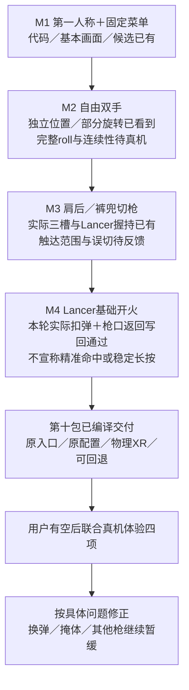
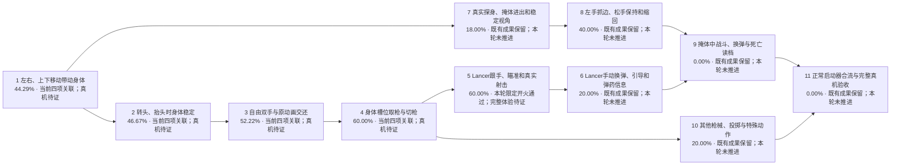

# GearsVR：第一人称、自由双手、身体换枪与Lancer基础开火

更新：2026-10-28T15:08:59+08:00。唯一会话实施，唯一checkout为C:/Users/11/.codex/worktrees/6dof-single/gearsVr；没有助手、没有归档会话派工。

**第十包已更新同一个入口。** [GearsVR Launcher.exe](</J:/gearsVr/candidates/6dof-unified/GearsVR Launcher.exe>) · [普通说明](/J:/gearsVr/candidates/6dof-unified/README.txt) · [第十包ZIP](/J:/gearsVr/candidates/6dof-unified-20261028-10.zip)。用户无空，已授权继续一个Lancer开火节点，与前三项联合真机验收。本次没有扩展换弹、掩体或其他枪。

| 阶段 | 代码／构建／交付 | 已有基本证据 | 尚未确认 |
| --- | --- | --- | --- |
| M1 第一人称＋固定剧院菜单 | 已交付，原实现保留 | 累计实际双眼第一人称、隐藏本体头遮挡、空间固定暂停大屏与恢复 | 物理头显与菜单舒适度 |
| M2 自由双手 | 已交付，原实现保留 | 完整预览下左右独立位置、右yaw/pitch，代码完整四元数链 | 完整roll、真实范围、持续可见跟手 |
| M3 肩后／裤兜切枪 | 已交付，原实现保留 | 实际库存三槽、实际Lancer握持／侧移 | 真实触达范围、误切、过渡连续性；有按压被保护丢弃 |
| **M4 Lancer基础开火** | **本轮修正、编译、打包第十包** | **实际扣弹420→419→405；同shot枪口起点和基础方向写回；正常收尾** | 连续长按、后坐力/原动画期间跟手、精确命中与物理手感；HUD准星未投影新射线 |

## 本轮实际修正

1. 同一PostPlayerTick先处理装备再处理开火，避免先做枪口读取导致取枪输入超时；切换原先的R2交还仍执行。
2. 未持枪或拿着非Lancer时不反复做Lancer读取；缓存只用于调度，真实按下仍重新认证当前武器、挂点、输入和返回类型。
3. R2当前样本100ms时效和producer sync间隔100ms分别检查，不改原始时间；真实断流和过期当前帧仍拒绝，保留计数边沿、拥有权、松开和停止。装备保守事件时限未改。444项针对扳机回归通过。
4. 在实际返回成功提交后仅记录GT诊断计数，再于普通tick最多输出8行。没有回调日志／引擎调用，没有新动作权限。

首次私有清单fire为false，而正式第九包本已为true；已纠正自测配置差异，不能将它描述成正式入口缺失。实际失败与修正逐项保留，没有把发送扳机输入当成开火通过。

## 实际成果与限制

最终购买版Source1局实际装备Weap_AssaultRifle后按下、松开，再在控制器命令保持不变时转头并再次开火。弹药420→419→405；同shot返回记录基础方向20、trace起点30、pushed起点20、physical函数起点20次提交，原基础方向0,0,0被Muzzle方向替换。这些是实际射击返回提交次数，不是15发以外的额外子弹数，也不是实体追踪。

Native清理、入口恢复、XR退出0、装备排空、启动器退出0、无遗留自有游戏均正常。记录仍包含时效交还／短连发，未证明无中断长按。后坐力和原动画可改变枪姿，未证明转头对每帧枪姿绝对无影响；代码方向来源及同shot返回使用的是实际枪口，未取HMD前向。HUD原准星尚未投影新射线，精确弹着和近墙遮挡没有验收。

[本轮完整证据](/J:/gearsVr/analysis/6dof-progress/solo-M4-lancer-fired-20261028.json) · [实际射击后的双眼画面](C:/Users/11/.codex/worktrees/6dof-single/gearsVr/analysis/solo-m1-20261028/m4-shot-direction-head-turn-after-fire.bmp)。只用限定结果支持限定结论，物理验收仍未通过。

## 原完整需求成熟度

**32.83%，本轮较31.02%增加1.82个百分点（按未取整值计算）。** 只有W2由40升到限定实际动作60档；11父项、64计分子项、原权重不变，其余分数不变。当前四项不等于原完整6DoF全部完成。旧v1的36.36与v2首次30.23是历史口径重算，不作为本轮增长。

## 三个联合体验动作

1. 同一入口进入Playground，分别移动／翻转左右手；暂停后转头看菜单是否固定，再继续。
2. 用已有真实臂展流程测量后，从肩后／裤兜取库存武器，切到Lancer并移回身前。场地Lancer可按原流程拾取；第一人称和自由手无需先测臂展。
3. 指向场景，右扳机短按／松开观察开火与扣弹，再固定手、转头观察枪和视野。直接反馈哪一步、哪只手和表现；不要求调试脚本。普通日志用Export logs。

## 历史判断纠正与候选身份

旧私有预览缩到1920×56，裁掉下方手部；完整1920×900已确认独立手与Lancer侧移。旧裁切图和pending计数不能诊断最终画面缺陷。所有未证实的root／UpperIK／per-bone／copy／subset Native实验未晋升，第十包仍复用v9 Native；原记录与回退保留。

PG源码49e1ce0，PG SHA256 `b5410418021bdb311ff6ac4d070fd3fa7a8e9bff8b12682269e471386ef9b4f9`；Native SHA256 `041df8394774bf39726d29374a213e9f6ab39c86d8166e3c9d0e9207552a0718`，功能源码9e0ad18；物理XR SHA256 `cb74d05c3dce128672f86cbeae1108518ecbc3740e5cc8667a3d920c96254237`。ZIP SHA256 `44372cd32eb624d886241ab5cce3486c2f2fb355a470e8e084e335f90c403adc`。原配置字节保持，未打包Source1私有XR、trigger→squeeze映射、合成尺寸或私有分析数据。

## 每小时复盘执行协议

既有小时任务保持暂停，不新建计时器、不向归档会话派工。后续按实际新代码／新反馈推进；不为报表重跑游戏、不重复全量检查、不以提交数量或等待时间加分。保留购买版、后台置后、observe-only、0.4、测试静音／恢复、私有存档与设置、身份／时效／单一写者／启动与清理保护。
