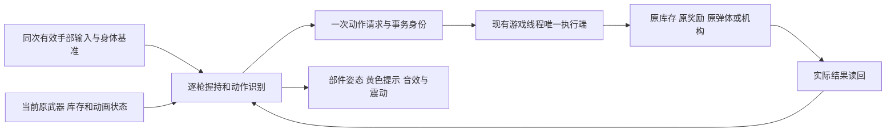

# Full weapon interaction and hand-throwing design

See current delivery [12 weapons offline specification v2](weapon-specs-20261028/README.md)and[Interactive review](weapon-specs-20261028/interaction-review-v2.md): Ununified R 3 Forward, clear Boltok staft/blast relationship, wrestle bow uncommendation, different trigger paths for Frag/Smoke and actual delivery[5 offline GLBs](../assets/weapon-6dof/offline-v2/README.md). This document keeps the initial structure background, action and asset status as v 2 The original animation, native ABI, example size and machine performance are still shown separately.

2026-10-28. Design delivery for subsequent implementation, covering those identified in existing specifications 12 Weapons and objects, bearing.[Weapons interactive specifications](weapon-6dof-interaction-design-20261022.md), repeat the gun-by-gun module in the unified source code. The current proposal is to determine how a gun-by-gun action, the original state and model components correspond, then to play the game thread; the original model will be used as a priority for parts that move independently, with missing complete ammunition being created separately; and the grenade will be determined by real hand movements at the location and initial speed of the hand.

Only new design documents, v 2 Increase in stand-alone offline assets and production tools. `C:/Users/11/.codex/worktrees/6dof-single/gearsVr` It's... `codex/6dof-single`;HEAD at first edition check `bd9e1f0`, another main line is not submitted. This round does not modify the running code or candidate package and does not occupy the build/play window; integration, construction and game operation remain the sole responsibility of the existing implementer.

## Operating rules

- Right hand holds the main weapon, left hand supports, collects bullets and operative parts; right Grip presses the gun at the body slot, left Grip presses the item. Use the left shoulder to retrieve the weapon. 2 Right shoulder to take weapons. 1 The left pants round the pistol, the right pants round the hand grenade; the left shoulder to the left hand to take the current weapon corresponding to ammunition.
- First clear physical move of this gun starts changing, R.3 Only the optional aids are retained. Only the actual parts of the current step are shown yellow and feedback is given once; direction, continuous process and return are determined. Airlock, half-port and post-launch cycle are configured separately.
- The cartridge is not to be abandoned; uninjected handheld ammunition is released and the remaining quantity is returned; inserted ammunition remains after cutting or interruption.
- Following the established perfect switch-off rule: When the final necessary action is completed, starting with the original acceptance of the current round's valid physical change request, it will be perfect and effective not later than the end of the original perfect window in the example. Timeout can still be done normally without extra cardboard or automatic filling. Gnasher/Boltok allows for less lock-down, but only normal completion of the plan.
- No “box” re-alignment is used for each weapon. The final action depends on the actual structure of the gun; no weapons that are routinely re-loaded are covered by their own use process.
- The direction of the aim is determined by the current gun-share posture and the axis of the gun; headline changes only. The original speed, dispersion, projection, recoil and special effects are attached to the original weapon chain; the established one-hand injury strategy is retained independently and not modified in this design.
- The takeover must also be able to resume with the cutting of a gun, death, stubble, failure to pursue and withdrawal.
- **2026-11-08 User overwrite:** The fragmentation grenade continues to be pulled out and held by right Grip, loose, Grip is thrown by real hand movement and no triggers are prepared; Frag virtual weight is 2 kg. The gun points are held constant and the original preview line is removed.[Current grenade rules and authentication status](frag-grip-release-20261108.md)。

## Gun-by-gun action and modeling

The "recommended action" is the interactive design to be achieved in this period. The "original version" distinguishes between saved scripts, models, animations and historical running reports, not considering institutions that have not yet been certified as already available. 12 All items are retained as separate delivery items and do not pass by Lancer on behalf of other weapons.

| Weapons | Suggested difference between action and shooting | Modeling | Original version based on key points to be checked |
| --- | --- | --- | --- |
| Lancer chainsaw rifle | Left hand grabs and pulls out, implicitly releasing locks; then the box is locked in a set of push-in/cover moves, not separately from the sync. The old box can be cancelled. The saw starts independent processing. | Reuse `MagazineMesh` and the bullet-bone; the button/box primary bone drive. Original starter checked and copied to offline delivery. | History card deduction 114.5°The package. 28.5°Proves the existence of a primary movement, not as a player handle threshold; actual capture/closing endpoint still needs to be marked. |
| Hammerburst. | Opens the lock on the cartridge, removes/replaces this gunbox and closes it. Separately sets the handle and inserts an axis; maintains the original firing rhythm. | Reuse separate cartridges and `b_HB_MagLatch`, preserve the original skin and material. | `HB_Reload` The locks have a motion track; the constant orbit of the cartridge relative to its patrilineal bone does not mean that the gun space is still intact. The opening angle, hand-held box interface and point of arrival are still to be marked. |
| Gnasher shotgun. | Left-hand rounded; maximum per round `min(3, 容量缺额, 可用备用)` The next round is allowed after each shot, with a left hand holding the front end, and a right hand hand hand-shape down and back. | Direct Driver `b_Shotgun_Lever`; complete sealed shotguns reproduce and calibrate the existing original GLB prototype. | The original lever has a static and historical run matrix that is about to be used in the first place. 32.43° It is the original animation range, not the handle threshold that is directly used. It cannot be pre-gamber pumped; the whole munition prototype has not yet entered the game. |
| Longshot sniper gun | It is recommended that the opening, shelling, left shoulder take a full round of ammunition, insert and lock. The scope maintains an independent optical mission and the axis determines the line of launch. | The bolts are in the air. `b_LS_Bolt`; New ammunition is created when complete ammunition has been identified. | The original bolt has an animation track, but the opening order, the point of contact with the hand and the number of single rounds are required to be certified. `bullet_spent_single` It is empty and cannot be used as a live bullet; the whole screen cannot be magnified as a scope. |
| Snub pistol | The grab box is implicitly released and the left handbox is changed; this project is designed to be a silo-slipper, half-silo free. The flank is moved without individual scratches. | Former Magazine 314 The triangle has been privately removed and UV/mode/material attributions retained; slider and side wing protobose driver. | Two sets of plans are VR designs; the original action cannot prove independent chamber +1 No increase in this amount is included under this item. |
| Boltok revolver | Object 03 Wallband 02/08 Open, combine to retrace empty shells, fill up and close partially; no independent retort action. | Original Gun, Legs and Object 01 Fixed rear disk; full live ammunition and hexa-hole nests produced to replace closed object 02。 | The original layer/position has been checked;21 AnimSet did not find a match track,80° is the offline design value. The capacity has been verified. 6 The original animation is still not certified. |
| Boomshot grenade launcher | The first shooting tube filling unit starts with the insertion of an original filling component at a time and locks off. | It's confirmed that Magazine Mesh 0 References `Locust_Boomshot.Mesh.Locust_Boomshot_Magazine`; direct reuse; barrel primary bone driven. | The original barrel is flat, complete composite trajectory/physical insertion to be specified; retain the incentive properties of ProjectFire. |
| Torque Bow sprained bow | When you lack an arrow, the left shoulder takes the arrow and locks it in the sink; the trigger is strong, the key is loose. Canceling the separate pending and charge and leaving Charles normally. | MagazineMesh 0 The reference to the original arm bearing arrows has been confirmed; bow arms retain bones/monstered without supplementing traditional strings. | The static cancellation combination is clear, the actual ABI has not been bound; ChargeEnded is not enough alone and EndFire/StopFire may be launched. |
| Hammer of Dawn | The weapon points to the target, locks, preheats and exposures according to the original conditions, and breaks/cuts the verified stop path. | Reuse original fuselage and Trigger; target markings and beam reuse effects, no new magazines. | Existing `IsAValidHODTarget`、`BeginBeamWarmup` . The condition of use must be covered and the whole item cannot be jumped with "no magazines". |
| Troika fixed machine gun | When entering the gun position, grab a double-share handle and rotate around the fixed axis; fire, preheat/cool and exit to original state. No shoulder slots will be loaded. | Reused turret, handshakes, rotorized pieces and double-gun skull; no shoulder cartridges. | Saved `CanReload` Returns false, with automatic reloading, so that the manual switch box cannot be launched by status. The actual launch rules and resource/heat control of a double-gun point must also be confirmed. |
| Bolo, the fragmentation grenade. | Right-pants are removed, prepared and waved; the method of each throw is determined by hand motion; no new cookies are added to the table and independent. | Original hand grenades, verse chains, cartridges and physical retention. | Original StopBounce Normal Default.1+1 s, Base was Pawn 1.5+1 s, adhesion 2.5 s;special HitWall has a branch. Static is positioned and the start speed/time of the trigger sequence remains to be certified. |
| Smoke Smoke grenade | The same gestures are used to release, but smoke is used in their own stocks, cartridges, fuses and effects without fragmentation injuries. | Reuse original smoke grenades, chains and `Emit_SmokeGrenade` Launcher. | Special prototype distinguished `Weap_SmokeGrenade`、`Proj_SmokeGrenade` With smoke munitions; fragmentation cannot be considered complete. |

The coverage also includes a “class and variant table”: which configuration is to be used for each player's specific subcategory, skin/grid replacement label; unknown class behaviour remains on the list of items to be covered. Junker positions, other load/spectrum-specific weapons are supplemented by additional inventories to confirm whether the player can operate and then incorporate the corresponding fixed weapon branch. 12 The item is an identified interactive list and does not amount to the exhaustive list of all weapons in the package.

## Which models need to be dismantled and added

The order of processing is:**Existing independent components,  ⁇  original bone movement,  ⁇  locally verifiable individual pieces,  ⁇  new original model**. The bone-skinned grid appears to be connected and does not mean that it cannot be moved alone; nor can the grey molds produced for viewing represent the original resource structure.

| Resource work | Existing Foundation | This stage of delivery |
| --- | --- | --- |
| Lancer/ Hammerburst cartridge | Original stand-alone component, bullet cartridge bone, static extraction tool; Lancer has historical components reported to hands | Originals are hidden, handheld, fixed fillings, insertion direction and material list; no more high-level details until the nearest quality is insufficient |
| Gnasher leverage, Longshot bolt, Snub slider, etc. | The original bone is now on record with the rigid parts. | Axes, pivotals, closed/open postures, touch areas, main deputy relationships; no OBJ to replace whole guns |
| Gnasher, full shotgun. | v 2 The whole geometry has been produced.960／320 Triangular, UV/material/reference node | The ratio to actual hand position is then marked, running unloaded |
| Boltok/Longshot full ammunition and Boltok hexagon | 3 produced double LOD with material/reference nodes; original shell used only as reference scale | Six-hole replacement of the original closed bomb nest; running display/original connection after wireing |
| Boomshot Fill, Torque Bow Arrow | Specific category MagazineMesh 0 Self-proved use of resources | Directly reuse originals, calibration of instances after scratching point/insert axis |
| Lancer saw starter | Three Nodes 704 The triangulation of the actual product has been verified | Copying offline directories only, without covering the main line original; game not loaded |
| Yellow Step Tip | Pure logic already gives the current widget | Follow the original area mask or contours, visible eyes and overshadowed by scenes; only light the steps and do not dye the whole gun in yellow |
| Bolo/Smoke Chain | Original Animation and Physical Resources | Holds visual, physico-sharp relationships when released; maintains chain movement |

Each active asset must have units, main local coordinates, axis, axis, exposure range, material slots, LOD, source and Hash.

**The new model enters the game as a stand-alone project.** The current direct source search does not find that the GLB is running while loading a connection; it cannot be described as generating a GLB as having supported a new model. Priority is given to re-using original components of the game. The first load sample of the new munition is based on the existing Gnasher prototype: verify engine component creation, resource loading, GC and destruction paths, then fix an additional package of tube lines. If you must go through Native self-drawing, you should also enter the actual two-eye view and address the depth mask, material and life cycle, and not use a hand-moving Quad pose as a 3D component. This option starts with technical verification, without exploring how each model will be reloaded.

Original package extraction geometry, stickers and reverse derivatives retained in negligence `analysis/`; the distribution section uses originals from original game resources quoted and distributed. The current view does not enter the release package directly in the original.

## Original process and specific access position

### Change of bomb status and inventory

Saved script displays public path as:

```text
ForceReload / 原版状态入口
  -> Reloading.BeginState：记录 ReloadStartTime、清除旧主动奖励
  -> PlayWeaponReloading：人物和枪动画、声音、EndOfReloadTimer
  -> Reloading.EndOfReloadTimer
  -> PerformReload：枪内与备用弹药转移
  -> Active
```

`Notify_AmmoGrab/Release/Reload` In several subcategories, the manual components are attached and the gun is hidden; the base category partial notifications are empty. Visible “Backloads inserted” and “King stock increased” are two routes that need to be coordinated.

Existing [Lancer Keep Test](../tools/playground/vr_lancer_reload_hold.inl) The original switch, the transfer of the end timer and the call to the original completion gate are activated but have eight seconds to automatically complete the lid and test the switch. Formally achieved by using a physical gesture, so this test can be used as an entry basis and cannot be online.

The proposed access is advanced in the following order:

1. Game thread accepts the first explicit physical change request of this gun and creates a business; option R 3 Enter the same request. Take over the automatic completion of the example and notification of conflict, and then accept it before a perfect deadline begins; no ownership is acquired without showing the physical changes that have already taken place.
2. Only real and usable inventories are retained from the left shoulder, generating handhelds with unique identity; insertion determination must verify both the type, direction, entry proximity and continuity of the item.
3. Use original capacity, and use the original size.`AmmoUsedCount`、`SpareAmmoCount` For example, current case data; pure model count cannot be used as a direct inventory.
4. When the final mechanical action is completed, the test of perfection/normality based on this original Getter output is submitted with the corresponding incentive and state exit, and the inventory and shooting readiness are read again.
5. The cut-off gun keeps the quantity loaded and unclosed institutions, releasing unused amounts.

**Here's a real connection problem:** Once the original amount has been issued/qualified and then called without conditions `EndOfReloadTimer → PerformReload`, the remaining shortfall may be filled automatically. Therefore, the end of the original fit must distinguish between “this service is not accounted for” and “a denominated account”, verify the entry point from which the service can be withdrawn individually or suppress a second round only in this instance, when the service has been originally called after it has been completed. `PerformReload`, and do not overwrite undefended parameters. The incentive function can reschedule the end timer.`AbortWeaponReload` It is also possible to keep a bookkeeping account, which must be included in the same business.

Perfect period to read `GetActiveReloadValues` The perfect right-hand boundary of the zone, not using normal `ReloadDuration` or value is `-1` . History Lancer 0.8 Seconds represent only this instance; the rest of the guns and difficulty cannot be applied. The original version is short, and whether a full VR action is comfortable with head-to-head feedback; default retention of confirmed rules allows for easy aids as a separate option and cannot be changed quietly.

### Special weapons

- Torque Bow：`Charge.EndFire → CheckFireShot → Fire`, fatigue counts to the upper limit. The cancellation combination has been positioned as clean-up PendingFire/bPendingEndFire, ChargeEnded, leaving Chad and triggering Endstate; parameters/real state still need to be bound to read back instead of EndFire being cancelled.
- Boomshot: Continue using original `ProjectileFire` The close-range gun mouth shield, launch location and inventory are verified separately.
- Hammer of Dawn: Access from the original BeamManager target legitimacy, operational status, preheat and exposure path, resource billing cannot be simplified to a normal cartridge count.
- Troika: Collect/release from the original gun position, fix the axis, fire and automatic state recovery access; double-gunhead, preheat and heat dispersion cannot be inferred by bone name.

## Code Organization

The current pure logic of gun-by-gun is based on the following: `tools/vr-common/`This time in `tools/` The C++ source reference check shows that the following table is mainly referenced in each test and cannot be used to claim that it has been used for the production game cycle. Keep them, add thin game adaptors and do not create a separate body or weapon execution platform.

| Functions | Existing documents to be reused |
| --- | --- |
| Base stock and geometry of insertion | `weapon_reload_model.h`、`weapon_reload_geometry.h`、`weapon_mechanism_geometry.h` |
| Lancer | `weapon_lancer_feed_anchor.h`、`weapon_lancer_insertion.h`、`weapon_lancer_magazine_pose.h`;Playground `vr_lancer_magazine_follow.inl`、`vr_lancer_reload_hold.inl` |
| Hammerburst／Gnasher | `weapon_hammerburst_reload.h`、`weapon_gnasher_mechanics.h` |
| Longshot／Snub／Boltok | `weapon_longshot_reload.h`、`weapon_snub_reload.h`、`weapon_boltok_reload.h` |
| Boomshot／Torque Bow | `weapon_boomshot_interaction.h`、`weapon_torque_bow_interaction.h` |
| Dawn Hammer/Troika | `weapon_hammer_of_dawn_interaction.h`、`weapon_troika_interaction.h` |
| Two grenades. | `grenade_throw.h`、`weapon_bolo_grenade_interaction.h`、`weapon_smoke_grenade_interaction.h` |
| Shared input and original action boundary | `weapon_hand_client.h`、`weapon_action_boundary.h`; continuing to call the entrance using the current only active and existing game threads of Native |

Proposed increase `tools/playground/weapon_reload_adapter.inl` and `weapon_throw_adapter.inl`The first is to link the current example, inventory, original animation and gun-by-gun machine; the latter is to be responsible for throwing services and initial conditions of the atomic bomb. The gun-by-gun configuration uses the existing dedicated Config/Plan, with the public part sharing only the appropriate mix of identity, geometry, stocking and backfill, without forcing all guns into the same alternation machine.

Each configuration includes at least: specific categories and parent, original package/grid/animation identity, main side handle point, gun mouth, liveware and patriline, fillings and entry axes, empty/silo/post-fire steps, capacity and single transfer volumes, original time and audio access, interruption processing, and source and authentication level. Unknown steps remain unconfigured without zero-value disguise confirmed.



Here's the sign of a suitable layer contract, not an already available callable game API:

```cpp
// Proposed contract; keep existing per-weapon state machines.
auto snapshot = read_current_weapon_and_inventory();
auto action = interaction.advance(same_ticket_hands, snapshot);
if (action.ready && identity_and_owner_still_match(action)) {
    auto receipt = execute_original_action_once(action);
    // Receipt comes from observed game state, never from an assumed success.
    interaction.acknowledge(receipt);
}
```

The widget attitude is prioritized to the existing only bone/component written at the border. Lancer adds a button controller with animated index cache, case object creation, GC and destruction problems; not just going to `SkelControlListHead` Put a pointer on it. The fixed load should be attached to the frame reference system, and cannot follow the moving original cartridge socket, otherwise the player will always follow the entrance loaded.

## How can a grenade really fly on a hand gesture?

Save the original process in the script as `Weap_Grenade.ThrowGrenade` Getting the original launch point, generating the original bomb, successfully pulling one and calling. `Init(SimulationDir)`Again. `GetGrenadeTossVelocity` Writes the initial speed; the latter calculates the speed based on a peri- and velocity range, possibly with reference system speed. Some network paths are then saved. `InitialVX/VY/VZ`. This explains why simply modifying the line of sight or hiding previews does not change actual throwing.

The target process is:

1. Release reference points and directions for hand grenades in the hands of a sample at the time of possession, using valid simultaneous conversations and reference space history.
2. The short window before release estimates speed, and then the common body benchmark at release is used to convert it to the game world. Turning back doesn't change the direction of the throwing; turning back, snap turns, falls back and skips time to clear up the history of unconnected movements.
3. In the same original creation, you can first use a safe hand point for the actual Spawn; no transient impact or backsliding at an old camera/role location can be created before it is moved so that the generation period is not in the wrong position. The initial speed must cover the original camera dropout and enter the original bomb and the necessary initialization/replicate cache before the first physical step.
4. The same reading of the identity, location, speed and exactly one charge; subsequent movement is only by original flight, collision, rebound, fuse and smoke/explosion logic.

- I'm gonna give you a specific priority. `GetPhysicalFireStartLoc` and `GetGrenadeTossVelocity` Safe return value access: the former provides a point of entry, while the latter provides an initial speed at which the base speed has been synthesized and allows the original version to be then naturally set `Velocity` and `InitialVX/VY/VZ`。`Init` The initial direction required is also checked against the same release plan. It affects only current local players, current grenades and this release event, avoiding changes in AI or other projectors; if the existing call borders do not securely cover returns, then minimize reverses around these two entry points rather than creating a separate grenade system.

The baseline is:

```text
p_hand_item(t) = p_grip(t) + R_grip(t) × r_item
v_hand_item    = 对有效短窗口中的 p_hand_item 拟合
p0_world      = 同一冻结身体基准变换(p_hand_item_at_release)
v0_world      = 轴向与单位转换(v_hand_item) + 一次角色/载具基底平移速度
p(t)          = p0_world + v0_world*t + 0.5*g_world*t²   （首次碰撞前）
```

`r_item` It is a sort of hand grenade-marked shift in the grip; the speed associated with the rotation of the hand grenade by position of the point of reference already included in the wrist cannot be repeated. `v_grip + ω × r` and check their respective active position. OpenXR line speed is the relative size of baseSpace, angular velocity is a radians/sec, and cannot be used to mix data directly between different reference systems or unmarked data.[Khronos XrSpaceVelability Code](https://registry.khronos.org/OpenXR/specs/1.1/man/html/XrSpaceVelocity.html)

Prototype [grenade_throw.h](../tools/vr-common/grenade_throw.h) Most of them. 140 The focus of follow-up is on the actual connection and handing:

- 140 ms The average window-wide can reduce the end speed of a quick shaker. Keep the existing estimate as a baseline and then compare the end weighted or effective equipment speed without any prior scaling up at an arbitrary rate.
- Alignment does not allow the next frame to be used as an accurate release moment or to mix the absolute values of XrTime and QPC.
- Current prototype reject speed below 0.5 m/s, insufficient migration 4 cm samples. A separate column of "effective low-speed light throw" and "ineffective tracking" is required to avoid light drops; whether or not to allow the in situ release as a pending operation, or not, will never be used as an active release.
- Original `bAddBaseVelocity/InitialFrameOfRefVelocity` The role speed of the VR side can only be synthesized once. When the body benchmark is already in swing, it no longer moves from world history differentials to speed; the vehicle horizontally is also integrated into a clear base source.
- The impact point cannot be pushed across the wall when blocked by a wall; the starting point of the collision must be treated in a manner consistent with the initial position of the original bomb.
- Prototype. 9.81 m/s2 is the mathematical default. The checked atomic bomb/world effective gravity is preferred to be used when running, and not just by a calculator but by another set of gravity for an actual shell.
- Keep user-specific 3 kg virtual weight target; speed is not divided by simple speed at the same speed 3. If the bottom needs a charge, first confirm the true mass and physical pattern, not both writing speed and repeated imposition of equal pressure.
- The dynamic deviation of the Bolo chain is treated separately from the transect. First, it allows for a visual continuum between the direction of release, speed and original chain, before deciding whether more precise physical motion needs to be read at the end of the actual chain.
- Once the fuse is activated, the breakup cannot be refreshed. The checked preparation function does not activate explosion timer; the normal stop delay of Frag, the direct trigger of Smoke's special service StopBounce, and the two types of attachment and special Hitwall are different, as detailed in v.2 Table. Actual operations are still certified separately.

Unplug original preview should only be used for the VR drop display of this local player.`SimulationDir` It is also consumed by the original generation chain, which does not remove the entire simulation process and leaves uninitialized values; it depends on it first, then partially replaces actual launch conditions. The first version targets local authorities’ Playground/Kateline connection, with online server authority and replication being separately validated and cannot be inferred from local re-speed as well.

## Parallel preparation and sequencing of implementation

| Workpack | Now ready for design. | Next concrete results |
| --- | --- | --- |
| Gun-by-gun specifications | Yes 12 Complete empty/semi-silo/post-fired steps for item marking of known and pending nuclear agencies | 12 A weapon card with a specific class/variate belonging, which is directly mapable for the existing Config/Plan |
| Original Process | Check inventory, timers, notifications, rewards and interruptions by location entry; minimize reversals due to gaps | Call charts, parameters sources and recovery methods for each entry point to the result; avoid leaving only a native declaration |
| Models and Coordinates | Reuse existing extraction/bones/animation tools to determine which are originals and which are added | List of activity items, grabs/axis/route, complete ammunition to be supplemented and unified loading programme |
| Gears. | Refine the impact of hand-out events, velocity estimates, base speed and fuse contracts | Bolo/Smoke 2 independent access cards, shared motor algorithms, binding the original bomb and effects, respectively |

These are not based on current headline feedback, nor do they require multiple games or additional writers to be launched at the same time.

1. **Lancer Full sense change.**: primary cartridges, fixed entrances, physical structures, quota stocks, perfect/ordinary results and interruptions; first, the general-purpose clock and animation.
2. **Hammerburst and Snub**: Verify that the shared matching supports different magazines and mechanical programs. The Lancer coordinates cannot be used only by changing the name of the gun.
3. **Gnasher and Longshot**: Resolve the book-to-book, complete ammunition loads, post-launch cycle and cutable partial filling.
4. **Boltok and Boomshot**: complete the most unclear institutional mapping before reloading plans; model studies can be done earlier, not until the first three batches are completed.
5. **Torque Bow, Hammer of Dawn and Troika**: each has its own active release/termination, target exposure and fixed gun position control.
6. **Bolo, pick up Smoke.**: Re-launching with the same gesture to independently verify fuses, buttons and effects; its static research and speed estimation design can be prepared in parallel from the first.

Compile/package each batch and perform a short Playground basic check using the already controlled path; specific failure to direct re-repair/review. 0.4 Detailed hand feelings, capture distance, and close-looking model quality are adjusted by headline feedback instead of using historical test numbers as a new threshold.

## How do we confirm that every one of them is complete?

Each gun records “design determination, code connection, compile packages, basic game check, head-over feedback”. The completion criteria fall on the player's actual actions: it can be held and targeted normally; it can be supplemented by the correct number at this point in the weapon; empty/half-barrel/under-assembly ammunition is handled correctly; no copy or swallowing is interrupted; after taking over the original animation, it can recover; current steps are visible and the firing door controls are consistent.

The grenade focuses on whether the same hand-shot action is still motion-driven when it turns only, whether the upper/down/light throw responds to different initial speeds, whether the wall side is generated from a legitimate hand position, whether the number is reduced by one and whether the original fuse and effect are retained. It cannot be replaced with a track preview, mathematical unit testing or successful exit.

Projects that lack the application of a switch-off are closed with "not applicable + matching action verified" such as the target exposure of the Dawn Hammer, the gun position operation for Troika; they cannot be plugged in or directly over-covered.

## Evidence and review portal

- [There are complete interactive specifications.](weapon-6dof-interaction-design-20261022.md)：12 This program does not re-run these experiments by using the run reports.
- [Survey of ammunition resources and reloading](ammo-and-physical-reload-20261021.md): original cartridges, complete ammunition gaps, notify and account keeping. 17 List of items `J:/gearsVr/analysis/ammo-reload-20261021/export-manifest.json`。
- [Knowledge base description](58-reverse-engineering-knowledge-base.md)and `J:/gearsVr/analysis/re-kb/knowledge.sqlite`: This time used `tools/re-kb/kb.py` Read the save scripts after searching for Reloading, PerformReload, Weap_Grende, ActiveReloadSeccess etc.
- Save script for this direct reading is located in `J:/gearsVr/analysis/re-kb/scripts/WarfareGame/`：`WarWeapon.Reloading.BeginState`、`PlayWeaponReloading`、`PerformReload`、`Reloading.EndOfReloadTimer`，`Weap_Grenade.ThrowGrenade/GetGrenadeTossVelocity/GetPhysicalFireStartLoc`，`Proj_Grenade.Init/PostBeginPlay`，`Proj_FragGrenade.EnableGrenadePhysics`，`Weap_Bow_base.Charge.EndFire/Tick`，`Weap_Boomer_base.ProjectileFire`，`Weap_Troika_base.CanReload/Reloading.BeginState`. They still contain undefended native token or parameter types and cannot be sold directly as retail ABI.
- [Add Model Description](../assets/weapon-6dof/README.md)、[Gnasher prototype](../assets/weapon-6dof/gnasher-round.glb)、`tools/weapon-models/` Script for bone/strengthen extraction/image audit: Asset creation and coordinates review portal.
- The source Hash and unknown items are currently recorded in the special header files. `WarfareGame.u` SHA 256 Yes `91c0f56e9302db2b3991fc3d8646abc1eaff2b33b8b021ce8df436d8cd681d13`Map source `MP_WarMachine.war` Yes `55f40ca44051413fe6db19816f97b09849c5e104319d93e9d5d159cbe6fb2840`; this is the resource identity corresponding to historical evidence and cannot replace the bytes check for the current EXE/Run-time function.

v 2 The post-review specifications, static surveys and offline model deliveries were completed; model imports, complete physical alternations and atomic bomb handwiring remained open to the main line for access, but were not recorded as completed games.

---

## 中文

# 全武器交互与手势投掷设计方案

当前交付见 [12 种武器离线规格 v2](weapon-specs-20261028/README.md)及[交互复核](weapon-specs-20261028/interaction-review-v2.md)：已取消统一 R3 前置，明确 Boltok 支架／弹巢关系、扭力弓取消组合、Frag/Smoke 不同触发路径，并实际交付[5 个离线 GLB](../assets/weapon-6dof/offline-v2/README.md)。本文保留初版架构背景，动作与资产状态以 v2 规格为准。原动画、native ABI、实例尺寸及实机表现的未认证项仍单列。

2026-10-28。面向后续实现的设计交付，覆盖现有规格确认的 12 种武器与投掷物，承接[武器交互规格](weapon-6dof-interaction-design-20261022.md)，复用统一源码中的逐枪模块。当前建议是：先确定逐枪动作、原版状态与模型部件的对应关系，再接游戏线程；原模型能独立运动的部分优先复用，缺少的完整弹药另行制作；手雷由真实手部运动决定出手位置和初速度。

初版只新增设计文档，v2 增加独立离线资产与制作工具。实现位置是 `C:/Users/11/.codex/worktrees/6dof-single/gearsVr` 的 `codex/6dof-single`；初版检查时 HEAD 为 `bd9e1f0`，另有主线未提交工作。本轮不修改运行代码或候选包，不占用构建／游戏窗口；集成、构建和游戏运行仍由现有唯一执行者负责。

## 操作规则

- 右手持主武器，左手负责支撑、取弹和操作部件；右 Grip 在身体槽位按一下取枪，左 Grip 按住抓取物件。沿用右手左肩取武器 2、右肩取武器 1、左裤兜取手枪、右裤兜取手雷；左手左肩取当前武器对应弹药。
- 本枪首个明确物理动作开始换弹，R3 只保留可选辅助。只让当前步骤的实际部件显示黄色，并给一次到位反馈；方向、连续行程和回位均参与判定。空仓、半仓和射后循环分别配置。
- 弹匣枪换弹不丢弃原有剩弹；未插入的手持弹药松手后归还保留量；已插入的弹药在切枪或中断后仍保留。游戏库存是最终依据，不能通过手持显示件复制弹药。
- 沿用既定完美换弹规则：从原版接受本轮有效物理换弹请求开始计时，最后必要动作完成时，不晚于该实例原版完美窗口终点即为完美，提前完成也有效。超时仍可普通完成，不额外卡壳、不自动补满。Gnasher／Boltok 允许少装后闭锁，未满计划只普通完成。暂停采用原版游戏时间规则，普通追踪丢失不暂停计时。
- 不为每把武器套用“插弹匣再拉枪栓”。最终动作取决于该枪实际机构；没有常规换弹的武器按自己的使用流程覆盖。
- 瞄准方向由当前握枪姿态与枪口轴决定；头显只改变观察。原版射速、散布、投射物、后坐力和特殊效果接在原武器链上；既定单双手伤害策略独立保留，不在本设计中另改数值。
- 拾取、处决和剧情接管时按原动作交还控制，结束后重新绑定当前武器。部件接管也必须能随切枪、死亡、读档、失追和退出恢复。
- **2026-11-08 用户覆盖：** 破片手雷持续按右 Grip 取出和持有，松 Grip 按真实手部运动投出，不再扳机准备；Frag 虚拟重量为 2 kg。枪械点按握持不变，原版预览线移除。详见[当前手雷规则与验证状态](frag-grip-release-20261108.md)。

## 逐枪动作与模型方案

“建议动作”是本次待实现的交互设计。“原版依据”区分保存的脚本、模型、动画与历史运行报告，不将尚未认证的机构当成已经可用。以下 12 项全部保留独立交付项，不以 Lancer 通过代表其他武器通过。

| 武器 | 建议动作与射击差异 | 模型处理 | 原版依据与还需核对的关键点 |
| --- | --- | --- | --- |
| Lancer 电锯步枪 | 左手抓匣并拉出，隐含释放锁扣；换匣后用一组推入／合盖动作锁定，不分别抓同步机构。旧匣插回可取消。电锯启动独立处理。 | 复用原 `MagazineMesh` 和枪上弹匣骨；卡扣／机匣原骨驱动。原创启动件已核对并复制到离线交付。 | 历史卡扣约 114.5°、机匣约 28.5°证明原联动存在，不作为玩家手柄阈值；实际抓点／关闭端点仍需标定。 |
| Hammerburst 锤爆步枪 | 打开弹匣锁扣，取出／换入本枪弹匣，再关闭锁扣。独立设置握点和插入轴；保持原版射击节奏。 | 复用独立弹匣和 `b_HB_MagLatch`，保留原蒙皮与材质。 | `HB_Reload` 的锁扣有运动轨道；弹匣相对其父骨的常量轨道不等于枪体空间不动。开合角度、手持弹匣交接和到位点仍需标定。 |
| Gnasher 霰弹枪 | 左手逐发装入；每轮最多 `min(3, 容量缺额, 可用备用)` 发，随后完成杠杆动作。每次射击后，左手扶前端、右手握把向下掰并回位，才允许下一发。 | 直接驱动原 `b_Shotgun_Lever`；完整封口霰弹复用现有原创 GLB 原型并校准。 | 原版杠杆已有静态与历史运行矩阵，约 32.43° 是原动画幅度，不是直接使用的手柄阈值。不能做成前护木泵动；完整弹药原型尚未进游戏。 |
| Longshot 狙击枪 | 建议开膛、退壳、左肩取一发完整弹药、插入、闭锁。瞄准镜保持独立光学任务，枪轴决定发射线。 | 枪栓用原 `b_LS_Bolt`；缺少已确认完整弹药时新建弹药。镜片和瞄准视图另接。 | 原枪栓有动画轨道，但开闭次序、手的接触点和单发计数须认证。已有 `bullet_spent_single` 是空壳，不能直接充当实弹；不能把整屏放大当瞄准镜。 |
| Snub 手枪 | 抓匣拉出隐含释放，左手换匣；本项目设计为空仓拉放滑套、半仓免拉。侧翼联动，不逐个抓。 | 原 Magazine 314 三角已私有拆出并保留 UV／法线／材质归属；滑套和侧翼原骨驱动。 | 两套计划是 VR 设计；原动作不能证明独立膛内 +1，本项目不增加该计数。 |
| Boltok 左轮手枪 | Object03 支架带 Object02/08 打开，联动退空壳，逐发补缺，可部分装填后关上；无独立退壳杆动作。 | 原枪体、支架和 Object01 固定后盘保留；完整实弹和六孔弹巢已制作，替换原封闭 Object02。 | 原骨层级／位置已核对；21 个 AnimSet 未找到匹配轨道，80° 是离线设计值。容量已核到 6，原开合动画仍未认证。 |
| Boomshot 榴弹发射器 | 首次打开枪管装填机构开始，一次插入一个原装填组件，再关闭锁定。发射沿原弹体与爆炸效果。 | 已证实 MagazineMesh0 引用 `Locust_Boomshot.Mesh.Locust_Boomshot_Magazine`，直接复用；枪管原骨驱动。 | 原枪管有平移，完整复合轨迹／实际插入轴待实例标定；保留 ProjectileFire 的奖励属性处理。 |
| Torque Bow 扭力弓 | 缺箭时左肩取箭开始，入槽锁定；扳机蓄力、松键按原规则放箭。取消单独清 pending 和 charge，正常离开 Charge。 | MagazineMesh0 已证实引用原手持箭；弓臂保留骨骼／蒙皮，不补传统弦。 | 静态取消组合已明确，实际 ABI 尚未绑定；ChargeEnded 单独不够，EndFire／StopFire 都可能发射。 |
| Hammer of Dawn 黎明之锤 | 武器指向目标，按原版条件进行锁定、预热与照射，松键／中断走已验证的停止路径。常规换弹先设为不适用。 | 复用原机身和 Trigger；目标标记与光束复用原效果，不新造弹匣。 | 已有 `IsAValidHODTarget`、`BeginBeamWarmup` 等保存声明，尚未建立可调用 ABI、全部目标限制及资源规则。需要覆盖使用条件，不能用“没有弹匣”跳过整项。 |
| Troika 固定机枪 | 进入炮位后抓双握把，围绕固定枢轴转动；开火、预热／冷却和退出按原版状态。不会装进肩部槽位。 | 复用炮塔、握把、旋转件与双枪口骨；不补肩部弹匣。 | 保存的 `CanReload` 返回 false，同时存在自动 Reloading 状态，故不能由状态名推出手动换匣。还需确认双枪口实际发射规则和资源／热量控制。 |
| Bolo 破片手雷 | 右裤兜取出、准备、挥手释放；各抛法由手部出手运动决定；准备不新增 cooking，贴附独立。 | 原手雷、分节链条、弹体和物理保留。 | 原 StopBounce 普通默认 .1+1 s、Base 为 Pawn 时 1.5+1 s、贴附 2.5 s；特殊 HitWall 另有分支。静态已定位，运行初速／触发时序仍待认证。 |
| Smoke 烟雾手雷 | 采用相同手势释放，但使用烟雾自己的库存、弹体、引信和效果，不套破片伤害。 | 复用原烟雾手雷、链条和 `Emit_SmokeGrenade` 发射器。 | 专用原型已区分 `Weap_SmokeGrenade`、`Proj_SmokeGrenade` 与烟雾弹药类；不能把破片弹改个外观视为完成。 |

覆盖范围还要建立“类与变体表”：给每种玩家可取得的具体子类、皮肤／网格替换标注复用哪张配置；不认识的类保持原行为并进入待覆盖清单。Junker 枪位、其他载具／剧情专用武器另做补充盘点，确认玩家能否操作后纳入对应固定武器分支。现有 12 项是已经确认的交互清单，不等于已穷尽安装包中的所有武器类。

## 哪些需要拆模型和增加模型

处理顺序为：**现成独立组件 → 原骨骼运动 → 本地来源可核对的独立件 → 新增原创模型**。骨骼蒙皮网格看起来连在一起，不代表不能单独移动；为查看导出的灰模也不能代表原资源结构。

| 资源工作 | 已有基础 | 本阶段应交付 |
| --- | --- | --- |
| Lancer／Hammerburst 弹匣 | 原独立组件、枪上弹匣骨、静态提取工具；Lancer 有历史组件跟手报告 | 原件显隐、手持握点、固定装填口、插入方向和材质清单；近看质量不足再做高细节件 |
| Gnasher 杠杆、Longshot 枪栓、Snub 滑套等 | 原骨与刚性部件归属已有记录 | 轴、枢轴、闭合／开放姿态、碰触区域、主副手关系；不用查看 OBJ 替换整枪 |
| Gnasher 完整霰弹 | v2 完整几何已制作，960／320 三角、UV／材质／参考节点 | 游戏内比例与实际手位后续标定，运行加载未接 |
| Boltok／Longshot 完整弹药及 Boltok 六孔件 | 三件已制作双 LOD，含材质／参考节点；原空壳只作尺度参考 | 六孔替换原封闭弹巢；运行显示／原件联动以后接线 |
| Boomshot 装填件、Torque Bow 箭 | 具体类 MagazineMesh0 已证实独立资源用途 | 直接复用原件，抓点／插入轴以后实例校准 |
| Lancer 电锯启动件 | 三节点 704 三角实际产物已核对 | 只复制进离线目录，不覆盖主线原件；尚未加载游戏 |
| 黄色步骤提示 | 纯逻辑已能给出当前部件 | 跟随原枪的局部区域遮罩或轮廓、双眼可见且受场景遮挡；只点亮本步骤，不把全枪统一染黄 |
| Bolo／Smoke 链条 | 原动画与物理资源 | 握持到释放时视觉交接、质心／握点关系；保留链条运动 |

每件活动资产必须有单位、主局部坐标系、轴向、枢轴、接触范围、材质槽、LOD、来源和哈希。检查用 OBJ/GLB 缺少游戏运行时组件、动画通知、材质加载或碰撞时，只能作为资产制作输入。

**新增模型进入游戏是一项独立工程。** 当前定向源码检索未发现上述 GLB 的运行时加载接线；不能把生成 GLB 说成游戏已支持新模型。优先复用游戏原组件。新增弹药以现有 Gnasher 原型做唯一首个加载样本：先核实引擎组件创建、资源加载、GC 与销毁的可用路径，再固定整套新增件管线。若必须走 Native 自绘，也应进入实际双眼场景并解决深度遮挡、材质和生命周期，不能用一张随手移动的 Quad 冒充三维部件。这个选择先做有界技术验证，不为每件模型重新探索加载方式。

原包提取几何、贴图和逆向衍生物保留在忽略的 `analysis/`；发行部分采用原游戏资源引用和可分发的原创件。当前查看用原件不直接进入发布包。

## 原版流程和具体接入位置

### 换弹状态与库存

已保存脚本显示公共路径为：

```text
ForceReload / 原版状态入口
  -> Reloading.BeginState：记录 ReloadStartTime、清除旧主动奖励
  -> PlayWeaponReloading：人物和枪动画、声音、EndOfReloadTimer
  -> Reloading.EndOfReloadTimer
  -> PerformReload：枪内与备用弹药转移
  -> Active
```

`Notify_AmmoGrab/Release/Reload` 在若干子类中负责手持组件挂接和枪上件显隐；基类部分通知为空。可见的“弹匣已经插入”和“游戏库存已经增加”是两条需要协调的路径。

现有 [Lancer 保持试验](../tools/playground/vr_lancer_reload_hold.inl) 已能启动原换弹、转移结束计时器并调用原完成入口，但带有八秒自动完成兜底和测试专用完成开关。正式实现要用实际手势驱动完成，故这个试验可作入口依据，不能原样上线。

建议接入按以下次序推进：

1. 游戏线程接受本枪首个明确物理换弹请求，建立一次事务；可选 R3 进入同一请求。接管该实例的自动完成与冲突通知，原接受才开始完美期限；未取得所有权不展示已经开始的物理换弹。
2. 从左肩取弹只保留真实可用库存，生成带唯一身份的手持件；插入判定必须同时验证物件类型、方向、入口接近与连续行程。
3. 每次有效插入只转移对应数量，并等待原库存读回。用原版容量、`AmmoUsedCount`、`SpareAmmoCount` 等当前实例数据；不能把纯模型的计数直接当原库存。
4. 最后机械动作完成后，根据本次原版 Getter 输出判定完美／普通，提交相应奖励及状态退出，并重读库存与可射击状态。
5. 任何重入或重复输入都必须命中原事务结果，不能第二次取弹、扣弹或颁奖。切枪保存已经装入的数量和未闭合机构，释放未用保留量。

**这里有一个实际接线难点：** 已经逐发／定额入账后，再无条件调用原 `EndOfReloadTimer → PerformReload`，可能把剩余缺额自动补满。因此原版结束适配必须区分“本事务尚未记账”与“已定额记账”，核实可单独退出状态的入口，或只在本实例、本事务的原完成调用中抑制第二次补弹。不得全局禁用 `PerformReload`，也不得绕过未解析的参数消费。奖励函数可能重新安排结束计时器，`AbortWeaponReload` 也可能记账，必须纳入同一事务。Lancer 先把这条链做实，再让逐发武器复用。

完美期限读取 `GetActiveReloadValues` 的完美区右边界，不能使用普通 `ReloadDuration` 或值为 `-1` 的未覆盖成员。历史 Lancer 实例读得约 0.8 秒只代表该次实例；其余枪与难度不能套用。原版期限很短，完整 VR 动作是否舒适由头显原型反馈；默认保留已确认规则，可把宽松辅助作为单独选项，不能悄悄改期限。

### 特殊武器

- Torque Bow：`Charge.EndFire → CheckFireShot → Fire`，疲劳计数到上限也可能发射。取消组合已定位为清 PendingFire／bPendingEndFire、ChargeEnded、正常离开 Charge 并触发 EndState；仍需绑定参数／实际状态读回，不把 EndFire 当取消。
- Boomshot：继续使用原 `ProjectileFire` 和原弹体，保留原奖励相关的弹体属性处理。近距离枪口遮挡、发射位置及库存分别验证。
- Hammer of Dawn：从原 BeamManager 的目标合法性、启用状态、预热和照射路径接入，资源计费不能简化成普通弹匣计数。
- Troika：从原炮位领取／放弃、固定转轴、开火和自动状态恢复接入；双枪口、预热及散热不能靠骨名推断。

## 代码组织

当前逐枪纯逻辑主要位于 `tools/vr-common/`。本次在 `tools/` 的 C++ 源引用检查中，下表专用模块主要由各自测试引用，不能据此宣称已被生产游戏循环调用。保留它们，新增薄的游戏适配层，不另造一套身体或武器执行平台。

| 功能 | 继续复用的现有文件 |
| --- | --- |
| 基础库存与插入几何 | `weapon_reload_model.h`、`weapon_reload_geometry.h`、`weapon_mechanism_geometry.h` |
| Lancer | `weapon_lancer_feed_anchor.h`、`weapon_lancer_insertion.h`、`weapon_lancer_magazine_pose.h`；Playground 的 `vr_lancer_magazine_follow.inl`、`vr_lancer_reload_hold.inl` |
| Hammerburst／Gnasher | `weapon_hammerburst_reload.h`、`weapon_gnasher_mechanics.h` |
| Longshot／Snub／Boltok | `weapon_longshot_reload.h`、`weapon_snub_reload.h`、`weapon_boltok_reload.h` |
| Boomshot／Torque Bow | `weapon_boomshot_interaction.h`、`weapon_torque_bow_interaction.h` |
| 黎明之锤／Troika | `weapon_hammer_of_dawn_interaction.h`、`weapon_troika_interaction.h` |
| 两种手雷 | `grenade_throw.h`、`weapon_bolo_grenade_interaction.h`、`weapon_smoke_grenade_interaction.h` |
| 共用输入与原动作边界 | `weapon_hand_client.h`、`weapon_action_boundary.h`；继续使用当前 Native 唯一执行端和已存在的游戏线程调用入口 |

拟增加 `tools/playground/weapon_reload_adapter.inl` 与 `weapon_throw_adapter.inl`，文件名只是实现建议。前者把当前实例、库存、原动画和逐枪状态机连接起来；后者负责投掷事务和原弹体初始条件。逐枪配置采用现有专用 Config/Plan，公共部分只共享身份、几何、库存和回执的适配，不强迫所有枪进入同一种换弹状态机。

每张配置至少包括：具体类及父类、原包／网格／动画身份，主副握点、枪口，活动件及父骨，装填物与入口轴，空仓／半仓／射后步骤，容量及单次转移量，原版时间与音效入口，中断处理，以及来源和验证级别。未知步骤保持未配置，不用零值伪装已确认。


下面是适配层契约示意，不是已经存在的可调用游戏 API：

```cpp
// Proposed contract; keep existing per-weapon state machines.
auto snapshot = read_current_weapon_and_inventory();
auto action = interaction.advance(same_ticket_hands, snapshot);
if (action.ready && identity_and_owner_still_match(action)) {
    auto receipt = execute_original_action_once(action);
    // Receipt comes from observed game state, never from an assumed success.
    interaction.acknowledge(receipt);
}
```

部件姿态优先进入已有唯一骨骼／组件写入边界。Lancer 新增卡扣控制器还有动画索引缓存、实例对象创建、GC 和销毁问题；不能只往 `SkelControlListHead` 放一个指针就认为会被求值。固定装填口应挂在枪体参考系上，不能跟随正在移动的原弹匣 socket，否则玩家永远追着入口装弹。

## 手雷怎样真正按手势飞行

保存脚本中的原流程是 `Weap_Grenade.ThrowGrenade` 取得原发射点、生成原弹体，成功后扣一枚，调用 `Init(SimulationDir)`，再用 `GetGrenadeTossVelocity` 写初速；后者根据俯仰和速度区间计算速度，还可能加上参考系速度。部分网络路径随后保存 `InitialVX/VY/VZ`。这解释了为何只修改瞄准线或隐藏预览不会改变实际投掷。

目标流程是：

1. 持有时采样手中手雷的释放参考点与方向，使用有效的同会话、同参考空间历史。右扳机松开只形成一次释放事件。
2. 用释放前短窗口估计速度，再用释放时的共同身体基准转换到游戏世界。转头不改变投掷方向；回中、Snap 转向、失追及时间跳变清空不连续的运动历史。
3. 在同一原生成事务中，先让实际 Spawn 使用安全的手中出手点；不能先在摄像机／角色旧位置生成后再瞬移，以免生成期碰撞或回调已在错误位置发生。初速度则必须覆盖原相机投掷结果，并在首次物理步之前进入原弹体及必要的初始化／复制缓存。
4. 同次读回原弹体身份、位置、速度及恰好一次弹耗；后续只由原版飞行、碰撞、反弹、引信和烟雾／爆炸逻辑推进。

具体优先调查本次投掷作用域内 `GetPhysicalFireStartLoc` 与 `GetGrenadeTossVelocity` 的安全返回值接入：前者提供出手点，后者提供已合成一次基底速度的初速，让原版随后自然设置 `Velocity` 和 `InitialVX/VY/VZ`。`Init` 所需初始方向也按同次释放计划核对。只影响当前本地玩家、当前手雷与这一释放事件，避免更改 AI 或其他投射物；若现有调用边界不能安全覆盖返回值，再围绕这两个入口做最小逆向，而不是另造整个手雷系统。

计算基准为：

```text
p_hand_item(t) = p_grip(t) + R_grip(t) × r_item
v_hand_item    = 对有效短窗口中的 p_hand_item 拟合
p0_world      = 同一冻结身体基准变换(p_hand_item_at_release)
v0_world      = 轴向与单位转换(v_hand_item) + 一次角色/载具基底平移速度
p(t)          = p0_world + v0_world*t + 0.5*g_world*t²   （首次碰撞前）
```

`r_item` 是逐种手雷标定的握点偏移；按手雷参考点位置拟合已经包含腕旋转带来的速度，不能再重复加一遍角速度贡献。若改用设备提供的线／角速度，应使用 `v_grip + ω × r` 并检查各自有效位。OpenXR 线速度是相对指定 baseSpace 的米／秒、角速度是弧度／秒，不能直接把不同参考系或未标有效的数据混用。[Khronos XrSpaceVelocity 规范](https://registry.khronos.org/OpenXR/specs/1.1/man/html/XrSpaceVelocity.html)

原型 [grenade_throw.h](../tools/vr-common/grenade_throw.h) 已有最多 140 ms 的历史拟合、握点偏移、世界变换和跳变拒绝。后续重点是实际接线和出手手感：

- 140 ms 全窗口平均可能削弱快速甩手的末端速度。保留现有估计器为基线，再比较末端加权拟合或有效的设备速度，不先设任意速度放大。
- 对齐输入释放事件与姿态时间，不能把下一帧预测位置当作精确释放瞬间，也不能混用 XrTime 与 QPC 的绝对值。
- 当前原型拒绝速度低于 0.5 m/s、位移不足 4 cm 的样本。需要单列“有效低速轻抛”与“无效追踪”，避免轻投被吞；是否允许原地放落作为待定操作，失追绝不当作主动松手。
- 原版 `bAddBaseVelocity/InitialFrameOfRefVelocity` 与 VR 侧角色速度只能合成一次。身体基准已含摇杆转向时，不再从世界历史差分制造转向速度；载具平移也纳入明确的基底来源。
- 从合法手位到出手点做短距离体积碰撞检查。被墙挡住时不能把出手点推到墙另一面；碰撞起点处理和原弹体初始位置必须一致。
- 原型的 9.81 m/s² 是数学默认。运行时优先采用已核对的原弹体／世界有效重力，不能只改计算器却让实际弹体使用另一套重力。
- 保留用户指定的 3 kg 虚拟重量目标；同样速度下不把速度简单除以 3。若底层需要冲量，先确认真实质量与物理模式，不能既写速度又重复施加同等冲量。
- Bolo 链条的动态偏移与刚体握点偏移分别处理。先使释放方向、速度和原链条视觉连续，再决定是否需要从实际链端读取更精确的质心运动。
- 引信一旦启动，中断不能刷新。已查准备函数没有启动爆炸 timer；Frag 普通停止后延时、Smoke 专用 StopBounce 直接触发，两类贴附及特殊 HitWall 也不同，详见 v2 表。实际运行仍分别认证。

取消原版预览应只作用于本次本地玩家的 VR 投掷显示。`SimulationDir` 还被原始生成链消费，不能删除整个模拟流程后留下未初始化值；先明确它的依赖，再局部替换实际发射条件。第一版以本地权威的 Playground／战役接线为目标，联机服务器权威与复制另行验证，不能由本地改速度推断在线也成立。

## 并行准备与实施顺序

| 工作包 | 现在可完成的设计准备 | 下一步具体结果 |
| --- | --- | --- |
| 逐枪规格 | 为 12 项填完整空仓／半仓／射后步骤，标出已知和待核机构 | 12 张可直接映射现有专用 Config/Plan 的武器卡，附具体类／变体归属 |
| 原版流程 | 按已定位入口核对库存、计时器、通知、奖励和中断；有缺口才做最小新增逆向 | 每枪一条入口到结果的调用图、参数来源和恢复方式；避免只留下 native 声明 |
| 模型与坐标 | 复用现有提取／骨骼／动画工具，确定哪些是原件、哪些新增 | 活动件清单、抓点／轴／行程、需要补模的完整弹药，以及统一加载方案 |
| 手势投掷 | 完善出手事件、速度估计、基底速度和引信契约 | Bolo／Smoke 两张独立接入卡，共用运动算法，分别绑定原弹体和效果 |

这些准备不依赖当前头显反馈，也不要求同时启动多个游戏或增加写入者。未来实际集成建议按以下小批交付：

1. **Lancer 完整体感换弹**：接原弹匣、固定入口、实际机构、定额库存、完美／普通结果和中断；先解决通用原计时器与动画抢占。
2. **Hammerburst 与 Snub**：验证共享适配能支持不同弹匣和机械计划。不能仅改枪名继续使用 Lancer 坐标。
3. **Gnasher 与 Longshot**：解决逐发记账、完整弹药加载、射后循环和可中断部分装填。
4. **Boltok 与 Boomshot**：先完成最不明确的机构映射，再接各自装填计划；模型研究可提前做，不等前三批结束。
5. **Torque Bow、Hammer of Dawn 与 Troika**：分别完成蓄力释放／中止、目标照射、固定炮位控制。
6. **Bolo 后接 Smoke**：复用同一手势发射适配，独立验证引信、扣弹和效果；其静态研究和速度估计设计从第一批就可并行准备。

每批集成后编译/package，并使用既有受控路径做一次短 Playground 基本检查；具体失败再定向修复／复查。保持 0.4、behind-windows、observe-only、测试静音、物理输入隔离与存档／身份／清理保护。详细手感、抓取距离、近看模型质量由头显反馈调整，不把历史测试数量当新门槛。

## 怎样确认每项完成

每枪分别记录“设计定案、代码接通、编译包、基本游戏检查、头显反馈”。完成标准落在玩家实际动作上：能够正常持有与瞄准；可按本枪步骤补充正确数量；空仓／半仓／不足弹药处理正确；中断没有复制或吞弹；原动画接管后能恢复；当前步骤可见且射击门控一致。

手雷重点看同一出手动作在仅转头时是否仍按手运动发出，上抛／下手投／轻抛是否响应不同初速，墙边是否从合法手位产生，数量是否只减一，原引信与效果是否保留。不能以轨迹预览、数学单元测试或成功退出替代真正的游戏弹体。

缺少适用换弹的项目用“不适用＋对应使用动作已验证”结项，例如黎明之锤的目标照射、Troika 的炮位操作；不能强塞弹匣，也不能直接跳过覆盖。

## 证据与复查入口

- [既有完整交互规格](weapon-6dof-interaction-design-20261022.md)：12 项覆盖、已确认输入和计时规则、模型与动画历史报告。本方案引用其中运行报告时保留历史性质，未重新运行这些实验。
- [弹药资源与原换弹调查](ammo-and-physical-reload-20261021.md)：原弹匣、完整弹药缺口、Notify 与记账的区别。原始 17 项清单位于 `J:/gearsVr/analysis/ammo-reload-20261021/export-manifest.json`。
- [知识库说明](58-reverse-engineering-knowledge-base.md)及 `J:/gearsVr/analysis/re-kb/knowledge.sqlite`：本次已用 `tools/re-kb/kb.py` 查询 Reloading、PerformReload、Weap_Grenade、ActiveReloadSuccess 等，再读取保存脚本。
- 本次直接读取的保存脚本位于 `J:/gearsVr/analysis/re-kb/scripts/WarfareGame/`：`WarWeapon.Reloading.BeginState`、`PlayWeaponReloading`、`PerformReload`、`Reloading.EndOfReloadTimer`，`Weap_Grenade.ThrowGrenade/GetGrenadeTossVelocity/GetPhysicalFireStartLoc`，`Proj_Grenade.Init/PostBeginPlay`，`Proj_FragGrenade.EnableGrenadePhysics`，`Weap_Bow_base.Charge.EndFire/Tick`，`Weap_Boomer_base.ProjectileFire`，`Weap_Troika_base.CanReload/Reloading.BeginState`。它们仍含未解析 native token 或参数类型，不能直接当零售 native ABI。
- [新增模型说明](../assets/weapon-6dof/README.md)、[Gnasher 原型](../assets/weapon-6dof/gnasher-round.glb)、`tools/weapon-models/` 的骨骼／刚性提取／动画审计脚本：资产制作与坐标复查入口。
- 当前各专用头文件记录了来源哈希和未知项。例如核心包来源 `WarfareGame.u` 的 SHA256 为 `91c0f56e9302db2b3991fc3d8646abc1eaff2b33b8b021ce8df436d8cd681d13`，地图来源 `MP_WarMachine.war` 为 `55f40ca44051413fe6db19816f97b09849c5e104319d93e9d5d159cbe6fb2840`；这是对应历史证据的资源身份，不能代替当前 EXE／运行时函数的字节核对。

v2 已完成复核后的规格、静态调查与离线模型交付；模型导入、完整物理换弹和原弹体手势接线仍留待主线允许的接入阶段，未记作已完成的游戏功能。
