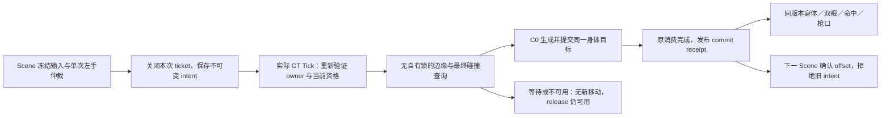

# 实施交接：收到开工指令后的执行顺序

## 当前 Native 调用端差额核对（2026-10-29）

本轮按当前 checkout 重新核对了四个文件、16 个唯一源码锚点，记录在 `analysis/offline-preimplementation-20261028/reports/cover-native-seam-audit.json`；同目录上级的 `audit_cover_native_seams.py` 可重新采集行号和完整文件 SHA256。锚点不唯一或不存在时直接失败，不输出新的成功报告。此记录证明源码差额，不证明运行时缺陷或接入完成。

现有生产调用端与离线 V6 接口不兼容，不能只替换 common 头文件：

| 接入位置 | 当前行为 | 必须完成的迁移 |
| --- | --- | --- |
| `cover_input_live` 的 participant 构造 | 无 Authority/ledger 的实例 | 单一 Native owner 持有 Authority、motion ledger，再构造 participant；寿命顺序明确，不能使用测试签发者 |
| `cover_shared_input_live::prepare` 的 complete | 传入武器 commit 的 bool | 武器事务成功与几何 ready/wait/unavailable 分开；失败或 action race 是 fault；提供当次真实 input grant |
| 两处 prepare 的 view 消费 | complete/update 返回后直接读取 view_valid | 输入结束不发布视图；使用当前有效 Tick、占用及 view mapping 证据单独 publish_view；旧 Scene ticket 不跨 Tick 授权 |
| `cover_input_live::publish` | 给旧 cover_body_live 发布目标 | 改由现有 C0 owner 提交、消费、恢复；发布目标和 apply 返回都不能代替 body/view/hit 回执 |
| shared prepare 的锁范围 | 调用者持有 stereo_mutex | 不在此处插入原版碰撞查询；查询移动到合适的 owner Tick，查询后重验，消费前保有真实碰撞快照/租约 |
| shared prepare 的 range/edge | 明确为零范围和空 edge | 保留禁用抓取，直到 reach/edge/path/occupancy 真证据接入，不能只填范围就打开抓取 |

具体迁移顺序：先实现 Native 证据签发／查询与生命周期管理，再实例化 ledger/participant；分别迁移 legacy 与 shared 调用者；把身体提交接到 C0 的 `pose_begin`／`apply_with_view_marker`／`pose_end` 并取得真实消费事实，最后接入单独的视图发布和缓存。`read_view` 是需要审查的现有消费入口，不能由名字推断它已支持新的掩体证明。

调用端需要保留的五种时序：正常松手先导入已提交位置再取消待提交请求；等待几何时仍处理松手；武器 commit 失败撤销手输入但不推断身体回滚；重新定位/世界/角色变化使旧请求失效并处理恢复债务；同 Scene 渲染重试只读缓存，不重复武器回调。已有纯内核检查不能代替这些 Native 合成路径的编译和后续验证。本轮未迁移生产调用端、未编译 Native、未执行游戏。

本文固定实现方向，不修改生产源码。所有拟新增类型／文件均是 D 级设计，不代表已存在的可调用 API。原有身份、新鲜度、单一写入者、C0 提交／消费／恢复保护继续保留；不能用新 bool 字段代替实际回执。

## I0 · 基线与范围

在 `C:/Users/11/.codex/worktrees/6dof-single/gearsVr` 继续主线；按 [索引](code-locations.json)检查符号和哈希，将主线后续变更合入实施上下文，不还原旧源码快照。当前 Native/Playground 的修改者仍只有协调会话。旧 observer、纯内核和诊断 reader 是复用材料，旧 body writer 和 preview 不作为最终执行端。

首次完整接入范围：本地权威战役／Playground、已经被主线认证的角色骨架，普通和 Stationary 掩体；保留原版特殊动作。左右侧沿、合法顶沿、真实头动、松手保持、重新抓取均属交付范围，不能只完成上探后宣称全掩体完成。移动／破坏几何必须有明确失效处理；联机权威和其他骨架单列不支持原因。

## I1 · 新掩体上下文接入唯一身体 owner

已有修改点：`continuous_hand_owner_live::{passive,owner_current,tick_begin}`、`body_c0_goal_policy_live::{no_cover,pose_begin,pose_end,read_view}`、`cover_shared_input_live::prepare`、`capture.cpp`。

拟新增 `tools/native-capture/cover_context_live.inl`，只读当前 typed actor／slot／surface 上下文。独立于 `cover_body_live::enabled`、旧 neutral-eye writer 和 native head getter；沿用当前 `weapon_hand_scene_binding`、rig metadata/Tick source 的对象身份与主线 C0 neutral。

`CoverContext` 必须记录：session/world generation，World/Controller/Pawn/Mesh/Link 的完整身份，slot 与端点插值，CoverType/Action/Direction，Stationary/circular，左右／上探权限，special move、break、菜单／输入状态，骨架签名，单位比例，CoverBasis/ViewBasis/neutral 与其 generation，reference/space epoch，以及真实调用时相的回执引用。不能把一个 Controller 指针当作上下文身份。

把旧 `passive()` 的“与旧 cover writer/input 冲突”与新统一策略的“有无当前 owner”分开。新 cover 作为当前 owner 的策略分支，不靠打开旧 CoverInputPreview。新策略仍拒绝两个 writer、重入、错误线程和未结恢复债务。非掩体路径及当前 M1–M3 默认行为不改；新能力未完整认证前默认关闭。

## I2 · 生产碰撞 backend 与可抓边缘

拟新增 `tools/native-capture/cover_collision_live.inl`；纯数据与决策放在 `tools/vr-common/cover_motion.h`。复用 `cover_trace_query.py` 的反射／代码证书规则和 `cover_surface_query.py` 的参数布局，不在 Native 中启动 Python 或每帧通过 Playground 外部诊断队列查几何。

绑定时单次扫描所需字段链，保存选定链与前缀见证；每次调用复核选定身份／字段／代码，记录注册表 count 的单调历史。allocation/capacity 变更、缩小、已观察增长后的回滚、cycle、越界、选中槽位改写均拒绝。采用显式有界容量，至少覆盖历史 WarPawn933＋Actor360 的案例；超限报告不能截断成“成功”。不要把上一候选512容量直接搬入。

查询只在真实外层 mesh Tick 已建立有效 owner 和来源后进行；复制必要元数据的短锁已释放，尚未进入 C0/骨架写入消费临界区。任意引擎查询可重入，使用当前调用深度保护；原函数正常返回后重验上下文。查询失败、异常、有效无命中、有阻挡四类结果独立编码。调用预算初始上限12次／Tick、软时间预算1 ms（D，可调）：超出预算停止新查询，输出等待，记录计数／耗时；不能中断正在执行的 native 函数，也不能靠跳过最后必要查询满足预算。

边缘候选可分多 Tick 搜索，所有结果带几何版本。身体运动所需的终态占用及沿路径扫掠必须组成完整的一组证据才能提交；不能跨不同几何版本拼出“完整结果”。动态对象必须查询或导致当前区域失效，不能仅追踪已命中的墙。针对凹角、薄墙、过梁、低顶、移动门、破坏体和手臂可达分别定义查询。

**时相决定**：最终运动与占用证据在实际提交的 GT Tick 内生成，并在没有未经认证的引擎调用／世界推进介入的区间内消费。如果引擎存在并行物理更新，还需要实际碰撞快照／读租约或等价的当前版本保证；仅重复读 Actor 变换不够。该保证必须由 A04/A07 认证，没有保证时返回 unavailable，不能赋 `collision_verified=true`。这属于 native 接线认证，不能在离线文档中假设已经成立。

## I3 · 输入、等待、裁剪与松手保持

修改 `cover_interaction.h`、`cover_input_owner.h`；保留 `cover_controller_adapter.h` 和唯一 `left_hand_interaction_owner.h` 的 epoch／press／incumbent 语义。单次 Scene 仍是一次 weapon prepare → 仲裁 → weapon commit → participant complete；不能把 broker nonce、`CoverInputOwnerTicket` 或回调注册借用到下一 Tick。

新增逻辑数据合同如下。它们是拥有拷贝的记录；证书引用由真正的 owner 签发和查验，不是调用者填 true：

| 记录 | 必需字段与职责 |
| --- | --- |
| `CoverEdgeCertificate` | context/basis/geometry generation、Actor/Component/surface、edge kind/id/区间、接近侧／可达性、原权限、query receipt |
| `CoverMoveIntent` | 单调 intent id、当前 committed pose version、context/basis/ref/space、手样本身份、左手逻辑 lease id（仅关联）、from/requested offset、锁定轴／抓取起点版本 |
| `CoverMotionCertificate` | 与 intent 绑定的 from/requested/accepted、扫掠体积与 path、终点占用、几何版本、当前物理姿态、真实 Tick owner、accepted/clipped/wait/unavailable/rejected 状态与原因 |
| `CoverCommitReceipt` | 唯一提交 id、intent id、前后 committed version、实际 offset、身体姿态／view／hit consumer 的版本、原动作适配状态；只有真正提交者生成 |
| `CoverExposure` | 同一 pose version 的 head/torso/arms 几何、遮蔽与暴露判定、来袭命中／枪口查询所需的证据；unknown 不当 sheltered |

现有 `CoverInputOwnerCandidate` 增加只读候选数据，不暴露可写内部指针。现有 bool 完成接口扩展为明确结果；不能把 `complete(false)` 用作“正在查墙”。`wait` 在本次 ticket 内完成仲裁交易，保留合法租约和已认证 offset；若同一回合收到 release，release 立即生效，不等查询。硬故障仍 revoke，要求下一次真实 release。

跨 Scene/Tick 的待移动请求采用新 `CoverMoveIntent`，与瞬时 input ticket 分离。最多一个有效待提交版本，可被更晚输入取消／替代。Tick 从当前 owner 重新取得可执行资格并复核当前逻辑租约，不能拿 intent 中的旧 lease id 当授权。查询／身体提交成功后写唯一 commit ledger；下一 Scene 用 receipt 将内核的 committed offset 同步一次，旧结果不能复活已取消的请求。渲染只读已完成身体提交的 publication，不读尚未落地的 input candidate。

`CoverInteraction` 增加明确的运动确认／重基准能力：

- accepted：更新已提交 offset；正常绝对手位差计算继续。
- clipped：更新实际安全 offset，并以当前手位与安全 offset 重设锁定轴起点，消除被挡位移积累。
- wait：不改 offset，不推进抓取起点，不重复产生 press；保留租约但持续接收 release。
- current occupancy lost：不把旧 offset 或零 offset 重新认证；进入 I4 恢复。
- reject identity/lifecycle：结束抓取、取消 intent，交接姿态；不跨世界恢复。

每个结果检查 from-version，避免一个旧 clip 覆盖较新的 release／恢复／重新抓取。正常松手只释放手，虚拟 offset 仍留在 commit ledger，由后续占用检查维护。

第二轮明确补充：每轮抓取／移动／松手／失效输入前，先同步已经成功消费的commit ledger，再取消未提交intent。身体已移动而输入尚未ack时，松手必须保留该实际位置；不能把已发生的提交当作晚到旧查询丢弃。receipt还要携带裁剪标志、锁定轴、抓取generation与对应手样本，以便下一轮准确重设起点。原消费者异常只表明不能发布成功，不能推断身体已经回滚；该状态继续保留恢复债务，空间重新变空不等于债务解除。具体合成例见[第二轮补充](research-followup-v2.md)。

## I4 · 身体、双眼和过渡的一次提交

枪弹查询差异（2026-10-29）：保存的 `Engine.Weapon.CalcWeaponFire` 调用 Actor.Trace 时使用 traceActors=true、零 extent、HitInfo 和 ExtraTraceFlags=1。现有 `cover_trace_query.py` 只接受0或8（Blocking），所以诊断碰撞成功不能替代枪弹几何认证。当前缓存 Trace 包装器在 bit-1 分支存在反编译 JUMPOUT 缺口，尚不能证明它一定消费上述刚体更新的形状。必须先解析实际组件碰撞分支，不能直接扩大诊断 flag 白名单或把刚体更新回执当作充分证明。

已核对的即时命中数据链是 CalcWeaponFire → ImpactList → ProcessInstantHit/Internal → GetFireModeDamage → HitActor.TakeDamage；WarPawn.TakeDamage 在 !bDontModifyDamage 时调用 AdjustPawnDamage 和 Game.ReduceDamage，随后还保留原伤害效果。CalcWeaponFire 有穿透和传送门递归，并会临时改变 bProjTarget；因此不能重跑它作为只读探针，也不能假设一枪只产生一个 Trace/Impact/伤害调用。未来证据需关联 shot、递归 query/impact、target/component、pose version 和真实 damage invocation。六份脚本及一份 native 缓存的校验记录在私有 `reports/cover-bullet-query-chain.json`；不代表所有武器、投射物或当前运行时已经覆盖。

实际更新分支补充：私有 `reports/cover-physics-branch-audit.json` 从两份已校验历史缓存提取6个唯一锚点。主候选的变换检查之后，按条件选择接收者虚表 `+40` 或 `+104`；`0x1402151e4` 只在另一个 flags 分支调用，使用的对象字段也不同，并在内部再次选择 `+40/+104`。因此只追辅助函数会漏掉主更新路径。偏移本身不能证明函数名，更不能证明立即/延迟生效；未据此添加 native 调用。

后续观察范围具体限定为：mesh/physics instance/body index/接收者完整身份与 pose version；预期部件集合和每个跳过原因；主/辅助路线；解析出的虚函数目标及代码身份；实际完成和查询可见的场景状态。单部件成功、P1 正常返回、队列中出现目标或强制 teleport 都不能替代完整 hit_geometry 回执。此项仍是接入缺口，不以猜测名称补齐。

物理更新入口线索（历史证据，未认证接入）：现有 `cover_pose_phase.h` 的 physics_rva 为 `0xf26d4`，观察器已分别包住主调用与晚调用（返回位置 `0xf9aeb`、`0xfac69`），无需为定位另造 Hook。知识库的历史直接调用位置分别为 `0x1400f9ae6`、`0x1400fac64`，与这两个返回位置相差5字节；三个相关缓存伪代码已逐文件对照 KB 哈希验证。详见私有 `reports/cover-physics-update-lead.json`。

这条线索仍不能签发 hit_geometry：候选有 asset/instance/body/bone/flags 等条件分支，P1 正常返回也可能没有更新所需身体；其间接调用目标、实际射线使用的形状和查询可见时机仍需查清。保存的 `PlayDying` 在跳过距离驱动的 kinematic 更新时调用 `UpdateRBBonesFromSpaceBases(true,true)`，但这是死亡流程，不能把 teleport/unfixed-body 参数照搬到活人掩体。导出的 native 声明甚至丢失形参，缓存伪代码原型也不可信，禁止据此生成强制调用 ABI。下一步限定为沿实际 body 更新分支和物理查询可见性追踪，而不是继续按函数名称泛搜。

消费来源定向核对：`reports/cover-consumer-source-audit.json`（相对私有离线准备目录）保存5个源码锚点和3份历史脚本身份。`full_body_c0_native_live::before_original` 在原调用前将 consumer_marked 映射为 consumer_verified，不能当作物理/受击几何已同步；atom overwrite 回执明确不证明 FK/Space/physics。现有 `weapon_grip_damage_metadata` 只选取 `GetFireModeDamage`，是武器伤害计算探针，不能直接充当 `WarPawn.AdjustPawnDamage` 的入站受击适配器。

时序合同明确分为两层：移动提交前取得实际命中查询几何已消费该姿态的证据（候选枚举现名 `hit_geometry`）；实际受击时再将命中区域、来袭方向和原伤害调用绑定到对应姿态。前者不能等待后者，否则无枪击时掩体移动永远不能完成。反过来，一次伤害回调或屏幕上的骨骼位置也不能补签前者。真实 hit geometry 消费入口与物理同步机制仍待定位。

历史 `AdjustPawnDamage` 中至少有 IsProtectedByCover 和人类盲射两条 cover-only 清零分支；只让 IsProtectedByCover 返回 false 仍可能在下一分支被清零。后续入站伤害适配必须同时处理这两条掩体语义，保留其他特殊动作、伤害类型和后续伤害规则。保存脚本含未解析 token/类型，不能据此直接写 native 偏移或假定当前 ABI。

2026-10-29 私有实现补充：`analysis/offline-preimplementation-20261028/staging/tools/vr-common/cover_consumption_bundle.h` 已实现身体、视图、命中几何三份消费证据的汇合。要求同 request/intent/from/pose version、完整 context、调用时刻编号、碰撞快照、身体样本和实际 offset；每个角色由真实 registry 分别验证，最后 registry 原子重验并保存组合回执。失败不修改输出，也不能推断未写入或自动重试引擎调用；已派发请求继续走原恢复流程。

该代码只是证据汇合核心，真实 Native registry/read/seal 尚未实现。现有 `body_c0_goal_policy_live::pose_end` 检查原调用返回、kernel consumed、异常和 protocol debt 后发布，但 `pose_begin` 与 `read_view` 仍要求 no_cover；其现有 Publication 不等于新掩体合同的三消费者证明。不得把 publication_sequence 直接复制成 hit_version，或只删除 no_cover 检查。

`cover_consumption_bundle_compile.cpp` 的编译期检查覆盖完整匹配、10 种错配、缺失/错误角色证据、封存失败与 owner 拒绝；输出保留也被检查。MSVC /Zs /W4 /WX 通过，未链接或执行；合成 registry 只用于这些检查，不可用于 Native。报告位于 `analysis/offline-preimplementation-20261028/reports/cover_consumption_bundle_compile.json`。

复用 `full_body_c0_transaction.h`、当前 native backend、`apply_with_view_marker` 和主线 C0 模型；不要新增第二套 SpaceBases／Root／相机 writer。`cover_full_goal_live` 的纯目标计算可迁移为输入适配，但不能作为 pose_applied 回执。旧 `cover_camera_live` 的 yaw+π 和旧相机覆盖不进入最终路径。

当前普通 SM0 策略中固定零 `CoverOffset committed{}` 改为明确策略分派：ordinary 保持现状；cover 只有在有效 context、运动／占用证据、damage/action adapter 就绪时提供 cover goal。坐标解耦按 [交互合同](interaction-contract.md)；位姿生成先得到合法 neutral/body target，再一次加入虚拟偏移和真实追踪。保持固定骨长，不从已变形骨架反算下一帧 neutral。

身体提交使用当前 C0 的 prepare/commit/consumer/scope-end 规则；原函数消费后不能用旧 C0 强制回滚。只有成功消费、同一模型／context／pose version 的结果才发布 view。`capture.cpp` 只选择一个最终 owner；不先用旧 cover view，再被 C0 或 run view 再覆盖。双眼、自由右手、枪体与头部保护遮蔽消费同一 publication。

抓取左手的目标是证实的接触点，真实左手仍作为拉拽输入；IK 达不到时限制虚拟运动／结束抓取，不拉长骨段。视觉左手释放按短过渡回追踪，不额外应用第二次身体位移。

过渡器记录旧 publication 的世界眼点／身体根／ViewBasis 和新原版移动基准。沿墙换 slot 时先结束抓取，再投影旧安全位置到新基准，查询衔接路径；完成后更新 cover generation。退出时原移动仍可用，虚拟保持量通过基准交接消化后再清零。recenter/snap-turn 不制造拉拽；世界/Pawn替换直接丢弃跨世界的姿态证据。墙体挤入或查询失效的恢复使用合法路径，追踪显示遮蔽与游戏移动分开处理。

跑动稳定合并在相同基准层。`run_camera_stabilizer` 现有站姿校准、SM4和固定前上偏移只作为旧候选参考；实现普通跑、起停、冲刺吸附连续基准，不对最终带 HMD 的图像低通。保留真实蹲下／上下坡、控制器转向及已区分的后坐力。

## I5 · 原版动作与伤害保护适配

拟新增 `tools/native-capture/cover_gameplay_live.inl`，复用已有 dispatcher 的实例／调用边界，不安装竞争 hook。第一步按 [原版入口表](original-entry-map.md)认证两 state 的 updater copyback → PlayerMove local → setter 链，避免写未认证 out 指针。只有当真实 `PlayerMove` 即将提交 CA/CD 时适配输出；保留原所有其他副作用，原流程只执行一次。

动作规则：合法真实／虚拟暴露决定可用侧向／上方动作，原 aiming/firing 请求仍决定瞄准或盲射行为；CA/CD 不再自动驱动视点和身体位移。不能恒零 CA，否则原保护函数会把暴露者重新当作受保护。Stationary 后写 CA 的分支同样覆盖。reload、switch、special move、菜单与输入暂停按既有上下文交还，不让掩体 adapter 卡住武器状态。

同时处理F19：`DoingAnimationTransition → ShouldDelayFiring → ShouldRefire`，及Pawn Tick／弓CanReleaseFire消费。稳定半探不能长期被视为动作未完成；只有已认证的本实例cover过渡可适配，原镜像、换枪、装填、真正特殊动作和no-firing限制保留。不得全局设置bNoAnimDelayFiring或把ShouldDelayFiring整个返回值固定为false。

Damage adapter 同属此实例作用域：真实命中落在已暴露部位时绕过 cover-only 保护或 blind-fire 提前免伤分支，随后原伤害流程继续。真正被墙挡住的伤害保持原语义；忽略掩体的 DamageType、爆炸／固定掩体例外、原其他免伤、护甲、难度与头部倍率不被覆盖。保留来袭方向相对于真实墙面的位置关系，不依赖已旋转为面墙的 Pawn 朝向猜保护。

不能通过短暂把全局 CA 改成7去绕过所有伤害保护，也不能直接恢复最初 Damage 而跳过之前合法修正。若无法认证原分支边界，停止扩展启用并报告准确缺口；不交付“画面正常但无敌”的替代品。

## I6 · 武器与命中消费者合流

对接 [武器实施交接](../weapon-specs-20261028/implementation-handoff.md) 的主握、support、reload、权威 muzzle／射击消费回执。掩体不各自重写12种武器。统一接口带 weapon instance、owner/Pawn、pose version、muzzle origin/direction、shot serial 和原合法性结果。命中 trace、投射物出生和HUD显示必须分别记录；HUD不可回写权威瞄准。

具体复用 `weapon_unified_fire.inl::prepare_current/source_matches_shot/typed_result/normal_return`：准备只在正常GT准备阶段进行；原返回通知中不新增Trace、引擎getter或锁。补上cover commit/basis/geometry引用，覆盖base aim、trace origin、pushed origin、physical origin四种返回路径。已有Frame/shot来源先后检查不等于掩体空间一致性；保持普通M4分支语义。详见[第二轮接口表](research-followup-v2.md)。

最少覆盖：眼睛外／枪口内；头在内／手枪可合法盲射；长枪穿墙；近距离目标；左右镜像；左手抓边时右手射击；松手后支撑／取弹；换枪／弹药动作中不能抢租约。投射物不能在墙另一侧出生；被挡弹道按原墙体碰撞处理。

同时检查实际命中消费者使用的身体姿态。若只改渲染骨骼而 physics／伤害仍用旧骨架，需把同一 goal 接到原命中消费时相并取得回执，不能只改 `CoverAction` 结束此项。新模型仅需手掌标记／姿势和已有骨架映射；地图掩体仍来自原几何。

## 最终时序与退化

边缘慢查询可以跨 Tick；输入交易、引擎调用借用、C0写入租约不能跨生命周期保存。暂停／失焦保留与释放按现有输入规则，旧 pose 不能刷新时间戳冒充新证据。所有未匹配、重入、注册表异常和清理债务走主线已有保护，不能把故障吞成有效无命中。

## 开工清单与交付状态

1. 检查主线最新符号和未提交修改，完成 I1；新策略默认关闭。
2. 完成 I2 的 typed backend、原始调用认证、current occupancy 保证；落实等待／不可用结果。
3. 完成 I3/I4 的提交与交接，再做 I5/I6 的原版动作、受击和枪口合流。
4. 按 A01–A20 选择受改动影响的纯逻辑检查；按照届时有效授权做短基本游戏检查，有具体失败才定向补查，不恢复旧大矩阵。
5. 单独记录源码完成、编译、受控基本结果、候选交付、实体头显确认；保留回滚包。

开工无需再选择交互方案；不得跳过的运行认证是：原调用参数／copyback，实际碰撞快照与 initial-overlap／动态物体语义，以及姿态到命中／武器消费的一致性。它们的检查点、失败行为和实现归属已固定于本包。本轮没有执行这些运行验证。

### 2026-10-29 后续：Trace 包装器 bit1 的实际解码

历史 Actor.Trace 包装器缺口现已按真实函数 chunks 补齐：0x1400cdf29 的 BTS bit17 / TEST extra最低位 / CMOVZ 表明 ExtraTraceFlags=1 增加内部查询位0x20000；0x1400cdf83写出该掩码，0x1400cdf8f调用0x1400cf8f8。两个真实 chunks 哈希与既有记录一致。此前“包装器bit1分支未解码”的状态由此更新；下游组件/形状消费以及物理姿态的查询可见性仍未解决。不得扩大诊断白名单或把位转换当作命中几何认证。私有报告：analysis/offline-preimplementation-20261028/reports/cover-trace-bit1-decoded.json。指令整数模型的11项编译期断言通过，无运行验证。

### 2026-10-29：枪弹查询掩码下游转交已核实

私有 IDA 实际指令确认0xcf8f8读取输入掩码后，在0xcf952设置bit10（0x400），0xcf96e写出并在0xcf977调用0xcfa40；后者在0xcfa9c取得R14D，经过0xcfd33条件检查，从外层+0x178取得接收者并调用其虚表+0x20，0xcfd6d仍传出完整R14D。因此bit17没有在这两层被清除。

IDA 在0xcfd58处误拆连续函数区段：0xcfd55的mov之后直接继续0xcfd58，使用同一组寄存器与栈帧。缓存伪代码的独立sub调用视图不能作为真实可调用ABI。全chunk已对照历史blob校验，原始导出见 cover-query-helper-chunks.json；评估见 cover-query-mask-forwarding.json。接收者的真实类型、虚表目标、形状过滤与姿态查询可见性仍未知，不把它猜成PhysX或CollisionHash。标志转换候选增加helper bit10模型，14项编译期断言通过。没有生产或诊断白名单改动、没有运行实验，原冻结快照v1不包含新候选。

### 2026-10-29：+0x178 查询接收者创建链及具体槽目标

历史字节候选扫描得到74处寄存器写+0x178，机械核对缓存后选中0x1401f1150：实际指令0x1f117d读取global0x141c20890，与Trace0xcdf60真实RIP地址一致；分配0x120字节，0x1f11b2调用0x1f14a0，0x1f11b8写parent+0x178。构造函数实际LEA在0x1f14ad取vtable0x14133d140，写object+0。保存数据节的槽+0x20（0x14133d160）指向0x1400cfef0。因此该创建路径的查询实现已有具体目标，不再只是未知虚调用。

这是历史构造链，不证明当前实例未被替换或当前ABI；动态对象身份/虚表/代码仍须认证。0xcfef0缓存（SHA已验）出现状态写入和0xe6a10递归线索，不得把它重放成只读探针；bit17具体组件过滤仍待补证。旧私有库打开报初始化error4/empty，保留失败副本，未发现存活IDA进程；重新校验原库SHA后复制新私有v2副本，实际导出成功exit0，原库不操作。报告 cover-query-receiver-resolved.json 与 cover-query-concrete-vtable.json，未接入生产、无游戏运行。

### 2026-10-29：查询掩码抵达候选组件虚检查

实际指令已确认0xcfef0读取incoming mask（0xcff07）并写context+0x3c（0xcffa3），0xd03b9进入0xe6a10。遍历从节点数组取candidate，检查+0xf4去重，取candidate+0x78关联对象，并读取+0x108起的向量做范围预检。随后0xe6c9d调用关联对象虚表+0x330，R9D来自context+0x3c；通过后0xe6ccc载入candidate虚表+0x2e8，0xe6cd8/0xe6cde再次传出同一掩码，0xe6d46调用R10。零返回走0xe6fcb的后续记录路径，不能按一般bool成功解释。具体槽实现仍待身份认证。

实施缺口由此更具体：除骨骼/刚体外，必须确认候选范围边界及查询索引已消费同一姿态，否则可能在窄检查前被排除。这里仍称bounds-like向量，不根据偏移强行命名引擎字段。原查询有context和去重状态写入，不可重放为被动探针。报告 cover-query-component-route.json 和原始 cover-query-component-chunks.json；尚未证明bit17最终几何语义、玩家组件具体槽目标或查询可见刷新时机。没有生产改动或游戏运行。

### 2026-10-29：SkeletalMeshComponent 基础命中检查及 bit17 分支

由类名引用定位工厂0x1404fd1e8，实际LEA0x4fd25a指向UTF16 SkeletalMeshComponent（0x1415bf86a）；工厂登记构造回调0x3d9d90，thunk在0x3d9d99调用实例构造0x3d9da4。后者实际LEA0x3d9daf取得虚表0x14137ac50并写实例首指针。保存数据的+0x2e8槽指向0x140339294，基础类命中检查因此有确定目标。

实际检查指令0x339307取输入mask到R12D，0x339332 BT bit17并条件跳转0x3393b1；该分支对关联数据+0x130做正值检查，正值进入0x14090bdf6，非正值返回0x339339，后者读取RSI+0x248并有条件调用0x131e80。不能根据这些偏移命名多边形/骨骼/PhysX分支；仍须解析具体几何与变换来源。当前玩家是否派生覆盖此槽也未认证。报告 cover-skeletal-hit-route-resolved.json 记录完整身份链、指令及限制；无生产或运行改动。下一步沿0x90bdf6解析数据消费，再与body更新对齐。

### 2026-10-29：命中分支与既有骨骼矩阵 getter 的直接连接

实际冷区0x90be4d先做name→index查询0xf9d80，-1跳过；0x90be76设置RCX=mesh，0x90be88以RDX输出矩阵、R8D索引调用0x1d40b8。返回矩阵随即复制并用于0x137a60变换处理，后续按asset+0x138的条目进入几何辅助函数。这是骨骼变换参与至少一条命中路径的直接证据，不能再将所有hit geometry都笼统归于刚体更新。

本次导出的0x1d40b8两段真实代码SHA，与现有tools/native-capture/cover_bone_getters.h的两段认证值逐项一致，可复用已有当前owner/thread/mesh及SpaceBases读取合同，无需另造骨骼getter。当前publisher明确拒绝MasterPose、无效索引identity fallback，并检查矩阵/数组/代码当前性；这些限制保留。包声明中存在PerPolyCollisionBones/PerPolyBoneKDOPs，仅支持后续假设，不能用其索引补运行时偏移。几何辅助函数、实际玩家资产分支、SpaceBases/world变换及范围索引的同版本同步仍未证明。报告 cover-hit-bone-transform-reuse.json；原库/生产源码未改，无运行验证。

### 2026-10-29：已定位查询链的完整片段身份清单

新增 cover-hit-query-code-spans.json、可重复离线 verifier 和私有 cover_hit_query_code_spans.h：从已有实际指令导出中去重排序，14个无重叠代码片段共7828字节，逐片对照历史代码节SHA验证通过；包含已知查询辅助、遍历、骨骼命中主/冷片段、共享矩阵getter和名字索引。C++清单范围/哈希格式/重叠检查 /W4 /WX /Zs 通过。它供未来接入前确认代码身份，不包含原版函数体，也不授权调用，不是完整递归依赖闭包。

缓存辅助代码出现zero-extent区分及两套几何路径，尚未给它们强行命名。尝试导出辅助函数时私有IDA v2再次初始化error4，未产生新导出；保留日志/副本，不重复修复，继续现有证据的可重复核验。更深几何helper、实际实例/ABI/姿态和bounds/index认证仍缺；没有修改生产或执行游戏/测试程序。报告 cover-hit-code-preparation.json。冻结快照v1不包含新清单头文件。

### 2026-10-29：几何辅助函数实际导出与代码清单 v2

从校验原库新建私有v3副本，一次限定导出五个辅助函数成功exit0，原库/工具配置不改。实际0xdb120对三分量做零比较，有限输入下支持zero-extent分流判断，但不能据此省略非有限输入校验。0xdec0e8按80字节条目从asset+0x138准备查询；0xdebe0c复用该准备后增加extent相关处理。0xded060经0xad8464进入0xdecae8；0xdec81c经范围调整和同一预检进入0xdec154。具体叶级几何算法与资产记录类型仍未证明。

新增五段至不可变v1之外的code-spans-v2清单，现19个无重叠片段共9002字节，全部逐片对历史代码节验SHA；私有C++清单编译通过，离线verifier支持显式v1/v2，默认v2，分别保存报告。没有调用或重写原版几何函数，没有修改诊断白名单。报告 cover-skeletal-geometry-helper-route.json，实际玩家资产、组件派生、同版本姿态/边界索引仍缺，目标未完成。

### 2026-10-29：叶级三索引顶点数据已核实

实际递归查询0xdecae8的叶段0xdecfd9..decfec以8字节记录前进，取+6的16位附加值并调用0xdeba24；后者0xdeba70..debaa4从asset+0x138的80字节条目读取+0x40顶点基址，按记录+0/+2/+4三个16位索引形成12字节顶点地址。体积查询0xdec154在0xdec699..dec72a使用同一顶点来源、三个索引和附加值，将三点传0x1b697c。后续命中结果还要和已有fraction比较，不可把任一叶返回当整个查询结果。

三组3-float顶点与原向量检查支持三角形类几何的推断，但不证明全视觉网格蒙皮或完整树格式。附加16位值不擅自命名材质/骨骼。实施上保留原资产顶点/索引，用当前bone-world变换配合同版本范围/索引可见性；不能通过改共享资产顶点替代姿态更新。普通线诊断不能覆盖体积查询。报告 cover-skeletal-indexed-geometry-route.json 与原始指令导出；当前玩家分支、其他物理路线、范围刷新和实际受击关联仍未完成。未改变生产、未运行游戏。
