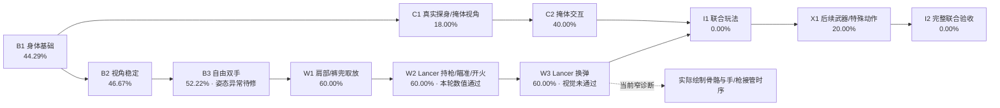
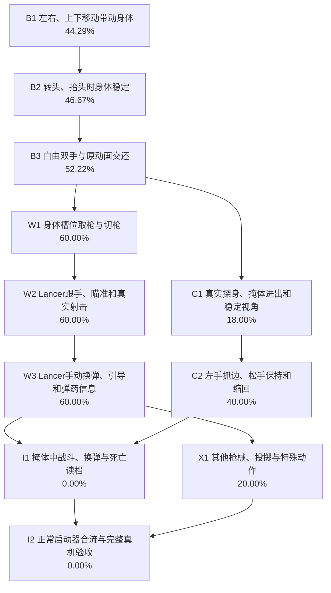

## 2026-11-06 v 67: empty-handed flash gun repair, E finger close; C impregnated

Fixed startup access has been updated to `6dof-unified-20261106-67`, the path remains `J:/gearsVr/candidates/6dof-unified/GearsVR Launcher.exe`. User configuration, scale 1 and 4 Second reload configuration bytes, v 66 Can roll back.

19356 In the actual game, empty-handed approach to ground weapons.17 seconds,547 All secondary hidden samples kept hidden; seen all 5 Double-way timeline and 6(a) A surface view, followed by active pick-up, shoulder-picking and firing. The root is that Pawn Touch informed of the initiative to restore our hidden positions; only to cancel the resumption of contact notifications, retaining treatment such as physical pick-up/exchange of guns/components for concealment/destruction. E ' s index finger remains intact with thumbs, while the remaining three fingers converge;2572 The game continues with the completion of the space box, actual pull/release/return/shooting,4 Videos and 6 Zhang E-Choose has been checked.

C rules are still to push to the head and hold on to a continuous operation, first time unhanding one-on-one.3 Seconds, pull off.19356 Hold on.20 Second, head move, back pull/sweet reboot, break-in/take-back/renewal of fire.2572 The log failed to run the current action, as it stopped early when holding hold.3(HandClit effect change), the exact source of expiry is not known; failure to return this round cannot be considered repair.2572 The first airbag capture failed, as did the needs_release, and a successful retry without overwhelming failed.

The next code point is not valid until C is repaired.100 ms. protection, continuing five more complete patches, walk-scratching, second actual execution/eye, HUD and start third person. No assistant, no other gun extension.36.47%current round+0.00 Percentage 11 Parent/64 Subsums are separated from weights; source code, compiler, simulator video and physical header recognition.`J:/gearsVr/analysis/6dof-progress/solo-lancer-E-ground-20261106.json`。

## 2026-11-06 v 66: Chainsaws maintained and 3 The second they're back, the hands are back and back.

Fixed start-up portal compiled and updated `J:/gearsVr/candidates/6dof-unified/GearsVR Launcher.exe`Candidates `6dof-unified-20261106-66`. The actual roll to the front of C-hand and keep holding on to continue, then release for the first time and then move again and again.3 seconds;activate after pulling off and interrupting protection reservations.

67776/source 1 Grip and his index finger are running away.3 Fire, all right.0 Do, the gun is moving in separately.0.000061 and 0.000484 Raw, unhanded and single hand; C holding above 3 The seconds, head move, back pull/stagger reboot, loose process/stop/take and resumption of firing are passed.193 The second double-track time line.7 Page frame and wood view; not a physical header showing acceptance or full five hand positions passed.64672 The cartridges were not loosed, the empty warehouse E-stroke and evidence of the amount of ammunition.

Actual root cause: old posture 103 When msec expires, the log logic grab is removed. The repair is still denied.100 The old attitude and action permission in ms. is retained only for the next frame to re-identify, hang point, reference/input epoch and authentic keys. The source/check/frontal sequence failed.

The maturity is still in place.36.47%current round+0.00(b) Percentage points;11/64 This is a back-up of the hands function, which has been tested and does not add points to the charge. Full Lancer, five-part alignment, empty-handed ground weapons flashing, walking blinking, second execution/eye, HUD and physical hand showdown are still working. Next step is to continue with the same Lancer batch:`analysis/6dof-progress/solo-lancer-formfit-burst-20261106.json`。

<!-- lancer-interaction-v57-current -->

> 2026-11-05: Open Development Candidate updated to **6dof-unified-20261105-57**The entrance is still. `J:/gearsVr/candidates/6dof-unified/GearsVR Launcher.exe`. Old version of the game path, scale 1 Keep user reload configuration, v 56 Rollback at Same Level `6dof-unified-20261105-57-rollback`. Below the lower text is "Public V"49 The record of the /continuing chestnail repair is historical only; the chest nails are hidden in no current direction.

>

> The same compilation identity as the Native/PG: Grip/finger grab from Lancer, hand positions and bounds, front-model wood double-held, cartridge insertion aids, front handle loaded along long slots, chainsaw handle pre-tolerance push/back pull.65028 Two double-held and actual gun tracks, tactical/air defence rounds, partial E pull still off fire, full pull/dismissal/fire after return were recorded.34876 The Grip saws were stopped/reconciled/released, and the index finger was used twice in a row to attack different original enemies, death of the original, first person ' s name free viewing, resumption of shooting and suspension of return.36 A physical bone snapshot is preset for a saw; the bones are identical and do not replace skin-skinning or real machine comfort.

>

> Read Again 34876..who are the perfect pair of time axes 00–07 The page, and the grip/two attacks key view; the game mirrors and simulators are constantly updated with no card waiting after the second attack of this round.2 Sync as p 3, the long slot data generated from the game resource are consistent with running GPU input bytes. Check before packing, list of official documents and double DLL identity pass; users can edit path configurations to be kept as actual byte at the start of this session. Record:`analysis/solo-m1-20261028/lancer-interaction-v57-delivery-review.json`、`candidate-delivery-v57.json`。

>

> Add 47508 Review: same v 57 Double DLL, press current 35 The baseline is normal for double-barrel, backside, shoulder and fixed guns. The actual body turns around.15.86 The change in the rays caused by the turn of the fixed gun is 0 Do, the real spent rounds are consistent with the gun tracks.124.98 Seconds 00–04 The pages and key proxies have been viewed, with the original mechanical sights visible in the right eye; no evidence of precise hits along actual machine-based sighting has yet been established.`analysis/solo-m1-20261028/lancer-stance-v57-review-47508.json`. Game/XR/recording is normally out, Native clean-up and exit recovery verified; no public program has been changed for this round.

>

> **The entire Lancer/Entity Heads ' Identification and Inspection has not yet been completed.** The next point of inspection is evidence of alignment between actual sight and gun-shot lines; user sense, natural capture width and old source 0 The exit VR is pending confirmation.65028 The old track was re-layed into an incomplete magazine service, recovered through a genuine pickup/insertion, not counting C action. Early failure records are kept; no full project maturity scores are added.

>

> 20432 The addition of empty guns and the unloaded boxes were recovered/released, both weapons were retained in their physical identification and quantity, and the loading of the fire was not removed from the disposal; Part E was released from fire and the actual long slots were kept free 23.0414 The fire resumed after the unit was set aside, released and returned.57 The double DLL has not changed and the standby is an unlimited model for training grounds, so the current round does not recognize limited standby as a settlement.139.53 Seconds with video 00–04 Encrypted windows and key viewes have been viewed; Native clean-up, portal recovery and XR exit 0 Verifyed. Record:`analysis/solo-m1-20261028/lancer-empty-stow-v57-review-20432.json`。

>

> Synchronize private target readers still fixed 3.5 Problem with unit pull handle: only certified p is decoded 2/p 3 Actual data, p.3 Offline Physical Cache Read 23.041412353515625, unknown/damaged content denied.47508 The original ballistic data indicate that the axis of the gun is consistent with the model's forward direction within the float tolerance, and the ray is scattered in its original form without misrecording a single wave as an error in the shooter's direction; the precise machine is still missing from the impact. Next step is for the stored owner.13780 The public entrance is stillv 57, maturity is not increased by the number of inspections.

<!-- /lancer-interaction-v57-current -->

<!-- lancer-body-seam-66092-current -->

> 2026-11-03 21:42: the most recent private review is 66092; open candidate remains v 49,V is not addedv 50. The actual blade links the enemy to trigger a original attack, death, first person's call for free viewing, resumption of gun bearing and trigger firing are recorded in this round after the C handle is activated. Full pre/re pull/collap/release re-push/rewind.18068, which is cleared by the earlier media according to three-chamber retention rules.

>

> This round will be limited to the glitches shown: body mapping will keep this original Neck matrix and head painting continues to hide;334 Top of a collar/514 A triangle, no arms weight. Native compiles,4284 Relevant offline inspection and 1871 Sub-local actual drawing application passed.117.24–119.95 The second-second attack was carried out with a collar/blanket cover and close eye interference, so the visual repairs were not passed and did not result in new candidates or claims that Lancer had been completed.

>

> Five pages of full time frame and seven full-size games/eye attacks have been viewed. Next steps continue to be taken to map the local visible restoration of upper chest/collar, with original attack, free HMD, fixed bone length, same camera and single writer. Gunner's posturing has been interrupted, fine gripping and hand-to-hand change retained.36.47%, this event+0.00 pp; entity head not accepted.

<!-- /lancer-body-seam-66092-current -->

<!-- lancer-C-forward-on-v48-current -->

> Latest saw delivery (Presentation)2026-11-03，v 49 C closes normally, the hold is real; pushes ahead of the gun and pulls off behind the butt; and holds hands can push forward again. Cut/tracking stops/receivers stop and return. E-side handles are still only used for empty silo loading, B flipping institutions do not interact. Fixed entrance remains. `J:/gearsVr/candidates/6dof-unified/GearsVR Launcher.exe`。

>

> 60944 Targeting review is out: real C grab/ push start Zoom hold on to original AI rivals Zoom in actual saw blade contact Zoom in original enemy attack and injury Zoom in action Zoom Restore 6 DoF  ⁇  new trigger restores authority to fire (No. 7–12 Fire, same source of gun/trajectorial origin). One attack request; assailant SM 34 Victims SM 35, original death and return SM 0 Recorded. Normal ON/OFFF/Symmetrical ON/Landless Hand Fold Relay 18068 The blogger says:60944 No action or change of bullet is faked as a re-diagnostic wheel.

>

> Viewed full period arc of the current cycle 5 Pages and the beginning/median segment of the attack/end of the attack 6 (a) A full-sized game with eyes;118.44–121.30 Seconds are actually first person animation and remain free to move. Obviously not completed: the chest armor/shoulder/forearms piercing is still present in the attack hand; complete vision or full Lancer usability cannot be declared valid. The attitude flashes back, fine grabs, hint overlaps, starts third person desktop/XR waiting for handover,18068 I'm not sure if you're gonna be able to get a life-cycle break. 28740 The release of the reload remains to be repaired.

>

> This batch was repaired: confirmation of armed possessions with independent fresh input when reading only observations/disable postures, avoiding error; simulation of moving without sneaking out the second hand; request for unimplemented and still holding the trigger is at most waiting 250 I'ms, every time a real fire is fired, it still demands a new tidbit.100 ms Source, same down/release count and tracker/publishing person,20 ms calls the balance, and the original requested clock is not reset. CPU enters the boundary 110 scene/1465 Check and R 2 838 Check through, and separate the game results.

>

> v 49 The new portal has been compiled and updated.9 V for change files 48 Back off.751 Reconcile distribution files, user configuration/4 Second reload INI as it is. Source freezes as `equipment-controls-prepared-20261103-211127`，PG SHA 256 Prefix `749d3910`;normal exit, Native/entry recovery and XR exit 0. The entity header still awaits feedback from the user.

>

> The next batch of attacks, which are actually recorded first, will be visible and visualized before the occasional interruption; without parallel guns, no reruns of intact rounds. 36.47%, current round +0.00 pp, fixed 11 Father/64 Sub-item/192 The operational point remains unchanged. Media reservation 60944／680／18068 Three sessions completed; earlier media tags cleared, text values/source code/reverse unexpunged, current round cleanup 3.61GiB。

<!-- /lancer-C-forward-on-v48-current -->

> Latest delivery (2026-11-03 16:35）：v 47 The UAD candidate has been updated to the fixed start-up entrance, where it is loaded and loaded.0/0/0- What?356 unchanged;box unloaded 60/60/60- What?296 No change. The trigger is still blocked after recovery (see para.48540）。

>

> Right ahead, the little ripper is on.20832 It's a practical walk.3.5 Model units pull out the tumbler and actually return to position.0 The B flip agency does not interact with players.8364 Endpoint Float Error has been corrected.50484 There are still signs of a security breakdown in the frame of movement.20832 Five pages of complete double-track time axis and handle details are checked; normal exit/entry is back on track. The original C chainsaw activation, grab a patch/forear arm and chest shoulder mask, yellow box discovery and stabilization XR projection after the suspension has been restored remain to be perfected. The historical “original launch” does not mean that the direction/routine of the original animation of the C handle has been verified.36.47%The same is true, and complete visual and physical evidence is not accepted.

## 2026-11-03 16:35：v 47 The gun is still in position and the correct forward-string has been delivered.

Fixed entrance:`J:/gearsVr/candidates/6dof-unified/GearsVR Launcher.exe`;versions`6dof-unified-20261103-47`。11 Retain V Change files 46 Back off.751 Individual distribution documents cross-check, user configuration and 4 Second reload INI as it is. Import/list/PE check passed; pack without running game or test program.

The results of this round are verified as actual ammunition/unloaded status after the receipt of the gun and the correct forward handle full pull, release and return to firing; complete Lancer, original C start-up action, visual or head-over inspection cannot be declared completed.50484 Failure, failure.8364 End error with 20832 Keep by separate. Media only 20832/50484/8364 Three sessions, old.48540 Values and text are still in place, and their media have been cut.

Next: Check C-start actions based on existing original evidence and amend the manual/physical shielding, guidance and recovery issues in the records together with no parallel guns and no new management sessions.

## 2026-11-03 11:07：v 45 Bug-in frame correction with first person shoulder armor

## 2026-11-03 12:48：v 46 Original hint correction delivered

v 46 Development candidate delivered: original Drawaactions & DrawActionInfo suggests using the current object identity context without misrecording the render-only record as an action, Frame;599 Sub-draw/recovery, debt 0。60576(b) Short-checking to retain the gun, cancellation of magazines, opening of fire and suspension;18124 Complete 326.83 Second waist/shoulder,4 The second round of reloading/storage/air storage is passed through the original launch handle.11 Pages Time Axes and 6 Details are available. Hand-type precision, physical cover, start-up hand-to-hand and real machine still not accepted.

Fixed entrance:`J:/gearsVr/candidates/6dof-unified/GearsVR Launcher.exe`。9 V Change files left 45 Back off.751 Distribution document reconciliation, configuration/4 Second reload INI. No new timers, assistants, second-writers or other guns are added.

- 18124: Complete 326.83 Second double-track recording; waist/shoulder firing, turn-gun/turn-over authorization separation, cancellation/insert/stocking/4 The second reward/silo is actually dialed and the original saw is activated.11 Pages 3 Time axis of the second 6 Chang.1280 Px details; not frame-by-frame or real-time.45440 Values/text evidence, the old media has been cut in line with the last three policies.

- 60576: amended for HUD 99 Short check around seconds, physical position adjustment/restoration 599 Debt liquidation 0; gun pick-up, cartridge cancellation, resumption of fire, pause/B return to hold.4* The full pages of the page are available for consultation.2 Zoom details; text moved above the magazine/crash area, but the gun could overlap when raised and the complete HUD layout was not completed.

- Could not close temporary folder: %s 24500 Raw locator DrawText Call 0 No image improved; withdrawn.18124 The actual HUDLocators array is empty, while the DrawActions & Drawaction Info does call. New realization only retains a HUD/role/arms/holder status, which Canvas reads when drawing; no longer uses render carrier without action clock as a fresh hand handle sample or synthmic time stamp.

- HUD original call nesting, partial writing/failure recovery, abnormal exit, external writer protection and existing recall protocols 4 scene and offline 6 The scene is passed. The command error to call the protocol program without parameters for the first time was identified and then used 4 A clear model; failure as a product or evidence.

- Growing up.36.47%,incident+0.00pp；11 Father/64 Molecular items/192 The operational point remains unchanged. No additional points are obtained from the number of repairs or re-checks.

- Next: continue with the same Lancer: batch correction of lower neck/forearms shield and scratch point/finger alignment; first retainer 18124/60576 Video, original skin-skin/contact location position specific defects, recoded and compiled for centralized recording review. HUD tips have been moved up but may still overlap with them; no other guns are parallel or re-routing to cover the deficiencies.

Evidence:`C:\Users\11\.codex\worktrees\6dof-single\gearsVr\analysis\solo-m1-20261028\paired-output-60576-review-receipt.json`;complete process:`C:\Users\11\.codex\worktrees\6dof-single\gearsVr\analysis\solo-m1-20261028\paired-output-18124-review-receipt.json`。

Delivery v 45 Development candidate, fixed entrance still `J:/gearsVr/candidates/6dof-unified/GearsVR Launcher.exe`; retaining replaced v 44 Total 10 The blog is a very popular one.751 Review of distribution documents, original configuration/4 Second reload INI as it is.

- 45440 Same 166.7 Second recording: withdrawal of original cartridges to cancel reloading stocks and resume firing; original bone 4 The actual pull-out is ready to engage a saw gun/head exercise with the same real original enemy. One of these shows a genuine posture deficit, independently certified arms are retained and the power is not stopped by mistake.100 The input of ms, identity, life cycle and gun exchange protection remain the same, inventory entry is still suspended and old pressure pressure is discarded.

- - Oh, Marcus.1 A lod; bone 7/31 Each 562 A hard vertex.814 A triangle, with no mixed weight or cross-arms. Only the local GPU hides two separate shoulder armors;2327 Subreal palette application, writing failed 0...head/eye, arm, bone length, physical and genuine interactive determination of retention.2878 Relevant CPU inspections and 102 Example/1367 The item is checked while running and cannot replace play/real machine acceptance.

- Full read 6 Pages 3 Double window time axis and 8 Chang.1280 Px Key Capture Frame. Original execution video 137.76–140.89 seconds;started with 1.82 Second game capture slot, emulator maximum 100 ms; catch slots are not directly frozen. Full tactical/air storage 4 Second reload and back/shoulder evidence to follow.34208/v 44 There's no rerun set in this round.

- Could not close temporary folder: %s 52368、5264 Layout Experiments and 54304 The parameter was written successfully without removing the actual weapon position text, and the DrawActionInfo experiment was withdrawn from production call/frame-by-frame path. Text covers, neck/front arm lows, finger accurate contact and physical head opening are still incomplete; no complete Lancer is declared available/completed.

- This round resets the old test video/image around with existing media retention tools 8.12 GB, only three last completed sessions; source code, value/text log, archive/audio and back. Early media paths are already cut against the receipt mark, which does not mean that images can still be viewed.

- Growing up.36.47%, this event+0.00pp；11 Father/64 Sub-item/192 The operational points and fractions remain unchanged.`analysis/solo-m1-20261028/paired-output-45440-review-receipt.json`。

- Next: Continue with the same Lancer: verify the actual DrawLocator/DrawText mapping of consumer-based relationships to OwningHD; amend the text covers; then process a close frontal shield based on original skins and actual video. Keep this real attitude frame independently of sawing restoration, same eyepoint/C 0 The handle is determined. No change, no repetition of the actual running, and no parallel guns.

## 2026-11-03 09:33：v 44 Hand fixes and complete Lancer check

v 44 Development candidate delivered: adjust chainsaw grips to the original Marcus skin, synchronize fingers with wrists, and first hint of real empty space.34208 Same 349 Second batch actually completed waist/shoulder firing, complete reloading/cancellation/retest/stocking/4(b) Second prize/air silos for actual mobilization and release, original saw execution and resumption of fire;12 Pages full time axis and 11 Chang.1280 Px capture frame is viewed. There are still close body masks, native text-covered; not complete visual or real machine acceptances.

- Fixed entrance:`J:/gearsVr/candidates/6dof-unified/GearsVR Launcher.exe`；v 44 ZIP generated, saved replaced v 43 Total 10 One file for return.751 Distribution document review, user configuration and reloading of INI as it is.

- The actual video of the execution was in its original form:320.37–323.24 sec. Game capture has 1.97 Second-starting the switch slot, which does not allow for a game freeze; simulator captures the maximum slot 150 milliseconds.

- Separate records of code, compilation, simulation actions, video review and development candidate delivery; complete visual/physical header recognition incomplete. 36.47%,This Event +0.00pp，11/64/192 The scope and denominator remain unchanged.

- Evidence:`analysis/solo-m1-20261028/paired-output-34208-review-receipt.json`;Next: continue the same Lancer close appearance: amend the original text grab cover using a verified source of raw material/skin-positioning. Make up the next set of modifications based on evidence. Keep a single eye point/C 0 The real controller determined that the other guns were not covered by a remodeling position.

## 2026-11-03 08:43：v 43 Development candidate delivered

Delivery v 43 Development candidate: object circulator/container, original bone 4 The saws were activated, the flecked and locked guns repaired, the saws were used with their hands in contact with real blades/a first person in the original version was executed and resumed firing.70472 Actions and videos, normal clean-up passage; accurate hand-styles, close cover and real experience incomplete.

Fixed entrance:`J:/gearsVr/candidates/6dof-unified/GearsVR Launcher.exe`。ZIP：`J:/gearsVr/candidates/6dof-unified-20261103-43.zip`. Roll back:`J:\gearsVr\candidates\6dof-unified-20261103-43-rollback`,Reserve v 42 It's...17 Replaced files.751 The distribution file is reviewed by list, and the configuration and reloading of INI is maintained. Packing has not started the game/ XR.

The code is completed, compiled and developed for candidate delivery; complete visual acceptance of accurate hand/shields and physical header recognition is not completed. 36.47%,This Event +0.00pp；11/64/192 No change. Actual video recording of executions 109.02–112.28- Seconds. See you at the evidence. `analysis/solo-m1-20261028/paired-output-70472-review-receipt.json`。

Next: continue the same Lancer: interactive presentation based on existing video closes, combined natural drawback and existing reload/taw; retained v 43 The development candidate can be withdrawn from the model, not through physical headship inspection and not parallel weapons.

## 2026-11-03 08:35:Lancer fixes

70472 First actual completion of the original saw handle, start-up blade contact with the same enemy and request a copy of the original SM 34/35 The execution and the death of the enemy resumed gun-held/gun exchange and authority fire; normal clean-up passed. The first person to execute said that video footage had been viewed, and the full vision and physical appearance of Lancer was still incomplete.

Complete 138.7 Two-Side Time Axis and 5 The original execution/restoration frame was examined: the original execution took place in the first person ' s claim, ending with a return to the same gun and firing; the watchwork was repaired. Close shoulder armour/foreararms and parts/labels mask still exists. The empty wrist stop after the demonstration was released was too long and turned back after the actual exit point, but the script was rerecorded. The image was sampled, non-full frame/real machine check.

Public v 42 unchanged;maturity 36.47%,This Event +0.00pp，11/64/192 The denominator is unchanged. Next: as validated 082150 Freezing the construction of new development candidates and rollbacks, retaining visual limitations; continuing to adapt close appearances based on existing video, with the next combined recording incorporating natural retreats without restarting or shifting from assistants to other weapons.

Evidence:`C:\Users\11\.codex\worktrees\6dof-single\gearsVr\analysis\solo-m1-20261028\paired-output-70472-review-receipt.json`。

## 2026-11-03 08:21:Lancer fixes

65768 First time, walk through the practice target and actually start the original saw; confirm that the sawing phase is early back past the gun and blade contact movements. The restoration of the same gunholder/original contact adapter has been compiled and returned with permission only to fresh co-source SM 33，SM 34 Other animations are still being returned to the original version; operational review is pending.

Full Viewed 120.9 Two-second video.5 The line of time: stand-by target position, return route to the central steps, actual handles moved and secured, electric power activated visible; sawing positions were not consistent with input, close-to-war interruptions to players did not occur. Close shoulder armour/front arm mask was still unaccepted.

Public v 42 unchanged;maturity 36.47%,This Event +0.00pp，11/64/192 The denominator is unchanged. Next steps: use the same frozen batch to check sawn-gun movements, actual blade contact, original execution/freedom head movement and resumption of gun fire after completion; reuse existing operational windows for diagnosis when entering path problems arise without easing access or identity protection.

Evidence:`C:\Users\11\.codex\worktrees\6dof-single\gearsVr\analysis\solo-m1-20261028\paired-output-65768-review-receipt.json`。

## 2026-11-03 08:03:Lancer fixes

Refixed original AddDecal wrongly revokes the gun permission:41864 The actual originals, the left shoulder Lancer, authoritative fire and normal clean-up pass. It was subsequently confirmed that the practice target was static and that old routes were blocked by sandbags; the ready switch and rectification of available locations had been compiled and the execution had not yet been verified.

Full Viewed 71 Second recorded 3 The time axis of the page: the gun and fire is visible, game corresponds to the simulator eye map; the initial third person claims that a hand-over, shoulder/forearms mask still exists. Practiceing enemy movements and firing cannot be called standby targets; navigation is blocked by sandbags without opening up chainsaw contact and execution.

Public v 42 unchanged;maturity 36.47%,This Event +0.00pp，11/64/192 The denominator is unchanged. Next step: verify the compiled practice target/accessible correction, complete original chainsaw contact, animated and resumed fire; retain contact/wall/identity/a trigger protection without reruning unvariable bullets.

Evidence:`C:\Users\11\.codex\worktrees\6dof-single\gearsVr\analysis\solo-m1-20261028\paired-output-41864-review-receipt.json`。

## 2026-11-03 06:38：11124 Merge video doubledisk, actual high resolution output confirmed

Full body/shoulder shot authority, head gun independence, reloading/discarding/stockkeeping,4 Seconds perfect, late for normal reloading, space box block, partial dial-up block, full-body set-off release back to fire and original bone 4 The number of the chainsaw handles activated/dismissed/renewal of firing passes.0 Submitted: Box 300 Fill 84 Start the handle.15。

Check yourself.11 Full Time Axes Pages and 12 The original size action frame (non-frame-by-frame) has been improved: the new path is moving towards a better direction, filling and starting handles are no longer forced to the same side; the transition to containment/release is visible. Small parts are covered by hands, with too many images of close shoulder armour and forearm, and prototyping label folding still need to be repaired. The initial third person claims that there is still transient contact with XR waiting, and the real enemy is executed undetected. Values are not seen through visual or head-over.

scale 1 Actual GPU Read Back to 7320×3200(PPM Head and 70272017 bytes) XR actually assigned two 3660×3200 Eye image chain; this is the simulator size evidence, which is not modified for AVP real machine acceptance. Native cleanup/entry back through and XR exit with starter 0, the video code is finished.42 Unreplaced, mature 36.47%, this event+0.00pp，11/64/192 The denominator is unchanged. The next step is to narrow the close shouldernail/forearms shield and carry a gun label based on current eye/bones data saved, without any new round of guessaring hand-types or automatic matrices being pre-delivered and running without changes.`C:\Users\11\.codex\worktrees\6dof-single\gearsVr\analysis\solo-m1-20261028\paired-output-11124-review-receipt.json`。

## 2026-11-03 06:14：43524 Merge video doubledisk, actual high resolution output confirmed

Full body/shoulder shot authority, head gun independence, reloading/discarding/stockkeeping,4 Seconds perfect, late for normal reloading, space box block, partial dial-up block, full-body set-off release back to fire and original bone 4 The number of the chainsaw handles activated/dismissed/renewal of firing passes.0 Submitted: Box 297 Fill 82 Start the handle.16。

Check yourself.11 Full Time Axes Pages and 9 The original size action frame (non-scene-by-frame) is clearer than the previous one; clearly folded wrists, parts are covered by hands, and too many images of close forearms and chest armour remain to be repaired. Initially, a third person claimed that there was still transient contact with XR waiting times, and real enemies were executed undetected. Values do not represent visual or head-to-head approval.

scale 1 Actual GPU Read Back to 7320×3200(PPM Head and 70272017 bytes) XR actually assigned two 3660×3200 Eye image chain; this is the simulator size evidence, which is not modified for AVP real machine acceptance. Native cleanup/entry back through and XR exit with starter 0, the video code is finished.42 Unreplaced, mature 36.47%, this event+0.00pp，11/64/192 The denominator is unchanged. Next step is to fix the same Lancer object alignment, wrists and mask without repeating a change in operation.`C:\Users\11\.codex\worktrees\6dof-single\gearsVr\analysis\solo-m1-20261028\paired-output-43524-review-receipt.json`。

## 2026-11-03 05:26：16328 Full digital link passes, hand-caring and guide appearance still need repair

This round actually runs through the waist/guns, turns/stand alone, cancels the box, reloads new boxes and discards, late to normal rounds,4 Perfect re-loading of the second, continued firing into real empty space, unlocked plugins, half release un unlocked, full body dialling/release/restoration of fire and prebone 4 The chainsaw handles the arc, the turn-off, the break-in and the resumption of fire. Three new positions are actually entering C.0:Box 310 Loads, times 83 It's the original handle.15 Once again, the amended access is no longer a mere request.

Full contract 325.5 Two-second video is coded;11 Full Time Axes Pages (Pages)3 sill sampling) and 9 The original handle is visible and open to institutional action, but the hand/finger alignment of the object is not credible; hand-held hands cover the institution with a thicker forearm/brain, yellow frame thin and masked, original Playground tag folding. Initial third person names/waits on video contact, and 39 The second desktop waits and the simulator retains a momentous image of the game. Numerical processes pass, the whole vision is out, and real enemy execution/head-to-head feeling has not yet been accepted.

Next batch of hand fingers that are only fixed to the same Lancer, shielding the yellow box of current steps, retaining a complete machine/ammunition/cancellation recovery process that has been moved, and not running again without change or firing multiple rounds. Native clean-up, exit restoration, XR exit with starter 0; running/coding residue without own. Open v 42 Unreplaced, mature 36.47%, this event+0.00pp，11/64/192 No change. Evidence:`C:\Users\11\.codex\worktrees\6dof-single\gearsVr\analysis\solo-m1-20261028\paired-output-16328-review-receipt.json`。

## 2026-11-03 05:13: physical handle static geometry ready; capture interface re-engineered and compiled

57196 Recorded and reset all images in the same cycle 4 Time axis page (per 3 Scanning in seconds, not frame by frame.8 Number of value results adopted, original block 4 The static physical matrix is ready for the first time; but failed before we grabbed the cartridge, new gesture C 0 Submission still in progress 0. The close-covered, original label superimposed and initial third person interlocking is retained without the whole batch passing.

Determines that the read-hand-only search calls current when the cross-arbitration holds the Clenent door, triggers re-entry protection and cancels publication. The embedded query has been removed, maintains current source protection for double-reading matrix/object identity and common actions; does not relax time limits or exposure thresholds. W flips after the original decode has also been amended, with the original handle CPU 190/0, Native/PG compiled successfully, frozen`equipment-controls-prepared-20261103-051151`. The latest source code is yet to be reviewed in a complete and purposeful joint, public v 42 Not replaced, entity not accepted.36.47%, Event+0.00pp，11/64/192 No change. Normal exit/Native clean-up/entry recovery/XR exit 0 All confirmed. Media is reserved for the latest three rounds, and the old generation media are now engaged in this cleanup 0.87 GB, source document/log/assets unamended.

## 2026-11-03 05:00：17552 Double-photo reset, actual functional failure has been transferred to fix

Steam has recovered from the outside and this round has successfully entered the game. Actual waist, gun-shot, rerouting, fixed-directional, original cartridge cancellation and resumption of fire obtained numerical evidence; no new magazines were removed after a second round 3→4, complete process failed and has not reached the new loading point and original chainsaw handle.5 Full Time Axis Page (Page)3 The focus frames are checked and not received by frame.0 Commit as 0 Not valid for handband adhesion; the original handle is always the same as 0。

Source code has been identified and modified: error ratio of two coordinate version fields, unnecessary decode writing of the static handle, failure to read temporary frames triggers resource release. Follow-up is still required to check the original decoded path and remove new magazines, with only one purposely combined review done after full batch compilation. Close cover, yellow box overlap and label are listed as visible defects. Native normal clean-up, exit restoration, XR exit.0; these do not amount to playing by the game. Open v 42 Not replaced, entity does not appear to have received or accepted.36.47%, this event+0.00 pp, fixed 11/64/192 Evidence:`C:\Users\11\.codex\worktrees\6dof-single\gearsVr\analysis\solo-m1-20261028\paired-output-17552-review-receipt.json`。

## 2026-11-03 04:34: cuddle-tip patches compiled; Steam waiting to change

The previous target wheel is effective: original driver/triple grab integration, compilation and CPU geometry, and positioning to the pre-injection birth of Steam hint. This round rereads real Steam processes and registration information, which are still inconsistent; no new restart permission, no restarting games. Independent source review found that a bulletbox grip may have been tied in advance of the creation of old parts long enough to lead to subsequent attachments.7 cm border continues to be rejected. The component has been changed to actually save the deviation at hand and completes the binding of registration/life cycle/world/reference space/input/hand-held/left-tracking sources; uncut manual failure clearance; filling gestures only use actual loading leases. PG compiles successfully, Native remains unchanged; no new tests or reruns have been added.`equipment-controls-prepared-20261103-043444`. Videos or real machines in the game have not been confirmed, open packages are unchanged and maturity is obtained 36.47%current round+0.00 pp. The current user is still authorized to restart the original Steam or the client is able to restore the client itself, and then do the same complete Lancer batch recording.

## 2026-11-03 04:26: Code compiled; video blocked by original game starter Steam

The original model interactive map has been updated to `docs/diagrams/lancer-interaction-map-20261103.png`, identify the original Receiver, the original saw handle and the location of the withdrawn temporary zip. Three visible hand types, wrists, most of them 3 Cm position correction with 120 The ms transition is already C-C.0 Boneswriter; independent physical hand palms for original arc-shaped actions, unmodified. Native/PG compiled, original handle CPU 186/0 Pixel/arc passed, original bone geometry 4228/0; the game's internal and external appearance and headlight acceptance are still pending.

This round first fixes the visible selection of multiple files for private cases, without moving the real user settings. Also fixes pre-screening query error reading public simulator configuration: latest pre-check confirmed as scale 1♪ Every eye ♪3660×3200 Eyes.7320×3200;not a validated GPU output. Actual game 4188/46540 None loadedd 3d 12/dxgi，46540 The original text of the reminder, “Neative to execute Steam for play”, is not activated and normal WM_CLOSE has been completed without any trace. The actual discrepancy between the Steam process and registration path/PID is a observed thread that has not yet been repaired or declared as the only reason. There are no changes to the STetam registration information or restarting the client; according to the borders where the user had previously operated only on the simulation handle, a request has been made to reopen the client's permission once, or again after the user wakes up.

No new video currently available for claimable adoption; public v 42 Not replaced. Total maturity 36.47%, this event+0.00 pp, fixed 11/64/192. Next step is to record the same consolidated recording only after the client has recovered and no change is repeated; the original first person claims to be handing over/low-out/shield risk retention.

## 2026-11-02 08:34：54488 Double-screen review, third person's name activated, low new image output and handle break still pending

## 2026-11-03 04:08: The whole series of codes for the original saw handle and objects to match hand gestures have been compiled and are awaiting video recording on the same round

The user indicates that the grab cannot be a general fistshake, and then authorize to continue during sleep. Add visible hand/ wrist patches: box hold, filling agency grip, original horizontal chainsaw handle ring; selection is only made after the actual current object Grip lease has been established.3 Cm, over.7♪ And don't suck, about ♪120 ms enter/release transition. It connects to the original single C 0 Bones writer, do not modify controller input; V 4 Read both visible hands and independent unsorted physical palms, which are read by the saw to avoid visual adsorption of a false pull. Fixed bone length, LOD, identity/time limits/stocking/restoration protection reservation.

Old b-r-r-r-r-r-r-r-r-r-r-l-d-r-n-r-r-r-r-r-r-r-r-r-r-r-r-r-r-r-r-r-r-r-r-r-r-r-r-r-r-r-r-r-r-r-r-r-r-r-r-r-r-r-r-r-r-r-r-r-h-r-r-r-r-r-r-r-r-e-m-r-r-r-r-r-r-r-r-r-r-r-r-r-r-r-r-d-r-r-d-d-d-d-d-d-d.4 The original handles are to be arc-drived by the real axis; the hand arc and actual original bones must be in place before applying for the original chainsaw action.10836 The actual dialling/release/institutional return is required in the airlock and the completed tips continue to be withdrawn.

Native and PG compiled successfully, frozen`equipment-controls-prepared-20261103-040722`;original handles CPU 186/0, adhesive/restoration and arc action check passed, original model C 0 Geometry 4228/0. An old Core device ABI failed to read 49 The following failed, the original record is kept and cannot be traced back or currently passed; the new geometry check clearly uses only real reference bones and synthetic hand targets. The current batch has not yet been physically run or visualized, open v 42 Load not replaced. Progress caliber 36.47%, this event+0.00pp，11/64/192 No change. Next: One standard price 1/3660x 3200 paired recording: tactical/empty original receiver charge plus contextual hands, original bone 4 chainsaw lever, release/recovery and authoritative return fire; inspect actual game and simulator output before promotion. Repair the concrete first failure, no per-helper game launches.

## 2026-11-03 00:02: Correct the original widget identity by user image; interactive diagram and AVP size configuration

Users request to see all Lancer interface points, question the yellow box and indicate a horizontal chainsaw handle. Original export Hash df 356ff 3...vespect independentb_AR_Chainsaw_Handle has 685 Top Point 2230–2914;Receiver/Receiver_Spin is a separate bone group. The small end cap next to the old loading point 18 The top point is ROOT, which cannot be independently loaded by proximity or name. The extra pull handle is currently designed as a temporary VR and not an original evidence.0 Geometrical mapping and review of interactive maps:`docs/diagrams/lancer-interaction-map-20261102.png`; follow-up corrections to grab points/actions are still pending and running, not declared completed.

67404 Successful patrilineal binding, actual submission/consumption 2 Morph, but regular blades are split.0; the user is out of the game because of the original blade material.0x 13a 3c 0 In the vtable method equals 0x 35b 9a 0 The inside branch, the entrance detour, will be bypassed. No re-routing continues.000102 Public v 42 No change; not a finished rip.67404 Full-time line 7 Page 3 The second interval) has been observed, without frame by frame, close cover, start third person / waiting card and left eye display are kept separately, run unsuccessfully and Native ends unverified.

New user instruction overwrites old 0.4 Dimensions: private starter scale 0.4→1, the simulator every eye 1280×1400→3660×3200(AVP panel size simulation; expected eyes)7320×3200; only old private startup resolution keys are restored without touching the real archive/user desktop. The official manual candidate is already scale 1;entity OpenXR continues to use its own recommended size. XR/play is not started, and does not claim actual output validation. Backup and reply`C:\Users\11\.codex\worktrees\6dof-single\gearsVr\analysis\solo-m1-20261028\owner-avp-resolution.json`. The maturity 36.47%, this event+0.00pp，11/64/192 No change.Next step: reacting the original Lancer part happening: moving on origami heated Receiver, chainsaw action on an original Chainsaw_handle instead of an assessed extra cod; fully empty empty egypty/release/retruing and custom withdrawal./animation correspondence before implementation, then one coherent combined scale 1/3660x 3200 check. No small-cap Morph activation or unchanged run.

## 2026-11-02 23:17: side handle partition drawings are connected; original dynamic material patrilineal correction has been compiled and no new transformations have yet been implemented

Original data identification 18 Side handle vertex with 8756 The main material supports Morph, independent.192 The surface saw blades are not supported. A copy of the only read-in canal has been accessed for two original examples, allowing the blades to remain in regular factories and guns using Morph; no changes are made to shared models, actual GPS loads or materials.286 The detached inspection does not represent physical movement.

62556 and 65004 All set 4 Seconds incentive/empty/airbox lock fire/part and full original release/backfire, but module stopped for binding inspection without being submitted to the new Morph.65004 Read-only physical inspection confirmed that both tanks were packaged in original dynamic MIC and Parent returned to the correct source; strict direct guidance was equally rejected by error.231330 The new source code is not running.

62556(b) Independent reversion of inspections is denied because they are not included in the new entrance and cannot be traced back;65004 Complete function/tail branch fixed Hash to verify all returns and Native/Virtual Handel/XR exits normally.62556 Full-time line 8 The page is visible and close cover is still in place;65004 Encoding Process 32900/exec 62584 Confirms that this round is owned and will be completed and reviewed before new parental corrections are tested. No game is currently available.42 No change, maturity.36.47%, this event+0.00pp，11/64/192 No change. Reply:`C:\Users\11\.codex\worktrees\6dof-single\gearsVr\analysis\solo-m1-20261028\lancer-handle-factory-state.json`。

## 2026-11-02 21:59: The experiment was disabled by the side handle Morph, which ran off without raw material Shader;42 Guide to remove reservations

Completed 18 Private Morph input at the original vertex, actual object creation/coupling, actual Recever relative angle and origin FIFO retreat into access;269 Macro/Step,2277 block and 3 The item extraction check is only offline.67012 Unarmed/life cycle before second unplugging 7→8 And protect the hang up. Restore.2.5 seconds;before 4 The sept UI is in effect and cannot be recorded as configuration not connected. This round exits normally/Native/entry/virtual handle resumes, does not reach the loaded, does not pass through the complete process.

67112 The airlock is loaded.4 The second perfect reward/empty/box still locks the fire, and the actual Reciver just moved.0.00101114836 Game exits when playing. The error text of the dump engine is clearly identified as FDeptthOnlyPixelShader, VF=FGPUSkinMurphVertexFactory, VF ShouldCache=0. System 0xc 000000 d and PlayFab, which were from the end of the retreat, are not sufficient to attribute it alone; there is no guess about stack/CFG problems. The original material and shared model has not been replaced. Native did not obtain normal clean-up confirmation and video exit 1, the process has disappeared; XR destruction completed and Game_exited's reply cannot be written as normal recovery.

Two complete video time lines, one each.6/7 Pages 3 Seconds reviewed (non-framework/intensity) and TPS/waiting and close arm/gun mask still in place. No side handle visible movement or physical appearance accepted. Morph path disabled twice before PG construction and Native bound entry, compiled and frozen 215657;no running or delivering. Next step is to check the original example of GPU/division/vertical path only, choosing to retain the raw material and only affect 18 Compatibility of toppoints, save 67012 Enter the hangup gap.

Open entrance remains v 42 Loaded and reset box frame, actual dialing/dismissed/return position completed, all guided 48472 Evidence maintained. Public documents reviewed consistently and matured.36.47%, this event+0.00pp，11/64/192 No change. No running games/XR/recording/compilation; retaining 67112/67012/48472 Media, the rest cleaned and marked as old media by original Helper, source/log/value/archive/roll-back.`C:\Users\11\.codex\worktrees\6dof-single\gearsVr\analysis\solo-m1-20261028\lancer-handle-morph-crash-67112-receipt.json`。

## 2026-11-02 20:39：v 42 Delivery. Reloading complete and de-direction removed.

The unified entrance remains as `J:\gearsVr\candidates\6dof-unified\GearsVR Launcher.exe`Version `6dof-unified-20261102-42`. This installation 193737 Freezed building matching Native/Playground/PhysicalXR to fill in original weapon components from existing white lists; does not pack original game extraction models, private simulators or test media. Original user game path/photoset/altering configuration is maintained by bytes.34 V for change 41 Backtracking. Packs are separated from Python pre-check, full inventory of Hashi and ZIP round-trip verification pass, and packs do not start the game.

Direct removal of the following 48472 Practical video evidence: the box is packed and only a body alert is kept in the empty space; all of it is hidden when the actual dialling, hand release and agency return to position. The remaining cartridges are also uninhabited after completion. Not a new playout was passed, the entity head was not checked.12.9/s Actual Game Flow and Historical Perspectives do not synchronize to continue as gaps.36.47%, this event+0.00pp，11/64/192 No change.

The side handle research is only active.51304 Quitped, not injected into Native/not entered level/unbuilt object; launcher exited 0, virtual handle recovery, no residue game, XR exits when initiating cancellation 1 Read the original version.12 Byte Active Morph and 20 Byte LED array evidence; incremental format, consumer end and life cycle are not certified and do not include guess layouts or shared models. Next step is to continue with the same Lancer side handle and mask without repeating unchanged full-chain tests.

Delivery letter:`C:\Users\11\.codex\worktrees\6dof-single\gearsVr\analysis\solo-m1-20261028\candidate-delivery-v42.json`；v 41 Back:`J:\gearsVr\candidates\6dof-unified-20261102-42-rollback`。

## 2026-11-02 19:57: Auto-disable bullet guide after completion, actual video confirmation

Modify to the user's latest request: no longer reside in the alarm box. The new actual outlet shows the current steps; only the empty container/closure removes the cartridge boxes and keeps the institution box/direction when the empty warehouse is actually loaded; all drawings are stopped after the actual pull, release and return position has been completed. Still a non-permanent line does not add any action or inventory permission.

193737 The blog is a video of the event.48472 The whole process is through,101 The actual gun tracks were sourced in the same way; Native/entry/virtual handle restoration, XR and video exits were normal.328 The full time line of the second double circuit 11 Pages, institutions 8 Pages and two differences 20 For Viewed (not frame-by-frame): approximately 3:30(a) Unboxed after re-barrel;4:30–4:48(b) The removal of cartridge boxes from the empty box and their conversion to institutional tips;5:18–5:22 When the load is completed and the shot resumed, there are no yellow boxes/arrows. The wrist moves with the same body axis and runs live, avoiding a slide of the original script in position and direction.

Side handle 18 Original vertex/16 The face has been extracted separately, not with the next gun.0/UV/colour/repeated data are kept in private; originals have not been hidden or accessed by example, and preparation data or existing Receiver flipping cannot be completed into side-hand animation. Arms/capture masks remain. No new certified Morph is found to write to ABI without adding guess layout/global resource modification.

Public v 41 Unreplaced, entity unaccepted, maturity 36.47%, this event+0.00 pp, fixed 11/64/192. Start a third person/waiting, first person on the two tracks of history claiming inconsistency and low actual yield rate to remain in place.`C:\Users\11\.codex\worktrees\6dof-single\gearsVr\analysis\solo-m1-20261028\paired-output-48472-review-receipt.json`. Next step continues to be visible movement/arms contact with the same Lancer agency, without starting a gun-by-gun parallel.

## 2026-11-02 19:06: The cross-checking of the handle and yellow hint chain is completed, and the visual gap continues to be maintained

40340 Use 184215 Freezing version, cancelled/stocked/released, left cartridges unstuck,4 Seconds can be configured with incentives, space case boxes remain locked, side handles are still locked, full original flip/back-fired, and saw start/cancellation, equipment switching and pause return.97 The actual authoritative firing point is the actual shot, with a consistent source field; normal Native/entry/virtual handle restoration and XR/video exit check has been made. Code/value flow passes without representation of visual or physical acceptance.

Actual pairing of videos 328 Seconds, full time line 11 Pages, institutional intensity 8 Pages, sports differences and overall differences 20 Read; not frame-by-frame. The yellow box, the lifting arrow and the side handle box/directional tip are actually visible and with the gun;4:48–4:54 Visible sidehand tips,4:54–5:12 The arm shield is still visible. The original model has a small side handle.16 The face is tied to ROOT, the current right side handle surface grab drive the original Receiver flip; the independent movement of the handler has not been achieved and cannot be written as a true gun embolism.

185514 Repositioning only the next private demonstration of the rifle surface towards a physical side handle + X, passing off-line trajectory and not yet running; producing binary 184215 Same.60–300 Middle of the actual stereo outlet for seconds 12.85 Group/second, last round 12.87, no confirmed speed boost; XR 90 Hz does not replace the actual presentation. The question of initiating a third person ' s id/waiting and first person ' s image from different histories is still pending.41 Unreplaced, mature 36.47%, this event+0.00pp，11/64/192 Fixed.

The last three rounds.40340/5656/10316 The media has been retained, the old media cleaned up as an existing assistant; the original model location audit JPG has been cleared with a retention strategy and its JSON/source code is still in place and no longer claims that the picture is available.`C:\Users\11\.codex\worktrees\6dof-single\gearsVr\analysis\solo-m1-20261028\paired-output-40340-review-receipt.json`. Next step is to supplement the side handle/institutional visible action and mask, and a whole batch of reviews is recorded; no other guns are extended or user games are operated.

## 2026-11-02 18:44: Yellow interactive frame and handle correction compiled, whole video reconciliation

User Supplement TF 2 The yellow box and loading position guide of the cartridge; then provide side-train/handle reference, require self-checking and no longer hand over this realization to the user. The original model Hash validates and triangulation reviews reveal small handles 16 Face bound ROOT; previously the original Receiver's upper-side grab point was not a standalone handle. Exposure/private demonstration has been moved to the actual side handle external 5.066,32.50145,9.42102. Keep the original flip-filling body ' s real action/show/back check; independent handler animation is not confirmed and cannot claim that the true bolt movement has been completed.156 The original surface boundary is generated with the yellow frame of the actual gun and the pull/insert arrow; the space storage unit shows the box and dial direction, suggesting that access/stocking/fire-fire permits are not granted.

10316 and 5656 Two rounds of old scratch points passed through the full process.93/98 The actual gun tracks were sourced in the same way; full time line 12 The differences between the pages and the campaign have been reviewed.5656 Alternative 8 The text is also available on the web page of the Working Group.60–300 Middle of the actual stereo outlet for the second window 11.85/12.87 Group, fluid per second; XR 90 Hz is not a separate game output. Continuous inter-entry access and double check check is done; this query local identity is closed before all originals are finished.8590 Checks for metadata and other data 42 A client case passed.

184215 Freeze 985 Start of file and current compilation 40340 The whole video, which has not yet been announced.41 Unreplaced, mature 36.47%, this event+0.00 pp, fixed 11/64/192 No change. There are still side-skin appearances/motion, masking, low-out maps, mid-history TPS/different first person and actual PP SM 34/heads up to check and check.`C:\Users\11\.codex\worktrees\6dof-single\gearsVr\analysis\solo-m1-20261028\side-handle-guide-batch-progress.json`。

## 2026-11-02 17:19: Starting the handle/transaction and “Fixer-See-System” has been achieved in batches, but it is not possible to get a better picture of the body.11872 Full chain passed, showing appearance unaccepted

42608 First subdivision later sample clearly starts with the handle.28.5057 The blogger says that the government is not a good idea.19 And actually pull it out, but get 15 Refusal to enter continuity before dispatch of original power; different from 68088 Stop after startup. The static starting handle then combines three original transformations that are fully identical to the transformation into a rigid one (in which case, the original conversion is not a single conversion).2112 Retains the vertex by word, index/material partitioning, border outsourcing) with three actual pull/reverses remaining independent; retains original components, physical matrix reading back, contact/owner/cleanup. The first hand-over completed by a ripping point and updated shows that it is not relaxed 100ms/50ms/250 Ms rule.44580 The chains passed, but the first token was caught.2/decision 12 lease 0/sample 2 Failure, so the whole round passed.1:46.732 The reason for the co-capture of QPC is not confirmed.

As the user requests, simulation moves first turn around the barrel side and keep the gun mouth in direction, then look to the actual body, then move/release; pull a bolt no longer resets the cartridge positions, and then reread the actual contact position. Real play is still controlled by player handles without forcing automatic turn-off. Keep all physical geometry and ease check until the same authorized load/stamp input is shown on empty starter.

165036 Freezing source 11872 Full controlled process passes: menu/first person called takeover, backshot/shoulder/head move without changing gun authority, trigger handle/SM 33 Maintenance/cancellation/returner, cancellation of original cartridges, discard/release retrieving, regular/4(b) Perfect change of second, continuous emptying, still flame retardation in the empty warehouse box, partial pull-in locks and full body pull back fire after release;92 The value is recorded separately from the image/headlight.3 Second total time line,20 Group movements,8 Page 0.75 The sept action chart has been reviewed and not received on a frame-by-frame basis;1:48–2:01 and 5:32–6:03 The first-hand gun/watching body/cracker is available, but general finger contact, partial institutional cover and close cover/tips remain unchanged.4:09.747 Desktop waiting card while XR retains first person 's name (recent catch difference)16.6663 ms); start TPS/SBS, low-out, historical TPS and actual PP SM 34 Not resolved.60–300 Middle of the actual 2 seconds game independent stereo 11.83/ sec, cannot be recycled with XR 90 Hz is fluent.

Normal exit, Native/entry/virtual handle restoration, XR/video exit 0;detected externally 62248 Manual process, only offline source/compilation, without stopping or controlling it. Media retain 11872/44580/42608 Three most recent; old 48508 Open V.41 Unreplaced, maturity 36.47%, Event+0.00 pp, fixed 11/64/192 No change. One by not closing 50708/44580 Capture lost 68088 The next step is to reduce the physical display/performance and exposure to visual defects, without adding new guns or reruning the process. The overall objective remains incomplete.

Reply:`C:\Users\11\.codex\worktrees\6dof-single\gearsVr\analysis\solo-m1-20261028\human-presentation-11872-receipt.json`;full double-track video:`C:\Users\11\.codex\worktrees\6dof-single\gearsVr\analysis\solo-m1-20261028\menu-firstperson-11872-165432\dual-output\paired-output.mp4`。

## 2026-11-02 15:53：48508 Full process passed but not synchronized; SPU sampling is unavailable and equipment phases are compiled and broken down

48508（152800 Data check of the fully controlled firing/replacement/starter -- original power -- release/return chain passed, actual gun tracks 93 All sources are consistent; not covered 50708 Second unloaded cartridge failed or 68088 The power kept failing.308.13 Two-second video.11 Pages 3 Second full time line,20 The group movement differences and anomalies were reviewed and not accepted on a frame-by-frame basis.2:01.665 Same capture of QPC, desktop waiting card, emulator to retain first person;ticket 1483 Source age 108.5923 ms, confirm again the display difference, not a third person. Start TPS/SBS, low-out map, close cover/tip/cap, and FP SM 34 And the head-on experience is still not complete.

For prepositioning PG 14.9 ms, equipment 40.3 ms, try using the example of a separate name WPR 12 scrutinized CPU sampling;starting is returning 0xc 5585011(No systematic sampling strategy enabled), no sample was obtained, no system strategy changed or the game interfered. Normal operations continue to close and it is confirmed that the name WPR is not in records, Native/entry/virtual handle recovery, XR/video exit 0. The function address Map has been saved and the texture of the mative/PG machine code fields around the re-linking is consistent; this preparation cannot be considered a performance repair.

154020 Compiled, further broken down by the largest amount of existing 16 The equipment is retrofitted: draw/saw condition/starter/reload/observers, without changing the order of operation, source/geometric/invalidity authorization and cleanup protection; the current breakdown has not yet run. Next step is to use this subdivision only for specific time-consuming and batch repair, instead of repeating WPR under unchanged strategic conditions, no more testing for micro-optimization of undetected gains.36.47%, Event+0.00 pp, public v 41 No change.11/64/192 The scope remains unchanged.48508/50708/67484 The last three media, old 29292, and the media reference mark is cleared, text/value/source code/archive/roll-back retention.

Reply:`C:\Users\11\.codex\worktrees\6dof-single\gearsVr\analysis\solo-m1-20261028\wpr-unavailable-and-stage-detail-48508-receipt.json`; double-track video:`C:\Users\11\.codex\worktrees\6dof-single\gearsVr\analysis\solo-m1-20261028\menu-firstperson-48508-152932\dual-output\paired-output.mp4`。

## 2026-11-02 15:18 Time-consuming prepositioning PG processing/equipment; no profit from page reading of name withdrawn 50708 Second unloaded cartridge failed to remain

The source code changes retained in this round are broken down only by the stages of a time-consuming exercise with limited quantities,4 Early and maximum 12 A later sample.67484 Full chain of control through,89 A true shot/source consistent trajectory, all clean-up normal; intermediate front processing of later samples 14.899 ms, original PlayerTick 1.339 ms, equipment 40.296 ms, total 57.516 ms. The evidence is located in our processing path and has not yet proven that specific internal functions or the rest of Native is time-consuming.

145053 The test is to change the common name reading to continuous copying in a page.8456 The entry contains a page of protection for border checks to pass; actual 50708 No apparent frame rate gain. Before the second tactical outlet.0→1 Not reached, token 3 decision 12（lease_lost）、sample_failure 2. The old contact or lost authorization cannot be replaced by a success. Production code has been restored verbatim due to lack of revenue 143610 Version and compiled 151144, test source/test/fail video is in 145053 Keep; failure and the optimised causal link are not established. Actual shooting 25 The entire source was identical, sent from the gun and the complete subsequent re-barrel failed.

67484 Double 303.88 seconds,11 Pages 3 Second full time line and 20 The movement is different.50708 Double 165.73 seconds,6 Pages and 20 The group movement differences have been reviewed; they are not passed manually by frame. Two rounds of full-scale candidates for a new stabilization period are missing, and TPS/SBS is activated, close cover/tip/cap 29292 Unsynchronised is confirmed to remain. Native/entry/virtual handle resumes and XR/video exits normally. Next step, using WPR as a proxy CPU function sample, stop guessing for generic name optimization; WPR has been checked for no other current records and no sampling has yet been started.34 And head-over acceptances are not reduced.

Mature 36.47%, this event+0.00 pp; publicv 41 No change. Recently, the media retained 50708/67484/29292, the rest of the old generated media icons are cleared, source code, text, value and rollback.`C:\Users\11\.codex\worktrees\6dof-single\gearsVr\analysis\solo-m1-20261028\tick-cost-and-name-rejection-50708-receipt.json`。

## 2026-11-02 14:30：29292 Full controlled process passed; synchronized video confirmation that the old first person on the desktop/XR is not synchronized and the low-output chart is still unrepaired

135604 Freezing Source/PG 76a 667...has completed the current round of operational operations,89 The whole source of the shooting is consistent and from the point of departure of the real gun.68088 The current cycle of the occasional generator ' s source is not repeated, and all successful paths to add original limited-status fields 0; this does not close the old failure or prove that the failure branch has been repaired. Group identity reads no credible overall frame rate gain.

About 303.55 Second game + actual window video of simulator, QPC alignment; full time line 11 Pages 3 seconds,20 The group movement differences and specific anomalies were reviewed and not manually accepted on a frame-by-frame basis.4:38.747 The same capture QPC: Desktop “WAITING FOR VR FRAME”, XR still shows that there is a first person called Eye. It is waiting card, not a third person. Original limited mirror rejects line ticket 2989 Show source age 106.3011 ms, while caught 15.1348 ms, capture to Precent 91.1663 ms;desktops 100 ms and continuous XR new maps 1 sec/retention 2 The second rule is different, explaining that there is no synchronization here and that specific CPU bottlenecks are not proven. The classification is originally reserved and manually determined without forging a third person's approval; the TPS/SBS is activated and history is not supported.59520 The question remains.

30–295.58 Centered by the actual new eye view of the second window 9.930 Second/second, XR approximation 90 Hz duplicate submission does not amount to a game 90 fps. The image is similar to a high level of time, correctness or head-over. Close arms/breath cover, undocumented reasons on the brown surface, tip-scrap, left hand grab and actual first person SM 34 Still to be completed. Next steps are based on the existing 91 Physical display/output problems for meslink and linear cost evidence; no time limits for moving to Tibetan Cardon, no no change cycle initiated.

Run, XR, video exit normal and Native/entry/virtual handle restored.v 41 Unupdated, maturity 36.47%, this event+0.00pp，11/64/192 The scope and denominator remain unchanged.29292/68088/39316 The last three times,52292 Once the old generation media is cleared with the available assistants, this round cleans up.1419334761 bytes; old reference markers have been cleared and source code, text, values, archive and rollback are maintained.

Reply:`C:\Users\11\.codex\worktrees\6dof-single\gearsVr\analysis\solo-m1-20261028\display-parity-and-full-flow-29292-receipt.json`;full double-track video:`C:\Users\11\.codex\worktrees\6dof-single\gearsVr\analysis\solo-m1-20261028\menu-firstperson-29292-140149\dual-output\paired-output.mp4`。

## 2026-11-02 13:57：68088 Actual 322 Msra handles open bridges passing through; normal turn-gun/turned chainsaw source protected shut down, complete chain not passed

Newly adopted evidence in this round: actual geometric space 322 ms is connected by the existing input continuity to witness bridge, input_bridged_samples 1 The ripper is actually done.19cm，SM 33/ Original power confirmed active; no longer running offline results.33 All of you!0, the original limited number returns stop_reasons 2, previously accepted input age 61.9033 ms. This is a multi-source/life cycle/50 ms affairs/100 ms input and verification, etc., is less than 100 These are not proof of which failure is specific, let alone a direct relaxation of the time limit. The complete reloading does not follow and does not use the previous round to cover the current round.

Compiled 135604 The only act is to give the highest amount of action.32 Line status back to refine source phase, read failure code and established transaction time; control order,50ms/100 ms/identity/epoch/stop/restoration remains unchanged, no new collector/action privileges are available and currently not running.134617 The site ran, but no credible frame rate returns were yet concluded.87.77 Seconds, two windows actually aligned to QPC;3 Pages 3 Second full time line and 20 The movement is not the same as the other side of the world.24.08–30.40 The second is still waiting for the desktop TPS/XR, no new TPS candidate in the Stable Area, history 59520 Do not close. Motion difference/near-covering/tip/caption with first person name SM 34 Keep it going.

This round is normal and has been re-established as a Native/entry/virtual handle, XR and video exit 0. The maturity 36.47%,incident+0.00 pp; the original limited control is retained without declaring stability/vision/headprint completion.41 No change.11/64/192 The scope remains unchanged.68088/39316/52292, clean up older generated media 421640314 Byte tags the old references are cleared, source code/text/value/archive/roll back. Next steps will be to check only the actual first source maintained by this generator and restore the full chain and the established road map.

Reply:`C:\Users\11\.codex\worktrees\6dof-single\gearsVr\analysis\solo-m1-20261028\motor-source-68088-receipt.json`;failure video:`C:\Users\11\.codex\worktrees\6dof-single\gearsVr\analysis\solo-m1-20261028\menu-firstperson-68088-134905\dual-output\paired-output.mp4`。

## 2026-11-02 13:48：39316 Full process re-adoption; reading unimprovised actual exit maps by cold name has been retreated and narrows down to GT body/equipment path

This round is progress: a complete controlled joint inspection with specific performance assumptions,302.81 Two-second video,11 Pages 3 Second timelines and 20 The group movement differences are reviewed; they are not accepted by frame or head.4 The second average/perfect and the airlock actually pulls release through,88 The actual ballistics source was consistent and started with the real shot.30–295.58 Medium bits of second new stereo release 9.93/s, and 52292 It's...9.95/s approach; head 8 Sub-unit position 22.651ms/22.837 ms does not show any tangible gain. The cold-name block reading has been accurately retraced against the baseline and is not retained as a Carden repair.

Read only OS snapshots when active, actual PG log GT 62292 Cumulative CPU 224484 ms, Native consumption thread 38284 Cumulative 29828 ms; this gives priority to GT work, but cannot be attributed to a specific function. Identity-type body is read in conjunction with the existing Controller/Weapon group scan, retaining the original final identity/structure/relationship/mark/table; compile and reread 30 Border passes, current 134617 Build unrun, can't put 39316 The video is assigned to it. Name border check.8423 Repeats unchanged results by not running a new game.

Start treaty.21.58–28.20 The second is still visible on the desktop, where third person /SBS and XR wait; waiting card does not mean a third person. Stabilization is no new TPS candidate, history 59520 Still not closed. Close cover, overlap of white-word tips, capture alignment/motion differences still exist; the actual first person is SM 34 Without coverage, the existing range targets are not Controller, while victims read it and require that they be supplemented by supported original behaviour and must not bypass contact certification.

Normal exit and Native/entry/hand handle restoration; open v 41 No change, maturity.36.47%, this event+0.00pp，11/64/192 No change. The latest media 39316/52292/59276 Keep, clean older generated media 701049311 bytes, old reference marker cleanup, source/text/value/archive/rollback. Next step is frozen only 134617 The new group is read for a joint check with the process; it continues to be repaired on the basis of real GT expenses and visual failure, retaining the complete sequence road map.

Reply:`C:\Users\11\.codex\worktrees\6dof-single\gearsVr\analysis\solo-m1-20261028\mainthread-performance-39316-receipt.json`;video:`C:\Users\11\.codex\worktrees\6dof-single\gearsVr\analysis\solo-m1-20261028\menu-firstperson-39316-133027\dual-output\paired-output.mp4`。

## 2026-11-02 13:05：52292 Full Lancer numerical process passed; two-way video confirmed that the start-up perspective interface and low new image output remained to be repaired

Recorded 302.21 Second complete game window + simulator eyes, physically collecting QPC alignment by WCC; unactivated, moving or adjusting user windows.11 Pages 3♪ The second full time line,3 Page Action Details and 20 Group movements differ, not by frame or entity.21.30–27.45 Seconds still see third person/SBS and simulator waiting for transition; stabilization has not detected a new third person candidate and cannot close history 59520 Or to rule out short flashes.30–295.58 Medium number of secs new stereo release 9.95 Second/second, XR cycle 90 Hz is a duplicate submission; there are differences in the collection pairs in the sports area, and no time series/window capture/performance causes for all sources have been isolated.0.997 Not equal to 99.7%Correct or low delay.

Source code addition of current input with a permitted handle, without geometry or movement authorization and without propulsion/engine; retain 100 The real posturing,7 cm contact, identity/epoch/freedom/time-out protection.28(a) Passes the narrow strategy;311 The ms branch is only passing in offline recurrence, with actual spacing of the current round 200 ms, no false runback. The new frame of previous box access did work and the round was retested early and it was actually a date 0。52292 Complete original chainsaw start/cancellation, change of gun with Grip and resumption of firing, back-to-side/shoring/shoulder-fire/fixed gun turn, de-location/discard,4(b) Second average/perfect and airlock release following firing;90 The actual ballistics were of a consistent origin and the starting point was the actual gun.

Visualization remains off-limits: close arm/brain armor/gun mask, cross-word tips by gun; left hand grabs need to be accurately aligned and steady.273.98 The second screenshot is in squeeze.0→1、284.05 Seconds in 1→0 The material is not a visual inspection.34 The first person claimed execution, wall/one-time recovery and the demonstration of user head is still pending.

This round is normal and has been re-enacted by Native, access, virtual handles, XR and video exit.0 Public.v 41 No change, maturity.36.47%, this event+0.00pp，11/64/192 The fixed denominator remains unchanged. Helper has been retained as it is.52292/59276/58484 Three rounds, clean up older media.343190239 bytes, source code/value/text/archive/rollback.

Next move: Cross-link/continuing out of perspective based on this video and the release of record fixes to distinguish between capture deviations; focus on gripping/shielding/HUD after verification of steady holding, before completing first person ' s SM 34 And in sequence. Evidence:`C:\Users\11\.codex\worktrees\6dof-single\gearsVr\analysis\solo-m1-20261028\paired-output-52292-review-receipt.json`;full video:`C:\Users\11\.codex\worktrees\6dof-single\gearsVr\analysis\solo-m1-20261028\menu-firstperson-52292-123429\dual-output\paired-output.mp4`。

## 2026-11-02 12:20:: Actual start-up of dispatch repairs progressing towards firing; complete Lancer remains blocked by the reload continuity and reloading of the vehicle

Compiled and implemented 145 Original script/cycletimer/parameter variation/250 ms is not renewed/cancelled/examining at a sexual intercourse. Real Beginstate belt 8 Byte parameters, now retained as a physical event; identification/status pre-check followed by existing R 2 Current gun point prepared for path execution of original detonation/fire, retention 100 ms real source life,20 The budget for ms, original speed/ammunition and only GT. Timeout/dismissal does not refill; the initial unexecuted status is maintained as non-shooting to pay off debts and cannot be exchanged over debt for guns.

53520/66720 Retention failed: initial successful capture, but additional post-certification exhausted the deadline and immediate surrender should not be considered as a hard failure.58484 The government has also been able to stop the shooting by replacing the original power/stopping the firing with Grip and re-launching Lancer.21 The actual trajectory is consistent and begins at the real gun.15.86 The gun is moving around the corner.8.54e-7 Degrees. It proves the numerical behaviour of a controlled simulator, which is not proven by the aim of zero/human handing/all visual and headline acceptance. The invalid source diagnosis does not equal these 21 Failure is judged by the attribution of evidence to each other.

58484 Keep changing the original cartridge visual begin gate 18 Postgate 12, no complete extraction is established.250 ms event duration/lease/identity, no extension and no renewal of old posture.59276 Verify Start After Re-Revalue 4 The source and the gun were correct, but the rip was pulled from the actual grab.12.97 Cm, next active geometric sample range 311ms，event 8 Interrupt. Current gesture model allows real producer/tracing to accompany evidence 250 ms consumer space, otherwise 100- I'm not.100 The fact that the projecter/epoch is not continuous must be ascertained.

Current round 4 The video is coded and the time line reviewed; updated 59276 About 79 Seconds,3 Pages 3 Second full time line and 20(a) Group movements;58484 About 140 seconds,5 Page timeline. No frame-by-frame/headlight acceptance statement. Launching third person / waiting map, low new image output, motion difference and open finger/near cover is still in history.59520 Do not close. All four rounds exit and restore the Native/entry/virtual handle; no changes to the user desktop window.41 No change, maturity.36.47%,incident+0.00pp，11/64/192 The fixed range remains unchanged.

Next move: first 59276 Actual sources retained and tracking evidence resolution 311 ms strut interrupted, complete de-fired/reactivated fire/turn; SM retained 34 The real first person is the execution and complete sequence road map.59276/58484/66720 Keeps the rest of the generating media cleaned up as they are, and the old quote is cleared.

Evidence:`C:\Users\11\.codex\worktrees\6dof-single\gearsVr\analysis\solo-m1-20261028\original-fire-order-batch-20261102-receipt.json`. Complete 139.97 Second progress video:`C:\Users\11\.codex\worktrees\6dof-single\gearsVr\analysis\solo-m1-20261028\menu-firstperson-58484-120059\dual-output\paired-output.mp4`. Recent Failed Video:`C:\Users\11\.codex\worktrees\6dof-single\gearsVr\analysis\solo-m1-20261028\menu-firstperson-59276-121201\dual-output\paired-output.mp4`。

## 2026-11-02 11:30 Two-way matching video reconciliation; reloading with Grip has advanced after the removal of the saw and resumption is still unsuccessful

Actual completion:68976 Arrival of original B/Electro/SM 33 And stopped normally, but the equipment input reader was suspended by B.12.6 Second, lose the same shoulder Grip. The same input source is observed while repaired to block action and a previous event, time and time is maintained using the old future slot 250 ms lifetime, no action execution, no new button or relaxation 100 ms source protection.66708 Real RightGrip 2 Switch to slot 3 Left Grip 3 Retrieving old Lancer, original electric/near war/SM is still. Source code, compile and 101 Operational strategy for items,119 Item input combination policy and source status program is passed; it is not a complete play or real machine acceptance.

Current primary card point: R after recovery 2 The number of munitions has been reduced by entering the original version, but no new effective authoritative ballistics have been obtained; actual firing entry records are render_age 102.3843 ms, over 100 ms. This is a matter of scheduling between the detonating/actual launch and preparation of the source of the gun, which has not been completed. Next step is to prepare the current source and retain the one-time semantic of the original incident before the original Consume Ammo, prohibiting any time limitation, renewal or impersonation with buttons/ammunition changes. The complete reloading does not last.34 The implementation of the real victims remains to be done.

Reconciled by user requirements 66708 About 103.07 Second game and simulator actual window video.4 Page full time line,20 Group sports differences,12 Pages 0.5 Second review activated.20–32 Seconds, starter.71–81 Seconds, cancel the change of gun.84–101 seconds. Not frame by frame or entity. Video approximation 23–27.5 The actual third person in the second game window, the simulator eye is still waiting to come out;28–29 Second game has become first person/stereotype, simulator still waiting, about 29.5 This round does not prove that XR submitted a third person ' s claim;31 No new stable third-person candidate in seconds, no closure of history.59520。

Finally.60–103.07 Medium number of seconds of new game/stereo 12.50 Second/second, XR circular approximation 90 Hz, the latter contains old images that repeat and cannot be used as fluid evidence.1123 Medium relative to overall relevance of the corresponding eye image 0.9964 When the sportsman/gun is still wrong, the static background is highly relevant and does not indicate that the action was correct; the best match offset offline is not a head-over delay. Close fingers are spread out/capture, parts look and mask are still not accepted.20.15–22.20 Seconds.2.05 The seconds are blank, but collecting the slots does not amount to a confirmed game freeze.

Both rounds have been stopped and the Native/entry/virtual handles restored without working on the user desktop window.41 unchanged;maturity 36.47%current round+0.00 pp, fixed 11/64/192 The scope remains unchanged.66708/68976/55752 Three rounds of media, older generated media deleted 839234381 bytes, source/text/value/rollback.

Video:`C:\Users\11\.codex\worktrees\6dof-single\gearsVr\analysis\solo-m1-20261028\menu-firstperson-66708-105826\dual-output\paired-output.mp4`Evidence:`C:\Users\11\.codex\worktrees\6dof-single\gearsVr\analysis\solo-m1-20261028\paired-output-66708-review-receipt.json`。

## 2026-11-02 10:35: original saw cancelled, input verification and time-series restoration performed; primary card points remain steady grabs

Current round is active, new non-delivery functions are passed: original version B has to be released from the close/electric/fire mode and one-time StopMeleeAttrack (true, false) clean-up book, SM 34 The policy program is protected by the original key, and the policy program is not interrupted.23 Entry of entry boundary and new 22 Block undating; dynamic original stop interface is not yet in the field. In addition, accurate entry of evidence prefixes will be performed prior to checking the latest publisher/tracker/meeting and the original Frame;8 Sample history is less than 100 ms is an identified time-series risk that cannot be called gate 15 The only real root causes.

68468 Position to start handlematrix_gate 4: Each valid frame is preceded by a visuality_revoke, which interacts with the current display of the frame. The window_pose_pending is separated from actual cancellation; this frame's physical matrix ACK is emptying and unupdated remains hidden before the original version is finished, and NoFrame/identity changes are still cancelled.55752 Read matrix_gate 0 But I'm pulling my hand away.7 Cm-post contact gate 7、decision needs_release 3 There is no actual capture. No re-adaptation, extension, renewal or forced access.

4 The wheel is complete and properly cleaned:69456(a) Failed to initiate the handle;62424 Real 19 And finish but before B.15 Rejected;68468 Confirm the de-marking;55752 The matrix is not yet ready for initial capture. Subsequent cancellations, actual recovery, resumption of fire and full round reloading are not complete. Next step is to narrow down to the initial close-to-nature capture/Native needs_release continuity, first distinguishing candidate changes from real failures with existing Frame-read evidence, then closing off firing rounds.

Latest 55752 Two-way video.79.05 Seconds,3 Pages 3 Second time line,20 Group movement differences check; not frame by frame or entity. Start third person ' s transition/waiting, movement parts are still unsynchronized and no new candidates in the stabilization zone have closed their history 59520. Last playout window new stereo release median 9.94 Second/second; XR cannot be submitted over and over again as a game FPS. Finger/part material/shield with SM 34 The first person stated that the execution had not yet been accepted.v 41 No change, maturity.36.47%,incident+0.00pp，11/64/192 The fixed range remains unchanged.

Evidence:`C:\Users\11\.codex\worktrees\6dof-single\gearsVr\analysis\solo-m1-20261028\starter-cancel-repair-batch-20261102-receipt.json`。

Video:`C:\Users\11\.codex\worktrees\6dof-single\gearsVr\analysis\solo-m1-20261028\menu-firstperson-55752-102611\dual-output\paired-output.mp4`。

## 2026-11-02 09:48: game/simulator double-check completed, original saw maintained progress and re-hatted failed

Latest 41108 Full video.92.97 seconds, left game, right simulator eyes; check the QPC for mirrors.4 Pages 3& Second complete timeline 20 The group movement is different and does not claim full coverage or physical head-to-head acceptance.23.27–29.57 The second-starter candidate can still be a third person / waiting for transition.30 The second sample has been named first; the stability zone has not detected a new third-person candidate, history 59520 Problem not closed. Last playout window new stereo release median 10.96 Second/second, XR approximation 90 Hz duplicate submission does not represent a game of FPS. The static overall high-level correlation does not cover the difference between the sport arm/gun, nor is it an correct rate or a significant delay.

This batch code has been compiled: source-only observes no more exposure candidates; original version B is held using real new inputs and visible life cycles, and the old frame ofpose is not used to maintain or misappropriate carler FFrame parameters; ready 33 Actual status confirmed.17984 and 41108 Real rip-back original B/electric/SM 33 The whole Pawn component is updated without any confirmation of the destruction of hand, and sampling is mostly consistent.42 De facto adapters and 23 New entry border checks are passed; these do not amount to visual acceptance or public delivery.

41108 First failure: after B was released, the same right shoulder Grip entered the layer of equipment but frame 1112/press 2 Return to busy and consume the next frame quiet; not yet completed for actual other gun possession, Lancer retrieves, resumes fire or reloads of subsequent rounds.17984 The original judgment of the weapon class was corrected: actually, the Lancer still in hand is being collected from his left shoulder. Now the script must confirm that held back. Finger grab/start handle shielding material, SM 34 The actual enemy first person claims execution, initiation of exposure and low video coverage remain open.100 ms is protected.

Normal clean-up of current cycle: Native, Portal Recovery, Virtual Pad Restoration, XR exit 0 Confirm. Other performance experiments.61512 Start without intervention while running 41108. Media only 41108/17984/48116, old image cleaned as agreed; this time deleted 840610868 bytes, text/value/source/release. Open manual package is stillv 41;maturity 36.47%, this event+0.00 pp, pre-existing 11 Father/64 Sub-item/192 The operational point remains unchanged.

Evidence:`C:\Users\11\.codex\worktrees\6dof-single\gearsVr\analysis\solo-m1-20261028\paired-output-41108-review-receipt.json`。

Video:`C:\Users\11\.codex\worktrees\6dof-single\gearsVr\analysis\solo-m1-20261028\menu-firstperson-41108-094021\dual-output\paired-output.mp4`。

Complete 78.97 Second video has been created, with the actual left game window, right-hand actual simulator eyes, and alignment by collecting QPC; no desktop check.3 Pages 3 Second time line,20(a) the differences in group movements, and 20–29 Seconds start and 72–76.5 Second-threshold details; not all video or physical headshot acceptances by frame.21–25 Second-species see third person in the original version and simulator waits;26 The second transition,27–29 The second is actually the first person to name "eye." The steady play has not detected a third person's candidacy, but history 59520 The road is not closed.

Last appointment.14 Seconds 14 Validity sample: new stereo image release/playring medium digits 9.94 Seconds/seconds, range 7.91–10.94;XR submission 90 Hz. Repeated submission cannot be considered a new game of FPS.773 Medium digit for group overall relevance 0.9965 But the sports are still different; some of the similars follow.33–67 The ms collection frame appears. It's not a prima facie delay measurement, it's not.99.65%Correct.72–76.5 The grasp, finger and readability of black parts through the gun/starter area remains unaccepted with the left hand.

This round fails earlier than the previous one:872/873 The government has been able to provide a complete picture of the situation.874 Interval 311 Post ms events 8 Interrupted, no handover to original B/electrical.18428 It's...18.914 cm true schedule reserved, but the process is clearly still unstable; no relaxation can be allowed.100 ms input or 250 The cost of updating/repeating metadata for the whole Pawn component is a condition to verify and cannot be attributed. Next, check the hands for specific expired/geometric reasons before continuing with the original power/cancellation/replacement/first person's execution.

54488 Normal clean-up: Native, Portal Restoration and XR exit 0 Confirm. Another game.29112/XR 38088 Open manual packages are still in place.41 No new source code/compilation/package delivery, maturity 36.47%，+0.00 pp, original denominator unchanged.

Evidence:`C:/Users/11/.codex/worktrees/6dof-single/gearsVr/analysis/solo-m1-20261028/paired-output-54488-review-receipt.json`。

Video:`C:/Users/11/.codex/worktrees/6dof-single/gearsVr/analysis/solo-m1-20261028/menu-firstperson-54488-081532/dual-output/paired-output.mp4`。

## 2026-11-02 03:15: Game/simulator check, private re-engineering still pending

2026-11-02 03:15: Double image check complete 142.12 Seconds. After taking over, no third person is shown but 102.382 Second action image on simulator 50 The frame of collection is only up after ms; this is a delayed observation of the contents of the window, not an apparent delay in physical appearance.6 Issue/authority trajectory 5-Long, keep pulling the trigger.17 No, private repairs not passed; open v 41 No change. Currently, no new operations are being conducted for each minor issue and the next step is to combine the forthcoming end-of-age shooting access, the re-opening of the gun points and the resumption of the first firing/release, with a complete batch.

This round links the original cycle of RefireChecktimer identification, preparation for a gun-only reading before detonating and coexistence of existing guns with leaseable terms.57 The original byte code/boundary check and Playground compilation are approved.18592 Actual code not matched,55048 New entrance not enabled,10420 Even the old version of the lease code has been blocked, leaving each other in a position to fail or limit; it is not possible to use 55048 The value was restored by proof of new access.62796 There are real release/resuspension records, but they're close 100 The original call for ms valid remains open, the continuous trigger is not empty and has not been delivered.

Checked for latest complete 142.12 Second video.5 Overview of full-time axes,20 Maximum eye difference and zoom in 102.382 Seconds and Beyond 50 The third person after taking over claims that the classification area is empty; the mirror is out of date only.26–27 Second-started contact near, history.59520 The road is not closed.60 Unchecked after seconds 7 The UE hands were retweeting, but the close body gun mask and actual physical movements remained to be repaired.

The next batch will fully address the entry limits for first/continuous shooting, repeat preparation costs, release and recovery, then make a full joint video without starting the game for each assistant.100ms/40ms/50 ms, identity/separate/archive/audio/background protection remains unchanged. No game/XR/video/coding process remains. Open v 41 unchanged;total maturity 36.47%, this event+0.00pp，11 Father/64 Sub-item/192 The operational point remains unchanged. Only stay 62796、10420、55048 The media is three rounds.59520/68348/18592 Text/value/source/release as the old media is cleaned.

Full evidence:C:\Users\11\.codex\worktrees\6dof-single\gearsVr\analysis\solo-m1-20261028\paired-output-62796-receipt.json。

## 2026-11-02 02:25: transfer occupancy processing and co-repeated review completed; two real failures still remain

This round completes the same code: the current posture is only for a clear zero-waiting lock occupancy, and attempts to read it from all sources three times before first locked input; bad packages, source changes, time reversals and expiry are still rejected. Mirror output returns the reason for the current rejection, merges the same ticket's repeated refusals and retains the original 16 bar cap. Synchronizes three public transfer headers for entity/private simulation XR; no changes are made to ABI or entities enter borders. Fixed bearing actions are maintained before the bullet is changed, both the failure criteria and the complete reloading process are maintained.

Native, Playground, Entity XR, Private Simulation XR compiled successfully. Current input reads 223 Border checks passed on individual related borders, mirroring WARP step resource/pixels/back check 13933 Passes; not available for GPU debug player, which does not pretend to be a real graphic card or head-over receipt. 021006：Native bedff 8cf，PG 748779d 0 Entity XR 958 cdbad, simulation XR cf 157c 02。

68348 Run-in normal end: Native and exit recovery, XR exit 0、Playground drained。2499 Second current posture is in progress 2497 The first time I saw a success,1 The following time, the refusal of the lock-in continues.1 The transfer of registrations is denied during the second closure; no old scene format has been added. The branch of the old scene is not actually accepted 3 Once, the branch of the record without the old controller was still unhit and could not be declared operational to verify that the branch had been operated.

Recorded and reviewed 0–200.48 Second time line.7 Pages 3 The average number of seconds is the most varied.20 The same eye image; not all by movement.29.71–30.71 Second start-up take-over period. This turns out the current round is not resurfaced.59520 That time.49.9 The seconds are not enough to declare all the scenes permanently fixed. The menu, free hands, close arms, wrist turns, perfect rounds, actual emptying and pull release are kept in the original film.

Two failures still prevented delivery:61.950 The second continuity lock continues to occupy,61.952 Draw hand-hand jump in seconds 50.74UE，62.011 Seconds restored; constant fire timed 53 But authority tracks 50 The round is marked unpassed by a back-up when the bullet is perfectly changed, the post-air lock gun is inserted, part of the pull is not released and the whole wheel is returned to the fire. The close body shields the left hand/blast box, human attitude experience and physical head count confirms that it remains open.

Re-use existing shared research to confirm that Engineering.Weapon.FireAmmunition script is retained first ConsumeAmmo, then InstantFire; current CallBundaryV 1 This sequence explains the design gap that must be addressed before a bomb is seized; it does not constitute a jump-off of real time VM calls or changes to ammunition, and no new door control has been achieved. Evidence is stored in lancer-fire-admission-gap-20261102...json, shared knowledge base unchanged.

The next batch will be maintained on two things: resolving the visible hand-hand jump when clearly transmitting the occupancy and completing the real source/release/restoration path before the detonating; sources cannot be used to fire without falling back into the original version. Once completed, the same joint process is recorded. Keep all subsequent Lancer chainsaws, other guns in turn, bunkers, battles and physical inspections, and no new guns are currently being expanded.

Public v 41 Not updated. Full video and records of this round are available in this working tree analysis/solo-m1-20261028/paired-output-68348-receipt.json And menu-firstperson-68348-021102/dual-output/paired-output.mp 4. Media only 68348、59520、18184 Three rounds;50776 and earlier media references are marked clean, source/value/text/return retention. Total maturity **36.47%,This Event +0.00pp**，11 Father/64 Sub-item/192 The operational point remains unchanged.

## 2026-11-02 01:55: double-photo confirmation of third person displays and simulator frames; not passed this round

Press the same QPC time axis to record game and simulator windows without operating a user desktop.59520 This round is complete. 163.95 double-second video; page by page 3 Full time line overview of seconds, most varied 20 The image, and the magnification of the framework for checking anomalies, did not claim to have completed all movements by frame.

Key evidence:49.899–49.949 sec, the original third-person role does appear in the game window; the simulator still shows first-person.49.873、49.896、49.931 The second mirror output failed to match the next. At this time, the view request was not confirmed as active switching, more consistent with the original window content that appeared after the first person ' s image output was interrupted; its specific reasons for refusal were not already available 16 The record is overwritten and time correlation cannot be used as the full root cause. The first person rejects the lack of baseline as 0 Head cover to reject only when started 1 The simulator will still be out of sync with the game and the margin cannot be taken as a physical delay.

This round code supplements the current input to separate from the old scene controller: when the old scene is uncontrollable, you must match the same role, model, coordinates benchmark, session, release process and input field that was successfully achieved independently before locking in a new attitude. No old gesture or refreshing old time stamp is used.40/50 The text of the article is available on the Internet at www.un.org/scm/sc/sc/sc/sc/sc/sc/sc/sc/sc/sc/sc/sc/sc/sc/sc/sc/sc/sc/sc/sc/sc/sc/sc/sc/sc/sc/sc/sc/sc/sc/sc/sc/sc/sc/sc/sc/sc/sc/sc/sc/sc/sc/sc/sc/sc/sc/sc/sc/sc/sc/sc/sc/sc/sc/sc/sc/sc/sc/sc/sc/sc/sc/sc/s/sc/sc/s/sc/s/s/sc/sc/sc/sc/sc/sc/s/sc/sc/sc/ 122/492/287 Border checks passed; the branch of this round's missing scene controller counted as 0, therefore there is no operational evidence to support the restoration of this branch. 014253（Native b 23566bd / PG 0f 2c 4b 3a）。

59520 Not passed: Fired after perfect reloading 6 "But the authority track is only 5 Article; there is a nearby attitude sample that is out of date and not directly considered to be log slips. The actual emptying, the insertion of which is still locked, partial pull-in, and full pull-out of release are followed by a return call; the overall failure remains, and subsequent stabilization holding/suspension period is not completed. There is also tracking interruptions and hand drawings are actually flashbacks, while close left hand/bracket readability is still being repaired.18184 Complete 209.81 Second video is saved through the pass, visual failure is confirmed and cannot be used to replace it.59520 Pass.

The next code check point: Distinguished and repaired the actual presentation/source failure, with original time limits and GPU resource protection; and maintained defects in restoring fire-consuming ammunition/trajectors. First completes this set of consistent repairs and then pushes Lancer's first person to the chainsaw and subsequent range along the same lines. No new session, assistant or timing device was created.

Full evidence: This work tree analysis/solo-m1-20261028/paired-output-59520-receipt.json;dual-output/paired-output.mp 4 And view-drop-48p 8-50p 9-slow 4x.mp 4. Only the latest is kept 59520、18184、50776 Three rounds of media;23604/34404 When the old media reference is marked clean, text and numerical evidence are kept. Root directory supported session already 01:01:56 Returns shared running windows, this time without waiting externally. Open v 41 Not updated, entity not recognized.

The overall maturity is still at **36.47%,This Event +0.00pp**。11 Father,64 The individual sub-points and weights remain unchanged. Source repair, border check, normal exit, image similarity do not pass the functional acceptance.

## 2026-11-02: The attitude shift has been aligned to actual data mapping, with specific consistency conditions to be checked

Targeted for the current round 23604 Inspection (freezing) 232915，Native 183adec 8 / PG a 4464cb 0) Normal end: perfect switch, actual emptying, empty-door locking, half-step pull and release, full pull and resumption of firing and menu return up to the current round. The wheel is a check for remaining anomalies that cannot be replaced 34404 Full waist/shoulder firing/cancellation range.

New evidence:

- 122.640870 s: The current attitude source consistency check refuses input;122.642791 s: Real drawing of a right hand next to the hand update offset 36.55 Game units (this configuration is about) 36.55cm）；122.682048 s: The video of the game is re-enacted with corresponding anomalies and next posturing update.

- 174.266491 s: Same type of source check rejected;174.268389 s: Right hand deviation 36.96cm；174.281500 s: The video was subsequently recovered after the corresponding anomaly.

- The corresponding input is only a few milliseconds old, and it is refused as hard shape. It cannot be simply written as timeout. The exact nonvariant trigger has not yet been proven.

- 2622 The difference between the bone and the recreated drawing bones is most significant in a real GPU palette observation. 0.0000284 A game unit. This supports "Aberrant wrist bones are actually painted," and does not prove that the posture is human or that all cameras are switched to normal.

- 208 s Near end/menu boundary does not automatically count the lack of hand-held authorization as a single playwright.

- An earlier, first-fair binary time predates this operation and is clearly marked as not applicable to the current round and is not considered new evidence.

The next diagnostic version is currently frozen 235138（Native c 276f 4b 5 / PG a 4464cb 0): Only after the original consistency decision has been rejected, add specific conditions to the existing rejection record without changing the judgement, not retrying, not renewing or authorizing old input. The translation has been approved and this version has not yet been implemented. The next one will be used to clear the current submission gap before continuing Lancer's actual saw start with first person action and subsequent established range.

Recent Complete 34404 Joint inspections remain "value passed, visual missed";23604 This is further evidence of the timing of two flashes corresponding to attitude sources ' refusal/submission gaps.41 Keeps, does not impersonate delivery of the private version. **36.47%,This Event +0.00pp**, the parent and child denominator remain unchanged.

Evidence: This work tree analysis/solo-m1-20261028/late-palm-focused-23604-receipt.json;video in the wheel 4，120–126 s The anomaly clips are maintained with the original value. Recording/reading does not operate a user desktop. Offline video aggregating has clogged duplicated the same frame, reducing repetition of JPEG decodement, and maintaining the same logic for time alignment and image content.

## 2026-11-01 23:31 Add a new late-held gun to show repair; value passed and visual is still missing

This round completes a set of actual code changes: check that the original animation has changed the hand submitted before the local image GPU bone is updated, and then follow the actual hand by the same gun writer. Keep the original input, submit, return time stamp and 40 ms New observation restrictions; no fire, equipment or switch of ammunition can be authorized for the results only.58 The relevant border checks pass.

Freezing version 20261101-230740（Native 815afd 7f / PG a 4464cb 0 It's a "S" 34404 Joint field runs are now in a normal finish: back shoot. 8/8- The gun. 7/7 Shoulder shot. 7/7- Hold your head. 6/6 Cancel, general change,4 Perfect incentives for seconds, actual emptying, undisable injections in the airlock, actual pull/release and resumption of fire are all up to current round value checks; showing actual triggers for retake-over 19 Numbers above support only the corresponding controlled actions, which do not prove all times correct and the initial sources refuse to be listed separately.

Fully reviewed 0–309 Second time line. 11 Pages of continuous overview and most inconsistent 20 Right on the picture. 184s、188 s There are still short-lived gun posture changes, with a visible left hand/bulk mask close to the bullet and an emulator remaining one or two frames behind the partial change. These segments are not directly classified as third persons, nor are visual, headline or Lancer declared complete. Open entrances are maintained.41, not delivered for private repairs.

The next is a narrow diagnosis of the existing bone records: covering the record budget to the later part of the bullet, linking the bones at the actual palette, Update, the reason for taking over and the original endpoint number. 183adec 8 / PG a 4464cb 0（232915) On 23604 The time limit and movement control are the same.

Total maturity **36.47%(Current cycle +0.00 Percentage**。11 Father,64 Number of molecules,192 None of the operational points or weights have changed; no additional points are added by changing codes, running times or diagnostics. The current actual harvest is " New code is run and this wheel action value passed " , while the current card point is " Post-stage attitude jump and close operation readability " .

Evidence: This work tree analysis/solo-m1-20261028/late-palm-visual-34404-receipt.json. Recording uses only private simulations and the output of two precise own windows, without controlling desktop windows. The last three rounds of media retention policy continue, with old media references processed by cleaning tags.

## 2026-11-01：V 3 Showing hand-to-hand compiled, merger verification failed, publicv 41 Hold on.

Current private Native d 5f 1a 276/PG a 4464cb 0, freeze source-controls-prepared-20261101-214733. Add V 3"Practical rear hand, for display only": same C 0 The body is not matched by the original action/ball change permit when normal consumption, original prescription/identity is still in effect.40/100 The gap between ms and action target is not relaxed.48 The use/old ABI/time-barred border check was passed, but not the play.

29916 Actual double-recording 268.35 Seconds, games 3795 Frames, Simulators 5742 frames; full range seen 9 Chang each 3 Second contact table and 3118 The worst is the same eye.20 Group, without claiming to check manually each original frame.4 The perfect incentives for seconds, continuous emptiness, the insertion of a ban on air silos, semi-laden bans, actual and complete pull release and resumption of fire are all touched.**The whole thing is still failing.**: A waist-jet button 6/Able ballistics 4 Turn the gun.7/6 Shoulder shot.6/5 Perfect.6/5;situation 103/110/225 The seconds are still short-lived. Can't put 66 Sub-visual results are published or the outer-level passed is correctly written. Sources refuse to record on the same wheel over time, but have not yet been distributed to justify any gaps; next steps will be taken to check the actual entry point to the gunpoint/Trace source access and duplicate processing times without extension 100 I'ms, no change in the time stamp, no change in rerun.

Reader has been called from the game function to RPM: read MagSize/bInfiniteSpareAmmo in a cached original script, and double-intersect SpaceBases with component matrices. New Notegame_Funaction_calls=0- The change is still going on, and the old GetBone Matrix cannot be said to be the reason.15940 And the middle failure is preserved: after perfection 6/5、9 The seconds are still running.10- Hash, has not reached the empty warehouse;53724 The first time I was in the country, I was just wondering if I could get a better picture.8 The sub-target/real hand-held deviations are concentrated during the firing. All of these are running Native/PG cleanup, which is now being conducted in a normal manner.29916 Starter exits 0 And no leftovers.

Mature 36.47%Hold, event+0.00;existing W 3 It's...60 The acceptance scope clearly bound the previous Native 854/PG 408 The government has been able to provide the necessary information.**Not current V 3 Private candidate passed.**No open entrance/candidacy update, complete Lancer, visible contact, and firing correctly and unaccepted by entity; continuation of the original route with current gaps followed by first person ' s name: chainsaws, gun-by-guns and bunkers/tasks.

Media keep only the latest as required by users 29916/15940/53724 Three rounds;11664 The other human-authorized Chtiblue support window has been returned normally, and the release of the return receipt read out and process inventory is empty;6 DIF checkout, public v 41 Not covered. Its parallel-view appliance is only recorded as an upstream pending entry and does not automatically replace the current XR.

Evidence:analysis/solo-m1-20261028/observed-hand-visual-29916-receipt.json;current full videomenu-firstperson-29916-214813/dual-output/paired-output.mp 4; running windows J:/gearsVr/analysis/chtiblue-focus-retest-20261101/runtime-release.json。

## 2026-11-01: Double-photo frame supplementation - real attitude flash and preview time difference separated

Reuse 11664 Complete 279.76 Second video, no new game running, no source change. Viewed 103 Actual adjacent frame around seconds: game 102.982 Short-term change of seconds from horizontal gun bearing to another forward lower gun/arms posture; simulator 102.999–103.049 The second also shows the attitude.103.099 Seconds back. Game 103.049 The retrogression frame of the second is in the simulator.50 The image after ms is compatible and cannot continue to be classified as “a simulator has not received the picture at all.” This remains a real visual failure, which cannot be declared repairable by similar timing; it is still the first person's claim and does not suffice to justify the third person's claim.

Near 5 The head input of the XR new drawing instrument is identical, and there are no new motion orders in this section for right-hand scripts; it is submitted with input evidence that does not amount to a final camera/bones frame reading back. The reason has not yet been proven, only the original bone composition, sole gun lease restoration and the handover of newly presented visual results have been included as boundary survey points without easing 100 ms or geometry/identity protection, not blindly updated full components. The simulator has a medium-sized view interval between new maps 77.28 ms (last)12.94 Hz), with code 30 fps, XR cycle frequency separated; no physical appearance is inferred from this. Starting third person / waiting for handover and close body shield remains open.

Full double video retention; also available 100–108 Spacing extract, same/back 50 Ms3 and adjacent frames contact table. Total maturity 36.47%Hold, event+0.00; only locate evidence, no function passed or candidate for update.41 The following step is to repair the visual continuity described above and then advance the first person's name, chainsaw.analysis/solo-m1-20261028/paired-pose-flash-11664-review.json。

## 2026-11-01: Lancer limits the mechanical process for reloading, maturity 36.47%

Total share by 32.83%Increase to 36.47%（+3.64 percentage point). W only 3* As per the established "Specific action to purchase version + controlled input passed and properly closed"60 File From 20_Other Organiser 60；11 Father/64 Subsum and other points remain unchanged. This is maturity of delivery, not remaining working hours; W 3 Not yet.80 Visual delivery or 100 Entity header shows acceptance.

Current RoundNative 854faa 44/PG 408e 849 f. Source freeze 201903- Yeah, I'm sure.279.76 The second is a complete double-recording. Actual entry and turn point of the gun through the waist/shoulder, no fixed direction of the head, cancellation of the original cartridge, disposal of new boxes without detonating, retake/normally completed late,4 The second is perfect, the clock is empty, the box is still off fire after the plug, half-laden is still off fire, full actual pull is released and firing is suspended/B is back on.54→60 Fire, fire!321→315 Original awards 0→6, only one qualifying return;100(b) Mes, inventory, score and monograph protection. Native/PG normal clean-up.

**Visible restrictions still prevent statements from being useful.**: About 103.05 Recent sampling patterns on the second and second routes are still different; close hand-to-hand/ballbox/institutional contact is blocked by the gun, which does not verify finger alignment or the appearance of the cartridge; there are still third person names on the desktop for startup/waiting for handover,0.4 The font is rough and the real function is unknown. Read again every full range 3 Second contact table, three consecutive action charts per second, paused original and 3300 Group worst contrast 20 Group, does not claim to have completed the original rendering frame manually by frame.50104 Pause visual failure explicitly; final menu independent path restored,82 Submenu mirror.

Open entrance remains v 41 The next priority is to repair the visuality of close-to-body actions and the remaining double-track error, with the first person called chainsaw, followed by a gun/shelter/war. The entity head is unaccepted and the complete target continues to be active.

Evidence:analysis/solo-m1-20261028/lancer-reload-11664-receipt.json;full videomenu-firstperson-11664-202016/dual-output/paired-output.mp 4. Only keep 11664/50104/50696 3 games of media;v 41 It's...10172 and earlier media are cleaned, historical text/values/source code/construction/release reserved.

## 2026-11-01: Double frame release and perfect reward return layout amended, combined inspection ongoing

Compiled products have been frozen at equipment-controls-prepared-20261101-201903，Native 854faa 44、PG 408e 849 f;public v 41 Keeps. The play mirror is updated only after XR has been successfully released; the frame-certified flat menu keeps independent WCC consumption and avoids suspending the hunger theatre menu when playing.50104 Passed but suspended, explicitly rejected, no outer pass or 1828 The number of times is consistent when visual passes.

Read-only 50104 Original four-function metadata confirm IsApplicableForARDamageBonus.ReturnValue actual 0x 580, the original code requires 0x 480 This leads to a denial of pre-screening. It has been amended to the actual layout and has allowed dispatched only to be held in advance of a real attempt at the original event; pre-checking does not call on unreplaced firing patterns. There is no ammunition callback, time limit relax or repeat awards. This is source/compilation evidence, and the results are still pending for current consolidation.

Double-track video up to the highest.30 Hz, Save width 1280; the actual sampling frequency, rendering frequency, XR cycle separates. The complete intermediate video has been reviewed by action contact sheet and abnormal pause; close arm shielding/interpolation remains mature as a third person is activated.32.83%No change, event+0.00. A full Lancer change of bullets and menu review of the same own window has been initiated, after normal completion/cleaning, then checking for a complete video, without restarting while observing waiting.

Evidence:analysis/solo-m1-20261028/publication-menu-reward-code-receipt.json、reload-reward-metadata-50104.json、mirror-publication-50104-rejected.json。

## 2026-11-01: game/simulator double-track video check to show that the problem is still not completely closed

Reuse 50696 Completed actual recording, no reopening of game or operating desktop for this check. Full side video 196.51 Seconds, games 1412 Frames, Simulators 1425 frame, to collect QPC alignments in WCC; compare the same left eye with a fixed verified window layout, removing border/black edge/top HUD. Reread full span per distance 3 Second contact table,1188 Worst playtime value contrast 20 Yeah, and...97 Back and forth.11 Yes; no artificial frame-by-frame viewing of all original rendering frames is claimed.

**Actual findings**: Simulator waiting for card continuity at startup 22.28–30.78 sec, the desktop game shows a third person ' s name after loading in part of the time.97.6656 The gun/view of the second-scenes mirror has changed and recent simulator samples have not been matched, and the frame has been preserved; it remains the first person to say that the source is uncertain and cannot be used 8 Hz single-line exit excludes or directly recognises XR pause.14.11 Hz, Game Precent Watch 14.10 Hz, and XR loop 90 Hz; the latter cannot pretend to be a new game chart refresher.1188 The absence of a wide regression mark on the sample does not exclude short third-person claims, relevance 0.9934 Not equal to 99.34%The function is correct.

**The private Lancer check has failed this time.**: Accomplished waist/spatch/swipe gun/head motion unmarked, cancelled, discarded, retaken, stored and late completion of normal round-up; exercise for perfect settlement to resume and the empty silo did not arrive. Native clean-up is normal, but PG hand_stop_code 4, drafted = false, cannot be written in full functionality with an outer passed tag.41 The entrance is maintained, and the private PG is not packed.

Mature 32.83%Hold, event+0.00. The next narrow task checks the existing time and code for the wrong/new image frequency, keeping Lancer perfect reward as a specific code card point. Only keep the latest 50696/10172/18000 The media,40112 and earlier media references are understood as clean-up, text/value/source/construction/release.

Full evidence:`analysis/solo-m1-20261028/paired-output-50696-review.json`;full video in`menu-firstperson-50696-193021/dual-output/paired-output.mp4`，97.75 Second cross-reference in the same directory.

## 2026-11-01：v 41 Pause re-scaling of menu source restored delivered, same startup entrance

Open Candidate updated to **6dof-unified-20261101-41**The entrance is still open. `J:/gearsVr/candidates/6dof-unified/GearsVR Launcher.exe`. Original configuration, default first person, production scaling 1.0 Two.4 Second reload configuration reserved; weapons reuse openv 39, the uncompleted incentive path and private simulators are not packed.727 Document packing check and installation check, v 40 ZIP and v 41 Revert directory to keep.

This practical fix: the old code sends the menu text to the front HUD panel, then the XR theatre screen shows it, and causes a double reduction. The same frame mode is used for simple text, material pictures and mirrors as the existing strict menu package. The menu is drawn by two-dimensional canvass in each eye, the desktop returns the original menu ratio and restores the former HUD to one-eye ratio when playing. No changes in action privileges, GPU access, original GPS resource access, original image 100 I'm not sure if you're going to be able to get a picture of me or an XR Bridge.

10172 It's...138.52 Two-second video has been rereaded: Game 990 Frames, Simulators 1003 Frame; title/original menu first person named "X" original, pick-up and recapturing/suspension/B completed, Native clean-up normal.1476 Sub-level menus, drawing,83 The submenu mirror, the final mode after exit is restored;717 No backmarks for a game phase. Mirror denied.0. Every full time line 3 Seconds contrast and see the original pause map; no artificial re-reading or exclusion of shorter flashbacks per frame is claimed.

**There are still visible limitations.**：0.4 Records rough fonts, suspending the short-time old visible menu when entering; close-to-body guns have arm shield/interpolation.105.6467 The third person who refused and suspended said that he had not claimed root cure; real clarity, fluidity and hand sense were not accepted.13924 Passed with frame metadata/life versus 3 Command chain inspection passes; D 3 D debug layer is not available and does not misrepresent the debug layer passage.

Keep Failed 18000 B has not recovered, Native clean-up has expired and the process itself has ended; its only read root observation path has been withdrawn, has not been delivered and cannot be filled back into normal clean-up. The actual menu address difference was read out but this repair is based on a duplicate HUD placement in the direct source code, without relaxing the old structure candidate.

**Mature 32.83%No change, event+0.00 Percentage**This is the available repair of the delivered menu, with complete Lancer/gun-by-gun/shelter and physical head start not completed. The next code point goes back to the existing Lancer fully reloading/reward/air storage facility, then the first person calls it a chainsaw; the above indicated defects are reviewed in conjunction with the next combined video with a clearly modified purpose, without starting the game by assistant.

Evidence:`analysis/solo-m1-20261028/flat-menu-v41-receipt.json`、`candidate-delivery-v41.json`、`v41-installed-check.json`. The latest full video `menu-firstperson-10172-190432/dual-output/paired-output.mp4`, menus and front charts `pause-before-after.jpg`. The media keep only the latest 10172、18000、40112 Three rounds;62092/23044 and earlier media are cleaned, old image references are understood as cleared, values/logs/sources/construction/release.

## 2026-11-01：139 The two-way complete control process is recorded; intermittent retreats are not repeated and the source map is suspended without repair

The open entrance remains as **6dof-unified-20261101-40**. Current Native `7ea15233...` Compiled successfully, original 100 ms duration and all actions/resource protection are not relaxed; only copies of rejected mirrors/times are split, and the detection is corrected for re-use of the identity of the old object. `equipment-controls-prepared-20261101-183003`, no assistant or new timer.

40112 Full video.139.48 sec: Game 994 Frames, Simulators 1010 Frame, same QPC clock; control title/menu first person called the header movement original X picks up and retouches around the body tank/suspension/B resumes and ends normally.3 Seconds match re-read, game stage 707 A fixed blackside sample with no wide retreat, mirror rejection/outlay 0。**8 Hz sampling cannot exclude a shorter breakback or replace head-up, delay and hand-to-hand acceptance.** Previous 105.6467 The refusal is still valid and cannot be closed for failure to repeat the current round.

There are still problems: suspending the UI text, covering and piercing the arm of a close body to take a gun; first one is before it's own projection, short-time third person on the desktop, and simulator waiting for the image.2.10 The seconds are out.24.53–26.63 Second load period, earlier 32.54 Second projector takes over, without misfiled playbooking. Pause the drawing hooks of UI's current example to actually enter 222 The CPU RenderBounds have been read in the current reflection, not as a GPU/Cutting certificate. Next look at this specific rejection and fix UI mapping.

62092 The previous attempt to stop after the gun was picked up, the subsequent execution was not carried out and the complete video failed. The scanner cache is actually used across the object ' s address; it has now been read again and the current register slot closed for review. A new round of real pick-up passes; old processes are stopped and no follow-up on the old Model results must have failed.

This round is code/destruction progress.**Mature 32.83%No change, event+0.00 Percentage**, no new play or headline finish. The last three games only keep **40112、62092、23044**；51096/36156 The video of the earlier picture has been cleaned, and the relevant old media references are understood as cleared, source code/value/ log/construction/release.

Evidence:`analysis/solo-m1-20261028/paired-layout-checkpoint.json`;update complete double-circuit video `menu-firstperson-40112-183044/dual-output/paired-output.mp4`Video.32.54 Second-scenario take over,53.67 X picks,133.37 Time out.138.12 sec. Current unowned game/XR/record/code continues.

## 2026-11-01 Mirror 100 ms rejects proof of time; error menu scheme withdrawn

The current open entrance remains **6dof-unified-20261101-40**. This round has the most participation in existing closing records 16 The mirror shows rejection,32 The outer layer refuses at a time; no new log stream, timer, bone/chip writer or time-release. Source/construction has now returned to `78e34a38...`, the private DLL and the private example is restored; failed version `d6903e45...` The source code/build/video is still maintained.

36156 Congener complete controller process actually passes and is properly cleaned; each full-time axis 3 Second, no third person is marked but the short text, close-cover/interpolation and full hand posture are not completed. It cannot be closed without a recurrence 58476 The single frame back.

23044..and clear recording of videos **49.904 sec**Mirror 505 The original tracking reception time of the image is on display. **105.6467ms**, beyond the original 100 ms duration, internal `stale` With outer layer `present returned false` Up. This is not a time-consuming or headline delay in the WCC preservation. The code will therefore enter Present without mirroring it, which is a definite path that can leak out of the original image;58476 The old frame is missing for the corresponding time and does not belong to you for the same reason. Duration, input and action privileges are maintained.

The menu experiment actually failed: re-use the original strict session/process identification and prescription menu package, which is a tool for the development of a new system.58 When you go through the mirror, the original window shows the world with two eyes and suspends UI from disappearing; a complete menu that indicates that it is directly available is not in the desktop canvas. Four " full" tags are reviewed by original map as belonging to this error SBS route, which cannot be counted as four third person names. The experiment was withdrawn from source code, build and private example, and did not deliver for the first time.51096 Failed to import the new parameter at Path, Native not started; rechecking the command entry before it is repaired, failure is not counted and it is not misreported as a game crash.

Next to fix the actual UI rendering map and position mirror release/copy approach 100 The time order of the ms border; no renewal of old tracking, no design to hide defects. Then complete Lancer ' s reload/reward/real space storage/taw, gun-by-gun, bunker and physical maturity continues. **32.83%No change, this event+0.00 Percentage**; this round represents progress in effective barriers and no new public packages are available.

Evidence:`analysis/solo-m1-20261028/display-latency-menu-investigation.json`、`menu-original-canvas-rejected.json`;failed full video and menu-by-line contrasts `menu-firstperson-23044-174716/dual-output/paired-output.mp4` / `menu-transition-detail.jpg`. Keep only the latest available **23044、51096、36156** The media is three games.58476/47644 The video of the earlier picture is cleaned, and the old reference is understood as cleared, text/value/source/construction/release. There is no current game/XR or build running.

## 2026-11-01: new bullet-picking points recorded improved; left shoulder reload still has a third person on the desktop, open v 40 No change.

Only the current round will show consumption with a neutral eye: currently original version of the same player/grid 53 Pick the gun, continue to use the same non-changeable benchmark and current component; actual attitude, assets/references, XR/Native sessions and end-to-end binding revalidation.0 Physical writeers, weapons/hands/firers are allowed to use the same time limit without extra forward moving cameras or changing positions to cover defects. `78a0fe5b...` Adopted, Public v 39 Weapons DLL `1383cd96...` Re-use. The old Goal Host test kit has been disconnected from the subsequent Native interface and the compilation failed; full-scale testing was not repaired.

58476 Double-track WCC video 135.12 Seconds, games 963 Frames, Simulators 978 Frame. Physical completion of the title/menu first person called header movement X pick-up and groove around body chute Lancer take-back/retrievation/fire time; normal closing, exit pass back. New eye point consumption during gun collection.38(a) The number of times;51.5–55.5 Every second action range 0.25 Second, the two paths continue to be the first person who claims that the large area of the original shoulder is being improved.3 Seconds, left shoulder retakes every other one.0.125 Seconds to read; action cannot be sent back or compiled as a substitute for visual conclusions.

**Residual failure confirmed.**: Video **126.615 sec** `game-00900.jpg` Show a third person on the desktop that the simulator remains the first person at that time; highest 8 Hz sampling does not determine the actual duration of the retreat. This is not a pause, and all Stereo currently refuses to close 0 The game is head-drowsing the rejection 0 The desktop mirror remains to be confirmed. The offline classification now clearly distinguishes between action clocks 126.926 Seconds and Video clocks 126.615 seconds, no extra game is started for the change report.

The theatre/suspension is small, the start of short-term incoherence, close shoulder shielding/body penetration, complete Lancer/gun-by-gun/dock and physical headlight remains to be completed. **6dof-unified-20261101-40** The camera is not declared fully through. Next, you can locate the mirror back and then take a menu showing the old Lancer route.32.83%No change, this event+0.00 Percentage point.

Evidence:`analysis/solo-m1-20261028/paired-camera-pickup-review.json`;full double-track video `menu-firstperson-58476-170453/dual-output/paired-output.mp4`- I'm not sure. `redraw-defect-detail.jpg`. The media keep only the latest 58476、47644、53928 Three rounds; earlier pictures/videos are cleaned according to rules, logs/values/sources/build/reset. Unowned games/XR continue without assistants or new timers.

## 2026-11-01：v 40 Camera handover candidate delivered, double-track sampling not seen back game

The fixed entrance is still. `J:/gearsVr/candidates/6dof-unified/GearsVR Launcher.exe`Version **6dof-unified-20261101-40**Native checked for the video. `eac30031...`; weapon DLL retentionv 39 `1383cd96...`Entity XR/GUI and original configurations remain unchanged, with two reloadings remaining 4 sec. Complete ZIP and v 39 The login of the replaced file is kept. Installing a rash check with configuration; no re-start to check for packing.

This round is repairing two sites and rejecting them by mistake: no pre-empting the association when preparing a new shield; camera readings and mask submissions only replicate PDF status in short critical areas, avoiding locking up and skipping the screen. The current GPU/player/model/capnet block is rechecked.100 ms observes and retains all tracking/action time limits. The reason for the restricted atomic rejection is kept in the established closing records, without adding a game log matrix or new bone/chip writer.

53928 Record confirmed the game process headbrow rejection 0 But the tracking expired 10- Yeah, I'm sure.92.3/97.85 Sampling to third person in seconds. Repeated simultaneous intercept requests are still pending at two locations.80–114ms。**Maintain the same Native/weapons/simulator binary and movement flow**，47644 Only removes duplicate simultaneous screenshots outside the double-circuit video, and continues with the independent WCC Game + Simulator window and event time line.129.67 sec: Game 929 Frames, Simulators 941 Frame, track expired.0. Third person tag for the game 0；1822 Sub-set updates are all corresponding 1822 The only head coverup that is not ready occurs before the first successful handover. This supports recording of additional burdens as one of the residual factors, and does not prove that all times/entities are invisible to Carden.

♪ I've got a full time axis ♪3 And then I look back and again, and...46.34–51.09 Every second I pick up a gun 0.25 Second encryption. The master title/menu of the controller Playground is completed first person / hand and head-pick X to pick up the right shoulder/pants and choose  ⁇ Lancer to take back/retriev/fire on/back on/b, and clean up normally.**Full visual and real machine still unaccepted.**: visible penetration of the shoulder when picking up a gun; close shoulder body shield/body intubation; short-term scheduling of the title menu 0.4 The lower pause is still pending; the current version does not re-cover a branch that starts with head start by pressing X and the failure of the old prototype cannot be described as repaired.

The next step is to complete some of the repairs to these recorded problems, and then continue with the full Lancer excess rounds/aerobics/perfect rewards/actual pullbacks/taws, gun-by-guns and bunkers. Full Campaign and entity header retention.32.83%No change, this event+0.00 Percentage, not due to packing/video or cleaning points.

Evidence: Current working tree `analysis/solo-m1-20261028/paired-camera-v40-receipt.json`、`candidate-delivery-v40.json`、`v40-installed-check.json`. The latest complete video is `menu-firstperson-47644-162155/dual-output/paired-output.mp4`. Retain it in accordance with the latest three-round rule **47644、53928、67580** Media, earlier entries have been cleaned up, text/values/source/construction/released. No new timers, sessions or assistants; no current game/XR running.

## 2026-11-01 Double-screen complete review and camera decoupling; one retreat, not deliveredv 40

Captures the original QPC match and the simulator eye window by actual WCC, not operating the latest desktop window.58032 Video 133.22 Seconds, games 953 Frames, Simulators 968 frames;per cent of complete processes 3 Seconds, and reread all the original maps of the mark and the corresponding eye frames.8 Hz is a recorded sample, not a game of FPS or head-delay measurement; the two-way vision/cutting/eyes are different and do not create pixels in a consistent percentage.

This round removes the failed local visual reading prototype, restores original hand/firer/stock verification. Cameras are changed to a separate check of current player/model and actual GPU neck mask; read current rendering data directly, cross-checking the pointer/group/identity and keep 100 ms observes the budget, which does not pass the still hidden head until the expiry of the old blocker, without extension or renewal. Source code is compiled and currently Native `e5d52ba4...`; final inspection uses public v 39 Weapons DLL `1383cd96...`, the development of a perfect reward path is not used.

- 58032 The title/theater menu is actually completed. The first person, called Playground, is called /Hands/head-to-head, X picks up the right and right shoulder/pants round to choose  ⁇ Lancer recovery/retrievation/fire pause/B. Native/entry/XR/process is properly closed.

- **Still not fully visualized.**: Video approximation 55.25 Two third-person sampling frames still exist in seconds, approximately.100 ms, the actual back-duration period and the remaining reasons are not confirmed; complete video and original drawings have been kept without loss. The headline cut is short of synchronization, the pause menu text remains small and close shoulder / body penetration continues to be maintained with hand gestures.1868 The subheading of the absence failed;290 The subhand does not synthesize the original animation to take over, and cannot be considered 290(c) An independent defect or as a certificate of passage.

- Failed process reserved:41596 The new prototype has created a large number of rejections/blackscreens (dismissed);24776 And it's all about the hair.800 msX failed to pick up;12456 Full movement passed, but still there.5 A short retreat and black frame. Failed source code and text/value are maintained, and visual failure cannot be overridden with a compilation or action event.

Open and fixed entrance is still. **v 39,no replacement**。v 40 The only way to get the script is to pack it.`camera_default_stable_in_reviewed_batch=false`Block installation; do not call this wheel of residual problems fix.32.83%No change, this event+0.00 Percentage point. Next step is to locate from existing sources 55.25 The second is back, repaired in batches and reviewed, then continued to complete Lancer/Back-to-gun/shelter and physical head count.

Evidence: Current working tree `analysis/solo-m1-20261028/paired-camera-v40-receipt.json`;update video `menu-firstperson-58032-154517/dual-output/paired-output.mp4`. Only the latest is kept **58032、12456、24776** 3-bed media; pictures/videos of earlier entries are rolled out, old paths are recorded only as source records and source code/build/archive/ log/value evidence is not deleted. No new timer, session or assistant has been created. Current no-own game/XR running.

## 2026-11-01: Two-way video confirming the first person to pick up a gun stopped it, SM 53 Show Handover Limited Repair

Add a new, accurate HWND/PID/create time stand-alone WCC pairing record as requested by the user, and keep game windows, simulators windows and old eye projection to match QPC instead of file dropout times. No user desktop window is operated, save 0.4/Setting/observe-only/ silent recovery/entity input isolation.8 Hz sampling is used only for action and frame positioning, not as actual rendering of FPS; the output of JPEG and the combination video are classified as a reserve assistant for three recent sessions without new timers.

64872 Combining action backshows were successful but visual failure: about 54–55 The second-forme pick-up gun returned to third person, the simulator.1.25 Seconds are kept old; other walking/cutting guns are also expected to retreat.59872 The gun-picking defects continued after the first person ' s initial reading was separated from the weapons identity transfer, and the read-only visual binding was prohibited to obtain action clearance; both eyes/baselines were rejected 0 Unsynthetic hand rejected 340. The actual intercept is located in `capture.cpp` It's... `visual_current`The original animation could not have required a written reply to the VR wrist when it had taken over the arms.

It's just a confirmed version of the SM.53 Picking up guns shows a reply: revalidating the original player/action in GPU Update, retaining 100 The current first person projection is not maintained until the ms are time-barred and after physical success in blocking the body/cap.63040 About 83.1–85.3 Second pair 0.25 The spectrometers show first-person acoustic, slight head moves and hand-recovered. The simulator changes continuously.150 msX press and add a new head, old 800 The ms were subject to matching input review by all other handovers and could not claim full repair.

FirstPersonViewTest by WeaponHandSceneBinderingEnableTest 683 Item/0 Failed; new visual observation keeps the function of a planon_known=false, which cannot be action-licensed. Body HeadAuthored MountTest has been compiled but this construct is not configured to fix the fixture path and does not claim to have a new execution pass. `680986c3caf174432e041fdca470a213ca26794a7457730d6b36d8859fd720a3`Private PG `ddd52d8d...`The new text is available on the website of the Public Journal.39 The private PG perfect reward adjustment has not yet been validated.

You also need to fix unsynthetic video rejections at the walk/equipment of Active interface, animated camera motion/near-coverage, menu line and text.100 There's still an appointment at the second.1.3 The complete Lancer/Airware/Incentive/Lather/Caw, Gun-by-Gun and Shelter Routes, and Real Machine Acceptance are not cancelled.32.83%No change, no points added for recording or cleaning.

Source:`analysis/solo-m1-20261028/paired-output-review-current.json`;back and forth of the video is separated 64872、63040 Session `dual-output/paired-output.mp4`. Two Native/entry/XR/process close checkes are normal;59872 Failed to keep. Recording tool failed to start first, blocking collection failure, path variables error and 44692 Unknown interruption is recorded, not played.63040、59872、64872 Three sets of media; earlier media for previous entries have been rolled out and text/value sources are still available.

## 2026-11-01 Disk cleanup and last three tests of media retention

Clears old test media and useless branches as explicitly requested by users.280.68 GiB old video/sight-by-frame picture/original PPM screenshot, last three game tests maintained 31832、49564、57044 The source code, build, archive, text log and value back-check are maintained. History video paths are kept as source records but cleared media can no longer be used as open delivery links.

Remove old branch that has been merged into the current history 6dof-cover、codex/0.0.2、codex/0.0.3、codex/6dof-unified、codex/weapon-6 df;restoration of reference and list retention light. Old fps-120-010 Work Directory 2600 A file (including unsubmitted and neglected) is fully backed up to J.ZIP, checked and removed.6 Dof-single, copy of main job 0.0.4 And Main.

The media retention rule has been added after the normal end of the existing private operator: only the latest three completed tests and current activity recording are retained, so that old media and their duplicate copies no longer accumulate; no new timers are added. The source/resource/construction/archive/text evidence is not deleted for more details.analysis/solo-m1-20261028/storage-cleanup-summary.json。

Lancer has not declared it all complete: the next step is to continue firing at the back/sliding gun, complete residual/airkick swap and perfect success incentives, and the PRD handle kick-starting chainsaw/real first person called close-to-hand. The other guns are being achieved one by one, different from each institution, sharing fire and perfect reward logic; using body-sensitization butts without broadcasting the original near-war animation as required by the latest human demand.

## 2026-11-01：v 39 The real stock is stored and hidden.

Fixed entrance `J:/gearsVr/candidates/6dof-unified/GearsVR Launcher.exe` Updated to `6dof-unified-20261101-39`. This round only recompile Playground; Native/PHYsical XR/GUI Maintainv 38 Hash, private simulators are not included.727 Item load, original startup configuration and 4 Second reload configuration line-by-line check, v 38 The complete package is reserved with this replacement file.

- Code: HiddenGame records of equipment transitions now also ignore the original version of WarDroped Pickup.Pickup.Touch, which is strictly certified as empty; no early recovery/revocation of concealment due to non-effect notification.040b 53 Byte judgement, protections for genuine pick-up/cutting/unknown handling remain unchanged.

- 48548 Same version 136.59 seconds,1255 Frame: Hand handles enter Playground from the title, actually approach X-click to pick up Lancer; when left shoulder Lancer fire, right shoulder Hammerburst, left pants pistol, right pants pocket Frag, back left shoulder Lancer; then take it back, retake it, fire again, pause/B and resume it. No direct firing or transject.7/5 Lancer shot again.

- Full time line, gun pick/pants/recover dense frame and original size images reviewed; pistols, grenades, Lancer visible at hand, Lancer disappears after recovery and can be retrieved.51—59 The second frame was not seen in the previous round, apparently without a baregun, but did not complete all of the repairs by claiming to be done on a single path.

- Close shoulder large guns remain close to the eye/view cone; nearness/body intertanglement, hand-stamping, paused text is still pending. The grenade selection does not amount to a complete drop; this round does not cover full reloading, all weapons are fired, precise machine sights zero, battle menus or physical head count are visible.64 A cap cannot be used to describe missing data as a follow-up failure or pass.

- Native, entrance and weapons log confirmed recovery, XR/starterexit 0, no game left. Source/build freeze`equipment-controls-prepared-20261101-031756`Evidence.`equipment-tour-v39-receipt.json`、`candidate-delivery-v39.json`、`v39-installed-check.json`;full video`menu-firstperson-48548-031847/stereo-demo.mp4`。

Next batch: complete switch/cancellation/restoration/release of the Lancer in real stock, combined with close shoulder shielding and a pause on readability. Complete road map continues; maturity level 32.83%No change. This event 0.00 Percentage, defined behavioral verification column without extra points for test numbers.

## 2026-11-01：v 38 Delivery, cross-checked with original X pick-up back shoulder

Unified entrance `J:/gearsVr/candidates/6dof-unified/GearsVR Launcher.exe` Updated to `6dof-unified-20261101-38`。727 Item load-by-hash check; original configuration and 4 Second reload configuration maintained, v 37 Complete ZIP and replacement files are back-staved. Native/Playground matches the new build, XR/GUI is reused; private simulators do not enter the real package.

- The old collection record resumes the real game thread before entering the original version of the modified inventory. Native only suspends ABXY, does not consume suspended short-presses and does not extend the original 100 ms time limit; Menu pauses without prejudice. NoAuth echoes still do not call engines or restore fields.

- The normal Active intake was preceded by a bSwitching Weapons inspection, which did not resemble the early equipment path check, leading to the withdrawal of the pre-established new gun record at the end of the pickup. Both phases require that the original move be idle and rechecked before the original call is made.

- Any of the same layers of Touch's records were previously revoked; the original WarDropedPickup.Pickup.Touch was actually 040b 53 Empty script. Only current class/state/package, script entry, non-Native/void conditions and stability 3 The byte fully matches the empty notification. Real GiveTo/ pick/scrip, original or unknown processing continues to protect.3028 The empty notice is actually recorded for authentication and no offline text is used to replace running time judgement.

- 3028 Same version 75.57 sec/694 Frame: Hand handles enter Playground from headline, physically approach X-gather Lancer, pull out of left shoulder, trigger fire, pause/B return.7 The ray starting point for the sub-actual shooting is consistent with the gun entry data and is written/traced from the source. Checking scripts does not call GiveTo/Instant/Dip; Native/entry/hand handle/weapons recovery, XR/starterexit 0 No leftovers.

- Can not open message 61200 Old guns hand over debts and the false “Y should cut” assertion;29192/49092 The new gun EndSpecialMove is withdrawn;61308 The original control program is used to focus on the original, and the slot is responsible for cutting the original gun; no changes are made.

- 60336/30060 Private simulators are replaced by objects that are open and cleaned up when closing, issuing only local independent checks on non-submission; no reissue of successful/uncertain instructions or relaxing the time limit for game entry.

- Full process, pick-up/screech gun dense frame and original size images have been reviewed. See also original pick-up of transit short-shot guns, close-face draw a gun mask, close-to-near penetration with small/low contrast to the pause text. Right shoulder/full pocket, full reloading/other weapons/warms, zero-pointing and physical presence not proven by this round; complete visual/total project is not considered completed.

Next: Right shoulder/right-and-hand pants under real inventory to be replaced and reloaded, combined with repair of the intermediate opener, close face cover and suspension of readability. The original road map remains mature.32.83%No change. This event 0.00 percentage points;codes and restricted player process progressing separately.

Evidence:`analysis/solo-m1-20261028/equipment-fence-v38-receipt.json`、`candidate-delivery-v38.json`、`v38-installed-check.json`. Freezing source code/construction as`equipment-controls-prepared-20261101-030025`;video is as`menu-firstperson-3028-030102/stereo-demo.mp4`。

## 2026-11-01：v 37 Delivery, VR handles from title to default first person

Unified entrance `J:/gearsVr/candidates/6dof-unified/GearsVR Launcher.exe` Updated to `6dof-unified-20261101-37`。727 Item loads per Hash check,10 items;old configuration and 4 Second-show file by-the-tee. Native matches XR for new build, Playground/GUI reuse; public package with PHYSical XR is not mixed into private simulation construction.36 ZIP and the replacement file are back on.

- The original command is shown in the cold start.0 The size/NN parameter fixation is default integrated, only for the original entry and accurate error pattern of authentication. Original byte pre-checks are performed after normal return of exclusive access has been initiated, without bypassing the checkup or second writer.46848 Actual amendments 12354 Number of refusals 0 Official Native takes over normally.

- The theatre screen is aligned with the actual eye-to-eye attitude and anonymity/slanted view, and remains space-fixed during the same menu period. Full video cantons are available without repetition from the previous round. The original read-only menu observation is in operation at startup, the left swing pole within the fresh menu is known to be converted to a native D-pad, the center/late/insight/time-outset is maintained, and the trigger and Grip remain untransmitted.

- 46848 Record 46.83 sec/428 Frame: VR A leaves the title, confirms service tips, left-hand levers select Playground, A enters level by default menu button; default first person 534 Sub-practical application, independent right-hand/head move, Menu pause/B resume. No keyboard or direct access to API. Native/entry/virtual handle/weapons normal recovery, XR/starterexit 0, no leftover games.

- Reservations 44212 True failure: menu shown, but 14 The sub-stamp pole does not move the focus; this is the basis for the startup period observation and orientation navigation, which are then checked and not made from a jump-down loop.10 Passed through the life cycle check of the host;109 It's still the same as a history mock.36 Error/3 Failed/2 Skip, do not claim full passage.

- Visual gaps: short text/low contrast, switch-over waiting for card 9 Seconds; used equipment with animated opener and close object pistols are still to be repaired. This round does not cover the original X pick-up/Y game, full firing/reloading process or physical appearance. Lancer ' s original model is already backdoor/front star, without repeated sighting as required.

Next delivery: Continue the original X/Y and equipment transition-consistent process, concentrate on physical defibrillation/plugging and moratoria, and advance in sequence the original reloading/weapons/shelter road map. Current maturity remains 32.83%This event 0.00 percentage points; the defined path is completed by means that do not represent full nodes/real machines.

Evidence:`analysis/solo-m1-20261028/menu-navigation-v37-receipt.json`、`candidate-delivery-v37.json`、`v37-installed-check.json`;freezing source/building in`menu-navigation-prepared-20261101-014915`Full video.`menu-firstperson-46848-015002/stereo-demo.mp4`。

## 2026-11-01 Private candidate resumes startup menu, the official entrance remains v 36

This round is a real picture of progress:64112 The original GPU buffer can see Attract page, and then source 1 The handle A and the original service error confirmed entry into the main menu, and the simulator synthesis map also contains menu content. The final synthesis command was received in the original version.0×0 Target size and NN sampling coordinates, input texture actually as 3840×2160; this does not contradict earlier observations that “engine vision/exchange chain itself is not zero”.62760 It's also recorded the same time period.37 The mapping chain before the secondary Present complete excluded errors resulting from mixing earlier intermediate texture with later exchange chain buffers.

Refurbishment is currently only available for private start-up observation branch: re-use the only original quad portal to check 7 A field of primary bytes, input texture, stable to be bound, a description source and the only current display buffer, restores only recorded zero size/NN form without modifying windows or engine objects. Effective image remains as it is. Strict compilation and related limited regression pass;64112 Actual amendments 10056 Number of times, the rejection is recorded 0, normal cancellation of byte, input and readback resource recovery, starterexit 0. The wheel only checks the start-up menu, without a full Native session being activated.

**Not yet delivered, nor can it be called VR menu completed.** Early quad-commitment check-in still pending production integration; earlier 63108/55976 The complete Native clean-up is not counted as approved at the host's original entry pre-check. The entire layer of simulation also has a duplicate/cut presentation, which requires an independent eye and correction of the theatre structure. The already controlled Playground/Giveto step cannot be used as VR handle header navigation or original X pick-up receipt.36144 Repeating entry failed,55976 The failure to repair the unused ones was retained and not used for the points.

Next batch: correct integration of the only drawing entry to be completed, checking of the theatre's eye map and another menu to default first person consistent check; then continue retention of equipment/input/offload/other weapons/dark road map. Lancer maintains original model machine sightings and Snub test reload remains closed.6dof-unified-20261031-36；11 Father/64 Sub-maturity 32.83%This event 0.00 Percentage, entity head not accepted.

Evidence:`analysis/solo-m1-20261028/startup-menu-geometry-receipt.json`,Same Directory`startup-menu-geometry-identity-20261101-003923`Contains matching source code, DLL, cache, original buffer and composite. Private Native SHA 256：`c4faff06be5d0eee779c330c7e40623503f97c3439721e33a7eb8430961bb971`。

## 2026-10-31：v 35 Menu Switch Key Continuity Fixed, Unfinished

Unified entrance `J:/gearsVr/candidates/6dof-unified/GearsVR Launcher.exe` Updated to `6dof-unified-20261031-35`，727 The data is not available.8 Item Updates, Original Configuration and 4 Second-skept by-the-word file;v 34 File saved next to v 35 Rollback directory. Entity header and full project acceptance is still incomplete.

- Fixing the real source problem: The menu/theater transition showing the hint was used as a tracking border, blocking the pressed ABXY/Menu to release. The number button continuity is maintained, the roller is independent and the focal/expired/equipment or tracking intergenerational changes are isolated from old input, and the trigger/Grip is not duplicated. Additional orientation checks pass through with the original input protection check.

- 59800 Same actual video 37.47 sec/338 Frame: VR pause/B resume, first person after old transition event maintained, role moved around 2.36 Rice steady, stand alone, left shoulder Lancer to take the gun/stalk/fire,8 centimetre/10 The control scene enters and the Giveto inventory is not prepared to be equal to the full VR heading navigation/X pick-up gun passed.

- The pacing of the serenade no longer inherits cooling from the last weapon; the original temporary gun collection interface is used when there are strict general equipment, without special action/carrying.0.77–1 The second is still unheld/in-format and cannot be marked as a visual problem.

- The cold start menu survey has new boundaries:55092/46716 Actual Precent returns normal, unshielded/failed;46716 The original buffer of the read-out game is also completely black before submission, and the diagnostic GPU resources are properly cleaned up.50612 Authentication of engine viewing, client and exchange links for readable 3840×2160; DPI cut or zero size is not a proven cause. Continue looking at upstream menus.

- The total number of rounds is still confirmed by action, with small text/low contrasts and a forward route close to Troika, with the arm puncture.48920 Failure to recover B for the first time was retained; it was only resumed for B for the second clean-up phase.59800 Adopts the broad conclusion that “all inputs never lose”.

- The original Lancer model has a rear-end and front-star mirror, without additional sightings as required by the user; no ballistics have been claimed to be zero.

Source code and three-end construction frozen to `analysis/solo-m1-20261028/vr-input-v35-source-20261031-204750`; the return, complete video and visual list of questions is in the same directory.32.83%This event 0.00 Percentage percentage, not multiplied by the number of compiled, disabled or tested. The current session continues to be the only one achieved/constructed/run.

# GearsVR 0.0.4 Development progress

This document preserves the development history of both arms and bunker branches, allowing for a convergence between the active hand. The records remain based on their original verification range; private candidates, read-only samples or offline checks do not represent complete functionality, default build updates or head-over acceptances.

## 2026-10-27 - Ready aligned with the entry target/submission/return observation contract, no new candidate to run

The only delivery that is coordinated is to be subject to stabilization: Body has the smallest passive ready observation of HJ Native, and weapons sessions are only in the field/coordinate contract with minimum consumption. Both parties have confirmed their default on OFF source 1 ♪ You're not gonna get away with it ♪1mm／1e-3 rad) , the original status of Writer/source remains unchanged.64 Non-rotation, capture failure and unknown eligibility also retain anentry/UNKNOWN until declared nonready/identity change/capacity ceases; unknown cannot be left out as nonready, old first 32 No change, no more gambling near epoch.

The smallest bone.35／51／52 Reuse old hand 9 Slot 5／6／7: Bentry company successful World Wrist goal, actual Kernel results and plain/consuer-pre Local, previously called + returned 35／52+CTW, independent force_close; uncalculated/not reached/uncertified group has a valid slot without old workspace or default 0 Embezzlement. Consumer_pre is located precisely in the before_original, not the original callback; Capture succeeds but prepare fails with a passive reading that can be independently certified by Body and cannot be used to protect old models. Gun/Muzzle sync field is the current UNKNOWN wheel without extra reading assets or filling it with old PG geometry. All maths are word=Space*CTW, Game-based unit, Raw XRm space column; not replacing the entire head/leaft/view/basis source with the same right hand as raw.

Root Logic Contract`analysis/lancer-ready-same-entry-20261027/consumer-contract-v1.json` SHA `b860b295ee1a35e86d89adf931260074c533a8281bf77d5b3c34e4366eaa8e32`and`docs/weapon-ready-same-entry-observation-contract-20261027.md`Body has been handed over to the house/coordination without pre-speculation of binary offsets. Body has confirmed that it will be started to freeze layout/validity/host evidence, and Root then consumes the smallest file-only; there are currently only contracts/documentation documents, no new Native/PG/collector/writer/Game, compile or test, no expanded firearms/shooting permits or default integration.

## 2026-10-27 The first of these is the "HJ3phase" and the "R" version.8 Muzzle pairs in phase; same raw wrist/gun posture still changing

Body will follow up on the existing Hand/BMS only.32 Do limited job (`pg-first32-finite-join.json` SHA `22a3548822811b9cc2d53797a666da46f484a92460ae28d9e9608fde6ece138f`），9 PG actual mesh+epoch/end exact equivalent 0。prefix 1272..1337 No, I don't.1280／1290 Actual records, near epoch not substitute; ready/move beyond prefix and PG reading space is not covered by existing query. Therefore the available information cannot be located to Native target/consumer/end; Root has not been resolved or recalculated, new reception`hj-finite-join-received.json`Keeps the original Hash and the limit. The phase angle is clearly the maximum of ready by the original Root item-by-value 32.54642°、move 8→9 About 23.60479°, the old PG JSON does not change. The next minimum requirement is limited precision observation to cover these actual differences, integrated/only shared owner arrangements, and no new Game/Compilation/testing/appendix or Writer at this time.

Body's only HJ group.710756／reader 01d 8／PG 5 fdc completed and released: Game 60808／Native 3165621632666. Original review system=true,8 Action threephase through (status)0→41／4.485336s、ready 41→50／1.075517s、move 50→59／0.8634748 s) poststop bodycontinue/bothrestore/bridgeclose averagetrue, formerly Finalizer 106／full／Native-entry-PG／XR 0 The first of these is the "Five Documents" (P.O.S.) and "The Voice of the Earth".32 Handtrace is valid. `693a9be13ee40b06112d8aee93d29290ada21cde8c6bc944fcd1b0c4f18613a6`, and repeat the protocol results without repeating Body v 3/Native decode. Reader_fairs=[] Only the chart is not recorded in the Bureau 66 Lose the stderr, don't put old 66 The restoration or combination of passive diagnosis claims a single cause and effect.

Root's the only one.40791 B. Original PG Log (SHA) `89e837fbf5c5ddc90d9845c81f52365c97f5d1c96937e7ca08bd5d61b15bac3f`）：9／9 Component + Avatar + Muzzle pairs are effective, where 2held／3ready／3 The movement is completely off the street.1 Line prephoase. Initial actual interval 536.1317／538.1829 ms, follow-up 50 ms configuration;actualref 9 bone 0 The geometry is the same.32 Maximum error in math replay 1.78e-15,gun versus Avatar bone 52 Fixed relationship disability 0.0002301 The word for Avatar CTIW remains the same.`analysis/lancer-component-readback-20261026/hj-saved-muzzle-review.json` SHA `5bd618475033a183b453f854f781c5916431b5eb2bd4e4e668665e99f91882ba`Saves the full Raw/source scope/Practical phaase window and matrix.

The original agreement was still unsettled: the sample of the ready and raw right hand.4／5／6（Avatar epoch 1359／1360／1362 The #Girl/Gun/HUNGUNS,4 and 6 Near 5 Deviation, max. Muzzle offset 39.54088 u;move 7／8 Near 9 Cut again,8→9 The gun's spinning.23.60479°；32.54642°It's in the ready phase. Read it back and forth, and read it stable.0 Or eventually GPU, with the same right hand as any other source that does not replace a whole head/left/view. Body example epochs has been given to request limited matching using points already covered by source-target/consumer/end, with an explicit lack of overprefix and no new board/maximity/new writer or attribution animation.2 Close, getter/authoritybore/dispersion/backward/real hit/physical head undetected and not replaced by default; functional score is still approved in a single fixed node and cannot be obtained 9 A sample push-out is complete.

## 2026-10-27 — BHELD 003 Minimum consumption expansion is on track, waiting for the only HJ to run.

A clear and integrated division of labour, new signed-ored in Root `analysis/lancer-component-readback-20261026/decode_held_captures_v3.py`，SHA `54ef375080ece0cae984a72fdb16710b60241488d558fb0e304bab135c679a90`. Only along unmodified v 2／v 1 Projection of common memory fields, visible BHELD 003／version 3／Header 120／Record 600，capture reason 392／Context 400, old Guards/admission to 408; original document/timescale/identity/late-arm/coverage maintained without the retention of projection files that are faked in their originals.683f 5b 95／header 256cf 9b 2／Backend 48e 173b 8 Checked as accurate Hash, old v 2 Reader is unchanged from all old deliveries and strictly refuses new magic, new v 3 Reject old v 2, does not cover old evidence.

UNKNOWN is not observed and has no success;0 Only prove that Capture returns True.1..24 First actual number of operations retained, followed by improper adoption; only 11／24 The government has also been able to take a look at the situation in the country, and it is not clear that the government will be able to do so.11／24 The four helper labels represent boundaries and do not guess internal conditions; the new refusal is to detail only the recorded Native backend_capture, without creating branch time or pre-empting the original guard/Kernel result. Capture refuses to be invalid with hisld committee, and the first does not have a trusted record of statistics.

8 V 3 Specialized synthesis method 0.031 s passed; only relevant rechecks after adding above-mentioned contradictory boundaries 1 Methodology 0.006 s past. No rerunv 1／v 2 Package or Actual 128 Section, Game/Reconstruction Native/XR not started; used back to former Bobby journal 36／Backend 245 Layout evidence. Delivery.`held-capture-v3-reader-delivery.json` SHA `a8f64c5854fa63e273b5beae86ebac2b40f797e5aa177c7029483e8644186bc9`and`HELD-CAPTURE-V3-READER.md`，2520 B4 records that clearly identify SYNTHETIC as a non-existent machine.3 Decoded/Native analysis, Root only consumes actual PG Muzzle and Stereo-open stderr without double-tracking.

Group candidate accurate Native 710756／reader 01d 8／PG 5fdc，b 768 No. Body has reported new DLLs as statusup 22／preflight 23 Actual 45／0 and HJ 38／12／4 Case pre-screening completed; these are new candidate checks, which do not pass as a father. Root does not have a new Game, play points, default replacement or alternative reception platform; after delivery, the only HJ action/sync/restore door operated by Body as per the authorized original HJ action.

## 2026-10-27 - The Stereo-open exact sub-diagnosis for private reader was completed and no joint game started

By integrating independent division of labour, Root is based on actual 0c 707 Reader freeze 9 Source/original flags candidate, private only`stereo_bridge.h`／`reader.cpp`Change;sharing Native/XR/headers, original 7 Source/test and old exe-hash maintained. OpenMutex  ⁇ OpenFileMapping (even if the former fails to implement the latter), MapView,0 Wait, original copy/release/QPF/packet short-circuit order is maintained. WAIT_ABANDONED still releases the refusal and releasingMutex does not add a condition to the rejection after normal copying. Win failed only when actual calls are recorded during the original first reading 32, has returned and copied packet first rejected; no additional open/sample/read/QPC/retry/ permission. Old stderr line and stdout/exit 66／400 ms matches and the bottom of the page remains unchanged, with only one line added`reader_stereo_open_v1`. Old LastError cannot be considered a valid failure without execution/ copying and successful call, followed by normal read does not cover open records.

Full and strict reader compilation,19 Caseline/candidate API double scene, original/new 3 A CLI for this Python PID.64／64／66 Minor check passed; error actually when missing Stereo object 2 Instant log, stdout is empty. No Game/XR, Bridge programr, target RAM or old right hand command; no running back without changing the controller package. A narrow Astra read only two files without P 1／P 2 Actual`/sourceDependencies`Include Selected 7 Private headers, old 9 The source Hash stays.

Select exe signed `analysis/stereo-reader-open-diagnostic-20261027/validation-1793056273353595900/reader.exe` SHA `01d8b9db36bfa57b580dc98d47e0969eec1b31be32d44e8b03759fcfc11ffc83`；`candidate-manifest.json` SHA `0dac77b18fde597cadac1660f246be2757c89093683e61b1ab30a0e2951c649b`、`result.json` SHA `b66b388aa1e9234e957d2d733d3de405af30d10c01ad6d6f242bb3f8769ea0fb`SHA `098147ac281eac3b975355d7d0b010c0955b2964eb1ad644c45445def069e846`Submitted for integration and use by Body.`docs/weapon-reader-stereo-open-diagnostic-20261027.md`. This is a diagnostic delivery, which cannot be determined as having been completed by HIgen/fresh Gap or the play; new Native BHELD 003/capture rejected the first candidate by Body, now v 2 Reader continues to strictly reject new magics pending the minimum fit-out of the integration arrangements 5 fdc cadence is organized in a single line by the original door, with no default replacement/addition.

## 2026-10-27 - Hi obtained two sets of real Muzzle geometry, both earlier than held; candidate for later sampling interval only

Body's subsequent narrow analysis is sealed.`analysis/body-held-outcome-runtime-20261027i/held-restore-saved-summary.json` SHA `c34acbb80d7ecf21ff8b532a7752f858b7be0a45ba57e201574c1b6100c218c6`(Body documenta)250e 7 Root only delivers Hash and quotes, not resolved with gun/restore:journal because late arm 1 The first item has been recorded as blocking the boxend_capture internal rejection condition. Right recovery is not possible.66 The stereo.open is confirmed, but the same case is not supported by internal sub-causes/calling clock. Sampleb 4c 1b 0a／5fdc 2 f Candidates remain on hold pending sharing of position after-line groups; intermediateb 768 No choice, no immediate start, all failures are maintained with Muzzle evidence.

The only HI/PG that Body has.207 Go, Game.29688／Native 3144730156562 It's over. Root only consumes it.49675B／SHA `7fb11641f10e35cad2653b27a952851ff0d9726fff6fbf79eedd78facf909770`Original PG small log.3 Lines 20／pass 2／Reason 0，2 Line complete COMPONENT+ Avatar+Muzzle Match Accepts, and 1 Lines rejected by the original game_or_generation without posting deved world. Actual only socket and current Ref 9♪ The bone 0 Match, Relative Position `(72.6682053,-0.00669687986,11.25)`／rotation 0；9 bitprint reverted to binary 32 Post-independent matrix replays the error between two original world positions 0. This proves that the exact Core.Object Schema is valid at these current points and does not reverse the only early withdrawal of HH.`hi-saved-muzzle-review.json` SHA `c468aa12d1d77cb2b15f2ff42857401d22894fd9aef3ef7255247152cd5dc327`Keep all raw/timescale/name and identity scope/original Hash.

The end of the two active areas is before the original held case 261.8747／86.4689 ms, fixed raw enter Muzzle position difference 0.53072 u; no physical or ready/move observations to increase stability visible/collateral C 0/ Original gerter/bore/authority shooting or GPU certificate.40／6 sec+posegate failed,status 0→1 Just observations; stop post-body continues, but right controllers resume unverified, both = false, head 32 Receiving and Inspection 1。106/Full/Audience 9／9 The access to the body is restored.66 For Reader_open/stereo in Souce 1 Before matching the cycle, the claim cannot be expired because of the file contains a fresh; sharing protocol/restore analysis is exclusively occupied by Body and Root does not re-resolve held or read reader.

Root was only the first to adjust the MUZLE ON path.3 An original sample interval 50→500 ms, follow-up attempt 4..24 Still 50ms；3／pose、24／identity、8 The limit on the duration and all source/metadata/ permissions/original actions/doors are maintained. It only disperses initial limited observations, not a case trigger, and still must be associated in real time. Full PG compilation is available `5fdc2f59037db4fc06055d5ca9344c79eb89873403f9c9b706a734d090b223cd`relative 207 Only one probe file, old flags/16 Export/OFFF parent-maintain, old Pose 12／Socket 42 Do not run again because the source/relevant definition remains unchanged.`analysis/lancer-muzzle-observation-20261027/attempt-1793055422892249000/receipt.json` SHA `a4b53aa3b7337f65dac50382a7960190c039ec46eb13fdbd961895357b946213`Audit of SHA `6f3d2e1e15941d64d93faa5f8d975adb684c0293a7d6b9ab591b441126927ac3`;intermediateb 768 Full phase 500 The ms candidate is unselected/unscramble. The new candidate is only prepared to wait for the shared door location and coordinated serial group, without immediately opening Game, without play-offs or replacing defaults.

## 2026-10-27 - HH does not have valid Muzzle data; amend the confirmed Core.Object field owner and add actual early withdrawal records

Counting corrections: Body subsequently monopolized the Boardv 2 Legal 111 Article/drop 0 PHAX:42 A heart-cookers 2..43）；26 The top of the joint/status observations in strippas 35, so can't take 35 As far as Native is concerned, only submission.35 And it can't be just...42♪ The marker doubles the original count ♪40 The United Gate was revised. Root returned to the Body conclusion and did not reopen it.111 Article; there is no Goal at the Held stage 10／11 Independent reason with poststop 10 The location remains under the control of Body, which is not extended to the Muzzle side office.`analysis/body-held-outcome-runtime-20261027h/two-blockers-saved-summary.json` SHA `585b1703ca6a21b520b3202c844a633dc97733872409422213c7b7d59a96e3e8`; Root only approves this delivery Hash and reuses the mark, without repeating the count.40 A disinact in-case help marker after marker 5.7116094 S,live producer/status freshness remains uncertified and the original joint door has failed; poststop independentreason 10 After the end of the case 142.1621 ms, only three observed epoch 1→2 Wait.16 Physical space/identity items are consistent, followed by 2.406 S-s-attempts/reject+87 These preservation evidence do not attribute the two interruptions to the same cause or to Muzzle. The original HH small log/negative echoes are consistent with all historical pins.

Bobby's only HH game.50892／Native 3134767077917 Closed: Start-up door/Grip/episodes 1 Adopted, but former shoulder-fixed 40／6 United Gates in seconds 0→35、6.0179205 S, followed by ready/move, stop quikescent was established and body continued to be time-consuming.106／full／Native-entry-PG／XR 0/ Ten documents/udio 9／9; do not move the message. Root returns to Body `runtime-handoff-summary.json` SHA `b64799c8db911de7d9728aa256f26e3e516801578c25aa4eb1a23d7c57568058`Only consumes it.21648B／SHA `64a1dc290faf28c7a4e917f82e3267d0f0caeb54fef3becf965e8f886f3bcf28`PG Log: Shoulder 3／3 Component and Avatar are accepted, Muzzle round/pair 0 nodived_world; allsocket 0／count 0 Wait for unrecorded defaults. Two lines are earlier than case 179.369／70.1742 ms, third line only starts after the face 0.2454 ms, do not fill the section.`hh-muzzle-negative-saved.json` SHA `df7d7cacc300a7871781330796e62bbb92c8a1d3a1efeab8ccec56a176381636`(c) To retain the originals and boundaries.

The current user of the new code is a unique assistant and Root confirming the specific source error from saving metadata:`Vector/Rotator`belong`Core.Object`Not directly.`Core`Old 31 The synthesizing ruler of the example also wrongly constructed a direct Core, which does not prove true downer compatibility. The correction only accepts accurate ScriptScruct to real Core.Class Object rootCore chain, extent 12 and all original identities/fields/dynamic values remain, false downer and old direct Core reject.`live.json` SHA `65bcb1c55b619cf5f8014a411b8269a4d5d1e5c96c929b67a9ee59307ae57e66`With Core `objects.tsv` SHA `636376e841f7c82b639e1480885edc650554a4df0d995f99d3faef2c9efb139a`Based on this, it is not the current Game getter/Call Certificate. HH does not write down actual failure step so this deficiency is not considered to be the only reason for either the first rejection or the original UNH/Stop failure.

Only existing returns are given to step/pass/actual metada Reason without additional diagnosis of Game read/clock/guard; Reason is unknown when not entering Reader, actual none =0, failed Socket is still not published. New PG `207cb5373f5ac675a24efb64a6f08237f17c72b2662fb6d046b80b0855f8f231`Relative 80b 826 Change only 4 Observation files; complete and rigorous PG construction, affected Socket 42 Example: In situ position mathematical/test source is the same as Hash and re-use old 12 Example.16 Export/old flags hold; OFFF programe accurate parent.`analysis/lancer-muzzle-observation-20261027/attempt-1793054247587862700/receipt.json` SHA `be549385365f5f786b94f7fb11832ff1b9d5025aa7e5fb7a7851ebfa6ee4f012`. Work Audit SHA `90be72f306dbe4c7715960d9aeeb5a8f78917c6b489ed9827e5152412d481d17`. This is a candidate for specific changes, without running/Muzzle or playing the game, without rebuilding Native/XR, not re-resolving held/old space, not relaxing doors or replacing defaults.

## 2026-10-27 - The actual Muzzle observation PG has handed it back to Body for HG action, CPU passed but no results yet.

Root/single existing assistant 9 The bone pure array position is observed and actually read by typed Socket, which is then used as a collection of`83140a9`. The default OFF Muzzle program relies on the existing campaign program, reading only the current MuzzleSocketName/Sockets object/BoneName/RealativeLocation/Rotation and Gun 9 The upper limit of the original Frame, identity, prescription, attachment, former compont/Avatar pair and sampling was retained.`muzzle_pair_accepted`Separated from old observations, gerter equivalent/authoritybore/sameC 0/ and eventually renderer has not proven that no new bones writer, engine getter or track_known/R 2 Release. Non-Actor objects only certify current registrations, not the unknown pending-kill flags.

Directly by HG failclosed PG dfd 995 Actual source 2 and 17 The father of the vendor, only changes.2 Existing/plus 5 Source:811 The original FLAGS is maintained and DEFINES only adds Muzzle to the watch.12 Gunbone/position and 31 The case of the typed Soket owned was passed.16 Export is maintained. PG SHA `80b826235774f6b9126db0017fdc24f1867cc2127e99b68bb6ddfb436a3db150`；ignored `analysis/lancer-muzzle-observation-20261027/attempt-1793053485363798500/receipt.json` SHA `63bde1d5b8f4de45c1dcd344af6461977b65a5102dfcda6e23a5d7464c662809`. Read-only job audits`artifact-audit.json` SHA `bbf633081f3076c9aad9c7c7deb0e30dffeba1e62de04001ce9f8391a14d2eb3`Proves that probe after OFF's removal is accurate as the parent. The first failure to create a single vendor configure and the last vendor path key normatively refused to retain; none of them were compiled/Game, only triver was repaired before it obtained the success mentioned above.

Root has Body backstage.09e 0554 Min 3 Document Amends the name of the cherey-pick as`f567793`♪ Don't go back to old bild 4/No change in history of HF/HG pins. Candidate has given Body the only runtime owner: then change only PG, re-use HG accurate Native 22268／XR 1a 059／quiet 19b 355／EarlyLaunch c 12172 And original 8 Actions,40-6s／Stop／106/Audience archive protection,0.4 Quiet, R.2 Continue OFF; Body confirms that it is ready. Root does not open Game, repeats old subite/hold decode or rebuilds Native/XR. Currently only the build and new CPU checks are available for actual spot location/continuous visibility/authority firing and default integration, 5 to be applied 40%Hold on.

## 2026-10-27 - The DG's original gun and surrender agreement passed; reuse 9 Wrist/gun pairs, actual gun points still missing

Body gave GG to secure the run: Game 64176／Native 3118170081683，Native `22268f8a…313b6`／PG failclosed `dfd995e4…904669`／XR `1a059d2d…a2b4e9`／quiet `19b355db…15ef3`I'm from the same station.8 Actions, heads 40／6 Second door.0→46(About 5.232 sec, two subsequent stages+8／+10# The rest of the world #89→124 And, uh, held.68 No change. Normal.106/Full and audio 9／9 Restore all passed;reused in Body `runtime-review.json` SHA `2d73d4b0b67fd80546d319492e1d000d99238154ea022f7ad128ac0b3612e89d`、`runtime-final.json` SHA `c574abf9c20a6bb87fc818091f80a55130825aabea7327f7a59564bb2d445431`and save summary, without recombating 128 Article v 2- Drop it.3 Or to pursue partial rejections that have not blocked the agreement.2 Closed, physical visible follow/authority targeting/default integration still unproven, 5 integrated 40%. The following new case must be re-based 09e 0554 The build 5 Backstage strategy and accuracy 19b 355／c 12172 Select, the old HF/Hg pins do not change.

Root's on the HG.32715 B PG Log Access 9／9 Stabilize before-after wrist bone/gun pair (in the case of a carbine)4.9722–5.6081,gun versusbone 52..and fixed-90°Maximum Matrix Element Disables 0.00024615;likeraw input wrists 35- Bones.52 The gun changes together, the biggest next-hand gun shift 32.43099 u/ Rotation 32.77917°The role CTI is consistent. Proves only the attachment of these sequenced observation points, and does not allow for the precise Writer hour or GPU stabilization of non-atomary numbers.`analysis/lancer-component-readback-20261026/hg-saved-component-review.json` SHA `bbe78ada3f355fad5990b13b0aad000ab949a1aa59dd612c2fad9c246a38d01b`The site is also used to support the u-boats, which are now being used for their work.

Body reuses existing hand-v 3/BMS, confirm only PG epoch 1295／1297 Matching Native seq 1／2 Same as mesh, consumer/end passed and PG followed; six epochs were ahead of schedule 32 End 1363, no actual post-consumerjoin. Root does not repeat decode this prefix. Individual assistants only read the available aim/socket information: History MuzzleSocketName and Static 9 The bone is known to be currently missing the actual Socket/Bone Name/relative geometry of Muzzle, which cannot be replaced by an old Magazine probe or +Y static axis. Next delivery closes current gun-point data on a given PG read-only path and shares Native changes necessary for Body, keeping track_known=false and former CallFunaction consumer boundaries; no new Game/compilation/old space/Native modifications or progress points in this round.

## 2026-10-27 — BHELD 002 Early decoded delivery; old retention 520 Contract, no new Bureau recovery conclusion

Body freezes the journal contract, only added to actual Native/Goal return observation,header SHA `0abf184b0d3f2ab13ad9e36a45e0ee1132962447fd84f35c0bf5b131bc60d881`，BHELD 002／version 2，Header 120／Record 584 capacity 128／7 Seconds unchanged. Root added signored `analysis/lancer-component-readback-20261026/decode_held_returns_v2.py`，SHA `3724aeb179f5a4e93a7b101f30d6d37b52cca9af0863a12b1af0d6ace9ad2401`;oldv 1 Reader and deliver all source Hash to keep. Common fields are added by removing 8 U-man.64 The temporary memory projection is repeated in the old reader, where the original time mark/identity is kept word for word and does not generate a projection document that is impostor; two versions reject incompatible magic/version/layout, which is exported to create exclusive creations without covering old evidence.

Raw Captured/key tags do not directly grant intestine identity: actual Goal reason 1..6 and 19(exception) unrecorded 7..18 Checked through original wrang_entry/same_entry and keep needs rawsource 1／rawkey 1／initialized 1 And legally recorded.19 Bit. Reason 7 Failure to pass current_prepare, cannot succeed as a result; daapter only works on reason 14 Explain, Reason.10 Wait for Rawadapter.0 Keep but show unrecorded.0 It is the actual Captured result that UNKNOWN did not succeed; Goal did not succeed either. No new branch clock, at_ns still null, followed by apply/exception not replacing already-old guard/Kernel first rejected. Add a new first_no_input_after_held_committee with the first successful link to the border without input entry/text/compose and does not prove the integrity of the phase or reproduce old HE history.

Re-use Body Host 29／0 It's...584／120 Layout evidence Root does not rebuild Native/PG/XR or run againv 1。v 2 Orientation 10 A synthesis method is adopted once (0.026 s) , covering the above-mentioned reason 5／6 False flags, reason 10 Default 0, version cross-rejection, cut/identify/unknown listing, zero mask and exclusive CLI etc.;2456 B4 record sample clearly stated SYNTHETIC, non-actual HF.`HELD-RETURN-V2-READER.md`and delivery`held-return-v2-reader-delivery.json` SHA `08028f735f8734f24182f208cd851cc73b9d53927a4ae24687c41e03f952bee1`No new game/assist/player/player is passed or defaulted in Root, whole 36%Maintain; follow-up only reading the true partner of the only new candidate for the normal Drain from Body, not to be called repair in advance.

## 2026-10-27 - He's first unempted journal decoded: once, the first time a gun was taken, and the first stage was recorded as refusing to be in Kernel Commit; the original door and stop went on and on.

Body supplements the existing but/Goal preservation analysis, and Root only confirms that the summary of the same bureau is linked to three shared Hash and accurate IDs without re-solving the Raw/Retrial source. `analysis/body-held-outcome-runtime-20261027e/goal-budget-saved-summary.json` SHA `985c5d9ac40791d8cf65b9286da9618c5175ffd789e6c0cef1638f9f1dd46b7e`Record actual Butget 9 Query/no_query 0 Only the exact query in the case.8／9 First Query 8 The current prepare_end/committee_end returns to the border giving the original Scene age 48.9722／50.5291 ms; these are not the first Kernel failure or its Context failure, and they are still not the only attribution. First-failure pick 29620／Compose 29621 Before the case 1172.3921- I'ms, it doesn't match query.8／9, cannot fill the current Kernel rejection.

Then Stone refused to reason.10、keybits 0x 7e 3 ff, only observed stream/reference/head from 1→3 Not yet, the rest.16 Item (including actual XR space, Native reference and reference record); physical time after physical end of case 146.0534 ms, only prove a subsequent interruption.2／tick 33464／Compose 33465 Body is prepared to add the actual Goal return cause and calculated keybits in the same boundary journal, without guard/clock/engine; Root requests a freeze on new header Hash/version/Recod/Header and playout back to match the increase, and UNKNOWN/valid position must distinguish between non-attendance and default 0 Old 520 The decoder and original are not covered.1336 And it's a real guard CPU triad.995e 4…904669 Only CPU artifact; Root does not repeat tests and does not claim to run for repair. `he-existing-budget-received.json`Retain scope and summary Hash, no new Game/Build/Source Gate changes or additional points for progress.

Bobby's only play is not empty after normal drive.`body-held-outcomes.bin`，Game 68132／Native 3072491780786，PG `1336a597f7c7d47115e364e8c688fdba2c40ac3b9746ca13e902b3286c63990d`. Root directly re-extended to decoder for co-location PID/Native and case `[307257894873500,307263918239700]`Call.56800 Bytes = Header 120＋109×Record 520，errors 0／invalid 0,droped/ned/formeign 0. No Game/test/ compile/IDA or full revision started. Recording starts late from case 37.116 I'm starting, though it's the span convention.6.094 s and continues after phase 107.7466 ms, still not fully overwrite request 6 Second acceptance.

The Bureau did record Grip held (slot) once.3,event 1,press 1,frame 307,source 2684) at the original stage of Native Mount only 1／40, the whole round is not passed. The specified phase falls into the window in its entirety 106 Article 1, tick 33250／Compose 33251／query 8: Two SourceGates each; three actual Tick missions all together/passed; selection of hisld_lancer; Kernel prepare=prepared (see also the table below).0)，commit=guard_rejected(12 Next tick 33357／Compose 33358／query 9 Record = listed (CC BY-NC-ND 2.0)1)、held_counter 1／trace_sequence 1 The rest.104 At this stage, the input/query/admission/Kernel results (UNKNOWN) are not recorded by entry and cannot be accepted as default or the reasons for the early withdrawal of Goal can be selected only on the basis of non-attendance fields; all journal 107 strip. Recorded refusal is the case starts missing 37 All the first possible reasons for failure in ms.

First former Scene age in final appointment 48.8083 I'm, uh, sorry end to 50.8076 ms;newcontrollerage at this time 12.3798 ms, capture 9.1784 ms. entry end contains former Compose and other follow-up tasks, not the Kernel failed time; the format does not have a Context first error/verdict and Kernel operating timescale at that time, but cannot be exceeded by a mere finishage 50 ms identifies the sole root cause of the frame. The exact tick/compoce/query is handed to Body and is reused if there are a bug/first-fair that can be linked precisely to the bureau, and cannot be prefixed or otherwise tested.

The post-Stop free-hand is more time-consuming than ever.`body_continues_after_stop`No genuine, Bridge_error; former Finalizer once 106／full／Native-entry-PG／XR 0/ Ten documents/udio 9/9 Also, the body/coordinate identifies the experiment PG 1336 The failed bulk scalar fallback has an automatic clearance differential of PAGE_GUARD, and Body is the sole holder of real CPUs against failure; the candidate does not qualify for default integration nor pretend to have this difference as a root cause. Extension fields such as previous_card added by the event line become default in the Evidence amalgamation at the end of Input 0, not real prario unborn/counter 0; the extension field was validated by the authority. This restriction is retained with evidence of events in the Bureau and is not re-composed separately.

Root's product signed `analysis/lancer-component-readback-20261026/he-held-journal-decoded.json`and`he-phase-first-outcome-saved.json`• The latter retains the original Hash/ two actual Kernel results/phase border/unlicensed security restrictions, generating access`analyze_he_phase_first_outcome.py`One shot is not a steady hand.40-6 s/Stop/fire or GPU acceptance, no default replacement, repair conclusion or playtime progress plus points.

## 2026-10-27 - hd early sample candidate actually valid but not repaired; first preses absorbed by baseline after pressing the former gap

Body's in private.`analysis/body-held-outcome-runtime-20261027d`Run a different candidate only once: PG `013c39f377b1fff7dec2897778004f6839c8b98ee995d19990a2028d444adc43`Extend existing ERL from held to normal unheld, still active at the real current clock 100 ms, conservative.created, follow-up inventory/current/identity/attachment/250 Replay asyms, baseline/ping/future.72case／778、Runtime 84case／901 Verify, Root does not repeat. Native/XR is not re-composed and does not change 40-6 or hold on for a long time.

Game 44240／Native 3056117722988 window passed, but without equipment/episodes 0/ Not in Held 40-6s，journal 120 bytes. Only two target frames are associated: frame 342／source 3173 On actualpress 3178 Before, Rawpress 0／lastpress 0 Previous_sync_stale, next_after_inventory 0;oldsync age 102.8921ms、current 25.1187 I'ms. Adjacent sync.77.7734ms、Frame now→Input 23.8938 Ms, consumer and beyond.66.9259 ms. The Gap Watch is pre-written by a pres command 7.5696 ms;and then fame 343／source 3178 Article 1press 1／lastpress 3178 Be Baseline, previous_born 0、evidence_valid 1、event 0. So the candidate for early path is running but unrepaired, and this is "not pressing gap first, then new press encounters baseline" and cannot be returned to hc, which is "rejected by pressing the frame below". This is only a Tick.**Follow**Inventory is the only time-consuming option that the individual refused; no prepositioning, previous Tick, copy/current/binding or CPU/GPU costs.

Body was once a Finalizer.106／full／Native、entry、PG／XR 0/ Ten documents/udio 9/9/fresh returns empty pass, only cleanup. Actual code range is independently clarified and the old manise/hd pins/receiving: relative hc to current only`weapon_equipment_runtime.h`A production document`weapon_equipment_input_test.cpp`Test changes; historical " two production diagnostic fields file" is the earlier diagnostic differential, not the current early delta.`analysis/equipment-input-early-admission-candidate1/source-manifest-scope-clarification.json` SHA `33c270d805a67a9e307b7a1669f07942936a6150ff10328e89283d99ffd7164d`; Root writes for Hash, former manifest and hhd pins Hash, without rebuilding or re-examining all of the source.

Root has a reception record signed up. `analysis/lancer-component-readback-20261026/hd-early-input-failure-received-20261027.json`. No default integration or increased playtime progress of the failed candidate; original hc evidence, hb missing and old ES are retained. Body then only shares binding to read the cost candidate with current acquisition/curent actual path, Root does not repeat the survey, does not add a general log, assistant, compiler or Game.

## 2026-10-27 - hc-synthesis with framer Raw Counter, specific RGrip border closed along the chain of time-barred rejection/baseline absorption

Body's private.`analysis/body-held-outcome-runtime-20261027c`Run and clear single original actions,100ms／40-6 S and pulses remain constant. Root only saves two target frames (gap/same/supposebaseline three lines) in association with the same, without opening a new Game/test/compile or revisiting the whole source code.64604／Native 3046028507935 Diagnosis PG `3eb4932cdc17e43a1889b51778d63a6033f58f5b976443466e7aa0ef2b8927ac`; Re-use the evidence of the private Body PG only for diagnostic fields/validation, not as input repair.

frame 278／source 3553 The Rawpress 1、release 0、lastpress 3550, stored previous_born 1／source 3547／press 0／release 0／lastpress 0, actual`next_after_inventory=1`;columnoutcome `input_evidence_valid=1`／sequence 3553、baseline_waiting／event 0, exclude old evidence or put Outcome defaultpress 0 Rraw 0。frame 279／source 3558 Actual 1／rawpress 1／lastpress 3550、previous_bound 0／event 0、`next_after_inventory=0`. This is the club 3-Pressed for pressed.1／lastpress 3550 The blog, "Show/space/profile/input" is a line that matches the gap.3550 in 3547 and 3553 Between. The specific edge is therefore entered into Consumer, the old sync door in front of the intent was rejected and replaced with a baseline; not the device was pressed unpublished or the equipment action door was refused after the intent was generated. This is hc Bureau closed down without filling in the missing hrb field.

♪ Old sync age ♪111.4226ms、current 47.4542 I'ms. Adjacent sync.63.9684- I'm sorry, it's the original.100 The #syms old-sync door; Frame now to input operation 39.557ms，`next_after_inventory=1`Only proof that the sampling is not declared as inventory/CPU/GPU function after inventory.40-6 S; Root did not change doors, replace clocks or replay press.106／full／Native、entry、PG／XR 0/ Ten documents/udio 9/9 Root was used to resume its return when it was returned; the entire round of unarmed results remained in place for hours.

Linked back to the commanding signored `analysis/lancer-component-readback-20261026/hc-input-edge-closed-20261027.json`Contains the target line, co-identity/compand association and original SHA. Body/coordination has been handed over; Root does not repeat or rerun an assistant using a human-authorized Astra for minimum safety repairs or only narrow questions if necessary. Actual attribution of delay and security restoration are pending, with no default streaming or extra points.

## 2026-10-27 - hh First round of RGrip breakpoint: recreate baseline after the old sync door refuses, not generating incent

Completion of the integration of additional narrow tasks, with only hb command/input/equipment back and actual PG 7e 927e 17…61 aa freeze source code; nuclear-based, practically private PG bytes and nuclear-owned 4 source/Runtime/backend/router Hash.73444／Native 3029853403801, Body producer-timeline original SHA `eaca4af6e22410167b9565b11a1f5ea7ef95473943a225e23bd3d2c3bffdef8c`Reuse, do not repeat XR source/window survey.0→1→1、released 0→0→1、lastpress 2969; observed by producer by press.

Only see the known areas near the press.267–278 Frame equipment label (ceiling)48 KiB), actual 273／source 2972 Enter`Input::next`It's...`previous_sync_stale`Branch: Practical observation 302993948340200、previous sync 302993840423700、current sync 302993895962000;oldsync age 107.9165 ms trigger original 100 ms door, current sync age 52.3782 I'ms. Adjacent sync.55.5383 ms, cannot claim that XR sync space is greater than 100 ms. Outcome is baseline_waiting/source_gap/event 0，frame 274 For Baseline/event 0. FreezeInput:154 Before new_press/router/event generation, return, reset router/base/cursorMAX; Runtime:324 Input_bondary. So the first point is that consumers have entered, rejected and rebuilt baseline before indent generation, not after customers are not running or incent. Inventory_sage=ok only proves metadata steps without replacing subsequent tap/switch.

When the frame original is produced and not printed, the previous baseline is available; Outlook.press=0 This is not a raw counter. The mechanism is therefore compatible with the button being absorbed by Baseline and has not yet closed the specific edges by field.41.5446 ms is also a time difference, not a function/CPU/GPU that has been positioned; early-hold/late-unheld next path is not frame-by-frame. Bans new 2975 Replace Save 2972 The minimum missing point is related to the existing production/consumption boundary, with a log that retains its own value of consumption and sampling; this task does not achieve this change, re-input or liberalize the door.

Machine backsigned `analysis/lancer-component-readback-20261026/hb-input-first-break-saved.json`, the explanation and the source line number is in`HB-INPUT-FIRST-BREAK.md`, Generate the portal`analyze_hb_input_first_break.py`. No Game/test/ compile/IDA/Associate or share Native, weapon source change; interface stops at this breakpoint. Original hb equipment results time out/episodes 0 The real journal is empty, the original ES and armed.40／6 The door was still open; no repairs or extra points were made.

## 2026-10-27 - Independent delivery of the hand-off from the line of held journal; hab correctly ungunned

By the integrated division of labour, Root only signed `analysis/lancer-component-readback-20261026/`Completed`decode_held_outcomes.py`/Synthetic fixure/minimal inspection and delivery description. See Body help candidate/runtime/related saved-analysis, only original export and host layout evidence, no BHELD 001 read the contract exact pin `held_outcome_journal.h` SHA `a18b7a947b876260adbf3f6b61de6bb5f5bf7b4c0847014479c9bbefb2bd5be1`Re-enact Body's Host 20／0 Record 520／Header 120, does not rebuild Native/XR/PG.

The entry is maintained for all raw sources/capture/new Tick timescale, two before/after SourceGate and Conteext, three physical missions and fourth slots,mount, Kernel prepare/committee code and help/trade security;Default zero/UNKNOWN/failure/actual failure separated.The first refusal is classified only on the basis of actual recorded results during the freeze phase and does not translate the call to borders by the company_end, old Scene age or unknown time into pass/sole root cause.PID/Native identity, size/cut/tail, count/clock/slot loss and volume overwork clearly exported;The window is incomplete based on actual span and optional original scopes.128 Capacity/7 Second-armed doesn't prove it.6 Second overlay,`gameplay_acceptance`It's always true with complete PHase.6 The synthetic orientation check passed, the first rejection summary was added and the relevant 2 The item is double-checked, no matrix/assist/start game or weapon, Native source code.

Synth 1680 Byte sample clearly indicates SYNTETIC, output source_after rejected, Kernel refused, and held committee records three types of incomplete window. The real information provided after Bobby hb normal drain`body-held-outcomes.bin`Yes 120 Bytes, SHA `b57c6bbf0543b8702f58b789d3f08214e2d9da74d17866400a5756a49e990561`, with Case PID 73444／Native 3029853403801 Actual call to CLI, correct output 0 Articles, Urors=[,]`empty_or_not_armed_no_runtime_outcome`, did not decode exit 0 When action is passed. No actual help phase log entry exists at this time.

The exact orders, the entry of contracts and the results are in anallysis.`HELD-JOURNAL-READER.md`；parser SHA `e86ee2cc0a9eccf53787433b79f4db039cfc86c04ec92fadaac16011557a4084`;delivery of a letter`held-journal-reader-delivery.json` SHA `9fdc8dab6183ea819ce8015fd6e426df9261610a7a0c4045d91cab4e7fdfef8b`Seal source/synthetic and real empty file results/host and enum sources Hash. After Body is handed over, the next check point is a legal subsequent and normal drain actual-held journal, which does not reopen for reader.hb has not been able to obtain equipment help results earlier, but has not entered the original 40／6 The first block of the second door is to move from a new integrated division of arms-side read-only storage input/equipment back and freeze consumer positioning; no repetition of Body's investigation or production side time series sampling, no change in sharing of Native/Letter Door/New Game, Compile or Assistant.

## 2026-10-27 -Body help-journal A's starter denied; no proof of carrying a log

Body's in private.`analysis/body-held-outcome-runtime-20261027a`Single 0.4 Backstage attempt, no ready, native not activated, XR not active, control command 0. Save Windows Datas as visible HWD is in ecnic=true, rectc (-)16000,-16000)、client 0×0- I'm sorry.30 sec/ visible and clear at least 640×360 Door rejection; this does not prove that Native/XR/Newjournal leads to minimization. No exit, focus, mobile/restore/re-adjust windows or re-placed gun station.

The former Finalizer only carried out it once.`accepted=false`and`KeyError('session_report')`Keeps as it is; Body sets up another startup-cleanup-udit instead of running session pass. This audit record cancels/restores, PG supply-only shutdown 0/entry recovery, 10 files/sets are unaltered, owner/game accurate and fresh Game/XR empty at audit; live audio 2／2 Restore, Pending 0(By the audit of the Bureau).`startup_cleanup_observed=true`Not equal to active Native/XR exit 0 Root only approves the audit four-entry Hash and original audio Hash, re-advertising the Body conclusion, without initiating Game/test/ compile/IDA or modifying weapons/sharing native.

Audit of SHA 256 `8537d0f31c6cda317af6aa98c8bdd725413932775eef8dbd90d327112b762509`Root's acceptance log signed `analysis/lancer-component-readback-20261026/held-journal-startup-a-received-20261027.json`. Both the original ES and B failed, Goal/source missing; the new journal remains offline only, without default streaming, repair or progress points. Body then only exits to compare the window sequence with success B, and the FPS is still suspended by humans and Root does not restore it or open another GPU.

## 2026-10-27 — Body Goal epoch B triggers and records transient uncapture; old ES continues to stagnate with the original door over time

Body then performed an analysis of the same station's saved clip by heart, and Root only duly certified Hash and re-used it without running/resolving raw.26／26 Posture samples read successfully,0 (a) Prose error;`coherent=null`It's the original.`mount>=40`Unsatisfactory words are not selected and cannot be interpreted as missing postures or failure to read in full.10 Article v 3 The first time I was in the country, I was thinking that I would be able to get a chance to get a better picture.9 All planned atoms are in the same condition as consumer/end, with three returns equal 1;not yet completed 32, do not upgrade to full acceptance.32 Only the Bridget.25 Article falls into that phase, covering case+0.0558 to +2.0687 Seconds, no explanation.6 Seconds later.14 Code 3／branch 7 For the return`body_mount_current` false, follow-up postquery objection age not reached Hands;11 Of the ready 1 Article rejected,10 Line to call call to end border, only 3(a) The article has a precise tick/compoce link to successful held track;7 The article does not have a perentry Kernel result/actual track selection and cannot be pushed backwards by cumulative group-code.14 Former Scene Endage 50.2164–51.665 ms, but its bool qualification is multi-conditional and without a lead error, the new Tick Raw age is not in the old budget and cannot be attributed solely to the age or claim that the new source has failed.

Body saves analysis for worktree `analysis/body-goal-epoch-runtime-20261027b/held-phase-saved-analysis.json`，SHA 256 `1a04aac6549a5f8baeb3ebd6d5df31b9fcfb9f1c124686bfd511161a6582ae43`;Root receiving records signed `goal-epoch-b-held-analysis-received-20261027.json`. The next step is that Body prepares only the active help phase with a passive lead error/admission/mount/Kernel resultjournal, connects to tick/compoce/query and retains the original time and results without adding guard assessment, renew/replicate, GT I/O or any new door; then it is exported after normal Drain. Here you will diagnose the preparation direction, no new board or code merge/playing conclusion.

Body's private.`analysis/body-goal-epoch-runtime-20261027b`Single 0.4 Backstage is running, and the original weapon source code/father ES has not changed. Root only receives a copy of the memory from Summary and Ready/review/final, nuclear message, entry of Hash and failure phase fields, without running Game/test/ compile/IDA or merging Native.62936／Native 2930735530854 Diagnosis of Native `40d2063db8fb32b7180f4c99740eae15a15fc9c5bd258a084a2735d52ee741e3`PG still`7e927e17…61aa`，pins `5baed00ba3acebdd342c5a4cefe01edc6857ada4da47ed4f1222bb77ab36d9bd`. Pre- and post-stage diagnosis 0♪ After Top epoch ♪1, actually trigger observed; first reason 4 Uncaptured by the Body freeze, no source/key (relevant field) is available for records 0♪ Not these 0 When valid source or key equivalent evidence.

This round does not pass:`shoulder-fixed-first32`Original 40 Submitted/6 Second-time door timeout, cumulatively held Main Mount 0→10、context rejects 3→48、post-admission rejects 3→49、source age rejects 38→153、Native commits 180→190;colherent=nul. They are aggregates of the same area where the same office failed, without per-query/C 0 Matching does not lead to the conclusion that the independent source has failed in repair or the underlying cause, nor can it lower the original door or fail to cover the carrying with subsequent restoration.

Stop returns this time directly [sic]5 And quiescent, then Native committees 206→235、hands 27→56、Goal plans 291→320，held MainMount 10 No change, Goal objects 128→129;observedstream/reference/head maintained 1. If you refuse first, you can continue with the 29 So the current round is just an instant uncapture and a renewal, without reproducing the old ES algebra.2 The old failure was rejected before the subsequent continuous planning, and neither explained nor repaired.106／full chunks／Native、entry、PG／XR 0/ Ten files/udio/accurate PID is back through. Body has turned over the window FPS without weapons side code consolidation, default integration or progress points. `analysis/lancer-component-readback-20261026/goal-epoch-b-received-20261027.json`- It's a good idea. `0efe28b424e5368ba5efd506c97cc6fde9765851c36a226ce933ff98b4affe6b`; keep all earlier records of adoption and failure.

## 2026-10-26 - The Body Diagnostic Derivatives Bureau has passed and the original ES failed; first refusal to cover uncertified diagnosis

Body was born from ES private in his workstream.`analysis/body-goal-first-reject-runtime-20261026a`, use its read-only Goal first-reject candidate Native `efdf83825f28a7a23b8a30d01338aa55aa9cbafefb7d17986bf492cc46f47462`, the original action is running once with the Stop Door. Root only reads its three-storey memory reply and precision PID/Native without repeating construction/testing or starting Game.59052／Native 2854251650177，Stop 4→5、quiescent、coordinator complete/errors 0, after baseline 302→332、hands 75→105、Goal plans 349→379，held MainMount 56 No change, Goal reprojected 86 No change;observed stream/reference/head maintained 1 I'm sorry.106／full chunks／Native、entry、PG、XR 0 10 Documents/Audio/Accurate PID is reinstated.

Diagnosis`body_goal_first_state`Average 0, and there is no new Goal refusal after the current Stop, which does not confirm that the initial rejection trigger was correctly covered.1→0 The source code of the separation with anabcent_quiescent triggers a leak in the frame " , which is yet to be directed and not used as a proven cause. Root does not use it for this one-time extension by failing to recreate the original ES, rather than restoring: ES atobserved algebra 2 Root receives back the signored `analysis/lancer-component-readback-20261026/goal-first1-received.json`Record the three originals Hash and range; Body has given a window to the FPS, Root does not have Game/test/ compile/IDA or share Native changes, no default streaming or progress points.

## 2026-10-26 - Reuse ER/ES only for record-keeping, Stop continues to shrink the difference to Goal pre-planning conditions

By integration 19 Point delivery, actual ER PID only 23040／Native 2694171951921 With ES PID 31188／Native 2701965669072, separate time lines and increments, not cross-checked by line number/cumulative. Both rounds 4→5 And quiescent baseline cookie 0／revision 4／callbacks、transactions、pin 0 The blog is a good one for the rest of the world.0. The difference is that the internal observed stream/reference/head/hand algebra was previously used in the 1 And become 2 ER actually goes through the window.1；Native reference epoch 2／flags 1／failed 0 Same. After ES.12 ticks/Native Captures/Goal attests 78、Goal rejects+78, but plains/Main Mount query/hands attests and committees 0;ER submitted both through the above-mentioned planning/Query/hands submission in window+34♪ and held submit ♪0。`body_goal_view_held` ES+78 is the old cache view used to count and cannot be mistook for a gun.

Freeze Native 47 Source`body_c0_goal_policy_live`Same_source_basis incorporates observed stream/reference/head into neutral baselinekey, with poe_begin branch that changes after initialization and rejectes it before planning; running count is compatible with this path but does not save actual origin key/poisaned/denied branch, and other pre-planning conditions cannot be determined or excluded. ES first observed algebras at the end of quiescent.2;Live status reading is only a summary that may be delayed, not an accurate continuous event timescale. The normal exit summary of ER later is also raised to 2 The final rise in ES 3, the Final summary cannot be used as the Stop baseline.

Checking with the actual head and session, ER/ES BMS is just...1–32 Prefix, final records earlier than quiescent baseline 4625.04／4519.46# I'm; single first-failure 8145.20／7867.91 ms, neither of which covers Stop. Only decapitates the head and leating timescale without recalculating source/format, not pushing first 32 Table of differences and missing documents`docs/weapon-stop-freehand-er-es-20261026.md`The machine returned to signored. `analysis/lancer-component-readback-20261026/stop-er-es-saved-review.json`. The minimum action for the delivery of Body is to refuse to record specific terms and old/current key and session/tick/compoce after the first stop in existing pose_begin, without adding Hook/writer or relaxing eligibility. No Game/XR/test/ compile/IDA or shared Native changes are available; ES round still fails, with the original Finalizer successfully returning only to pass and moving at constant speed.

## 2026-10-26 - ES got it.9 Bone/gun stabilization pair; whole group of wristbone posturing fork and release procedures still failed

Body continues only with a re-entry to save originals for the time mark: PGrows 4／5／6（epoch 1644／1645／1647) by co-authors 26→27／26→27／27→28 Covered, save-state Main Mount committees 45→45；rows 7／8／9（epoch 1662／1664／1666# By the obs #30→31／31→32／31→32 Blocked, average 54→54;hands attests/committees and Native committees are unchanged.v 3/BMS Before 32 End of article epoch 1612、perf_ns 270208184290100♪ Before these ♪1754.78–2932.96 ms, not fit into the current epoch C.0. Root only checks the PID/Native and three inputs for the rash from Body's reply, re-interverting its conclusions without repeating matrix/journal extrapolation. Reply is for Body worktree `analysis/cover-implementation-20261024/es-native47-pose-timing-review.json`，SHA 256 `3054388dfe3ed3099f9e0627db1f3e2b0dd80b0ffca52538cc337728c63af81a`These are non-atoms, the approximation.0.2 The state summary brackets of seconds and possibly lags, which only say that the number saved remains unchanged, do not prove that there is no new actual GT submission for each PG sample point, let alone locate the original animation/other writer/GPU phase. This limit corresponds to the original endorsement by Body; no new experiments, source code fixes or progress points.

Body CT 10 Clear window after normal exit, Root only runs the sealed ES once: Game 31188／Native 2701965669072 The old shoulder door.45 Second, ready 9 Sub-transfer 9 Sub-held submission. Actual original PG component 9／9 and add a new pair 9／9 Accepted, front and back epoch/all 115 Space, Local, Ref/Role CTV, Change bitmap 0- The area.5.0517–5.7871 ms, medium 5.2277 ms;not read in two sequences outside of ER 35.4808 ms method. Each actual role isset/ref 52 The name and original source/hold/input are consistent.

Save matrix rerun by row-vector`gun_world * inverse(bone52_world)`，9 All bars are like fixed rotation matrix`[0,-1,0; 1,0,0; 0,0,1]`The maximum element difference with close to zero 0.000029427 Game units (and the rotation element error is much smaller). Ready and Raw samples 4／5／6 The wrist.35# And the zes are 1.54785／-12.62361／1.54778，bone 52 Synchronize with the gun z 1.54783／-12.39745／1.54775;small-move and raw samples 7／8／9 See also the whole group of high and low-profile shifts. The role CTI-9 is consistent. Here's a direct support: "These observation point guns do not deviate from bones alone, but rather are wrists."35- Bones.51／52 The whole group changes its attitude, which does not allow for the final reasons of the animation/writer/attachment update phase, let alone the full-scale or GPU effects. The original EQ split fork remains a problem to be repaired, but only narrows the positioning range.

Current Round Actions**I can't pass.**：host 83942 exit 0、coordinator 15041 exit 1,report complete=false, error=[], first failed to be kept as`No post-quiescent continuing free-hand commits / stable held counter`Timeout. HandStop [ Chuckles ]4,5 After passing on quiescent, baseline help 68／hands 70／handsAttempts 474／NativeCommits 464;post 12 The propoe observed that the four numbers were not growing, and continuous_hand_ticks still 552→630. The failure cannot be concealed by emptyerors or Finalizer accessed lists. Root will give the specific sample epoch/time/format and this count to the only Writer owner in Body, without adding a writer or relaxing the success gate against the saved Native/BMS data.

Former Finalizer performed exit normally 0；Native／entry／XR 0／PG 0/ Original 106 Full block/ten files/udio/accurate PID is restored, and the final approved scope remains only host/cleanup. Fresh CIM is empty, windows are returned to Body; no running back. Root saves data independently`analysis/lancer-component-readback-20261026/es-saved-pose-review.json`, keep all ER failures with the original EQ records. No new Native build, default streaming, steady-and-shoot/gPU/headshot acceptance or progress points.

## 2026-10-26 ER's original action and recovery pass, external match.39 All of them.

Subsequent minimum source code: add Ref to the existing default OF FF PG component program 115/Space/Local/epoch/CTW, with a screenshot, typed reading the actual SkelletalMesh asset and reviewing the decriptor/identity/global chart, no engine call or new Hook. Two snapshots are read over and over again, recording bone 35／51／52 Back and forth of the world matrix, epoch, real role assets and Ref 52; the additional pair failed to keep the original component read out of the package instead of replacing it with a paster.24／8 Three times.50 This is the same as PlayerTick.0/GPU or mounted gun/ray licence.

New core 18 Downed cases, actual typed adapter 5 The case was adopted, covering the stable read-and-reader multiplication of world, unreadable, asset/master/array bunds and address spill/NaN, ending epoch/header/asset/CTW change, two snapshot bone 35/52/Local/Ref/epoch/CTW changes, and descriptor offsets/type/reading selector changes. Actual PG complete TU is strict with original flags`/Zs /W4 /WX`Pass; fixes after the adapter fixes the original translation failed with the wrong member name, and does not run the failure binary. Old budget, Matrix, Body etc. check directly to re-use without overtrying. `pose-owned-1793010260063126400`(core)18 The first compilation failed by /adapter.`pose-adapter-owned-1793010288688309800`（5(As adopted) and`pose-pg-syntax-1793010340722190600`. No new PG DLL, no new case or fork in the skew has been constructed yet.

Subsequent Source`3c8b0e0`* Compiled/linked separately as`7e927e1748e1d3549fa13df83eaffa72013a14f658b9e93f9d13e3d3c08b61aa`，787 Source and vendor stability, actual production defines/FLAGS and PG 38 The government has also been able to provide information on the situation.16 Export name maintained, Native/Sharing Contract/Provider/XR non-source difference or re-formulate. `analysis/lancer-component-readback-20261026/pose-pg-build/attempt-1793010396695942700`. ES is sealed on`analysis/equipment-native-rgrip-runtime-20261026es`，pins `b6fdd6714e88ae480d1b187e2a008fbb91f0eb3c680bf48a3e7f822c5f8f76f6`，coordinator `818345328debc87889cf8d8c7f39ca09b54abeaa3ee153e3dce602ba6280c55b`External body_observation reverts to the original EQ byte without calling ER wrapper; the rest of the former host/gate/track/finalizer is replaced only with a namespace/PG abstract, and the Body subsequent shared query difference remains isolated through private pin-old EQ. The full private AST/real propose access import/original storage/hash audit passed, minimal proof`es-pose-sealed.json`, former two-session/finalizer and protection statement in ES `POSE-PAIR-README.md`. Only seals are closed and awaiting the operation of a monopolistic window; no cause, stability or head-to-head acceptance is claimed.

Body CT 8 Root executes the sealed ER only once after complete closing and clear submission of windows: host 12792／coordinator 39259 Meanxit 0 The old Finalizer once exit 0。Game 23040／Native 2694171951921, shoulder/ready/small-move 45／8／8 Submitted by: Sub-eid 8 The blogger says that the government is not in a position to do so.39 The former coherent posture continues.9 The original PG component observed their acceptance; the external pair was added 0／39 Accepted:38 The next two genres were relatively different.1 The time you want to check changes is when Query ends the metadata/registry.28.7729–55.0061 ms, medium 35.4808 ms; refusal to record that there is no post field, and therefore cannot locate any change from existing data, let alone directly explain the original animated cover, late attachment or gpu blinking. This time, no stable match was made, not a steady pass of the gun. Maintain the current condition of rejection without re-trying the same input and failure.

HandStop[4,5], quiescent/free hands continuation, controller restoration/bridgeclose, Native/entry/undo 106 and complete blocks, XR 0／PG 0/ Ten documents/audio/accurate PID is restored, only host/normal clean-up is done for final access; no _remaining_games=false is kept at short notice. fresh CIM has no Game/XR/Enforceworkworkworker and the window is handed over to Body.`analysis/lancer-component-readback-20261026/er-saved-pair-review.json`The next minimum candidate will read only bones and gun components into the existing PG component, with a view to doing a test of the sample by road; without adding Hook, changing Native or bodywriter, extending other guns, not mischaracterizing PlayerTick as C 0 The steadyness of the gun, the shot/shooting and head-to-head acceptance are still pending.

## 2026-10-26 - EQ original action completed, fixed-input component attitude segment fork; paired observation offline

Update: After Body explicitly turned over the empty window, Root executed the frozen EQ and original Finalizer only once; Game 20012／Native 2635598176705- It's not like that.40／6 Second door passes, three phases actually added.43／9／10 The blogger also wrote:8 Command completed, and the order is empty.9 The logs of the components are read over and over again, rotated by a group of adjacent samples from the ready  ⁇ small-move 9.99998°; however, small-move enters the two latter samples identical to epochs with a difference in component location 14.93523 Game units, angles are different 24.06287°. The final sample is ready before the end of this period.640.34 ms, not attributable to Stop Cleaning. Avatar Matrix 9 Same bar; only component response can be confirmed, but no stable hand or fork has been shown. Old skeletal samples are from these lines 24–105 ms, cannot be rigidly aligned to a sub-position.4.96–5.23 ms, with regular tick 33–37 The ms range cannot be attributed to the probe. `analysis/lancer-component-readback-20261026/eq-saved-component-review.json`。

Normal HandStop 5, free hands after quiescent, controllers restored/bridgeclose, Native and entry restored,106/ Complete protection block, XR 0／PG 0 10 documents/audio and precision PID adopted; host instant`no_remaining_games=false`The original value is maintained, and the final cleanup result is not overwritten. The running window has been returned to Body, and the current FPS is then used, with Root not taking possession.

For the fork, source code.`59e2cca`Add`tools/game-playtest/weapon_component_observation.py`In the original`probe(observer)`Outsourcing`wrap_probe`: The original bone reads back the hyped gun/role component/single weapon_end attachment  ⁇ 2nd original bone readback the actual Query identity/ attribute selection/field and last skeletal emoch/Space/Local/CTW reading after end of registration form. The additional record failed to return to the first original posture results; the first original gesture itself is still unwinded.40／6 Second success condition, no game writing, no engine getter, no Native/PG/XR. Limited order repetition is not clearly with C 0 Atomic snapshots do not prove the final GPU phase, shot or shot.

Actual production`world_state.Query`On the own RAM fixture 16 The orientation test was passed, which included stable relative matrix, epoch/Space/Local/reference change, late transformation of components, two final readings, attribute selection/identity/registration changes, error/repetition, unreadable, addition to the failure of original posture, discovery hints rejection and imitation of reverse matrix. fixture attitude Callback is seam, unproclaimed again verifying a previous Live Bones algorithm.`analysis/lancer-component-readback-20261026/pair-observer-offline-receipt.json`，SHA 256 `5e8a5899ca52390ef64c9c7ee0363e3ee70f0215c5b6846bb881ce2c0672018a`。

ER has been accessed and sealed:`analysis/equipment-native-rgrip-runtime-20261026er`，pins `4618c3bd9ac62e0ad4d32f50cb7fe24b55aaf5465eee817a2ceb99465e5a4f3b`The old coordinator's summary still`0cb264965702af66b83796c29297c2fd7bbfad1d51c6c73ec225827287f83b08`I'm sorry.`body_observation.py`Byte complete maintained as prefix, adding a lias/wrapper only at the end; actual private import confirmed`probe.__wrapped__`It is the original function. Helper/world_state copy each and pin, all privately owned Python AST, original post/trajector/gate/finalizer with the same original but namespace. The first cline was rejected by guard for the late change of the body share cover_surface_query; ER retains this refusal, replicating the old file of the former EQ as a private equivalent, using it according to current import priority and accurate pin, without writing back to Body or accepting any difference that does not relate to subsequent. `er-pair-sealed.json`and ER `PAIR-README.md`. No re-establishment of the unchanged Native/PG/XR, nor re-runs old checks; waits for existing monopolized windows to be turned over and runs only as they were. Steady handout, sameC 0 The results of the shooting are still pending.

The following statement of historical delivery while retaining EQ storage; “to run/Root nonlaunch” describes the moment and has been updated by the actual running records above.

Source`28babdd`DLL complete PG-only compiled/linked with single PG-only `38d897b4ff4f355b958874235327a1851a9acb5fc9c7bfa05be91774d3a68912`，783 Source and vendor unchanged; actual production defines versus EP only`GEARS_PLAYGROUND_LANCER_COMPONENT_PROBE=1`, old flags and 16 PG export name maintained. The old text after the new flag OFF is returned, the Native/Share Contract/typed projecter remains unchanged and the old check does not re-test. The exact bild is signed `analysis/lancer-component-readback-20261026/pg-build/attempt-1792999696227354400/`。

EQ from EP, eventually pins `2e8591fa29b289d62d572cdcdf7c5a3c4957b61e18dff0e00bc98951947986ac`，coordinator `0cb264965702af66b83796c29297c2fd7bbfad1d51c6c73ec225827287f83b08`。Native 47/BQ/CY, INI and UAE 8 Actions/40held-6 sec/106／R 2 OFF／0.4 Backstage protection remains unchanged, all pirvate Python only need to namespace and PG/coordinator summary replacement, original EP input/successful result/BMS-v 3 The original of the alpha is retained.8616 Exec is entered in the selected metadata with accuracy, without modifying the action or Finalizer.

The components will be sampled according to the boxer/ready/small-movereal marker and time analysis; each item represents only the parent V.1 Metadata Watch, not to show C.0 The source/link/local check is not followed by the actual component and waits for the only original action to be read back.

## 2026-10-26 - EP was previously armed with door and trans-shipment, continuing the original gun assembly only for verification

Body with Native 47／PG 5a 34 Finish EP action and exit normal: original 40／6 Second door, right-ready 8 Minor, small +10°10 The list of submissions is available only at the centre of the report.32 Article Sequence/tick/Compose/thread Link, Independent Recosting v 3 FK position/Local, maximum recalculated location error 0.000255116 Game units; four characters actually Appleied 32、640event 0(b) Drop. The full BMS reader-ready echo link and the new target are reproduced in their evidence, without acting as Root's re-direction of all sources;32 And it's not extended to the whole process.62 A strip of gestures. HandStop 5/quiescent/Free Hands Continue/Bridgeclos and Normal 106 PG keeps first 32 Prefix 6 unheld／15 ready／11 Inactivated, unlike BMS successfully submitted collections, is retained. Existing evidence is reviewed only and no reruns of Game.

Root's next single delivery is to read back the location/direction of the original Lancer component: a new default NOORmal PlayerTick program for OFF, preservation and repetition of original copy_frame real game output, direct reflector/role Matrix, double-typed assets/soleatchment/endgame/hold/domain/Frame qualification check, no call on original block/socket getter, no gun/ camera/radio, no new metadata witness authorizing normal GT action. Campaign triggers sampling to follow ready/move budget;47 Budget assertion, actual Matrix reader 8 The case is closed and the full PG TU strict syntax is passed.`docs/weapon-lancer-component-readback-20261026.md`Source candidate does not yet represent GPU-stalking/real shot/target shooting/Cover/headshot pass.

## 2026-10-26 — Native 47/PG typed candidate for EP sealed and handed over to Body, not yet operational

Body delivered Native.47 `78705ddd823a79a88aed943d559decb3bc873ce32eaf6d05ae9bba7c3d731348`After that, Root was only sealed`f611000`Source code complete PG full compilation/link to DLL,`5a34a2808a1fb066091841f2d08b474650fda142cda55fb3cdb61870e4f3be0b`。778 Source maintained with vendor, actual Ninja production defines v.f 85 Only the new flag for Bobby Main Mount, which is unchanged, has no test-stat macros; the existing Host results are directly reused and Native/XR is not recreated or rescaled for reporting. The only construction and receipt in signored `analysis/body-mount-pg-candidate-20261026/pg-build/attempt-1792994530678841000/`。

E.P. from the E.O., eventually pins `fc3c560f3d6cebe6305347154fc1cd8d70fe2a09ffb52f6cbb024d8b26e08885`，coordinator `91bd06a0ad0a6cb3ef8780c02e7e1963ff23b479854cb2ab4f41e07df47664c9`。Native receipt `cae944a5…60ed`、manifest `6ed5c005…bf75`、source 47-before-build 3 `b14c684b…a4af`And source 2 All 787 The blogger says:14 Change 5 increasing;Native 44 Export Only 46 Multi-Independent Attach, original defines only add new source switch, PG 16 Export name to remain. BQ/CY maintains, not using the old XR/PG selection in the Native General Manual. INI only adds`BodyMainMountSource=1`,BodyTickInput 1/ Old probe 0, start guard to confirm the new section and actual enabled status; action coordonator only replaces the PG summary, original trajectory/8 Command/40held-6 sec/106／0.4 Backstage protection remains unchanged.

Original new typed as BMSCOM 01／Header 64／Record 8616，`body-mount-source-commits.bin`, no old Tick reader;v 3/alpha and cleanup-only finalizer remain unchanged. `d3a21d45…0aaa`And actually schema head.`2eb74168…901c`Root only checks the Hash and supplements it in area.`bms-reader-supplement.json`, does not re-enact or modify the EP; Body read it on its own and does not treat the sap/source join or postcommittee age as accurate CAS/real GT/Kernel proof.

EP has been independently processed and operated after the action diff of the Body independent review, without access/ready at delivery, Root has not started Game/XR, EO input/outcome/threeraw complete. The full command is maintained in EP's NATIVE 47-README, actual source code and joint build delivery in reala 47-Setaction-preflight. Joint source/link is still not continuous or visible, whole 36%／W 2 40%No change, no default integration or publication.

## 2026-10-26 — PG typed Tick／C 0 Equipment to observe source code and boundary host, pending Sourse 47 Joint Build

Body shared header press SHA `6ad0a08fb3633bb0cc3d39841634a69c2a65771ed29886e7c32ceeb9c03b4b3d`Word-by-word access, new independent service-only Game/asset/attachment portal for Root, Clint single Gate/epoch sync metadata operation and typed Sender/provider, new flag defaults on OFF and relies on the original provider.1 Clit/Frame fresh method does not change with the reader function; old and new provider shares entered/callbacks/parent pin/drain. Two Game packages are doubleset and only attachment, retesting holdGendGeneration/hold_binding/domain/epoch; real begin countmetadata 50, new Raw/capture 40 With old Scene 50 Authenticate individually. Nature reference_revision only 0 Even number Shape/echo, distinct from original StereauGate reference_general; pub/ticket/action associated with Native authentication, PG does not pretend to be independent and does not create Frame/world position/grant.

Strictly directed result: sender 272 Checks, actual Clear new operation 80 checks、actual typed Game／asset 24 checks、actual attachment 9 Cases (downed parsingseams), actual programr+equipment 271 Checks are owned by the media/Clint Seams and former Clit 15+30+17+8 Cases pass. Actual PG complete TU-Pf 85 Flags plus new flag pass`/Zs /W4 /WX`, no obj/DLL generated. There is no P-specific Astra PG incremental risk review 1/P 2 The difference is V.1 Reverted word for word after removing the new/flag fence, typed reader followed the same logic as original except for entry signatures,f 85/EO maintains a freeze. See`docs/weapon-body-main-mount-implementation-20261026.md`With signed `analysis/body-mount-pg-candidate-20261026/`。

This wheel does not build PG/Native DLL, Build Case or Game/XR. Waiting for Body to freeze source 47/Newexport to build together with original 40／6 secaction;source/host and syntax acceptance not able to raise continuous play maturity, total 36%／W 2 40%No change. The external modification of AGENTS is not included in the present submission.

## 2026-10-26 - sort typed Tick/C 0 Independent equipment to look at borders for inquiry, pending sharing head

Collient/PG read-only solutions in the narrow direction of Body/Astra: extract historical association with past callback, actual GT, client epoch/Gate; new Raw 40 The right Grip qualification is for the current Game/HeldGeneral/ Double Asset/attachment/All final readings to form query-bund metadata Witness. Old V 1 Tracking does participate in the process of eligibility for frame_active/right Grip/world_grip, and cannot delete sync to check or forge Frame; original copy_frame_on_gt/source_game_on_gt/PG V 1 and f 85/EO remains intact. The program adds that Hand Commission itself has no publication/binding_gendering, and cannot be described as reading from Clit; domain_ready only has ready/depth fences, there is no export actionGeneration, and it must wait for Body to clearly share the accelerator.

The minimum local operation advice sheet implements fixed metadata reader within Gate, which prohibits the re-relocation of the old Clit source method; two times Fresh Game surrounds doubleset/realattchment, retaining each readers internal end reading and final epoch/holdGeneral/domain/time check, returning to real view range instead of Frame/world position/grant.`docs/weapon-tick-mount-equipment-witness-plan-20261026.md`. The current round relies only on analysis/document, without production changes, construction, case or Game; waiting for the only sharing typed head and Hash before applying the PG path without raising maturity.

## 2026-10-26 - EO actual queries are less time-consuming and the continuous doors fail to reschedule production consumption

The report is Game.1500／Native 2480512716131，19 All of the rest is passed, four players are applied.19、380event 0 drop;former first 40／6 Seconds still fail, undisposed, HandStop 5/quiescent/freehand continues/restore/bridgeclose and normal 106／Native／entry／XR 0／PG 0/ Ten documents/udio 10/ accurate PID is restored and host false stays in a moment. Root only checks the saved PG/budget timescales and cleanup fields this time, without recosting 19(c) A gesture that does not extend the claim of independent validation of body side results.

The original E/EO is linked to Root by query and all sources.26／EO 27 Middle of the callback 6.5356→3.7464 ms, actual sample reduced 2.7892 I'ms; when the EO entered PG, it was the middle of the sync age.44.87425→47.0972 ms. Both sides.16 Final reponse 12 All over the portal.50,EO Range 50.3525–53.4922 ms. EO Native prefix Quary 0, only PG 1–31;failed 15 The link sample is entering the original sync at copose.45.6674–48.0854 I'm, middle of the command.0.983 ms. Line-by-line connection cannot be wrong 32 No separate running count or algorithms can be used to claim a match of cause and effect/total scene assurance, nor can they be explained by prefixes 65 state_broker. See details.`docs/weapon-en-eo-query-timing-20261026.md`And signored `analysis/weapon-parser-candidate-20261026/en-eo-saved-query-comparison.json`。

Freezing candidate and EO without adding similar sort of resolution micro-optimization, new case or Game; continuing to check production time series on the side of body, retaining 40／50 With the original door.19 Passed by gesture without representing a continuous holding of the gun/showing/shooting, as a whole 36%With W 2 40%Keeps, without default integration or headline acceptance.

## 2026-10-26 - PG single query resolution optimizes source code and orientation validation, pending action to validate actual gain

Root, by the only candidate identified in a single pool, installs this typology workspace for query after PG programnder has acquired exclusive access to entered, technically restores the original TLS and clears the working area. FName only notes length limits within the current query; rereads slot, index, all characters and terminates the NURL at the time of hit, with long text changes still captured by the original snapshot witness, and length or readability changes rejected. Three original Field scanners change the duplicate address search to an accurate address, Hashi, previous group/prefix 4096 Maximum/first name and type/all read-and-end readings maintained, embedded or insufficient capacity to reset linear retrace. Two fresh Game observations, two typed assets, independent final observation, original identity/qualification/time stamp/40 and 50 ms and default non-trial paths;no changes to Native, wirre or R 2 Run the switch.

New PG complete TU is strictly built, SHA 256 `f85a00dda92f09c0c7548151b676c7cb37dc5ec0879472201855ad0248615650`;actual Callback/attach orientation 933 The claims are directed to three actual scanners/fresh_name 8330 All claims were passed, covering re-entry, workspace TLS, SETH recovery, emptied queries, collisions, circulation and 4096 Border, text/guideline changes and reading failures.8330 It's a number of claims. No writing.8330 A scene. Independent Astra incremental review does not have P 1/P 2 It was found that the review itself did not perform the test.0ec 1 The blogger adds that the government is not a party to the law.763 The source is consistent with the construction of receipt, no test-stat macros on the production side; an accurate increase of six built/sourced/test documents and two new headers/tests attesting to the existence of a single bilch in ignored `analysis/weapon-parser-candidate-20261026/`。

Algorithms for example 8,390,656 Sublinearly down to 6,153 Zi Hushi Detection, LivePawn Character Read 9 Down to 1 The following times only indicate the reduction of operations, which does not translate real games to save milliseconds.0.9208–6.1447 ms and subsequent consumption still needs to be performed by Native, sufficient for Body to verify the original action; retain former first 40／6 secs with 106 Full recovery, with insufficient returns, is followed by a review of the time series for production consumption and no continuous micro-canners. The current round of Game/XR/GPU/headmark acceptance does not yet exist and maturity does not increase.10 PG ready 6 A record of the article held, where 5 Article of the Covenant:30 Failed; original letter of reply remains and log membership cannot be called posturing success.

Source Submission`73076dd`Then you get the only EO from the original EN and you give it to Bobby to run alone. Finally, pins `365adfc4d3fa5df273c5c986e5b1cb6c2a6a00fb1bed3a422cd535342985341e`，coordinator `27bed41e965077d0c0cd3821df7845b1953baee3390583c7888e5d8349138d2a`；Native 46/BQ/CY and all actions/threshold/backstage protections, only PG abstract for the personal Python, only namespace/PG digest/coordonator to replace summary,16 PG export name maintained. PG PE and current selection metadata have been updated, all pins pass with the original EN protection; no instances, no Root Game/XR when storage. Full two sessions and a nonmal finalize command at signed EO`PG-PARSER-README.md`, the case is not changed after delivery. This is a run-off of candidates that has not yet been adopted as actual gain or continuous play.

## 2026-10-26 - En, keep it.27／28 Full posture. Continue to maintain the original PG source.50 ms cost

Body completes EN and original Finalize once and returns empty windows.20148／Native 2447539276000 New typed/v 3/alpha, SHAa 987aa 5a…858f、da 05cc 27…0004、5e 1e 7150…c 1af；28 Article 27 The article is adopted by Consumer/end, Local, FK and the four actors actuallyApplied.552 Root directly cross-checks the original three, strip/tick/compode/thread/PG Qury, independently recalculating the matrix 's position. The error is correct for the sequence.5／query 30, four players no-token, cannot be ignored or given a final serial number;q 30 PG ready, cannot mix into PG source_mismattch. Original fixedheld 40／6 Second door still fails 43／held 28 This round is HandStop.5／quiescent、cookie 0 Then freehand continues, consultlor resumes, Bridgeclose and 106／Native／entry／XR 0／PG 0/ Ten documents/udio 10 Normal resumption of passage, host instant false kept and EM old freehand failed to be covered.

PG actually only keeps first 32 Total 111 Time, truncaed 1;with the original Native budget query 1–32 The scene/publication/cookie/old sync is consistent.6 unheld、10 held-ready、16 Held returns after complete retained/game/assets/bind 12；16 The reposse entrance is already sync 50.9203–56.1443 ms. Its PG time-consuming 6.3998–7.3612 ms, only answer 50 I need to save it.0.9208–6.1447 ms (Calent)3.2709 The entire course is subject to a written review by Native.63 It can't be done.32 All categories, end failuure 110 With last_query 111/raw 0 Nor does it fit; but not at the moment of success or precision of CAS.

This cycle ends with log/source analysis as required by Body, without changes to PG/Native, derivative, build or run again. Root gives the lowest possible change to a single parsing working area within the claimed PG callback: length limit supplement for full name reading, precise address grouping to accelerate field cycle check and retain all original fresh Game/typed asset/ independent end read/identity/gendering/50 ms and default other paths; no return commitment when the previous copy ratio did not serve as a profit for retail walls. Specific scope, gap and prohibition of renewal/relaxion threshold`docs/weapon-en-pg-budget-review-20261026.md`Independently endorsed as signed `analysis/lancer-native46-review-20261026/`. Another seq must be retained 5 Token's abnormal. The next original action must be real increment, not duplicated.46 Take chances.

## 2026-10-26 – En seal Native 46 The same submission was made for the certification of consumption

Body freezes Native 46 Final build-cover-body 46sim 2 After that, Root was only born from EEM. `65f55c25b111bea5c7e818dfb3bdaf0acd8a7bb2ef243abdd1440450c67a951b`、manifest `d523040f…cea80`、receipt `4b1fa4b9…bb6e0`With the ultimate source 46-before-build 2 `459c7671…94709`. The candidate has submitted the same submission to the consumer certification and has failed to act independently;40/Scene qualification 50/ Former alpha 1-Scale 0 The text of the document is available on the Internet at www.un.org/sc/sc/sc/sc/sc/sc/sc/sc/sc/sc/sc/sc/sc/sc/sc/sc/sc/sc/sc/sc/sc/sc/sc/sc/sc/sc/sc/sc/sc/sc/sc/sc/sc/sc/sc/sc/sc/sc/sc/sc/sc/sc/sc/sc/sc/sc/sc/sc/sc/sc/sc/sc/sc/sc/sc/sc/sc/sc/sc/sc/sc/sc/sc/sc/sc/sc/sc/sc/sc/sc/sc/sc/sc/mc/sc/g/sc/sc/sc/sc/43exports／22startup／23preflight、32 Red example/real downer-Rig-Kernel and ActualContext/Kernel wrapper targeting results and Astra closure records are reused by their source, Root has not been rebuilt, extended matrix or Game.

End of the year `0866765458013f065b78db11602ed2518d6dabafe603a1ab16345a11f2976fa6`♪ Coordonator still ♪`1b4f9f2a…7da95`。PG 0ec 1/BQ/CY, controllers 8 Trail, firststed 40／6 sec and 106 Complete protection maintained; INI word for word em, all private Python replacements only case/instance at signored case 46-Separation-preflight.json. Original EM input/outcome and alpha/typed/v 3 The original three-original was maintained. Two original orders were given to Body for accuracy and a date of order to freeze EN, without instructions/ready, Root did not act on its own Game/XR. The round was not accepted; the actual Local/FK/continuous held/transfer/repatriation is still received and no new consumer candidate, original Grant or return time mark is considered final gesture proof.

## 2026-10-26 - EM diagnostics obtain right arm pprior-compute rejection chain, retain return timescale to explain boundary

Body's done EEM and once-in-a-kindie. Complete.106／Native／entry／XR 0／PG 0/ Original 10 files/exact PID is restored normal and ish CIM empty; current round HandStop 4→5/quiescent, doublecontroller restored with Bridgeclose but cookies 0 The postfreehand continues to be time-out, independent and not covered by normal clean-up or EL successfully. First-hold door failed and did not enter; Native 45 It's just a passive diagnosis, not fixed or accepted.

ARMALP 01 Original SHA 256 `dc9f4e15411f070b51c83ac6180598f44a421b584dbeda39a0bffcc2acff3e62`- Oh, yeah.53920／Native incarnation 2410681145942；24 Article (held record),330 An event, Drupped 0 Root directly presses 144 B structure check all raw fields against the revised em-alpha 2 and tie up the typed 4424／v 32120_Other Organiser 24 Subtract tokenReprojected 1, which corresponds to the number of people who have been killed.6（identity）／weight_failure 12(prior_compute), not yet in sample/owner; HH Limb 16 With single 5 Sub-realistic 1、Scale 0、readmask 127, then owner passed and recorded actualApplied.

The consolidated overlay explanation has been modified by Body to reader label: zero fill in Compute and homer is not considered final packet observation; ex-em-alpha 1 Keep, Native and game not running again. Root uses em-alpha only 2 amend semantics and use v of them independently 3 Real QPC frequency and typed original sync recalculation 96 Secondary Compute RETURN source age; RR failed as 50.0018–50.9297 ms. cluster by failure, code 1 It's...21 returns the observation to 47.8729–50.0303ms，code 6 It's...75 Article 49.9995–50.9297 ms, there is an overlap of borders; this is not a precise point of rejection earlier or a stage-wise qpc sequence.

Source chain indicates that the resource_hand_own control_begin/plan still depends on old same_source 50, the refusal can render scope sticky and invalidate the hnd.control_current on which CCTRL.curent relies; submitted body to use retained consumer_current in the house. This static chain is consistent with the rejection but the cause and effect of the unsettled retaind consumption interface are still awaiting the return of the Astra design/actual Host of Body, and currently there is no single mark for recovery point or acceptance of new behaviour upon return. Root does not send new case, change PG/Native, or Game; independent Raw/age/complete cleanup results signedored `analysis/lancer-native45-alpha-20261026/` The original EM and the host false are kept in a instant.

## 2026-10-26 EM freezes Native 45 Diagnosis with held alpha, original consumption behaviour unchanged

After Body delivered the only passive alpha diagnosis, Root gave E.L. Em to accurately choose Native 45 `7d0d2d542d2c661a04f4b352a5c9ad791a3db049ea95b9c6b27273c3f9813be2`、receipt `36e9be28…8ed91`With Freezing 45 `c7fc7c4c…a7baa`。PG 0ec 1／BQ XR 1a 05／CY 378 And Bobby TickInput 1 All kept; all private Pythons need only namespace replacement, native_sections are the same word for word as EL.43 The same name for each export.8 Command, firsthand 40／6 sec, alpha 1／Scale／40／50/PG/wire/actual XML Editor,0.4 Backstage with 106 Full restoration protection remains unchanged. The original complete TU, startup/preflight and the directed downer/CCTRL results are reused as receipt, Root only selects/seals, does not rebuild or add matrices.

End EMPs `05f347344c5b7f6f903364602556515dd94f759b3a6562dc4b4059a3bd89d1bc`♪ COORDINATOR STILL ♪`1b4f9f2a…7da95`;namespace and INI at signored case native 45-Separation-preflight.json, original EL input/result and typed/v 3 Original text maintained.45- README gave the original two full orders to two retained sessions and a nonmal Finalizer, Root had been handed over to Body for exclusive access and blocked EEM without initiating Game/XR, no instances/ready.

Newsidecar for native/body-arm-alpha.bin, ARMALP 01／Header 64／Record 9256（40＋64×144）／first 32 Successhold, every one 64 - Yeah, yeah.296256 B;header endu 32 It's the event_capacity.64. It links to original typed by hand_record sequence/tick/compoe/theread 4424 with v 32120, do not use old first 128 Body/hand/CCTTL stopped and then CREATE_NEW exported, sample Project/owner Danny/final application recorded, qpc is mostly return-observed, cannot be sorted or timed. Body strict reader is ready, Root Finalizer remains within range. There are no EEM actual running results yet, and the diagnostic choice is not repaired or followed by continuous acceptance.

## 2026-10-26 - EL gets it.29 Second-time, held submitted that the original controlled consumption cover was still blocked and continued to follow

Body has completed the EL and a normal Finalize release window and confirms that the fresh CIM is empty. New typed input 361 All access is valid and normal Tick end; master ready 49, actual 29 original first-held 40／6 The second door still fails, without a subsequent drop-off/transfer, without lowering the threshold or running again.51152／Native incarnation 2350130212567 New log 128360B（Header 64＋29×4424) (Previously v)3 Yes 61552B（Header 72＋29×2120. Body strict reader validates input/PG/Nativejoin and recalculate mathematical goals:29 All the errors in the wrist.0♪ And the head goal ♪8e-6 u, but only 1 The whole post_pass, cannot be said to have been followed by a gun.

Root independently checked two old binary-headers,29 Articles Sequence/tick/compose and PG respone/parent query/formerly Scene Key, also directly v 3 SpaceBases x CTV recalculates the error in position of both wrists, which is consistent with the same as that of Bobby. More specific evidence at this stage is:29／29 Nine bones per word at entry to original consumer 511) When consumption ends only 1 Article is still identical; by alpha Grant Mask 0／1／3／7／15 For each of them.4／7／10／7／1 Article, retain mask with after_local 448／451／455／479／511 Article by article.29- It's a head/leg.51／52／55 Keep, the alpha four roles correspond 8/10、11、32/34、35; this is the exact relevant round, not replacing specific rejection of branches or repair evidence.31.8073 Uh, left wrist.0.0001067 u There is, however, a significant deviation and rotation must be fully checked by reader and not only the near-location sample.

Body's follow-up is only extended to the existing POD el-pose 2 Make it clear that these are the owner Grant, which cannot be equated to actual application before the final CTRL back check and XMM/packet rewriting.29 Add a new name to the old article (v)3 Checking for consistency by article, proce_pass still 1;endorses are el-owner-grant-recheck.json. The next minimum diagnosis is the same 32 Alpha sidecar, a link to the help, with a distinction between single project, Native service and final packet application, without using old first 128 Capacity, no relaxation of alpha 1／Scale／40／50; thesidecar has not yet been proven to be a real run.

Original 29 Sub-normal_consumer_end both adopted, current round HandStop 4→5/quiescent, two reincarnations, Bridgeclose and cookie 0 The latter freehand continues to be physically passed; the original timeout of EK/EI remains complete.106／Native／entry／XR 0／PG 0/ Original ten files/audio/exact PID normal clean-up passed and host false kept.50 The results of the independent check are signed. `analysis/lancer-native44-consumption-20261026/` The source scene is unmodified, unrun or re-established.40／50/ The original door stays.

## 2026-10-26 - EL binds Native.44 Visible typed consumer, original behavior door maintained

Body delivers the real typed consumer Native 44 Later, Root gave EK-based El and chose actual build-cover-body 44sim 2 DLL `1dafeb65f369e01b38b3b961f25bad5f3dfa27ff2930cd9fd9550b91f100e180`♪ Finally source 44-before-build 2 Source`3df45c10…92140`；PG 0ec 1／BQ XR 1a 05／CY simulator 378 No change. INI only removes BodyTickTrackingProbe and adds BobbyTickInput availabled 1;not a read-only probe, specifying new Tick/currentC 0 Bases ultimately leave everything 40 ms, former Scene qualification 50 ms, formerly Core/PG/wire semantic reservation, not claiming old Scene 40 The door passed. Body was full of TU/43exports／22startup／23 Preflight and its orientation typed/real C 0 Host certification is reused to the corresponding receipt, Root has not been re-formulated or ran another Game/old matrix.

Finally EL pins `0a2e635328e5408853d56121f087835c3587fc532da9ff1374131f034c6fcb8f`♪ Coordonator still ♪`1b4f9f2a…7da95`;namespace atignated case native 44-selection-preflight.json。host／coordinator／runtime_support／finalizer／106 certifier/dispatcher replaces only case/instance, and program removes their only new section word for word; first-hold door, original 8 Command, R.2 OFF, all identity/input/archive/ audio/backstage/exit protection maintenance. EK original input, results and SHA 69266c…d 1b 9 The original probe remains unchanged. Two times, recipe was created before creating the case, because of a false transferation claim, the old manifest file name was rejected and the failed version was retained; the inherited diagnostic-only description and sealing was eventually modified and reenactable.

EL has been given a three-order start and current selection to the Body Masters for exclusive operation, Root freezes case, does not co-deal; deliveries are without instances/ready and no actual running acceptance. New successful association original is native/body-tick-committees.bin, BTICMTT 01／Header 64/sizeof 's new PD/ ex 32 Article, subject to strict reader and original body-hands-committees.bin v 3 Linked by section; contains independent Input, current base/CTW, avartaAsset, former PGRPonse and parent review.committed_ns only postcommittee observation, not CAS exact time. Rootfinalizer still only validates original v 3 and normal clean-up, the new log does not replace continuing held/slow transfer/return or material acceptance.

## 2026-10-26 - EK actually proves that the real Tick new input is available, and the old held/return action is still pending

Body has completed EK and a normal Finalize, release window and confirm that Fresh CIM does not have Game/XR.01 Original 122176B、Header 64／Record 3816／32 Article, SHA 256 `69266cbe43418984477a5ab3208e474ce295234cbca664f58e8738d336a2d1b9`- Oh, yeah.55712／Native incarnation 2333248191503;Body strictly reader passed.32／32 Valid, Newer and the real C option.0 Basis exists, raw security moves ahead of the original Scene.2–4;newhands.sync source age 0.2243–10.8548 ms (median)7.36925 The Zeinobias, the former sync 29.3217–47.2362 ms (median)41.1907) , collect 0.0251–0.0558 ms. basis observation after collection 0.891–11.3381 ms, original timescale not updated.32 It may be possible to prove before held that only new sources of the current round with real Tick and current benchmarks are available, without extrapolating to the calculation or stability of the gun tracks/targets.

Root directly checked the original binary fullhead with 32 A tick/thread/cookie/stop-time/failure/valid/newer/basis prefix, consistent with the strict reader of Body, independently recalculating its aggregate indicator and accurate session; not denominated as a rewording of all word syllables. Reply was signed `analysis/weapon-parser-budget-20261026/ek-source-availability-root.json`The old consumer can't be in state.`analysis/lancer-main-mount-ec-rejection-20261026ef/ek-native43-diagnostics.json`。

Original consumer did not switch, first-hold door failed: ready 16, stone/fault/content refused 0、held commits 0、post 40 Reject 17 The gun and the minor transfer are unattractive. HandStop 4→5/quiescent, restoration of hands, bradge close normal but free to continue with the updated inspection with his hands after cessation, not claiming surrender passed; normal 106／Native／entry／XR 0／PG 0/ Original ten files/ audio/exact PID is back through and the original values are maintained at no time_remaining_games=false.0ec 1 Freeze;Body continues to achieve real new typed input and same C 0 Linked, no change to old Core/PG wire, subsequent candidate checking for continuous held, movement and return along the original door.

## 2026-10-26 EK chooses Native 43 Tick probes only, original consumer/action/cleanup maintained

Body delivered Native.43 After the real-outer-Tick read-only probe, Root accurately derived private EK from the original EJ and replaced only Native build/DLL/hash/provenance and PE metadata by adding the original native_sections`[BodyTickTrackingProbe] enabled=1`New Native SHA 256 `1517cfb04235655c03e4345df9afc13fc903d4185286aace15d549d2c02dc426`PG stilla 54d 592／0ec 1、BQ XR 1a 05、CY simulator 378。43 Export name, build receipt/freeze source 43 Source checked;Body was fully constructed/22startup／23 Preflight is reused by a specified source, Root has not re-assembled, has not run the old matrix or Game.

EK pins are`b6f1820a87eaa660c2813ddda7404d4af13a24f3d04c373ff0a297286469f104`♪ Coordonator still ♪`1b4f9f2ab451d8a37232033ac00f3fc32e5a71c16da630a610c53abf5997da95`。host／coordinator／runtime_support／finalizer／106 Full certifier/dispatcher is kept word for word, except that case/instance namespace is not necessary; program removes new probe and corresponds to EJ.8 Command, R.2 OFF、40/50、0.4/behind/observe-only/mute-restore/physical-background-OFFF/ Original ten file protections are maintained. The original EJ input, results and budget original remain unchanged. Offline seal and full start commands are signed `analysis/equipment-native-rgrip-runtime-20261026ek/` The native 43-Separation-preflight and NATIVE 43-README。

Body confirms that the only EK running window has been taken over by the Crisis CIM without Game/XR, Root freezes case and does not start simultaneously; this article does not have any results from the wheel.01／Header 64／Record 3816 Up to 32 Article 122176 B, ABI and Strict Reader are physically built by Body.32 A real Tick may be used to judge the true new package/original timescale/source and option C before carrying a gun 0 The baseline is not available, as the same held, consumer switching, continuous follow-up or header acceptance; Root Finalizer maintains its original clean-up range and does not add a new probe to the successful door.

## 2026-10-26 - EJ excludes Native calculation hotspots, verify source-age budgets before choosing changes

EJ talks by body to freeze Native 42／PG 0ec 1/BQ/CY and original actions are exclusive execution, Native ready 17、held commits 0 The first door is still open.106 Full and normal resumption pass; EI is still time-excessing, not covering old failures with EJ or proving stability on a single round.11880B、24 A Query and 1 A nonquery age rejected record, SHA 256 `a5656dacaf91b57a8d1615b8a4c818d0d01825d464ed9f3485bc8e92ceb092b7`Actual PID 45644／Native incarnation 2288270726650. Body decodes strictly in line with Root's independent original byte/identity/stage.

17 A sample of a ready's Compose entry to the 0.9256–1.1539 I'm, query is 6.3464–6.8692 I'm; sync is old at the Compoce entrance.36.5061–39.1390 ms. Body side source code and original timescale indicate that the same snapshot published in Scene is followed by real Mesh Tick consumption, publicization  ⁇ compoce 28.2771–30.1130 ms; reading does not update the source timescale. The range is not broken down into CPU/GPU or precise frame, and cannot be called Native model calculation 30 ms or fixes by a cache model.

Root's recalculated from the same binary article by article 40 The budget: Query entrance left -0.0922–2.4939 ms, medium 0.6156ms，2 bar exceeding limit;restriction of actual query end 40 Checked.0.1007–0.1962 The blogger adds:3 Even if query takes time 0 And the rest.14 Query Walls reduced when required 64.0%–97.4%Medium of each required multiplier 9.21；17 Moderate allows query to take time 0.5119 ms, without subsequent huds/final 40 This is the anti-fact budget upper bounds for the preservation of samples, not performance predictions, FPS or final certification. Original level/identity is the same as decoded report item by item and calculation and independent confirmation is signed `analysis/weapon-parser-budget-20261026/`。

The PG source code contains word-to-word double reading and field chain linear weighting, but the resolution optimization does not have any empirical evidence to cover the budget.11025 Subcopy/515 Subfresh_name/27 A entry, plus 64 An aignored prefix 15761／643／28; both observations accepted. Assuming perfect same length limit of query hits and still fresh reads all characters and NUL, save the total number of calls 33.01%／40.82%, character bytes are not lost; the call ratio cannot be converted to a real time-consuming rate or declared multiples when this optimization is not achieved and no viewed-set or retail walls are measured. The evidence is signed `analysis/weapon-parser-cost-20261026/result.json`，SHA 256 `19739a31b6bd495a6cef9d1a67db0978592a0b8057df3d14d93081d46aef8f94`。

Keep the PG first.0ec 1, no small running. Budgets and counting have been given to Body and combined for the option of retaining the original 40／50 ms, complete variable and identity rereading, the lowest legitimate direction of last independent Game observation. Consumer source code also confirms that parentent has submitted Hand Frame, retained Rig and BodyContext to be part of the same real Scene/publication/education/reference and original input, not simply replacing one side controller or putting C 0 When a true new source is made, it must be proven by an independent source that does not delay the release of old values, re-standarding or current C.0 Root does not change the Native/PG production source code, default starter or launch of new Game; complete weapon functionality and physical header recognition is still incomplete.

Astra/High has only reviewed consumer agreement decisions from new sources, without revisiting old matrixes, developing IDAs or changing codes: current V 1 Tick cannot be impersonated as Scene, but the main-mount response only contains fixed grip-to-wrist calibration/identity/revision and therefore a prominent distinction between “source of simultaneous query-correlated original Scene calibration” and “source of independent Tick attitude” could be considered.1 The layout and reader can be maintained, the former moving on.50 ms complete qualification, which is independently certified by Native ' s new contract as a true whole package of Tracking, Base/Reference and original sync/receive timescale, with final use review 40 ms. The programme is not yet operational and cannot be called old Scene's 40-Mms check passed.

The new portfolio contract must be the same actual C.0 Connect to the same parent/lifecycle, current world/controller/pawn/mesh/weapon/component/asset, hold/mode promotion, geometry/scale/units/basis and reference consultation preserve two source identities;No rewriting of old resultskey/binding generation, no query cacheready, no secondary decode Grip, access to Scene support case, authorization fire or additional writer, need to be clear on the path to failure.The overall Hand/Rig move to Tick has a greater impact and new agreements must be negotiated in a visible manner;If Body can advance truly consistent Scene production/consumption, the current agreement may be retained.This narrow decision has been shared with the sole head of Native and the unit, Root keeps the PG freeze pending receipt of confirmation from specific sources/join.

## 2026-10-26 - EI's.27 The sub-gun query is all in effect, and the rest of it is blocking the transfer to actual C.0 Budget phase

# I'm a little bit too much 54d 592／PG 0ec 1 The old Native.41/BQ/CY and the same action. The PG records are valid after exit 29／29 No cut, query.1–2 To the real unhold; query 3–29 All contact/retained/response ready, source bind/assets check passed and normal.27 One with a gun back to 6.2567–6.8577 ms, end-sync source age 43.9903–46.9392 ms;Native stabilizerready 27, stone/fault/content refused 0# The world is still in the middle of nowhere #0,post-admission rejects 27. The group is a physical search sample, does not match the FPS benchmark or indefinite stability conclusion and does not disguise independent cumulative counts as subsequent submissions to the trace on a case-by-case basis.

Get Lancer, Source 1 and same metadata/identity verifications continue; held 40 The front door is still open, the gun/transfer is unattainable and cannot be declared finished. HandStop 4→5/quiescent, double-handed recovery, Bridge close and 106 Full recovery/Native-entry/XR 0／PG 0/ Original 10 files/audio/downedPID is properly cleaned. Original EI input and all results are retained.

Follow-up to the item-by-line reconciliation of the original freehand expression in this section: the actual runtime-review Bridge_error for post-quiescent continues to submit overtime, body_continues_after_stop_true, body_hands ultimately 0; this behaviour has not been checked.159／solved 0／commits 0／status 8=158／cookie 0, without success after_hand_stop_native snapshots. The right hand remains on the shoulder after the main door failed and does not reach right-ready, so the availability of freehand for this stopover is not independently proven; no such delay is currently attributed to PG Parent's failure or specific solver defects. EJ maintains that original input was as verified and the results are otherwise tested.

Stage/Forced Timescale/exact parentent Link and Stabilization Count saved analysis/lancer-main-mount-ec-rejection-20261026ef/ei-query-ready.json与ei-native41-diagnostics.json. The PG has been frozen since then 0ec 1, does not continue to speculate or superimpose PG changes; body sessions will locate physical time of contact/capture/model/Goal/gate/query/post/hands/CAS before deciding on the specific amendment of Native. Root does not change Nature, does not send Game and does not change 40／50 ms or source tags, complete weapon functionality and header recognition still pending.

## 2026-10-26 - ETH gets the first effective master response and continues to follow repeated Game observations in the inspection.

ETH actually took Lancer and it's still a success, held's headline and committees 0;first Native ready 1. After the PG normal drain 16／16 Uninterrupted record clear:q 1–3 Unheld;q 4–11 and 13–16 Initial contact ready, retained package and bind/assets are ready, eventually reponse returns source_mismatch;q 12 Successfully publish and accepted by Native.11.2–11.9- I'm sorry, it's the age of sync.38–40ms，q 16 Mt. sync 50.905ms；Native stale 12 All source_after,post-admission 14，projection／pre-source／C 0-current 0. Ready does not count as body submission at a time; the difference with the EG ' s thin max is not used as a matching performance benchmark.106 PH Field/Logs remain.

Further source code checks found that complete Game observations were performed within and around the current of an attached_frame, so that there were four more observations in previous rounds. Only retained path was used to use metadatacore: read the main sample from read-in from readread_attched_frame, old attached_fram reserved for the short order of the non-empty curlentant ⁇ core ⁇ curent short circuits of the Waapon.2/Other calls and previews remain unchanged.Retained uses core through the compilation branch of prepare_observed, and remains surrounded by the same copy-frame real game and end-dependent source_game/completesame_game, adding cheap GT/domain/armed/registration/frame_action fence around core.Assets are maintained for double reading, typed schema, right-bone/visibility, array/entry/Mesh self-review, generation, independence and final bin with no cross-scope cache/new permissions/time extension.

Actual 318 The project was adopted with retained-core/preview-wrapper route, change/gendering within the core and softinvalidate; complete and rigorous PG construction was approved.761 Source/vendor stabilizes. The source text proves that the metadata subject is kept word for word except for signature and two currents, and wrapper sequences are fixed; this certificate is not binary or run-off equivalent. Astra only reviews this new extraction/retained branch without specific reference, old 537 The programr and the rest of the matrix are reused. `0ec1cf1e…c88415`，attempt 1792966517339153800；Native 41/XR/sim continues to freeze. The body-end Astra budget review alert PG-only is not always sufficient, if the next round is still coming together 0 Use old C again.0 Phase time positioning actual cost, without presuming Native hot spots or relaxing based on publicity interval 40／50ms。

## 2026-10-26 - EG locates post-source expired, PG returns the same real observation and maintains a phase record

EG runs and cleans up with the only body, takes Lancer and the head of the house is still failing.41 Show stale 6 all broker source_after;projet/source_before/C 0-Current refuses the same.0,post-admission refuses to have another 9 Time last_query 10、mask 1541 Six-year olds.46.0638／51.8660／52.1526／52.9531／52.9305／52.9508 ms. End value Raw callback 12= source_mismach, but last_query was subsequently unaviilable and not considered to be related.50 ms source limits and 40 The blogger says that the government is not in a position to do so.106 Full recovery and rest exit protection passed. Steady data decoded in signed analysis/lancer-main-mount-ec-rejection-20261026ef/eg-native41-diagnostics.json。

PG source further confirms that wre source_mismattch only comes directly from sender::context or ender::response; retained bin failed translation to inactive, not 12. Add first 32 The CD stage/actual return/timescale record of the CD in the claimed callback contains Qury/parent cookie/Native input/lifacycle, distinguishing between context, retained sub-phase and represse. GT does not do logs IO, assign or extra game calls, which were always used as entered/finally/callbackback; only PGShutdown completes the parent quixent, stop access and output after PG drive, Initialize resets under equally suspended conditions. No new Native export/VV 1 Layout/source release or write permissions.

Only one repetition of the first reading is reduced in the retained chain: former Clent.copy_frame_on_gt discards the same real Game, prepare then comes into use_game_on_gt;The current text is used as a double output overload and is also uploaded in the private prepare_observed.Preview retains original reading and the GT/domain/armed/and cookie registered survival at the Helper entrance;At the end, independent source_game and integrity came_game, double typed asset read, attached, hold establishment, eventual independence and retained bin.No cross-scope cache, fake Frame or renewal time;The original summary of the header of Public Clinic/wire/source/candidate/rig binding remains unchanged.Old b 58524 c Only the above-mentioned narrow changes were made in the four documents as a result of this specific reality.

Sol/Medium adds a new "downed-seam" check directly containing actual adapter; the first two test kits were modified and left in their original form without easing production checks. The complete PG is strictly constructed, and it is now ready to be built.761 Source code/vendor closed stable; actual provider 537 Item, actual 284 Item adopted. Astra/High only reviews this increment, no P 1／P 2 Found normal publish failed misrecorded as an irregular return P 3, has been given a joint diagnosis of the pilogue and returned to shut down using the failed path of owned VirtualProtec. `bed19e2b…2b2a9c`, build Attempt 1792965623362730100；Native 41/XR/sim does not reconstruct, re-use old PG matrix. Reduced observation and offline is still compared with the same action in the next round by means of improved performance or actual held acceptance.

## 2026-10-26 - EG keeps the action, only binds the Native.41 Passive phase diagnosis

After the EC failed, you switched to your body and first got a signored from the freezer. analysis/equipment-native-rgrip-runtime-20261026eg and enforce doors to prevent unfinished selection with actual runtime-slot; accurate native 41 Disables the private status after delivery. Eventually, the `2d8de020…2a69`PG still `a4657e0d…44472`BQ XR still `1a059d2d…2b4e9`CY still `378e785f…14894`. There is no complete copy of the old XR in native-only statistical: only the Native field/provence and actual Native PE metadata are replaced.43 Export to the same group. Former coordonator `ce4e0091…f4773`、host、PG、106 The certifier and all actions/time limits/background protection are reused bytes, without reruning the old PG matrix.

Existing host dynamic collection body_main_mount_*, save new without changing the code 26 Field: prevention/broker/C 0 Reject, post-admission rejects, query brancy, callback Raw status, failed mask and six original times. The statistical end value is not considered to be the same as query trace, and does not force a connection between raw status and last failure of different querys. There is also an independent domain read-only decodator to verify that the saved session-status is accurate with Game/Native incarnation; old Native 40 No fields are clearly avable = false and no forged zero.

EG pins at last `f19afb69…e1bd6`, select the reply and NATIVE 41 The article is a passive diagnostic choice delivery, not the reason for refusal or recovery; waiting for the round to stabilize the field to decide on the specific code correction.

## 2026-10-26 - EC actually took Lancer and the Lord refused.106 Normal resumption of passage

Body is the only one who can execute EC review 2. The actual shoulder is now released.3 The following are some of the examples of the “soft” and “resulting” of the "producer" process:38／38 Common postFK bone sampling is readable. Shouldder-fixed-first 32 First door timeout, Native track ready 0／commits 0／stale 14／last_query 15／max 15.2285 ms, no value or context_projected;v 3 Help logs 0. Not before the drop-gun/slow transfer, cannot claim to have been followed by a gun.

HandStop 4→5、cookie 0 You can go on with your hands, you can go through the original hands and you can go through the bridge close and normal.106 Full range recovery, Native/entry, XR 0／PG 0, original ten documents, audio, owned PID and fresh CIM; host no_remaining_games=false is kept at once without covering the original value. Root does not send a copy of Game or change this EC/Native/PG.

Root read-only preservation of PG evidence and real production path: the regular tic preview's hand-held, whose own assets are certified Lancer asset and right hand-in-hand, is derived from its deliberate provision of empty Body Binding; it is not a national callback that fails to locate. The actual provider process rewrited (copy/bind/complete asset inspection/final bin) rewrite phase has no permanent logbook, and Scratch cannot distinguish specific rejections from this PG file after cleaning up.15.2 They're not complete C.0 Time-consuming. Evidence/Input Summary saved in signed analysis/lancer-main-mount-ec-rejection-20261026ef/evidence.json; body interview Native refused to follow up on the branch, and Root did not rerun the old matrix, did not relax its level of detail or budget, etc.

## 2026-10-26 - Lancer Masters, e.g. EC offline delivery, running window to body session

From re-occupying private host through EB, actual RGrip border/equipment return, independent source by body session and integration requirements 1 Reader and keep the API from Pending, only ready to signored `analysis/equipment-native-rgrip-runtime-20261026ec/` Combine glue. Native.40 `f146c542…de8ce`、PG 3715853 `a4657e0d…44472`、BQ XR `1a059d2d…2b4e9`、CY simulator `378e785f…14894` Both bind to the exact product; use a body-modified jointmanifest 629c 92. No body/rendering/XR/simulator/PG source code was modified or re-established, no game or XR started by Root.

Body 19 Actual INI configurations retained PP, C 0 Hands, arm-control ownership, CCTRL/case, Fresh/Atom/Goal and use the help_main_mount and self-bound-only diagnosis. Action is limited to a left handable baseline, right shoulder pulse 3 Take Lancer and independent Live.hold authentication; shoulder fixed input must be obtained at least again 40 A new Native hand-selectjoint committees and a consistent wrist sample before dropping guns and moving them lightly 2 cm/turn 10. The total input ceiling contains the restoration of the last hand state. HandStop then takes another quiescent baseline, requires free hands to continue submitting, not-ready fallback growth and no further growth for the help committees; unknown pending input/export does not cover or replay.2 Keep the OFF, no extra gun RPC.45 Second coordination window,300 The second host,4/behind/observe-only/test silent recovery/psysical-background OFF/10 file protection remains unchanged.

Resume check found that the EB certifier is in control.8／Fresh 3 Branch, just Native.29 not enabled; therefore retain its unconditional fixedPose 8 UNION, FROM EXACT BODY 19 Add Atom 7 Full range branch to avoid directly covering the loss of old protection. Independent certifier SHA `6c88c33c…a2a2`,finalizer further requests fixation 26 Scope source/target-RVA/full length/fixed summary fully matched, total 106 The first of these is the new Native/entry/XR.0／PG 0/ Audio/Ten Files/PID Cleanup Conditions.19 The old extract of provenance is not consistent with the current source; a factual summary is used, which is not claimed to be covered by the old list.3 first 32 Original binary and checkhead 72／record 2120/Game PID/Native incarnation; comparison of wrists/gun values is still performed by body sessions.

Offline host-preflight 33 Compiled, compiled,12 Private namespace entrance,4 entry API checks;full range validation of actual functions 54 Full reading/cut/tail check passed; negative example of Native-only/Pose-only/ error marker, negative example of fixed range coverage, return of hands rotated, etc. for actual case 11 Item and originalwatch finally 6 The project is passed. The only Python glue that has been examined by the community of Sol/Medium is not specifically found. `2bd3cef6…9ad4`、coordinator `9e7e8937…74aa`, see EC/JOINT-README.md for the exact path, operational steps and boundary, only running body sessions. No new joint games, visible gun trails, authoritative rays, dispersing/rescientific power or headshot acceptance are added here, without increasing maturity by glue delivery.

Post-delivery offline review amends a specific rejection risk: original left/right controllerz=-....4 Restoring the check before free hand surrender will fail to return the sentence.2 Reordering the stop order: currently reaching the stage of HandStop, waiting for real cookie 0 After status, take a baseline to verify that free hands continue to be submitted and the number of hisld counts remains unchanged. The handles are restored with two preset orders and close/normal stop. Actually AST's normal path, diagnostic reading failure is still stop/restore/close, unknown export does not re-open/decose. `71c4fdf0…0233b`、coordinator `ce4e0091…f4773`; the total input/security door/native remains unchanged and no EC games were started before or after the correction.

And also update the historical targeting chain document to distinguish between EB real Rs.2 Closed rings and missing serial-design chain: Master Response is only a wrist marked, and cannot directly complete the full gun point Pose, send Grip or shoot-in permission. Following this is the base aim/ error direction of the actual Lancer call from the current CallFunction owner to the starting/end point/end point without any additional random targeting functions.

## 2026-10-26 - The main access/magnification/father registration line for the additional Qurey is completed, pending Native connection

Body sessions are officially frozen `3f20163b…2f2cc`bytes, root copy; actualx 64 Layout RigFrame 1824、Body 112、Request 1968(body overboard)1856）、Response 504、Registration 48. The additional registration returns the same Hand parent cookie/Native incarnation/content and completed-pin modules, only new Native attch is exported without adding PG export or independent dectach. Body is responsible for Native Broker, C 0 Consumption and writing, V 1 And original 51／52 No change in increment. First round R 2 Mode OFF. Four b 58524 c Master sending source maintains the previous Hash.

Add the default OFF GEARS_PALYGROUND_NATIVE_MIN_MOUNT_PROVIDER_TRIAL, requiring a Native equipment/prior readiness.HandStart validates the new Native export as belonging to the already held module before creating a parent;Parent and the existing CF attach succeeded in doing Child Attach, accurately verifying the return certificate cookies/incarnation and confirming registration_live before returning.The end check has been completed after the qualifying protocol test found a missing link window;Any partial attach error leaves the original begin_disconect, keeping the father registered and so on, not unloading.

PG back to all access points, enter the original callbacks and use SETH. __Feltly closes the count, clears the permanent working area and releases the atomic re-entry mark.(b) The addition of Wire Request/Response/Candidate/Diagnostic to the permanent working area;Only one person who has claimed access is allowed to return to the illegal status channel for the submission of Native Fault, without knowing the outer layer.Legacy parser was temporarily disabled and recovered in final form only when the original flag existed, not included in IIwriter.Callback does not include Engineering calls, logs, Native re-entry, waiting or GT LifecleScope.There are local snapshots of Rig/Hand/metadata that continue to be retained as confirmed by both parties without extending Reder or freezing the four sources.

Puremapper maps the existing BodyContext with the current store/body data of NativeScene/body, calling real prepare_retained and returning to actual Candidate by field. Independently check query id/hand library/parent/Scene/complete object/hold development/geometry/scale/unis/basis/revision and fixed Lancer calibration.50 ms, not rereading or helper time refreshing source; failed external Response is empty and retains only size/version, but ready returns only the marked data and does not return to Writer list, World Goal, aim or support permission. Native remains subject to its parent review/operation/registration and 40/50 ms window to do a backend review.

299 Precise field mapping/timeout with owned fixture,289 The actual provider.inl retial/attach protocol check was passed, which covered the wrongs of the wrong device/text/GT/disabled/domain, soft/hard revoke, real re-entry, SEA fully restored and father error, without pretending to be real asset read or Native admission.760 Source code/vendor stabilization, PG `a4657e0d…44472`. The first complete PG failed because the namespace of the parser only existed in the old flag, amended and retained the failure source/back; protocol fixture opened the Parser Stub branch separately without actually starting the old writer. After closing the new provider guard, two access files were connected to 0b 0aaf 6 The old path text is mechanically identical, non-bidling or Game declaration.

Astra/High only reviews this new Callback/Map/Paternity Registered Dangerous Border, no P-specific 1/P 2; relying on confirmed Native lock call/module pin/unified inflight/drain contract, not re-revisiting old R 2 Or consider the CPU test as C.0 The source code and validation at the Root branch, signed back, is still pending.analysis/lancer-native-r2-20261026dw/pg-build/attempt-1792960173173668200/与provider-off-equivalence.json. No default replacement, release or extra bodywriter.

## 2026-10-26 EB closed the locks and hand over to the main man, Query.

EB usagea 09767e／PG `a3087ecb…24707`And the compacter, the actual first R.2 Press, keep down, release,356→347 And two new ones.347/up pass; downed press after 2nd 1 Then it was clear in Mode 2／source 9 Execute status 4、game_r 2=1→owned 0, no early replacement of running source-loss. Runtime-review.complete/behavior_complete and independencer 2 This short action is equipped with input_gap and R 2 Source Denied Log Average 0; this is not proof of full or physical head stability, still in the original version, without detection of hair-by-effect/shooting/barrel rays/harm.

EB records copy and subsequent reading subparagraphs: two examples of input_elapsed valid input 6.5542／6.5237 ms, with copy; not allowed to use game_elapsed 3 Ms directly compared to the old version 6 ms to claim half the time. Additional 2press action still 17.889 ms, follow-up optimization should not be ignored. This is only confirmed by entering the original in a closed loop and strictly stopping semantic approval without drawing FPS returns.

EB controller recovery, HandStop/quiescent/bridge close,88 Independent recovery, Native/entry, XR 0／PG 0 original ten files, audio 10/10, exact PID and Fresh CIM have not all passed Game/XR and returned to the running window. Evidence is signed analysis/equipment-native-rgrip-runtime-20261026eb/runtime-review.json、runtime-final.json、r 2-behavior-audit.json；pins `bf6d0583…9db46`The former DW/DY failed, the EA false green interpretation and the DX were both retained through both passages without running back to their old success stories.

The next delivery is now in the hands of a real Lancer. Body session has been given B 18 Double-brain and B.19 Limiting the range of options for an individualship through/reacquire is achieving optional registration with parent cookie/ModulePin/ unifier inflight/drain; Root only takes PG-end after formal contract confirmation, and Body only consumes/ writes Native. Master Sender Four is stillb 58524 c Unchanged, not exported prepare_retained cannot be called directly; query first round R 2 Mode OFF, stopmount, V 1 Frame and 51／52 The original increment is maintained. The latest two-out output of the Cliter is only PG C++ access, without changing the query case/bridge assignment, and the old single output behaviour is being returned to hold. No default replacement/new release/head viewing.

## 2026-10-26 - Independent interpretation corrects the EEA false green, and Clarent returns to real Frame/Game at the same time.

EA actual first-time/active release 356→347 Passed, and the second pross were owned; but frame 350♪ Running Mode ♪1／source_status 4 Turn it back, stopping Mode in the back.2 Only accypted, game_r 2=0. The co-ordinated device used to be a combination/behavior_complete, although true, does not prove that "returning the shooting input which is still in its possession at the time of cessation" cannot be adopted as an entire target. Original review/final unchanged and add a new independentr 2-Behavior-udit.json: in the second-downed press of the actual log, request follow-up Mode 2／source 9／status 4／game_r 2=1→owned 0, and there is no running hand-back. Use the original Hashi of the DW/DX/DY/EA 4 game directly. The independent target is determined in descending order; DX does not really return to the reservation and does not run again.

The EEA entrance is re-observated and the equipment is still sync age.111 ms and R 2 Foreword 100.3851 ms, the latter triggers the correct safe release. The partial decline of game_elapsed cannot be pushed to overall performance or stability restoration.88 Independent recovery, Native/entry, XR 0／PG 0 original ten files, audio 10/10 Accurate PID and Fresh CIM return window without Game/XR; failure and semantic gap are maintained.

The next narrow increment is PG C++ HandClit.copy_frame_on_gt double-loading, returning to the same successful call local current Game instead of commissioned_game cache. The old single output entry is entrusted with the same execution; both outputs are cleared first and all original GT/gate/epoch/publication/back and back-to-back freshness/same_game is maintained, and they are not produced together until all success. There are no class fields, registration/Frame, Nature ABI or Writer changes.2 tick immediately uses this Frame+Game, with only engineless steps such as controller admission/clock; use point checkarmed to reject workr soft invalidation, registration_live not a substitute.2 Two reading/observe/same_game reviews and final independent review are still in progress; the confirmed metadata failed to maintain unknown classification without turning down the loss-fallback. The final observation is successful before checking armed. Execute/ammo/securityrelease does not take this feed, continuing its original independent metadata path.

Revert the original Clit fixure to overwrite/expire/re-entry/disconect competition for all double output, failed to clear both outputs, successfully logserve, old single export at once observe and copy postsoft invalidation still preserves registration but armed=false.15 Existing+30 Frame-copy＋17 source-current＋8 Case of Game-output adopted, original 84 cases／900 Runtme,69 cases／733 Input and 420 Division R 2(a) Check, complete PG strict compilation;755 Source code/vendor stable. `a3087ecb…24707`The CIA. `d41e2e98…db996`. Adds a new copy_elapsed_ns/input_elapsed_ns to explicitly include the clock range of coppy, not just to compare the reduced game_elapsed. Design questions are answered only by the already Astra-limited limit and there is no additional full audit or new test system.

EB Re-supplied 29/XR/sim/reader and original actions, the co-ordinater has tightened the above-mentioned urban slang; the actual function is passed by DX positive, EA reverse and delete stoppage DX negative, with all cleanup and source doors remaining unchanged. `bf6d0583…9db46`, wait for the window. Body B 18 Two wrists and B in a row.19 Limiting the range of return/retraces given and starting independent master query handover: Root sender stillb 58524 c The original four documents remain unchanged, the Native end is solely responsible for body sessions; precise paths/Hashi and DX have been compared to PG, emphasizing that existing prepare_retained are not exported, with a formal contract with cookie admission/infoight/drain, Module pin does not constitute PG call access. No default replacement/publication/head-and-see receipt.

## 2026-10-26 DY rejects the simple-consumer sequence swap, withdraws the candidate and eliminates repetition of Game observation

The movement attempt recorded in the following section has run off de facto, failed to act as a completed repair.2 After success, the next Frame pres. ..sync is old.109.3368 ms; protect the correct implementation of original release, and correctly unreset when physical simulation triggers are still down.356→355 The reduction in equipment is not compensated for R.2 Invalid, round complete=false retains. DY 's disable 0, no pending, controller restoration, HandStop/quiescent,88 Independent recovery, Native/entry, XR 0／PG 0 original ten files, audio 10/10 The PID/fresh CIM is normal; the release window after normal cleanup. analysis/equipment-native-rgrip-runtime-20261026dy/。

Saved six candidates from file-by-file DY constructed for actual DY analysis/lancer-native-r2-20261026dw/rejected-dy-source/, then restore all the Runte/PG dispatch/backend/related testse 70174 f. Retains the original R by DX 2 order;do not use Astra static non-finding or CPU re-entry as a business sequence acceptance.

Next narrow increment is only in the course of the session.2_native.inl: The original current calls from the old tic, which has called full fresh observation and then read_game observes before/after and throws away the first valid Game. Change to the same actual output of the Clent.source_game_on_gt as before, keep the original key/epoch/registration survival/back-and-back-to-back verification, typeed R 2 Two readings, full object/structure review, and final independent opserve and same_game are still in place. source_current output only confirms the course after proven origin; follow-up typed metadata fail to maintain unknown classification without a retry of source-loses release. null-source independent safe return path remains unchanged, no delay crossing frame Game, no update on Frame time, no change to 100 ms. Also maintain a log of par value diagnosis for ammo_queried.

The first edition of the strict PG and its original impact rapid check passed, which was also published in a series of articles on the Internet.755 Source code/vendor stabilization, PG `2739de07…be6ff`The blog is a good example of the country's current situation.420 Division R 2 Checking still went through. But Astra narrow review found P-2: If all read_games (source) are added to the source, tick will witness the time-consuming after-metadata that could expire and then own the new condition. DZ has prepared but never implemented it, keeping the original pins and binary and tag DO-NOT-EXECUTE.

Amend to request and repeat the real source testimony only when tick transmits the source_current output point; execute/ammo/equipment transfer does not pass on all old calls, maintaining the XR-index free access path even if release receives the previous Franc limit. Astra only reviews this branch and call point and explicitly closes PP 2, no new specific questions. Final complete inspection of the PG and original impact passed, PG `6aedb359…c8f83`. EAs have changed the exact PG from a re-used DX host/coordinate/all actions and security doors only; former Native 29/XR/sim/reader remains unchanged. The expected reduction of one observation is not considered as an improvement in performance. Shared body/key interface continues to freeze without default replacement or release.

## 2026-10-26 - Lancer original R.2 Short loops pass, position and reorder capture/shoot consumption

DX Replicating DW Practical Host/Native 29 Sim/XR/simulator/reader, only PG `cb187cdf…6e18e`and then fresh UP observation doors after diagnosis. Actual first-time buttoning/independent originals key down/leavekey up, original total ammunition 356→348, both new post-release readings 348/up; and then the second DoWN gets downed pres, keeps physical simulations of trigger down 0, the original version of PC key has beenup. Runtime-review.complete and behavior_complete share true, with zero pending reports.8 Not round- or hit-point; lead/barrel authoritative rays/harm/headprint undetected.

DX controller recovery, HandStop/quiescent/bridge close,88 Independent recovery, Native/entry, XR 0／PG 0 original ten files, audio 10/10 The window has been returned to the body. The evidence is signed analysis/equipment-native-rgrip-runtime-20261026dx/runtime-review.json与runtime-final.json，pins `291cda1b…79b5`. Original DW failure and independent scope statement retention. Add R 2 Code and diagnostic phase submittede 70174 f, keep default closing.

DX is still equipped twice with previous_sync_stale.2 Pre-consumption age 91.3954／98.9844 All of them are qualified, and by the time the equipment is imported,100.7385／106.8725- I'm late.9.3431／7.8881 ms. Recorded R 2 Game Read 8.3–13.4 ms, double props 16.1／17.2 ms, recorded ammunition queries 11 ms; these are samples of rare state variations, not complete frame analysis. The second equivalent ammo query takes time without output in the version. It cannot be attributed to a mmo search for all intervals or DW failures. Matching and evidence Hash is stored at DX/timing-review.json.

Add PG-local only synced schedule point: the stable RGrip is still sampled in Runtime and then called R 2 Consumers, then, review the original Frame curent and perform an old stock/identity/attached/action age check. Parameter three: Runtime: tick leaves empty consumers without adding additional curent; Parameter four only takes a co-locating moment, does not give engine/writer privileges or retains Frame.2 Once, ensure that the real source is still returned to owned pres; no early exit will be repeated after dispatch. The original slicing of the gun is maintained by yield. A logbook from ammo_queried is added to avoid leakage time for the second sample with the same value.

Add real Input+Runtime 90 Ms pre-samples, old sequence first.20 ms other jobs will be rejected; sampling before synchronization can be regularly switched, but work 61 The original test and the affected test are not valid.420 Division R 2 The government has been able to provide a complete picture of the situation.72 cases／764 The Input Check,755 Source code is stable with the vendor closed. Astra/High only reviews the five file movement increments, without specific P 1／P 2;no review of old controllers or rerun of Game. Finally, PG `f8ca11ee…e86a6`. DY is ready to wait for body B 18 run the window; this cannot claim that the adjusted actual continuous input is stablely passed.

## 2026-10-26 – Lancer accesss the original version R of the Native frame.2 First time, the bullet was unloaded.

Add PG Private Native Lancer R 2 Consumer, directly using the real Hand Frame currently registered; old Hammerburst Bridge retained. Only certified, actually right-handed and held Lancer, original version of typed ButtonPress/ButtonRelease(Name R)2 Enter, without changing the gun's mouth, aim, wound, Native ABI or bones. The gun must be handed back to the press; the old side will not be reset after tracking has failed. If the full five objects are not identified or the original release fails, they will remain unrepatriated and will not be replaced.2 Three export, life cycle combined with existing PG callback dry.

The review found that other PlayerController and the embedded Tick, which was not suitable for processing input, would be misrecorded as a source of error, had been converted to skipping before consumption and covering the originalr could still release and the real Newowner could not take over the old debt. Two early compilations of pure tests failed from the non-intension of the fixture count, with the original retained; only fixing the fixture, without easing the production input structure. `6d8fea67…ea809`The real wrapper and the original ledger.380 The checkers and the original affected equipment were cleared, and the team was able to get a hold of the security cameras.755 Source code and vendor lock-in stable, Native/XR unrebuilt.

WW Buyer Actual Right shoulder Grip takes Lancer out for the first R 2 Pressed/Leaved original independent bHoldingButton_R 2 Read Back Passes;GetTotalAmmoInGun from 356 Present.347 Release the two new samples.347 And keep up.9 The second DOWN drops in the reconstruction baseline without being owned pres; the whole round of complete=file is maintained and hold the stop button unattractive. Backstopsscope uses DU/Snub text and shoots=0 The original is not a valid count. A separate file has been written to bind the former behavior-scope-addentum.json, which was bound to the old Havior/final Hashi, and retains the original without running back.6 Dof holding the gun.

DR's R.2 disable 0 No pending export, controller recovery, HandStop/quiescent, Native/entry/88 Independent recovery, XR 0／PG 0 Original 10 documents and audio 10/10 The window returns the body.analysis/equipment-native-rgrip-runtime-20261026dw/. Runtime-final.acceded refers to the restoration of closed passage and cannot cover runtime-review.complete=false.

For the second DoWN, add real wrapper playback: previous-sync gap after even the current frame is fresh and must abandon old Doawn until the real UP is pressed again, source 0／1 Covers. Complement the actual time-consuming phases of the boundary change log and game/action/ammo; report a real advance fresh UP after ammunition query for testing co-ordinaters to wait and send second DOWN without change 100 ms limits, account book or engine privileges.420 Checks and complete PG compiled by PG `cb187cdf…6e18e`, the source lock is stable. DX only uses search and fixes scope for the derivative co-ordinater 's search door, which is reused as host/native/XR/sim/reader; original full pre-screening and reviewed cleanup doors are reused and the change real mbda and cleanup door go through. DX runs and time-consuming reasons remain open to run windows; no current assumptions about time spent on queries are taken into account. The only writer and masterend of the body is b 58524 c Freezes maintained, no default replacement/publication/tag.

## 2026-10-26 - Lancer master handles the sending end bound to the same Scene, and completes the body.

Continue Lancer's actual master connection. Check B first.14 Actual 37 Sim's source of freezing, not the generic tools directory: Weaponhand prepare/committee in Scene tried to release it before Rig; later C 0 Keep the Scene source, body: plan, and then do the huds: copose/Kernel.prepare. So a subsequent sync search can be made using the Root Frame, whose Scene has successfully come to me, but Rig is not in itself able to prove that the weapon is going to succeed.0/Kernel Call Number and Publicisation_security cannot replace Hand.Framekey.frame.37-Before-build list and 37 Sim DLLHashi has been independently checked and static sources have returned to signored analysis/lancer-main-source-20261026dv/source-order-review.json;do not expand early inspection of Live Kernel that is not found in the generic source code to actual 37 I don't say it.38 Time series verified.

Amending the text of Root's report, which was originally matched by Native identity, full object, former Stereo/GVC and Reference, but omitted a prominent hund.key.frame==rig.sense_invocation. Add a new scene_mismatch to refuse and keep the original status count number. Old DP real record is identical. New returns are intended to keep all input samples/time unchanged, change only Scene, confirm that they remain rejected, and public order numbers can be advanced independently. Test fixes the texture as the same Scene without continuing to cover up the original error in its independent constant.

Add PG-local BodyContext/bind with a request for Native Key, Publicisation/Scene/world/binding/Reference Five Source Algebra, full Mesh, Rig Unit, Actual Geometry/scale, Basis 2／revision 2 Matches, copying Bobby Binding.key from real 0 The new website is still in charge of real C.0 Geometric authentication and pre- and post-use validity check, knownbull values are not authentic. Prepare_retained first freezes the caller's own Rig/BodyContext, calls former Client.copy_frame_on_gt to obtain the submitted frame, then binds, executes the original Held/asset/attchment preparation, final review of source prescriptions. All candidates reject emptying without retaining cross-blank results.

The entry is still PG local function, not exported or newly registered and does not change Native/Hand V 1. The current call request has been PG callback Lifetime case; subsequent Native calls must be made by the sole body manager to include access to established broker, walk count with cookie and exit/quiescent processes, not just on module pin.0 After body plan, before the right hand target is formed;51／52 The original animation increment continues to be kept by the only writer and cannot add additional to the label 90°. This round does not modify the body session source or install another Writer.

Strictly complete PG compilation and impact 453 Rig binding/328 The source of the Body binding inspection passed.752 The source is stable with the vendor closed; the latter uses synthetic data to cover sources/geometric/baseline rejections, empty old outputs and binding into existing Lancer candidate strategies, which does not amount to actual Native geometry or back-to-life acceptance. One time, Sol/Medium reviews Root ' s new adaptor portal without specific reference.89070b 7…174 Dd, return to signored analysis/lancer-main-source-20261026dv/pg-build/attempt-1792950587535241200/receipt.json. No Native/XR re-established, old non-relevant check reused.

DV buy-out common scene reused DP host/Native 29 Sim/XR, actual right shoulder Grip ⁇ Lancer help 4 Ready records of different publicizations (formerly co-ordinated door)4;DP observed in previous game 5 It's not the same as the threshold.5. Four averages=sense, full binding still validated by actual function; source age 50.4155–66.1822 ms, publication age 35.3064–50.6330ms，units 100. Complete/behavior_complete true, no error, only proof that the armed person is ready to read through at a reinforced position, not 37 C 0 Write to test. Additional master preview authentication Lancer at a time 12.6 ms, but body_binding/candidate always 0, prepare_retained has not been called by Native. Evidence is signed analysis/equipment-native-rgrip-runtime-20261026dv/runtime-review.json，pins 470bcef 8…72ba 4。

DV controller recovery, HandStop/quiescent,88 Independent recovery, Native/entry/XR exit 0／PG shutdown 0 Original ten files, audio.10/10 The window returned the body session with the exact PID exit and then the fresh CIM has no Game/XR. The next playable checkpoint is still the only C 0 Lancer and hand/targeting/shooting at the implementation point; Native search access and actual wrist cover repair are still pending between parties, without using local fit/preparation data as real wrist or gun movement. No new release/tag or default replacement.

## 2026-10-26 - Late input of guns, read Grip in advance with tick.

Yes.995fd 2 f. The second Grip failed to follow DQ/DR. The old record was only sync/received, without actual Input: next consumption time, and could not distinguish between two places. Add a pure diagnostic subdivision of Gap, observed_ns and previous_observed_ns, with the highest number of rejections at real next 16 Articles with original Framée.now, sync, received and Sequence; no replacement time formula or expansion 100 ms threshold. Strict PG compilation and original Runtme/real InputQRuntime orientation pass, reused as Native 29 Sim/XR/host executes the same DS as both.

DS actually obtained two previous_sync_stale: current sample source age 44.4435／45.8568 ms, and the previous sync point to consumption time is 122.224／101.3919 ms;consumption of the Frame.now delay 37.5691／43.2679 ms. Two are not currently of older origin 100 The DS's second cut was still unsuccessful, complete=false; this evidence filled the specific rejection of branches and actual consumption with a time frame without writing the investigation as a play. The original logbook and machine work were signed analysis/equipment-native-rgrip-runtime-20261026ds/runtime-input-gap-review.json- It's normal.88 Recovery, Native/entry/XR 0／PG 0 original ten files, audio 12/12 And then the fresh CIM was not passed through Game/XR and the running window was released normally.

Source level check confirms that the input is read by baseline before inventory, but the weapon path is used to be stored, identified, attached and complete multiple times, then read the same Frame entry.The amendment is read only once along the existing border near Baseline and re-nuclei immediately when helds stabilized without pending/future;The results are only on this tick stack.The original position is used for the same result and the original cursor, without double reading or replaying.Follow-up inventory, gun possession status, attachments, current source age of Frame, event tuple/age and pre-action check for all retention;Any early return discards a local event, with the original pinding/future path unchanged.The old results will not authorize the next frame.

New Re-entry with Real Input Quest Runtme Model, Simulation 40 ms current source age,50 msSyncPurpose and 28 Ms subsequent inventory/annex is time-consuming: old Runtme claims that the same new timeline was actually unsuccessful and the new version passed; stock failure, attachment failure and expired without cutting guns, recovery without reloading, implementation on a new pressure basis.69 Example 733 entry check passed; only the order difference was reviewed at one Sol/Medium without specific reference. The new PG is 2eb 6b 5fc…a 0bfa，750 The source/vendor lockdown is stable, the Native/XR or the default starter is not rebuilt. analysis/equipment-input-early-20261026dt/pg-build/attempt-1792949065954512600/receipt.json;old-runtime-check-in of old Runtime 's expected failure in the same area 1792949119833556300/receipt.json。

DT is running two actions, not recorded for source_gap or baseline reconstruction, Lancer authentication 1 Article/11.9059 ms; second still uncut gun at pressure, complete=false. Further checking revealed that private scripts inherited the wrong crotch coordinates from DQ: vertical=-....72／depth=0 Not the DG that passed...55／.02. Real pressure position is about lower than center 17 Cm, distance.17.1 cm, beyond production radius 16 cm. Send the actual head/last-press grip of DT records to the actual compiled body_slot function, return none under controlled neutrality; original DG position returns pistol. analysis/equipment-input-early-20261026dt/slot-check-1792949450884873600/receipt.json. This is an independent test input error that cannot be attributed to a consumption delay and does not expand the production slot to fit the wrong coordinates.

DT normal.88 Recovery, Native/entry/XR 0／PG 0 original ten files, audio 12/12 The DU only restores the private script ' s DG-pants rounding coordinates, and the goal of the PG/Native/XR/ both actions remains unchanged; pre-screening is not started because for the first time private coordinator did not synchronize two old Hash in the arteries/extraArtifices, and only updates these exact derivative entries after retention has failed, with complete pre-checking. History DQ/DR/DS/DT and respective sealed input does not change.

DU then actually completed two check points, complete/behavior_completeEquire, two paragraphs pesode and rors empty:470 Right shoulder slot 3 Obtaining Lancer help and actual asset/only right-hand attachment certification, time consuming 14.0466ms；frame 505 Left pocket slot 0 Cut to the snub and hold general from 1 Change 2, asset ready to return unsuppleted_asset/unsuppled_weapon (status)3) does not renew Lancer certification. All records are still Candidate/body_binding 0. The entry sequence correction was not used to relax protection: the Bureau still records 3 Subprevious_sync_stale, source age 29.3905／46.5215／24.7161 ms, presynchronous point cumulative 107.1264／113.1679／113.5128 ms; the baseline was restored and the target was achieved. The Bureau cannot be stabilized by expanding into all Cardon-case inputs, nor can it be claimed that consumption delays alone were the only reason for the total failure of DQ/DR.

DU normal stop controller recovery, HandStop 4→5／quiescent、88 Independent recovery, Native/entry/XR exit 0／PG shutdown 0 Original ten files, audio.12/12 The new CIM has no Game/XR and the window is returned. Activation, rejection of real value and clean-up are signed up, respectively analysis/equipment-native-rgrip-runtime-20261026du/runtime-review.json, runtime-input-gap-review.json, runtime-final.json; pins 3eeb 3b 10…e 5779. Next check point back to common C 0 The above Lancer has actual master/targeting/shooting; only the certification of asset lapses after input consumption correction and gun cutting is currently complete, physical wrist, authoritative ballistics and header recognition still incomplete, no new release/tag/default build replacement.

## 2026-10-26 - Lancer's actual asset and master candidate certification, diagnostic preview negative

This round maintains a single target: within the normal GT equipment consumer, certify Lancer assets for current real gun hold status and prepare for fixed Grip-Wrist at common body implementation points. Add a new NativeEquipment Main MountTrial with default closure, without adding a Navive registration/export/sharing of ABI or bone/component Writer. Existing source_current_on_gt extracts from source_game_on_gt that can return to the current GripGamestate, retain original GT, register, precise FrameKey, identity, source age and transfer end check; fail to clear output, do not publish new Frame or generate write permissions.

Actual asset reading requires that the current Weap_AssartRifle, Instigator/Pawn link, type of gun Mesh and COGASaultRifle SkeletalMesh return after double checking attribute selection, object identification and links. Validation with expected gun Mesh consistency along the only existing b_MF_Weapon_R_End Annex; preparation function rereading current game status, holdration, assets and registration/time. Candidates must also receive a single body authentication of homometry, modelScale/units and marcus 115-ref-eyes-face-forward-y-authored-v 2 Base to output the right-hand wrist calibration. No body bound timeout output is empty, no default Marcus/scale assumed, no setting of Webon Mount.valid set, no change 51／52 Subchain or recoil. The body's orientation correction does not equal the partial axial change of the bone, and no more superimposed fixed wrists 90°。

DQ buys a regular version of the scene that actually completes right shoulder RGrip ⁇ Lancer help,6 Authentication of a real asset and right-hand attachment; preparation time-consuming 12.9455–14.9817 Ms. Because the preview does not provide for a body binding,6♪ All of them are bodies ♪0. The left pocket of the rags is not finished, complete=false and source_gap/baseline re-encumber the original record. The maximum interval between original input is 100 ms, check both continuous sync intervals and current time from previous; not just the proximity of sync 55–66 ms rule out refusal. Each re-reading adds a burden, but it has not yet proved to be the only reason for this gun to fail. The evidence is signed analysis/equipment-native-rgrip-runtime-20261026dq/runtime-review.json。

DQ Normal Stop, Control Restored, HandStop 4→5／quiescent、88 Independent recovery (including eight complete Posechunds), Native/entry/XR exit 0／PG shutdown 0, original ten file maintenance and audio 12/12 Resumes pass, then fresh CIM has no Game/XR. The original exit no_remaining_games=false keeps it and does not rewrite history. Cleanup is limited to normal exit and restoration, which does not mean that two target actions are passed.

Negative change only limits diagnostic tick: replacement of limited budget by registration/world/target identity/gun-held algebra/animation and switchover changes at least at intervals 100 ms, top 8 The budget does not store or reuse any authentication results, geometry, caliberation or proce; actual prepare is still performing a full fresh validation each time.42 Example, candidature 118 The first candidate test failed because the synthesizing fixture missing four-dollar unit, only fixed and retained the original failure; no production check was reduced.574160cc…bf 0cc，750 The source of the compilation and the vendor closed stable, Native/XR unrebuilt. analysis/lancer-main-mount-20261026dq/pg-build/attempt-1792947521251763900/receipt.json。

The DR has completed the comparison with both actions as recommended in the package, maintaining the original input time limit, eight order caps and normal recovery.1 Actual certification, single 15.0932 ms, later no further reading of the gun; Candidate/body_binding 0. The second cut of Snub is still overtime in the reconstruction of source_gap/baseline, complete=false, no actual Snub rejection was obtained and therefore the old Lancer certification does not extend to the goal of a pistol. This contrast does not support the original continuous diagnostic burden as the sole reason or proof that it has no effect. analysis/equipment-native-rgrip-runtime-20261026dr/runtime-review.json♪ Pins is ♪7c 207b 3d…7461a。

DR normal Finnalizer accepted=true,88 Independent recovery, Native/entry/XR exit 0／PG shutdown 0 original ten files, audio 12/12 The running window is returned to body session after the exact PID exit and then the fresh CIM has no Game/XR. Next step, check the actual input order of consumption against two source_gap time boundaries, adding limited active logs if necessary, without continuing to accumulate and undisturbed the same action 100 ms. Sharing body/carf execution is still the responsibility of body sessions; B 14 The evidence has reduced the change in six arm bones to the original Compose call, and no actual wrist deviations have been repaired. Therefore, this round cannot count as free hands, gun bodies and arms, shooting or real machine delivery. Full demand and default starter remain unchanged, unpublished/tag.

## 2026-10-25 - Common equipment consumers read shared Rig, Lancer fixed master map ready

This round continues to hold Lancer-held lines without expanding other weapons or adding writer. Add a new default closure of NativeEquipment RigReader, decorating the existing hand_rig_clit from old independent IK test profile and reading the GearsVr ReadRigTrackingFrame V along the same retained Native register 1; old parameters read to retain original translation period sources and new consumers use the source of authentication of Frame. Five sites repeat former Admission and Native pin with the same life cycle conditions, stopping/reconnecting fences. Data do not cross frames, do not create scope, weapons/hand ownership or write permissions; new switches do not activate older bones/componentswriter, VV 1 Layout and export number unchanged.

The new binder also requires Native hand-to-hand Frame to be effective and original.100 Inms, consistent with PID/GT/bird/Native Started/cookie, world generation, five complete object identities, reference algebra and attitude, former Stereo and full GVC field by field, and retain the producer condition.Right Grip is necessary;The emergence of the Grip is recalculated as actual pre-HMD base/reference/units and cannot be directed in the direction of a weapon by the ender-camera forward or HMD.Read before and after still checking the current GT link to the actual object, recording time for re-couping.The Grip of the world is a ready-made tracking coordinates, not actually written wrists or gun matrices.

DP buys a regular scene after the actual right shoulder Gripheld 5 Ready records of different publicizations, original source age 43.4153–60.3024 ms, publication age 35.9553–49.3073ms，units=100; the coordinator complete/behavior_complete averagetrue, without error, indicates only that the target of this round “read matching readiness postures while armed” is passed. `b000d7ca…64a3c`The old Native.29 Sim/XR/reader, private RigTracking only =1 Data release, and Body/IK/compont works 0. Root Current with Native 29 RigFrame/HandV freeze 1 Head Hashy. This is not a native round.35 Writing of hands, continued hand and hand, authoritative shooting or head recognition, actually recorded in signored `analysis/equipment-native-rgrip-runtime-20261025dp/runtime-review.json`。

Added designer-autored `marcus115-lancer-held-grip-v1`／revision 1 Fixed Map, reset with existing Marcus 115 Geometric signatures, actual modelScale/units and the same handheld marker; held right wrists are aligned with UE F/R/U and converted to Grip ⁇ Wrist shifts accordingly, avoiding a shift of only wrists to move point of contact.0 side map, model barrel along mesh + Y,up +Z; original attached-90°The gun-in-wrist orientation is used only for mathematical validation, and the only subsequent writer is calibration, not gun target/additional component rotation. The protocol does not prove physical calibration, current weapons asset authentication, gunpoint/authority ballistics or support track, which cannot simply set up Webpon Mount.valid.51／52 The original animation increment and the subchain.

Strictly complete PG compilation and impact check passed; new Rig binding 429 Entries and Fixed Lancer Map 752 The active hand_rig_clit source code also tests old wrapper, visible source refusals, re-entry, readout period sal/denied decetach, registration change output and drain after detach.19 Pass; provider is synthesized and cannot be called a real Native pin. A source level review does not identify new life cycle gaps. Buildback is signed `analysis/lancer-rig-consumer-20261025do/pg-build/attempt-1792941739671401900/receipt.json`, Windows tests as a common directory`reader-check-1792941532680971100/receipt.json`; the failure of the first compilation of two privately owned harnesses for include/include sequences was also retained.

DP controller recovery, HandStop 4→5／quiescent、88 Independent recovery (including eight complete Posechunks), Native/entry/XR exit 0／PG shutdown 0 Audio 10 Reconciling with original 10 documents, followed by fresh CIM without Game/XR, window returned.0.4/backdoor/observe-only/quiet starter and default. This round is not published/tag.

The parties have aligned the following minimum content: Main_hand_hold, current Waapon identity, fixed-asset Grip ⁇ WristCalibration, provider review, linked to existing registration/Frame, in the same C 0 • After body plan, formerly consumed by the sole body manager, Kernel.prepare;1 Read only. Share small versions of the contract to be implemented when body sessions are available, and Root is responsible for physical asset authentication and dispatch matching.10 The next available spot for Root is still Lancer, who is in the same hands, actually holding a gun/targeting/shooting; it is expected that effective working hours and cumulative windows will wait until unknown and complete final scopes are retained.

## 2026-10-25 - Lancer obtained a qualified skeletal/gun reading to confirm that the end was inverted from the direction of the gun

The bone name search is now prepared in step with the certified GT frame, at maximum rate.512 Item, scanning cycle 3 ms budget; original identity/source time-use check performed independently before and after cycle, with the entire preparatory steps measured 5–6 ms, not claiming to be always limited by 3 ms. Keep only the name index, without slowing attitude/Frame; changes in the list of names, overage and cache of name content prevent old progress from being used for calling. Add a new cold table 60000 The DK cursor was used to account for the identification check.0, again wrongly requested to read the buffer plume 0 The missing valid short name causes DL to be timed out; both are amended, failed and source/ compile back to confirm the reservation.

D.M.'s in the house.27573 Three items, former MatchRefBone.35、GetBoneMatrix 35、MatchRefBone 51 Actual success; reading continues 51 Pre-matrix identity/time limit guards refuse to record the age of origin 101.14 ms. Six original gert plus complete pre- and post-checks cannot be stabilized in the same place 100 The ms is inside the frame of authentication, so it's changed to an independent comparison of one bone per frame with the same frame Gun, rotated 52／35／51, without the integration of different frame matrixes into a single frame chain, without any cancellation or extension of age.

PN candidate for PG `75730158…3fe82`After the real shoulder Griptsheld.4 Grouping cell readings:52 Two groups,35 and 51 Groups, independent analysis of original source age 92.18–99.49 ms, limited/non-degradable and non-resilient matrix, Absolute All Three 0 Two sets of End 52 It's exactly the same as Gun World, but End 52_in_Gun both directions about+90°yaw；Hand_R 35_in_Gun Place of Origin around (-)2.3226,0,0) Or direction of the same 90°yaw. This results demonstrate that the current original mount contains a fixed direction deviation, cannot be equal to the zero-guided World Matrix by relative Translation/Rotation components or can not use the wrist matrix directly as a gun matrix. The original matrix only contains signedored `analysis/equipment-native-rgrip-runtime-20261025dn/attachment-analysis.json`, the game-derived matrix is not added to the open source or package.

NN No.5 Group rejected by the aggregator Changed_before_record, recording age of origin 101.5975 ms; the old log does not break down which ultimate stability guard failed first, and cannot be used to determine that the component jumped. Concorder complete=false, did not reach bone 8 The result of the group quota is retained, and four-pack evidences are not equivalent to full round adoption, much less a control vehicle driver gun, shooting/eye/physical head opening acceptance. The source code is then broken down only for final reasons of rejection and again validates Framee ' s validity at actual time; final diagnosis PG `961f7cf2…68001`Strictly complete compilation and impact check passed, build return signed `analysis/lancer-native-attachment-20261025dh/pg-build/attempt-1792939680249726900/receipt.json`, this version does not start with Game/XR and has to be distinguished from the DN version of the actual game. The next dynamic test is done by a common hand candidate without continuing to run for static sample quotas.

DK/DL/DM/DN complete control re-establishment, HandStop 4→5/quiescent and normal exit; respective 88 Independent recovery consists of eight complete Posechunks, Native/entry/XR exit 0／PG shutdown 0, original ten files and audio 10 The block is restored, and the new CIMs are then not available. The windows have returned to body session.29 Sim, XR and Reader;0.4/ Behind the scene/observe-only/ silent and archive protections are maintained, with the default starter unchanged.

The actual directional deviation and the next contractual gap were given to body sessions: retention 35→51→52 Natural sub-chains and 51／52 The original animation increment, executed by the only common writer; Root is responsible for Lancer holding maps and senders. WeaponHandParticipant currently has only a left-hand candidate and cannot pass on main_hand_hold/arms exclusive right-handmount without pretending to have an acceptable consumer interface. The next available play point is now a hand + Lancer gun shot/authority, waiting for body sessions to be minimally hands and consumption points; neither the expected effective working time nor the cumulative running window wait time is known.

## 2026-10-25 - Lancer left the right hand to read only samples, and the first one was retained.

The only goal of this round is to get Hand_R in the same regular GT frame 35、Weapon_R 51、Weapon_R_End 52 Checks with the actual gun assembly matrix, a link to verify the original arming chain for subsequent consumption; no new bones/components writer. Private Attachment Observer is by default closed and executed on a step-by-step basis along with existing NativeEquipment consumers, checking the stability of FramePurpository, physical object identity, sole attached, reflect parameter compacts and sampling components. Only existing MeshPoseProbe is removed from the old arena switch for reuse, and no older components are written in.38b 51e 7…c 43 E-toggle `analysis/lancer-native-attachment-20261025dh/pg-build/attempt-1792936667671300600/receipt.json`; complete PG translation module and quick impact check passed, Native 29 Sim, XR and Reader are all re-used in their original products.

DI read Absolute Transport/Rotation/Scale first in real Lancer 0, the relative position of the component/rotation is as 0, but the GetBoneName is not expected to reflect and therefore do not have a bone matrix. The project 's existing MatchRefBone (the current auxiliary function is bone_index, which is not GetBoneIndex) was then changed to keep full type and identity checks. DJ right shoulder Grip still successfully entered actual held, with initial bone cold search not completed and triggering 100 ms Source Limitation: Record observed_ns minus sync_ns approx.101.7704 ms, reason=bone_names_missing_or_source_expired. This result only determines that the search step was time-barred and does not assert that there is no trimony; there is no satisfactory matrix or dynamic follow-up. DI, DJ's complete=false retains it without a normal clean-up alternative to playing.

DJ controller state recovery, HandStop 4→5/quiescent, Bridge off,88 Independent recovery (including eight complete Posechunds), Native/entry/XR exit 0／PG shutdown 0 Audio 10 The item is restored and the original 10 documents are maintained; the new CIM has no Game/XR. The evidence is in signed `analysis/equipment-native-rgrip-runtime-20261025dj/runtime-review.json`、`runtime-final.json`and`attachment-analysis.json`。0.4, non-activated/non-vertenable, silent test policy maintained and candidate not replacing default starter.

The results adopted remain as follows:6063d 99 The government has also made a number of efforts to identify the consumers of the Native Frame and the consumer of the Internet.03b 510 The only technology on the side of the weapon currently hinders a three-bone/gun assembly relationship for which it is time-barred. Next, the bone name is prepared to be removed from the entire cold scan and then the current certification frame is used without extension of source age or untimely skeleton matrix. The next available check point as a whole remains Lancer's gun and authority shooting after continuous hand-to-hand update, with body conversations not yet delivered to handswriter, and expected effective working hours unknown.9; the waiting period only addresses this delivery-related offline work, with cumulative waiting periods not yet counted.

## 2026-10-25 - Real Grip completes the pistol with Lancer stock.

DG follows the same PG. `41ef279a…879ee`、Native 29sim、Source 1 XR and DC reflecter, change target to current scene only pistol slot 0 And right shoulder rifle slots.3 Right to left pocket.1 The actual current weapon was converted from Weap_AssaultRifle to Weap_COGPistol; right shoulderpress 2 Then you take back the same example of a Weap_AssaultRifle. Both go to help, read independently PC/Pawn/Weapon/two Mesh identities, current weapons links, only b_MF_Weapon_R_End connection and HiddenGame=false; Grip unzipped 0 The co-ordinater COMPLETE/behavior_complete averagetrue, two pesodes, no error, did not enter arena or are exported by model to replace the original inventory.

This proves that the current retail scene, "The real simulator Grip" is correctly stored to switch the physical connection and hold the software." It still uses the original cut-off to make a transition, but it does not yet prove that the gun continues.6 The complete final demand is not reduced, the next consumption will be on the basis of hand-to-hand execution and completion of Lancer holding and authoritative shooting.

Self-controlled controller status restored, HandStop 5/quiescent and Bridge closed; normal Finalizer 88 Independent restoration contains eight complete Posechunks, Native/entry/XR exit 0／PG shutdown 0 Audio 10 Restore and maintain original 10 documents, Hash, with an accurate PID and subsequent fresh CIM. Complete act and clean-up evidence are stored separately in signed `analysis/equipment-native-rgrip-runtime-20261025dg/runtime-review.json`and`runtime-final.json`window is returned to the shared body session, and the current candidate does not replace the default starter.

## 2026-10-25 - A common game that obtains a hand handle frame and inventory, corrects the old route of gun-takers' dependence

The only game target for this round is Grip, which leads to the correct stock switching and actual holding of a gun. DD has acquired real source from buying a regular version of the scene.1 GVC 3/Stereo matches, original sample source approximate 1.47 ms; HandStart and the only Native CF registered successfully, normal PostPlayerTick consumers get current Frame and complete actual inventory reading. But input always follows baseline_waiting, stopped after three seconds, without shoulder. First identified failure is consumer dependence on another historical Root branch of EquipmentIntant Bridge v.6, and actually freeze Native 29 The sim source code does not exist at all; it is neither the actual handle sample valid nor the inventory switching that has occurred.

DC Private Reader completed the return of a genuine independent taget/publicher/reader process, retaining public-process board, original six, matching cycle and final dual source 100 ms check; it has succeeded in the actual DD session and is reused. DD ' s original failure remains, normally stopping to get HandStop 5/quiescent, controller restoration and Bridge shutdown; independence 88 Eight clinks, Native/entry/XR item 0、PG shutdown 0 Audio 10 The cleanup does not mean that the gun was successfully taken.

(a) The production amendment is changed to the same certified Native Frame, with a right Grip 4 slot only, as consumption is directly consumed on an already existing regular GT path;Use the current head position and stabilize access, record last-press positions and clear calibration to not create new Native producer/hook/bones or cameras.(a) Continuous original sync and sequences of the latest pressure, which is conservatively converted from earlier sync and continues to be retained at the original time;Rebuild the baseline without re-placing old presses, which are inoperative or long intervals, and air pressure does not prevent the next shoulder pressure.(a) Before Native is registered, read two actual calibrations from Capture.ini near the certified and Pin-occupied module, which are rejected without a hand show without suspicion or illegal;Check PG callbacks back before reconnecting to avoid working overwrite while the old GT still borrows configuration.Sol reviews to close the life cycle gap.

Actual new input  ⁇ Runtume model orientation check, original Runtume return and Windows module path/UTF 16 The complete PG TU and related hand/shot/CF/protocol check passed.737 Copy input to keep the Hash; candidate`GearsPlaygroundNativeEquipment.dll`Yes`41ef279a3c8b7d83a8a214879082bea0d11d3a4dccf26a286152b0556ad879ee`，13 Export, Gate/Entry still OFFF. Buildback in signed `analysis/equipment-native-rgrip-20261025cw/pg-build/attempt-1792931495360835400/receipt.json`. DF reused DD host/ old Native 29 Sim/XR/DC reader, replaces only the PG with an independent field, synchronized the immediate sequence to the weapon specifications and complete final requirements retained.

DF's first real touch target Grip: Right shoulderpress 1 Slot entered by production 3 Help, read independently the same actual Weap_AssaultRifle, current Pawn/PC/two Mesh, only b_MF_Weapon_R_End connection and HiddenGame=false. The gun was originally a current weapon, proving that the same slot is holding and cannot claim to be replaced with another gun. Second left shoulder props 2 correctly identified as slot 2, the production returns empy_slot and is completed along the original feedback path; it indicates that there are no items available in the slot and that the existing records do not distinguish between objectless and non-selective empty bomb weapons. The script assumed that the slot would be held over time by the user = false. No objects may be created or bypassed for use check through scripts.5/quiescent, controller recovery, Bridge off,88 Independent recovery and original 10 documents/sound pass, Fresh CIM has no Game/XR. Next DG follows the same PG/Native/XR/reader, retesting left-pants pocket pistol 0 With right shoulder rifle 3 check the actual different weapon switching; no default trigger has been replaced and does not represent a gun 6 DoF or headline pass.

## 2026-10-25 - Normal game and XR go through, RDrip release before retrofitting.

DA Actual use of purchase, source 1 Simulation of input,0.4 Quits six real-reading inquiries, which are retired, effectively read and closed without processing for call; this complements the actual search evidence previously tested on control of OS Seam. The single bureau starts by not showing that the root causes of the failure of the original window were repaired or did not represent cross-crossing body or weapon.

The RGrip Coordinater then quit before constructing Bridge because the subprocess lacked a search path to the existing pefile library, did not call HandStart and sent Grip. The original session stopped normal: Native cleanup, exit restoration, XR exit 0、PG shutdown 0/entry restored, audio 10 Item restoration and original configuration/archive 10 Hash is maintained; read independently 80 The item matches, and the original host end process is still being withdrawn from record keeping, followed by a fresh CIM confirming that there are no PIDs and Game/XRs. The successor Finalizer also requested eight complete lines of Pose code evidence but the old targets did not include them when the Bureau's Pose module closed down, so they were not available.`runtime-final.json`= false and empty poste_checks maintained; cannot 80 The result is written as complete eight paragraphs of the acceptance or inspection or 99 item.

The new DB only has private host access to the existing pefile/ordookup five files on J disk, checking Hash before import, importing and checking accurate motore origin without installation dependency; actual independent imports have been adopted and are not constructed. Read-only stoppers add three fixed Pose portals to the original targets, following the original stopped/process/manifest guard, with full scope of the previous eight paragraphs and expected rash; no Pose is enabled, changed the allowed hook list or lowered the condition of the Finalizer. Sol limited read-only review does not find that the items must be repaired.30 Python,12 A fresh namespace,6 CLI help and 3 A retained CPU scene prescreen is approved.`c9fc59bf24877106c31174209471a5c4bd1baf16f3e37f23b850eeeab914708d`; current candidate remains independent of default starter.

DB then actually completed the second Native/XR start and Bridge attack, but initially read-only reader returned 66 Root and Sol are confirmed by the actual frozen source code:66 The failure of the counterpart Bridge open, and the firm demand by the Controller Input Bridge consumer that target PID be equal to this process; independent reader's transfer into GamePID violates the call contract, even if Stereo opens it. This is Root testing reader's error in establishing a connection, not having been time-barred or sourced.1 The subsequent amendment limits the private cross-process to reading only observer and not changing the production of the Bridge process.88 Individually read full matches, containing eight complete Posechunks; Native/entry, XR exit 0、PG shutdown 0 Audio 10 The item is restored, the original 10 documents Hash and the exact PID exit was passed, and a fresh CIM subsequently confirmed that Game/XR was empty. The original DB behavior result is complete = false and the error reservation remains uncounted for full functional progress.

## 2026-10-25 - Commence diagnostic phase judgement correction to retain two unexecuted interactive runs

The original prime records of cx further confirm that the same real exchange chain HWND was observed as iconic, clit 0×0, while desc/buffer still 1280×720;earth adopted bunkertree 1 The parent can also be considered as the medium, so it cannot be directly identified as a failure of cx.640×360／30 Second door, with only the OwenPID window metadata and limited queries that have been exported from Quiet's diagnosis. The query module uses original retained adapter to limit fixed Quit DLL/two read-only export, read back and release a proprietary output after the original thread has returned; re-approve the original Module path/base/SHA/executable image without reissuance at each dispatch. Nine controlled OS Seam scenarios cover valid non-empty records, timeout, exact exit, readbackbackback/writing/relay failure; Astra closes it down.1P 1／1P 2. They do not constitute actual Queet/window acceptances.

cz Upon actual start, the new diagnostic guard wrongly requested that the injection_attempted of the second window remain false and normal false-true propulsion was considered abnormal and the watch cancelled earlier after about two windows.The original start-up window could not be explained in this instance, since the continuous absence of Native/XR, Quiet RPC, Grip and Participant was not started.The repaired driver protocol/join records that the path did indeed run and saved the original failure.(a) The host end moment when game is still in normal exit, which was retained no_remaining_games=false;Another new CIM confirmed that Game/XR/original owner had withdrawn and approved the cancellation/entry restoration of the prime, retention of the shutdown by PG 0/PE recovery, audio 1 Item Restore, Original Profile 10 A copy of the Hash identical, atiny monitor and awatch already havejoined. Independent pre-session cleanup returns are on ignore`analysis/equipment-native-rgrip-runtime-20261025cz/startup-closeout.json`，SHA 256 `9ce4e6304a963e09122a0c8c8f995ed7f1d92c9b376da764ee61d535aaca4a08`;inverted the instant false of the original host.

New DA retains cx/cz and freezes all input, deleting only read-only diagnostic requirements for this variable stage;kind, complete process identity, accuracy image, current PID/bird check and follow-up incarnation check maintained, with the original start of Prompt click still limited to pre-injection. Directly extracts the actual guard AST authentication of identity matching with false/true and three types of bad identity 5 Example: Sol has no new gaps in independent narrow trials.19 Include actual vvefy_pins mandatory verification to avoid authentication only 40 A host file. Full new namespace precheck passed 30 Python,12 A fresh child,6& CLI/INI and 3 An example of existing retained does not start Game/XR. The AST certifier after first birth has been mischosen and stopped, with the actual source having been born; the retention failed and independent certifier only rechecks bytes without copying or starting. DA pins is`cf91c76871aceeff0b269edaaccfbc1f59553b0a49223c04c2945f63f0fcb46a`;waiting for bunkers while this article is set 30 The next window is coordinated after the normal end of the run.

## 2026-10-25 - RGrip has been measured to stop before the start-up window door, not yet performing interactive

Freezing of independent cx host, actual 13 Export PG/42 Export Native 29 Sim, old Sourse 1 XR and private simulator. cy only supplements the optional limited value grip for existing file commands; complete DLL,588 Actual parser/grant inspection and 68 The list of selected behind strategies is now cleared.25 Zing,365 Actual RAM reverse recovery for compilleres includs and each delta, old 9abbeae 4 Simulator unchanged; also confirmed PG/29 Six actual wre head only CRLF indicates difference, read only GVC 3/Stereo helper compiles six authentic copies of the headers, keeping the old publisher and source check.27 Python,12 Private namespace,3 A physical retained-adapter and actual CLI/INI/export precheck passed. Astra closes the co-ordinater 1P 1／2P 2 Then you do it, and you don't call pre-screening a game action success.

The default copy of the game is no longer available, with the choice being the same as the recent bunker experiment and Hashi still bdc 6705d…8fa 4 The current purchase version of Steam EXE; configure and archive new private examples.0.4, Mute, back-up, Tiny-output read-only, and the physical handle background is closed. The start door was in 30 No visible and client area found in seconds at least 640×360. Last read only two of the PIDs for HWD: a visible but not the 0×0, a hidden without read rect; no class/title available, for reasons not determined.

The actual Native has only completed the start-up reservation/prime, continuing session is not activated, XR has not been activated and PG remains reservation-only; host and waiting coordination units have been triminared without generating ready, unstartParticipant, no Grip or cut guns.0.4 Every eye.1440×1280 Still, it is only a startup plan, not evidence of the GPU size. This time, neither the gun-taking, free hands, game stereo or head-notification check can be counted, nor can it be attributed to the new equipment path or cy Grip code that has not yet been operated.

Root independently approved the end of this pre-session: prime cancelled and untry_restore_verifid, watchdog without pending; PG submission shutdown 0/PE reported; audio 10 Items restored without pending, original configuration/archive 10# Hash unison, Tiny Monitor has join, fresh CIM confirms that Game/XR and its owner do not exist. This range is clear and holds the statusup_passed=false/RGrip_accepted=fales; no requirement for complete Native/XR sessions 99 Accept and accept. All failed and original frozen files remain ignored`analysis/equipment-native-rgrip-runtime-20261025cx/`, the end of the line`startup-closeout.json`. Next, read only the reasons why the original start-up window is not ready and fill in the watch terminal records that have been omitted by the end of the previous driver; do not unwind the window door, activate or adjust the user window.

## 2026-10-25 - Normal game RGrip inventory consumers complete the offline validation

Add Default Closed`GEARS_PLAYGROUND_NATIVE_EQUIPMENT_TRIAL`, after the original PlayerTick returns to deal with the existing GVE in Native 6 Body slot event; does not rely on testing grounds, old switch/intent export or pre-submitted model for carrying a gun. Each time registration with current Native, process birth, process development, complete World/PC/Pawn/Mesh identity and original XR input time binds, the cursor baseline is successfully established before handling new grabs. Repeates do not repeat switch or hints, leaving at most one original future event; the original cutgun issued by an actualor continues to be observed only when the input is lost, without cancellation, roll-back or re-issuance.

The different slots call only once in the original version`SetWeaponFromSlot`, the return only means that waiting is started; in five seconds it will be necessary to observe the full identity of the target, the actual Weapon, the original animation end and the real connection before submitting to help. The current slot must also confirm that the only available view is from the current Pawn.Mesh`b_MF_Weapon_R_End`; HiddenGame read through strict typed Reader, failure of reading cannot be seen.`copy_frame_on_gt`Read the strict publicization and only review of original source`source_current_on_gt`The latter does not grant action permission, do not update the list _game and do not refresh tracking time; it allows software to hold a gun in a state that is temporarily different from the old public service after this submission. Privately, help binding supplements Native inclusion/cookie/world education prevents old registrations from continuing to satisfy the holding of a gun; open wirre and client data layouts remain unchanged.

The original transfer of the inventory still occurred only at the normal PG boundary.The new domain gate excludes the return of CF/NoAuth Dam and ActionGate before any work at the fame/inventory;CMake refused to mix with contorted IK or old stockwriter and asked NativeEquipment+ActionGate to match the actual Entry route.Initialised replacement is only performed when the client off and Callbacks are zero, closing after Native Questionscence, disable PE Hook and PG callbacks.Pure diagnostic counts are emptyed and output is distinguished from the non-Frame, non-book PC, domain rejection and inventory query stages, without adding an engine to write or backstage Query.

The actual Runtme set up a strict MSVC test to 84 cases／685 Checks;real client/source review 60 Group passes. Freeze.734 The full PG candidate for the source of a project and four related existing post, four actual CallSubscriber protocol models were passed, containing a rectification domain rejection assertion. Six real CMake group checks pass with Gate+Entry complete PG; Sol read-only review prior to closed HiddenGame P.1 and two configurations/regression P 2. The complete construction and related tests after the final diagnosis are still passed, candidate`GearsPlaygroundNativeEquipment.dll` SHA 256 `2617d3226b616dd392545dafcd28d11c75d4a22e9e78d6ca4cf633e228ed81a8`. Evidence is ignored`analysis/equipment-native-rgrip-20261025cw/`; previous absences of snapshot include, name/WX compilation failure and failure of protocolharness leak argv were retained and not covered by pass.

This record only proves that the actual XR Grip to the physical inventory/link is being prepared separately and has not yet been implemented; it currently retains the original animation switch, as well as the unsuppleted and unstaggered hold of the current wave. Unswitched animation/receivable guns which have not met user requirements are still in place. Continuous free hands, body alignment, au pairing, animated exchange, full weapon replacement/shooting/harm and head-to-face experience remain incomplete, complete targets continue to be active, with no replacement for the default freeze on Native/XR and starter.

## 2026-10-25 - Real calibration card simulator synthesis, state change and normal exit

With the bunker Native 28 Test a separate window for coordination using unmodified bytesc 84a 0e 7 d Candidate and fixed.9abbeae 4 Backup emulator running approximation 98.5 sec. Only Python displays fixture and XR 41548, no Game/Native/PG and does not call for personal measurements or preservation.0.4 Parameters produce every eye 1440×1280 The plan, the logs make it clear that this is not a game GPU allocation; the only actual UI swapchain is 768×256 All of it.8818 Frame with simulator tracking, loggame_input_projected=false; CSV source 0 Only the normal XR source code, which is clearly defined when running, cannot be physically measured.

Real Compositor intercepts English waiting, Chinese 50%, green preservation and stop showing four states of waiting after heart beats, MCP diagnostic log PID and actual child 41548 Convergence, FOCUSED, no error/warnings. Successful submission 8817 Base UI, just 4 GPS uploads;saved serial numbers 356 Get matching exact success xrEndFrame back, game stereo submission/scene copies 0. Normal stop_event after the same handle wait to exit 0, no value; actual EXITING path is not called to endsession, with a session_exit policy still confirming that objects_destained/shutdown_completed. UI/session/instance is cleaned in the normal order and the focus ends are identical, fresh CIIM confirms that Game/XR is empty and released window; no forward-looking quickshot is used as full-scale Z-order observation.

The card is flattening by fixed runtime source code and this CSV FOV: quad-only D 3D 12 Press 1920×348 Preview client area creation canvas, bill does not keep the content ratio, viewing each eye 960×348;tangent projection 3:1 The card became about 8.7975:1 And then narrow it down to the target by a screenshot.202×23 Pixels, match the map. Keep the product.1.4×0.4667 m-size, no reverse compensation emulator preview and no changes to the simulator settings/source code. This conclusion limits this ultra wide Bill preview to a physical header ratio and readability still pending acceptance.

Actual logs, four original JPEGs, displayharness, scale reviews and end-end confirmations are on the neglected side`analysis/armspan-hmd-ui-20261025cv/`General audit`closeout-v1.json` SHA 256 `8c47f79c8e6dc1e727ef333fbf1ab3aefa28dc20dd0f5f6d1ff4b281523283bb`. This group proves that the real simulator displays and life cycle, does not prove complete initial testing processes, player arm shows, hand/ill-hand exchanges within games or full weapon play.

## 2026-10-25 - Weapons branch receiving complete C.0 Body core

Independent submission of UI at headpoint calibrationf 5e 2884 After receiving bunkerc 1ed 4 bf complete pure array body planner/test and 16 Line CMake registers. The only conflict is history, keeping both sides and clarifying Native 26c／27 The original run is a bunker working tree; it is not copied.cpp or other unsubmitted Native connection. The interface between the original head/foot target, Root/splin/leg and the output of new shoulder is maintained without describing the body output that has not yet been reached as actual hand-backing.115、scale 1, fixed feet and yaw thi 60 Degrees; HMD eye to skull target conversion, walk-to-foot change, full bunker angle and actual writer were not completed.

Root checks four fixtures, original sample binary/reconciled/I used my bone name join ' s source Hashi, freezes the branch 659 A copy of the Native/compon source code using current actual shared headers and strict W 4/WX Configuration Compile FullBodyC 0 PlannerTest. Confirm Ctest's accurate registration.1 Item, actual implementation 9456 checks／0 Fail and generate 20 Grandpa.115×32 B candidate; maximum head/foot/section disability for independent FK check, respectively 0.000254662／0.000570187／0.000314261 Original unit,9456 The main one-by-one examination is not a playground number. Initially, harness stopped comparing the Windows backslash path with the Ctest JSON positive line argv and kept its original endorsement; only run the same exe successfully compiled by physical path, without renumbering to cover failure.

The evidence is ignored.`analysis/body-c0-receiver-20261025cu/`And finally,`validation-1792916254856275600/receipt.json` SHA 256 `82c09368bbd6c17eecf82b2d7ce32eb15280959ac634b8491471d5afcdff8bfa`This time, no Game/XR/IDA has been activated, Native DLL has been rebuilt or the bone is being used for writing; full weapons functions, body calibration and animation continue to develop, with the default freeze building unchanged.

## 2026-10-25 - Bilingual description and progress of the first arm-calibration access

Calibration candidate shows a sign of arms expansion in an independent XR session before Native activates, two Grips holding 2 The CPU card is a memory GDI rather than screen capture, with the Chinese missing word being returned in clear English; normal start-up menu/return game/tracking lost three static cards still follow the original colour and one upload path. Dynamic cards are uploaded only when content changes occur, waiting strictly for XR to get images and GPS to be completed; nonexact success, invalid session or GPU does not risk releasing/dismantling uncertain resources over time. Complementing the holding status of Acquire SESSION_LOSS_PENDING, which has been frozen as binary.

Add 112 B shows protocols, bound by this game/owner/publicsher identity, random token and single-module number, read only for consumers 750 msec UI period; displaying a heartbeat that cannot advance measurements or refresh tracks. Long-term and actual sampling stops more than 100 Empty window in milliseconds. Atom saves before green cards, only the corresponding card is actually submitted successfully to xrEndFrame to confirm feedback and at least retain it 0.6 sec; failed to keep a record and prevent this Native activation. Reader closes, XR exits normally before displaying motion/mutex is released. UI mode does not create WCC/Native image receiver, counts independently, and does not pretend to be evidence of a stereo game.

Freeze 250 XR/common source code, complete OpenXRPoseProbe candidate for translation; add 3 Division CTST is all adopted, including 221 Physical IPC/process lifetime check,246 Pixels Checking and 25 Group 939 Real WARP upload/failure check, and other 6 Original card/menu/session check and 2 The line probe self-censorship. Real Python from the independent C++ reader 112 B returns and leaves with the original packet bytes, and after exits the named object disappears;15 Invalid group CLI refuses and cleans up its own stop event before creating an XR instance.14 A zero-loss preview in English and Chinese has been generated, Root visual check English notes, Chinese notes/99%/ Save status. Launcher at Python 3.14.4 Same version as the portable run 3.12.14 Each set.284 No skip passed; first test occurred because of non-acceptance of existing pfile-dependent path 2 The wrong endorsement of the Import and failure of the SDK relative path pre-test are retained without easing production logic or installation dependency.

The evidence is united in the neglected.`analysis/armspan-hmd-ui-20261025ct/`;xR complete constructed as`xr-build/attempt-1792915291110463800/`, read-only audits and pixels/Python UI/ Cross Process Back to Independent Save. The group did not start the Game/XR session, replace default Native/XR or release versions; actual HMD displays, full calibration experience, free hand writing and animation are still pending. Next take over bunkers shared C 0 Body core, maintaining complete weapons requirements and priorities.

## 2026-10-25 - Keep arm displays to be shared, repair duplicate frame measurements and reset

The original C++ ArmspanCalibrator emptys and resets the duplicate observations with the sequence; the frame rate is higher than the input sampling rate. Independent submission cb 32e 45 Replace with: the same duplicate sample as the key and actual measurement field does not advance the number of samples/time, unknown window; reverse or seq changes are emptied and returned, and the failure is executed first with the T-pose check. Fields are compared to each other without a copy of the padding memcmp or whole Frame.1616 Passed item and original assertion; with the new test, reverse reservation to freeze failure of old head at repeat progress, Python 11 This restoration is part of the original legacy measurement path, and the bunker does not need to be introduced into its body-slot module.

Add a common personal calibration data/reference size/configuration module to the original schema 1. Loading no longer requires the legacy consreller observer to be open, and requested hand-held modules can also be consumed; requested prereading still does not enable Hook or awardr. The boot already has calibrated files that do not change format, Native does not save files, and legacy/mailbox only copys snapshot. Real Windows temporary INI 75 The check was passed, covering empty values, parts of fields, bad values, consumer/stereo conditions, cut-off, failure and removal of the own file; the failed original of the initial test error asserted that the return value of INI flush had been retained without any change from production reader.

Canonical checked from the same source 115 Reference ParentCry 8/32 Shoulder space and two.8→10→11、32→34→35 Long, one time only.1 Estimates are s= (span-reference shoulder width - sum of double-mount offset)/ 4 former lengths, with four absolute metres; the maximum outward competitor extension for the motion wave is a possible short estimate assuming that no real grip orientation, shoulder width or human ratio will be restored.175 The item, with the real ro.3 References 189 Passed, different from the maximum size of existing Native pure-buffer FK 2.5176e−8 m Unknown model, bad geometry, unit, non-limited value, spill and aliases do not change output, do not include a ratio or modify the full wrist position.

The following is the default for keeping only read-only diagnosis.1. The actual owner is still only admitted to the model_scale=1、Marcus 115; has a unit CTW and a strategy for input of stat/near-rigid that is not relaxed.1 The definitions of Header/TickRecord/Plan/Failuure remain unchanged, and the new diagnosis only reports estimates, four paragraphs of target length and binding/applied count; no Native output arrays or wristbones are still written.

Complete Native CR 1 Actual compiled links, DLL 64929eeb…974ce，201 Item is registered for CTest pass.25 The Cache leaked Ro.3 Matrices/reference, first unregistered downer special model; Root completed three fixtures and mandatory check-up of test names in independent CS host build for additional 46 Item: All 19 The new five mode covers the four-part fixed length of multi-target/original changes, cache and change retweaking, default values and error maintenance. Only new tests prove actual unit CTW 1.1／1.2 The static judgement of Root, which initially confused the silariness with the control:rigid, was not misrecorded as a production repair based on an established stict ' s early rejection.

Evidence is missing. `analysis/hand-personal-calibration-20261025cq/`、`hand-personal-native-build-20261025cr/` and `hand-personal-owner-host-20261025cs/`. Main Build/Ctest Reply 40c 89597…9cc 43 Extra 46 Item reply bc 8b 1045…3c 8f 0 fb; independent narrow-linkingc 558866c…144eba 7 No P found 1/P 2. Root does not start or replace default binary, Source 1/host does not pretend to be a player's physical survey; the first HMD calibration interface, actual hand/body alignment, bone writing, animation and head-over continues to advance with complete target still active.

## 2026-10-25 - Shared fixed-level personal long interfaces and complete construction of the latest combination

Submitted in three separate documents 35a 4497 Addupper_legth_scale and lower_length_scale to sharedLimbInput/LibData, by default 1, the logpter has a LengthPolicy; control checks the value/positive, invalid or no output. Preserve keep this original input segment long multiplied by a fixed ratio and the daaptive can still be extended/reassigned according to the original rule; callers must bind the correct model to the calibration of the preservation and use the original baseline, and cannot continue to consider the modified result as long. No shift from wrist distance, eyebone or IPD ratio, no change in header/world unit, nor write into Live LocalScale.

Independent and rigorous CL check is Adapter 9 Group 820 Item and Control 24 cases／417 Item adopted, including non-even 1.25／0.9 Three target ranges.1.5 The CORE/grip/personal ratio is still clear and the matrix is used in the original RO.3 Sample. Astra-specific trial did not reveal P 1／P 2 Report 395a 5829…3f 65. The layout of the Pirvate LimbInput/LimbData and the C++ embedded in the Worldspace does grow and requires simultaneous re-profiling of consumers; the head of the public Frame/ReadRequest/Core remains unchanged, and cannot be called the ABI as the private C++ layout.

Then freeze the complete combination on the weapons operational tree: bunker fa 283ca（f 5 Matrix policy, read-owner only, post-water read-only) and weapon input/sole wrapper and new long interface. Full Capture.cpp TU compile, link through, private Native is e 9b 5b 75…ee 628e；727 A copy of the C/C++/ASM/CMake input is identical to the current source code, original 42 Export is consistent.198 Adopted by the Committee on the Elimination of Racial Discrimination; succeeded 25 Cache did not provide a carler fixture, and constructed the actual Continououshand OwnerTest and executed using the original pin sample/argv 14 Mode, all passed. NATIV DLL bytes have been successfully maintained. Not this 14 The secondary direct execution, renamed the CTSt, did not re-execute the lack of registration coverage through groups.

Full group audit ignored `analysis/hand-shared-native-build-20261025cp/closeout-v1.json`，60dbe 936…b 1d 8 d;master/CTest reply 10aedf 9a…24699，14 Mode Reconfirmation 7d 8d 3f 7a…e 9471 e. Independent interface delivery `analysis/hand-fixed-length-calibration-20261025co/handoff-v1.json` Yes 925ef 815…57ea 8, the Console session is accepted in a single version. Root did not start or replace the default binary; old 24b／25 Freezing Source & Old 2 b. The results of the live run are maintained. The first hand show of a player collects connections to this interface, sets his body/eyes in alignment, follows his real and continuous armbone, animated intercourse with head-to-head identification is still incomplete and complete weapon targets continue to be active.

## 2026-10-25 - Receive continuous hand-reading, owner and nulk ID recovery.

In f 5 Basic Streamscf 0383 d Receiving bunker independent submissiona,c 03bd 4，11 One original and two documents were kept together, with two of them not being tracked by the old C 3 File. This path does not depend on the Pose event, locks up Core at real Uter Tick once and re-uses four primary no-op nodes; Cap-OFP maintains a read-only plan without issuing an official armbone posture or providing a writer or philsiacs fence license.

Root's independent check.13 Fixed-delivery documents and 11 The real source of the report says that by Native 24 b Actual ABI re-diagnosing original 132944 Bsidecar, identical to the original report:411 Tick、411 Quetter,394 Second complete 4 plan, reject count 45 Not failed Tick numbers; end 32 Encyclopedia All complete/failure 0 QPC is active. Root receives a reply. `analysis/hand-continuous-receiver-20261025cn/attempt-1792905481414545600/receipt.json` Yes 2db 36ef 7…1dc 04. The towner was 96 Item Restoration/XR 0／audio 10/ The original 10 documents were adopted; Root did not start a new Game/XR in the current round, still distinguishing between receiving verification and performing the life cycle personally.

The field runs clearly using the mathematical diagnostics of the daaptive, and deploys them.24 b Retain old 2 bc input algorithm;current stream source usedf 5 The visible matrix strategy, which is not combined with the same measured DLL. Unaccepted arm length, body/eye alignment, independent hand movement, actual bone writing or head-over. The new combination will continue to be checked on an independent and complete TU construction.

Separate minimum independent submission ab 2ec 38 The last identity check, which was shared by the old Python, was repaired: bypassing this assembly hint cache, real fresh_read contreller/field. Legitimate typed-nul is still allowed to start retest as per its original policy; changes are hard rejected under the four combinations of reuse/coales: contrrol/field/offset.31 Defining test and above 929 The complete Native Python passes; only the production logic and two returns in that line are changed without changing the start_capture classification, renderer, Scale or armbone privileges. The corresponding evidence is returned at cm/sol and cm and eventually Python for independent reception by bunkers and the latest default source.

## 2026-10-25 - Physical convergence and integrity of hand base compilations for Native

In independence `codex/weapon-6dof` Integration bunker stable submissionf 5da 0d 1, preserves the history and functions of both parties and does not switch or write to the bunker/J work tree.10 The conflict was merged: Native Runtime/Core/HandGoal coexisted with the weapons controller mailbox/intent/equipment; CallFunction remained the only wrapper/original, and the weapon had been read-only observers moved to independentinclude; both stopped, owned and exported.3 The final reference after the same instrument is returned to the Core snapshot without the old reference epoch release. Build/stuging list and two sets of Python tests are kept together.

Freezing of actual stream source and compilation, full link Capture.cpp TU, private DLL 6cdd 51c 2…211153;checking actual 568 Entriescompilers dependencias, Current 718 Division C/C++/ASM/CMake entered in line with the source of the freeze, which was used to export all reservations, together with 42 item.185 The relevant CTSt passes, covering the hands/Rig, message continuity, UI call, SEH and stop-of-the-spot paths;18 Messages and Embedded Types 197 Field layout is consistent, Core still 1832 B, open Rig still 1824B／Read 40 B. Inside StereoGate only two extra points; this is not openwire ABI.

Python Native Group 929 Item (%2)12 Item Skipped on the existing condition, starter 264 Item, XR 6 None of the items ultimately failed; this full-scope inspection contains the next self-submitted nulla guard fix. The old teststartup returns the real stdout/stderr shape and locks the list of processes that were missing to avoid testing the actual user game. The first CTSST list lacks a command, Python regular that is not supported by the CTest yet constructed, lack NumPy environment, too wide the stop only CIM and old mock failed to do all of them; successful Native DLL failed to cover these follow-up hanesses.

Submitted for audit as ignored `analysis/hand-shared-native-merge-20261025cm/build-closeout-v1.json`，542b 627e…89341；185 Department CTST 99788075…9c 4 f/ Eventually Native Python respondeda 86e 29fc…b 4b 94 c, Astra/Sol drops and layout records are kept with directory. This group confirms that the actual shared source code can be constructed together and host contracts are not activated, the default binary or release version of J is not started; no manual bones are written, physical animation is returned,0.7 The next line of continuous read-only downer connections is independently submitted for continued reception by bunker.

## 2026-10-25 - First person's actual target, body benchmark and visible matrix strategy

The user requests to continue completing the free hands that you share.23 b The simulator DLL and two purchase versions of the same XR, fixed head/hand original Pose, are shown independently: a general perspective with actual policy 0 First person to call it 1; the two columns are different processes/times, and do not pretend to be the same. The first person is called Core.world_head to C 1 head 55 Bygones 1.744 m Zoom to 0.269 m, but actual left wrist target shoulder distance 61.900 Original units, still larger than approximately 46.995 The original arm is long, preserve solves the refusal and output remains unchanged. The right arm array is first rejected by strict rules; its limited position calculates target distance 85.687 Units are diagnosed only and are not recorded as legally entered or successfully solved.

To all of them.115 Bones reference signatures, original CCTRL and C 1 Recheck, Limb shoulder root point converted from Component-to-world to corresponding C 1 Shoulder point convergence; no misuse of local/world space on one side was detected. First person refers to actual two-eye interspersion 5.35427 Unit, eye midpoint and head 55 Difference 9.845 Unit, there's still an approximate between the center of the eyebrow and the world_head.18.152 Unit deviation. Shoulder line is about to turn around relative to actual base right-42.866°The camera crossaxis cannot be assumed to be the body shoulder axis. The above-mentioned rice values are used only for original u 100; bone pivot is not a face surface, player height or standard basis and does not change hands/IPD units according to model ratios.

Offline replaying tools and evidence is ignoring `analysis/hand-native-core-input-20261025cj/`。FP 2 Replay BacktoRecordb 60a 09e 7…fa 63 e See the same DLL double-playing and body sizes. `dimensions-v1/`; final eyebone deliveryeb 042cef…a 4a 56. Original Core, control matrix, reference bone and back-and-forward Hash is kept and the missing phase continues to be missing. Only all wrist targets are moved to head 55 The counterfacts test is also clearly separated: geometry on the left, still inaccessible on the right, has not been applied to games or used as a locator fix.

Receiving bunker stable submissionf 5da 0d 1 Common `OriginalMatrixPolicy`: Default still stict_unit; visible board_near_rigid only allows original Limb input 3×3 The limited formal id, strict imitation and qualification of Gram error, the Component-to-world, output and Single special rules are not relaxed. The project tolerance also allows for a small amount of true scaling/cuts, which cannot be claimed to have only floated into or proven independent LocalScale; no actual writer or default opt-in is opened.

Root to be precise.17 Source-receiving compiler, adapter 8 Group 626 Passed, replyd 3038c 09…bef 3 de. Then put the unmodified real PP 2 Control wrist targets are given to two different strategies: unreachable  ⁇ unreachable on the left, invalid_matrix ⁇ unreachable on the right; all four failures keep output bytes without a daaptive call. `analysis/hand-matrix-policy-adapter-20261025cl/actual-fp2-1792903324632193800/receipt.json`，25527283…b 834 df. This results in separating the original matrix acceptance from the body/arms display problem, which does not count as free hand, continuous bone writing, animated trade or head-to-head acceptance.

## Weapons 6 DoF branch records

Record of the document `codex/weapon-6dof` Follow-up action. Issued 0.0.3 The history of existing branches and frozen products continue to be retained; early weapons records are available [0.0.3 Progress](../0.0.3/PROGRESS.md). See you at full demand. [Weapons 6DoF Interactive Design](../../weapon-6dof-interaction-design-20261022.md). Private candidates and automatic tests here do not represent the release of new versions or head-over acceptances.

### 2026-10-24 - The only real connection to the firing entrance.

Weapons candidate maintained. `c41a65c` PG subscriber()6157a 180…5c 69) with the bunker, Native 9sim（e 8109e 81…5727 and XR 5sim（6e 0f 44c 7…4839) Perform a private interconnection validation. Native CallFunction, PG only manages AccessEvent; keep UI normal and no longer use the second CallFunction hook-up path after closing UI.1 The ABI bytes remain unchanged. This combination is used only for simulators to connect without covering the latest default starter; future formal integration must be specified by user-support 3 Native／menu-modal 1 The XR freeze baseline is the starting point, retaining left eye independent history, menu repair and diagnostic functions.

Private testing uses purchase versions, stand-alone configurations and archive, per side render 0.4, Mute, window in place, Tiny-output read only, keep the handle backstage input closed. One real original R 2 Before firing, submit a model to the current Lancer slot once for a gun from the game thread and connect to the real Native hand/ Call register; do not set single fixure, call injury geter or present the model as body RGrip or hand-held. Tests must show that PG exact-cookie is empty, PG's PE is restored and Native calls access maintained, Native resumes two original entry points after normal stop, XR exits, original audio and original configuration/archivation restores.

Offline pre-check has been passed and the actual tool source is fixed. The Cover tool path of the AP is used only for reference purposes, and actually works with the weapons work tree 1221 Source of tools;spect-based platform fixed 1, original flags, real XR runtime name/ version/module path and 8720 The first pre-check was rejected because history Cover diagnostics have changed and the second found missing passive helper; all failed were retained.

Enter script using private SfeBridge: hold reQuest and actual Submit pad before submission, which has an absolute deadline to cover reflection, submission and completion waiting. Submit does not recover even if GT is written while still in operation; only the rejection code is known 1／2 Unaccepted threads are removed from the uncertainty. Overtime only observe the same request without repeating fire; re-issuing release is based on actual dispacitation records. Mute is managed by root 's only Guard, and the starter returns the exact identity of the body to avoid two Guards recording each other silent. Lately downgame and cleanup itself continues to go into the exact game/ audio tail.

9 Manual entry of items for border inspection and 45 Strip 2 Log rule check passed; Astra completes the restricted source review for the four previous closing questions and the last two amendments. Manual checks do not amount to crossing DLL, actual injury, GPU or headline results. Prepares a reply as 002d 5573…ba 556 Private Bridge Check 4898bbae…ae 66;evidence is ignored `analysis/weapon-call-runtime-1024bi*` Directory. This entry has not created a BI game example or started the game/XR when the disc is set, and the actual results must be recorded separately.

The true sub-manufacturing of the mountain, full weapon filling and yellow guidance, free hand painting return, projector/delayed injury, gunshot trajectory and target, scopes, sensory sawing and throwing, default fusion and overall/Quest acceptance are still incomplete. 6 The DoF target continues.

### 2026-10-24 — BI-r 3 Real Coexistence Starts and Cleansing, reorders the test field

First BI multi-send before creating the game `remeasure_armspan` Configure fields rejected; new BI-r 2 The same period was rejected because Python did not provide visible access to the existing pfile library. Two original failures of workingrker, no birth, each one-time marker and private configuration reservation were terminated, without covering or restarting the same test as observation timeout.3 Removes irrelevant fields and supplements existing reservoir paths only to private wrapper/general generations, without a dependency, normal startup or rebuilding Native/PG/XR. The cold process import check is not started until it has passed.

BI-r 3 Real completion of the purchase of the version. UI, source 1 Start and 9025 Sub-cramble submission. Actual XR name, version 281474976710683, runtime/opert module absolute path and IPv 4／IPv 6 It's... 8720 Listening PIDs are aligned to exactly down XR. Request ratio is per side 0.4;starting game image resource measurements 1536×864. The submission of the count and size is not a drawing, visible hand, aim alignment or header acceptance.

Functional test not passed: test script automatically enters battle and then calls `PlaygroundTestEnter`, state in 100 Stay in the second observation period. `travel_requested`. Source code is clear only `WarPC_Menu` Branch sent to Clinic Travel; this order cannot be accessed on the test map. No hand/ Call registration, monitor or R 2, Native's count is zero and therefore no real hold or 0.7 The multiple-harm result was not explained as a natural card death or a positiond rendering defect.

PG Shutdown 0& & & & & & & & & & & & & & & & & & & & & & & & & & & & & & & & & & & & & & & & & & & & & & & & & & & & & & & & & & & & & & & & & & & & & & & & & & & & & & & & & & & & & & & & & & & & & & & & & & & & & & & & & & & & & & & & & & & & & & & un @ and un @ and un un un @64 byte recovery; independently read CF after Native has stopped normally 32 Byte and PE Original 64 Bytes match. Nature cleanup/entry resourceation is true, XR exit 0, Hand callback/transaction/aux scope/sticky debt/pin/bookie/retained 0. The exact owner game, launcher, XR, root and audio helper have been withdrawn,9 Audio Session Restoration, Pending 0- I'm sorry.10 A configuration/archive hash is the same. The failure occurred before Native wrapper baseline was collected, and it cannot be inferred that wrapper was changed by comparing "false to missing baselines" or claiming that this intermediate stage has been proven.990fdc 3…cf 0d，31 File sealing and restricted summarye 96184a 4…91c 9 is on Ignored `analysis/weapon-call-runtime-1024bi-closeout/`; Platform life cycle is recorded separately from functional failure.

BI-r 4 Only private script order: do not automatically enter the battle; starter is enabled and submitted to TestEnter from the main menu when waiting for the level before Native activates. Next, real player/camera must be ready to activate Native, actually hand-registered/R 2/ Fragmenting process maintained. Nature/PG/XR products and SafeBridge bytes unchanged, new one-time preparationd d 84494e 2…da 7 e Passed. The test window has been explicitly returned to the bunker, pending completion of its current AQ, before coordinating a game and not launching it; this article does not pre-declare BI-r 4 Run through.

### 2026-10-24 — BI-r 5 True share holding limited authentication of the return value to Lancer

BI-r 4 The site is used to map the sites from the main menu.11 A pick-up/6 Target is ready, the original Lancer 's GiveTo/Equipment/ Left Hand IK query is completed. The starter then selects right-stick dead-zone policy to be used on this site binding `Not a right-stick look-axis command` Refusal and normal shutdown; no hand registration/fire, clean-up and clean-up 10 A file is verified. Specific binding strings are not independently collected and cannot be considered as being rewritten or attributed to the current normal default version by the test site. BI-r 5 Only the unconnected option is not requested in private/config, and policy Guard and normal starter are unchanged.

BI-r 5 Stay with me, Native.9 Sim, PG subscriber and XR 5 Sim product, actually complete the same slot model for guns status 5、Native hand register accepted 1／call attach accepted 1，PG Start 0 and get active/armed status 258. Then only one original R is called.2 press and match release, total length 0.3048 sec, original key box is true/ False; no direct call to damage getter or set hold fixure. Real Native owner registration cookies/incarnation and four `native_shared_owner / fire_invocation / fixture_ignored=1` Packet is consistent, each retains its ownr frame, input security and world generation.

Four eligible getter returns are completed once compare-exchange and readback: three 12→8.399999618530273（`41400000→41066666`One.20→14（`41a00000→41600000`. The last three are used to reset the same Result address, but re-release the original value for independent getter/row/scope-call 20、12、12, not multiplying old writing values 0.7. Actual schema 2 Raw/content/writer Audit adopted, Astra peer reviewc 2970a 86…2a 07 No contradiction was found to overturn this qualified conclusion.

First time back on stop HandStop 5，client off 0，PG Shutdown 0 PE Original 64 Byte recovery and Native CF detour is the same as baseline; after Native stops CF 32/PE Original 64 Independent match again. Native's already in the field.37392 Equal begin/finish, eventually callback/transaction/auxscope/sticky debt/pin/cookie/retained 0. Nature cleanup/entry resourceation is true, XR exit 0, owned game/ launcher/ XR/ root/ audio helper exited. Actual view 1536×864 Matches Every Side 0.4, physical backstage input is original without a test window mask;9 Audio Session Restoration, Pending 0- I'm sorry.10 A configuration/archive hash is the same. The test window has been returned to the bunker explicitly.

This time.21 The entry is cross-checked,33 Document storage and summary 4c 9a 3edd…c 23 b In Ignored `analysis/weapon-call-runtime-1024bi-r5-closeout/`Old r 5 It's... `passed=false` Keeps, and consolidates the separate records " shared owner to same call storage validated " without changing to complete functional acceptance.`shot_entry_runtime_verified=0`Auditer `runtime_binary_provenance_verified=false` The government has also been able to provide information on the situation in the country.4 A getter doesn't constitute independent confirmation.4 No final enemy HP/TakeDamage, projection or delayed injury was measured.

The gun is submitted from a model of the real game thread, which is still not the body RGrip; the track/sub-prime geometry is not certified and cannot be extrapolated to Two, Hand Model Movement, Animation Return, Full Weapon or Quest. The writer remains Lancer/ Private arena/ visible opt-in/64 Line controlled version, not installed on default starter. Next step continues to take the projector with multiple targets/delayed settlement and completes real handheld rounds of motion pictures and full weapon interaction; complete weapons 6 The DoF target continues.

### 2026-10-24 - Hand parts read to merge

In the default closed TAIL candidate, the five fields read in the same mesh are changed to a batch position and then checked for mesh class with the first matching five field addresses. Each value is still checked by its original type, dimension, size, range, single bit mask and Vect/ Rotator layout; field addresses do not go through this non-VM reading save. Back and forth check, slot VM number, final access for each setter 100 ms source age,0.1 Original unit/0.1° Precision requirements and rollback path are maintained. This reduction is duplicated, with no actual time-consuming returns or AX overworked conclusions.

Add actual helper's CPU Seam check 56 Item is passed, field check is in place 207 Item and continuous component line check 1326 passage;complete TAIL PG with MSVC `/W4 /WX /EHsc` Compiled successfully, private DLL is a 799ecbf…2591 Actual case when TAIL closes 1 Document pre-processing results are the same as in this baseline (regulating line breaks and empty lines only; not complete TU/ ABI proof), record b 3f 10658…db 2 f. Astra peer review did not reveal the loss of assurance to be repaired; CPU fixture used a stake, real metadata behaviour was maintained from a source comparison and no proof of operation could be extrapolated from the quantity checked.

Evidence is ignored. `analysis/hand-component-read-20261024bj/`、`analysis/hand-component-read-build-20261024bj/` and `analysis/hand-component-live-build-20261024bj/`. This stage is not running the game/XR, unmodified Native/XR/default starter; bunker sessions continue to have exclusive access to the coordinated actual test window. Follow-up automatic testing continues on each side 0.4, silent, window-set and tiny-output only independent examples. The pick-up/neartime simultaneous animation exchange is still pending the implementation of the separate ActionGate supplement channel, which now has hand V 1／call V 1 The same is true.

### 2026-10-24 - Partly merge pawn fields with shared observe

For pawn six fields in single observer read Controller/Mesh/Weapon/bDeleteMe/bSwitchingWeapons/bNoWeaponFiring Check objects, class, owner profile and complete Property before each value is taken. Consumer binding rematches the first paragraph of the same name and executes all previous final identity, structure, attributes, links, Bool and table to repeat.Retain the first error type rejected in the spin-off layer, Core package, exact ComponentProperty, dimensions/wideness, owner and pawn double extent, chain cycle and capacity limits;No cross-prepare/committee/shot/otherobserve cache, no changes in registration, gun model,100 ms or write in the authorization.

Manual memory checks containing actual helper, original self-portor and production of metadata Reader 36 Class pass, original hand review 21 Passage, evidenced 37650e 6…71 df is on Ignored `analysis/weapon-hands-transport-20261024bj/cpu-attempt2/`root uses the freezer for BI subscriber 13 Entry Open Options Compile Full Current PG, Private DLL 7e 237915…4395;actual subscriber/cent/shot/writer 6 Offline IC passes, including wired fire, reuse Result and original SEH. They use manual memory and local Native Host models, not new cross-DLL/play; old BI-r 5 The work and the actual evidence remained as it was, without any pre-identifying time-consuming gains.

Full Build in Ignored `analysis/weapon-hand-pawn-live-build-20261024bk/`This game/XR is not running, no default product has been installed. The syntax of the draft wheel/PGPD for independent Action Gate is checked with Native owner; the unknown Scene/stereo context NoAuth notification requires an independent engine-free path to be cancelled and cannot be reused before_action with hidden engines. Independent PE/bridge pre-licence and immediate carche revocation are still awaiting Native provider alignment; subscriber continues to be banned from the ongoing STREAM/STOW combination until coverage and authentication is completed.

### 2026-10-24 - The motion transfer and engine-free exit path.

Add Independent `weapon_action_gate.h`（e 8908d 94…d 361) and the default close-down PG Gate subscriber, retain original hand V 1／call V 1 bytes. Gate is entered after registration with the same hand/call, using the same cookie/native incarnation/context;128 Bjournal and PG local service cover begin, original call blanks and end, also to stop waiting for them to close. CallFunction hook/orijinal/ left hand owner remains at Native, there is no new secondary entry or arbiter. Gate currently only has animated the original, but has not yet recovered the engine or actual results of the Native program/ cross-DLL.

Independence `inspect／revoke_no_engine` Provide a right of evacuation for access to an engine that cannot be called: GT check read before non-atomic status, handles actions, restore echoes, dirty and pending by hand/stow; revokes old Plan/binding/readinscence, keeping pending journal, prohibiting indirect calls through the old beforee_action GetstateName/finish/yeld. Still echo does not hide the obligation of hands, real PE/CallFuntion does not consume community own Bridge Self-tokeen.1 Hand Backend lacks a pure record; related still only has bool, pending the natural state exemption still to be checked by engine. These restrictions continue.

Gate's.14 A drop-off scene is passed, covering embedded devices, original call stopovers, wrong identity/LIFO, normal capacity depletion, C++/SETH malfunction, no abnormal refusal of observer and failure to reduce other new leases after cleaning up the count. The source review found that the void return of observer could not prove token shut down, global overload error, failed release unrecorded issue attempted; the original animation observation only added a new bool call for this ledger closure, with old post/ completed count reservation. Astra has no remaining must-fix on final subscriber.

Purely remove the five configurations of the helper host check together 56 class passes; root complete TAIL PG and 17 Class check passed, with only one stylist that conflicts with PG global variables renamed. The complete PG for Gate Switches/ Switches is all `/W4 /WX /EHsc` Compiled with subscriber at close 6 A de-lined integration scene passed; the complete STREAM/STOW and subscriber combination was still rejected by the actual CMake configuration. The first round of the binder's bone matrix error, the runner negative exit code recognition problem and strict compilation variable mask failed without subsequent coverage.

Limited summary 1c 0b 0dfc…c 418 and 14 Scene Recordd 2bdea 3e…0072 E ignores `analysis/weapon-action-gate-20261024bl/`; three complete structures are separate `analysis/weapon-action-gate-build-20261024bl/`、`analysis/weapon-action-gate-off-build-20261024bl/` and `analysis/weapon-action-handoff-full-build-20261024bl/`. Finally Gate Private DLLs are 5e 8b 49cb…1a 48. They prove that the original animation is taken over or restored, physical hand motion, Tow, projector injury or head starter acceptance. No game/XR, no freeze on Native/XR or default starter are running at this stage.

The permanent STREAM/STOW compatible switch continues to be closed until the front is restored, and the frame capcche is withdrawn and fully armed with actual pick-up/near-off/receipt. 6 DIF targets continue, and subsequent physical tests continue to use the independent purchase version 0.4 Proportional, silent, behind example.

### 2026-10-25 - The result of the original restoration function is emptied locally from the pre-frontal boundary

Hands old before_action made move to a separate file and added checked back; the old void entry was maintained. The return was determined after the old action profile and its possible finish/drain, recording the actual restore/yield return value, which cannot be successfully judged by the fact that the field is clean. Mechanical reverse changes confirm the original action filter, the engine call and the order of the original action are unchanged, the mother file being identical except where it is include. The actual production function is directly covered by two configurations CPU inspection teams 62 Category/60 The secondary checked and void trajectory state is used to cover the late-stage analysis of new arrivals.

Still also keep the old void entry, adding checked and pending to complete the reply; canceling branch still only once called former yield_hands, Stop does not act as a successful agent. Stop, however, does return successfully this time to clean; unclosed, invalid slot, restore false or residual ditty/fault/visitability does not lie to clean. Former Hammerburst natural firing state border remains independent and cannot be folded into "pending cancelled".37 Category/74 The sub-preliminary, checked, and void wrapper tracks have been compared with the end state and the complete original file after mechanical replacement is identical.

Copy the advance draft of Native owner baseary 6dac 28b 3…6709 To public source code, keep it as an unfrozen and unused draft,hand/call/Gate V 1 No change. The default closed-down bombery client only exports prechecks, binds to registration and local life cycles. The single atom's crending-bit+count closes doors when the worker stops; even if Native Open does not license a scope, the PG call that entered prevents HandClit from emptying the GT state and FreeLibrary (Native). Entry address/generational protection and reconnection cleans up duplicated deductions.8 Local admission check and actual PG stop path healthy/faulted two fixtures by: count 0 Do not erase sticky fault; internal GT refusal does not seal doors. The original publicly stopped entry was rejected as GT, which is internal helper hardening.

Full checked-hands TAIL PG and base-life PG by `/W4 /WX /EHsc` Signed as f 7d 42842…2 aa with 68cb 312a…af 43. The latter does not have a physical PE/bridge Open/Close call or recovery phase; life cycle fixure uses local API reference to the system module that is back and held, rather than NATV. Astra has no remaining must-fix for current admission/client/stop-restricted source review.

Evidence is ignored. `analysis/weapon-action-restore-20261024bm/`、`analysis/weapon-hands-transport-20261024bj/stow-checked/` And two. `analysis/*-build-20261025bm/` directories;sailing to `result-r2.json`（442a 77a 7…a 163. The original summary only misnames the code of the draft as frozen_headers, retains the original and corrects it clearly with a new aggregation, without adding a freeze baseline. The recovery phase must remain roundback: no advance use of NoAuth relinquish or pre-enhancement of stop epoch. It also requires visible Finnish, non-following finalice clearance stage failure threshold, and Open 's previous address stable State 512 Pool; unsure that Open/Close must keep its original slot. The above-mentioned connection, Native programvider, real animated exchange and hands exercise are still complete and the STREAM/STOW combination continues to be banned. This round does not start a game/XR, does not change the default Native/XR/starter.

### 2026-10-25 - Fixed boundary storage, single recovery phase and export transmission

Add Address Stable 128 Slot 512 Each slot retains this ReQest, Open Output, Free Receipt and Independent Close input, binds the instrument to its own address and does not bypass generations; is uncertain that Open/Close separates the sink without being replaced or used. Normal NoScop only accepts agreed returns of five types and checks zero State, no active/engine logo and no scope. The global extension that was subsequently revoked by Native will not replace this Open freezeback. Public base ABI continues to use an owner-fixed lockup.6dac 28b 3…6709, has hands/call/Gate V 1 Bytes remain unchanged; this does not create a new default freeze baseline.

The resumption coordinator records this single consumption, with visible execution of the hands  ⁇ finish  ⁇  stop  ⁇ finish.Specific adapter call already checked helper, keeping precise pending_state_exemmpt;Undo the forward plan without advance relinquish rollback or pre-encumber.The original action resolution does not trigger recovery under outer hold.The C++/Seh failure within the phase was returned to the public word guard only, leaving open private business/restoring/ditty and leaving an independent permanent failure threshold.Follow-up writing, reset, normal Finalize and clit stop can not cover it with a surface clean.After the embedded poison, two visible Finnish check again before calling old helper.

Add export: API/cookie/content before getting local Admission;Reveoke first, Open as required.Local Entry crosses the original call gap, whether or not you get Native scope, until termination notice/ Close is completed.Unknown export history, anomalies, backfill damage and failure Normal repeat Finnish does not retest or repeat deductions.Reverse/Open that does not return to finish position cannot be called by a caller for complete Finish false reporting of clean.The transfer has not been mounted on the actual PE/owned-bridge entrance, and the same active cell has not yet been shown to be bound to the only physical service entry.

CPU check separate log: roll 22 classes;coordinaters 12 categories;specific 21 Independent process,37 outer scene;final transfer 38 Process scene, run another PG cycle 3& Pool, recalculated 42 An operation.Finally, the old NoScope environment is still in its original space and the new entry has been re-used as a same slot scene: the old Finnish/repeated finish does not touch new generations, worksr does not release modules early.The old helper/grant/clinent of the adapter is clearly host Seam;The Native API/original body/successful Finnish is host seam.The actual channel stop path was executed, but the Native projecter, real animation, engine controller and GPU/headprint were not included in these CPU conclusions.

Full TAIL adapter PG and independent PG by `/W4 /WX /EHsc` Signed: Zeinobia 697bf 4cf…19 bf and 18150ff 8…79 ca. Astra has no remaining must-fix for the restricted source review of coordinator/specific default/fail threshold and final transfer; subsequent test source only adds the above-mentioned NoScop reuse, with the production code unchanged. Old review, historical CPU attempts and first two CCs 4459 Maintains the build failed log. Final translation return is ebbf 61dd…2905, specific Acapter 's CMake Repository for a 5828698…c 574;evidence is ignored `analysis/weapon-boundary-transport-20261025bn/`、`analysis/weapon-restore-stage-20261025bn/` and corresponding build directory.

The current round has not yet started the game/XR, without changing the Navive/XR/ Default Launcher or with the STRIAM/ STOW+subscriber combination. Next is the actual entry flow back to NoAuth, the initial self-consumption of owned self token, the POD fully covered original layout and the Native programr; real free hands continue to interact with the grab/near war/receiver animation on each side. Following actual tests continue.0.4, Mute, window inches, tiny-output read and disable input from the back of physical handle; keep up to date 3 Native／menu-modal 1 XR fixes with other sessions.

### 2026-10-25 - Physical action access, reversion rights and abnormal closure

Add the ENTRIY test option for default closure, and send PE and owned invoke to actual input-local control;The source code portal of the current is also connected to the same route, and eventually authorize_once and matter remain close.(b) Relevant PE completes the licence and a restoration before the old scope is constructed, then forwards the original version naked;Recursive PE includes unrelated Tick to go straight to the original and do not repeat old pre/post/ queue jobs.The real CF whose whole-gap refuses to mark reset already has Gate Linked depth, and the associated CF only withdraws and does not open a new scope.NoAuth does not call the old Action/hold/observer resolution to recover in secret.

Downed initial component token before any retroke;Add a new binding address, object, and action token, only armed before the final Args:run.Consumption is exempted only from the counterpart of party and not on the other side.mutating/releasing is retained as observation information and cannot be removed from the action obligation alone.Request/Receipt copies of the back must match active Pool cell and begin checkes the real active_stig;Change the Journal cannot reuse the parent status.

All relevant PE/bridge/CF cancel local HandClite publicization with context_lost before Nature Reoke;The two sets of divestments are closed down by the government.Token is consumed before sampling the local Snapshot.(a) The C++/Seh barrier in the preparatory phase is not contained in its original version and the preparation failed to transmit the real PE;Original abnormal types, code and opaque parameters continue to spread.The first of these is the "private cleanup", captured TLS recovery, transport release and callback release.Cleanup has its own malfunctions that maintain a fixed State, quarantine passage and accurately return local lead, do not cover the anomaly and do not repair normal post.

This ENTRIY operation configuration still explicitly excludes STREAM/STOW. The old engine recovery of the old machine_tick/PostTick has not been approved for a new full section of Tick, and ExternalBundary still authorizes this pre-action restoration only; it cannot be safe to use the active profile as a security enforcement point. The prohibited combination of CMake is denied by negative expectations. The continuous handing down of the actual rehabeability of the helper with the new Native programvider has not yet passed, so the candidate is not ready for the default starter.

Full ENTRIY PG to `/W4 /WX /EHsc` & Copyed, SHA is b 74c 8fed…8462. Actual limitr/ no particpant backend/ realclinent, subscribers, transfers 39 A host pass; contains cleanup SEH, original anomaly, CF-wide re-entry, different actual Journal and modified backend copies.28 A status/active-cell binding scene. Local client prepare/committee actually released, clean NoScop/Cfrreded withdrawn publicisation before Native Reaction called; old snapshot has not exceeded 100 The old Helper, Native API, Original/Legacy and the object category are still clear host Seam, which does not allow for real animated interactions to be considered returned.

Initial receipt token using actual source code 1018 Byte Precision Snippet, 5-Specified 61 Independent process passed; PAGE_NOACCS Request offoreign-thread refuses before decitation. Actual pure handoff while dirty/ping/faault status is maintained, engine_reads/engine_writes/logs 0. Old handoff test to synchronize the broad echo waiver expectations, original five configurations 56 Class passes. Final CMake Recalculation 117 All work passes, including entrances.39 Tie it up.28 Full and pure contact.16、core 12、adapter 21 Astra limits the final production source code to review no remaining Must-fix; only test target/precision segment generation and options description have been added.

Evidence is ignored. `analysis/weapon-entry-routes-20261025bo/`、`analysis/weapon-entry-binding-20261025bo/`、`analysis/weapon-entry-initial-handoff-20261025bo/`. Revert the compiled version by using BN Private Build Directory, where unpublished PG DLL is now corresponding to BO source code and history BNHS can no longer be reviewed with current file on this path; former manifest and 8c 1e 9 bc Source code retained, with separate BO products and this difference stored in the current round.3 Native／menu-modal 1 XR has been reviewed separately as 4752801a…ae 14／37f 46312…a 4 d Unchanged. No game/XR/RE started; follow-up with Native 16 The simulator candidate pair must remain independent 0.4 The full weapon target continues to be silent, in the rear and observe-only.

### 2026-10-25 - To give priority to the free hands shared by both parties, as required by users

Users clearly require free movement of hands first, and the same input is required for bunker sessions. The priority level of execution is adjusted accordingly: first to access the right-hand tracking of the same Scene, complete world transformation, center/turn and epoch, then to prove independent hand and animation before retake over with physical transfer of bone of the hands; b. weapons share the result with the bunker.16 cfbe portal candidate reserved, new writerless baseary probe back; complete 12 The weapons, the switch, the sightings, the chainsaw, the throwing and the UI were not reduced.

Source review confirms old GHW 1 The world conversion is compatible with the Cover Point map under the same benchmark; correct benchmark is the final pre-HMD base_view actually used by both eyes, which cannot be replaced by the original source_view. CoverScene has now frozen controlrs and selected final view once but no old GHW 1 Release segment. The parties coordinate the release of the same logTracking data by Native's only owner, specifying original input/reference/source times, world/content inputs, final benchmarks, units and invalids; data cannot act as setter for skeletons without changing old hand V 1, does not read another " update " input or recapturing time stamp.

AX's.0 MovementCmands has been positioned as a test sequence problem: Runner first-class gunjoint receipt, failed first to reach the first hand command. The existing clean waiting hund_only path allows for verification of the right and left hands first 4 cm pure flat and back, then the animation re-enter; real armbone world matrix, other hand uncoated and original 0.1 Unit/0.1 Do, do not.100 ms limit continued retention. RunteMeTracked 0 With MetaOperator Simulated 1 It must be checked by actual source. The simulator identity does not amount to a certifacto source 1。Support 3 Standard freeze itself does not have GHW 1 Producer, which requires the smallest and verifiable co-source release of candidates for follow-up, cannot directly re-use AX old renderer or scale 1 Configure. Currently, the offline is still ready and running windows have been left to Cover for AR 14;all actual tests continue 0.4, silent, behind and observe-only.

### 2026-10-25 - The stand-alone hand movement candidate, before the gun takes over to send the hand order.

Add Default Closed `GEARS_PLAYGROUND_HAND_INDEPENDENT_MOTION_TRIAL`. The private configuration retains the original TAIL, certified, personal hand-only dependent,304 bytesStart, original 15 Second period and sequentially Plan/Object/time-outdate/journal check, fixes not to enter the body of gun acquire/update. normal_tick first performs original hand recovery and exit operation, then requests clean waiting or clean proof of success; does not restore the gun compartments, nor clears the record of Closed, Drain or malfunction. Normal configuration continues with the original path. Only RunteTracked can be compiled from a specific source.0／MetaOperatorSimulated 1, the request must also correspond to the same single-charted source environment; no option R 2 The simulator switch determines the source of the hand.

Astra has no remaining must-fix for the limited source review of three files. `analysis/hand-independent-motion-20261025bp/root-builds/attempt1/` Independent directory complete source 0、source 1 and full-off TAIL `/W4 /WX /EHsc` Build, for each 83e 90e 24…82b 1、ee 61f 1d 0…c 807、58371cf 5…b 854; no previous candidate directory has been reused or re-enacted. This is only a compilation result, no game/XR running and there are no four operational receipts for actual moving commands or animation restoration.

Add `test_hand_independent_motion_profile.py`mechanically extract actual normal_tick, hand-only readinscording, mode selection and computer dispatch gard; three strict CL configurations,15 Independent processes are passed. Both sources verify the validity of journal acquire/restore, semi-present resum/apply/acquire/update for both hands 0, original record maintained; dety/failed-drain/revoked rejected and kept. Actual Polity 100 msboundary, any original source timed out 1 ns, MS time and error limit. The complete result is `lifecycle-cpu-attempt5/result.json`; the engine has been clearly host/fish/end, pure primary journal does not prove tail writer, actual handbone or game animation.

Shared with Cover `rig_tracking_math.h` Pressedd 52efa 9d…7502 Use original byte to use the final pre-HMD base_view; full attitude output is UE world forward/right/up, and cannot repeat XR axis conversion. Native 's new read-only Rig frame is still in preparation and raw tracking data cannot per se be impersonated as old GHW 1 curtificate; the existing XR Companion only provides actual steam/traking eras, while the old reference_epoch is an independent continuity count from Native StereoGate. The subsequent entry must match the current freezer 's source of genuine producer access and missing information remains unavailable. This article does not change the default native/XR/starter or represent free hand completion.

### 2026-10-25 - Shared Rig Read, latest XR Co-Input and Independent Test End

The independent hand core has been submitted to `eda686d`. By Native owner 58cbb 26f…76b 0 Original bytes `rig_tracking_frame.h`: real producer stream/ tracing separate from actual NativeReference, Frame 1824、ReadRequest 40. Root compiles and checks all awards under its own dependency 8;new read-only `rig_tracking_reader.h` It's...18 This helps only copy data, not yet called by the real Native and does not grant a skeletal writing permission. typed RigPolicy/ Full recapt is still active without using Raw Rig to spell old GHW 1 GHW, no new GHW.1 publisher。

XR Changes from Menu-modal 1 Source: Private copy: programc 089c 4d 8…390e，586 Original files and two storages for JSON to remain in the current rash after construction. Normal is only increasing 7 Documents/13 A hunk of GVC 3＋GHC 1 Releases the connection; the same original actionsample and time go into the actual SouseTracker/Two Bridges before trying to release the eyes. Unpublished, untraceable, invisible preserves the real source history without double sampling and does not add producer reference. Original colours, menu fixes are reserved with the original WAIT ON/SIXDOF OFF/ HDR OFF/ compilers flags. Four original menus of CPU and three strict bridges/ actual loop extract CPUs through.4174d 0e 3…1♪ And I'm gonna be so happy ♪056682a 7…6b 4, in the ignored `analysis/hand-xr-continuity-20261025bq/`;additional complete `/WX` The experiment's Zero-Purpose SDK C 4459 Failed to save the file. Formal candidate is built on parent-based flags. It is not running, source 1 Sim is an independent successor, cannot re-label this post.

New `hand_independent_motion_run.py` Default UNBound, rejected before the item is helped/prepare.Four hand orders ahead of any gun body joint waiting;Immediate control/tail byte, follow-up to Tick's actual pre_restore handbone, and restore check back separately, missing the post-restore world handbones of the case still pending.The late release of the late-to-date review of the data was fixed: close to the original identification, and clean up the already-owned game;Actual retained attachments, submit/export and GT results are not re-issued, free, unloaded until the original or actual process example exits.No remaining Must-fix;34 A runner offline scene and 22 Fake Win 32/theread scenario passed and reserved on `runner-final-attempt5/` and `bridge-cpu-attempt2/`, not a physical process/DLL/play-end certificate.

This section does not start the game/XR/SDK session, without freezing defaults, previously published packages or other sessions.18 b New XR pair, real right-hander.4 cm movement, complete rotation and hand stretching, hand-to-hand exchange and header recognition still to be completed; subsequent automatic testing continues on each side 0.4, silent, behind-the-board, tiny-output read only and off the physical handle backstage input.

### 2026-10-25 – Typed Rig hand-wiring completed and the implementation phase still pending.

Add Independent `RigPolicy/RigPlan`Full 1824 Byte Native Frame enters Plan; Scene publicization and Raw XR Sequence independently, initial frame baseline, new Scene and raw do not repeat, single-handedly loses, actual NatureReference maintains full identity/source/cookie/ epoch/base. Two original times 100 ms strictly authorized, local receipt time for MS is diagnostic only and not pseudonymed Native uptime. New strategy 1261 Inspection/18 Group scene, old stread 25 Group/certified 12 Group returns pass, old policy source is not modified.

PG Private Rig Branch has been read from the real Native Getter, complete typed Plan runs through Tail Reend, retakes Live Rig before writing and after writing, and revisits local acaction/object/intergenerational input after returning with this reading. Restores without relying on fresh Rig.8 Group/16 Select code token equivalent checked passed, actual helper full text and authorized path extract 146 Inspection/15 Group host scene passed. Adding data to the closing-bit/count life cycle and 24 Bytes reviewed individually; they kept the real module and registration, Connect did not load Native, did not change Start 304。

Stable source code. `full-pg-attempt2/result.json` Medium source 0／source 1/Rig-off TAIL 3 Complete `/W4 /WX /EHsc` Build passed and source pins remain unchanged.1 Three compilers, except 0, but the agent has completed GT and read-action reviews in the build window so the consistency check stays as it is. `passed=false`, do not block it.18 b Adopts an uncoverable homeer `native-body18b-ready-semantic-final1.json`，943fea 2b…c 304;first adb 69... that old metadata pin refuses and originals are retained, two DLLs remain unchanged. New XR source 1# Sim for 1a 059d 2d…b 4e 9、manifest c 189bcca…efa 80;actual optator mode,0.4 Clear thresholds with three backstage environments, normal and menu-modal 1 The Matrix stays in its current Hash. Root does not start the game/XR.

**These PGs are still only compiled and qualified for CPU, not allowed to press Native 18 b Interoperating READY use.** Continues the source code check to find that the original Handanim CF hook has assumed simultaneous hands/stow returns, and cannot be moved only for observation or falsely reserved.18 b Only CF owner; current CallV 1 The synchronous recovery is prohibited, the subscriber+stream/stow of CMake and the ENTRY+normal Tick disablement remain in place. At present, Native ActionGate has limited restoration rights and PG needs to take on the real Gate-Bound restoration stage; normal Tick writing also requires a physical security phase for Native, which is not granted by RigRead or the original PE. Both parties are comparing the actual stages with the execution path of the Native final skeleton, neither installing SecondCF Hook nor returning the four idle commands as complete. `pg-call-owner-coexistence-review.json`（ed 078cdf…1b 17 The complete free hands, the real operation of the bunker and the aneurysm are still incomplete.

Independent script then complete actual RigV 1 recide: fixed real MSVC playout/header, complete 1824 Byte sidecar cross-checks with prose, Native/game/XR, five objects and original double source time; four 4 Centimetre command, original disability and subsequent pre_restore bone check retention. Connect loads Native from the same exact game handle count and sends down one time in precise path 24 Request, use original startup period; Hand 15 Seconds are still starting before HandStart. New script 737fbe 7c…39a 5 The old retained source code must-fix, but it's not a good idea to be able to get the information out of the public.85 A offline scene passed. Evidence is in the area. `runner-rigv1-attempt7/`Three. `sole_native_cf_owner/cf_handoff_ready/normal_frame_stage_ready` Default false, true completed source proof also has to be itemized; the current compiler candidate is not satisfied and still refuses to run before any artifact/SDK import. The preflight statement is not running at Grant, which is not yet available 4 cm moves or eventually world bone recovery is proven.

### 2026-10-25 - Free hands first, share the native skeleton direction.

Free hands interact with the bunkers before relying on them, as the user recently requested.1 The final skeleton workspace is calculated and distributed by the only owner in the order of body, arm and weapon. Only moving the old PG observation entrance will not solve the simultaneous animated exchange and therefore no new normal Tick forward authorization is added to it; the existing subscriber+stream/stow, ENTRIY+normal Tick is kept.1 The actual release of the workspace is still verified by Native owner for consumption, downstream physics/annexes and animation restoration, and no final skeleton has been declared operational.

Add common `hand_two_bone_pose.h` and actual header tests, respectively fixed to 015d 06ac…922 f and 2aabe 8d 4…4d 67. The input is the shoulder, elbow, wrist-like and full wrist target of the same coordinates, without bone numbers, engine calls or writing permissions. Retention length models clearly fail to reach an unattainable target; self-adapted mode adjusts two segments of length and accurately maintains a wrist target, which was retained by Native Atom Scale. Full wrist rotation is reserved for roll; upper arm/forear arm rotates in swinging on the original bone axis without assuming that the model axe is the only solution to the joint limit, collision and strange attitude is not within this pure mathematical capability.

Strict `/std:c++17 /W4 /WX /EHsc /UNDEBUG /MT /O2` Compile and 16 Group CPU scenarios are passed, covering the internal and external reach of boundaries, stretch/folding, mirrors,128 Three scenarios of sub-gone transformation, extreme unit scale, full wrist roll,4 Cm-tip and return, failure output remains the same. Final confirmation is ignored `analysis/hand-two-bone-20261025bs/attempt2/result.json`, try to keep it as it is. This is mathematical validation; actual role wrists, weapon attachments, final skeleton release and GPU/head-to-head acceptance are not complete. The default Native/XR or normal starter is not changed at this time.

### 2026-10-25 – The single resumption of the Native Gate binding experiment

Add Default Closed `GEARS_PLAYGROUND_WEAPON_GATE_RESTORE_TRIAL`。Actual Native Gate.begin journal, pre-observer and original call complete documentation, Native State address, GT, cookie/Native example, current Entry, Backend and status;One-time record before the first helper.Repeat, copy, nest, original gap or attempt after return cannot be reset.Follow the existing hands  ⁇ finish  ⁇ finish/verdict/POD cleanup and cancel forward plans while retaining private rollback;Do not generate external Open reply, do not give normal Tick/Face Write permissions.State 128、hand／call／Gate V 1 and the original call position is maintained.

38 An independent host process scene,1225 Check pass, old 14 The scene returns and the three OFF preprocessed output of each old file goes blank. Full Gateon/GateOFPG is used as `/W4 /WX /EHsc` Build through DLL 1f 981675…37# And ec and 98733010…7c 66, eight source pins and actual DLL Hash match at Root review. Limiting the independent source review did not find a new P 0／P 1. Evidence is ignored `analysis/weapon-gate-restore-20261025bs/`, failed to try and keep with the log.

These full DLLs still do not contain STREAM/STOW, configuration disabled; actual helper, Native lock/stage and provider are host Seam in CPU scene. This is still the experimental code to restore, not free hands, real animation or running READY. No game test for these two DLs has been started, nor has the candidate changed.

First private only-read bone name sampling in the same round `hand-reference-names-20261025bt` Rejected by the Latiner playground inspection path before any game birth/Native session, not sent to Pose event.10 Hash same, Game/ XR/ launcher worker/8720 None; lack of session-free Finnalizer is validly retained = false, not allowed to be cleared when Native/entry/udio passes. This is because the birth of raw manises the requirement that a relative path playground_build be converted to an absolute path, and the new private bcase restores correct accuracy origin, extra delineating actual loader with launcher, retaining all originals of bt failed.

### 2026-10-25 - Same bone name and real parentage.

b fix PG precision origin still refuses before game first: private PowerShell starts sharing directly `graphics_policy.py`, the Python script directory priority allows it to import old information policy. Failed b and bt are fully preserved. New bv uses fixed 12 Private access to a target is first loaded in strictly private context, then the actual script path, parameters, exit and cleanup are retained; the rules for sharing remain unchanged. The global configuration changes, physical backstage input and entry entry into an instagram only allow offline probe, and the actual route is not enforceable.12 a flash-child namespace program,25 Python compiled, actual PG/driver configuration and PowerShell inspection passed to limit the absence of P-verification 0／P 1。

Then bv purchases version with Source 1 A physical read-only sample is completed once in the simulator.115 index/ Number/Name, complete opaque RefSkeleton original byte and same game/ homeer/XR/Nativesession/mesh/asset identity; this is the only C of PoseEpisode 0／C 1／Plate 0／Plate 1／L 1 It's all matched. The parent only takes the actual C-C.1 Parser output. The direct parent chain of the current model to the right arm is confirmed, and IK helper is not used as a real handbone or extended to other models.594792 Bytes, SHA b 5098d 75…9e 57;join 00511f 9a…245♪ e, final is fe 2b 7dad…3d 91. Complete raw data is only left in the ignored `analysis/hand-reference-names-20261025bv/`。

Bureau `runtime-final.json` accepted=tru: Native Normal Stop, Access and 88 Independent verification,8 complete returns;XR exit 0;old 10 files have the same; matching audio 10 Recovering the number of attempts,0；PG shutdown 0/entry retorted/stopped; Tiny Monitor jobed; precisely owned PIDs are empty. `no_remaining_games=false` Keep as it is, follow-up independent Finalizer and global Game/XR/8720 The query is empty and the old instant results are not returned.

Tests are on each side.0.4, Mute, window set, Tiny-output read-only and physical rear handles are closed. Body/ Rig/handwriter and engine restore are all closed; this is bone name, parent chain, life cycle evidence, no controlr motion order, and no new skeleton/play field writer. Delivery to the bunker Native owner continues for co-lancing with real Atom/father chain; free hands movement, animation exchange, final release/physical/annexes and header receipt are not complete.

### 2026-10-25 - The net buffer of the real arm chain of this agency.

C with bv above 1 Original Atom, parent chain, consponent and certified bone names as input, copying only the single shared kennel with Native owner net buffer zone adapter without changing both production source codes. Current session 100 Unies/metre.4 Centimetres & Back,90 The wrists are spinning and the multiple axes are rotating.8 Positive scene, and both sides preserve cannot be denied; actual header `/std:c++17 /W4 /WX /EHsc /UNDEBUG /MT /O2` Compile Run-up 0，12 The original input, source and copy of the header.

FLOAT Atom, packaged and actually FK, target wrist position maximum error 3.289601e-5 Native unit, maximum rotation 1.707830e-6 radians;maintaining each step 115 scale bytes,112 Atom and the other handworld byte,19 The pure FK reorganization of the relevant offspring is passed. Inputs, source code, dependence, results and first round records are kept in a neglected file. `analysis/hand-arm-actual-20261025bw/`;final `result-attempt2.json` Yes 61f 067c 1…8659- I've already handed it to you.

These targets are Native wrist pose, which does not directly use Rig world_grip rotation as a wristbone; grip ⁇ wrist calibration still requires real access.4 The centimetre target does not trigger any length adjustment, so no new extended hand model acceptance is added. Returning position only means the wrist target/rotation return position and three Atoms in the back chain are quantified without guaranteeing original bytes; this does not clear the rollback obligation or substitute save original preimage for running time. This section does not activate Game/XR/SDK, nor does it prove that the real skeleton is written, model deformed, final rendering/physical/annexes or head-on. Next step is the default closure, limited number of C C by Native owner 1 Overlay Verify Actual Writing and Restore, still holding the only executionend and 18 b The default freeze remains unchanged.

### 2026-10-25 - The original synthetic change regression and control to the wrist.

Checking unlive drafts of Native owner found C 1 L/C 1 Request complete C 0 Local and C 1 Local is the same. By re-pacing the actual parser range of bv and the Hash, the original version will modify six Atoms with a quatorion and a few transfers of the two real arm chains to the left. The old host only updates Space without covering this physical nature. Root is for stabilizing private ownershipc.2ecc 4c 3…259 e Source Snapshot Compiled Legal Original Local Change Return: Strict CL Compiled 0, function expected, actually returns context, Writer_calls 0 Test 9/factional_expectation_met=file is valid and not started. Evidence is ignored `analysis/hand-c1-overlay-review-20261025bx/`。

Astra's qualifying review also states that C 0 The security of consumer after partial return, the restoration of a failed case, Space journal early retirement and the protection of aliases for desired array/real control storage. ebc Audit 88d 1f…71b 7 Native owner; it's separating C 0 Input, Original C 1 This is the discovery of a draft that has been designated as unfreezing, not the endorsement of the new Native candidate.1／L 1 Samples and host Seam are not actually written-in privileges, but still await real access, restoration and consumer branch connections;18 b. Default Native/XR and normal starters are unchanged.

Add Parallel `hand_wrist_calibration.h` and actual header tests, fixed to d 73d 075c…d 224 With bcefadc 2…dabe。`Calibration` Default unknown, save the rice grip-local offset relative to integrity.`from_caller_aligned_world_pair` The change in the number of calls is only calculated if they are otherwise identified.`native_wrist_target` Full wrist target is generated by the same UE world grip, unit multiplier and known atfset; smoothing only once, full roll is kept without modification of output. known means that schools are allowed to exist without proof of physical alignment, identity/ prescription or Native privileges; old temporary binding, Solver, Rig, PG, Native and CMake.

Strict `/std:c++17 /W4 /WX /EHsc /UNDEBUG /MT /O2` Compiled and compiled 10 Group CPU check passed, covering units,90 Degree and multiaxis rotation, full roll, center/in situ output, world transmutation, right-to-right infset, legal q regularization, unknown/illegal/spray output remains the same. Actual translation depends on five sources and snapshots before and after Hash; final confirmation is on neglected `analysis/hand-wrist-calibration-20261025by/attempt1/result.json`，c 078001a…9810. The actual tagging process, durability and live-time is still not achieved. This section does not activate any Game/XR/SDK/IDA or change other session source code.

### 2026-10-25 - Primary control of export routes and independent tracking data core

The C of the Native owner.3 Private revision removed C 0／C 1 Equalises the assumption and improves partial failure, blocked phase and known aliases processing. Root fixes six source codes and retakes the complete C from the Bureau bv 0／C 1／L 1 Original Snapshot, used as C 3 The main thing is that the media are not very well equipped to use it.8455 Item/43 The scene passed.16 The source code/input is the same. Evidence is ignored `analysis/hand-c1-overlay-review-20261025bz/bv-paired-attempt1/`, result is 6a 98b 4f 3…12ee 7. The actual IO/GT/Request/proofs remain host Seam, papered overlay only to verify the default left chain. Astra continues to point out that Local has any change in weight or discharge of debt in whole fields and Space is only able to determine the unclosed P-manufactured original production based on a partial-after 1 Audit 775c 53f 4…8d 8 c Retain.3 No live, no write-in from this CPU comeback.

The main route is then re-used as a temporary output controlled by the original raw arm, with the former Compose responsible for official skeletons and subsequent dissemination. The new RO for Native owner 4 Pre-independent window get 12 Control Node, the actual bracelet is active Limb/ SingleBone and strength 0. Root has read the original front and rear/ preset = true, followed by a rejection due to changes in values during observation, rounded = false, cleanup verified = True, unspelled atom Pose or enhanced execution privileges. Original node is achieved, target space, complete rotation, maximum stretcher limit and temporary output transmission are checked by the only Native RE owner; Root does not run new games or use IDA.

Parallel source check confirms that the current Rig programr relies on real hand registration before and after release, not only on public read to check cookies. The existing TrackingBundle/Tracking_for, the final pre-HMD base and original source/reference time of Scene can be reused, but there is no independent complete snapshot entry for internal nodes. `native_rig_tracking_frame.h`/Practical test, NativeSsessionKey 24 Byte no cookies, CoreSnapshot is independent 1832 Bytes/align 8;source_ticket and native_reference_review only for internal shape checks, which are performed by the Native outer layer.1 Frame 1824／ReadRequest 40 The layout of the membership is maintained, and public certification still requires non-zero real registration.

Public `rig_tracking_frame.h` Only the same payload validator and member-by-man by-the-word copy of the paper helper; Core shared with public data policy.`project_for_authenticated_registration` Press the Native Session projection to run the original public validator only after the caller has otherwise verified a real broker/receipt; no cookies/producer/time/sequitable is granted. Default is not granted.50 msec and 100 ms cap, head-only and original data semantics without copanion; hands consumer still needs actual producer, handmask, current ticket/reference/stop and security phase.

Final two productions header fixed to d 6b 295eb…c 2b 2（Core）、af 103284…d 684(public); test 83f 2f 7d 8…b 8 cf. Strict CL actual heads/frozen old V 1 Checked through: Core 8 Group 204581 entry, including 58484 Frame and 328 Request behavioral differential,48220 Full V of a valid mutation 1 output bytes comparison;old RigPolicy 1261 Item/18 The scene is back through. Layout, original statement/request_valid, Payload extraction,17 Source/dependent and 11 Read-only input check, attempt 1 originals retained; final confirmation ignored `analysis/hand-native-rig-core-20261025cb/attempt2/result.json`，f 45580fd…fa 35 Astra limits review to no P 0／P 1，37a 8296e…ebac。

The current round did not achieve Native stock/Scene builder/getter/watch, nor did it modify other sessions Live/capture/shared source code, run Nature DLL or start Gamate/XR/SDK. Data modules have been handed over to Native owner and still require real-born temporary output, continuous hand-to-hand, animation handover, full role/equipment status and headprint verification; default freezer/starter 18 b The same level.

### 2026-10-25 - Native branch receiving data core, preparing for output resolution

Nature owner has received Core by final three files. First reception check because of local `stereo_frame.h` Different from the original CPU, correctly rejected, failed to retain; then explicitly re-use actual local headers and freeze old V 1 The blog is a good example of how the government can help people to understand their experiences and share information about their experiences.8 Group 204581 The check passed and the actual reliance was the same as the three source codes. `native-rig-core-receiver2/actual-local-result.json`"Assured" = true, a reply.490c 99d…e 488 e; this only demonstrates that another group actually relies on the lower layer of data reception, and Native release/cachel/getter/latch is still not accessible.

Next observation candidate is a Native owner to freeze 18 Minimum incremental preparation, default closure, recording the temporary matrix, weight and state of primary control return; not blending into Core Live or attitude writer. Root first read register-only round/processed Bridge, still using original methods after observation and finally recording and cleaning; candidate has not frozen and therefore does not adopt conclusions on this initial reading as final ABI/run. Root is not starting games, XR or IDs, nor changes to other session sources.

Root also delivered a list of MSVC layout fields for offline resolution, which are on the neglected `analysis/hand-native-control-output-20261025cc/plan-draft1/required-layout.json`，89e 46f 0c…1939c。It is clearly DRAFT_NOT_FROZEN: all size/align/offsets remain nult and have not yet materialized or accepted as actual binary.The list covers Header/Row/Nodestate/Method and Pose Dependence Type, Numerical Straide/count, Base Type and Bool Expression, Failure Quote and requires confirmation of Episode/Ordinal/linked-row relationship, matrix space and parameter sources.The final resolution must bind the frozen source code, actual MSVC layout and identical CPOSE data to preserve abnormal/failure/miss/mixed/non-limited values;Endpoints do not prove the reader ' s exclusion, future weight, final rendering or physical result.

### 2026-10-25 - Physical layout of primary control output is linked to the precise stage

Users confirm that free hands are first completed for sharing weapons with bunkers and both parties continue to use the only body/hand executive end of Native.1 b: Production inl as a 3276d 4f…7725 c, Four Sources Delivery 9f 0dde 8a…00d 26. Root compiles a separate layout of its own ignore directory, directly intoclude the freezing of real test/inl, exported from actual production type, without rewriting structure or running test Main/observer.`/std:c++17 /W4 /WX /O2 /MT /EHsc /UNDEBUG` The blog also shows that the government has a strong interest in the issue.0; Physical translation relies on the same four sources and other dependencies.

Actual Header 72／Row 1944, size/align/offset, array data atfset/train/head, base type and expression of bool/flat, Failure 15 androws 128 Exported. Layout is ignored `analysis/hand-native-control-output-20261025cc/layout-v1b/attempt-1792887601705353300/layout.json`，2d 0b 064d…9529。CCTRL 001 is the only read-only record of the default closure; this ABI check does not prove any actual sidecar, node attitude writing or accompaniment.

Add a new offline SCOSE precise connector to request the same asssession, complete owner, theread,1 Astra’s first review noted a lack of control over QPC inter-sectional conflicts and L.1/physics pair calling bug; old source code and report 5bc 212a 3…ab 3 c Complete retention. The revised requirement is that the positive integer QPC (excluding bool) satisfy C 0≤before≤after≤C 1; master/late physics pairing and checking original carler,kind/case, inversion and pysics_matrix; L 1 Checks with the old uuter pick. The missing or contradictory maintains specific reasons, without borrowing data from other stages. Weight is only visible when the original parser is accurately connected and time is in the corresponding section.

Strict correlation and contrario 42 scene passed, six source codes/input stable; endorsement as a common directory `join-v1b/attempt-1792888199784113300/receipt.json`，e 56f 5fd 6…2e 3 d Astra reviews only two original Ps.1 With new view filters, all closed/no new P found 0 Or a P.1 Reportd 263715d…aa 03. This entry is the previously clearly marked synthetic control line of the real bv CPOSE, which does not pretend to be a new CCTRL; the matrix is always only numerical observation, and is false for both reader fence, final rendering/physical, writer privileges and game acceptances. The Root round did not start Game/XR/IDA; continuous hand-to-hand, animation back and within Native's tracking distribution lines are still incomplete.

Same directory is pure Python CCTRL 001 The decoder eventually fixed 4698aa 2f…ff 03 The original file that bound the actual layout was re-checked with the canonical content Hash, even if it was brought into the prepared variable Layout.11 Group CPU/33 A copy of the retention synthetic binary and CLI successfully/rejected; original file=okay with extra comparative filters, separate records for complete bad lines, fload-place bits/non-limited classification, parameter differences and visible computight association. Finally, CPU returns. `parser-v1b/cpu-attempt3/result.json` For c 444c 953…c 75 e, delivery letter 3c 1e 1cb 0…c 09 c The failed original, which was rejected for the first time only because of two fixture retention documents renamed, remains in place.

Root makes three end-to-end integrations of the final decoder: a set of compute/water and complete matrixes are cross-referenced when old bv real CPOSE data match to explicit synthetic control bytes; all scene comparisons are maintained and rejected with non-limited outputs. Seven source codes/input stable before and after, and back. `join-v1b/integration-1792888738648462900/receipt.json` as f 7ee 80c 9…df 39;old decoder's similar returns are retained.19 The test was performed by Native owner, but it was refused before the start of the operation to report a control code matching check, did not send Capture event or produce a new CCTRL/CPOSE; this failure cannot be replaced with the CPU results in this section and is locating specific guards. The offline tool has been handed over to Native owner for continued use, without any new extraction or free-hand run-through conclusions.

### 2026-10-25 Internal tracking of release, reading and single Tick, please.

The new government has been able to create a new political environment in which the country is now living, and where it is not yet a place for people to live.16 All of them passed.35 Reconciling on original fixed and quarantine candidates.6055b 424…e 066. Subsequent changes are ignored `analysis/hand-native-rig-live-20261025cd/`, does not alter the existing live source documents of either party or initiates Game/XR/IDA.

Candidates to save the original ShareSnapshot's sole TrackingBundle, final pre-HMD base, actual Scene/source time/continuity and ticket/reference review no longer require external registration cookies. Internal getter-accredited body owner/original Scene with current Native session, stop/failage, world generation, picket, access, cache revision and source age check. Internal Cache revisions are only used for invalidation, without impersonating XR epoch or input time.1 Still using the real Broker registration rights and calling on the reviewed common projection, Frame 1824／ReadRequest 40 is the same as the original.

Add a non-copy TickLatch to get a snapshot at the real uuter meshTick entrance once, using the same object/key/original Scene data for four control nodes. Each use is still subject to double prescription and currentity; replicating begin, errorkey and failure cannot be transposed into new frames. Errorend only invalidates frame and keeps active key, which must end with the original uuterTick; correctend cannot be used as a re-sampling switch with Tick. Actual Spope monopoly, abnormally fine, current owner authentication, global quote and four-node are not allowed access to Native owner, nor can helper be used as execution or write permission.

Astra first instance retains three Ps 1: Stop/quote/source end of final mutex, change in registration or error release of late cookies and error unblocky. Amend to retake clocks within lock and recheck original source and entire door and read publicly for genuine registration after final check; Broker adds SC state/cookie/revision stabilization predicate without use of hand autoration or change the phrase " nase-invalid data " .401a 2b…7e 0 b Broker is fbca 2c 51…db 18 New 26 Mode/669 Checks pass.36 Real dependence is stable, reply.68765c 37…f 8e 9;final old 16 The return of a Mode is also through, bd 2fcbd 8…b 16 c. The first round of new tests was only marked by a misalignment, which failed to be fully maintained.

Root also uses its own guard page to accurately suspend the real Broker ' s result copy: cookies have been publicly read out when they have not been published, and the inside Core keeps original bytes; continuing with a true short copy of SEH fails registration, then working contract passes.32 Check, compile/run all 0 Back to the c.2e 0b 7 f...addb. pin hook is only available in private fixture, not produced; Actor/Scene/PG/modulepin and Runtime endpoints remain host Seam.5d 9255f 6…9481 Initializing/Call/closure of contracts on an outer layer, without replacing real life cycle tests.

37 Final source code reviewed by Astra, three P-group 1 Close within declaration. No new P found 0／P 1 Report 212cce 14…0 dfb. Freezing delivery `delivery-v2.json` Yes 4e 51c 153…e 42, has issued Native owner; contains two actual production document changes, shared Core head-dependent, four fixtures/additions and untributed points. Default renderer/starter and previous 19／20／21 The original freeze is maintained and the physical hand-to-hand, animation and final posture are still pending.

### 2026-10-25 - Physical sample of primary control and independent phase review

Native 20 The branch log that previously refused to locate to MineHook state status 8;no events, no new posturing samples.21 To Freeze 20 Minimum derivative, only certified exact 6 Bytegetter generates originals compatible with the trippoline,vendor. Purchase version RO 3 Then I got it.1 Minorevent, CCTRL 8rows／15624 Byte and CPOSE 1episode／594792 bytes. Root has read solid: approved=true, errors empty, Native/entry cleanup and 96 Independent verification approved, original 8 A full copy of the poseclinks and a new control range; it's an ordinary CT 0／CA 0 Status is only read sample, not bunker/continuous hand or head-notation acceptance.

Root fixes two original bins, final decoder, former CPCSE parser/layout, connector and final eight inputs, and ignores `analysis/hand-native-control-actual-20261025ce/` The government has been able to provide a complete picture of the situation.8 The first one is the "C" of the blog.4 Groupweather Link and 4 Exact CPCSE connection passed by a compute, original and forward Hash; reply 29e 11064…3495 Two of the lines are:8／10／11 and 32／34／35 Fathership is separate.6／8／10 and 30／32／34;no other session GNames to fill the bone name. Limb's first two matrices and C 1 Same as the bits. The end matrix has an approximate.1.30e-4／2.37e-4 Difference in primary weight; two Single matrices and C later 1 Same by bits. Four actual alpha returns 1,+AC original field values 1, but not for proof of future v 248 Returns or writes the condition of the stage.

Four pairs of Compute/Weight's realentry RSP, the former outputheader parameter at +0x80- The old R of the bright.9 Actual in +0x70, cannot be used as a pose output. The existing schema does not take post/scale header after the return of the water; zero is not empty. v 240 The RED imm 0 It's not a value.0. The follow-up must relate to the real header of the previous Compute and reread/check at the target stage; no new writer, reader fence, final pysics or free hand movement adopt conclusions.

Root weighs the Hash.20／21／21 All source trees of sim 682／684／684 Item, eight ready analysis and validation of the difference between files, CMake reverses word for word, Capture and vendor byte, original 76 Plus the observer.77 Items, and Sim's only original name hunk.80936d 51…c 4b 7;syncing CCTRL as 597b 2d 01…f 5b 7 CPOSE is 103e 331a…dfc 0 Old 21 The data of the -ready metadata still contain logging_delta_only=true, and Root has indicated to its owner that it is actually a getter compatible fix/test increment which needs further clarification, does not change the old freeze option or replaces source code or running evidence with this field.

### 2026-10-25 - Shared default hand position and true control matrix match

The first step is to ensure that the weapons and bunkers are shared freely.16 New 26 With the real Broker registration window 43 run through independent host; receive return confirmation to keep in `native-rig-live-receiver1/`. The real entrance and read-only Core observation are continued by the session, and Root does not start Game/XR/IDA in this round, modify each other ' s live files or compete for running windows.

Root's ignoring it. `analysis/hand-authored-mount-20261025cf/` Production `marcus115-openxr-grip-authored-v1`. Local static export of all 115 root reference bone, original four-digit/diverse/paternal and RO 3 The five valid stages are consistent bytes; the geometric signature is 3b 3c 978c…5193, does not contain GNames number or address. This proves that the skeletal skeleton is geometrically assigned, does not prove retail whole resources byte equal, and the missing Pmain phase is not counted. The right-hand hold axis and palm position clearly marks designer_authored, with full rotation, rice deviation and model multiplication only converted once; unknown templates are rejected without automatic marking from any animation posture. Actual handheld lines, alignments with other models remain open for visual/head check.

Add Private `hand_core_target_adapter.h`, complete wrist target is generated by the same lock-in, current model/right-hand binding and known default positioning at a time, with Limb and Single reused. Keep the original Core full byte and time to check the original Scene/controller source age, handmask and visible producer continuity policy without revisiting bridge access data. Callers still need to check the actual current Tick/owner/asset/destination; Target is just normal data and validation is not equivalent to currently written authorization at the time of preparation. Length patterns continue to be clearly selected by callers, using common solver; failure does not change output.

Actual RO 3 Single's m 15 For each of them.0.9999998807907104 and 1.0000001192092896 Old precision equals 1. Root allows only limited abs(m) to private Single rotation replacement path 15−1)≤2×float epsilon: Verifying copy sets the item as 1 Then we follow the original rigid rule, and output is not uniform, seven Africans.3×3 Field by field. Limb and Component-to-world maintain the strict rules, projecting, scale, shear, reflection, Nan/Inf and supertail values are still rejected.397 All receipts/failed originals were retained, not covering Native 21／22 Freezing source.

Strictly CL-built, default location 699 passage of items; adaptor 7 Group 603 Item adopted, containing original Singlerow 2／6 Direct success, actual Limb input, boundary and output remain unchanged. Maximum location difference 3.60395e−6 Raw unit, rotation of basis element differential 4.75608e−8, only for this CPU mathematical error. The Core/grip/ typed aste identity is still clearly host-in and does not pretend to be a game capture tracker. Final adaptor echoes 542c 9ba 8…b 622 Root's independent check.16 Source/freezing copy and 7 Inputs, audits 1a 0dd 7c 2…4b 86;default locatorbackfc 85d 84d…0f 7. Astra reviews three production headers and qualified tests without P 1／P 2 Report 883f 4738…a 1dd 5。17 Source 4 Overall delivery of a roundture `delivery-v1.json` Yes 5622ab 3c…f 902, has been sent a Native owner access.

This group is the only offline candidate for Native's executive end, and it is not installed with a default starter. Continuous independent handwork, complete roll, stretching out, tracking lost, center/direction, entering and leaving bunkers and re-entry after taking over the original animation will still need to be operational before body takes the bullet, holding the gun with one hand and filling up the weapons.12 Weapons target and already available 3／menu-modal 1 Default to hold all subsequent autotests continue on each side 0.4, Mute, behind and tiny-output only.

### 2026-10-25 - First game of Core Roads and Independent Raw Bytes Review

- Native owner.22 Private candidate completed `cover-host-1025core1` Single events only read: real uuterTick 27090／Compose 27091 Four of the controls are shared at one time, without an external registration for cookies. `runtime-final.json` Acceded=tru/errors empty, Native and entry restored,96 Independent verification, XR exit 0 Audio 10 Item restored to original 10 The file is maintained; Root has read the channel in fact, rather than deduce cleanup by process disappearance. The station remains a simulation source with raw body/handwriter and attitude written off.

Root's ignoring it. `analysis/hand-native-core-actual-20261025cg/` Fixed three actual bin and five final reports, used 22 Freezing source 12 Real reliance on re-cL export of Header 112／Record 1920／Core 1832 and the required offset. Layout construction/run 0 Recall.193a 0c 8a…b 34 d. Read independently thereafter.7792 The original byte of the bytes is four complete snapshots, which are identical to each other. The native/Scene/outerTick/Compose/Ordinal/node/endbone/indbone is precisely linked to the original graph-hash and fields of CCTRL; an individual's pure checker with the same result as his parse. Root did not rewrite the checker algorithm or re-test the game life cycle.

Actual Core file is 24ab 74c 4…662 c, Root Verifying Reply 47e 1fc 85…b 4a 4; original input unchanged. Four actual publications 262／sourceTicket 263／referenceRevision 6/Published_ns is the same, but world_pose_mask=1、flags=0 Only head world gestures can be counted as hand-tracking or movement success. Next steps are to have the sole Native executive end access to the previously frozen hand adaptor, and then hand-grip and full postures are validated with actual matied; original animations, permissions, output lifetimes, final phils and head-to-head acceptance borders remain in place. Root does not start Game/XR/IDA without modifying Native 22 Freezes the source or default starter.

### 2026-10-25 - The current skeleton pair should be ready for release on the independent XR handle.

Root keeps checking on core.1 Actual CPOSE: all of the five effective phases 115 Bonesq/T/parent and default positioning templatecanonical 3b 3c 978c…5193 bytes;no missing Pmain 0／1 Complements valid and does not use crosssession GNames. Current C 1 Copy of reference bone and verification in `analysis/hand-native-core-actual-20261025cg/`，`current-model-binding-v1.json` with d 5e 58475…04d 4. This option supports the template selection of the current sample, and future live asset identity, model multipliers and current enforcement licences are still checked by the Native caller.

core 1 Private host clearly configured no_xr_controller_producer, actual XR command factory unsigned`--controller-input`, so the last round without hand-to-hand world attitude; this is the setting for the read-only test, not the tracking malfunction that has been located. 1a 059d 2d…b 4e 9 Include the CLI and the source 1 Continuous release, Native Shared tracking does not rely on the old Native transferer_input_observer switch. Root is `analysis/hand-xr-controller-producer-20261025ch/` Prepares to add only the private difference of XR factory to this token, which is the same byte as the former Native fact; only AST dry-run of actual practice, using pseudoPID, confirms that all original parameters are retained and remain valid 0.4♪ Back to e-mail ♪34523bc…0e 62 Issued Native owner.

This copy is the next default carrier for the derivative profile, keeping the parent program path and cannot be run directly by the new runtime-ready; freeze it as it was when Native owner joined the next private ronner. core has not been modified.1 Original, reconstruct XR or start Game/XR/IDA without adding Native observer/writer parameters.15 The exact match with Stereo, the movement of the handbone and the restoration of the animation are still subject to physical extraction; the backstage is closed, the physical rear entrance is closed, silence is required and observe-only is required to be maintained.

### 2026-10-25 - Real hands in the game, Core receiving and body origin problems.

Native owner has submitted common Core Foundation, event observation and default hand location to d 051cfe／822d 525／f 80433 b; its actual local reliance on default positioning 699 Adapter 603 And original math.417 All passages passed, receipt of reply 29e 19472…1c 05 b. Root has nuclear three-manufacturing head of actual Hash and does not install them in a normal starter.23 Full connection compiles the small macro that shares solver local names in Windows RPC, and owner only push/undef/pop at Capture global dapter include, maintains shared rash and failed originals of mathematics and amends the candidate 23b。

Core 2 Use old Native 22 Sim/old BQ XR and original static sim/sim/old BQ XR and original simulator, only input changes are added to the XR command contreller-input.15／active 1，world mask 7／flags 3 Source: MetaOperatorSimpled 1;Native session and XR session are kept separately, without any confusion. The Root sub-mission is `analysis/hand-native-core-input-20261025cj/core2-v1/` From actual Native 22 Type CL export coder and others offset, nuclear 4 Compute and C 0／C 1 The full cohort, original renge Hash and QPC blacket.0／1 The missing is maintained, and the original owner is pure checker is clearly rerunin' on the same algorithm, not pretending to be a new independent payload.

The old Core is 34ad 0b 06…6cf 6 Four snapshots together Hash 14f 856a 0…e 44 b; final verification 57bd 5c 01…d 40e 2 Corporate delivery 37dc 1fbe…d 6 cb. Root weighs all of the Hash 32 entry/source,31d 73013…fe 61. Former publicization/Scene/stereo/controller time is not updated and, finally, the source age of Compute is less than 15 ms; this is only the current sample time limit, not a performance or continuous motion conclusion.96、XR 0 Audio 10 And the original 10 Document cleaning passed and the root round did not start with Game/XR/SDK/IDA.

Physical space verification revealed the first problem to be repaired:u 100/ Model Multiplication 1 When, two arms long left.46.99497022 Right 46.99497366 Original units; real grip plus known shoulder-to-carriage range after known 144.45525572／126.48935208. The actual common: :solve both sides returns unreachable and output is unchanged, without using anacaptive or animation matching to cover the current distance.115 The bone canonical still is with 3b 3c 978c…5193 Correspond. Reconciling `reach-v1/attempt-1792899149053572100/receipt.json` Yes 9de 6f 1fa…8f 2f。

Further from actual Core and C 0／C 1 Positioning: world_head, base Camera and source Camera in the same position; relative to C 1 The skull.55 Distance is 1.742732 Rice, based on actual base forecast/right/up projection --1.678775／+0.460439／+0.082604 rice; mid-shoulder distance 1.716038 M.C.0 The conclusions are similar. The skeletal syntax is derived from a static template that has been geometrically complete, without reading crosssession GNames.6bffb 941…034f 3、space-handoff d 388325d…c 406 a;old 7 The db version is the same and contains initial self-pin improvements. This confirms that the current sample origin is clearly detached from the body, and has not yet been shown to be specific repairing methods.

The parties keep Native on this.23 Read only the restricted uses planned for the head/shoulder differential and preserve availability in real PP, before entering a continuous handbone output. The old first_person_view preview uses anchore.location pluseye_head, then followsforward 0.35 Mi/up 0.10 Rice; the actual Rig took view_owned instead of switchball, and cannot be judged to have been aligned by opening a FP extrapolation alone or claiming these constant errors without matching measurements. Fixed simulator postures, original calibration and source time are maintained to avoid holding back partiality. Full free hands and weapon targets continue.

### 2026-10-25 - The stand-alone roll test candidate.

The current freezer's controller command is only yaw/pitch. Root also reproduces it for subsequent full rotation certification 24, only modify the runtime.cpp/mcp_integration.h and add an optional rall rad/ one-hand internal field. Default rall 0 Keep pace floats by using the original two-angle path, omit roll and keep already valid, visible 0 Restore; other fields continue the parent agreement default. The original head-relative semantic, source type/epochs, Tracking, backstage input, rendering and export are retained; father runtime/current test and default selection remain unchanged.

Actual parser and mechanical extraction of original/new pose and granted components with W 4／WX／UTF 8 The blogger adds:83 The inspection passed,4915b 8d 1…a 452. The head globals is an explicit host input, and no SDK session was created. Full DLL is used as Ninja/Release/MSVC 14.51.36231 With original flags, build and father 5 The first one is the "Catest."95ea 815f…6c 97; two codification and link commands are only standardized as the same character by character after source path, e 7c 24bda…f 653, the original export ordinal/name is consistent. The early test fixture of the GBK/Windows near macro and one command filter failed to be maintained without widening the production gap.

Astra narrows down the scope of static ppose.1／P 2，08af 6cab…23e 2. Freezing delivery `analysis/hand-simulator-roll-20261025ci/delivery-v1.json` Yes 9ca 672c 5…4a 43♪ DLLs 50d 61004…a 803, the current private program is issued. The isolation roll must be fully fixed with a posXYZ/yaw/pitch/button and headpose; only the hand and roll triggers default reset of the parent field. Angle speed remains close to the father ' s yaw/pitch and z=0 The new runtime is not available for real-time roll, handbone writing or head-over.

## Share Native and bunker branch records

### 2026-10-24 - Clear physical crouch/physical probe and grab side by side

Correct by user, rewrite[Interactive specification](../../6dof-cover-interaction-design-20261024.md)I'm sorry.4 Section: Real stand-up, crouching, bending and left-hand physical expeditions directly affect the point of view and bunker exposure without LGrip; additional virtual moves are provided by the left hand grab, which can be used individually or in a superclaved fashion. Additional programmination is prohibited only for “pure rotation with complete unchanging position”, and the real shift associated with natural turn/head/side tilt cannot be discarded. Virtual neutral eye points cannot lock final sights below their top, nor can they keep loose hands or lock on real head motion.

Synchronize operating tables, achieve P 4, AGENTS and the interpretation of earlier documents, add C 19–C 21, Current 21 The Entries of the Entries 4 Run steady, check and check.25 entry. This round is demand-fixed, without changing running time codes or default build.

### 2026-10-24 - Additional running/sprinting camera stabilization requirements

User feedback is too high for current running lens to be moving. `6dof-cover` It's...[Interactive specification](../../6dof-cover-interaction-design-20261024.md)I'm sorry.4.1 The section is supplemented by a camera repair covering ordinary running, impulses, game allowed run along and stop/go to bunker transition. Remove the extra running, swinging and angle moving, maintaining real head-on movement, normal shift, terrain/position changes, active diversion and weapon behaviour.

The source review confirmed that the current first person ' s preview is still entered with the original view forward and Pawn/EyeHeight, and cannot be considered stable because part of the animation and roll-over has been removed; no valid running root causes have been identified for this round.01–R 04 Four acceptances, plus the original C.01–C 18 Total 22 entry. The synchronised branch AGENTS requires; this round only supplements specifications, without modifying running time codes or default build.

### 2026-10-24 - Independence 6 DoF bunker branch and interactive specification

Create a separate hosting on user request `C:\Users\11\.codex\worktrees\6dof-cover\gearsVr`, the branch is named `6dof-cover`From... `codex/0.0.4` It's... `9ffa710` Proceed, the root directory has not been submitted to this branch 29 Item Related 0.0.4 Source code, diagnosis and documentation to form a baseline `85fc2b3`; root directory branch, source code and user configuration unchanged. Untraceed elements unrelated to this function are not included in the baseline.

Add[6DoF bunker interaction and realization specifications](../../6dof-cover-interaction-design-20261024.md)Covers right and left/uptick, real head move, LGrip grab side and back pull, bunker towards eye point, original adsorption/exit, input cross-cutting, match between firing/hit/crash, life cycle and 18 The result is a view. Users have clearly released their hands to maintain body position, re-capturing the reverse movement before turning back. The old interactive document ' s roller, unhandback and non-reserved entry/exit status are indicated as being replaced.

Source check to confirm first person preview still moving ahead of uniform level 0.35 M, lift up 0.10 m No eye points were established by bunker height; only the location of the portal was to be modified and not called the sole reason for its validation.8 The word limit query, which gives a candidate for the mask action/slot/camera script object and historical string, does not consider the statement as an interface to be used in the current process. Read only the manual input bridge and LGrip reuse needs of the independent arms branch, without merging or modifying it.

Actual 1 By-the-word copying and checking of the source, binary and source checkout in new worktree, along with a limited query 1,196 files;default native is still `5e78c2a7…fe7a`XR is still `df54d17c…1b48`. Record kept in signed `analysis/6dof-cover-planning-20261024/baseline-copy.json`, and keep the support 1 With left-history 1 Freezes a reply. The current working area source snapshot does not pretend to be the actual default builder; it is still developed from the actual freezer ' s minimum incremental amount.

Document check to confirm new specifications 6 A relative link can be deciphered,18 The receipt and inspection number is complete, and the Git variance format check passes;1,196 The private copy checks the Hashi again, and the root job splits/HEAD/state and copied source document remains unchanged. `analysis/6dof-cover-planning-20261024/document-validation.json`。

This round completes specifications and sets, does not modify bunker operation behaviour, does not re-formulate DLL/XR, does not start the game or adds an ID to export. The next step is read-only authentication of original bunker status, legal edge, input assignment and camera source, then enter a pure logic and game connection; automated, real games and physical header recognition are recorded separately on the basis of new functionality.

### 2026-10-24 - Support the observation integration default portal on running time

Complete five types of operating evidence according to user requirements: the name of the system, vendor ID, tracking support and size caps actually provided when XR runs; the queue device used for the game exchange chain corresponds to the adapter information/LUID for the actual XR equipment; the version of the graphic module file that the game actually loads with the XR process, as well as the version of the VR component installed/operational; the number of anonymous exchange chains created, bound, resize boundary/return value, Present progress and original catch/owned line count; and the first failure time disk and active native status maintained. The headline connection mode, model/version not provided by the manufacturer, is not available, does not replace actual running evidence with a registration list or already installed card list.

The original call only writes about the memory and uses the try-lock, and file and adaptor description queries are completed in existing workrker;The cumulative full-entry, Precent and the previously restricted bind of Present are recorded separately and cannot be considered as entity headline FPS.Keeps the connection using anonymous chain ID, does not export the address.Two rotational, single document budget for the original birthday and first negative HRESULT to be saved as flush/committee;Windows and the readout test found that the safe CRT default exclusive access was opened, and has been changed to allow reading.(a) The starter daemons check the game/XR identity at process creation time and keep it in condition;The reasons for the failure to record collections are not recorded as zero.The first observed failure was created by fsync and atom, and subsequent clean-up errors were not covered;There was also an independent first failure response during the start-up phase, which was maintained even when the normal time line was full.(b) The original QPC, frequency and observation time is maintained and the process is linked to a clock field;The earliest failure does not automatically equal the root cause.

Export Revision As `support-evidence-3`Add a support rotation history, first malfunction, running native snapshots, VR software supplementary list and line-by-line runtime coverage; the support package still filters private paths, account numbers, certificates, points, attitude and original command. The current configuration is marked as export information, followed by a statement recording this request parameter. The new source module adds to the portable load whitelist. There are no first failure files when normal sessions fail; missing values, cutouts and collection failures can be distinguished.

Build strictly based on the proven freezing source: check left-history first 1 It's...582 Item Hash, copy private source only 3 A native/build file and shared support header/test; XR only adds observations to the original colour freeze source. Keep all original build switches, FPS slots and independent left eye history without re-coding other experiments from current sources. Default native now `build-support1/GearsCaptureSupport1.dll`／`5e78c2a736526b3bf22a87023959d1635d82d8bcec80ddd05ed24fede4d6fe7a`XR is `build-support1/OpenXRPoseProbe.exe`／`df54d17c03068f46cad60f43c5b17114dcc61bf612321efc85611822cd181b48`. Old left-histoory 1 Keep root GUI as original package 0.0.4 Dev. Freezing a reply to ignore directory `analysis/runtime/support1-frozen.json`, the full source Hash and the construction record is in `analysis/support-instrumentation-20261024/`。

Final purchase/private configuration/behind-windows simulator test `continuous-stereo-30188-20261024-020809-bad3a100` Normal start, about.22.0 Second valid session 1983 Subsequences program, copy 1914 Sub-images (which contain a repeat projection and cannot be equated to the number of independent new frames). Real logs include system, native/XR adapter, matching results by chain, both modules snapshots, exchange chain snapshots and live status. The monitor is not wrong and normaljoin. native cleanup, portal back through;10 A configuration/archive of Hash is unchanged, no intercepts enabled. The previous initial run test was `continuous-stereo-52204-20261024-014313-c36b1934`, keep records. The first round was rejected before start-up only because the test list still pointed to an old working copy that did not exist and then changed to a current original Steam copy without changing user selection or restarting the old P 2 P Survey.

Export to Final Real Session 21 Item, ZIP **1,035,984 bytes**♪ And spread out ♪ **10,386,072 bytes**. Individual confirmation system/card/module version/exchange chain/live status into ZIP, private path/mail/account format/64 Bit pointer scans to zero; normal operations do not forge a first malfunction. Launcher 229 Tests, operation controls/support diagnostics 67 Test,39672 FrameLink claims, independent historical status tests, DLL ABI and continuous cessation of self-measurement; default GUI self-checking,85 The portable load file and default list Hashi authentication is enabled. Reconfirmation is the same directory `final-validation.json`／`export-audit-final.json`. Only observation and life cycle validation is supported, without declaring the entity Pimax/Sboys acceptance or Chtiblue root to be resolved.0.0.4 Publicly, tag or upload this local support package.

Final review amends the long-term retention: original 256 The first failure of events buffered by a circular index, followed by continuous follow-up after flush, beyond budget retention and significant cumulative discards; re-recording the adapter on rotation. Reset the frame with a frame/software profile when the starter log turns, while maintaining the initial observation time and avoiding only half-way remaining after multiple rotations. Three turnovers maintain the context, remain after the buffer has exceeded limit, remain in place for the first break and the first failed line can still be returned to verify; eventually native/XR uses the new empty bulild-c directory, recheck dependency prefixes and rechecks 493／532 item after you have built it.

### 2026-10-24 - One time, we'll export the evidence available to maintain the fault location.

Two for Chtiblue.0.0.3 Support packages to keep summaries of the failed native activation and zero-domain output respectively, but old emitters do not carry the same native-start, native-status, session-status and complete stop cause; adding XR CSV fields will also result in the old white list discarding the entire CSV. This is an evidence gap that has not yet been proven as the specific root cause of the player's failure and cannot be inferred from the summary as a cause for SteamVR crash, camera distance or some API player.

`diagnostics_bundle.py` Export Revision As `support-evidence-2`, the same call is connected to normal GUI `launcher.py export-logs` Path, no special entrance or re-coding GUI. Last three recognized sessions have increased `debug/session-N.json`: Keep native activating error/Python back-to-back file name and line number, native life cycle/capture/bound count, stop requesting source, XR error and value output, CSV and menu/world/telemetry history. The current XR new column is included, the unknown column does not lose all known columns; the attitude column is not exported. Timelines and components of Hashi are kept to start, and the time lines and component are still in place.0.0.4 The suffix of the dev version can also be correctly exported.

The system list retains CPU, GPU, graphic card driver, RAM and Windows; a new OpenXR-only registration list with API player is available. Only the name, version, DLL file name, Hashi, registration status and declared environmental disablement mark are kept. This list is an export time environment and is not actually loaded with evidence from old sessions. No additional XR session, read game process or change of registration form has been started. The HMD model, connection mode, still needs to have a running record or user feedback; the existing freeze XR does not record this information and does not add drivers/GPU crash dumps.

Upper limit per attachment 4 MiB and 8192 Notes, long files keep the beginning 64 KiB and end of line, record budget priority retention lines and errors; ZIP total roll-out budget 32 MiB, prioritize the scaling down of long history and retain core activation/status content.512 Stops after a candidate; directory is still available 200000 The upper limit and visible alarm. All inputs keep a fixed prefix, reject links/redefeating points, refuse to follow the path provided in the report; support packages filter private paths/accounts/certifications, pointers/posterials/initiative commands, archives and binary systems.

Authentication:45 Item Exporter Tests and 226 The Python test, which includes activation of original errors, zero-out image capture count, stop source, current/unknown CSV column, error in the middle of a long history, total size budget, more recent candidate, privacy/redecomposition point and atomic writing check. Reviews the problem of remediating additional filtering of source status from an extended history: summary and extension records keep first sampling, data push/change, number reset, identity mismatch/non-available status and type of error readable XR/digest, while unknown private fields continue to filter.20 A file, ZIP. **1,120,082 bytes**♪ And spread out **11,856,449 bytes**; the latest three sessions are checked against the three start-up time lines, recorded in native-start/native-status/session-status and CSV, extended telemetry with a condition of fresh remaining valid, private path/box/account format/64 Bitpoint scans are zero. Private audit returns ignore directories `analysis/support-evidence-20261024/offline-export-audit.json`, the local package was not uploaded.

Default native still is `a637128c…d758`XR is still `58ef6c39…539a`The root GUI is still there.0.0.4 Dev; this time only Python export and test/description is changed, no freeze has been re-established or replaced.0.0.3 Package/label retained, not created 0.0.4 Release. The uncollected documents of the old support package cannot be updated retroactively as a result; current changes enhance the evidentiary completeness of one feedback, not to suggest that all future failures can be determined by only one package.

Completeness review: The critical gap “collected but not exported” is currently filled and still insufficient to certify that “a feedback must determine the underlying causes”.The subsequent diagnostic construction should prioritize the completion of actual XR systems/headlight information, the match between the game and the GPU adaptor selected by XR, the graphic modules/story actually loaded in case of failure, the progress of swapchain creation/selection/resize/president with the capture rejection, and the first failure before a permanent record of clean-up errors.The registration list cannot replace actual loading evidence, the installed GPU list is not a substitute for actual equipment selection and the successful export of normal sessions is not a substitute for the item-by-item acceptance of failure packages such as failed activation/zero release/runback.These pending entries have not been written as implemented and the freeze default construction has not been replaced.

### 2026-10-23 - From 0.0.3 Create flash fixes branch

Discard as requested by user 0.0.2 Initial account recognition and local configuration changes temporarily not submitted by branch, back `codex/0.0.3`From `9ffa710` Create `codex/0.0.4`. Restore the previous reservation 0.0.3 Investigation logs and user configuration; the original stash is still kept, other source files are not deleted or ignored investigative evidence. Root directory GUI is restored 0.0.3 Published file `45cf2da2…7fb6` and by hiding self-checking; default native `7571fee6…bab9`、XR `58ef6c39…539a` Still 0.0.3 baseline. Not created 0.0.4 Publish or label.

User in 0.0.2 And it's also observed flashing. It can't be used to...0.0.3 The new FPS optimization is considered as root cause.0.0.2 The quarantine test was successfully injected, but the active graphic combination of dynamic blurs is in the ticket 2 Come on. `draw_state`／flags 258／pair 0, both the eye projection and copying are zero; it cannot be assumed to be an effective no-blink contrast. The original configuration remains unchanged from the archive, with two background tests and the XR process being withdrawn.0.0.2 Temporary startup changes are discarded as required and not moved 0.0.4。

0.0.3 Actual manual session already 7200×3200 Full original SBS receiver source capture left eye clear/sweeter, right eye clear, as detailed[There's an investigation.](../../steamvr-left-eye-flicker-20261023.md). The current round prioritizes the verification of dynamic blurry and left-eye historical state. The source code contains asymmetrical re-enactment from the original player, Viewstate, and right eye use independent plant status, which is a test assumption, not a proven root cause. The repair has not been implemented and no operational/head-notch acceptance was obtained.

Private reply and image continue to be stored in ignore directory `analysis/flicker-simulator-20261023/`; branch/GUI toggle endorsements as `branch-004-baseline.json`。

### 2026-10-23 - Left-Eye historical isolation is connected to default build.

Purchased a game, every eye 3600×3200, original colour strategy, dynamic blurry static scenes that reproduce the user's cut-off strongly in the left eye. When a frame of ordinary games is interwoven with VR frames, the old version of VR resets the historical state of the player with the left eye and the right eye with an independent state. The left eye is also given to the independent and enduring state created by the plant, leaving the original player ' s status for general rendering; avoiding problems without closing on dynamic fuzzy or changing colours. Fixing regular continuous VR conversations and retaining diagnostic control mode behavior.

| Match Test | The complete SBS source map is clearly left-eyed blurry. | Preview Fuzzy Sample | Number of returns in normal frames |

| --- | --- | --- | --- |

| 0.0.3 Baseline C | 5 / 7 | 17 / 88 | 1325 |

| Independent Left-Eye Candidate C | 0 / 7 | 0 / 88 | 1463 |

| Final Default Build E | 0 / 7 | 0 / 220 | 750 |

Full source chart is 7200×3200, before XR conversion/synthesis; right eye remains clear. Baseline left eye gradient RMS approximate 3.61–11.69 Candidate C.11.69 The right eye is about to be equal.15.26. The indicator is used only for this matching scene; the preview is a number of continuous sampling windows, which cannot be converted to a full session scintillation frequency. Finally E contains targeting, pause and reloading, so its preview contrasts with the frequency of C not at the same static stage.

Early A/B unrepeated quarantine tests cannot be used as a problem-free contrast: private startup scripts will write no BOM configuration as UTF-8 BOM, the game then rewritten part of the painting to low-level. After retaining the original code, configuration maintains the original high quality and the baseline naturally repeats problems. Only the test script in the directory is modified; user configuration/archive has not been replaced.

Candidate D and final E are through general sighting/shooting, pause recovery, checkpoints 1→2 Substitute reconstruction; proof of targeting/shooting is limited to FOV and ammunition response, not the test-precision inspection. The new state is only used after the factory identity, false watch and identification with original player/right eye; stop and switch off before removal of path clearance along original releasing/delayed deletion has been completed. Both sessions are stopped normally, two eyes are released, hook entrances are restored, XR exit passed, resource retention and raw UI/material failure count zero, user's original number is zero.10 A configuration/archive of Hash is the same. All testing processes are out.

Default native now `build-left-history1/GearsCaptureLeftHistory1.dll`，SHA 256 `a637128c5604a7c88d9dc7658a2e5248a3a5c6b76559d6ff3a0d57ab7710d758`;recompile the current source from the actual default freeze source instead of other experiments, and maintain the original build switch and the FPS slot repair to enable additional independent left eye status. XR is still `build-runtime-colors1`／`58ef6c39…539a`, no colour policy changes. The minimum source increment is merged to the current source code in the only context and its other existing contents are preserved.

Validation includes state of independence, eye structure, submission life cycle etc.9 Targeted primary check, current source state/eye structure 2 The compilation operation check, the actual self-measurement,217 Division starter Python test and GUI hides the self-check. Root directory `GearsVR Launcher.exe` Updated to **0.0.4 Dev**，SHA 256 `4c864dc26d8376c8ebb29aacc2f4cb5a749864b3cf84d74e2048218cc570e913`;starting diagnostic version as `0.0.4-dev`. The default repair can be loaded without using an independent test portal.

Freemarking Notification as Ignore Directory `analysis/runtime/left-history1-frozen.json`, pair image and full session evidence in `analysis/flicker-simulator-20261023/`. Native/simulator pixels and life cycle re-entry;**Physical headlight, complete battle and FPS effects unaccepted.**. No creation 0.0.4 Release packages/labels, historical packages are published to maintain.

### 2026-10-24 — 6 DoF bunker branch started to materialize.

Work-specific independence `6dof-cover` Branch/worktree. Demand to `docs/6dof-cover-interaction-design-20261024.md` Whichever: Real standing, crouching and left and right probing are directly effective; Left hand LGrip pull provides additional continuous deviations, remains loose, then grabs back. Keep raw entry, adsorption, movement along the edges and exits, replacing LT/RT automatic nodes. User has authorized autonomous backstage testing and multiple agents; test to keep visible behind-wind construction, silent voice, tiny-output only to observe, real controller rear desk input closed, all running using isolation configuration/archive.

Quite pure `CoverInteraction`、`CoverControllerAdapter` and `LeftHandInteractionOwner`Three source codes from the control bridge are submitted from the weapons branch. `da775ed7d12118910b140c156b9750a0c678a9bd` Integrator: & blob, unedited weapons worktree. Grab a side test covering triangulation, freeze the local axis, hold loose hands, recapture, and 20000 Frame repetition/dissipulation, total scope, ownership, tracking/life cycle disruption and independent head-over shift; adaptor 629 Check the field. Left hand decides the interface. 203 The check is passed. They are connected CPU logic, which does not yet represent a primary bunker or cross-DLL rebuke that has taken effect.

Add read-only `cover_state.py` / Original Call Metadata Preparation/FFrame Conformity Capture/ Bound Wire Packet. The current purchase process has actually exported two sets of PlayerMove/UpdatePlayerPatterPosture and two matters, both 6 function,162 Personal status and 13956 item source check; two PlayerMoves locals size is 20, CT/CA/CD is three independent byte. The out-parameter flags,lias/copyback or action count are not interpreted as writing permissions. Passive observer returns the only existing dispatch hook that has been called once, maintains a return repository without reading Result as outpam and does not change gameplay.

Runner's Camera Candidate only modifys the current CameraBone modifier `bDisableAmbientCameraMotion` and `RoadieRunShakyCamDampeningFactor`, saves other bool slots and custom/fired animation. Practical application, readback, condition is back on.2 Subwritten and 2 A/B/A controlled input contrasts with the CameraBone Alpha of the frame motion by approximately baseline 0.0034–0.0735 Convention on the Rights of the Child, 0.0036–0.0878, become a candidate 0;additional pitch/yaw/roll for the relative control of candidate sports samples 0, camera Z-PawnZ is constant 76 Baseline and recovery phase are approximately changing angles 0.077°–0.253°, still has disturbances; the role continues to move. This is a routine camera cache that does not yet have GPU/headprint proof of disease or bunker access.

A round of initial input checks was rejected because the test window covered the subscreen taskbar, without bypassing the protection or adjusting the window while running; followed by before segregation copy starts 1280×720 Window configuration, backstage check passed. Another round requests to actually trigger roll-and-tronography, explicitly excluding the runoff validation. User is normal. 10 The configuration/archives remain the same before and after closed isolation sessions.

The posturing results in the effective bunker are yet to be connected and validated: retouching with callback, legal edges with continuous body/crashes, face-to-face bunkers and blind spots, actual weapon/left hand consumers, run and transition, head-on acceptance.`CoverMovementPct` The current script is used as a velocity fixation and cannot be used by name as a search weight; the individual primary shelter/blind firing-free branch must also be included in the body exposure verification.1 NARRATOR: Maintains the history of independent left eye and original colour strategy; no new version or label is published. Private evidence is in this worktree ignore directory `analysis/cover-implementation-20261024/`。

### 2026-10-24 - The original short bunker end and phase-time conversation resumes.

Hospital testing progress is loaded in quarantine copy and 4 source files are cross-checked SHA 256, and only map the profile that already exists in the example. The progress retains an identified/existing health identity tag which does not constitute a non-assisted battle verification; normal archiving and setting is not replaced. Hospitals can recently access short shelters successfully.`CoverType=2`、slot 0,Native tag established; original aim generation `CoverAction=7 / CoverDirection=3`Recovered after release 0. Backslide following the original logic of clear cover, exit adsorption; input driver suspends continued movement when special status conversion occurs. Test user-name 10 The document, Hashi, was kept.

Add animated only-reading animation sampler to verify current control relationships, Mesh Owner, Animations Examples from Templates, SkelComponent Return Chain, and Children/MaskList metadata and end-conformity for selected nodes. Read in real characters 177 Node, en 2 CoverBlend and 18 PerBoneblend. The short bunker actually has the right to weigh 0 To the original world. 4, recover after recovery; an animation transition sample read earlier is rejected due to changes in values and then passed steadily.13 Group add synthetic tests to the existing cover/world tests 41 Item adopted. SpaceBases is 115 The Matrix, the Stride. 64, RefSkeleton reflection remains Int 4, does not guess it as a bone watch or decode the opaque data without permission.

Passive Call Candidates from support 1 The actual freeze source is used to minimize incremental amounts and preserve the history and original colour of the independent left eye. The register only allows the addition of count, selected identity, script, function, type and other source bytes when the number/capacity of arrays remains unchanged; retreating, moving and selected source changes are rejected. New candidates open limited observation windows with visible events without requiring a change in file or a gameplay command. Two windows actually start/sequee 64 PlayerMove Called, denied and dropped 0；192 A bar updater/action matter/ orientation setr question back to keep the same call frama, locals, original bytes and code positions. Each window covers SFI; as each window is stabilized, this data does not prove that the output was changed from old value to new value, alias/copyback, and the next round opens the window before pressing/release. Result 's address or opacity RAX is never considered outpam.

Candidate for natal `build-cover-observe4/GearsCaptureCoverObserve4.dll`，SHA 256 `3bd0c30ca1dbc49a6d2628073c7e67f987bcc1258f1983e2a7efb484f9d7b8f0`, only for private experiments. 498 entry; actual session stopped normally, native dry, entrance reduction and XR exit all passed. It does not replace the normal starter's support 1。

Camera Settings are now optional `RunCameraSession / RuntimePolicy` Manages, only visible list capabilities are enabled and default capability is not yet open. Wait Handle to complete, independently open before initial writing and check the original process creation time with mirror; identity queries fail as exit. journal returning to a still-to-be confirmed lock at exit will retain the reader/writer and owner locks, followed by non-daemon guardian only for cleanup; exclusive sidecar checking session without main report. Session/ wrapper/ original Policy/right-stick check total 134 Item is passed, and a targeted check of the true Closehandle failed path is applied automatically. 2 Fields, resume on normal close 2 Fields, released/closed are true, pending is empty and no policy error. Launcher capability, portable module list and diagnosis are connected, but no motorized, GPU or headline passes have been declared.

The body achieves continued movement along the original cover mixed posture and necessary local bone chain correction, maintaining logical Pawn/cover anchory stability. No scheme is used to move back and forth from the entire Pawn root position with each tick. Read only two getter of native query and its non-continuous cold branch, whose performance function has been exported by private IDA and is fully consistent in the current positive process; certificates are kept at signed active airways, without using source bulk or identical RVA as current byte. The consumer's and blinding branches remain connected and validated in continuous body weights, bone posturing, real shooting orders.

### 2026-10-24 - Physical change in the bunker posture linked to bone search.

Previous T-test at local 05:13 Ended, no subsequent automatic continuation of construction; the user asked for a halt and progress report as reported and restored. T ' s complete log has now been decoded:64 Full Call Group,0 Rejected, two of which actually recorded caller-local from CT 2/CA 0/CD 0 CT 2/CA 7/CD 3, and reverse recovery; the next two matter both caller/locals keep the rest.62 Group only proves a steady call continuum, without misrecording the difference between values of two separate windows as the same call change. Session stops, native cleanup,80 Entry Revert and XR exit through, original 10 A copy of the configuration/archives is again a HUS match.

Add a restricted bone query adapter, only called by the Playground Line Queue that has been loaded and is known to Hashi `MatchRefBone`／`GetBoneMatrix`. Only the currently controlled Pawn Mesh, type, parameter layout, return width and all 8 The paragraph getter/realization code checks before and after each call; no changes to Actor, Mesh or collision fields. The queue is issued for release requests allocated without retrying or releasing without permission. The module checks the distinction between disks and current processes: the actual change following start-up is the PE Resource directory, Import maintains original values; only the purchase has been allowed to keep exact bulkes with saved Resource elements, while changes in other file headers and sections layouts are still rejected. Restoration of attribute queries does not involve read budget overruns caused by the ancestor ' s whole Children chain, but a declaration is required; first witness and end of reading retention does not raise the overall budget.35 The targeted test passed.

V. Separating the original session with normal postures, short bunker close-up, original search and retrenched head/bone matrix, completed with queries and temporarily distributed.55 The pelvis.1;the time to close the head Z-40.44 Get on the road.17.75,Turn Up-37.87 pelvis about-71.80→-31.91 Pawn root is essentially the same. Samples are not atom-same positions, and endpoints are subject to motorized changes; this cannot be assumed as a basis for blend weights to world height linearity or proof of collision/rendering or gun point. Two above-detection getter queue queries were obtained in bound-targeted input and subsequently released.

Actual CoverBlend update, parent blend Tick and all exported code segments of the subweight dissemination function are consistent with current process; reflection confirmed `bDoingCoverActionAnimTransition` Read/ write fields for original post. The continuous semi-prospect may be miscalculated as a long-term animation transition, requiring separate verification of new launch requests in the attitude prototype and not yet declared completed by aim/firering closed loop. Two additional sets will only be called before the original function, then transparently jump to the original function x 64 thunk; synthesis test 121 Item is passed, covering specified volatile repository, float/stow parameters, return channel, sign position and unwind. Real body attitude hooks are still connected and default capacity is closed.

Users request extra backstage games testing `render_scale=0.4`. New V session has been configured to be used 0.4♪ Every eye ♪1440×1280 Source of receipt 2880×1280(Recommended)3600×3200. Complete private endorsement is in signed-up `analysis/cover-implementation-20261024/`. The new prototype has not been incorporated into the normal starter and the weapon worktree has not been modified.

### 2026-10-24 - Continuous access to prototypes and complete the connection, pending physical attitude check

Add Default Closed `GEARS_COVER_BODY_PROTOTYPE`, the existing native pre-service, unified install, access authentication and stop process; run while also testing the subprocess visible environment variable, normally starting without generating prototype INI. Two transparent portals restore the top wheel Weight before CoverBlend tick, then write to the nonempty medium/top before the parent Tick finishes weighting calculation and first empty medium distribution `1-u/u`. The original dissemination and animation search continues without changing the Pawn root position, DesignedWeights, TotalWeight, CA/CD or action transition slot. Currently only stabilization of actually controlled roles is supported.2 Short bunker, SpecialMove 0 Incoming ahead, doesn't mean the right or left is connected.

Test Event Press `0→.25→.5→.75→1→.5→0` Push.10 No new event is withdrawn. It is a private prototype control point for continuous body postures, and has not yet received LGrip or real head move. The reflection layout is obtained from the actual receiver/ currently controlled Pawn chain and can be updated with valid context before initial writing; write pre-example check of selected properties, objects and storage relationships. The log keeps the first round of neutral/surveilted child samples as steps in order to avoid exhausting the first step of the follow-up log space.

Recovering the content of each field condition that still equals the installed value of this module, without external changes being covered; working, current Pawn or storage relationship changes do not amount to destruction of old cases and old examples of unknown or still alive remain pending. Only objects slots no longer point to their original address or full fresh identity are retired. Stop before giving the most threads 5 Second recovery, late finalization and retention of hooks/resources, cannot be reported as successful. `CoverBodyJournalTest` Will 68 Synthetic check to incorporate version control, covering survival cases, identity lapses, partial writing back and access; two sets of thunk 121 Check, prototype ON/IFF compile and 33 Item start configuration test passed.

Actual candidate from validated observ 4 Freezes the source superimposes the minimum increment mentioned above, keeping the original build switch, the independent left eye history and the original colour.2 DLL is `build-cover-body2/GearsCaptureCoverBody2.dll`，SHA 256 `6ae83dad2d22cc91d3d302e79a5752aa7e41dd7f12ff4b1bc83fd4db0c0779b0`, relying on and complete construction backfilling is kept in signed analsis. W in the first round was rejected without injection before the game started; after completion of the play/ XR test for another session, X refused until the example was created, without folding a second game. Currently waiting for the actual test window to be taken alone, did not write compilation/composite examination into body gestures or head-on approval.

### 2026-10-24 - 7 consecutive rounds of physical calibration and independent clean-up

body 3 The CoverBlend entry correction for regular NPC restores the player Weight's time-series problem early: normal entry only restores the current node, and only Reset, timeout and stop withdrawing all its own fields from bound game threads; withdrawing uncompleted without consuming next entry. Non-target child refuses before entering Scope/mutex. Independent journal checks as 99 Item is passed. Can not delete folder: %s: No such folder 4 The actual freeze source stack plus minimum increment, body 3 DLL SHA 256 Yes `ea3dcade1e68fb8cedba3fd298a6ba551d818dff2122d8226fa4e578ae7be8e9`;The branch did not write the experiment to the normal default starter.

ab Separate formal session with 0.4, backstage, silent, tiny-output only. Current role is stable CT 2／SM 0, CoverBlend#4; 7th tranches are all given to the four primary matrixes Head, Pelvis, Foot_L and Foot_R. The search is complete and provisional distribution is released. 4.64–5.45 Seconds, in 10 Second within TTL, but not reached 2 Second target; matrix is obtained in sequence and cannot be claimed as a contours atom.

| Uplift weights u | child 0／4 | Head Z | Pelvis Z | Native action transition |

| --- | --- | --- | --- | --- |

| 0 | 1／0 | -39.16 | -72.11 | false |

| .25 | .75／.25 | -22.95 | -60.46 | true |

| .5 | .5／.5 | -3.20 | -48.70 | true |

| .75 | .25／.75 | 13.30 | -37.00 | true |

| 1 | 0／1 | 28.54 | -25.56 | true |

| .5 | .5／.5 | -3.87 | -48.86 | true |

| 0 | 1／0 | -38.09 | -71.95 | false |

Coordinates are original units of the game. The Pawn root sample is identical in the seventh set; final neutrality is relatively neutral for the first time, with a difference between head/bone Z 1.07／0.16. Both feet have a horizontal shift of the original attitude, and Z changes about 4.7 Unit, no collisions, hits or GPU alignment has been established. The physical test shows that the body's posture is continuously probable and can be recovered without taking LGrip, real head-to-body drive or shelter specific eyepoints. `+0xd0` Access, confirm. `bDoingCoverActionAnimTransition` Yes. `+0x540 / 0x20`；u>0 , including u=1. Next step is to get the original post judgement to read the native Weight, and then the prosae to read the continuous Weight, not to clear the transition slot directly or claim that it has been able to start shooting based on the results available.

Stop authentication of two new fixed installation portals `0x2a85a8`／`0xfa680` Full code segment SHA 256 Check, and check, the CoverBlend non-continuous cold segment; it does not accept a native self-recovered as an alternative, unknown RVA still refuses.32 Deactivate 4 Item path closed to resume check pass. ab First Reset to pending=0, stop normal: session passed, native cleanup, independent restor/all_mattch 0- I'm sorry. 10 The configuration/archives Hashi is consistent, and the game/owner/XR has been withdrawn from all three processes. The previously aa independent verifier anomaly remains incompletely certified and not considered successful.

Keep the full evidence in signed `analysis/cover-implementation-20261024/body3-ab-calibration-review.json` and `analysis/runtime/continuous-stereo-53688-20261024-150032-c1505489.restored.json`. The test archive maintains the original tag "asisted/health-assistance" and this round does not constitute a non-assisted battle, shooting, running or physical head start recognition. Users explicitly authorize direct coordination of testing for each session; currently lined up with menud weapons bunkers, fully cleared and handed over windows, automatic tests are used privately 0.4 Configure. Final integration is based on the latest default at that time 2/ Menu fixes, and saves the completed content of other sessions.

### 2026-10-24 - Continuously,pose separates from original action judgement.

body 4 Change to fix two storageer parameters ABI call/post packaging: install continuous Weight before first and lastly non-empty original transmission returning after returning the current round The CoverBlend post returns and installs the continuous Weight for use in propose evaluation.TotalWeight is still calculated only for primary transmission without adding CA/CD, bridging tag or Pawn root.Adds a new multi-incorporated Scop/wrapper/service responsibility, nested frame, abnormally fine and condition restoration;The temporary native phase is not the same as the cleanup.Normal C++ malfunctions with helper stop new modifications after the RAII unlock, and the original function continues to penetrate abnormally;Unknown internal SEH does not make a recoverable commitment.The scope construction failure also returns its active increment.

Independent ASM 319 Production journal/life cycle 705 Item passed. Freezing candidate strictly from source 3 supersing five files and one single Scope host hunk, replacing whole capture.cpp equals source 3;CMake remains unchanged with other files, actual flags remain complete DLL+9 Help through. body.4 DLL SHA 256 Yes `c3da142950b1a5967011c772661242c24bf63dfd7a60f5cfc668ce950b81d4e1`。

ae The actual log is already recorded.u=.5:native post-child 0／4 Weight is 1／0 And child TotalWeight is...5／.5- Weight of the poste realm.5／.5 TotalWeight stays.5／.5 It proves that two stages of separation have not been completed, and the actual semi-bone lifting, transition signs are still correct or new fire response.ad/ae completes the neutral new geometry and quadribrate query with a mirror transition position of false; both rounds are stopped normally and independent 83 Entry matching, XR 0 It's not like that.10 The file is consistent, all the processes are self-owned. Double calibration breaks off the release time judgement from local file sharing competition and excessive status, has failed to maintain and amend read-only waiting. f/ real startup Panel `no_eligible_window` Rejected, no substantive activity/no firing; prime, Playground, audio and identity cleanup passed without front desk replacing or adjusting user windows. Evidence is signed `body4-owned-runtime-review1.json` Revert to examples.

ac Accompanying disease run kit through original CanDoSpecialMove (in English)4, false, held getter and only TryToRoadieRun (false), condition End branch is in the same Pawn SM 4 Time execution, end recovery SM 0. Full metadata check to exhaust sampling windows, no form of during-SM 4 (a) Camera multiple times stamp;3.578 Actual lease in seconds exceeded original 1 sec/back 3 Second target, all are clearly recorded as not meeting the standard and are not considered stable at zero speed of missing samples. Camera field 2 Write/2 Recovery, held/watch, timmer, native/independent entrance/XR/sun 10 The files and processes are cleared.

### 2026-10-24 - Half-trace new fire, access private neutral eye view.

ag same quarantine positive example completed body 4 Main authentication. Fixed...5 Underweight, only one new LT+Shoot input action, original weapon AmmousedCount 4→8;A/LastCA=7／7、Weight=.5／.5 The initial birth transition is then completed, and the shooting sample is now complete. `0x540 & 0x20=false`Double release confirmed, no second launch action. This results in a response that does not represent the hit accuracy, the bullet-face shield or the calibration of injuries.

The same example of neutral/semi-probate/total search head relative to Pawn Z is 0.708492／35.724415／67.756161 Half a mile from the end. 0.522254, three Pawn roots the same. The first snapshot animation changes after shooting are rejected before getting the shot and then left as owner to get two bones half with four bones in a new post-only Reset ⁇ Advance rotation without repeating firing. The final action is to create a new photoshot of the video that will be used by the user.0、failed=0;native, independent 83 Entry, XR 0 Playground, audio, original 10 The file and all self-identified cleanup pass. Full evidence is kept in signed `body4-owned-runtime-review2.json` and `cover-host-1024ag-body4-final.json`。

Add a new pure CoverView and CoverInputOwner connection logic: the base camera accepts only frozen neutral eye points and virtual pull, with real HMD folding only once in the original steeo_matrices; the body target calculates virtual deviation + true flattening using the caller's measuring curve without assuming weight or head height linearity. The only shared LeftHandInteraction Owener accepts an over-contract with a actually submitted weapon; cover only gives priority to new requests, loose hands are removed and left hands are lost to enter non-freezing real head moves.552 The point of view,48 The item owner combination check is passed and maintains the kennel/adapter/lease check.

Add Full 8 The section that allows for a proper fit between Hathy and ABI, reading head matrix with dynamic FName ⁇ bone index, rejecting the unloaded SpaceBases, cross-border index and MasterPose path,38 Independent check passed. Read only GT/Pawn/Mesh/World/Link/slot freezes HeadWorld-PawnLocation;201 CoverCameraPreview connects it to first-person prepare, and before stepo_matrices, skips the cameraCloser when successful; only test subprocess accurate environmental variables are enabled and normal path is defaulted. First freezes PawnYaw+prime as a preview of the scene wall, but no body rotation Mesh has been made;100 The mas calibration waits and the unknown context remains on its way, and the transition still needs to be physically adapted.1236 The synthesis connection, body ON/OFF Monument TU compilation and configuration of the item is denied check.5 Candidates from source 4 Min 5 File supersizing, DLL SHA 256 `156085d845021507be77e0a56da34aa19d3f82f8f3820ed57362455e1730d0b5`Full 9 Help pass; physical eye/direct and getter validation to be performed.

CoverLink experience sampler actually acquired Link/Pawn typed transformation, slot flags/offset and live Stand 130／Mid 70、StandingLean[0,78,69]／CrouchLean[0,70,19] The field is not coded hard for all bunkers. Python World combinations are still marked candidate, not equivalent to impact surface. Left-right branches and injury protection continue to be independently verified; no LGrip, left-left/upside grab or hit have been fully connected with this paragraph.

### 2026-10-24 - Physical validation of flow-point correction and low-eyes

Oh, my God.5 Camera not applied: programr stopped at current_link, application=0. The current reading geometry is successfully checked through the same WorldInfo check for Link/ Pawn/PC, but Link.outer differs from Pawn.outer; original provider wrongly rejected the flow-to-world bunkers. Fixing the WorldInfo attribute type, owner/extent, inheritance path and quote categories of three characters, allowing different Level.outer in the same game world. No identity has been deleted. 320 Items and camera 1257 Adopted, body ON/IFF compiled.5 b From freeze source 5 Replace only a file, other source code, renderer flags, body 4 Service, CMake is unchanged; DLL SHA 256 Yes `e4893743f7563fd1cb934c104506ef4bba4e74c26f08192e1bc77caaf74b5400`full DLL+9 Check through.

- Who's there?0.4 In the backstage positive example, native getter actually calibrated Head 55, fixed binding once and finally camera_applied=679 neutral, first-person open, first-person off, only one original LT is accepted; CA during LT 0→7 No shooting. The four-phased baseline eye points and fixed orientations, relative to Pawn positions, remain unchanged at the log accuracy. The neutral eye point is [-]381.723053,-3132.8313,-29.4882965[Verified]9.59703; first-person event actually consumed twice, last requested=0. It confirms that the new eye path actually works and the cover of the old camera is raised, but has not yet been proven to be physically mesh-faced or shot/hitted.

Finally, after_aim's only-read animation snapshot was rejected by the "Cover value changed during operation" and the whole round of the camera is still false; it has not been restarted or treated as a camera failure. Ai does not retake collision geometry.188 The top of the Candidate is about to have a lower eye.43.49 Unit; this is not a certified collision surface. Existing PNGs are part of the general perspective that triggers the initialization, and cannot replace any subsequent bunker image or head-over acceptance. The subsequent diagnosis adds the actual base view of the origin/forme input from the matrix inverse to avoid misproved initial calibration log as the current rendering matrix.

Both aah and ani are normal Reset/Stop, native and independent 83 Entry check, Playground, XR exit 0 Audio 9／9 Restore, original 10 Configure/archive Hash, exit all the processes. The evidence is kept in signed`body5-ah-sameworld-evidence1.json`、`body5b-ai-runtime-review1.json`and two rounds of final report; default support 2／menu-modal 1 Not replaced.

### 2026-10-24 - Continuous real-time target and geometry readiness

Add a separate view profile, only child under the current original mirror 5 As a single-side continuous endpoint, mirrors or mixed 2D gestures have not been written. Live target entrance is based on current GT, full Pawn/Mesh/World identity, world generation, strictly incremental fame/QPC and 100 Repeat the frame limit, while unknown identities remain liable for reinstatement. The neutral judgement uses a virtual u and cannot fall into a small search without a diagnosis of the burket.0 Just call it neutral.1717 Services/live inspection,24 Close build check and 64 The group environment combination is passed; the new real-time input game validation has not yet been completed.

New camera/input group to read exact matches from the same StereoResult 3 frama, raw tracking coordinates are used in the same context as eyes; real HMD is moved only to physical targets and base cameras are only subject to virtual deviation. Hand-held disappearance should not freeze real head movements, or position-swinging should not generate attitude shifts. Private Top experiment uses a ag-magnified three-point curve instead of using this role/scene as a common constant. Runtime ' s LGrip acquisition remains closed until lawful surface and accessibility are certified; no read-only candidate plane upgrades into a grab permit.

Native read-only geometry module authentication of current Link/Pawn transformation, live height, slot structure 212 Bytes and selected D for Bool 0 mask，655 Enable and 2 The object is closed; all combination positions/tops are equally marked Candidate, no original getter or collision certificate has been created. Animated diagnostic supplements the bMirror Skeleton reflectoffset, original Word, D 0 mask and parsing values, not writing fields; new mirror type/scope/competition check with existing animation, geometry 27 The Python test is passed. The real simulation is then validated as a head-drive in the same quarantine instance, and only two current certificates of protoslot getter and Actor. Trade continue to be closed for legal scratches.

### 2026-10-24 - Continuous physical detection and unification of left hand connection

AN complete in the formal quarantine instance 9 Motion of the section for HMD, render scale=0.4 window is set, silent, tiny-output only. Each paragraph links the exact sequence of the Native selection to the full XR CSV and maintains all access 1; does not belong to the real header. Same location yaw 15°／pitch 10°PHYSIC UP AND TOP WIGHT 0; moving up 0.15／0.30／0.55♪ The rice gets ♪0.214188／0.428376／0.811942 The last two paragraphs, Head is relatively neutral Z increases 33.289／59.440- I'm not sure.20.093／37.839;after zerochild 0/4 Restore 1/0, four bone search stages PawnRoot is the same value by value. Bones search is not atom-limited to retain.0.20 Rice only proved no error in triggering the top, and has not proven a side propsych.

Nine paragraphs camera base and the matrix origin before HMD application remain unchanged; they are not final eye arrays or GPU images. The original attitude has been restored, with Reset postping/fields/nodes/in-flight 0;Native, independent 83 Entry, XR entry 0 10 original documents, Hash, audio 9/9 The evidence is signed.`body7-an-motion-summary1.json`and`cover-host-1024an-camera-final1.json`. AM first to get the current GetSlotLocation/Rotation entrance, and AN to get two wrappers with Improgramming 7 A complete chunks check with the current memory twice for stable reading by word; no contact has been made to call these two getters or authenticate the wall surface.

Unified left-hand connection now covers all active Scene, including unincorporated bunkers ordinary CT 0。The role binding independent authentication of the current PC/Pawn/Mesh/World/Weapon and typed Instigator, which did not rely on body layouts, has been initialized to support known empty weapons and gun exchange.Native decodes the logical LGrip only once, and freezes the frame to implement the only homer distribution of the weather council over system;Unfinished prepare services, callbacks and module references continue to be kept during the stop/unregister period.The late arrival of unregister only returned accurately retired cookies to transport Queiesence, not as evidence of recovery of PG resources.

When PG is busy or submission fails, the new Scene can re-certify the last submitted deviation and group the current real HMD; do not publish this non-submission of pull or lease, avoid jumping back neutral or leaving the point of view to rely on the left.745 Item, Shared Group 30 scene 568 Item, runtime ON/OF 424 and independent binding 579+1+1 Check through.8 Select source 8 c: Only 19 Group input/life cycle hunks and two CPU transfers to frozen 7, which can reverse the parent and not carry other NGX experiments from the current tree; DLL SHA 256 Yes`3a05b91fa0453dda9e8a32916f05330c681f9c9291a901bd291e4e4fad93ed55`，23 Former DLL/helper and 85 A Focused CTest Pass, Actual Dependence 516 entry.1 Registered/de-exported existing, two ABI heads and weapons 5565 Eec same; actual PG registration connection not completed.

LGrip Runtime is still closed and candidate slot geometry cannot be awarded to grab.4 The measurement and latest default integration is still to be completed.0/4/5 Only a triangle position field cannot be called the 3-weight unitization complete 2D follow. Default support 2／menu-modal 1 No new release/tag.

### 2026-10-24 - Protometric, protometric and original bunker coordinates and LGrip input.

AO uses the quarantine original,0.4 Scale and old backstage protection, closing the body/camera/input prototypes to complete original seven-phase data: CA in turn 0、3、0、4、0、7、0;left CDs 1 Right CD 2, always the same Link/slot 0／CT 2 Three original LT leases were all confirmed, and five flat lease agreements were confirmed as zero and Writer closed without Shoot. Four known skeletal stages of inquiry passed and PawnRoot was valued; these getters are still not the same atomic posture snapshot.5 Weight both.1♪ Top is child 4=1；child 0／4／5 The bMirrorSkeleton side is full false, Pawn.bWantsToBeMirrored is left to True, right to false. Mirror_Master and TransionBrend are still missing typed weight/image values which cannot be used as child 5 The margin determines the reverse position around the original, and not to use Child.5=0 As proof that the global mirror switch will not change neutral postures.

Add`cover_surface_getters.py`The current UFunction signature, Link/World/Pawn/slot is then certified.7 Full code chunks, any identity/code/number header change is rejected.12 Second Total Limits and Single 1.5 Within the limit of the second queue, an unknown pending file is left untried. AO actuallygetter pair returns Location=(-)388.7710266,-3114.7421875,-58.9570160)、Rotation=(0,-31860,0;specified candidate position 0.0060243 Game units, which indicate only that the slot is close and do not certify top lines, walls or availability.7 A RotatorMatrix/ MirrorAxes/mirror consumer chunks match the current game. Add 14 Item and related 13／35 Total 62 A Python check through.

AO has full CSV.11332 Publicized/source 1 Frame. Native clean-up, independent actual 80/80 Entry, XR exit 0 It's not like that.10 Document Hash, Audio 9/9 Recovery, PG shutdown, Tiny workker and three accurate self-contained processes are passed; this is not done when prototypes are closed 80 Entries 83. The evidence is kept in signed`native-pose-ao-summary1.json`、`cover-host-1024ao-camera-final1.json`and`signed-side-ao-evidence-review-astra.json`。

Independent test emulator grip 1 Only send the private squeeze of the private file channel to an existing XR action state, retain source 1 and raw track marks, running as they are. Realv 3 ♪ And the rest of you ♪8 No game in seconds 0→1 Keep it up.0→1 Completepose recovery, maintaining non-repeativeness and eventually cumulatively 2;old 10 The file and foreground window remains unchanged, the port is empty and two own processes exit. XR exit 1 The first bench refused because the port of the operator was pre-existing in the actual module receipt, and it was not a good idea to have the game back.0 Enter, fail and follow-up naturally exit check retention; second increase of bound receipt waiting and as per actual raw head_flags=15 Checked and passed. Evidence is signed `simulator-grip-source1/bridge-bench2-receipt.json`, it validates the input chain and does not verify that the real grab side is taken or the body pulls.

Native 9 The unified CallFunction entrance is being accessed offline. The outermost UI hook is re-established in reverse with the finale, and the game is not changed to SEH/RAX/IV; the production of uuter hook after access to the auxiliary bridge has been passed 763 Checks. Supported notifications and module pin must cover the entire pre-sorrigal Zend gap, notify Fault or unsure to close the retention of sticky debt; complete freezing of DLL construction with real PG is still pending. Partial Child 5 Mirrors only prepare the visible opt-in A/B candidate, not as an authentic original left and right switch. All incomplete playouts and default integration ranges continue to be maintained.

Native 9 Finish the fresh freeze construction.256 Yes`50601ea6bf86ffcd6b0532e62975ed80704198846ba4d02ae660ff5f2cf6d2dd`;in frozen 8 c 628 File is parent, only 12 Changes in documentation,7 A Capture hunks and CPU CMake block, Capture/CMake reverse word for word, other files are maintained with rendering flags. Three registration/cancellation/Assistattch export exists, Hand V 1 Maintained with Supplementary ABI 5565eec／32b 416a。23 Former DLL/helper and 94 A Forcused CTest Passed, Containing 41 A runtime independent scene,30 Shared scene; independent Broker 1348、runtime ON 516／OFF 85 And Uter.763 The check was also made. Attach accepted only the only wrapper installed by Native, and the same as cookie/native incarnation/content and the original pin PG image; the original call blanks even counted in Callback 0 Unpin is still blocked and the unknown end cannot be erased by subsequent closure.

Native 9 Sim changes only one sim continuous pattern, and the rest 633 Document/CMake/frags identical word for word, whole-round recovery normal; DLL SHA 256 Yes`e8109e819c63e105637178fc9e33213ed0d81be46ac38efd0b7f78702f8c5727`，23 Helper reruns through, CPU 94 Reuses clearly and literally because the source code is identical. `native-body9-build-result.json`、`native-body9sim-build-result.json`The candidate has submitted a weapons session to accompany the freezec.41a 65 c Subscriber, the successor to old PG pin is only a reference and the actual test must be replaced by the real Hash of the subscriber; no true cross-DLL registration/fire-fire/clean-up inspection has been completed at this time and no replacement of the default component.

### 2026-10-24 - Top mirror positioning and geometry access.

AP shuts down three prototypes in 0.4 The original seven-phase comparison is completed in the backstage positive example. Master#2 child 0 Mirror position in order false, true, true, false, false, false, false, corresponding to CA 0、3、0、4、0、7、0; retaining the upper mirror after left probe has been recovered.7 Both sides always fall into false/Weight 1 And true/Weight 0- Around the four.14 The identity, layout, mask and sample values are maintained in each ancestral area; the separate reading space is not equal to the same pose epoch.80/80、XR 0 Audio 9/9 the original 10 documents and all self-owned processes are withdrawn from passage, as evidenced by signed `native-pose-ap-summary1.json`and`cover-host-1024ap-camera-final1.json`。

Native 10 Only frozen.9 Overwrite three body files above, keep the default closed`side_mirror_trial`Local Child 5 A/B capability. Typed BoolProperty and Masked CAS share lease with Weight; original post can be provisionally shown but pending liability retained; zero is not allowed until node carche actually enters the fresh mesh epoch, and a fixed direction test is not activated twice with cohort after 0/Reset/failed.2682 Item, MASM 319 Division and OFF branch passed, normal 23 A Helper with 94 CTST rerun; sim 23 Rerun the Lines, CPU 94 Reuse explicitly. Normal/sim DLL SHA 256 For each of them.`1e1af1a824e09d9066ce2b4524ffefd443770b897824c0266a450a739ca1319b`／`4ccc24cd6f286a2f73edc18de63fb81a3efd62cb114dcce1dcf981cf8e0448b3`. This is not an authentic original left-and-right switch or complete 2D control; the actual bone effects, final output monopolization and co-production are still to be verified.

Native 11 In the frozen.10 Accessing raw geometrics path. The current Link/Pawn/World/slot and field layout are certified in body mutex, native getter Guard repeatedly check frozen Scene Receipt, Context and original Values; independently store the original slot position/rotation, with the original candidate plane and topline still uncertified.`CoverGeometryObserver`Default close, most of which is available only for valid Scene 16 A successful sample, at least at intervals 100 ms; no view, body target or grab write. Geometric ON 953／OFF 2 Native gerter helper 208 The project was passed, and both the normal and Sim versions actually ran again.23 Helper and 94 Ctest, body 2682 Still. Normal/sim DLL SHA 256 For each of them.`d83775bdde24298279946b27b6c93e4701f90d4d653ecce2c768086186d42405`／`b3d72dc8ed274c52e9c2daee30258df175a1d34f34a57f6f50883e8efbceaca0`Before.9／10 No change in candidate; geometry, mirrors A/B and c at running 41a 65 c Cross-DLL check continues in queue, without replacing default.

Additional identification and amendment of Python diagnostic fields:`UFunction.FunctionFlags`Readable`+0xf4`Old`+0xfc`Actual matches the function name index. saved from the complete chunks and CallFunction`R9+F4`、Native bit 10 Consumer ASM confirms; first big dispaccher code produces failure retention beyond budget, and second only mechanically exports ASM.64 Check passed, add examples to ensure that name index 0x 400 No Native permission granted. AP history`function_flags`Fields are scrapped and original records kept, independent NativeIndex/Pards/Return/entry/real gematter values are not rewrited or re-engineered. Correct and private metadata/name readhelp 2 In the ignored `function-flags-offset-errata1.json`. It does not change hand/supplementary ABI, Native 11 Or have a body driven.

Recent Defaults Moved Forward to Support 3 Native `4752801a…ae14`With menu-modal 1 XR `37f46312…a4d`. The candidate for this branch keeps the original source of the freeze rendering, and subsequent formal integration needs to be superseded with the latest support 3 Passive diagnosis and menu repair do not cover the default with old candidates. LGrip’s legal surface/crash, independent combination of body resolution, Mesh’s wall, shot/gunshot consistency and disease running are still in the range of outstanding A/B acceptances.

### 2026-10-24 - Freezing complete 3D target and actual geometrical reading back

Add `CoverBodyTarget`Freezing the same file of virtual offsets, original HMD horizontal, point-of-view benchmarks and integrity as a search input. Left, top, bottom, back, back, back, support real standing, crouching and body proxies; no triangle is unified or saturated, and rotation at fixed positions does not produce homogeneity targets. Source tracking and target are each above target.100 ms is invalid. The current module only stores the target eye point, the skull to the eye point calibration, bone resolution, epoch release and collision are clearly not passed and no bones added to the writing.

Native 12 Strictly by frozen 11 Add five files, six Capture hunks and three rows of CPU CMake, with the same textual recovery, other documents, freeze ABI and replicators maintained.256 For each of them.`40173f6973da047e2ff80dd98b614ef9f7c0acba751e28f820f3b739f8e25598`／`27baf0bf9225171ce0c6fd0124a0a367b66738a7fba3c737cd60a7c6c07e328a`Both editions actually run again.23 DLL/helper and 95 fusingd CTest; new target package 316 Van, there's body journal.2682、geometry 953／OFF 2、surface getter 208 The item is passed. The evidence is signed `native-body12-build-result.json`、`native-body12sim-build-result.json`Freezing with each other. No defaults are replaced and no delinear results are counted as actual body solvers.

AR-A／A 2 The Native 11 The actual regular session of Sim is stabilizing the CT.2／CA 0／slot 0 Get down 16 Pyrophysical surface observation: slot position (-)388.771027,-3114.74219,-58.957016) rotated to (0,-31860,0, the original candidate position is different 0.00602429416 Game unit. It only verifies that the slot's original getter is close to a candidate group, and has not yet certified wall surface, top, grab accessibility or collision. Both rounds were rejected by test script before any Advance: A misdirected inactive transfer child 1* The present document contains the text of a letter from the Permanent Representative of the Republic of Korea to the United Nations addressed to the Secretary-General.0 Consider it false;A 2 Waited for the target_u field to stop only from log output. Failed to keep, no mirror effects or left-and-right attitude conclusions.2 Clean up independence 83 Entries, Native entrances, XR 0 Audio 9/9, the original 10 documents and accurate self-contained processes are all out of adoption. The subsequent script must separate the request target for the time-track from actual typed Weight/Total/skeletal evidence.

AQ Runner is entering the SM.4 Former PE identity preheating refusal, no implementation of Try/End or holding running input, no during-SM 4 Sample. Complete clean-up of independent 80 Item, XR 0 Audio 9/9 The first 10 documents and the self-owned process are passed.`cover_bone_query._module`Add only failed fields, section differences and head Hash diagnosis, with original rejections maintained; relevant 64 The Python check is passed. The patient running camera is stable and not accepted, so the sample cannot be written as a flail.

### 2026-10-24 - Visible Scene and Stereo locking the context.

Native 13 Add internal context ledger and real`StereoMutex`- Attribution records, all of them.11 The complete Scene entrance is packed with PDF helper and technically wrapped with original six parameters, return values and anomalies. Embedded, duplicate/misplaced/mistaker, spill and non-LIFO end cannot be misrecorded as context empty; unknown state remains puison. It currently provides only the background records without giving engines access or field writing rights; normal callback, actiongate and fronted PE/bridge licences are not connected and cannot be called complete animation passes on this basis.

Candidature by actual frozen 12 It's...640 Add minimum stack of files to 643 File, Strict 9 Changes in documentation,10 A capture hunks,3 CPU CMake and four inl 5. Capture/CMake/inl all restore word for word and keep parent lines.`build-cover-body13/GearsCaptureCoverBody13.dll`，SHA 256 `82dbf0779730ce48603ab0ebd198a8f56808e7faae687acd7ac7a47d02802693`。23 Original Helper with 96 All of the Forcused Ctest runs through, with which it 102 Item covers actual mutex ownership, try-lock, cross-line isolation, Scene encoder and real SEH penetration; body 2682、geometry 953／OFF 2、surface 208 Continue through. Formal Capture objects depend on actual Nina 525 The project contains two new heads.37 Reports and original 3 All parties export, freeze ABI and retrofitflags are maintained.13 Sim or actual game/entity head-on conclusions, default versus old 9／10／11／12 Normal, sim products are not replaced. `native-body13-build-result.json`and`native-body-source13-provenance.json`。

AR-A 3 Continues to be rejected by script before any weight: it reads the status file next to the runtime report when cleaning. It actually writes in individual quarantine cases while running from birth`native/session-status.txt`，AR 4 Changed to read the LIVE path after certifying instance_root, native_committee build-dir, game/owner incarnation and Stared_qpc.3 Clean up independence 83 XR 0 Audio 12/12 The original 10 documents and the withdrawal of the ownership process are adopted.4／A 5 rejected by the original Starup window threshold before the continuous activated, without probe or Advance, not to be counted as a physical failure or continuity 83 passage; window diagnostic is a visible but final 0×0 The candidate and a candidate for hidden, Tiny-output, have observed 1280×720, but it cannot be equated to a real-time frame. No front desk, window adjustment or threshold easing.4 Full pime/entry, reversion 13/13 PG, Tiny, Audio 12/12, original 10 documents and current accurate process for clearance of nuclear weapons;5(d) Retain independent follow-up review.

### 2026-10-25 _ FullSupport 3 Baseline consolidation and test block position

Following a review by physical source list, the common parent of the frozen relay source in this branch is Support 1（584 documentation); source 13 Still missing 2, which is the full starttime of the timeline, cannot be supersumed 3 The last three files. RealSupport 1→Support 3 Cha.7 File. With source 13 Triangulation for ours, root audit of three Capture conflicts, retention of original/fail order for cover/hand retained, complete Steeo submary scope and hand 3 trace。source 14 Yes 645 File, Cha.7 Incremental file, rest source 13 keeping content word for word; old defaults and 9–13 Hold on.

Native 14 normal DLL SHA 256 Yes`438ac963d8ebbf40427ba1a5245594badcad38eab638560c5550494a35a79651`。23 Original Helper,97 CTest (old)96 Add AtomicStatusFileTest and IndependentSupportStartupTraceTest actually passed;102、body 2682、geometry 953／OFF 2、surface 208 Hold on.76 Defines, actual Capture compiled flags,37 Reports and freeze of hand/call ABI 13 Hold, actually depend.526 The entry contains a new trace/content header. The evidence is signed `native-body14-build-result.json`、`native-body-source14-provenance.json`The same increment is then integrated into open source code, the open tree has been tested and tested at a different level, and the whole source code of mixed experiments is not used to replace the freeze build; the public sync record is in place`public-support3-rebase1-applied.json`. Not at present 14 Sim, actual game or header acceptance, and no replacement for default startup component or new ActionGate/Bundary projector.

A 5 Independent start-up clean-up completed.6* The main window is open for consultation and only the main window is available for consultation.2、client 0×0; only the sample is minimalized and the trigger cannot be identified. The Bureau then enters the continuous without replacing the restoration window/server; after two shifts have been completed, the missing sample of the script directly indexing sample stops.7 For highest 3 Seconds wait for fresh legal posture, maintain the original axle to the lease and eight caps, and move into stable CT 2／CA 0／slot 0 Then it was rejected by the registry closing check in the ancestral only-reading area.8 Only before the first Advance, this precise and pure reading failed to be repeated once, with each original result being retained independently, without easing the original crosening term and subsequent positive weight/bones phase.6／A 7／A 8 All complete independence 83 XR 0 Audio 12/12 The original 10 documents and accurate self-contained process clean-up.

A 8 Adopt neutral baseline, zero-series request, typed child 0／5 The new diagnosis indicates that the same version of EXE is index.12 `.themida` ♪ The world is so full of shit ♪0 PointerToRawData disk 11354624, Runtime 0, the remaining bytes are identical. Offline as always 1536 Byte only changes this field and superimposes reviewed resource directory layout to rebuild Hash and A 8 Live head Hash is fully consistent. Compatibility only accepts the original SHA 256 Accurate index/full section and 0 Target value; other headlines, byte layouts, Import, all function codes and full original Live Header closing of each query are maintained. Compatible records do not recognize rewriters, do not modify game files/RAMs or authenticate running time content for map sections.6 Group containing multi-field variations, unknown Hash, changing and code changes refused to check, related Python 70 Item is passed; the readback of the current game, which is new and compatible, is still pending.[Microsoft PE field description](https://learn.microsoft.com/en-us/windows/win32/debug/pe-format)Private evidence is in the`bone-empty-raw-pointer-layout-ar8.json`Positive weights on A/B, actual scratches, complete 3D body resolution, collision/hitting/gunshot consistency, original LT/RT automatic spot removal and terminal stabilization acceptance continued to be achieved and not counted as completed.

### 2026-10-25 - Consistency of bunkers with weapons movement boundaries

Adds the Navive ActionGate border to external action program, still using the only CallFunction owner, already handpin and one left-hand arbiter. CallFunction is in the order of Gate begin, V 1 begin, original function, V 1 End, Gate end; all accepted responsibilities cross the full original function and finish at POD finally. Restoring engines only allows authentication of visible permissions on GT and this entry; Scene, Stereo, normal echoes, nesting and unknown context refuse permissions. External State saves only a description, TLS/responsibility node remains in the Native fixed pool; stop, abnormal, uncertain and uncompleted retention module, workingker does not unload it earlier.`WeaponActionGate.engine_restore` Default closes, no STREAM/STOW enabled.

Fast Reoke is short POD copy and atom revocation, old Frame committee cannot overwrite new generation.PG invalidate caused by Action delay to the next lawful Scene Frame prepare or owner worker;Original immediately withdraws the Native authorization without adding a callback or acquiring a steeo lock.Shared Scene checks the base/barrier before composing, and can only be removed from the same complete but still fresh certified perspective and remove hand-held authorizations;No repetition of the submission of serial-numbered shelter observations or new body outputs.Continue authentication of the submission of a virtual offset and current HMD offset when fresh Scene failed, without dragging it out.Acceded submission for rebased/no_candidate/needs_release could be submitted without hand-held authorization.

Core Independent MSVC Test 4,443 Passes (old Broker/Runtime) 1,949 Original CF outer 763 New provider 48 Process scene 1,731); and 35 Production of a Shared Consumer combination pass, covering the frame withdrawal, change in revision, whole external scope block and prepare/committee undo. Evidence is signed `action-provider-core1/run-20261025-020201-782171/result.json` and `shared-action1-20261025-020340-477559/result.json`. These are CPU/life cycle certificates; complete candidate build, PG ENTRY interoperating and real game action acceptance records separated.

AR-A 9 , the initial pure reading results rejecting the loss, but scripts are wrongly indexed to roles, and no positive weight is performed.10 Corrected schema and rejected by guard_cover before any Advance; native 16 A primary geometry observation confirms that the Bureau was in the CT.2／CA 0, Pawn/Link/slot 0, last host is SM 0. Rejects instant scripts without the complete sample/ cover rejection, and therefore cannot be asserted as not entering bunkers, closing errors or a certain moment.9／A 10 Complete clean-up;A 10 Independence 83 XR 0 Audio 12/12 The original 10 documents and the exact self-contained process are out of the way.

AQ 3 Actual preheats by PE/VM, three original queries for CanDoSpecialMove (P.E.V.M.)4,false)=true、ControlScheme=0, Is Holding Rodie RunButton=false. Then the properties are ready to reach the established level.32,768 source-check cap, unsent Try, not holding running input, no SM 4 Sample. Two camera policy fields are temporarily set up and all recovered, not counting lens stabilization.80 Cleaning, Native/Enterprise, XR 0 Audio 12/12 the original 10 documents and accurate process exited for passage, as evidenced by signed `cover-host-1025aq3/sprint-1.json`、`sm4-aq3-summary1.json`. The subsequent restoration will be reduced to duplicate metadata authentication and retain original ceilings, attributions, types and closing checks.

Native 16 Full freeze and compilation completed: DLL SHA 256 `07837b14539ee81c42eb87aafe56819afc7b8a564533032841db86b072584641`，source 16 provenance `121066957d119eb58eb7e939517ac551a80a039f279cf1475e840134e64c4872`- I'm sorry.14 Only 13 Increase in documentation,650 Document, reverse byte; original 76 Defines, Official Capture flags, Support 3 Passive diagnosis, original colour and independent left eye history maintenance.23 helpers、151 All of the adopted CTST, independent SportStartTrace;41 Reports are original 37 Add 4，provider 48 scene 1731、boundary 328、context 102、body 2682、geometry 953/OFF 2、surface 208 Passed. Evidence is signed `native-body16-build-result.json` and `candidate-cover-body16-manifest.json`. Failed 15 It's Capture forward not synchronized, original source 15/provence/build and complete record-keeping of failures;16 Also amend the declaration, two new CPU trange static CRTs. Build record-keeping honesty: the same payload first leaves CoverBody 15.dll basename test, and then copy to CoverBody by bytes 16.dll; random ad hoc catalogues of fame-link are only templates and have not been forged.16 Sim, actual PG ENTRIY interoperating, Game/XR/headmark acceptance or default replacement.

AQ 4 After the certificate of independence is fixed, the original game completes one Try and 0.703 Second-hold lease, resume his sub-contract and return to SM 0♪ Get it ♪107 Accepted SM 4 Samples and 47 different cameras timetamp;intersecting complete CSV 61 Frame to FixedSurce 1 Simulates HMD. All new certificates are maintained 32,768 Maximum and complete attribution/closing, fast sampler bytes;97 Line CPU passes. Two camera fields keep their candidate and restore 2/2;playcleaning up independent 80 XR 0 Audio 10/10, the original ten files and the correct process exit through.269.063 Unit, Z Range -41.350 to 1.699, the topography cannot be moved to a shake; camera is approximately three local coordinates relative to Pawn 25.058／0.306／62.071 Unit, rotate relative to PC range 17／0／0 RU. There is no proof that the FM has been turned on, no step-by-step disability, final eye matrix or A/B, and that stability can not be claimed to have been restored. `sm4-aq4-summary1.json` With the Bureau `sprint-1.json`。

### 2026-10-25 - Run steady view candidate and shared tracking coordinates.

Native 17 Only actual frozen 16 Supersume 7 Documentation (654 Document: Independent runner/live and combination tests, plus Capture/CMake/first_person glue.0 The calibration must be CT.0, no-crowding/no-cow request, no-shelter/film transition; SM 4 Based on the current Pawn root position and calibrated high-eye tectonic perspective, from PC yaw/pitch, HMD is still only available downstream once. Runs are always fresh with context 10 Cut back in seconds. Back up plus minus.90 Dopitch; This option is not available when the valid Scene/identity/epoch/time limits are lost, without stopping the host. Configure default closure only if the first person claims that actual preview is effective and non-in situ sniper scopope is covered, ordinary Scene reads only preheat at the end of the FP. Root also excludes cainematic/mounted/unpossessed by the ordinary rule. The candidate has yet to resolve the third person ' s claim of running or to complete the actual FP switch/SM 4 Connect and final eye check.

Normal DLL SHA 256 `ec3e12f62aa3eee2c8226feb4cd743baf70b76d4050b0c34566c8427d0efc11a`，sim `cf8787ee6947cc944d3095ee24c8ab358719b62e6d1fb480ff0442057628a12d`Normal actually 23 helpers、154 Ctest and Trace/OF 2/surface 208 Pass, add kernel 1524、live 195、OFF 2；76defines/mainFLAGS/41 Reports/existing wirre and Support 3/ Original colour/Independent Left History is maintained.17 The only difference between sim and old is that it's not the same.23 Helpers to be correct 17 The sim file name is actually passed,154 CPU explicitly reuses the normal by relying on closed packages without Capture.16♪ Sim's attempt ♪1 The evidence is stored in the correct name. `native-body17-ready.json`, two built-result and climate; no default replacement.

Add common `rig_tracking_math.h`，547 The final pre-HMD base_view, original reference and original tripping position map head/right to the same game world using full basis and visible units; no more HMD moves, attitude shifts to UE Xforward/Yright/Zup. Love cover+ has submitted a file of vital input consistent with original cover_traking_point, also validates the real Steeo_matrices eye center, hand leveling, removal wall offset, rotoration-only, rebase and positive-and-fault 90 degrees. It does not contain armbone calibration, autoritative aim certification or setter clearance. Precise header has returned to the weapons session, shares original input sources and new Rig data snapshot interfaces are being connected separately, without expanding the freeze on Hand V 1。

AR-A 11 Actual initial Nutral father CoverBlend cache completed (node/mesh tag &2400;reshness readings saved after 3121, does not meet the "old/new mesh". This additional mirror writing condition does not apply to A control, A that does not have amirror writing.12 Retain only A except for the request of Fresh-Cache, and B refuses.12 Present.0.25 The request is stopped because of a change in baseline, but the data are not saved first and cannot be attributed to a field.13 No coordinator started, empty run expired; independence 83 Item Cleaning, XR 0、audio 10 The original 10 documents and the accurate process audit were approved, and the original review final was not retained.14 Start up with the coordinator, zero Quadrax-front of Child.5 typed interval rejected, not moved to regular; complete 83 Cleaning, XR 0、audio 10 The following are not counted as side gestures. The same geometry observations are used to replace the attitude in which many remote getters cross.

AQ 6 Actively running Native in a real game 17 First person to run, sim. One time.0.703 SM streen 4 Held lease obtained 112 A sample of accypted,54 different cameras timetamp;Native actual 751 I'm not sure if you're going to be able to do this.697 Sub-calibration,54 Sub-application,0 Refuse. Calibration eyes high.60 Units, PP applications 609 No second sniper scope.62 The frame is fixed.1 Simulate HMD; this proves that the candidate is actually on the SM 4. Keep camera_status_accidented=false, final_rendered_eyes_verified_false, without A/B or default replacement.80 Project, Native clean-up, portal reduction, XR exit 0 Audio 10/10 The original 10 documents remain in order; after the suspension, the Game/XR survive without being present. `sm4-aq6-summary1.json`、`cover-host-1025aq6-camera-final1.json`。final 1 The end of the "camera OFF" is an old template text that does not match the actual configuration/count, and the original file is retained, in addition`sm4-aq6-acceptance-boundaries1.json`Clarify the current boundary and do not extend acceptances accordingly.

`world_state.Query.finish()`Now save the first refusal of the value forward and forth, and registry also saves the name "point/count/capacity"; original rejection, short-circuit sequence, read sequence/number, abnormal string and growth.`CoverQuery.finish()`Not changed.20 The test passes against the old. AQ 6 Only before the first FP toggle, a new read-only authentication of up to two and three seconds is allowed based on clearly recorded growth in registry count; the second must be checked in its entirety through the original stict gate and complete cohort/allocation. Other failures immediately reject the toggle without reissuing or remining; this folder does not give new permission to produce runtime.

The propivider and Shaled consumer shared the Rig interface has been completed 16＋36 CPU scene,1,450 Entries check, MSVC x 64 From Frame 1824 Bytes, ReadRequest is 40 bytes; freezinghand/call/action V 1 No change. The original match is GVC 3 Read only once, additional input copanion must match exactly with the input and publicsher; program count when missing 0 No GHW.1 Certificate. New Native Reference observer takes away the old snapshot before changing/replacing/tracking the invalid status.4,888 The test is passed on the observer and the existing steeo tests. Root has access to the final pre-HMD basic perspective and read-only report, preparing for Native 18 Grouping is built without the real hand-check of that combination.

Add a read-onlypose stage observatory: maintain original call and unusual forwarding in the former Compose/Physics/Four LayerTick, most after the event triggers 8- One epsode, top of each.7, the logs are recorded for LocalAtoms/SpaceBases and related matrices to signored binary. The actual code is first compiled through a full Hash certificate; it is by default closed down, no bones written, no monopolization or setter granted.116, MASM/ABI/Seh 492、live 147 The camera and Rig's full native 18 The construction and collection of games is still to be verified, and static phases cannot be equated with non-observed co-locations for final safe writing points.

Native 18 b complete combination has been adopted: actual frozen 17 It's...654 Documentation plus 21 File Minimum Closed is 670 Document, all changes are reversed by word; original 76 Renders defines, actual CaptureFlags,Support 3, original colour and independent left eye history. New test-only fixure size cape column, unrendered configuration. DLL SHA 256 `bc588e78c8c7cc4927f6ba4cd3fcd3a8c26ea27f9732cd6dc2007b1a134eced8`，42 Reports; actual 23helpers、176 Focused Ctest, former SteeoFrame Independent Run, Trace/OFFF 2/surface 208 Pass.116／thunks 492／live 149、Rig 720／Shared 730、math 547、observer 4888 At first,18 COMPILATION AND 23 Helpers have passed, but a Ctest leaked private fixture, reserved 175/176 Negative examples;18 b Only change the only directory of CMake test parameters and test output, description Capture with 18 Exactly the same. Builds the old script source variable and the prefix of typed-cache parameters also remain as it is, without relaxing the test. Evidence is signed `native-body18b-build-result.json`I'm not sure if you're going to be able to do this.

18 bsim has also READY, DLL SHA 256 `cf6bcecd98dcfdb76ba9c9798082af08c490d94e369f1657dff3a1437664c3fe`The blogger says that the government is not a party to the law.670 File and reverse check passed, actual fresh compiled and correctly basename run 23helpers。176CPU／trace／OFF 2/surface check to explicitly re-use normal after actual source code relying on closed package certification, without a pseudo runback.`native-body18b-ready.json` SHA 256 `adb69c39faa0481aea775a77423418d21ed53cedc16c30c47b4c4eb79f14cee4`. The old report is also amended to the original copy, DLL and the original log. Read only Pose file parser is checked offline and the first round is closed to an event; waiting for the latest menu source XR source 1 No new game collections are performed after Sim.18 b Game/XR, real handy, complete body or head-over acceptance, no replacement default.

After the first handover in the previous paragraph, build-up angent removes the cross-referenced-Pose-Rig field inherited from the report, along with updates of sim climate/provenance and RADY pins. Weapons sessions are correctly rejected by old pin;`adb69…cee4`Byte complete in`native-body18b-ready-pre-semantic-metadata-audit.json`Root rechecks 9 Save a fixed selection with CREATE_NEW after an associated file`native-body18b-ready-semantic-final1.json`，SHA 256 `943fea2b3e0def7899c9ead53c47fc2bcc8a3ead4e11e01c82a49348ac51c304`;finally Sim Manifest is`77f94b9447f9cb091f491509122b72ea9025be9fb6738c67887c974e6b741c01`I'll take over.`native-body18b-handoff-final1.json` SHA 256 `f47c9bc04e4dad1d9117d37d6f3253a3bcb35bb7c4b711859628977769855664`. Two DLLs are maintained with original source/operational logs, not re-established or re-detected; the transition selection is not continued to be overwritten by a new name file.

XR source 1 Sim returned, based on the latest menu-modal 1 Co-source normal, private only sim options and 9 A limited hunk; original menu, colour, CSV tail and normal input to keep sample loop. EXE SHA 256 `1a059d2d3b6aed6b4f8911ee1790f5051a1908b0d91515f3451655e535a2b4e9`，manifest `c189bcca43d4a41420359fc36acb39100a00cbe0cb3e0174f091948539befa80`. Root independent verification 7 EXE/loader/source matched CPU returns/external runtime and opator files; evidence was signed `pose-phase-ro1/xr-receiver-preflight1.json`. Actual runtime identity, complete module path and the current XR process 8720 The listening is still checked after the session is started with the available sessions, and document validation is not a substitute for actual running acceptances. Read only Pose's single-taker kit preparation, where no new Game/XR has been initiated.

### 2026-10-25 - Physical attitude phase, bone name and primary data matching

Pose RO 1 First run-in on the private side of Child before Native worker started.`prime_owner`Import path exited with error, not sending event; former failed/incomplete, XR exit 1 The independent ex post check does not have an accurate Game/XR process, audio or video.10/10 Resumed, PG/early prime resumes passage and the original 10 documents remain relatively constant; no complete Native independent clean-up was completed.2 Only three specific child import paths are repaired and the real CLI is verified, maintaining all Native/XR/actions/authorities and original read-only protocols.

RO 2 The first time I saw the show, I was surprised.0.4 scale, behind/observe-only/mute, backstage physical input closed; only once SetEvent, obtained 1 episode、594792 Bytes, SHA 256 `29ca02928e54a7b42711a4e3adbc11cd801b5df2ca9db8603d0a21c3f6b36110`。C 0／C 1／Plate 0／Plate 1／L 1 Five-stage validity, Main physics not completed; no available/ned/duplicate, observation of concurent 0 Not as monopolistic. Status receipt is CT 0／CA 0／SM 0、link null／slot -1. Normal stop, Native/entry, independent 88 Item (including three entry completes)8 A known code chunks, XR 0 Audio 10/10 Original 10 documents, PG 0/stoped, Tiny Monitor and Accurately Self-employed PID cleared all through. `pose-phase-ro2/runtime-final.json`and`runtime-binary-parse.json`。

Actual 115 Bones C.1 Meets the line vector`Space=Local(q,t,s)*ParentSpace`、`World=Space*component`, recreate maximum offset error 3.668e-5 Game units, rotation elements error 9.664e-7；C 0 Could not close temporary folder: %s 0→C 1 Only bone numbers.8／10／11／32／34／35 The change of local;1 To L 1 The four original arrays are the same at the record end, and cannot be said to have been unwritten by Callee, consumed by GPU or updated with physics.91 C/realvtable method,12E 330 End call and philsics receiver; F 20F 4 It's matrix integration, F.2610 Yes.48 Byte conversion, no longer allowed to be body getter. Targeted new ASM and the old globals are verified for all chunks, maintained by the IDB; only existing local CLI private copies are used when the IDA interface plugin is missing modules, without installing or moving tools.

Add`cover_skeleton_ik.h`FK, world asset extraction and world  ⁇ local/general adaptation, unified weapons recovery session`hand_two_bone_pose.h`No second set of long-term double bones solver. Fixed lengths cannot be clearly defeated; complete goals of the daaptive are achieved by a visible lowerer/end local transport, keeping scale and other local bytes. Data only write private arrays to call without giving permission to write in games. Strictly MSVC synthetic 486 Item, with real C 1 ♪ Sixture ♪2040 Adopted;4 Maximum position error of unit migration/return/complete roll and anacaptive target beyond its original length 2.71e-5 Game units. CMake two Focused test passed, unrunn 176 Use frozen for independent construction 18 b Minimum four document increments,673 File; initial worktree missing signed Hook, copying file only and log decode failed to be kept without relying on or changing the frozen tree. Evidence is signed `skeleton-ik-cpu1/delivery-shared.json`and`skeleton-ik-cmake2/result.json`。

Weapons session new bv read-only session further completes the same ssession/ref Raw/this Pose parentent closed ring, Root actually verified join SHA 256 `00511f9aace8ba9dfa16ba7906edd18179b6af8dd8a1a2ce50df814383df245e`And final SHA 256 `fe2b7dad240bce2aec9e63f168cfcea39f244a6ffee42fb3631697ec96203d91`. Current 115 The left chain of the bone model is`b_MF_UpperArm_L` 8→`b_MF_Forearm_L` 10→`b_MF_Hand_L` 11 Right chain.32→34→35；113／114 The other IK helper cannot be used. Only tied to the acet/ref signature, it is not possible to complete the model hard code.88 Independent checks/XR 0/ Original 10 files/audio 10/PG and accurate PID cleanup pass, all Writers are closed. Next step is to default the separate, boundable Native C 1 Posture writing test; no real free hands, complete bunker body/crash or final acceptance release is available.

The draft of the independent audit freeze for weapons sessions is not yet available.`c2ecc4c3…9e`, modify Local's new regression by legal progeny Compose to confirm old C 0==C 1 Preconditions reject the test act and fail to retain it.0 The failure of field-by-field returns may leave mixed gestures, C 1／L 1 The failure phase cannot be properly closed, Space responsibility cleared early and non-empty desired arrays are not included in aliases.0 Input, C-C-T-T-T-T-T-T-T-T-T-T-T-T-T-T-T-T-T-T-T-S-T-E-T-T-T-T-T-T-T-T-T-T-T-T-T-P-T-T-T-T-T-T-T-T-T-T-1(b) The output, the current overlay value and the subsequent condition of restitution are retained separately;1 The original output is the precise target for instant rollback, and new animation input cannot be covered by old postures. Any uncertainty or partial writing cannot continue as a consumer; actual Native entry, consummate consumer sequence and faulty export remains to be verified/validated. Audit and return in weapons worktree signed `analysis/hand-c1-overlay-review-20261025bx/`, the host test or the carler proof position is not raised to a live machine write permission. Two sessions share solver, grip to wrist/rotation are driven by an independent small module of the weapon session without modification of another worktree.

Shared`hand_wrist_calibration.h`Received bytes, SHA 256 `d73d075c7b854c14addb5fa919292d6301f4116dff0b864987009b32ccdad224`, originals of the session with the weapon and`pose_math.h`Dependence on a full match. The interface requires a visible and aligned grip/wrist pair, saves the grip local-mite position and complete four-digit offset; default unknown refuses, fails to change output, and any original animation attitude cannot automatically be considered as physical. Root compiles and adopts strictly CL with actual local header 10 Group CPU inspection, including non-exchange rotation, complete roll, unit conversion only once, co-mobilization and spill refusal; evidence signed `wrist-calibration-cpu1/result.json`. Add future configuration for future configuration focuse target, and this round does not rebuild or run again 176 Suite; actual assets/right hand binding, source marking, storage interaction and manual acceptance remain to be achieved.

Limited Overlay C 3 The pure IO revision has been frozen as ahead SHA 256 `2bce0f10b7fa8cb0517ecbe821236cc6e5c9c1019b001b8fb39800ecda87941b`，strict CL synthetic 7031 checks／39 Scenarios, real Ro 2 C 0／C 1 Matches.8455 checks／43 Passes. Real hexoid change holds, instant failure accurately back to round C 1 As it is, new animations are not covered by old postures; default of debt is clear Fatal/retention liability, Space no longer being supplemented with approximation of FK to zero, desired and metadata/control aliases. Root ' s actual heavy source code is hush with a new back call and hand over the weapon independently narrows; replying to signored `overlay-trial-cpu1/delivery-native-c1-c3.json`（SHA 256 `64d76d6efddc705a661c5df55e522f67df1831a39a5a5b2be05ada8aa12e0189`. The draft is not a real READY without the permission of Native connection, the writing in the game or the actual reader.

Targeted ASM review further confirms Compose's compliance with valid AnimTree `mesh+230`, sub-wheel labels and chain selection output;`master=0`Root has recommended that priority be given to locating the actual target input of SkelControl, so that former Compose can produce its own Local/Space and spread along existing physics/render;1 Direct array overlay retains private authentication. Minimal read-only collection already follows 18bsim／source 1sim／0.4 Backstage protocol, adding controlled mesh actual AnimTree, bone-to-bone control Map, chain and real-fault target inventory, was then used to achieve confirmation of effector/curve direction/target space/full rotation source for the actual calculation. No changes were made to stength/LD to enforce it without adding setters, repeating frontal permissions for Compose or PG. Currently, collection is still under preparation, without implementing the interventory equivalent controller or updating the collision body.

RO 3 The refusal is not available because of the actual AnimTree class before the event. Root restart saved command`1289B1: 48 8B 0D 98 8E AF 01`Confirm`next RIP 1289B8 + signed disp 1AF8E98 = runtime RVA 1C21850`;data symbols displayed by IDA`1C20850`It is a Raw-loader comment that cannot be run directly when RVA is running.88 Independent (Indicated)8 Full chunks, XR 0 Audio 10 Original 10 documents, PG 0 And accurate PID cleanup is all through.4 Use new examples, only for current unbook 7 B command decoded after word-to-word authentication, without changing the collector or retrying in a live process.

RO 4 Pro-inventory independent, obtained controlled mesh 12 Node of control; bone number 11、35 The map is shown on Limb, SingleBone, and the SingleBone chain is shown on the same page.1／1／0／0. This side still requires this control/refFName attribution, which cannot be supplemented by a cross-process same bone number. The actual Limb skeletal 230／238 For RVA `3A4908`／`1D2A04`♪ SingleBone is`19E2FC`／`1D396C`Root's a badass.270 Yes`F7940`. Tag count 115, value taken 0／1, original tags and parents are kept; inventory's bone-by-bone graph calculation assumes that the entire bones are in desired and cannot be shown as proof of real Compose overlay. Prefixed SHA 256 `bc93485fca5ae6236dccdb173f18e24b15605fa2f653affd31d2e805e4de5bf1`。

RO 4 Only events sent; post-CoverQuery rejected due to changes in the values from sample, round`accepted=false`Keeps, does not spell a pre-independent window as atomic Pose or rear. Complete cleanup 88 Item/8chunks、XR 0 Audio 10 Original 10 documents, PG 0/tiny and accurate PID exited for passage, after which Game/XR/8720 empty;final SHA 256 `d556c81c8732af7b4c6b7382806e1cb390930e6e01ca85583905c3b13dd6349e`. Root has retrieved the main knowledge base and only exported it to the new private IDB 5 ASM, all the chunks match history to blob and before 64 B matches the live read; full functions are currently run bytes that are not certified. Original IDB Hash is maintained, CLI output 0／2.156 seconds; derivative evidence retained `ida-body1/native-controls1/`, does not enter the release package. Next review of actual target fields, space conversion, complete rotation and length limits; no control goal writing or free hand check is performed.

Weapons session Independent C 3 The review still points to two Ps.1: Local press the whole 16B／12 The B field is judged by only a few bytes as native-replaced, and the liability still has an overlay mass; space does not prove that it was regenerated from full raw input.1 ULP changes are not equivalent to restoration. These are not proof that the head is covered adequately by the checks.3 Maintain unwired, unused and private reuses without the original freezer source code changing or opening C 4 Replaces the current primary control main line. `analysis/hand-c1-overlay-review-20261025bz/astra-review-c3.txt`，SHA 256 `775c53f4c4bedbf92617442b7f99675ed53ef30eb1170a1b4c89551724828d8c`; the specific field of the late dynamic reading rejection is also not located, does not imply failure or considers it to be a non-relevance.

Actual original Compute contract has now been reduced to temporary output: Limb v 238 Here.3 A consponent-space Mattrix 64, in accordance with the table/elbow/wrist.1 Wrist; former Compose was responsible for generating Local/Space from these matrices without further delay.`cover_control_output_pose.h`Reuse exact shared solution, default preserve, unattainable, visible access to complete target; Single replaces 3×3 Rotate completely and keep word for word. Only accept the project unit-scale.417 checks／24 Cases, with RO 2 C 1 Encoding Sample 475 checks／27 Adopted by the Casses; C 1 Samples are not v 238 Actual output capture. Header SHA 256 `67109c6d79698a6759e156c5747c66bfe6254f4a760214ccd81f55788ca45b36`- I'm sorry.`control-output-pose-cpu1/delivery-unit-scale-v1.json` SHA 256 `553dff2cc86f46bada9635533b3412ee5bbc3ce768a8213166c24ddb5edcfd76`. No valid or authentic handchecking yet.

v 278 Weights and v 248 Additional scale is clearly two calls: return 12911 F and 129474，v 240 It is also possible to return per-bone scale arrays. The first output candidate must check the real alpha, g, scale and Single ApplyTranslation; the matrix length cannot prove that LocalScale is maintained. Root has prepared for default closure of passive observation at three entry points: Limb/Single excompute and original water getter, which are attached to Pose event, recording the real heideer, temporary matrix, nodal parameters, vtable target and original right return;248 Read-only targets, no extra call gelter.5 A full history of chunks.5891 Certificate B is born with the original blob and mechanically induced, still operating before it can be certified; gerter does.6B `vmovss xmm0,[rcx+70]; ret`This time,6 B and Ro.4 Reads the match. Observation connection/testing is being achieved, and WIP is not compiled as a new candidate or to overwrite old defaults.

The data source for Rig inside Native is separated from the public regation.`CoreSnapshot`1832B／`NativeSessionKey`24 B, excluding public Franc or fake cookies; public V 1 Still 1824B／ReadRequest 40 And real cookies check to hold. Root's first receiver because local`stereo_frame.h`Refuse before copying differences, not using different CPU conclusions; second use of actual local headers and freezing old V 1 Strictly CL,8 Group 204581 Checks are passed, including the original behavioural differential and valid Payload all bytes projection. `native-rig-core-receiver2/actual-local-result.json`. This is a pure data layer interface, Scene builder/Native-session Catch/getter/outerTick single-watch still missing; no rereading of Bridge, no refreshing of source time, no change to Scene 's name as Tick, and no skeletal writing permission.19 Read-only observations first from actual frozen 18 b Minimum incremental construction, maintaining its original V 1 Header and all 76 Old defines; Core Live migration is a separate and distinct increment.

Native 19 Read-only control observation has now completed the minimum source lockout construction: from actual frozen 18 b 670 File-Appliced 682 Documentation,15 Item increments, retain 76 Old defines and former capture flags, add only to observer capacity.256 `4f601096265f02af844eec11ee6b07c17ee360657a4effe8a10276465f10aeb4`，23 Actual DLL helper with 183*At the end of the day, I'm going to have to go through the room.256 `8b7cc0eb276de778864e5988208c070670e9a6cdfd148bef201afe5c70b7f8fc`The only thing that can be used is to keep the addition of a term compatible with the private simulator.23 The actual DLL is by,183 The CPU results are reused by real dependence on the closed package and clearly not run again. Source and CEATE_NEW select to be fixed at signored `native-body19-ready-final1.json`Old 18 b With 19 The source, binary and results remain unchanged. These results do not cover real MinHook installation, control machine sampling or handwritten writing.

`control-output-ro1`Use 19sim／source 1sim／0.4 Backstage isolation protocols, which were denied common protection/reserve from CCTRL or CPCE before the sole event was sent. The error text does not distinguish between full code Hash, entry prefix or actual MinHook failed; gerter uses VEX as a presumption to be verified. The whole round of accessed=false is saved for time with normal exit by Finalizer.1, not full cleanup passed; PG restored through, audio 10 The project is back, the original ten settings/archives have not changed.00:40 The UTC review is empty for the exact PID and Game/XR processes. `control-output-ro1/runtime-failure-audit1.json`. The rejection sequence evidence is then completed with the real local MinHook test, which cannot be protected by matching code or replacing missing samples; the latest default has not been replaced.

Native 20 From actual frozen only 19 Three files reject log increment, Row 1944／Header 72 Keep all the moves. Normal SHA 256 `b7c2ac308f825d711166f001af0295b41227eaf5b17920e1f14c943185f080c0`，23 DLL helper and 183*At the end of the day, I'm going to have to go through the room.256 `98fa60907c636fd5e43a7725e1fb8e39f0fabe632536e2b2f473585e157deb55`，23 Actual DLL helper passed,183 Fields are re-used as closed-to-contain items.528／live 690/ Two OFF combinations each 11 Pass, source and new return to remain, original 19 And the old failure stays.

`control-output-ro2`Actual 0.4 Backstage launch is already on the same pre-activated rejection:`minhook_create / RVA515BB0 / status8 / certified1 / reserved_mask3 / calls0`. This shows that five complete knownchunds have been matched twice in Native, two Compute successfully reserved and then exact VEX getter was rejected by MinHook as MH_ERROR_UNSUPPORTED_FUNCTION; the code certificate is still not independently returned. The isolation is directly linked to the Virtual Alloc experiment.19 and 19 Sim's actual library, twice.172 Checks pass: old VEX getter can be executed by CPU, HDEC 1/F_ERRO_OPCODE; the authentic trippoline/detour/disable complete of classic SSE getter is passed, and two Compute only Create/Remove is not executed. The freeze report is signed `minhook-control-cpu1/delivery.json`（SHA 256 `628b386f120c4e962a2c1d26324185de8ce6ab17a445e6dd2cc98bf690a79144`) Only get 20 The actual error in determining it is the current round activated blockage without reversing other historical failures.

RO 2 Unissued, no CCTRL/CPOSE, accessed =face. Normal stop andfinalizer try to keep it over time, Native cleanup = false, uncertified entry, XR exit 1;PG recovery, audio 10 The article was adopted with the original ten documents.00:50 UTC has an accurate PID and Game/XR process empty, with a complementary endorsement signed `control-output-ro2/runtime-failure-audit1.json`, cannot rename process to complete Native cleanup pass. Currently advance the minimum decoder compatible candidate for only the first instruction exact six-bytegetter by actually validating the trippoline call, rejecting similar code and creating a new image after it is restored 21, without changing the SSE or extensive access to VEX, without changing the vendor/old frozen source, without bypassing code matching and without replacing defaults.

Native 21 From frozen 20 I'm a natural.684 The file is changed only to CMake, add the built-local trackoline generator and real MinHook test without changing the original vendor, Capture logic, control parameters or target array. The generator requires that the original tripoline complete SHA 256 `824ed887ec9da606960962af8973205d1f97cd03241e75517eba485280fb6377`, the only original decoder guard and the restored SHA 256 `825edb0f2e75fc4a72d2f1f374040aa672badfd997aed27ded78ae7b86bdd4b3`, only accept the first entry on observer ON `C5 FA 10 41 70 C3`. The error source expressly rejected the error and other decode errors were retained; actual defines and flags with four MinHook C objects 20 Same item by item. Separated 242 checks、baseline 206 The four similar VEX cases are still rejected. OFF actually separate Cake library+test again baseline 206 Passed, no source generated for the restoration.21 Build script error 20, Ninja does not reject a new test for target and does not accept DLL/manifest; failed directory and script reservation, correctly constructed`build-cover-body21a`。

Correct.21 normal DLL SHA 256 `0a3db8c0a48bceaf8b3dea6f1bac160099438e4d90acfb191ac714a70083ac27`，23 Actual DLL helper with 184*At the end of the day, I'm going to have to go through the room.256 `841f88cba1b4dde010ffb3bbb2e4b0facc543edbec5f1830425f6ad457153f8e`，23 Actual DLL helper passed,184 Item CPU is reused by actual source/Ninja dependent on closed package.76+observer defines、42 Export, original colour, stand-alone left eye support/menu source maintained; selection fixed to signored `native-body21-ready-final1.json`Don't change the old 19／20 And normal default.

`control-output-ro3`First successful new access live-screen observation: purchase of version, source 1sim、0.4 The view is for normal CT.0／CA 0 The only one who ever got the same episode.8 CCTRL()15624B，SHA 256 `597b2d01a9abe82aaff898b67d505ad770a4a16150cdfb018c9bbffaa923f5b7`) and CPOSE()594792B，SHA 256 `103e331a0c1c79e2c6eeddb40e57a38fc279027851c5d6db6d0bf80f3ebedfc0`）。control reserve mask 7／MH 0、rows 8, reprojected/ned/protocol/failed 0; Native/entry is fully recovered,96 Independent check all matches (control)8+Pose 8 Including, XR 0 Audio 10 Restored, original 10 documents Hash unchanged, PG/tiny/Accurately owned PID exit fully passed. `control-output-ro3/runtime-final.json`。

Weapons session freezev 2 Decoder press the real MSVC Row 1944／Header 72 Actual unsolved 8 Okay.4 Article Compute and 4 The true view is fully aligned. First job is due to the absence of a report for the Root Finalizer direct parse function 256 correctly rejected, the original failed to retain; then rework the same binary report with the original CLI of the frozen Pose parser. Core fields are identical to the old report item by item, and original Hash is unchanged, real playout SHA is written by the original CLI. New join qualified_compute_rows 4/global_issues are empty, recorded in`offline-receiver2.json`and`runtime-control-pose-relation.json`Two of them are sub-bone chains.8／10／11 and 32／34／35 The output Limb 3 matrix and Single 1 matrix, real alpha 1，Single+C 8 Average 4/ApplyTranslation=false; +AC field around 1、v 240 Objective C 3F 20 To RT imm 0 Empty function (not a value)0 Return, v 248 Objective 516100 is +AC float getter. scalehead and future g returns unsampled, endpoint equal to no proof of future value, reader fence, final rendering or phils; Pmain for CPOSE 0／Pmain 1 Still missing.

Root's gonna play real v again.238 Temporary Matrix and two with Row Component-to-world 264 B Private Maths Plugin, call Actual 21 Build`CoverControlOutputPoseTest.exe`Two times.475 checks／27 Cases passed, maximum error in position 2.081e-6／3.201e-6 Original unit. Test program stdout inherits old C 1 Sample label, the original log is kept and sent back with a clear and true input this time v 238, does not pretend to be a physical grip input. Evidence is signed `control-output-v238-math-cpu1/attempt-1792890843986105300/receipt.json`. Mathematical contracts now cover real output codes and do not yet have Native arm/body written or collision inspection.

Targeted audit recommendations from subsequent submission points are used as originalv 278 Return,12911 Actual alpha and v before F returns 240 Completed, still updating unconsumpted original scratch output. Key ABI:right portal R 9 Yes, v 240 Legacy scalehead=old RSP 0+70, cannot be held out; must take the same original RSP as the associated Compute 0+80，affected=+90，hasScale=+48. The three header/matrixes of the existing row are unincorporated initialization values that cannot be used to start writer; real reading/rereading, scale and future g conditions, current target/code/downer/cohort/age and trouble management need to be completed at this stage.238 Route read-only results and this narrower submission stage do not grant the Writer/PhysicFence permission; audit is kept in signed `control-output-ro3/native-control-output-post-weight-audit1.md`. Scene of independent Native Rig core is running/store/native getter by the weapon session in its private anallysis, with no cross-rewriting of the existing Live source code on either side.

Native Rig provider v 2 The government has been monitoring the situation in the country and is now holding a meeting with the police.37 Actual local dependency on all matches, only agreed 6 Source/fixture changes; Root re-formulates the legacy with a true local headers strict CL 16、Core 26 The real Broker Guard registration window.43 The internal cache does not depend on the public register cookies, open V 1 Still apply a genuinely published review_current, without the Hand authorization to register; add non-copy TickLatch to the original Scene, fournode to the same key/scage, and then sticky after expiry, misend undefined. `native-rig-live-receiver1/attempt-1792891869053074900/receipt.json`. Share processor independent submission`d051cfe`, which includes global Core head access to facilitate subsequent integration with weapons sessions; no changes to another worktree.

Native 22 From 21 The smallest birth.691 Documentation/16 change, reservation 21 It's...77 The number of defines and actual capture flags is added to the list of only Core event observer capacity.256 `c9c9341085299b3d255a8235935caec0ee32d8c1d41ea33b7cf2f4f55d6d9837`，23 Actual DLL helper with 239 A Foused CTest pass with old public V 1 It's...204581 Discrepancies, Core 26/Brocker registered to the guard and the new observer.24 ON Mode/3 Set of OFFs. First end script mistook JSON ABI for normal text and correctly stopped the report; failed to keep, second finish script reads real verified-build and succeeded 23／239 Backup. Check out JSON HEAder.112／Record 1920／Snapshot 1832 Only the remaining unrun checks were performed, and no re-formulation or imposting of the tests. Sim DLL SHA 256 `05c7e44d9d46971bc3b855d4e82fee89add23e1d7d18ec44140cea3b1f6663b7`，23 The actual DLL is by,239 Item is re-used by physical source/Ninja dependent on closed package.42 Export and Public V 1 The wire layout stays.

Add`cover_native_rig_observer_live.inl`Default closes only the first certified event outerTick holds a real global Scop status, independent TLS Frame saves noncopy match and four Compute returns to read the same watch outside CCTRL lock.The original tick finally implements exact end after Pose finish/CTRL and before release;Still free, stale/unusual/drain. Wrong end/unknown liability reserve pending.Adding pending for check-in at stop, native cleanup, resource retained and intestry-restored.Local Strict MSVC 182 Checks are Rig/Phase/CTRL/WorldStub, independent Astra narrow trial is not operational P 1／P 2; do not treat them as real and continuous Owen or enforcement rights. The true Native life cycle is otherwise demonstrated by the following tests.

`native-core-ro1`Use 0.4/behind/tiny only observes/tests silent, Rig and WeaponHandParticipant is enabled only by data runtime, not registered, and cookies are 0;Body/Input/Camera/Run/FP/engine_restore still OFF, source 1 Sim still head-only. Real time for an event to get a Core sidecar 7792B（SHA 256 `24ab74c4fac560ace18e16e92b0b81c7259ae469ce38d3b4c496918d319c662c`），1 Core get,1 Next watch,4 Second read success/0 Rejected,4 Records/1 exact end／0pending／0 Failed;Rig published 336- No, no.20, the start/scenario refuses to be further attributed and cannot be written in a zero-sum paragraph.264 With UuterTick 27090／Compose 27091 Keep separate. C++ is used directly by the checker 22 Actual Core/observer type, 4 copies 1832 B-Scraps Same Word by Word, Publicization 262／sourceTicket 263／refRevision 6/publiced_ns unrenewed, world_pose_mask=1; pure payload is valid at the time of ComputeEnd, which does not extend to current liveness or write permissions.8 Copies of private damage, cut-off/tail byte/writer/count/session/inert/ invalid Payload/not valid but different ticket were rejected as expected and the original document remained unchanged.

Same round of CCTRL 8 Okay,4 Group Compute/weather Link and CFOSE Parsed; by Core 4 The log is identical to the CCTRL thread, session, Scene/QPC/generation, UterTick, Compose, ordinal, node,kind, end bone and QPC. `native-core-ro1/runtime-core-control-join1.json`Checker/Scanning Reply As`runtime-core-parse1.json`. Native/entry clean up,96 Independent scope inspection, XR 0 Audio 10 Restore, original 10 documents Hash, PG/tiny and accurate personal PD exit all passed.0／Pmain 1 This is a regular CT.0 The scene does not prove that the bunker, hand-tracking, follow-up Compose success, phils/render fence or continuous hands. The first read-only callway is open; independent and continuing Owener, known model/complete wrist target, actual temporary output written down and shelter body movements continue to be achieved.

21 The Ready-final 1 The misinheritance logging_delta_only=true has been identified by an independent source audit.3 Original report unchanged, add`native-body21-ready-clarified1.json`（SHA 256 `96e957bd7c760793c5c01529b40d802d7ef25e54bd7bdc777e830056f5417c62`) Clear 21 Include exacter getter compatibility fixes/tests, selected 8 The actual product is identical word for word; no re-numbering of DLLs by metadata description is required.22 This label was not used for the selection, and the default list was not replaced.

Share of hud target packages received:`hand_authored_mount_profile.h` SHA 256 `63bdc29eae4ad9cd49c3ae9a17242e680a9acaa9785a1dd9aaefe32f44f11ec7`、`hand_core_target_adapter.h` SHA 256 `5bd88f2c983e7c17d592eff9b8aacccc6de445ca8252ec0672ae883c002ca477`And Single Maths Minimum Fix`cover_control_output_pose.h` SHA 256 `2bc3f16d80a64f821507869750f9fdfe5bc4e1bd29727dfd63507c76141620f8`. Actual local 17 Dependence on line-by-line matching, just above 3 Production item/2 Test changes, old math with 22 Freezing source maintained; Root strict CL renumbered 699、adapter 7 Group 603 Old Math 417 Checks passed, actual include and back-and-back Hash fixed at signored `hand-core-adapter-receiver1/attempt-1792896688960933200/receipt.json`Host Core/binding and actual RO 3 The matrix mix fixtures are different from actual tracked hands or enforcement rights.

Default`marcus115-openxr-grip-authored-v1`Clearly defined as designer_authored: The four-point geometric definition of a static skeleton is the handyman and hold axis, without automatic calibration by animate wrists and actual grip.115 boneindex/parent/qT 28 Composition 4140B canonical SHA 256 `3b3c978cb7b6df3f3be48f60ac33daaf45dd8f30816a18a392fc906bdbc75193`is not a bone number or an integer of the cross-process FName;RO 3& Current core 1 The five active reference stages match them item by item, while the other templates are still rejected. Each hand-to-hand prepare generates a full wrist target, re-uses Limb and Single; converts in model scale and Core.units. Current master/asset/source/stop and output lifetime and execution licences continue to be certified at the Native end, with physical palm, hand type, model appearance still awaiting validation.

Actual Single Row 2／6 M-m 15 Yes 0.9999998807907104／1.0000001192092896, the old strict affine authentication will reject legitimate actual machine input. The fixation only allows the authentication copy of Single to file abs(m)15-1)<=2♪ float emsilon back 1 Then we go back to the Rigid, and we actually outnumber seven of them.3x 3 Fields (includem)15)Bits by bit; not to use the real matrix normalize, nor to relax the Limb/component-to-world, head, refile or scale conditions.397 Negative examples such as real Single formality/exceeding threshold are retained by delivery packages, and two original Single now actually goes through full-rotation. The live gesture has not been written yet.

`native-core-ro2`Same Native 22 Sim and freeze XR source 1 Sim, only increase private XR practice`--controller-input`, no old Native controller observer or any writer enabled.0.4/beend/tiny only observe/mute positive run to grip_flags 15／active 1、world_pose_mask 7;the same UuterTick 24515／Compose 24516 Four copies of Core bytes, publicization 237／sourceTicket 238／refRevision 6 Keep it the same as Scene.239. Call only 1 I'm not sure.4 Every time you get caught read, then you go to the end and you go to the next place.0; not registered to public, cookie 0 Actual 7792 Document B SHA 256 `34ad0b06e6135544310cd17f7613a64d70a87235219a8a362b795ef210366cf6`. typeped parse and node/ordinal/Scene/QPC associated with four clusters of the same cycle, stored in signed `native-core-ro2/runtime-core-parse1.json`、`grip-flags-inspection1.json`and`runtime-core-control-join1.json`. Complete Native/entry 96 Independent recovery, XR 0 Audio 10 Resume, original 10 files, PG/tiny and own PID exit. This round is the default simulation of data access for the coloner post, not a flip, physical hand, continuous hand or bone checkup.

Add Default Of the OFF`hand_goal_observer_live.inl`After the same event, four former Computes, read only planned full wrist targets and Limb/Single output; no Game/node/Local/Space/input, no additional Core getter or Bridge read.0 Only the owner Ref/metadata, live ast, Ref header and review of content, known to Marcus 115 Signature selects selected target; each hand prepare is used once, Limb and Single re-assign the same target/core. Single only plans to rotate, keeping the original seven affine fields, which does not allow for claims that the flat move has reached the target.519 CPU check passed; narrow view of Root connection at Astra is not currently read-only P 1／P 2, that a clear freeze on the snapshot close-up does not mean that the source is still valid at the time of return,`planned`No writer permission. Root also builds a typeped binary decoder/magnetic re-play tool, actually controlled fixture formal and 10 A copy of the damage was denied, and original Game data is still pending.23 Group build and collect. All fixtures and derivative evidence remain in signed anallysis, without replacing default.

Native 23 First compilation team found Windows RPC`small`Local variable of macro-contaminated shared Solver; original 23 Failed source/build maintains only the macro at push/undef/pop around capture 's dapter include, without changing the sared algorithm.23 b In 697 Documentation,4 Existing items/6 New File From 22 The actual source of the freeze is derived and maintains a counter-pact;78 Old defines and actual rendering flags keep only the default OFF's HandGoal Capability. Normal DLL SHA 256 `0131375505ac8a881151de31aa2fc89bed1a204315175e7318b96c89a238e212`，269 Focused CTest and profile 699／adapter 603, former Stereo/trace/surface/coding passed; Sim DLL SHA 256 `795a432fa60691189703db4fe3b9bfe57d253aca6fc0add812f81f387ef5c7a2`Only old simulator guard differences, actual compilation and pre-checking were passed, CPU was reused by physical source/Ninja dependency and flags audit.42exports、Support 3, original colour and independent left-eye heistory. Two reports/pathicization claims failed to be stored as they were, finish continues only incomplete validations, without renumbering DLs or repeating prechecks for metadata errors.

Pre-screened caliber corrections:23 The preflight actually contains 15 CaptureSelftest and 8 Independent Component execution; history 23 The label of DLL helpers is inaccurate, the old frozen report is retained and qualified by this note and cannot be used 23 DLL loads understandings.23 b Headers strict CL compiled, regular and 10 A corrupt copy refused to pass and chose to save in signored `hand-goal-parser-cpu1/frozen23b-parser-selection1.json`. These decoded/magnetic results do not yet match the Native actual planning, continuous Owen, Writer, philsics or headline acceptance; next push`hand-goal-ro1`Actual collection.

`hand-goal-ro1`Freezing of Native 23 Bsim complete 0.4/behind/observe-only/mute-real run, maintaining the Body/Input/Camera/Run/FP/engine_restore OFF only for Rig/Weapon/Core/HandGoal ON.10208B `hand-target-plans.bin`，SHA 256 `b418f1b7f2b7f97623a0412beddc6eb91160377fc08e5ad48d8375db35767166`;prepare per hand 1、planned 4、reject 0／failed 0／pending 0。Core getter 1、cached read 4／reject 0，outerTick 28017／Scene 272／GT 21456、Native session 1588117652527. typeed parser aligns the four actual complete wrist targets and planning matrix with the bints; original matrix, component-to-world,1832 B Core copy bybytes is associated with the same cycle CCTRL/Core file, and four groups of Pose/control pass. Limb wrist position value error 3.174e-6／1.763e-6 original unit; Single rotates only and the original offset remains, and its target distance is never miswritten as having reached its location. Complete Native/entry 96 Item Restoration, XR 0 Audio 10, original ten documents Hash, PG/tiny and accurate own PID exited through the pass and the window was released. `hand-goal-ro1/runtime-final.json`、`runtime-hand-plan-parse1.json`、`runtime-hand-core-control-join1.json`。

The round clearly chooses the mathematical policy of an adaptive only, not counting arm length and hand pass.2 Actual data independently re-discovered: the total arm of the original is about the same size 46.995 Unit, shoulder to wrist.144.455／126.489 In units, preserve is unreadable and the failure output remains unchanged. The current FP OFF test maps the full hand position to a third person's "pre-HMD camera benchmark; this is a real space deviation thread, not a solver failure certificate. Source code also indicates that old PP preview moved forward 0.35 m/upstream 0.10 m So the opening of the PP does not pre-set physical alignment. Then you check and correct the hand-body coordinates with the point of view benchmark, then do normal arm lengths and actual writing verification; no automatic calibration of deviations by triple stretching arms or random static postures. The continuous reader is doing it independently in private, has not yet been integrated into current codes, nor has hembone writer or collision detection.

`hand-goal-fp-ro1`The first FP control was denied by INI configuration protection before ready: private person is still first_person_preview=file, and the GUI Selector therefore does not enable Native capability; no FP toggle or progent sent, failed and missing venent back-confirmation error reservation made by Finalizer, independent 96 Item/XR 0/ Original 10 documents and accurate PID clean-up passed.`hand-goal-fp-ro2`The existing FP capability of private only and offline to implement the actual gameplay_controls functions confirm the choice as a True/XR/runtime and fixed tracking attitude; send the only postevent through the current PID FirstPersonToggle event into the actual preview.1／requested 1／transitions 1／applied 246／rejected 0 Full Core Metadata to identify actual view_policy=1. The original generic list/old preview algorithm and user configuration are maintained.

FP 2 Real data 4 Group Core/CCTTL/CPOSE is passed, but HandGoal only plans two left Limb/Single: the third base length of the original end-of-the-right Limb matrix 0.999979923355763 Deviation 1 About 2.0076644e-5, beyond the original 2e-5 Enter the threshold, so invalid_matrix and stilty rejects the final Single; the original matrix is accurate affine, limited, CTIW strictly passed. This plan accepts clear false, complete Native/entry 96／XR 0 Audio 10/ Original 10 documents/PG/tiny/Accurately own PID exit is still through.256 `b60a09e70b2579f87034b801a9574b230aaf837707d4649022431ed46c3fa63e`) Confirming the PP 2 View Point C from the Bureau 1 Bones.55 About 0.26913 m, and the FP OFF is a date.1.74273 m; actual right-to-right shoulder to constroll wrist target still 61.900／85.687 Unit, Haraang Long 46.995 Unit. Leftpreserve is unreachable; right can report only limited geometry of original row-product and invalid_matrix, not pretend to have accepted a rigid attitude. Opening the old PP cannot directly complete physical alignment.

Independent Astra Matrix Audit gives a private visible opt-in policy candidate: only the original Limb can use the Grand Flobenus total budget 1e-4, the CTBT/model scale/coding output and Single tails retain the original rule; default remains stict.61 Item for Inspection and Original 417 Item/24 Example: The original Native end of the line is not a real goal; this candidate will not solve the actual error. The budget is similar to that of engineering, and small real/shead cannot be separated from drift by matrix alone. Evidence of the control LocalScale domain is still lacking at this stage without including shared header/adapter or writer.

Read onlyowner candidate 1 In independence 548 The document is compiled and approved by private tree 1111 CPU inspection,40 Tick／160 Compute, exited from the program.0/ Diagnosis capacity; cannot be considered as a 23b 697 Root has no P-reading sole trial.1 Found a P-rated copy of the same depth error at Child Company/Control 2, requested Candidate 2 Retain liability and make two returns by exact address; complete carler bytes still leave signored evidence, cadidate 2 Replace with read full SHA 256 Authenticate and calibrate small callsite to avoid writing complete chunks into the transferred source code.23 b Minimum migration and collection; no continuous live, protobial writer, shot/gunshot/crash or head-notification.

Root receives the matrix policy candidate according to a single interface, which is confirmed with the weapons session:`LimbInput`and`LimbData`Add the following new Original Matrix Polity at the end, default strict_unit; dapter copys the data policy to work.limb each time it appears, badenum moves physical solve invalid_policy, CTW, Model-scale, Single tail and code output still uses old rules. Root actually applies local strict CLA adapter 8 Group 626 It's the old math.417／24 Examples, near-neximity special 61 Pass; includes a copy of the Worldspace, failure to unpUT, badenum, CTW strict and approximation policy that will accommodate a small real scale border.3 item, old CF/Native 23 b/ Freezed Native 24 It's...2bc 3 Keeps the source and binary, without taking the new policy into continuous runtime construction. Unopen live opt-in or any writer, the actual controller target is still not within reach. Sources and actual include returns are stored at ignored `shared-original-matrix-policy1/attempt-1792902299784375500/receipt.json`。

Read only the owner Candidate 2 The issue of liability for the consumption of the Compose/Control same decpth wrong Entry address has been corrected. Two exact-advices are returned through. Call for full authentication 798／26 B history code is still signed fixure; tracked profile only RVA, length, SHA 256 and 16 B callsite, does not contain full game code.24 Cap-OFhelper for first grouping failed to quote Cap-ON statement 24 Reservations;24 b Adding a true compiler guard around the new connection, with shut-down capability still on its original path and no no-op double.24 b Actual.23 b Minimal derivatives.702 Documentation (6 Existing/5 The blogger adds:80 The blogger says that the government is not a party to the law.284 Forcused CTest,15 DLL helper and 8 The item component precheck is approved.256 `b6d4fff5b7ec56ed64882097bf808ea0ca89a949dd911b8ed1f72647ac22f5b6`，sim DLL `fdc9da253163bfb3ddbd1704f31b527ed37fd116a683db2463667c8dd39a0584`;ready chooses to signored `native-body24b-ready-final1.json`，SHA 256 `84dc7495a9d2b2f6c1b1a2943515ffecfd728a4b55ac1aa265034a1a7f43ac0b`。42 Export, original renderer/minHook source maintained.

`continuous-hand-ro1`Here.24 Bsim complete 0.4/behind/tiny only observes/tests silent sound-based run. Rig/Weapon/Continuous data capability is activated, old Pose/CTRL/Core/HandGoal event observation closed, Body/Input/Camera/Run/engine_restore maintains OFF; no Pose incident was sent through existing FP toggle into preview.411 A real uuterTick calls once each, Core getter, Core reads no.0；394 Tick has completed four plans, and each of them is about to be prepared.411／405, always rejecting count 45 Not a failed Tick number. Finally pending 0／failed 0 full Native/entry 96 Independent recovery, XR 0 Audio 10, original ten documents Hash, PG/tiny and accurate own PID exit all. Binary`continuous-hand-plans.bin`Yes 132944B，SHA 256 `891b36404852cce6e039decf97b1c36ac4eaf75f205c9401651d56249670da62`capacity;32 The last 32 Common and fair 0. The total number of cases is not counted.32(c) a circular storage capacity limit.

The round explicitly uses a détente-only diagnostic and 24(b) Old strict matrix algorithms;`runtime-final.json`. The current tracked access is selected 24 b 6 Existing/5 The new document, Capture/CMake, only applies the hunk to bring the patch back to its present state and retains the submitted new sharad policy. Root compiles downer/actor two helper with current actual headers strict CL, which is a very good way of doing it.13 All homeer models plus carler SHA authentication/actor check passed, replying to signored `continuous-hand-tracked-integration1/cpu-1792904583612796200/receipt.json`; first failure to maintain a vendor include path. This CPU result is not a complete DLL compiled by the current sharet policy and continuous, and is running a freeze 24 b Separated from current tracked sources.

Weapons Session to PP 2 Same eyebone reference bone.57／60 Further check gives: world_head from the mid-point of pivot, double eyebone 18.1519 cm;before 26.9132 And the distance is head 55, should not be equated with a real eye error. The reference is still not marked by entity eyes or IPD. Shoulder line is about the right direction of the camera 42.8655 Douly, moving points of view alone is not enough to solve the full hand.4 The original recoil control can be located in the ancestral chain of both shoulders/heads, but its own natural state is to be maintained; actual calls and post-light line data are being completed with only reading, without mandatory activation of original controls or any future call permission based on endpoint data. LGrip grabs edges/maintenances and backslides, final torso walls, lower neutral view points, shot/gun/crashes and running views remain incomplete and cannot be described as a cover play.

Native 25 In practice 24 c Replace only CCTRL/CMake with 4 A document,706 File-wide back against Patch 702 baselines;old 80 devines, renderer/MinHook source, stict 2 bc and 42 Export is maintained.9 New CPU scene 463 Checks, Body Off/Controloff.11 Checks and ABI checks passed, cumulative.296 Forcused CTS, normal and sim 15 DLL+8 Component pre-screened; sim 296 The CPU is used as a genuine Ninja/source/flags closed and not as a rerun.256 `b2ae70ba1d99c4c17ca1ec7703b1f54f46f91d2abb964239caf7e38254cf4400`，sim `4139c64a46f8bbba999ffd144bbd1999d9408c66994835ca8bbd323eb0dd473f`;select to signored `native-body25-ready-final1.json`，SHA 256 `19663a3f7b0a1658e96448c0ae260056f6a64a93f4ca7b0655fd9688a629aa75`. This module defaults OFF, only re-use old v 278 Returns observation without adding a new book/getter/engine call or post; Cap-OFFF visibleenabled requests will be refused and ignored silently.

`post-weight-scale-ro1`The new module was only a start/final print statement of Capture-status, which is not included in the field and the actual INI and initial declaration are both ON.88 B sidecar; original failure and financializer missing anent error reservation,96 Clearing through the project is done independently.`ro2`Only amends private guard to take a real startup statement from the current Capture-status, checking the current launcher PID/creation time and Native PID; readbacks for old real failures, with three negative examples of missing statements/mistakers/wrongPIDs rejected without changing DLL or weakening original identity/input/window protection.0.4/behind/observe-only/mute, Continouous and HandGoal OFF, Pose/CTRL/Core dataON.

`post-weight-scale-ro2`Actual session 1650050334510／PID 54836／Compose 44873 Get four groups.`CPSCL001`，24984B，SHA 256 `f7cf3b3ee85517bd90a2e286883d81af30d0dd340fd008437a29189d79f61260`. Root uses 25 The real ABI and independent Parser are once again deciphered.4/4 Read-only observation qualified, bone sequences separated 8→10→11、11、32→34→35、35;read_mask both behind and behind 127,cachedflag is the actual DWORD 0, scale header's data/count/capacity all 0 Real alpha bits 3f 800000, complete returns the packaget to keep, Compose is normally closed and has no listed/concurent. Embedded 8 A Compute/weather Row linked word by word to the original CCTRL, with the only change being actual close offset update 1938 The blog of the blog @Cairo_returned 0→1 The rest includes the same word for word and without false or non-uniformity.96 Item Restoration, XR 0 Audio 10, the original ten files and accurate PID exit pass, and the window is released.

Independent Parser SHA 256 `f789d7d76e2eeea06ac7eafb998172a957f7c5a43f820f78487e40df1df0d8f8`，13 The item format/cohort/claires/cut/unreaded values passed positive and negative; the actual result of Root was signed `post-weight-scale-ro2/runtime-scale-parse1.json`. It excludes only four groups of the current round.v 240 Extra Zoom, Futurev 248 Scale is not certified.25 Exclusive 2 Old/4 The new file is minimally connected to the tracked, CMake keeps the rest of the current content, reverses the patch accuracy, and the current view of the headers on ON9/ABI and two OFFF helper strict CL passes, backs up as`post-weight-scale-tracked-integration1/cpu-1792905767363545400/receipt.json`;current complete DLL compilation and running freeze 25 Separated records.

### 2026-10-25 - Supplementary records of the bunker branch, along with C.0 kernel receiver

Below 26c／27 The fact that the running and original evidence are part of the bunker branch, receiving its historical records does not mean that the arms branch has built or operated these Native candidates; the catalogue is located in the shelter independent working tree.

Null-link identity correction for independent weapons reception sessions`ab2ec3818b7e1ec0d7e3094a9e1bcfe13e88b8a2`♪ This branch is`fe4f90e`Only the current UI pre-null test consult/field identity check will be restored to a true fresh_read, avoiding ansembly hint carche to cover up changes.7 passage of items;first error directory 0 I'm counting on you. I'm expecting someone else.31 The defaulting metadata assertion is retained and then based only on the original text 0／7 Entries log and source Hash clarified that no rerun or impersonation 31 Entries. See signed and source `analysis/ui-null-fresh-receiver1/receiver-final1.json`;no default list is re-stilled or extended to startup compatibility tests.

Fixed personal arm long interfaces submitted independently by weapon session`35a44974575a22fd4ca8cc25ad07f4f60f58ed92`Received, branch is`6affa4b`。`LimbInput`／`LimbData`. The default of the user_legth_scale/lower_legth_scale 1, the older has a LengthPolicy at the bottom of each visual copy without extrapolating from target and not changing input matrices/heads/IPD/world numbers.(a) retain only the long x fixed ratio of the original input segment;The daaptive is still stretch/redistribution and cannot be considered a completed player measurement by calibrated status label.(a) The private C++ Workspace/Input layout has grown and consumers have to re-codify simultaneously, public Frame/Read/Corewire remains unchanged;Player measurement/ durability and live opt-in are not connected.Root first Raw Hash pre-screened the Git checkout CRLF difference and refused before it was compiled, then certified the actual originals of Peer Hash, the LF canonical and the Git Blob by each other, with only a different line, and actually left the local Raw Hash independent.Strict CL adapter 9 Group 820、math 24 Example 417 Adopted, current whole pattern of continuous downer/actor re-numbered with new headers, with a response of`fixed-length-receiver1/attempt-1792907100878442400/receipt.json`and`continuous-hand-tracked-integration1/cpu-1792907047716080400/receipt.json`. Local Helper does not pretend to be Root Full Tu; Weapons Session 727 Source group TU/198 Relevant CTest and 14 The Continuous model is another clear source of evidence.

Native 26 Initial Recoil candidate narrow-read correction for opaque scale 4 Assumptions: Only stable two-reading real threehead/DWORD, new headers_read 512, non-emptyscale expressly rejectsoutput_read 64 Root finds another copy of Ned and self-listed = false WeightCall may still be consuming the responsibility of decepth, but it is not possible to find out if it is a good idea.26 The blog is a very popular one, and it is not an easy one to write.26 b All lined calls plus exact top/previous address chain and counter-example; error end bond, real sequence of received/outer.26 b On a practical basis.25 Go, go, go!4 Existing/4 Add 710 The inverte of the file accurately returns 706；81 The blogger says that the government is not going to be able to do this.42 Export, renderer/MinHook/strict 2 bc with 25 Scale is on the line.256 `90fa333909401783a91fae512bff878df71923c8261e48d4467254199dfc1bae`，sim `7e7323639cf56a3ef6a27fa040455ce1a977dbce285b3cc7b9bfdefd8eba723b`;ready`native-body26b-ready-final1.json`，SHA 256 `29cb851a8b50b358fa47fa46a24b4e1b5176e5848a1972c5909019edb4dbad10`。normal 307 Focused, Recoil 205 Checks (including opaque)25／nested-end 24／OFF 7 Two editions each.15 DLL+8 ♪ I'm gonna get you a drink ♪307 Re-use as actual closed.26, failed pre-construction parameters and old basename confirmations.

`body-recoil-ro1`Already 26 Bsim complete 0.4/behind/observe-only/mute-in-the-course continuous observation. Oldevent/post-water diagnostics of OFF, Continuous/BodyRecoil read only ON, by having a FP toggle without Pose event, not strong bit/strength or calling Comput.408 Compose Watch, Natural Call Count 0- No, no.16；32 End of slot record averages 0／returned 1／no_natural_call 1／self-qualified 1、mask 399(context/model/map/begin/end/code), no headers or output. Binary 165464B，SHA 256 `83e7fce686f08a7546d129a527ba5921af1af402fe810dcb0c24941da7358a51`. Root uses external receipt's session 1663201348914／PID 50808／base 140000000 Run independent parser, structure/claims/cohort passed,32 The output is as follows:0, cannot record the static scene, the outer ring or 16 A rejection window is presumed to be the whole paragraph inactive. Complete 96 Independent recovery, XR 0 Audio 10, the original 10 documents and accurate PID clean-up were passed; this was not a physical posture or a Writer acceptance.

Recoil parser SHA 256 `252abcfd24784da8f7c1899eeae63c4bdb7afd8bedf5ba2afbfe43f419f520c1`, with 26 b Mechanical integrity ABI Unanimously: Header 88／Record 5168，19 The entry format/readmask/cohort/opaque/Aberrant/ring/CREATE_NEW check is passed.`body-recoil-ro1/runtime-body-parse1.json`. Already put 26 b 4 Existing/4 Add a new option to access tracked, capture/CMake only for hunk and precise inverte, Recoil ON9 scene under the current new sared fixed lengthheads/ABI/OFCL strict pass, reply`body-recoil-tracked-integration1/cpu-1792907275905002200/receipt.json`. The compile and run default is still OFF, not Writer, Monarchy, v 248 Or philsics fence.

The qualified static audit further confirmed that the former Compose was in 1293F 5／1293 The FA has consumed scratch to SpaceBases, and the government is now in a state of emergency.129419♪ written and converted Atom after ♪12946E→129474 Takev 248/g; when the real g returns it is too late to change only old scratch. The next minimum observation is to be called by the watchback and connect to the existing four groups of post-water, without extra calls to getter, without endpoints+AC or multiple g=1 is the audited `analysis/post-weight-future-g-audit1.md`; torso-natural action cover and g bystand candidates continue to be privately realized, with LGrip currently unopened for scratching or final bone writing.

Native 26 c Add Default 0 It's...`freeze_on_first_natural_output`, only the eligible natural output is saved to freeze the ring writing and continue with the original call/Core/cumulative count, Header 88／Record 5168 Hold on. First time.312 One of the new tests in the check failed because WinProfile was against INI path, original source 26 c/ retained; source 26c 2 Only test absolute path, production bytes the same, normal 312 Item and Recoil 1596 Checks pass, sim is used in virtual closed. Two versions each.15 DLL+8 ♪ I'm not gonna let you go ♪256 `1f55b584598b2e0b62e3a7547eee3e0824104d6963194e0684221dd2d0730340`；normal DLL `d5a25d6559d8f280305ff778aca4c03a13af3d2a21f2ae84a265ad95e1eba99c`、sim `18704cef03f4664414b28cc6c131136e657a278b3206f5d9fdf76dcc01b700fc`. No normal defaults.

`body-recoil-fire-ro1`Here.26 Csim completed primary down HWD `Game_Shoot`Input: Request 80 ms, no aim/retry, released in Finland and requested normal stop after being identified with UP. Enter release certification passed without access to post-shot ammo, which cannot be claimed as acceptance of ammo/damage.491／composes 509／natural_calls 12／rejections 21，32 in the record 1 Independent and consistent natural output, mask 1023／alpha 1／hasScale 0;freezing after blocking 18_Other Organiser 165464B SHA 256 `a0a0c7b933764c426a51fe0e5470e2a9594d9faa255b77407549fbb5f554b18a`. Actual output of the QPC section after distribution of DOWN 11.952 Ms started, dated before UP 72.502 ms end; this is only a time-related and does not replace proof of cause or injury.96 Independent recovery, XR 0 Audio 10, the original 10 documents and accurate PID clean-up passed.

freeze parser 2 It was supposed to be only one line in the final state, actually fixed producer.`write_session_status`Save`complete=1`Last line, the marker therefore correctly retains the refusal. Root adds a new independent parser 3, only for fixed native 26"Sole Status Line" accepted by c-product + precision 1 End line, multiple snapshots, missing/micro/overload lines still rejected; old parser 2/All original files are maintained. Actual freeze review pass and typed 6 All copies of the corrupted format were rejected, and the result was:`body-recoil-fire-ro1/runtime-body-freeze-parse2.json`and`analysis/body-recoil-parser3/validation-final1.json`。producer／session 1704512707745／PID 17792／base 140000000 The status of the creation/clean-up is still subject to itemized verification, without easing identification or counting contracts.

Native 27 From 26c 2 It's...710 Minimum source of file 718 Documentation (5 Existing/8 The blogger adds:82 The government has been able to do this since the beginning of the war.339 Forcused run, sim re-used as actually dependent in closed packages, 2 editions each 15 DLL+8 Adopted by the Conference;42 Export, original rendering/colour/left eyehistory to maintain with old ABI.9 The exact VMOVSS move required by B getter is only Cap ON generated, vendor maintains with cap OFF source, the new HHash is clearly`24cc672eb7d20d9c38763a282e7c2abd90d3eb177a2834b0d8d79a8ca1d47984`. Real call independentexact-self count to saturated pending restored end resulting in counting back P 2, failed version retained. Ready SHA 256 `4b131ba4efdadc82eba4f4adcef960e8b6748df5506b8d6d56387685dcc1c8b7`，normal DLL `8934b07d97f0b7f60abb4f305eef71dcce9ac7bdb10d6bf695997ada4bc51123`、sim `a62d6f9f73c5f99c59b003af5736ed009772c935458deba016a45aab97d192ea`。

`future-g-ro1`Actual one FP toggle returned with four original groups g for a Pose incident, all 1.0，Scope=session 1732915906423／PID 7868／Compose 45116，Header 88／Record 7728 Total 31000B，SHA 256 `51511acbd5169dc1a3fd1dc490f1f6e8f6dcc3053c432ae08630877e12661b53`The blogger says that the government is not going to be able to provide a proper analysis of the situation.4/4 Quasified, old Post/CCTTL passed word-to-word, complete 98 Independent recovery (formerly 96+Newgetter Complete 9 B/Standing 32B）、XR 0 Audio 10. The solver does not preread the new g-parameter, and the old post original is not pushed to current or future write qualifications.`future-g-ro1/runtime-future-g-parse1.json`;writer/g compartment/producer ⁇ C 0/Physics fence remains false.

The body officially suffocates to the C before the original animation output enters base FK.0 Recoil is no longer a continuous carrier.7940、109970 and F 6D 8C／577E 5F／10AEB 0 Original IDB SHA 404 ae maintained.4 F 7940 Only take an inventory, not a frame producer performance authentication; F 9341 After that, it's possible root-motion and 109970 Processing, final submission to boundary shall be F 9487 Before. IAT thunk actual raw 6 Undo 131CA 18, with the old IDA expression 131BA 18 Different; disk PE does not match to immcpy identity. Only producer  ⁇ C 0 The spot is still ready, not to expand the whole animated tree.`ida-body1/fresh-local-output1/`and`fresh-local-helpers1/`。

Add a true complete pure C 0 body planner, current root source is`full_body_c0_planner.h`/test/CMake. To complete 115 Signing, canonical and real C 0 Atom 32+CTW Model, Output 115 Local Atom, Changed Mask, updated head/should/bone pelvis/foot and disability; double-slurver and borderline FABRIK with the original security segment, all non-Root LocalT and scale kept word for word. Independent physical moves and submission of Grip offsets were combined once, Rootheading was separated from head rotation, two postures had a pure turnback without moving Root/bones; including Ref neutral upper body. Failure to maintain the whole Output old byte and undefended target.1 Body yaw  ⁇60 degrees;not exceeding full cover 180, step-to-step or motion acceptance, HMD/eye author mapping of the head-bone world target is still provided upstream.

This planner independent review does not have current pure array range P 1／P 2 Root only has three include, the original/fixture is maintained.9456 checks／0fail、20 Full 115×32 B candidate, max-dumping.0.000254662 u, feet.0.000570187 u. Long section 0.000314261 u; main count is bone-by-bone verification, not a description 9456 Plays a separate game. Root tracked compiled and actually include returned as`full-body-c0-tracked-receiver1/cpu-1792914362233462300/receipt.json`. CMake does not register the fixture when it lacks private fixture, and does not pass the skip. The planner results have not been written into Game without claiming that C 0 The title, reader or philifics fence, LGrip actually grab the side and final play is done.

Native 28 In practice frozen 27 Up only move in 4 Existing/9 New document,727 Documentation/83 Defines, keep the original 82 definitions,42 Export,26c freeze、FutureG、strict 2 bc and original rendering. Optional 3rd entrance does not read the fifth slot of the carler, Root 5 is reserved; returns packet compared with all observation repetitions, fails to accept and only restores Mod own packet.356 Targeted CTest and 15 DLL／8 The blog is a popular pre-test; Sim's real TU/pre-screening is passed.356 Item is reused as actual dependency and flags are closed.256 `651e2b37464423d21c5ffb314a03746cc2449119f71fbc96c3e82118c9a9af51`；normal DLL `43476a3837f47f1d8e6cb96b5d5186aeb7c3701c0c1080eae3ac9ba134d7c41d`，sim `25c3658573bf1da8d1cf2ed030511863188752436e0ce6861931118b81756f81`. The parent count of the sim script is by 718 Fix 727, the missing sole-review report is completed and the old source of the freeze remains.

`fresh-producer-ro1`Here.0.4/behind/observe-only/mute complete one existing FP toggle without Pose event/fire; actual session 1765175332446／PID 51640／GT 20748，tick 282／Compose 283 Get five stages all 31 The real Root & Optional & C 0 Sample. FPOSE 001 Total 66480B，SHA 256 `d3278f14cf526a8e25af868c86d5cf7c9954ab8882d2da8d7006a974c4b4e4ee`;Root 5 is read with real, Optional 5 is zero, packet/real closed. External identity/module base and session are independently linked, complete 99 Recovered (old)96＋F 7940 Hot/cut and 109970 3 complete chunk, Native/entry, XR 0 Audio 10 The original 10 documents and the exact PID are cleared.`fresh-producer-ro1/runtime-fresh-review1.json`，SHA 256 `661a6d365d8bc946199b3eacd67c470ebb355e24eac929a0d3ec008c25ab3801`。root 70=0/ Cache empty, first childight 1／flags 0 V of the 270 Still linked to F 7940; cannot be fully covered by this layer or endpoint equally. Only the limited number of Call trees required for actual re-entry do not extend to the whole offline animated tree.

Saved F 7940 And when there's zero, send old Local directly to F.6D 8 C cache path, Cache-miss returns non-receipt. Static review continues to separate from real samples. Threshold constant is desolated from original RP bytes to actual RVA 17070D 8／17070D 4（raw `acc52737`／`58ff7f3f`The old IDA has less global expression 1000;mechanical evidence is signed `analysis/fresh-producer-branch-constants1.json`. The new test should not use the old expression address or put the view=1 As all the brancy conditions.

Full C.0 Service nuclear access Traked: completeSurce/Output/Desired and 115 After review by the FK, Changed Mask, section length and seven marker only for the changed Q 16 And Root T+ ex-scale 16 Using CAS; maximum 116 Unit. Failed to reverse order exact ours ⁇ before to withdraw, unknown value retains liability. Consumer notification locks before any identity is rejected and returns/unusual typed finally closed; never write back old C after former Compose has started using 0. A certified producer who is stored with an old memory and actually covers all of the default fields can be retired, with equal value, wrong end or partial coverage of unsolved debts. The P that could return after initial notice of error 1 The final two stand-alone and freezes have been maintained. Root is suitable for only one include, renumbered with the current real shared headers strict CL, formerly RO 3 And the exact C from this new collection.0 Each 24741 checks／0 Fail, real process CAS 128 Passed by PAGE_NOACCS SEH; counted 13 Field-by-field/facility matrix assertion, no 24741 Play a game scene. Received reply as`full-body-c0-transaction-tracked-receiver1/cpu-1792918283854668100/receipt.json`，SHA 256 `76d59ebcb247876b40aebc383f5728f1fe0fd8b7a10c1a712cb786f12d2cbce7`. Native backend remains clearly unfulfilled/rejected, with Host not being written to Game, isolated or physically accepted; real connections continue.

Add Pure`body_head_authored_mount.h`Select Head from the full-signed static Ref correlation to a separate bone name 55、LtEye 57／RtEye 60 Eye/HD UE-world position uses different types of Headbone; conversion of the original Eye entry, with complete canonical/ref review without using a single ectoplasmic edge as player IPD. When maintaining eeye ' s location, the Head bone is fixed offset and the bullet cannot be counted again in the physical/Root/Pelvis fixed local offset (the original world reference).4.86286695,-8.56014083,-0.00011918) original unit; this is only a designer_authored template and not physical calibration or camera height repair has become effective.

Root-by-line access after delivery of freeze, currently real shared headers strict CL renumbering; ex-RO 3 And the latest fresh-ro 1 Full Ref 1013 checks／0 Fail, containing independent quatorion FK 192 The group fixed eye position rotates, wrong model/ref/input and failed output. The actual maximum traffic position is about the same 8.7e-15 u, independent FK margin 1.17e-6 u. Reply`body-head-authored-tracked-receiver1/cpu-1792919063575648600/receipt.json`，SHA 256 `50c664222ebada11c599b0dcfdad3fee1602f6f61e5259848e9ddae8b131d7ec`. Real-made cover nonutral, Rig and renderer shared base and Native body writer is still on line without replacing default or claiming visual acceptance of HMD.

Native 29 Only in practice 28 Go, go, go!4 Old/1 New real F for the new B2B 7940 Call the record.728 Documentation/83 The old defines are completely unchanged.42 Reports and old FOSS ABI maintain. Normal real 374 Targeted CTest and 15 DLL／8 Component by Sim Real TU/Pre-Check and Actual Closed Re-Use 374 Adopted;ready SHA 256 `0b8d75e46aebe2635fae90be70478edb7b080d43037a077398c9a5494ec14cd7`，normal DLL `ddc16beb34047e5e095a95f692ebe12115360dd1053f98403db2f111c979b8b3`、sim `cdb75328edf4ec21cc8d7d65adab14640c3757677b5ae96d5d77fbe94058450c`. Backcipe/source token and sim used output errors kept before compilation; source 29 Sim stage continues only uncompleted compilation/re-use review, no already adopted metadata duplicates 374。

`fresh-tree-ro1`Actual session 1796769383690／PID 30400／GT 55932，tick 300／Compose 301 Access 13 Subreal F.7940 Enter, all returned to/exact end/packet preservation; trees 86064B，SHA 256 `6d176e046e6ac8d986fdb9349b237bb583d932dd6134b55754be39d126b17747`。99 Items recovery, Native/entry, XR 0 Audio 10 The first 10 documents and their own PIDs were withdrawn for approval.`transport=true`But...`accepted=false`As it stands:7 The unknown side is F.5C 1D、10B 561、385817 And four FADCs.4；out／Desired／R 9/fifth unchanged, unobserved override gap, not recent F 7940 Planent is a full-fledged father. Actual tree analysis in signed `analysis/fresh-tree-runtime-branch-review1.json`Root is only real 6 Target and current leaf/cache helper are being exported from private IDA machines.404 ae IDB maintained, all Owned CLI external 0；F 8AF 4 Cache-miss into E 08A 0, so that the return or copy module cannot be promoted as clean.

All-body planner increases the hype, heating, and options.`world_absolute`Target. The pelvis always follows up upstream stabilization of neutral world+physical+committee Grip once each time, Root uses the visible worldQ; absolute patterns reject not zero relative yaw, Head/feet remains an absolute target in practice. Default that old relative behavior is maintained and feet do not move behind closed feet to complete Outlook. Root accepts heaing and absolute, only two precise replacements for testing include, updating old cross-border reverses to the upper limit of Xinjiang; current real shared strictly CL translation and 365012 checks／0♪ fail by, of which 13504 The project is not a reality.351508 Yes 1000 It's not a variable.365012 Play a game scene. Root/Pelvis back drifts 0,head/feet disability 6.63e-5／6.26e-4u，48 A piece of inheritance is identical bytes.`full-body-c0-absolute-tracked-receiver1/cpu-1792922639039692300/receipt.json`，SHA 256 `53fde47e52cb0d183b05cb0ad0e8b2c0a901f04dd3c7dea1f53860038477acfc`. Private Goal from 232 Increase to 296 B, consumers need to re-codify simultaneously; Frame/Output and Openwire remain unchanged. The strategy of stabilizing neutral, wall-oriented and footing is still provided by the upstream actor/Cover, which cannot be calibrated from animations with old deviations or last time from Outlook.

Private actual Native Backend has achieved real read/CAS 128 Same as "Latch C"0 Points, c 2 Fixed P-P that ended the path error relying on new task 2:stop/Core expired/hand sticky no longer prevents the original World case from remaining valid exactly fine, wrong Entry/metadata/conflict still secures.638 Inspection and compilation/42 Reports adopted; final sole instance signed `analysis/full-body-c0-native-backend-final-audit2.md`. The current Goal policy has not been called, the field overwrites receipt is being implemented and no body position submitted at Game. Following this is original Q 16／T 12＋scale 4 Writes the transaction decommissioning Local liability, distinguishing fields to cover all of the fame BaseClean; time update, same values or unknown decode formats cannot replace the evidence. Sync C 0 The entry contract was used as an inference only for the works and did not declare that the full program was reader/physics fence.

Real Native Corehead/65 Division Host test is now in place bytes accessed tracked; memory backend only, not old 28 Capture/CMake or uncommitted live. Root 296♪ and the business and actual sharing of healthers is strictly re-codified by CL 65／0, overwrite real processesread/CAS 128/PAGE_NOACCS SEH, hybrid source/ours, non-downed fields/ref/Desaid/header/CTW change, single address permit and post-consumer bond. See Root includs and Hash`full-body-c0-native-core-tracked-receiver1/cpu-1792923404915454200/receipt.json`，SHA 256 `db77cb73410a6d6d692d75170d3dbe45184697ff6f385fc9f669a040ab240d58`; it's not a substitute 638 The physical live review did not claim to have been written in Game.

Pure`body_goal_view_adapter.h`And its testing is already in progress, re-enacting the current Goal 296, static Head/Eye marker and actual shared Rig/Core heads. Stabilization of neutral, original HMD and submitted Grip offset conversion to the same absolute Head goal and pre-HMD mode base; physical migration into the head/body once, render base only with no real/virtual, old Core.world_head_articulations Local not involved in recalibration.1832/ EntireRef 115 Re-collating.159 Inspection/0 Failed, covering six-way horizontal, pure rotation, retention of Grip, independent axis to oracle and failure output. Reply`body-goal-view-tracked-receiver1/cpu-1792925368609010900/receipt.json`，SHA 256 `638f520ba7ad8f8dceca348c6daf6c21a0da1d240cf4df36cc7d6eb782b2be39`; no Native permission or Game/ Collision/head-onward acceptance conclusion. CMake only provides private Core and C in a visible form 0/Ref registers the fixture example.

Native 30 Private portfolio completed: from actual 29 It's...728 Only Atom verified after copying files 5 Old/15 Add an incremental and add the current Goal 296/head marker, GoalPolicy and Host compatible increments; ultimately 762 Documentation,5 Old file modified, original 83 Configure only add 3 The default OFF capability. Real 129CC 0/E 0A 73 Supports the retirement of the field overwriting responsibility, independent WorldScope is not known as Root scope and does not introduce BaseClean/Space/physics or new permission. Old SM/Equipment uses current storage authentication to end old duties and new tasks continue to move on from the original SM/weapons access. The animation group has been corrected for misuse of bones 512 the issue of ceilings, and use of non-authorized`may_match`Filter the NPC/no sound/not-incorporated Atom before full validation; all original calls and physically count retention. Independent Host 1088／0 Real MinHook.17／0;Goal and newreceipt interfaces host 265／0, both clear about the seam and no Game range.

This is C.0 The strategy is indeed the same as the watch Core implements an adapter and Native.apply, for the first time complete C.0 Registered as a computer-local nonutral, and subsequently only moved with the CTI. Former Compote returned normally, exact end was published without agreement; Scene read the same pre-HMD base after FP/run/cover had been prepared for use by Steeo and Rig together, excluding camera_closer remodification;`body_goal_view_used`Record the actual gerter success. Currently only the controlled standing SM 0／typed CT 0/ Two crouch=false, fixed foot, defined virtual 0; complete Cover/Grip/Crash/Show is not yet completed and cannot be considered as full bunker acceptance.

Normal real Capture TU/Atom ASM/DLL,416 Targeted CTest and 23 Pre-inspection (Pre-inspection)15 DLL＋8 @sim_sim: @simmc/component(); sim only reproduces the original single-placed TU/ASM/DLL and 23 Pre-screening,416 The CPU is reused after actual Ninja relies on closed-packing, source/CMake/generated object flags and excludes the only Capture.cpp difference.42 The original colour/menu is maintained with the independent left heistory. `analysis/cover-implementation-20261024/native-body30-ready-final1.json`，SHA 256 `193f0dbb3616b9e973ede132a8ec9e9b54101acfd6e0c440b1493216fcc8e902`；normal DLL `9842056b7717d4ba6c27d3bec22111ff014eeb9cee251483552981b4062e85c3`，sim `e619be88d7487f10db4d7c68069b02e5af0f07357bea0857f7648de6e8c76047`。Native 30 No Game/XR started, no replacement default or continuous body/headology acceptance.

Failed to maintain Python log encoding after the completion of the normal and amend pre-script; only precheck/CTest not implemented was restored, without duplicate. The sim generator source directory token was rejected before any copy/compilation, the pre-script and original dedification was corrected;29／29 The sim source code and product are not covered.35%Report that the offline check is not converted to the functional progress of the game. Next step is to resume checking for a full entry with a new Atom 0.4 Backstage is running a continuous body verification and then complete Cover interaction.

`body-live-standing1`Actual Start of Purchase 30 Sim+use 1 XR，0.4/behind/observe-only/mute and original ten documents to protect the reservation.1869370775539、Game PID 6812，Native captures 3075 The actual number of people who are in the country is about to drop.1；Goal plans 2087／applied 1／published 1／view_used 1，Atom qualified 65, final body/Goal/Atom pending all 0. Proves that the real body and Scene path passed again, and that successive updates are still failing;`runtime-final.accepted=false`Keeps as it is. Current polymerized subject cannot distinguish between plan, prepara or committee, next position with the first true rejection of a stream/entry snapshot, not with pending 0 The blogger says that the government is not going to be able to make a difference.

The Bureau is in a normal state of suspension, Native/entry recovery, XR exit 0、PG shutdown 0/entry, audio 10 It's not like that.10 Document Hash and exact PID exits are passed; add Atom 7 Full chunks plus already 99 All right, all right.106 Recover all items independently. The host returns`no_remaining_games=false`The Authority does not send a mock head-over/rotation command and cannot position to respond to acceptance; external post-FK probe 149 The samples were rejected by the projectProperty Mesh type only and refused to be separated after Native.2 Generator compatible with current Native supported CompentProperty and repeats the metadata/finger to add actual Game/owner/XR creation time, image and 8720 Lister check. Private streamlining review`body-live-standing1/runtime-body-review1.json` SHA 256 `f8934f6a1142b94558248edbab32ea56cce909a225242b8ba6714b6fde6b0e30`; complete Cover/ Collision/Scrap/Physical Head Office still not accepted.

Native 31 Only 30 Add a first failure diagnosis, Kernel’s const stopgetter and the corresponding host tool to distinguish between real first refusals without being covered by subsequent stopped.433 Targeted Ctest/23 Passed pre-check; Sim recompiled TU/ASM/DLL 23 Pre-check, reuse by actual source/dependent/flags closed 433 CPU. Ready SHA 256 `adc0f8203be4ef2c3e9440f7548f969a1e3c110fb2e5878bcdd2d7658d790c91`，normal `3d1278123325a37b14b70aa4ed28f1b1b0a8765ba4155f1bc6db140a44a61a51`、sim `d7d36b2202e874a20d15924f96ff97195292a142f58db674a6c988f7c249ebf2`. All identity/time limits/service verification, nonutral, rendering and public wreree; diagnosis default OFF, only B 2 Private INI enabled, GT does not write files.

`body-live-standing2`Actual first-time acquisition failure 16896- B, SHA.256 `e607f48d4d17e8910dac1488f25dc90b8ff21f4fb0069731482231775657383a`Root actually replayed the CPU with plan solid, saved report fully consistent, header approximate 7.93e-6 u;real first refusal to be a member status/guard_projected/unit 6，Kernel failed+stopping，fields 0／protocol 0, and then 337 The next prepare=stopped.23.85 ms, where the group contains rollback 22.64 ms;Core Source Age 24.52→48.37ms，Stereo 29.03→52.89ms、controller 29.01→52.86 ms, the latter two are beyond the original at the end of the snapshot.50 ms door.`same_source→read_tick→current_copy`Validation of these ages; precise rejection of instantaneous age is not separately sampled and does not impersonate the end time as that moment. Next step is to optimize only repetition 7 chunk complete SHA/provider heat path: keep each full current byte/book/caler authentication and 50 ms door, again to measure continuous conduct without replacing Kernel or re-reading neutral.

B 2 Rejected by independent standing sample condition before the simulation head move, without sending HeadPose command; first birth failure still earlier C 0 Processing is effectively recorded. Normal 106 Independent recovery, Nature/entry/XR 0 original ten files, audio 10 The government has also been able to provide information on the situation in the country.`accepted=false`Discontinuing with watch. Private streamlining review`body-live-standing2/runtime-first-failure-review1.json` SHA 256 `1586a92cf392426046723cd9ed01d27c688956f555fefef0bded5287d80d5b7c`. Current priority is recognized by the user`J:/gearsVr/docs/6dof-implementation-roadmap-20261025.md`Consistency to stationary position scenes; Cover Live freeze, not expanding complexity. The overall goal is still complete 6 DoF bunker, does not consider this intermediate delivery to be complete.

Native 32 Keep original 50 ms, complete code bytes/book/caler certification, only validated 7 chunk SHA/provider initialization moves from the heat path per unit to registration stage B.3 Failed before any Game/XR due to private package missing CaptureSelfTest; original bytes completed 9 Helpers, execute from directory that will actually be started 22 Stepup check.4 Purchase of editions 0.4 Backstage static observation protocol 31.9 Seconds to get 1663 Added to the list of values 146 A valid post-FK sample; the polymeraccepted=true only applies to static continuous paths, without sending HMD position shifts. Its first cas_fault occurs after normal stop request is about 113.8 ms, final liability is fully settled; not as a conclusion of the observation period hardware CAS failure.

B 5 It's...8 Private simulation headline command (neutral, right)3 Cm, left.3 Cem, go.2 Cm, down.2 cm, yaw, pitch, back) all currently isolated runtime consumption and read it back, but body stopped writing permanently before the track, and the committee/public remained separate.1；43 A post-FK sample does not constitute a motion response, is reserved = false. The first failure is in the section/unit 1- Yeah, it's an apply.1.20 ms, Stereo Source Age 49.1487→50.3476 ms. The current Backend will equate the refusal of Context before the atomic operation with the real unknown CAS malfunction, which ended permanently thereafter; this specific issue with B 2 Thermal path expenses are recorded separately.4／B 5 All completed 106 Independent recovery, Nature/entry/XR 0 Audio 10, original 10 documents and precise PID clean-up.

Follow-up private Native 33／34 Add an accurate view-only classification, valid permit and no-write results without calling CAS, a new Kernel epsode after priority and accuracy of End/zero obligations; recertify all owner/ref/source/sourcebasis and registry, serial extension, crosslined drain only to operate permanent stop signs.40 Access to original 50 The neutral camera benchmark is independent of the old Core life and this apply outcome, but still checks the current Scene/ref/CTW/NewStereo path only once; held view does not represent a success for body.34 In function in kay/defer/hard and Host mode 27 Amendment,33 Original source and reply reserved.

Typed/transaction/real Backend orientation Host and 34 A live integration mode is adopted, which includes the partial writing time-out rollback, no call to CAS certificate, identity/scope/real value/expectation/stop not restored, re-recovering another time-out and current-CTW Camera benchmark when old body frames are jumped.34 sim Actual TU/DLL,42 The blog is a good example of the situation.23 Pre-check and actual package 22 Passed by Enstartup, DLL SHA 256 `111b0404ff6d01106c8a6d2d459f7930dbb22696947d4671ac44cdb9da983539`Evidence in signored `analysis/native-c0-transient-recovery-candidate1/`；B 7 Use original 0.4/behind/observe-only/mute protection and existing 8 The track starts to be marked by a target game, which is not accepted as the basis for moving body, hands, complete Cover or physical header. The default freeze construction is not replaced.

B 7 Before head move, rejected by the old top three-conditioned FP toggle backstage guard.106 Resumed, without HMD; short world phase 171 The next time, the group/public cannot replace the sports acceptance.8 Only specific read-only guard responses, followed by identical Native 34/XR, backstage/single game/faceless all established;21.005 In seconds.941 Added to the list of values 43 Photo by Port-FK.8 The HMD commands are consumed and read back.3 cm/up/down 2 And the troupe.5 A settled sample, with a maximum error margin between Eye and Pelvis 1.56e-5／7.63e-6(a) The unit of origin;0.4 Protection and Normalization in Back Office 106 Restore maintenance. Aggressed = true from old continuous counting conditions, complete movement accepted still false; independent review`body-live-standing8/runtime-motion-review1.json` SHA 256 `ef4c382a463c9115c73120919ae79bc52e3bce2c5fc9c35554bb76c7c238723c`。

B 8 Rotation phase 380 The first sample of the next spine_unreachable can be replayed word for word, but the script was located to test the unit error: the runtime file ordered yaw/pitch to enter directly at sin/cos semi-angle, unitrad; old script will 10°Write directly as 10 RAD, Eye Q.147.042°Matches the norm of the value. It does not make sense.10°Rotation is defective. Complete C for the same failed 0, only reset baseline EyeQ after plan pass,  ⁇10°／±30° The eight correct angles of yaw and pitch also passed; no change in planner/marker/bone length/failable border, evidence`analysis/continuous-rotation-first-failure1/`. Old failure source and source age retention; lastly, the lack of a settle sample is not accepted as such.

Current only checkpoint: use the same Native 34/XR re-diagnostic Radians normal turn/heading and back, B 9 Only track angles, official and end steps are repaired without rebuilding Native/XR. Currently waiting for the regular release window of weapon DJ to be converted into a valid implementation time; ready to verify projections with a target 20–40 The normal track game returns the hand of the writing end after reading the loop and then reconnects to the same writing end; the original aerodynamic return, full Cover/Grip, running perspective, collision/hitting/shooting and physical head start are still pending, not depending on the size-hold or test number up.

B 9 Completed the above-mentioned game bone reading back check point: still the same Native 34／XR，22.338 seconds,1303 The following additions to the list of people who have been killed by the police are:8 The orders are consumed and read back in accordance with the métres/radians;49 Could not close temporary folder: %s 41 A sample of settled samples is checked out.3 Cm, top down.2 Cm, stay where yaw/pitch is.10°All correspond to neutral; maximum Eye position error 3.31e-5 Original unit, Pelvis 7.63e-6 Back to the corner.9.99998–10.00002°, fixed the Feet maximum drift.000793 original unit. The pure rotation of Eye/Pelvis does not involve additional flattage, and the last setter sample is available. Independent matrix/quaterion reader first with B 8 C++ adjusted-marker oracle, did not change source time or mix eye with headbone.`body-live-standing9/runtime-motion-review1.json` SHA 256 `57468bcbe3cc7c5a17705e053c8aa07f1c4eb47c1c3d20f1f56d6811a0611ca4`。

B 9 Total 1405 The next step is to make sure that the government will be able to do so.1 Additional admission kip; failure to submit unobserved period, age-recovery count 0 So the game proved that continuous motion and jump did not really trigger a new episode re-opening path, which still has only evidence of a direct host. Finally, body/Goal/Atom was held accountable.0，106 Independent recovery/Native/entry/XR 0／PG 0 original ten files, audio 10 The acceptance is a fixed movement of the head/body; neither eye image/physical appearance, normal animation return, handwritten and complete Cover is accepted. The window has been returned to weapons session normally.

The only subsequent delivery currently is to merge existing controller arm/wrist targets into the same C 0 Output/Kernel, keep Hand_R 35→Weapon_R 51→Weapon_R_End 52 Spread and verify normal animation take-over and recovery; the minimum hand-available version is not yet available and the time of effective work is unknown. certified typed freshness, service Failure/no-CAS and memory Backend border are first preserved to this branch; trucked Backend remains unconnected with the original receipt boundary, actual Native 34 Live/receipt/camera is still freezing private candidates, not fully covering Root ' s latest default or claiming to have been operationally by default integrated.

The actual tracked source code for this branch has been re-compiled by the main implementer 5 Host Targets affected and running 21 Targeted processes, all passed; no private candidate includs replaces the current tracked head.`analysis/native-c0-transient-recovery-candidate1/tracked-host1/receipt.json` SHA 256 `07912d32a64048c911d593479a2b3186fff1a651e3f97054b6841692fe34b4ff`. Keep the user ' s own updated AGENTS/workstyle configuration, and the retired overlay technical is not included in the submission.

2026-10-26: hands into the same C 0 Private candidate for Output/Kernel 35, the pure combinationr passes through the actual CAS/Registry Host, but B 10 Actual controller after baselinehands Solved/committee is 0，571 Once again unreachable. Right wrist target shoulder distance.57.171 u, real fixed double length 46.995 u; cannot shrink or relax to refuse. Full Ref 115 Evidence shows that Marcus model actually +Y is forward, -X is right, and the old author Eye profile's +X is pre-flank.90°Candidatures.36 Keep old profile and add a new specific Basis=2、`marcus115-ref-eyes-face-forward-y-authored-v2`, and amend the rotation of Head-Eye to invertehead x EyeRef; the local axis of bone is unchanged from Grip-Wrist and does not fold weapons again.0 Offline, reset.64 Independent entropy and related 36 The process was adopted, the original paragraph was extended and 50- I'm holding the guard.36sim DLL SHA 256 `ff40e1efd9567dd5c973a4aadefaa410aa319363b012cf4dcf7a9ea9771e6b78`, still original flags/42exports／23 Pre-screening/actual 22 startup;no replacement default.

B 11 Failed to display "Contacing Gains of War Services / Establishing Uplink" until continuous Native activates: the real menu after Attrac confirmation keeps it in place 60 s timeout and error for the Finalizer false at this stage. Also pre-session-closeout, verify pime cancel access restored, PG shutdown 0/entry restored, original 10 files and audio 10 Restore, host and then CIM no Game/XR; XR exit 1 It's true. It's not a good idea.106 Item body hook over.12 Only use the same Native 36/XR, controller baseline extension 25 Kam-hoon!15 cm, no timeout or backstage protection activated; this is a successful entry to the target scene.11 The government has been able to provide the necessary information for the public to help them.39 A coherent space sample,735 The second observation period is the joint commit increment, journal total 755 normal function returns the record. Last step of the neutral command has arrived, but 32 The end mark in the s window is not complete,`sweep_finished=false`Reservations.

B 12 The hand check still failed:38 The only mesh/epoch that matches the target journal is a sample of taget journals, which is used in the first place.24 Maximum wrist error for a settled sample 32.4766 u, Direction 161.954°. The journal only has target, an insular probe time stamp before reading, cannot impersonate the "same epoch" as a time series after the "original Compose returns", and is not yet located at the error-generation stage. Limiting source code and actual failure candidate confirm that the arm Q did indeed enter the same Outlook, complete Local bytediff, Backend check and CAS, without finding a mask/index leak; failed Candidate cannot replace successful submission of readback.35→51→52 The distance between the two is almost constant, but no original Local bytes have been matched.`body-live-standing12/runtime-hands-review1.json` SHA 256 `1ebb925f12ea3683d2dc2df1248f6bf1601909806983f2a04b0ae97fa76d24cd`。

First-C of the new face 0 See also Eye approximation for benchmarking 2.07u／5.60°differential;first-C 0 It has not been proved that the real initialization frame of the new Head/Eye benchmark was not accepted or positioned accordingly.9 The relative movement results of the original candidate are retained and cannot be inherited as new profile or new Head baseline.12 Normal 106 Recovery/Native/entry/XR 0／PG 0, original 10 files and audio 12/12 Restore; no_remaining_games=false at the end of a host, with its original value reserved and ultimately accurate PID inspection and subsequent CIM empty, returned to the window for the weapon session.

Current only follow-up: the same C as existing 0 The hull is increased by only read-only records, linked success plans, consumer certification and Local/Space and the QPC that were returned to the former Compose; running a neutral static hand target, distinguishing between Local's failure to maintain correct but non-compliant with Space before deciding on the next investigation. No second writer was added without complete trajectory or Cover matrix, and no count of commit/cleanup was completed with hands. Actual hand, animation exchange, full cover/Grip, run stability, collision/shooting, double eye image and physical head start are still pending, and the time for effective completion is unknown.

Native 37 The passive observation mentioned above has been completed, with only one old.inl relative 36 Change, first 32 Record version 2／2064 B;old 38 Return of affected Host and 3 Through a directional observation model, reader can distinguish between the Local changes and the Local changes but the Space changes. Two tests for fixture claims from pure Host were corrected, the original failure log was maintained and did not change to the production guard; narrow review confirmed that there is no new order/debt/cross-border/GT document I/O or life cycle interruption.37sim SHA 256 `01f8a2915526ed52b33fa6039607e3178c64f208f19bb69828b09969a71aba82`, with flags/42exports／23 Pre-inspection/22 Actualstartup. Old Body retained by error of generator 36 File tag and original buildback reservation, correct Body 37 *Alias bytes and do the selected path smoke, without re-numbering the same.

B 13 Re-use XR, issue two hands of neutral baseline; Bureau 542 Trying again 541 Unreadable/0 solved／0 joint commit，version 2 Journal only 72 B-header, therefore, did not succeed in returning to the border for analysis. Target accepted false.106 Restore/Native/entry/XR 0／PG 0 original ten files, audio 11/11 The window returns the weapon. Next, use the full C-C.0/Goal, plan back shoulder and final base to fully reset current planner/compoper offline, specify the size of each side and precise single input, reuse 37 Evidence; an alien spat or shorter trajectory cannot replace this step without changing the length of bones or fixing the calibration to match the test.12 The original deviation is still unlocated, B.9 The new benchmark and hand still do not receive a receipt score.

B 13 Trans-Ray Host recast clearly marked source gap: FPOSE C 0 and reservations 32 Core has no exact matching of the public to prove a nonutral initial frame; with the C 0 The current view is based on the results of a new version of the project, which will be re-constructed by Eye/base from the popular Core, and will be used to recreate the current videobody planhands network.49 Checks passed and base bit-exact. Select a single point x about ±.18m／y-.30m／z 0／yaw 0／pitch-.3 Rad, right or left, the minimum internal and external abundance.18.3985／18.7529 u;old-15 m passed at the host, so it cannot be claimed that B has been explained.13 It's...541 Unreadable. Not relaxed bone length/marked/source time/50 ms, no grid expansion continued.

B 14 Same as 37 The only thing that I can do is run.61 Add a new joint line,8 Coherent sample, end mark complete.32 Bar 2 The border is all valid.20 The rule is at least in the final command.250 post ms;inbound consumer 9 The bone Local is literally the same as Planned, after Compose returns.32/32 They're all six arms.8/10/11/32/34/35 Different, and different from the original before. After Local matches the after Space chain (maximum)2.89e-5 u) Still has a wrong wrist 26.1409u／161.604°; therefore hand target acceptance is not a substitute for the old Finalizer’s livenness accepted=true. Head is here single-point C 0 Goal error 2.22e-5u／9.54e-5°，51／52 Local source=plan=consumer=after; does not replace new neutral initialization or continuous head/hand acceptance. T only has a minimal recosting of float points, scale still 1, does not extrapolate byte. Normal 106／Native／entry／XR 0／PG 0 original ten files, audio 12/12 The window was released to the weapon.

This evidence reduces the deviation to the original Compose call. Click KB and then in the original language, reset the saved IDA analysis: the complete LocalAtom store for the results of the controller is RVA 129419, the Space is written earlier, so you can't jump Local store alone.515bb 0 And its original return packet provides a candidate, returns +0 Jump below non-negative threshold 1294b 3, cross the Local/Space and scale-only applications; only a fourarm role for authentication of the same successful joint/consumerscope is considered, with the rest remaining in its original form, the only C 0 Local writeer and old FK. Old CCTRL export 128／post-weight 4 The capacity is depleted without upgrading eligibility, and real-time validation and export capacity must be decoupled without historical row/count/first 32 Numbering permissions. No actal fixes or new default integration is available at this time.

Compocemain/cut full byte and B 14 Restore item-by-item matching of evidence; coded RIP review shows actual RVA threshold 17070d 8♪ History raw ♪4 acc 52737(About 1e-5 Old IDA text 17060d 8 Low 1000, the subsequent strategy must still read current actual data values and not use history float as a live proof.`B14-compose-encoded-identity1.json` SHA 256 `335e9506916ca6dc0ca18898a4d83b3820e9338ee52270aaae578792678643a7`;border reports`body-live-standing14/runtime-c0-boundary-review1.json` SHA 256 `d072999d2d00ca02ee34015ca6c213c3b80a8d9260c12232b274a8859471ec4b`. This MCP IDA private opening is cancelled without return, and the exact owner has stopped and registered empty; another private CLI 60 s Timeout, unconfigured/installed tool/old database, exported from existing IDA for mechanical byte review and no continuous blind retesting tool.

Native 38 Private candidate access to existing gert back fourarm role arbitration in Packet: only the same Canadian continuous scope has completed the validation of joint line and current read threshold raw 4 The video is not available.0/ Former alpha 1 Once adjacent to the strictest of the world, token passes before XMM is passed.0 Low 4 Byte Precision+0; original observation starts without adding Local/Space Writer or Hook, real-time qualification independent 128／4 Export capacity. A narrow review found that Native dry could still be grant after arrival in retained certification, with red measurements retained and pre-grant permanent stop review and CCTRL final activity gate; Native real API host 5 Mode, CCTRL 2603 Check with old OFF back through.38sim SHA 256 `3bc9e9838d78c488aaa4e185bcd475805cd4c9bcf2d7a8dfa12d80e2eb278865`, old flags/42exports／23 Pre-inspection/22 Actual startup,v 3 Records 2120 The tail of B is a reference to the Native qualification and cannot replace the Packet modified or actually produced evidence.`analysis/body-c0-arm-alpha-candidate1/stop-fix-closure1.json` SHA 256 `2e87af5cb796d0ce0528177992125221aeaf7a6c9d41220782bbc8e64faaca99`;no integration defaults are available.

B 15 Actual configuration denied before the active session of the continuous: CCTTL is open but the required CoverPosePhaseObserver is still closed. No controller/HMD command sent; Native cleanup=false, intry restore=nul, XR 1 Retain original report with separate pre-session-closeout verification of the recovery of the plume/PG entrance, original 10 files/audio restoration and accurate PID exit, falsely stated 106。B 16 Only fix private phase configurations and match guards, reuse same 38/XR and one hand silent; actual 643♪ And I'm gonna be a big fan of the world ♪97 I'm not sure if you're going to be able to do this.32 Article v 3 Border is all valid, consumer Local is squared word for word.32/32 Six arms change again. The biggest one in the wrist.24.1537u／159.099°. Native Alpha owner call 0、grant 0, CCTRL Changes 0; real-time access path is not executed and handchecking is still fair.106 Restore/Native/entry/XR 0／PG 0 original ten files, audio 10/10 The window has been returned.`body-live-standing16/runtime-hands-review1.json` SHA 256 `37689fdf1da7bcab84b1046feb4c2b6fb196186a9e97a0dcbb8839139362cff0`The old Finalizer accepted = True still means only Livingless.

B 16 The current address is strictly required by CCTRL Continious current; the actual interface condition is missing when it was read directly from the host rock.39 Red/Green Host, with no relaxation of receiver, no borrowing from history, no changes 50 ms/services/rendering or weapons contracts. The effect of restoration on the actual game is still to be measured at the same static point; complete hands tracks, animated exchange, initialization of new neutral, equipment master-to-wire, Cover/Grip, running stability, collision/hitting/shooting and physical appearance are not accepted accordingly.

Native 39 Complete the minimal producer repair described above, with only one production of source code.inl and corresponding to the Host change; the old producer strictly consumer red measurements 35 Inspection/5 Failed, nulla address, snicky/control 9, with B 16 consistent;after completion of the completed accuracy address/matching end cleanup 35／0、40tick 881／0 The blog also found out that the government is not a party to the law.39 Zim keeps the original flags/42exports／23 Pre-inspection/22 Actual Startup, SHA 256 `876bc3019440651914b73da0033681623093ce1684c0e11732863ca63ea45729`。B 17 Re-use XR and the same HMD still hands point, actual 300 Subalpha modified,75(a) Minor joint committee;32 valid original returns to four roles equal 15／count 4 The blogger says that the government is not a party to the law.51／52 Keep it up one by one. Maximum wrist position/direction error.000174688u／.000092081°Local Ziplace 7.04e-6 u;final order of the jack at least 250 After ms 15 The article is identical.8 A coherent walk Space is the biggest watch.000234934 u, fixed single point acceptance. Unn_remaining_games holds fast, eventually 106 Independent recovery/Native/entry/XR 0／PG 0 original ten files, audio 10/10 The weapon, DX, was handed over by the air with PID and Fresh CIM.

B 17 Hand-held independent report.`body-live-standing17/runtime-hands-review1.json` SHA 256 `f4aa627bc9486ce2d3bebc4e2bc660492e07ec64dcaf914dd3cfeff1133030db`; only fixed points are accepted here, and no consecutive hand-to-hand, animations return, new neutral initialization, image/heading or complete Cover is accepted. Next steps are used only in the same format 39 The equipment masters the Native contract and default freezes the renderer/support construction without replacement.

B 18 Change private test tracks/readback only, Native 39/ XR was not rebuilt.18 Metres/radians command complete baseline, left-to-right out/internal movement, reverse dipth, top/down, opposite 10° Yaw, on the contrary.10° Pitch and neutral.9(a) Phase;96 The government has also been monitoring the budget for several stages.50 ms/start cleanup/order-by-order identityLister and Jack protection remains the same.55 The coherent Space,38 At least the Jack.250 After mssettled to observe the full passage, maximum wrist position.000232537 u, direction.000156848°；1410 The second observation period is the joint part.35→51→52 The biggest change in relative relations.000054181u／.000069978°No extra.90°Or a gun-snatch.32 The old Compose returns log is still mask 15, coder/after Local word-to-word; the domain journal only covers the head and does not pretend to return to the fence at every stage.

Master agent to freeze Core and real emulator 32 Posture construction, production of Rig transport/actual Marcus signature protocol/wrist target calculation of expectations for each stage, double-string v 3 target error 0;saving source/identity unchanged,32 The first of these is the one that has been set up by the government.55 A practical CTW-supported visible host Model-scale 1, the whole board is not changed. The actual trajectory accepts data from the back stage settled counterent to match expectations and does not use a neareest target or receipt as FK permission.`body-live-standing18/runtime-hands-review1.json` SHA 256 `972b3b1aeb239bf12d228fb66439f4fc99a0f6cef538e446d14c0d43d7a14fe3`;normal 106／Native／entry／XR 0／PG 0 original ten files, audio 10/10 The only next door is the hand-debarment former controller taking over and re-recovering; the controller rolls, new neutral initialization, image/profiling, full Cover/Grip, running steady, collision/hitting/fired.

B 19 Reuse 39／XR，8 Command completes the delivery of both hands.2 The blogger says that the government is not going to be able to get a better chance of getting rid of the problem.47 COHERENT OBSERVATION. Two inaccessible stages 1.5 S-L-L-S-E-R.7 Record-keeping joint/alpha strict platform, unreachable 8 Counting continues to grow; recovery phase 7 Settled's wrist was the worst.000181941u／.000109789°Original controller 31 Photo by @normalcomplete/mask 15 And finally,1- It's a piece of cake.5 Invalid records are kept. A single different Space precise equivalent of the original right Limb output is left, but rotates from the following Single 9.656954°; two subsequent cohorts and both former Single < ...001u／.001°. This expressly accepts hand-to-hand pass and retrace, and maintains the time limit for readings at intermediate stages; it cannot be accepted as a complete per frame ofpost-return, menu/overplay, physical release or head-on animation.32 First paragraph of the articlejoint returns originally from the same name 15/Local=plan, not impersonating handoff's return fence.

B 19 Independent reports`body-live-standing19/runtime-hands-review1.json` SHA 256 `764e1e3626bfa344c865bab13fd5fb46e0ae24be4cab87bf1cdf61d95238412f`;normal 106／Native／entry／XR 0／PG 0 original ten files, audio 10/10 The window is empty and the weapon EA/EB has been handed over. Continuous hand-and-barrel doors can advance independent equipment masters' Native queries; old b 58524 c PG-local senders only prepare data, which does not equal the entry of Native Lifetime. Next steps follow the same textbook/module pin/callback inflight/drain, freeze the minimum additional contract and then take this session to the only C 0 Consumer, weapons session only to PG entrance; V 1 Frame and the original 51／52 The incremental remains.

The creation/matching of the build-up/sweeper has been measured 39 Candidates are moved to the official source code of this branch separately, CMake registers adress-contract returns; no package covers private Native sources or Root's latest default. Master recompiles actual owner host using official tools source codes and runs 18 Independent process, all adopted, including address/40 tick/mistakeend/stop/revoke/typed age and identity hard-to-do. First drive miswritten non-existent typed-hard mode, failed and all output retained; corrected to actual typed-age-owner/typed-age-cohort adopted after no change in production logic.`analysis/body-c0-arm-alpha-candidate2/tracked-scope-host2/receipt.json` SHA 256 `20e8022f2e061f781f6119bcc3f9ec83530cd5effb1c605f689054f5a4603885`. Complete Native 39 Body/receipt/alpha/camera combinations remain frozen as private candidates and do not claim that Root's default integration or complete Cover is completed.

The main data-holding contract has now been frozen:`tools/vr-common/weapon_main_mount_provider.h` SHA 256 `3f20163b1b65b7a74811958d4547b5c43605a6708d063a4049e4935deaa2f2cc`, Current Rig V 1 Frame still has.1824 B, the new Request.1968／Response 504／Registration 48B，28 Item x 64 Layout/shape check passed. Initial test miscalculation Rig 1840／Request 1984, compile refusal and mechanical sizeof probe retention; correct is test expectations that header remains unchanged. Only one attach export is attached to the present Hand parentt, re-enacting module/content/cookie, Callbacks and nimal_calls, original Drain; outside regular callback locking and review of review/operation epoch/revocation/committee/competed Frame, excluding active Call/action/external/poison and the CCCV 0 The search does not require that the left hand be left or otherwise.`docs/6dof-held-main-mount-query-contract-20261026.md`。

Native 40 Private candidate after the same body plan, fax Y 2 Marker validates the current model/frame, selects only the results of verification with Scene/actual held Lancer data as visible handholdheld_lancer profile; fixed by Native re-formatted, Source/left hand/51→52/ Kernel Writer remains unchanged, Callback stays the same 40 ms access/50 ms is every piece of guard. Normal unhold/busy/stale/unsupported back to stock; anomaly/altering/malform/reentry leaves the original parentent invalid. Big Wire/C 0 Workspaces are permanently stored without moving previously bound metadata; no new hook or new Hand transfer obligations.

Point: Broker 1934/Runtime New 22 and old 159、pure composer 6042／adapter 624 Real C.0 ActualContext/Backend/CAS/Kernel/Goal/Marker 11 Mode 1484 Checked all, the latter Runtime query is clear; source code does not differ from actual PG qualifications. Real C 0 Queue of the Query 40／50 Ms, Native stop/metal/actor all expired 0 Comm and do not change Local/source time; lack of marker or actual X 1 Marker does not search. Two review reviews are restricted to separate contracts and new ones, which do not add a new substantive P 1／P 2♪ And the results are signed ♪ `analysis/body-c0-main-mount-query-candidate1/`。

Native 40 ON/OFFF complete TU/DLL 23 Pre-inspection/22 Actualstartup, average 43 Reports, only add`GearsVrAttachWeaponMainMountProviderV1`;ON only compares 39 Multi-relevant GERRS_WEAPAN_MIN_MOUNT_PROVIDER definition, formerly renderer flags unchanged, comple/INI default OFF. ON SHA 256 `f146c542d8780752d9d39d10299f4a3ec1b69aecb3bc044c7c5a5d53885de8ce`，OFF `ef078f2db94a96962290e2faa83d8dc133de5375dea45a055b026dfe998d42d1`. The first bild drive - DNAME to the requested NAME=VALUE 's bild_verified, did not create DLL; the original failure was retained and only the driver was fixed, the freeze was unchanged.

First round of joint selection to explicitly cover the old generic PG inherited from the base: weapons conversion 3715853 Candidate PG `a4657e0d2a6fd3f643958dbdb157c9a88b95ccbdb337bed02b935a6e9b644472`;XR remains BQ `1a059d2d…e9`Runtme must support the actual right squeeze by verifying that it is not rebuilt. `378e785fa284f281deab1bab01ba7b2d081901185afc508c9f04c67fd4114894`It's not possible.39 Old Test 9 abb. Select exactly in`analysis/body-c0-main-mount-query-candidate1/joint-selection1.json`Joint service. Only offline/construction is currently completed, but joint game has not yet started; only Lancer will be able to pick up the gun/symmetric C next.0 # Help result/small right hand move/restoration, R 2 Always OFF,0.4/behind/observe-only/mute/prohibited physical handle backstage input and 106 Restore to hold. The weapon session prepares its smallest host/coordinate glue, which is then reviewed and operated alone. The default version of the Super/render/public version has not been replaced, and the full Cover and headline are still not accepted.

The independent pre-commitment check found that the XR inherited by the Joint Independent Check was still in the form of a support 1 df 54, the BQ description described above did not work on two joint JSONs; this is not a game failure. The joint service and the related-service are now being implemented without changing the freeze list/reconstruction 1 revision 2 Unite as B 19 Actual BQ path and completeness 1a 059 Hash, old JSON both retain before-xr-fix 1. Corrected by United SHA 256 `629c92feb352e95c298a6409bf18399ebb871f6cdbc921ec954d4c666f8656a1`，selection SHA 256 `7c494a52f9755e2bbd5c93ee5966c08a6103b4755e261ab78e31ba2e6deb9b82`；`joint-xr-fix1.json`Check the actual documents, and maintain PG/Native/CY Runtime identity. Root's preparation end received the same new option, which eventually became available only after a single date.

The EC's first joint run is over: Native 40／PG 3715853-a 465/BQ XR/CY Runtme 's actual RGrip for Lancer and Independent Light-bone inspection, but first held-C of fixed posture 0 Door timeout. Nature queryready 0、stale 14、held commits 0，v 3 Journal Records 0;no shooters are claimed to follow.15.2285 The ms does not distinguish between the precise rejection phase and the hybrid stale count, nor is body_unaviilable from PG conventional preview available as evidence of a Native callback failure.4→5 Postcookie 0, free-hand body continues/hold submission no growth, dual-hand status restoration and adoption; normal 106 Full recovery, Native/entry/XR 0／PG 0, the original ten files/audio/accurate PID and Fresh CIM are all passed. The current end of a host is done without delay.no_remaining_games=false is retained, Finalizer accepted=true only means cleanup.`analysis/body-c0-main-mount-diagnostics-candidate1/ec-first-failure1.json` SHA 256 `bc3ddbbb89f4c5ba1857df181a57f305f0dc25ec7b4654f31803e81baa9f7b92`。

Follow Native 41 Only precise freezing 40 Source plus passive query phase and source age diagnosis, unmodified predicate,40 ms access/50 ms graph, wirre contract/PG/writer or hook.775 Only Broker/ Full-body live test changes against rejection; source-before/after, callback raw state, program/C 0 Refuses to separate the source age, and independent statistics are not used as a query-like track, but at the end of the period.1938 And real C.0 Host 11 Mode 1484(a) Checking through;41sim SHA 256 `2d8de0209cf0099a180fe2f09efd324c8a228af67c2fbc88121fb06f23d02a69`, old flags/43exports／23 Pre-inspection/22 Startup through. Freeze in`analysis/body-c0-main-mount-diagnostics-candidate1/`; the next EG re-activate EC and PG, replacing only this Native, running from the body session to the sole. Full Cover/Grip, running stability and headline acceptance is still pending, with Root default not being replaced.

EG Diagnosis Reruns Maintain EC Actions, PG/BQ XR/CY Runtime, only Native 41 The actual Lancer is still passed, and the first held door is still not working.6 Once Native sale is located in full at the point of the breaker callback: program/source-before/C 0-current/fault/content refused both 0;reply branch 4 Once, post-40 ms admission rejects 9 Number of times, ready/hold committee 0. Last time failed 10，mask 1541 Corresponds to the overall loss of Rig, defined-now, Scene and sync age; in order of origin 46.0638／51.8660／52.1526／52.9531／52.9305／52.9508 ms, no time re-marking. PG last Raw 12=source_mismattch by-book, cannot and overwhelm last_query 0. The PG static return map further indicates wre 12 From sender context or reponse path, retained bound refusal to be translated into inactivated 1; a specific PG phase to be recorded.

EG HandStop 4→5 Postcookie 0, free-hand continues and all input/bridge resumes pass, eventually body hands committees 54;complete 106／Native／entry／XR 0／PG 0, original ten files/audio/accurate PID and fresh CIM are passed by air, host-time false retains.`analysis/body-c0-main-mount-diagnostics-candidate1/eg-after-callback-expiry1.json` SHA 256 `63841cebccdca85d2581835aa382e1612ec01ae532a7052fa4415d4df561e1e3`Next step is to modify the PG by a single weapon, remove the duplicate initial reading with the same call for real Game and maintain final independent Game/two assets/addition/source review to complement passive PDF-phase records; Native 41 Freezing re-uses, no relaxation.50／40 ms, does not expand the matrix. Offline held oracle is ready but the last copy of the Core record retained by EC is missing aset/geometry and is strictly rejected; journal 0 NO_HELD_COMMIT_EVIDENCE, without selecting or repairing the record to get target pass.

ETH Replaces weapons only 80c 4ee 8／PG `bed19e2bf27611d84aecb206dd3e45f9fc48a9039cdf65b7ad4cc58e7b2b2a9c`，Native 41 Reverts the original action/background protection. Output after exit of the new PG 16 Full query POD uninterrupted:q 1–3 Unheld;q 4–11 and 13–16, check the final source of the response 12；q 12 Full release of ready. Nature-free total 1/Held writes 0、post-admission 14 With Post-source sale 12, you can't impersonate the independent end count as a quiry track.38.269–39.937ms，retained 11.183–11.939ms；q 12 End 49.786- I'm sorry, but...50 ms but not yet 40 The max is not used as a benchmark.`analysis/body-c0-main-mount-diagnostics-candidate1/eh-retained-budget1.json` SHA 256 `487346bae35939876084f314456bbd5c0537bd52d3583a11b392ad15b03b058f`。

ETH Complete 106／Native／entry／XR 0／PG 0/ Original ten files/audio/accurate PID and Fresh CIM are empty, but they still have no help. Astra limits the budget review to be kept on`analysis/body-c0-main-mount-budget-review1/review.md`:publication  ⁇ callback with C 0 Pre- and Schedule, not directly called Native Calculating Hotspots; record actual C as necessary 0 The weapon also found two complete Game observe, hidden around the time.a 54d 592 Only the original attachment metadatacore is extracted from the retained path, wrapped in same subreal Game and at the end independently of Game, with both assets/accomplishment of original verifications and other calls for old packaging retained. EI will replace only PG `0ec1cf1e85a69f00535c4c5e4eeb8c020e862f72c7e4999dfbc85351a0c88415` Run and move; if still held 0 And check the stages of Native.40／50 ms, no other running performance matrix or extension function.36%, no increase due to test.

EG query for EI already 27 Second ready/stale 0 Actual held submission still 0;HandStop postfree-hand communication is timed out and cannot claim passage, complete 106 Resume waiting for exit check to pass independently. EJ then adds only Native 42 The second step is a passive segment.24 In the Query 17 The ready still holds 0。17 The ready Composequequery is 0.926–1.154 ms, PG queries 6.346–6.869 ms; sync was when it entered Compoce 36.506–39.139 I'm sorry, it was Scene.34.413–36.273 ms. Actual uuter Tick Compose 0.319–0.384 ms, cannot refer to the interval between sampling/publication of old data and consumption 30 ms Native. Free-hand after EJ HandStop continues to pass, and the EI failed in separate row; complete 106／Native／entry／XR 0／PG 0 The original budget document SHA is available in the original document.256 `a5656dacaf91b57a8d1615b8a4c818d0d01825d464ed9f3485bc8e92ceb092b7`, source sequence checked in`analysis/body-c0-budget-timing-candidate1/order-review1.md`。

The next step is clearly identified as the real Uuter-Tick source and current C 0 Independent input of the baseline, as per contract`docs/6dof-body-tick-input-contract-20261026.md`: proposed new body input will be required before end-use/write 40 ms; former Scene maintained as equipment/design dependency 50 ms. The contract explicitly changed the source of data for the body consumer, not to be called Scene.40 These are passed and cannot be achieved by changing time or aggregating CoreSnapshot.

Native 43 It's a read-only probe for this step, based on the actual freezing of Native 42 It's...778 File Private, only 6 Access files 2 New file changes. After the real GT's original uuter-Tick owner/lease/Latch has succeeded, every Tick is used to open Bridge to read the old Steeo, accurately match the original hands and continence, raw clocks with stability, Stereo only uses the try_lock; no display/offset, no update of the SteeoGate, no recoded Grip, no change in old Scene/40／50 Consumer/CAS. Current C 0 The new header geometry and the non-retrovalent/last clock are presented by Astra for a limited incremental review and closed; preredicted only in the same order, without turning QPC age.

Native 43 sim DLL SHA 256 `1517cfb04235655c03e4345df9afc13fc903d4185286aace15d549d2c02dc426`，source 43 List SHA 256 `fe2c8a1c490356cb630c7bb109525e81cb15836ef469624337392f27f3a1f09b`. Old renderer flags,43exports、22startup／23 pre-checked;actual probe host 43 Check, owner 7 Mode 1021 Inspection, C 0 Host 11 Mode 1484 and Butget 15 Check passed. Exited later bound-exported BTIPRB 01 For Header 64／Record 3816, top 32 bar; strict reader accepts the host package and refuses to cut, add byte, wrong PID and error magic. Early post compile/new fixture error, reader compiles and fixture time error, and burn driver format is retained without modification of source freeze or failure count pass. Evidence in signored `analysis/body-tick-input-probe-candidate1/`Next round of purchases 0.4 Runback field only to verify the new package and real base availability. DefaultSupport 3 No replacement for menu/colour construction; continuous body, full bunker/Grip, running perspective stabilization, collision/hit/shooting and physical head count still unaccepted, total 36%No change.

EK Physical source validation completed: original log SHA 256 `69266cbe43418984477a5ab3208e474ce295234cbca664f58e8738d336a2d1b9`Tie me up.55712／Native 2333248191503，32 Average of Valid/never/basis, serial number added to the original Scene 2–4. New hadds sync 0.224–10.855 ms, medium 7.369 ms;formerly sync is 29.322–47.236 ms, medium 41.191 ms;sampling 0.0251–0.0558 ms. Current basis observation after sampling 0.891–11.338 ms, cannot pretend to be a capture moment. The old consumer first-hold still fails, ready 16／stale 0／held 0／post 40 Reject 17；HandStop 4→5 With quiescence, hand-in-hand recovery and bridge closure, freehand continues to be late rather than behaviourally returned for acceptance.106／Native／entry／XR 0／PG 0/ Original ten files/audio/accurate PID and Fresh CIM are all passed, host-time false stays.`analysis/body-tick-input-probe-candidate1/ek-availability1.json`Not probe.36%。

Follow Native 44(a) The visible realization of the two source contracts mentioned above: the new private Input retains its original Scene and the original HMD/hands/continuity/reference/access times of the real Tick, with the old Core/Rig/PG projection and open wirre;Single-Tick acquisition, non-changeable match and normal Tick end, no package exit/retake.Pure goal and hadds typed overload share the original Math/solver using the same current neutral/CTW benchmark.ActualContext rechecks the input and actual Capture at each previous validate/exchange 40 Ms, old Scene relies on complete tact.50 ms; body/Parent/Scene hard failure has priority over age-only, retained rollback/consumer/end does not require the source of expiry to resuresh. Held Parent still writes rechecking the transfer, lifecycle, action generation, barrier and debt after PG exits following the original sync PG query linkQory/FrameKey/hold promotion/Equipment Component and aste.0 Allows new Tick freehand not to use device identity as a traching permission.

Native 44 sim DLL `1dafeb65f369e01b38b3b961f25bad5f3dfa27ff2930cd9fd9550b91f100e180`, eventually frozen`source44-before-build2.json` SHA 256 `3df45c10d5b6ecfba0ff69f91ef0dd8cfbb36c27553342e0b3e62918d1f92140`。782 File 10 Documents and 4 new document changes;full TU/43exports／22startup／23 Precheck passed, replay flags maintained, only new body entered and compiled off old probe. Astra limits the lawful configuration of anonymous namespace aliases/ADL access and program compiled OFF after review confirmation; first TU failed, old list and driver retained. New reality access Live 27，pure typed 116 Old Hands.6042／goal 159 Old owner 1021／C 0Host 1484 And new C.0 Host 7 Mode 1046 Adopted; the latter actually implements CAS to cover old Scene 46 ms but success of new traching fresh, expired/hard-activated zero CAS, new Tick recovery after normal end/zero debt and cookies 0- Keep freehand.

Native 44 Add Quit Empty Read Only`BTICMT01` Header 64／Record 4424, top 32 Wint with old v 3 Linked by security/tick/compoce; retained independent Input, current base/CTW, Avatar Asset, full-fledged PG Response and Parent. COMMENTED_ns are only aftercommit observations and cannot claim accurate CAS time. Strictly reader uses Host 18 CAS/normal FK/finally non-space log validation: target error 0 FK's got a deal.0.0002 u. The head of the office 1e-5u，Host alpha 0 If it is retained and has been maintained and has been held together with the paper_pass=false; wrong PID/cut/query tampering is rejected. EL is maintaining the same 0.4/behind/observe-only/mute protection, PG 0ec 1/BQ XR/CY Runtime and original gun/fixed-hold/small transfer wrist/turn back threshold; not yet based on source/host/constructing claims of true held following, complete bunker or head. Evidence in signored `analysis/body-tick-input-consumer-candidate1/`, Root default is not replaced.

EL finished: Real new input 361 Number of acquisitions/361 The previous fixed-hold gate failed to enter the post-relay.0 And become 29, but strictly new type/v 3 Only one rule by article 1(a) Complete prosec_pass;29 The nine bones at the entrance of Consumer are all programmed word for word, and the difference occurred after later_local with the highest error on the right wrist.32.322 u. owns the list/count distribution 0,0)4 Article, (b)1,1)7 Article, (b)3,2)10 Article, (b)7,3)7 Article, (b)15,4)1 The following article corresponds to the role of the corresponding arm/wrist animated. owner Grant cannot be compared with actual application before final CCTRL check and XMM modification.12.890–16.735 ms, old Tracking 46.251–50.051 ms;the latter observed over 50 Can't be considered as accurate CAS overage evidence. HandStop 4→5,quiescence, freehand continues, two reintroller and Bridge closed; eventually 106／Native／entry／XR 0／PG 0/ Original ten files/audio/accurate PID and fresh CIM passed, host instant false retained.`analysis/body-tick-input-consumer-candidate1/el-runtime1.json`Root independently recalculates the consumer/afterLocal/FK correspondence. Currently only new sources are accepted as actually the only writer, not held follow, whole 36%Hold on.

Next step is Native.45 Add only before matching 32 ♪ the ♪`analysis/body-held-alpha-diagnostics-candidate1/`；782 Only three document changes in files, original sample/downs/two current calls, short-circuit sequences, alpha=1／Scale／40／50/Parent and the original low four-byte editor. The log records both sample reject, Native's first deny service, owner grant, endpost-owner rejected or actually applied; raw_rdx full original value and read_mask avoid interpreting unknown role or unread zero into old data.128 Article/4 The observer capacity is not covered by new evidence.

Native 45 sim DLL SHA 256 `7d0d2d542d2c661a04f4b352a5c9ad791a3db049ea95b9c6b27273c3f9813be2`，source 45 List SHA 256 `c7fc7c4c4ed9001af10bc1e298b812f718e48a0dffcc70830db2115d4a0a7baa`, old flags/43exports／22startup／23 Pre-check passed. Actual owner 603 Original CCTRL 690 I'm not sure what you're talking about.318 and arbitration calls Seam 194 Check pass; sample/owner of Seam is clearly stub, not real game privileges. Astra limits three files to no new P 1/P 2, only C bounds are kept while containing stop 0 Observation, complete emptiness of the three parties and export.`ARMALP01` Header 64／Record 9256(A maximum of each article)64 One.144 Byteevent,32 Article ceiling 296256 bytes) binding typed/v 3 Same as restence/tick/compose/thread; six strict reader cases certify damage/PID/thread/writer and emptyevent explanations. CCTRL phase qpc is original retrun operation, cannot be reset or is time-consuming; absence/empty/expiration does not automatically count as rejection or acceptance.29 Submits a claim function complete.

EM finished: Game 53920／Native 2410681145942，24 A help log and 330 Article by article, no spill, original alpha file SHA 256 `dc9f4e15411f070b51c83ac6180598f44a421b584dbeda39a0bffcc2acff3e62`Right arm Limb/Single 24 Before sample, it was the company effect.6/Sequent piror_compute 12 and refused; left arm Limb 16 Second, Single 5 The number of sample okay, owner Grant and actual application.50 ms, but not for return observations alone. Strictly reader fixes the Zero Initialization Packet-observed tag to save em-alpha 2, exem-alpha 1 Keep. Firststed 40／6 s still failed;handStop 4→5 Resumes passage with quiesce, input/bridge and freehand continues to outtime the current round and retain independently.106／Native／entry／XR 0／PG 0, original 10 files/audio and precise PID/fresh CIM were passed by air, not accepted as held followed.

Freeze 45 Actual owner/Rig Host 32 Recognized cause and effect: advance only old source over 50 ms, first time age-only burn the original match and set up sticky, with a failure of CCTRL curent from the same exact Spope, actor/reference/metadata/old Core byte.46 This will add the same submission of a visible typeed certification and independent permanent hard-control-fault, without updating sources, non-restoration watch, no-heavy or new writing.Kernel read only gert check for realback/leave/stamp/thread, joint has come together/notify, consumer veried and unfinish/stop/protocol;The same consumption is still independently verified for the life cycles of practitioners, metadata, model, Core/resource/sourceticket and Parent.New Tracking 40 ms/old Scene 50 ms, old alpha 1／Scale 0. Expiri only stopped old source reading and old assumption plan, which was continued with the former Company before/after and subject (control) to avoid reauthorization after hard node/stack failure has resumed; this P found by Astra 2 Amended and static closed.

Native 46 The final private DLL is`build-cover-body46sim2/GearsCaptureCoverBody46sim.dll`，SHA 256 `65f55c25b111bea5c7e818dfb3bdaf0acd8a7bb2ef243abdd1440450c67a951b`;list of final sources`source46-before-build2.json` SHA 256 `459c767117ef68fb93e2111ab23ead3140b08b994542ca5724d60e4381c94709`. Seven files delta contains a Host Seam, formerly flags/43exports／22startup／23 Pre-check passed, the list of the first round of corrections was retained before the burn and source lists. Original gerter is normal/stop/real SEH 781 Adopted;actualContext/Backend/Kernel wrapper 805 The project validates that the old source is still certified, permanently rejects it after a metadata malfunction and adds zero new CAS.279 The narrow group retains the burnt match and validates the good, backed unwind, stop, wrong scene, before/after failure recovery and closed line; of which the Context/typedInput/node is read as clear Host Seams, without impersonating complete samplezaplied or fresh over retirement.690／sample 318 Check passed. Evidence is in signored. `analysis/body-retained-alpha-consumer-candidate1/`. En replaces the original Em Native only for this final candidate, PG 0ec 1/BQ XR/CY, original 8 command/ first 40／6s／106 Restore with 0.4 Backstage protection maintained, running alone by body main session; not replaced by Root default, whole 36%No change.

EN completed and cleaned up: Game 20148／Native 2447539276000，28 Of the "held"27 Complete prosec_pass, all target error 0，27 Four Roles Equalissk 15／count 4 The actual Applelid characters are the same as the original, the word for "consumer" and "after Local."27(a) The number of times;552 Events,0 Spill.5／query 30 Retain four roles no-token, poste failed and cannot be used as stop or deleted; it has the old sync 47.763 The reason for the subsequent hard refusal is not determined either.40held／6 The door still failed, and the subsequent move was not executed, Main Mount ready 43／held 28／stale_broker 63. The round is highest 32 Budget 10 Time-consuming ready query 6.358–8.160ms，C 0→query 0.993–1.284ms，commit 1.334–3.582 ms; this is not a comparison of the FPS or total CPU cost. Only covered ones are currently accepted 27 HandStop is still not accepted.5/quiescent, freehand continues, consulter recovery and Bridge closure passage;106／Native／entry／XR 0／PG 0/ Ten documents/udio 10/Accurate PID and Fresh CIM passed by empty passage, and the evidence was kept at no time_remaining=false.`en-alpha1.json`、`en-pose1.json`、`en-budget1.json`、`en-runtime1.json`; the old PG refuses to be analysed by weapon sessions according to their original log, without changing the threshold or running again. Full Cover/Grip, running stable, collision/hit/shooting and head-on acceptance are not completed accordingly, as a whole 36%Hold on.

Host evidence link:263 The entrance to the initial group SHA 256 `07a59d1f…947ee9`And then it was...279 Final Test Entry for Lines`e3880443…62c0f`Replaces with the same path, without saving a word-by-word copy of the old entry. Both sets of original returns/compilleres/obj/exe/Extend; cannot recreate the current entry 263 Source code proposition.279 Add actual CAS and before/after counts, Local/CAS no change claims and output ataising-fresh/protocol without changing the source code. See the exact connection and limitations.`retained-owner-entry-provenance.json`。

EO replaces the PG with a weapon only 73076 dd query-local pure resolution candidate`f85a00dda92f09c0c7548151b676c7cb37dc5ec0879472201855ad0248615650`，Native 46/BQ/CY and original action/40held-6s／106 Protect still. Actual Game 1500／Native 2480512716131，19 All of the hell_pass, mask 15／count 4 And the four characters actually went to Applelid.19、380 Events 0 spill;target error 0 Maximum wrist position error left 0.000204816 u/ Right 0.000225270 u. The original door was still unsuccessful and undisclosed; PG ready 41／held 19，Native 22 Subage-only failed,65 Second breaker stale. Stop.5/quiescent, freehand continues, consulter recovery/bridge closure and 106／Native／entry／XR 0／PG 0/ Ten documents/udio 10/Accurate PID and Fresh CIM are all passed by air, host false stays in a moment. Former Finalizer only executes once; results at O 46 The eo-alpha 1／eo-pose 1／eo-budget 1／eo-runtime 1, not based on financializer accepted or 19- Up.36%。

PG real prefix to ready query medium by En 6.5387 Down to EO 3.7711 ms, but Scene still has a date.6.27ms、publication→C 0 About 30 I'ms, EO sync is in the middle of Scene.8.1922♪ And En is 1.4223 ms; two games are not input pairs of FPS benchmarks. Root Independent PG prefix is confirmed to be still available 16 Final reponse 12, can't classify all of them with these prefixes 65 statle. Astra actually relies on a review to confirm that old Tracking is also involved in Broker beforee/after, PG Clinic/bind/world_grip/right Grip qualification and Native writing, and cannot delete guard as “metala without traching”; there is no evidence at this time to support the reordering of smaller engines.

Replace the following with the new, authentic Tick/C 0 Master of the source. See you on the contract.`docs/6dof-body-main-mount-source-contract-20261026.md`V-V.1 Complete retention; new contract split from Scene/Equipment History Link, New Raw 40 Current Capture 40、Scene observation 50 Query was the first time I had a chance to get a job.50 Native fixed private C 0 Validates to perform outside the Broker lock. POD cannot report Tick or reserved its own callback count-off.`tools/vr-common/body_main_mount_provider.h` SHA 256 `6ad0a08fb3633bb0cc3d39841634a69c2a65771ed29886e7c32ceeb9c03b4b3d`Independent AttachBody Main MountProviderV 1;actualx 64 Tracking 1792／Basis 256／Source 3888／Request 3944／SourceKey 160／Response 712／Reg 48、align 8 Old Frame 1824／Req 1968／Resp 504／Reg 48 No change, original 50 The layout/association check passed, astra single schema was not available 1／P 2. PG only uses independent public access/binding/ticket/actionGeneral, not to be considered as independent observation; Clean epoch local Gate, NatureRef snapshot review and StereoGate referral cannot be confused.

Native 47 From Exact Freezing 46 Private sources, new types of pure`gears_body_tick_source::Input`and the independent overload of Goal/hand/compoper completed:44 Wholepage retention, new type used for old Scene QPC/publication 50 With new Tracking/acquisition 40, the old raw only makes unmodified history/coordinate hard association. The old raw 51／Scene 45/New raw 1 ms old type rejected, new type can be calculated; all fresh old and new goals/final Local consistent, Scene 51／raw 41/Future clocks/hard ID, etc. are still rejected and the output is not changed.190 and affected old Hands 6042／goal 159 Passed, independent SourceTarget does not pretend to be the old TickTarget; no Live/Kernel/PG/Game permission is available at this stage. The main agent receives actual source/Braker/Native, weapons session takes special query-bond device observation and has not yet been constructed or run 47. Only read and check for existing running during the waiting period: old candidate only FP/SM 4 New body SM 0- Look first, R.01–R 04 Common benchmarks/interconnects/final eyes still need to be validated, without changing current experiments or declaring the work of frowning.

Native 47 The actual connection was subsequently completed at the signed `analysis/body-tick-mount-source-candidate1/source`(Accuracy)46 Parent 782 Documentation, current 787 Documentation;14 Change/5 Add. Independent Rig metadata watch/Scene observation strategy to retain old Core original bytes and original V 1 Failed; actual uuter Tick single collection, new type of Goal/hands, per piece Native context, same parent new Broker query, fixed private C 0 validator, Independent New Attach and BMSCOM 01 The network has been accessed. 309 The actual sourceLive 85、Owner／Rig routing 227 New Broker.467 And old V 1 targeted 590 Check all passes; Seams record each and without impersonating the game. Integration of host running actual ActualContext/capture/select/fixedvalidator/Goal/hands/CAS 128 Backend／Kernel／original-finally／retirement，8 Final 969 Check pass: old Raw 51／Scene 45/New Raw 1♪ When held and cookie ♪0 Freehand's coming together.1／CAS 18;metalata hard changes, query ready or nottready return to Parent undo and cancel before accept 0／CAS 0。

Two physical realizations were found and repaired during the current round: any query return process retains a real pre-query parent dependency that cannot be reduced to freehand by invalidation; retained by fact consumed Kernel only hard continuity/idle parent, equipment 49→51 ms no longer misburnedhard, but new writing still refuses and clearly classifies source_age_expired. Unknown/future/rewinding equipment time is still hard, formerly BEGIN 50 Write a limit reservation. Both fail before repair, repeat and then return, and eventually FullBody SHA 256 `f349d9ad70372b0545abb3142ceb72304996cb53d74d83ddc8fe931a0b0a4b24`. Full Capture Tu used original 46 Production of flags plus a new flag/editation by Zs, with original baselines and candidates 29 same waning without new; narrow host to/w 4 /WX. Not yet.47 DLL/Game/XR/Physical Headshot Acceptance and Not Replaced Default Build, Risk Incremental Review and Candidate Construction is the next step.36%。

Follow-up individual Astra increment review found and closed down a P 1: Long-term exit of freehand may still be written if the non-zero parent collected by Tick has disappeared or replaced before selection/search. Actual independent authentication now and every time, independent authentication of cookies and Native incarnation; no IDLE count, normal result calledback does not refuse, cookie 0 Initial empty-handed. Actual sourcelive eventually 89 Integration of the project, Native 9 Example 1000 adopted;preselection revoke as query 0／commit 0／CAS 0，cookie 0 Still Compmit 1／CAS 18. The review retains the link and closes, with no P-related scope.1／P 2 Don't pretend to be Game evidence.

Native 47 Final candidate built:`tools/native-capture/build-cover-body47sim3/GearsCaptureCoverBody47sim.dll` SHA 256 `78705ddd823a79a88aed943d559decb3bc873ce32eaf6d05ae9bba7c3d731348`;freezing list`analysis/body-tick-mount-source-candidate1/source47-before-build3.json` SHA 256 `b14c684b61cc8356bb971df623f102be5f0a571a22fe82d9774de69d4923a4af`Real private source 2 Reservations 787 Documentation/14 Change 5 Increase.44 Reports only add AttachBody Main MountProviderV 1- I'm sorry.46 Only one of the boys Main MountSurce define; actual 22startup／23 Passed by preflight. First build is not UTF 8 Compiller-prefix probe rejected; real TU found second time to add an undefined ADR for the new idle function; old freeze source and failed build retained, source 2 Only limit the name of the function, semantics unchanged, actual source 89 Run through again. Not yet.47 Game/XR/headset/default integration; weapons already in placef 611000 c Send precise candidate, prepare for the same action 40held/6 s test, undisturbed continuous door or 106 Protect.

The original EP action is in the right copy.0.4 Backstage complete, Game.55200／Native 2559925659979, the test was started after another Game naturally quits and is completed when the Free CIM Game/XR emptys and returns the monopolistic window to frame rate sessions.40 Minor/6 seconds fixed hold the door through; follow-up`right-ready`Move small with right hand 10°Add Newly Separate 8／10 Sub-author, each with consistent post-FK observations. BMSCOM 01 Front 32 The article is strictly and independently analysed:32/32 Full source/ready echo,32/32 New Synchronization Track 7.3631–18.0295 Ms, old V 1 Tracking 43.4009–58.6423ms；32/32 Hands prospee_pass, target error 0 Maximum FK error left 0.0001563 Right 0.0002552 games units;ARMALP 01 Actual Four Roles Applied 32/32、640 Events 0 Lost. Native plenary session Main-mount ready 75／commits 62, sourcepage denied 105/hard refuses 2 reservations;former 32 The log capacity does not cover all submissions. The right-hand input changes the position of the world in the back wrist and weapon bone, which is not a frame image or authoritative shot.5/quiescent, free hands continuing, controller/bridge restored; Finalizer only once,106 Independence recovery, Native/entry, XR 0、PG 0 original ten files, audio 10/10 The complete evidence and scope are available.`docs/6dof-body-native47-ep-runtime-20261026.md`. The equipment master has taken the common premise; LGrip grabs the side, actual bunker body/crash/shooting, authoritative firing, running R 01–R 04 The visualization of the eyes and entities is still pending.3/ Menu/Colour Build and Public Releases Not replaced; Root Workspace`docs/6dof-progress-dashboard.md`Fixed 11 Node caliber, whole.36%Weapons 5 still in.40%The current period of the breakthrough is not sufficient to upgrade the corresponding nodes to the next.

Add a single diagnostic entry to the collision evidence on the side of the bunker.`tools/game-playtest/cover_trace_query.py`. It checks the current Actor. Trade Reaction, GNAtives only in Game, which is already held by this session and loaded with Playground and currently active CoverLink 277 Saves the parameter layout on the sample with the 8 Deleting check, Python compile/import pass recorded in signored `analysis/cover-trace-diagnostic-candidate1/offline-contract1.json`. No actual Game is currently called; the Trade single-ray result does not represent the legitimacy of a border collage or LGrip, which does not enable scratching or adjustment 36%. The running window is still held by frame-rate sessions and will be done after it has been finished 0.4 Backstage hits.

Subsequent restricted review discovery argument certificate missing original`UField.Next`Order, and Playground.`EX_NativeParm`This sequence is actually followed. The original chain has been required to be fully aligned with the order of nine reflectors before Trace's call, and the first two stable refusals were intentionally exchanged offline. See signed `analysis/cover-trace-diagnostic-candidate1/offline-order2.json`. This correction does not have engine execution or collision conclusion; previously recorded running windows are released and new private ownership is being prepared 0.4 Backstage bunker scene.

CT 1 Private 0.4 The backstage recital actually arrived.`CoverType=2`／`SpecialMove=0`, cover and geometry read-only samples are all available; slot 0 Allowed to travel right and left. Candidates for slot forward.`(-0.9962,-0.0869,0)`The outside sampling was first lost because of the work tree.`pefile`The import failed and then the existing main workspace was used to read real shelter data using a path; the five-minute session cap entered stopping first, and the current working area was not able to use the main workspace.`Actor.Trace`Call number still stands 0. Stop commands intersect with automatic stop without commd-11 Reconfirm, retain as control process limit. Final session stopped/passed, Native/entry restored, XR exit 0、Playground shutdown 0/entry restored, original 10 consistent, empty CIM Game/XR; earlier`no_remaining_games=false`The flashshot does not pose as a final residue. `analysis/cover-trace-diagnostic-candidate1/ct1-runtime-summary.json`. This does not lift collisions, scratch sides or the whole population 36%。

For the next short run, CT.2 In the ignored `analysis/cover-trace-diagnostic-candidate1/ct2-prepared.json`The private script of Fresh, the exact Native/XR/PG and the current read-only source Hashi were fixed;`run-ct2.py`Passing ex-gratia/no execution entrance check is done with the original entry to the bunker, a World-only border ray and normal shutdown line within the same five-minute budget.`bTraceActors`It must now be visible booleans, both parameters packed by offline checking. CT has not yet been activated 2, the radio is also capable of proving only a period of actual return as measured, without directly authorizing LGrip or body to cross. The current game window has been framed for a session without Game and will run the CT once released.2。

CT 2 Operation after the self-check window is returned: backstage Game 24044／XR 62568、0.4, the original input command entered into the bunker.`CoverType=2`、`SpecialMove=0`、slot 0, independently accessed.`cover_state.capture`complete non-atomic sample = false; CT 2 The script stops at its own double proof door before the radio is submitted.`Trace`Call Number 0, the original rejection text is missing because only the script saves a summary. No geometry is released as a collision permit or in secret. Normalstop command 11 There's a successful reply, host exit 0,session stopped/passed, Native/entry restored, XR exit 0、Playground shutdown 0/entry restored, original 10 documents agreed, Fresh CIM Game/XR empty; evidence signed `analysis/cover-trace-diagnostic-candidate1/ct2-runtime-summary.json`。CT 3 Already signed `ct3-prepared.json`and`ct3-runner-final.json`Fixed freesh private scripts and the same binary, with only the most complete read-only cover/geometry sample 3 Retrieval of text with limited retrenchment; each reservation rejects text; still CT 2/SM 0 And both of them are submitted only after the only Trace.3 Not yet started. Frame-rate sessions are taking over the next three segments, as a whole.36%No change.

CT 3 Run after frame rate session is clearly returned to window: backstage 62176／XR 45436、0.4 One reading-only sample at a time.`CoverType=2`／`SpecialMove=0`and cover/geometry accessed, constructed a section near Pawn,`bTraceActors=false`. Current`Actor.Trace`The function header is not consistent with the previously actually stored reflection sample, and a strict certificate is refused before submission.`Trace`Call number still stands 0; actual difference fields are not recorded in the current round of diagnosis and cannot be speculated or bypassed. Original confirmation is signed `analysis/cover-trace-diagnostic-candidate1/ct3-runtime.json`. Normal stop command 8 Success, host exit 0,session stopped/passed, Native/entry restored, XR exit 0、Playground shutdown 0/entry restored, original 10 files and settings are archived, Fresh CIM Game/XR empty. The next test window is delivered to weapon EQ according to a joint schedule and does not reopen the CT 4。

The offline entrance has been minimally diagnosed: the next function refuses to record the current and expected NativeIndex, parameter sizes, returns deviation, functional symbols and entry RVA; does not relax any fields, call engines or authorize grab-sides. The actual Trace sample is saved, five field-by-field errors exit with rejection information containing current values, Python compiles through. Following the EQ weapon, a subsequent collision search will be determined by new evidence; single-fire command will still not prove that the left/right/top edge, hand can reach the continuous body as a whole,36%No change.

Weapons EQ returned to window, CT 4 Privately read only 0.4 Real Board Read Game 63516 Current`Actor.Trace`：NativeIndex 277, argument size 116,Return Offset 108 RVA entrance.`0xcdacc`, function sign`0x424401`; nine fields with deviations, type signs and Bourmask still match old samples. Full source query is due to`World-state metadata/registry changed`No, no.`trace_code_verified=false`or a single head data impersonation complete certificate; engine call number 0。stop 7、host exit 0 The results of the project are as follows:0, Playground shutdown/entry restored, original 10 files and settings are archived, file empty, file CIM Game/XR empty, then turn windows over frame-rate sessions. Backup was signed `analysis/cover-trace-diagnostic-candidate1/ct4-runtime.json`。

Old value difference saved**Actual Original Function Header**Positioning, not guessing:`body7-sample-12.json`Head Offset`0xf4`It was.`0x424401`Offset`0xfc`That's the old report.`0x5c1a`Before.`cover_surface_query.py`Yes.`e8930ef`Read Offset From`0xfc`Yes.`0xf4`, the new diagnostic call certificate misapproves the old report values. The deviation is strictly required`0xf4`and original bytes`0x424401`. The old original sample is with the CT 4 Present value is consistent, five intentional errors still rejected, Surface 13 Test/Python compiled; audit in signed `ct4-header-offset-audit.json`. Two read-only queryers also keep specific`q.closing_rejection`, for the next metadata to close the refusal to locate without easing the atomic door.5 From the original CT 3 The first time I was in the country, I was able to get a copy of my own script.13 Scripts/19 Shared source Hash and grammar review passed; before startup, Fresh CIM saw another retail game started by the user from Exceller, and therefore**CT not started 5**, do not rob or operate the game. Collapse, grab and pull.36%Still not up.

Game started on the desktop exits naturally and CT after fresh CIM is empty 5 Independence 0.4 The backstage recital actually reached the same.`CoverType=2`／SM 0 slot; the second complete cover/geometry sample is passed after the first sample closed.`Actor.Trace`Head, original parameter chain, Gnatives 277, complete code clips and call pre- and post-object/session certificates passed, first actual engine Trade completed,`accepted=true`, the current Pawn/Link/slot corresponds to the pre-recall.`15.887`, returnactor 0 Z and MidHeight 70 It's about higher than the top of the list.4.844 Game units, this is just an explanation for the failure to prove that the top of the physical table.11、host exit 0 The results of the project are as follows:0, PG shutdown/entry restored, original 10 files and settings archived, Fresh CIM Game/XR empty; evidence signed `ct5-runtime.json`and`ct5-ray-analysis.json`. This round validates the controlled single call chain and does not prove the legitimacy of the wall, the impact volume or LGrip.

CT 6 Follow the slot position of the current sample and`MidHeight=70`Construct candidate topline down 25 Units, conventions 200 unit of the same slot horizontal ray. first full return and`accepted=true`Still an actual 0/ Full position method line; second co-line enabled only after complete empty return`bTraceActors=true`, check the queue completed and the original empty returns but call the registration form from 228192 Increase to 228193, close the certificate down strictly and refuse.`accepted=false`and specifically`closing_rejection`, the original output is not retried or treated as a hit. Two calls are made separately.565／520 ms, read 8255 Number of times; whether the impact on the wall is still unknown, then the next step is to establish a positive-direction contrast between short vertical lines of the ground and then judge Trades flags/geometry.2／SM 0 And cover/geometry sample by, stop 10、host exit 0 The results of the project are as follows:0, PG shutdown/entry restored, original 10 files and settings archived, Fresh CIM Game/XR empty; original reply signed `analysis/cover-trace-diagnostic-candidate1/ct6-runtime.json`. No scratching or change of whole 36%。

Checking against CT 7 Ready, not yet started: same current Pawn XY from Z+40- Up to Z-240,Line 280 Game units, firstworld-only/`ExtraTraceFlags=8`;only after the first complete and accepted empty return`bTraceActors=true`／flags 0 Second comparison. History saved.`execTrace`Local control stream shows that the branch of the world-only does not distinguish at this flags position 0／8, the factors branch changes the mask; it is static and cannot replace current game hits.`cover_trace_query`Increase visible only 0 or 8 Two diagnostic values, all other values and Boolean disguise rejected; four legal packings, eight illicit values, Python compilations and original 13 The item is checked through.7 The frame rate session is taking over the next low-quality baseline window, CT.7 It is to be returned.

CT 7 Finish the original after frame session returns window 0.4 Backstage running. Game.63580／XR 21844 Here we go.`CoverType=2`／SM 0 Two bunker certificates and Trace pre- and post-certificate are approved.`ExtraTraceFlags=8`Straight 280 Unit ray from`(-387.6745,-3114.8633,0.9113)`To the same XY`Z=-279.0887`, return`SP_HOS_S00_SMC`Hit position.`(-387.6745,-3114.8633,-127.0000)`The legal line.`(0,0,1)`; the return point is within the ray segment and corresponds to the end point XY. This is a positive contrast between the current ABI collision with the scene floor. First hit, predefined actuals-enabled is not performed for the second time; it cannot be inferred from it that the bunker wall, left/right/up edge or hand reachable.`Trace` accepted, called 1, original role/Link/slot consistent; normal stop 11、host exit 0 The following are some of the most important examples:0, PG shutdown/entry restored, original 10 files and settings archived, file empty, file CIM Game/XR. Backup is signed `analysis/cover-trace-diagnostic-candidate1/ct7-runtime.json`window has been framesed; next offline limits the candidate for real bunker edges and collision rays, then a single-scenes controlled validation. LGrip is not enabled, total 36%No change.

Offline against same fixed slot: CT 7 The ground hit Z is-127.000, slot is running for Z-58.957 The difference.68.043 units;CT 5／CT 6 The horizontal air rays are higher than the surface of the Earth.142.887／113.043 unit. Used previously`slot.z + MidHeight`Conjectures that top-line interpretation cannot be established as proven geometry; both of the blank rays may be above the real wall. Next CT 8 Limited to Pawn ground review by co-station, then on the ground by authorities 35 Unit, a world-only horizontal ray is made from the front of the slot candidate to the point near Pawn. Only internal to the hit point online segment, close to the legal line and in direction of firing, Actor/component excludes the role itself and maintains the same CoverLink/slot will be recorded as positive on the surface of the wall. Nor can LGrip or edge/body collision be granted for mission.6 Article 2 Practical`bTraceActors=true`, but the registration form is closed and changed`accepted=false`; it is neither a cross-check nor re-recorded as world-only.8 Not started, frame session holds a game window.

CT 8 Privately by Fresh after frame session return 0.4 Two scheduled rays are completed in the original instance.17984／XR 64840 Enter`CoverType=2`／SM 0, same CoverLink/slot and back-to-back Trade certificate passed. The first Pawn XY vertically down the World-only hit scene floor`SP_HOS_S00_SMC`，Z−127 The legal line.`(0,0,1)`, with the CT 7 The Independent Bureau is consistent. Article 2 is above the level of authority.35 Unit Z-92, running forwards along slot`(-314.0550,-3108.2214,-92)`to`(-513.2977,-3125.6101,-92)`，world-only／flags 8 Hit.`StaticMeshActor`Location`(-427.7049,-3118.1401,-92)`The law.`(0.99621,0.08694,0.00004)`;line parameters 0.5704 Line error 0.000038 The legal line is the opposite of the direction that it's coming.`accepted=true`Number of calls 2, the candidate slot is unchanged. The wallside Actor is different from Pawn/Controller/ GroundActor. This is near the slot.**Low Entity Block Candidate Positive**, and support the CT 5／CT 6 Overmeasured interpretation; the block cannot yet be shown to correspond to the CoverLink grab boundary. No left/right/upside edge scan, no hand reach, body size sweep, head cover, shot or gun point match. Normal stop 8、host exit 0 The following are some of the most important aspects of this process:0, PG shutdown/entry restored, original 10 files and settings archived, file empty CIM Game/XR. Backup and private scripts are reserved in signed `analysis/cover-trace-diagnostic-candidate1/ct8-runtime.json`and`run-ct8.py`, the running window has been turned over to weapon ER. Next step is to limit actual geometric search and capture/sweeping permission on a single edge; LGrip remains closed, overall 36%No change.

After the weapon ER release window, CT 9 Try to use the authorities' ground, low-walled surfaces and then go above.60／80 The first ground-based Trace accepts and hits Z again -127; second wall is Trace**Engine before surrender**Because of current UObject registration form count from 228194 And become 228202 The government has been forced to close the doors and refuse to do so.`trace_calls=0`No pending, not empty wall returns.60／80 Unit rays, no evidence of uplink.9、host 0,session passed, Native/entry/PG/XR restored, original 10 files and settings unaltered, fresh CIM Game/XR empty. Replying at signored `analysis/cover-trace-diagnostic-candidate1/ct9-runtime.json`. Next fresh CT 10 Only unsubmitted, non-pending read-only registration changes of the same type allow a short recheck and recheck the same CoverLink/slot; no unknown results have been submitted. LGrip remains closed, total 36%No change.

CT 10 The first wall search for the fresh instance was again rejected before submission because only count increases were recorded; script checking with former Pawn/Link/slot allowed the only non-submission of retrace.2／`trace_calls=1`, return with CT 8 Same.`StaticMeshActor`Lower`(-427.7049,-3118.1401,-92.0000)`and near horizontal legal lines, but when closing the object count from 228201 Increase to 228202 It's a strict sentence.`accepted=false`The first ground is still accypted, with two engines in total;60／80 Unit altitude rays are not sent out. Original CT 10 Keep rejecting, not subsequent revision.10、host 0,session passed, Native/entry/PG/XR restored, original 10 files and settings are archived, fresh CIM is empty; replying in signored `ct10-runtime.json`. The window then turns over the weapon ES, and the bunker is offline door.

Offline review shows CT 9／CT 10 object arrays are unmoved, only count single increases; original`CoverQuery.finish`Trade is for the exclusive use of Chase.`TraceQuery`The first edition allows only the end of the object list, with no change in the header of the name sheet and**Every old object used in this actual session**The original index slot, name entry and text, original identity field; the original identity/metal/Cover value, module/function/GNatives and code, Pawn/Link/slot, request for input and life cycle certificate are all retained. Any old reliance changes, objects used at the end of the new section, count retreat, data/capacity changes continue to be rejected. Incremental review indicates that the first draft is read with a father-like finish header, rereading again will remove observed short growth/return; subsequent amendments are consolidated in two tables in a Trace dedicated high water examination and restored after both reading processes have returned.52 The focus offline test passes.`CoverQuery`Not changed; cannot turn CT 10 Revision, delegation of authority to LGrip or adjustment 36%。

First CT 11 Real-time operations expose the candidate ' s actual read budget problem:1811 The first ground Trace was reached before the engine was submitted by adding slots/names to each object.`16385`Read, above and beyond`16384`(a) The door;`trace_calls=0`, no ground/wall/uplinking. Normal stop/host 0/Native/PG/entry/XR recovery, original 10 files and settings unaltered, Fresh CIM empty; original denial and huge witness collection left in signored `ct11-runtime.json`. No budget increases or 3 seconds to relax. The back-source code limits only the use of existing ones`anchor_config.LiveRegistryAnchorSampler`_Other Organiser`fresh()`Every time an old object slot, real-time name entry/index/text and original identity check is checked, the Trade query starts and closes**All 1811 Actual user**Re-visit with original Query; remove repeated object-by-person`q.read`, still requires the object/name index to be in the original Resolver range, with no change in name header, a fixed object table data/cap and uncut count, which corresponds to the original metadata values. The false sampler type is rejected, the selected number of objects is reduced to a simple receipt and the entire witness form is not exported.52 Passed Trace/World/Cover Focus Test;`anchor_config`33 Item is using existing warehouse`pefile`Click on the path to pass, and initial nudity environment import failed to be kept separately. This optimization has not yet run, old CT 11 No revision, LGrip closed, total 36%。

CT 12 Use precise freeze follow-on Trade reader in the positive 0.4 Backstage Game 27908／XR 65688 Completed original four 8 Radio, both.`accepted=true`、`trace_calls=1`The same CoverType.2／SM 0 Passed with Link/slot certificate. The current Pawn XY ground strike Z-127.000;same`StaticMeshActor`And HitComponent's original pointer above ground 35／60／80 Unit hit, position by location`(-427.7049,-3118.1401,-92.0000)`、`(-427.7059,-3118.1401,-67.0000)`、`(-427.7067,-3118.1401,-47.0000)`I'll take you to the police station.`(0.996213,0.086943,0.000041)`And it's going in a direction with less than an error within the line.0.00013 unit. Each reader remains 8255 Read, unchanged 16384/ Three seconds door;+60 Count of objects during call 228203→228204，+80 Period 228204→228205,head of name and used approximation 1904 Keep the object identity/value/code certificate as it is, select a growth certificate to press**It was realized.**Pass. This is the real ray return when the current call chain adds to a natural object, and does not mean that the entire unread registration sheet prefixes remain unchanged.`LiveRegistryAnchorSampler.fresh()`Checking the index/text of the name entry but not against the original entry address; hence CT 12 The “name slot pointer used” cannot be declared unchanged and its authentication boundary is left to the following additional certificate.6 Same slot, same direction, approximately above ground 113 Unitworld-only rays were completely empty and therefore the top line was temporarily emptied**80..about 113 Organisation**Record; not yet accurate at the same station, nor has it been proven that left/right/top grabs or LGrip can be reached.10／host 0 The results of the project are as follows:0, PG shutdown/entry restored, original 10 files and settings archived, file empty, `analysis/cover-trace-diagnostic-candidate1/ct12-runtime.json`. Window is submitted to a master schedule 36%No change.

For the name slot pointer gap, Trace is now dedicated to just**Only index of name actually used**Take a witness from the original Resolver cache pointer and use it as a pre-existing witness.`CoverQuery.values`Read the slot again on each close; regular CoverQuery, object array/name tablehead,16384 Read/three seconds budget, other identities/codes/life-cycle doors. Use real.`LiveRegistryAnchorSampler`The re-enactment of the current homeed memory index and text "Same as the new entry address": original sampler accepted, new Trace queries refused; both objects/names count back, old slot changes and additional tail indexes also returned.54 The focus test passed.11 Saved 1811 A cross-reference to an object 1676 One name, press CT.12 Original 8255 Read and one witness + three closed repeats estimated 14959 Read, lower than usual 16384; this is a budget estimate offline, not a substitute for actual CT 13 Authentication. Old CT 12 Return not later to a new edition of the certificate; the new source has yet to run the game, LGrip is closed, and the new source is not running.36%No change.

CT 13 Use fresh private 0.4 Example tried after**Start period**Rejected by the original window: Game window candidate visible but client rect is 0×0, normal start VR Panel waiting `Game window unavailable for startup VR panel` Timeout, launcher session is `incomplete/passed=false`. host before ready 0 Over. The bunker is not in.`Actor.Trace` Call Number As 0, the name slot new certificate is therefore not actually accepted. The cleanup of the external diagnostic scripts is read back and then directly `launcher-session.json` Consider it a yes. `session_report` , throw out `KeyError`, this is just a report error and cannot hide the original start-up refusal; original `ct13-runtime.json` Hold, stand alone. `ct13-cleanup-audit.json` Staple the original case, session and host results with Hashi. Native is not active, Playground only booking and shutdown/entry resumes, pime cancels and restores access, audio 9/9 Restored and uncleaned, original 10 files and settings remain archived; no host or fresh CIM remains with Game/XR.**No, I don't.**Normal session passed, Native Cleanup or XR detail 0 Evidence. No C.T.13 Calculates as a radio acceptance. The window has a frame rate session, which is then retried only after new example and the reason check for startup; no front desk starts or automatically changes the window. The grab/crash access door is shown separately[Collision sequence](../../6dof-cover-collision-integration-20261026.md)LGrip is still closed, total 36% No change.

CT 14 It's CT.13 **Zero calls before startup**Then we'll try again with a completely new example; freeze the script to keep the same four rays,0.4 The scale, backstage, silent and only observational output does not expand the budget or ease the window.460/XR in CoverType 2／SM 0 Same Link/Slot, ground Z-127 Hit. The wall is above the ground.35／60／80 The same unit hit in a row. `StaticMeshActor` With HitComponent, the French line. `(0.996213,0.086943,0.000041)`Four each. `trace_calls=1`、`accepted=true`、`pending_possible=false`;new version of Trace Reader for actual usage 1904 Old object and 1768 The only name slot pointer, identity/metadata/Cover and code chain is readback at the border. 228201→228203，+80 Observation 228203→228204, selected to rely on and maintain the name header; read every budget item 15325/16384 Date 144551 bytes. This certificate covers only the selected dependency and limited read-back borders, without proof of a prefix, precise uplink or body size for the entire unreading old registration form.11／host 0 The results of the project are as follows:0, PG shutdown/entry restored, original 10 files and settings archived, file empty, `analysis/cover-trace-diagnostic-candidate1/ct14-runtime.json`. The window has been frame-rated and LGrip is still closed, total 36%。

Net CPU services before Native access is ready to add read-only `CoverInputOwner::pending_movement(ticket)`: returns the submitted virtual offset, candidate point of view/real head transfer only in a GT that has been decided and not submitted, and whether the former matches the current base coordinates of the world/Pawn/cover/lifecycle.**No, it's not.**Collision permission, no modification of this candidate or weapon submission, failed `complete(false)` The original file has been submitted for offset.0.3 m failed to submit a lower frame to maintain 0, check the old ticket's failure, the cover and libecycle's replacement lapse; directed MSVC `CoverInputOwnerTest` 83 Item,`CoverInputTransactionTest` 745 Average 0 Failed. Current working tree is missing `tools/third-party/minhook`The new complete CMake configuration failed at the dependencies, so both are directly MSVC-directed compilation/implementation without claiming complete Native construction. Formal Scene-based Trace, non-zeroxent sweeps, dynamic blockage, failure fallback current occupation, body under fire/gun and final sighting still pending on line and receiving.

CT 15 The planned review of ground/low wall re-screening above the ground by counterparts 80／96／112 Unit, up to five rays. New.0.4 CoverType for the backstage positive example 2／SM 0, Link/slot Initial Certificate established, ground `accepted=true`、`trace_calls=1`、15325/16384 Read it. Once again, Z-Z-Z-Z-T-E-S-A-R-O-N-L-A-T-A-R-E-R-T-T-A-R-E-R-T-T-R-E-T-R-E-T-R-E-R-E-T-R-I-T-R-E-T-R-E-T-R-E-T-R-T-R-T-T-R-T-R-E-T-R-E-T-T-T-T-E-T-R-E-T-T-T-T-T-R-T-T-R-T-T-T-T-T-T-T-T-T-T-T-T-T-T-T-T-T-T-127. Submit**Article II**Re-align the original script before the wall ray. `observer.sample`Strict`CoverQuery`and`cover_geometry_state.capture`;stored before and after Controller/Pawn/World/Link/slot, CoverType 2／SM 0 Still exists, but `geometry_accepted=false`Script refusal, no calls to the wall or three high-level rays, no clamps on top of the same station, and no presumption that the wall does not exist from this refusal.15 No geometry specifics saved for this geometric reader `rejection` strings;suppling only in the next entry of new instance**Not submitted**Saves the cause before the ray and allows a full read-only retrieval without any change in identity/status or submission of unknown results. Normalstop 8／host 0 The results of the project are as follows:0, PG shutdown/entry restored, original 10 files and settings unaltered, fresh CIM Game/XR empty. `analysis/cover-trace-diagnostic-candidate1/ct15-runtime.json` Keep, LGrip off, total 36%。

CT 16 CT 15 . The single read geometric re-entry limit is**Before the next unsubmitted ray**, while keeping the specific reason for refusal; scripts are compiled offline and fixed access check passed.0.4 Backstage original instance again rejected by the original window during startup: the only visible game HWD channel rect is 0×0 The other candidate is invisible.30 No window in seconds to start VR panel. host ready before exit 0，session `incomplete/passed=false`, Native is not activated, XR is not started, Actor. Trade calls 0 Number of times; scheduled geometric retrometry is not implemented at all. This is with CT 13 Playground bookings for shutdown/entry, pime cancellation and access recovery, audio 9/9 Restore and no to-do, original 10 files and settings remain unarchied, Fresh CIM does not have Game/XR; original reply was signed `analysis/cover-trace-diagnostic-candidate1/ct16-runtime.json`。CT 14 Success with CT 16 Failed to use same 0.4 Configure, test backstage build and sim Native Hash; both round-tiny-output observations eventually appear 1280×720, so the cause of HWND failure cannot be inferred from the rendering output size alone. Next step is to check offline the start window status with aquit-startup path and then consider a new board; no window doors are bypassed, no focus is taken or user windows are adjusted. LGrip remains closed, total 36%No change.

Increase refusal for next set of startup**One-time read-only window details**：30 The second door is still visible and the client rect at least 640×360 Select; only when time is exceeded, the HWD record that is now counted and still in the Game PID is window rect, thread, econic/zomed, style/extened style. The diagnosis failed to record errors separately, without changing the timeout determination, and does not show/move/scalter windows.`py -3 -m py_compile`Single check with original window waiting/cancelling/identity orientation; no new game running, so that cannot be asserted 0×0 Cause.

CT 17 After the frame session is returned, it's brand new.0.4 CT completed in the backstage positive instance 16 Cannot run a top-top trap. Game 29196／XR 34148 Enter `CoverType=2`／SM 0 Former Contractor/Pawn/World/CoverLink/slot in five World-only, flags 8 It's... `Actor.Trace` Keep it back and forth. Five of them. `accepted=true`、`trace_calls=1`、`pending_possible=false`; the permission to read only geometric re-entry was not forced to use.127 above ground 35 Unit hit low wall again;+80(ZO-ZO)47 and +96(ZO-ZO)31 Still hit.**Same** `StaticMeshActor` And HitComponent, the French line. `(0.996213,0.086943,0.000041)`, the intra-line error is less than 0.00013 unit.112(ZO-ZO)15) is**Effective empty return**, not without submitting, overtime or certificate refusal; the empty result is completely zero HitLocation/Normal does not represent scene coordinates. The same slot, the same segment of the line, is therefore attached above ground on the top of the physical side 96 Hit with 112 The empty return is not yet precise at the edge, nor does it prove that it corresponds to the CoverLink can grab edges.15323～15325 Read/16384, preserve the old selected object and name slot witness; the empty returned object at the top 1903, the only name 1767. Normal stop 7、host 0 The following are some of the most important aspects of this process:0, PG shutdown/entry restored, original 10 files and settings archived, Fresh CIM has no Game/XR. `analysis/cover-trace-diagnostic-candidate1/ct17-runtime.json`; no non-zero extent body raid, capture distance/path, dynamic disorder, shot/gunshot or physical head count acceptance,`collision_verified=false`／`grab_authorized=false`LGrip is still closed, total 36%No change.

Goal refused first after registration and from freezing 47 `source2` Create private `analysis/body-goal-first-reject-candidate1/source3`；787 Only Goal/Share input two diagnostic source codes in one file, original `source2` Hash is the same. Real. `epochs(next)` Zero cookies for Central Africa`absent_quiescent`/Zerocookie takes one epoch, initial zero cookies does not remember; Goal keeps the original short-circuit door order and poison behavior, first rejecting read-only record status 19 Bitkey equivalent mask. Covered Host's abcent 11 Item,goal-transaction 15 Average 0 Failed; independently after testing for return code `cpu-build2` Goal Mode 40 Yes 12 Item/0 Failure, single unit ratios fall only to bit 13♪ The plans are 0 Before. `cpu-build1` Several of the failures were covered in a debugging rerun, not called independent storage backslides.

Private `GearsCaptureCoverGoalFirst1.dll` SHA 256 `efdf83825f28a7a23b8a30d01338aa55aa9cbafefb7d17986bf492cc46f47462` Pressed Native 47 The blogger says that the government is not a party to the law.44 Export of the item,22 Entries started self-checking,23 Item preflight passed; source list and item by item confirmed in signed `analysis/body-goal-first-reject-candidate1/`. It is a locator candidate and has not run Game/XR, nor has it proven why the player Stop; defaultSupport 3/ Menu Build is not replaced, LGrip remains closed, whole 36%No change.

Then we'll fix the original weapon, ES.8 Action/Stop/ Restore Case Only Appendix to Signored `analysis/body-goal-first-reject-runtime-20261026a/`, the father of the world `b6fdd671…5f8f76f6` no change; new cases separatepin CT 16 The launcher timer details and the weapon calibration private copy, offline.37 Scripts compiled,12 Namespace Check,4 A CPU case passed. One positive version.0.4 The Bureau actually loaded the diagnosis of Native (Game)59052，`started_qpc=2854251650177`The old PG. `7e927e17…8b61aa` And BQ XR `1a059d2d…b4e9`I'm sorry.8 Actions,40/6 Seconds, the held door, HandStop.4→5 adopted by quiescent; after Stop `body_native_commits` 302→332、Goal plans 349→379、applied 302→332,main-mount committees maintain 56 Goal maintained 86- I'm sorry. `body_continues_after_stop=true`But... `body_goal_first_state=0`，**No first rejection of the branch.**;this is not a location for the breakout of the original player. Shared-hand cookie in action period 1 After Stop 0,abcent count 232→278; the existing epoch only triggers when the front frame is not zero cookies, current zero cookies and frame is set up at the same time. The action barrier causes abcent to be late as possible missing path on source code, without any proof of frame by frame. This cannot be written as actual cause or repaired.

Bureau coordonator complete/errors 0, only once: session stopped/passed, Native/entry/PG 106 Items and complete code segments restored, XR exit 0 Original 10 documents and audio 9/9 Restore, Fresh CIM does not have Game/XR; the window has been returned to a FPS session. Full identity and count is kept in signed `goal1-runtime-summary.json`- I'm sorry. `ready.json`／`runtime-review.json`／`runtime-final.json` Do not recast. Next step is to replace the real path test of "cookie exit andabcent frame" with a decision on whether to add protracted pending events and apply for new monopolistic testing window; LGrip remains closed, overall 36%No change.

We're getting further offline. `body_goal_first_state=0` Maybe it's just the Bureau.**No new Goal refused**It's not the only way to judge whether epoch is armed. So we do a smaller paper passive diagnosis: signed `analysis/body-goal-epoch-visibility-candidate1/source4` From the runaway source 3 Exact Copy 787 File, add only to the Goal state `body_goal_absent_epoch`The event and the refusal are not changed.40 15 Item/0 Failed, candidate DLL SHA 256 `40d2063db8fb32b7180f4c99740eae15a15fc9c5bd258a084a2735d52ee741e3` Keep Native 47 Actual compiled flags,44 Export,22 Start and 23 Passed; no Game/XR is yet running, which does not allow for the assertion of cross-screech or fault root causes. The collision with Native narrow Trace is also only taking offline prototypes from another private copy, failure to close before uncertified call in the scene lock and LGrip remains closed, total 36%。

Native narrow Trace.**Private offline prototype**Current Envelope Exists `analysis/cover-native-trace-observe-candidate1/`: Freeze Native 47 source 2 It's...787 The original document remains unchanged, and the copy is only changed `capture.cpp`、`cover_pose_phase_live.inl` The blogger adds:`cover_shared_input_live.inl` Zerorange/spaced. It limits Actor. Trade/native 277(b) Reaction chains, Gnativs, complete code blocks, selected objects and name slot certificates, Scene identity and freshness, output classification and timing; `scene_lock_certified=false` It's a fixed door for the compilation period. No INI value can make new Trade call, and it's clear that `scene_lock_unproven`／`called=0`. Finally DLL SHA 256 `ad915290d57a1755dfc020ff6ddfc87bc35ff95082ff87bc032030c2cd19173b`，16 Transfer of items to be called,32 Metadata mutations, original 22 startup／23 - Yeah, well, I'm gonna be fine.0 Failed, Capture actual flags and 44 Reports are the same as the father's candidate; failure due to initial compilation paths and more warning signs is kept in private README. There is no Game/XR, Scene lock/re-entry secure, non-zeroextent, dynamic blockage or physical evidence that does not give LGrip or collision authorization, overall 36%。

Back-to-back review confirmed Candidate 1 In the three new bureaux that were closed at the time of operation, the old body/camera/input usually was first rejected by the non-watching of the old body GT;The old body metadata/layout/hook ownership and neutral calibration will continue to be blocked, and neutral itself contains the original bone gelter.The “New Trade Gate Close” therefore does not equal the entire forward chain zero engine and there is no site certificate to meet acceptance.A new passive CoverTraceContext is being built to re-assembly independent shared actor bind snapshots, separately authenticate the current Link/slot/world/position, bypassing old neutral/geometry and all bonegetters.Old Candidate 1. The same period, a private copy of the original database is exported from the existing IDA batch processing machine.9 A narrow function/983 Directive;packaging CTs match 17, but 23 Direct Call to 21 The indirect call still does not prove the Scene lock safe. MCP has an existing IDAPython batch processing exit due to the absence of ida_nexus 0; no tool installed, former DBHS maintained and the downed process exited. Evidence in signored `analysis/cover-native-trace-lock-audit1/audit.json`The whole thing.36%。

2026-10-27 Save progress after service has been interrupted: private Candidate 2 Independent ChaseContext, actual observe fake Scene 324 Item/0 Failed, transfer 16 Item/0 Failed, override three old switches 0 The old body's cold-activated,20 Sub-CT 0 Wait and enter the CT 2 The door can still be closed. Full DLL compileexit 0，SHA 256 `f8dc0243c7201faa7812ebf436021216f67492c4fe25416a8b9c962019e6dd1d`;old 45 Graphics/start self-checking is not yet operational. A follow-up review found that the internal registry does not accumulate all physical observations and has a hidden gap in growth; independent cadidate is required 3 in which the amendment is made and the original is retained, cannot be used 2 As final acceptance. Root KB analysis 2 WarPawn direct phildren of the WarfareGame package 933 item, Candidate 2 Full chain identity capacity 512 Multiple double scans, which require a first-hand resolution of the size of the boundary and cannot replace real costs with small fixture; replicability of census and package identity `analysis/cover-native-trace-lock-audit1/warpawn-field-census.json`No Game/XR at this stage, Trace door is always closed, LGrip is closed, and the whole 36%。

Sharing Top priority cases has been successful 1 Original action only read as signed `analysis/body-goal-epoch-runtime-20261027a/`, Native selects the past 45 Self-censored epoch visibility DLL `40d2063d…ee741e3`;newpins `c9a18711c9c27b38c0635565b95edee6772c1dce63b0ed018553c1c9a1d56083`，62 The original file, which is not the same as the original coordonator and INI.37 Compiled by Python scripts,12 Namespace,4 CPU preflight passed, formerly ES and Goal 1 Three-way confirmations are maintained; Game/XR/Operator has not yet been started. Users are running other games and the FPS schedule is pending return, the Graphic Self-Check/New Bureau continues to be suspended only for low cost source code and back check; the next available run will first distinguish between epoch ' s armed status and actual new Goal refusal without declaring a location stopover.

The A case mentioned above was subsequently completed once after FPS had explicitly handed over the case.0.4 Backstage startup attempt: original 30 Second window door refused. See HWD's client as 0×0;no ready, Native not activated, XR not started, control command 0, therefore no evidence of Goal epoch running.0 But the game is false, coordonator outside 1; former Finalizer only executes once, and KeyError/acceded=false is left uncovered because of lack of a session_report. Startup-cleanup-udit: prime cancel and exit resume, PG appointment shutdown 0& Access Recovery, Audio 9/9 Restore, original 10 documents are unchanged, file/XR, startup_cleanup_observed=true is not called passable. Case B only moves to the existing post-time reading window details diagnostics and maintains the original window door, Native, INI, action; pin `5baed00ba3acebdd342c5a4cefe01edc6857ada4da47ed4f1222bb77ab36d9bd`，37/12/4 Offline pre-check passed, not yet started.

Saved old ES and successful Goal 1 Returning to further independent comparison: old ES from quiescent baseline to final, Native captures 543→663、Goal rejected 88→208, and Goal plans 525、Native apply_calls 525／commits 464 No change; increase in the number of successful bureaux over the same period 30 The old ES observed stream/reference/head has been in contact with the body before the startline 1→2, native reference epoch always 2; freezing Goal's basis contains these three continuing values, and key mismach will be proison origin. This is a specific front-end rejection candidate for the count. The old bureau did not record any reasons for rejecting branches or continuous changes, which are still not valid. `analysis/body-goal-epoch-visibility-candidate1/saved-es-goal1-comparison.json`。

Navive-only context-based Candidate 3/4 Still private. Candidate 4 Try to find and keep all access prefixes in the single-downer chain, and pack them into history WarPawn 933 And Engineering.360 Declaring and growth back order; not candidate 2 A small passover is replaced.6 Seconds are hidden from members by two local slots and/or W 4 /WX failed, drive exit 1 Tests, unstarted, test 0, fit unknown, cl returns unsaved; failed endorsement and log independently retained without relaxing or rebuilding automatically. No DLL/D 3 D/Game/XR operation, CPU window returned. LGrip closes, default freeze construction is not replaced, total 36%。

Only the two local variables above are then renamed and delta is reserved as source-fix-after-attempt 1; independent attempt after FPS has again clearly handed over 2 Retain original/W 4 /WX and BelowNormal, compiled and translated exit 0,fixture process 3221225725（0xC00000FD/ Stack spill) exit, drive exit 1- Yeah, I'm sure.10 seconds;stdout is empty, the number of checks, fit and bug are unknown and not recorded.1 Three original returns and no change in log SHA, no automatic retry, complete DLL or 45 The current large object stacks of the read-only review folder and the live call chain cannot be used to increase the real GTL risk by increasing the test/STACK.

B-one-way original in the same explicit interface window 0.4 Backstage game.62936／Native started_qpc 2930735530854 The actual timeout of this new window is not triggered by the actual arrival at the house. Former coordonator is much earlier than shoulder-fixed-first 32 It's...40 Minor/6 Second-selector coherent door timeout, complete=false/exit 1, the original door is not down and reruns. The stop/quiescent of the clean-up path is still complete; additional diagnostic physical observationabsent epoch 0→1 First, no reason.4 Uncaptured, source/key cannot be interpreted as key mismattch.quiescent baseline after Stop 291→320、applied 206→235、Native commits 206→235、hands 27→56、mainmount 10 No change, Goal objects 128→129,observedstream/reference/head maintained 1 This is why the Bureau confirmed that epoch can be armed and then recovered, has not yet been able to recover from the continued stagnation of the old ES or accept it through full-gun posture. `analysis/body-goal-epoch-runtime-20261027b/epoch-runtime-summary.json`Retains the selected field and original SHA.

Most captured = true; only once a Finnishizer = true means normal clean-up: session stopped/passed,106 Items and complete code block restoration, Native/entry/PG recovery, XR exit 0, original 10 files and settings are archived without change, audio 9/9 Resume, fresh CIM has no Game/XR/cl/fixture and other games for users are running. The window is explicitly returned to the FPS, followed by only read-only analysis. Collision access documentation is synchronized with the existing outer meshTick ' s regular TickLattread Probe program, Scene remains the sole arbitration/submission point; Writer access is not enabled, without open source locks in Trace Gate, cross-Tick geometry currentity and sameticket waiting path is yet to be realized. LGrip closes, overall 36%。

Save the offline association of B-saved session as `held-phase-saved-analysis.json`: Original 6.034 PHase in seconds 26 Every time you get a observer, you get a full set of pose, pose_error.0；`coherent=null`The filter itself requires that the number of people who have been selected be met.40 The position is not to be changed to a status sample, nor can the status read first and proce read later be associated with the frame.3 Record only 10/32 Structure and identity are valid but not complete.32(a) Accept and accept;10 The article is located at the same location, in the verse, in the current/consumer/end state.1，9 A planned atom corresponds to the actual consumer and end read-by-yte, epoch corresponds to time. This proves that limited success frames have a real local attitude consumption which does not fill the gap.30 The video is a second-time proof of the impact of the image, the authoritative aim and the collision.

Track Inn Review AutoReadContext to distinguish live from life: live by Windows x 64 Field Layouts 440208 bytes;Proof was originally namespace static and could not be counted as a per-port. fixuremain 83296 OldState bytes with two other fields; formerly PE stock reserve 1 MiB. Without a collapse and actual frama size, without an asserted access or reuse method, nor with a spill of fixture as if the real GT had spilled out.5 Changed files only to CDPedtext/live: the only static reader slot, tomic busy/lineway/authority binding assignment 4 The source code and two failed endorsements remained unchanged; no increase/STACK, GT head or relaxation of any registry/closing/budget was achieved, and the Scene Trace door remained closed. `analysis/cover-native-trace-observe-candidate5/delivery.json`For source_prepared_not_compiled/runtime_ready=false; untranslated, no new checks or fit conclusions, the next action is to wait for a single low priority CPU kit after FPS has been handed over.

The FPS then explicitly handed over the most singles.35 Second-second BelowNormal CPU window,candidate 5 General 8.01 sec: cc exit 0／5.90 Second, fixure exit 1／0.113 Seconds,482 Inspection/1 Items failed, not retrying, windows returned immediately; fresh has no cl/fixure/game/XR.440208 Static Proof 213168 The match.653376 bytes; this folder is no longer overflowing.933+360 Normal chain fit=1：context 30767/32768、Trace 812/32768，prefix 1300 Three cumulative 14713／23206／30311- I'm sorry.50 ms door maintained; all seven historical variations arrived and refused, duplicate rejected, engine calls 0. But not all through: Mode 4 Changed Scene.thread, the old assertion still required preflight_projected=1; the old expectation failed because the new ReaderLase refused earlier before the polls/preflight. Read-only sources are located, original script/cpp/ log and actual cl/test returns are fully stored, independent `fixture-attempt1-analysis.json`Lists SHA. Prepares only independent attempt 2 Script, change the item to theread_rejetions=1 And rows/attempts/preflight/polls 0, do not change two production inl; and output of binding cumulatively read and observe its own increments separately,353228 Accumulated value cannot be considered a single observe cost. attempt 2 Uncompiled, unrun and incomplete DLL/45 Self-inspection/actual Game; delivery is fixture_failed_one_staled_thread_expectation/runtime_ready=false, still closed, overall 36%。

FPS clear again for CPU window, candidate 5 Independent Attempt 2 Total 6.48 Second Normal cl exit 0／4.39 Second 0／0.109 Seconds,482 Item/0 Failed; production context/live Hashi remains unchanged, former attempt 1 Failed file line-by-file SHA, window immediately returned, not DLL/D 3 D/Game. The new count distinguishes the full observe safe_copy increment from the actual 353201(summary before setup)27 And finally,353228) Not an appointment 3.16 10,000; it contains shared binding sampler reading outside two local buttons. This folder is not real path by original 50 ms and local budgets do not prove that the actual game is time-consuming, fully read out of budget or per frame; synthetic safe_copy does not replace actually guarded copy and costScope.`fixture-attempt2-analysis.json`Keeps borders, deivery_fixture_passed_dependency_cost_open/runtime_ready=false. Afterward, you process dependencies and real Tick access without opening a small package to Scene Trace or LGrip,36%。

The next log of the failed gun is ready for private ownership. `analysis/body-held-outcome-candidate1/`, from freezing Goal 4 Exact Copy 787 File, only two inl changes and new PDF header; normal source code not replaced. Existing real Compose begin/end access to independent GT/CAS log slots for actual PG callback-ready only 7 seconds/128 Article observation, save original source/capture and new Tick raw time, body_mount_source_current first actual failed expression and Context verdit, three access actual results, track selection, Kernel prepare/committee and hisld/trace serial numbers; old Butcht format and all permission doors reserved, GT notIO, output independent files by original drain.19 Short-circuit expression sequence, actual query/current/Kernel call times are the same as running or time-series equivalent proof. The source review corrects the misline application of missing track to read muttable status and diagnostic slot competition/invalid clock arming issues, both first draft and three source code revisions, which remain. Host negative example code is prepared but not compiled/run, complete DLL/old 45 None of them were implemented with the new bureau;`delivery.json`@salm_medialy_udited_not_compiled/runtime_ready=false, not declared for restoration according to the loglist candidate.

Post Host first compiled by BelowNormal tocl exit 2 Reject: Test global parent/stamp triggers/W when templates are being sampled 4 /WX's C 4459;test is not started, reruns are not run and original test/header/backmail/log are sealed. Only when the global name is changed for testing, FPS has a separate host-attempt 2 Total 7.11 sec,cl exit 0／3.37 seconds, test exit 0／0.027 Seconds,20 Item/0 Failed, record 520／header 120 bytes; production of header and connection inl 788 File retention. Check overwrite 160 The secondary bootstream is not available, the first callback-ready but the source-after refuses frame retention, actual result fields, error finish, real std:theread's anisoline rejection and reentry, capacity/duration/invalidlock. It is only certified by an independent recorder, complete Native connection and off-GT export unbuilt, unestablished 45/Game/XR; Delivery is statusalone_host_passed_institution_unbuilt/runtime_ready=false. Window returned to FPS, complete freezing of the pure CPU building portal for flags is ready and not implemented, without replacing default build or claiming failure repair, whole 36%。

Full log candidate for the first CPU build stop at showInclides:cl probeexit 0 Actual CP 936 Chinese prefixes strictly UTF by original build_verified 8 Decoding rejected, not compiled by CMake configure or Native. Original failure/raw saves. Read-check parent cosole output CP 65001 System ACP 936, the existing successful parent builds prefix to UTF 8; another independent handover restores the original succession of the builder to the existing console without imposing CREATE_NO_WINDOW, without creating cossole, without modifying the codepage, still at BelowNormal/parallel 2 CP-F 65001 Reuses the original unique probe, strictly decode/encode bytes before CMake, with a prefix equal to the original successful record; no error is ignored, hard-coded prefixes, extra probes or jump-over certificates of dependence.

Second full CMake condition/build/Ninja dependency averageexit 0(bueld approx.)477.59 sec, total 496.94 sec; driver back-matching is a back-slash line at Windows Asidebar, formerly driver outside, assuming that the Ninja object path uses a positive slash 1 Complete retention. Return FPS immediately and there is no compiller/game/XR without reconstruction, DLL loading or GPU self-censorship. Only then do an independent read-only audit from Ninja/verifed-build/DLL: actual FLAGS/DEFINES are identical to the frozen parent version after the path has been formalized.788 The document remains the same, and the newhead is dependent on validity; read with existing pefile 44 The entry is exported to the same and has no value. `analysis/body-held-outcome-candidate1/build2/GearsCaptureSupport1.dll` SHA 256 `2776ded8955feabcd25432a1bf552e6c2f57316bb0a8c6f0b430c25f23f9ac05`；`native-build-attempt2-artifact-audit.json`A clear distinction is made between failure of the original driver and adoption of product audits.29 The file/code/number compiled for the item corresponds to the frozen father, newhead warning 0 I'm sorry.22 Start/23 Preflight, actual Game/complete six-second log is not implemented, delivery is cpu_artifact_verified_driver_postcheck_failed/runtime_ready=file, unreplaced default or declared failure resolution, whole,36%。

The first of the original Butget 32 Overwrite only the previous paragraph of the case +0.056～+2.069 Seconds 25 Article:14 Code 3/branch 7, according to the freezer path indicates that source_before succeeded and that the return of body_mount_current failed; same intestary logno_query_age=1 And only to the post.40_end, not reachedhands/prepare/committee. They query at the end of the text 50.2164～51.665 ms, but Bool contains multiple and unrecorded entries. The new Tick original position is not in this old Core budget and cannot be attributed to the same age alone.11- The ready.10 To call the border,1 The article is in the final 40 age rejected;only 3 The strips match the successful held track with a fine touch/compoce, the rest 7 The result of the columnry Kernel is not a good match in aggregate number. First C 0 Failed before this chase 7.075 Seconds, and no PHP error. Next verifiable action is limited to preparing a record of passive run-by results for the real held phase, keeping the first actual fail point at the time of the real source/capture, query, post/final assignment, selected track and Kernel; constant, non-additional value guard, unchanged 40/6 The period is not changed.

The journal candidate is then independent.22 Startup/23 Entries preflight:45 Item/0 Failure, failure.15.497 Seconds, all subprocesses are properly out of service and the SHA is the same before and after the product; private DLL remains`2776ded8…3f9ac05`. The old blind diver ' s Windows path backcheck failed to remain, without rebuilding or overwhelming the old confirmation.`analysis/body-held-outcome-candidate1/verification1-analysis.json`It is clear that this is a static inspection, not a startup programme called by a Game, and there is no evidence of the export of GT logs, physical appearance or default integration.

Single original after FPS session is suspended by the user and explicitly returned to window 0.4 Backstage's game.11912／creation 134375142772941504) Use same as before 40 Minor/6 Second action, original 30 Second window door and new passive log DLL. Window door refused: Main HWND 9443022 Visible but iconic, clit 0×0, window rect is the minimum position outside the screen. Native is not active, XR is not activated, control command is not enabled 0, the new held journal is not tested; host coded=false, previously Finalizer only retains KeyError/accepted=false for lack of session_report only once.`analysis/body-held-outcome-runtime-20261027a/startup-cleanup-audit.json`Confirm appointment cancellation/entry restored, PG confirmation-only shutdown 0/entry restored, original 10 files and settings archived, audio**2/2**Restore and sending 0, test window is released and not reopened consecutively.

Successfully started B saves the same sequence of Ha refusing to further original quiet binary Hash, window sequence and source code offline: both early STARTUPINFO and API policy are all shownWindow games 2 For 7, first show up /visible/conic/clint 0;B will not be reduced to HWD until later 640×360. The last set of bquiet exports earlier than the change, and the original log does not override subsequent calls; after-CBT 's CallNextHookEx' is not User 32 The final state after operation is completed.`GameWindowFrames::recover_window`The actual listing and re-belt already exists for HWD, the window cannot be expanded or moved without executing, and B can not be attributed to its restoration.`startup-saved-comparison.json`Keeps input SHA and root_cased=file; no new game, window operation or door limit change. LGrip is still closed, total 36%, DefaultSupport 3／menu-modal 1 Not replaced.

The gap is closed to signored. `analysis/late-startup-boundary-candidate1/`: Reuse the only quiet Observer, first two groups 3/12 Seconds unchanged. Third group from fixed 24 Move seconds to the boundary where the original window door has already produced, still highest 3 Group/6 Reports, each 128 Ring, original output 326112 bytes; one-time rendezvous with precision PID/creation/token only waits for maximum number of original door results 1.5 seconds, read-only window state, without new windows or input operations. Original identity,30 sec/640×360 The door, the gun and Native are unchanged; launcher AST is identical to rehome's parent page after the new diagnostic node has been deleted.26 The CPU is passed, covering no post-cuts, no new requests from pending, no replay, budget, identity/token/clock/super-sized input.38 Scripts/12namespace／4 API check successfully; history preflight-attempt when external writing back 1...json and FileExists failed, old left, independent audit resumed actual success host-preflight, child returned code unretroactive, unforged or rerun.`d8affd28d4b5742731f15574b8eb2b079e10699a1dd8289bc44f5efc7f16ce45`。

Only hab original 0.4 Backstage game.73444／Native 3029853403801 Through original windows; border observation 0.266 The second, witin_rendezvous=true.6 All guiet/retired, no pending/error/overflow, captured 23 Article API/3- CBT, front and back. HWD.2500834@siconic: @cronic 640×360. The main window has a date after the first minimize 26.4 There's a restore in seconds.9→8、normal 1→8 And follow-up to CBT Normal 1; this is the last control that was successfully activated, not the only reason for the first minimization or failure of the old ha and does not fail to use the remaining LastError. The original action is even earlier`Expected production equipment result absent`Timeout, episodes 0 Not here.40 Minor/6 sid phase; new journal only 120 byte. True press the clock 1／lastpress 2969 PG has a line.16 Average of gap logs`previous_sync_stale`;press nearby 273 Old sync age 107.9165 ms, current sync age 52.3782 I'ms. Adjacent sync.55.5383 ms, cannot say that XR has two sync intervals more than 100 This input survey is submitted to the weapons session without changing the door or resetting it.

hh normal stop/quiescent continues body, hands controllers restore, Bridge closes; the original Finalizer only acceeded=true means clean-up:106 and complete code blocks, Native/entry/PG recovery, XR 0, original 10 files and settings are archived without change, audio 9/9 Restore, accurately own PID and fresh Game/XR empty. host early no_remaining_games=false instant snapshot does not cover final cleanup.ignored `analysis/body-held-outcome-runtime-20261027b/saved-runtime-summary.json`Retain original entry Hashi, late API and decompose; no second round, Native re-coding, default replacement or functional achievement points, total 36%。

hh production side time series is sealed separately as signed `producer-timeline-saved.json`（SHA 256 `eaca4af6e22410167b9565b11a1f5ea7ef95473943a225e23bd3d2c3bffdef8c`) Classify with the arms conversation consumer as seq/time, avoiding double-track resurvey. `1a059…b4e9`The results of the survey are available in the following languages: Sim-candidate/source source compatible with four relevant source files; position/press/release source 1、session 302958259964100、space 1、profile 2、input 2 No change, right handpress 0→1→1、release 0→0→1、lastpress 2969。GVC 3/GHC 1/stereo average 3700 Second public/0 skip，tracker 0 Rejected/epochs 1; these are the Bureau's statistics and do not amount to entity tracking of acceptances.`received_ns`The game cannot be impersonated to receive the package before it is actually written before XR sampling and edge update completed, Bridge public.273/source 2972 The time is marked 0.0167- I'm sorry.10.8169 ms, to input-observed 41.5446 ms; the latter is only an original timescale and not yet a time-consuming position for specific functions. The former CSV is 240 Quick, down to the frame.1 Hz, missing exact 2969; cannot replace time, mark the current time or take an update 2975 Replace fixedstereo 2972. This round only has available evidence and the source code read-only, without new setup, construction or door limit adjustments.

The weapon side independent breakpoint check corresponds to the above seq/time:273 Already reached previous_sync_stale at Input: :text, before new_press/router/event; reset project base/router/cursor, frame 274 heavybaseline;not yet enabled with Outcome defaultpress 0 From the actual Rawcounter, the missing frame is closed to each field of previous baseline counts. Root therefore prepares to signored `analysis/equipment-input-edge-evidence-candidate1/`: accurate copying of actual PG `7e927…61aa`Freeze 787 Source/17 vendor, production only of Input Editence add old bund/seq/press/release snapshot, Backend in original 16 The original field is added to the gap and existing status lines; status also indicates input_vidence_valid as preventing old values from being imposted, while GTBble only records whether actual next passed through inventory before. No new sync/query/read/clock or permissions, no re-opening/renewal period/release 100 ms;use the same Input text after deleting diagnostic members/assignments.8 After a meaningful baseline replacement evidence assertion 69 Example/741 checks、Runtime 84 Example/900 Checks pass, source.2 Only the Backend log, header/test/runtime is identical to the bytes of the measured version and does not run again.

Private PG first draft actually compiledexit 0, driver back check still left ValueError in Ninja Windows path format and failed to retain; independent read-only audits confirmed flags and 16 Export is consistent. Then create independent source to complete the current rawcounter and next/inventory path tags of Baseline 2, original and reply unchanged; source 2 configure/build exit 0 The actual flags match the frozen parent,16 Export No nameforwarder, nocompiler warning, DLL SHA 256 `3eb4932cdc17e43a1889b51778d63a6033f58f5b976443466e7aa0ef2b8927ac`，`pg-source2-attempt1.json`Keep source. `2776…ac05`／XR `1a059…b4e9`No defaults are re-created or replaced. New hc private case pins `b5d709ac134119629f4e8c9a4f647f2cc4bec8b33611ca9aae8933f47c4cc056`，38 Scripts/12namespace／4 API Pre-exit 0;coordinator changes PG_SHA constant only and the rest is the same as new SHA `24a973b6bdbdfd0ed55ced9fe9a0ce508f5ca69bcd9510b19ae94bf0ec229ef3`, press/leave,40 Minor/6 Seconds, identities,106 Restore door retention. Only candidate and offline check is recorded here, hc is still running in one actual run, not repair or functional points, whole 36%。

hc then single original 0.4 Backstage Game 64604／Native 3046028507935 Started through the original window and normal Native, still with the same equipment as the end of the gate timed out, episodes 0, not reached the Held stage/journal only 120 byte headers. Add a new log to specify 3550 Close border by field:278/source 3553 The Rawpress 1／release 0／lastpress 3550, Previous sound 1/source 3547／press 0／release 0／lastpress 0;actual_sync_stale refused before new_press/router/event, next_after_inventory 1. Next frama 279/source 3558 There is a certain input_vidence_valid.1／baseline／rawpress 1／lastpress 3550、previous_bound 0、event 0、next_after_inventory 0. So this time specific push-in was rejected by the statute of limitations and absorbed by the new baseline, not based on Outlook.press 0 Guess. Old sync is counted as the original.111.4226 ms/current 47.4542 ms/neighbor 63.9684ms，frame.now→Input 39.557 ms; Callback sequence labels do not amount to positioning inventory time, and do not claim that XR sampling was interrupted or the only reason for the old Bureau.`analysis/body-held-outcome-runtime-20261027c/edge-rejection-saved-summary.json` SHA 256 `1ca306047633db0c66e67b99a6b90235b7e2cdc22fbc5eb7fc413e90116a0412`Save original Hashi. Finalizer only once acceeded=tru/106 Full recovery/Native-entry-PG/XR 0/ Original 10 files/audio 9/9, fresh Game/XR and accurate self-identification, continues after Stop, and the test window is released.6/max assistant raises the minimum security repairs or only missing documents in three actual PG documents, prohibiting extensive investigation, opening, renewal, updating source substitution, re-opening or new bureau; no act of repair, overall 36%。

Astra Source Proposal and Incremental Review supports a small candidate: only the existing rantme is helped early input eligibility extended to normal unhold (excluded)`model.held()`(Change, change of name)100 ms access,event.treated to retain former previous_sync conservative community, follow-up inventory/current/education/attachment and 250 ms action door unchanged; baseline/ping/future unchanged, and tick localevent abandoned early. `analysis/equipment-input-early-admission-candidate1/`Input 72 Example/778、Runtime 84 Example/901 Check passed, including unhold 90 After the entry,20 ms inventory and failure/source expiration no action replay; actual PG construction`013c39f3…4adc43`♪ and freeze flags/ ♪16 Export, Native/XR unrenumbered. Two pure metadata assumptions (testing the number of times an identifier appears, report name in a case/PG_committee key) rejected and Game not executed; original failed script/confirmation reservation, amended hd pins `ecd4c8879d06fc805eca5a53ddb497ad78ed00ad65f163e72d555f1053ad5256`and 38/12/4 Pre-screened. This candidate does not guarantee that the hc will actually be sampled early.100 ms, source review is not physically repaired.

The only hd 0.4 Backstage game.44240／Native 3056117722988 Still missing through the Equipping Gate, episodes 0 Held's not here.120;early actual next_after_inventory 0 Entered into force. Under pressure 3178 Before, frama 342/source 3173 The Rawpress 0 Already previous_sync_stale (old)102.8921 ms, current 25.1187 ms, adjacent 77.7734ms、frame.now→Input 23.8938 ms, previous observation interval 66.9259 ms; next 343/source 3178 First time rawpress 1 Enter new baseline, event 0. This is a specific event that differs from the hc below frame rejection and cannot be confused; this tick follows inventory cannot be the only time-consuming refusal that is early, but has not yet positioned the prefix cost. The original Finalizer only had accypted true/106 Full recovery/Native-entry-PG/XR 0/ Original 10 Audio 9/9/freshgameXR empty, unscramble or default integration, saved in signored `analysis/body-held-outcome-runtime-20261027d/saved-runtime-summary.json`。

Save forearly after cleanup`source-manifest-scope-clarification.json`，SHA 256 `33c270d805a67a9e307b7a1669f07942936a6150ff10328e89283d99ffd7164d`；sealed manifest `0343673c…016a1`, hd pins and all old returns remain unchanged.2 Only describing the parent of the historical diagnosis, cpu_input_runtime_sources_actly_unchanged only describing the diagnostic history 2 Relative source 1;currently relative hc is actually from Runtme 1 Files and Input test, compared to the earliest freeze of PGs 3 Production document. No metadata clarification, re-programming or re-dovination.

Direct call chain checking also distinguishes between two metadata paths: PG copy_frame/source_current takes his own path`weaponhand::observe→gripdamage_metadata::raw_identity`;Native sharing binding though with Candidate 5 Same as SHA `666219dc…8ed`Other 353201 The call number cannot be applied directly to the current PG time-consuming list. Next private candidate`analysis/equipment-identity-read-batch-candidate1/`Just put the PG in place.0x 40/0x 48/0x 50 Continuous 24 Bytes 3-to-1 and the first registration is still in place, with no order of review for class/outer/name/final registration; block failed to return 3 Mark, zero cache/timescale/gate/ permission changes. Astra source increment is considered without specific security concerns and limited to the source layer with no game time commitment; actual Pawnread 40 Example/ClinentOffline 21 Example adopted, read bulk 20/Preliminary target equivalent 22/ Failed bulk back 23, with unreadable sub-fields, modified full observation rejection and real PAGE_NOACCS page (not faked as PAGE_GUARD over). `1336a597f7c7d47115e364e8c688fdba2c40ac3b9746ca13e902b3286c63990d`♪ and freeze flags/ ♪16 Export, old Input/Runtime source unrerun; Native/XR unrenumbered. he new pins `faa7d4754c4c847bb86141d203c1e593a54c0e7684303c4b2bc5e69f323ff5db`、38/12/4 Pre-check passed, coordonator changed PG SHA and the rest of AST; only the only different candidate action is currently initiated 0.4 Backstage Bureau, no results from the game.36%。

HE Final Results and Candidate Security Amendment (HE)2026-10-27: Only original 0.4 Backstage Game 68132／Native 3072491780786 Medium, slot 3 The real Grip did work.1／press 1／frame 307／source 2684) but former shoulder-fixed-first 32 Door.6.023 Seconds only 1/40 The next time held submits, the door after Stop is overtime; it cannot be passed by normal cleaning generation.106 and complete code blocks/Native-entry-PG/XR 0/ Original 10 files/audio 9/9 Resume, resh Game/XR empty. Weapons session mechanical decode 109 Valid held record: phase 106 Query 8 Kernel part 12- Denied, query.9 The group that was created by the government.1 Success, after 104 The entry does not have input/query/guard/Kernel results, and is unknown.9 query／0 no-query／120 attempts／111 ANGORED: Only query 8/9 exact matchcase;global first-file is before 1172.3921 Ms pick 29620／Compose 29621, cannot replace this reason. The former FirstReject after Stop is clearly reason 10/key_mismatch、0x7e3ff, only observed.stream/reference/head 1→3,16 The physical identity/reference space/model reference data for the item are equal; the record is after the case is closed 146.0534 ms were created, only the position was continuously blocked. Former FirstReject was only enabled at the end of epoch, but did not save normal Goal without query early and therefore successfully query 9 And then the first input-free tick 33464／Compose 33465 The actual point of return at which the refusal is made and the evidence is still missing, does not pre-qualify 12 Or follow-up key mismatt ratio 104 bar. Read-only analysis and input SHA sealed in signored `analysis/body-held-outcome-runtime-20261027e/goal-budget-saved-summary.json`, does not change the key/age door, renews, re-opens or repeats.

PG for HE `1336…990d`The independent PAGE_GUARD problem was subsequently discovered and isolated as a historical experiment: the actual memcpy+Seh block reading the first trigger guard would remove the page, and then the reverting amount might accept observations that old calculus paths should have been rejected; there is no evidence that this happened or that it caused the holding of guns to stop.1 Original, private source 2 For first 24 The byte reading failed immediately. The successful path and subsequent identity check remain unchanged.1336 Re-arming the real PAGE_GUARD in three ways, and then in turn.0／1／0; and guard was cleared after the first visit on each road;41 Example/ClinentOffline 21 Example adopted. Correct text built 2 DLL SHA 256 `dfd995e44aad9fe6a088cce75095d1cbe4d525dbe58012251a1facdefe904669`♪ The real father flags,16 Export,789 Source/17 Adopted by the Board of Auditors.`pg-build-attempt2.json`The blog posts a video of the event.2 exit 0 But then I misread the bild.1, the product field is invalid and the original is retained; read only independently`pg-source2-artifact-audit.json`This revision does not contain a continuous or physical receipt of the gun, defaultSupport 3／menu-modal 1 No replacement, LGrip off, total 36%。

Add a private name for HE Accurate Missing `analysis/body-held-early-return-candidate1/`From the actual 2776 Parent 788 The file is only reset to the original return point of Goal/Native and the original three files of hisld header; the increment is withdrawn by bytes.128 Article/7 Second limit unchanged, new `BHELD002`／version 2、Record 584／Header 120 Add Native begin to the actual return category, Goal Actual Reason and Conditional Keybits; Unenforceable UNKNOWN without adding clock/play reading/licensing guard, not changing the order of short-circuit requests. IndependentRecorder 29 Item/0 failed;complete Native actual fathers flags,44 Unrepeated export,788 Sources list adopted,82.292 Seconds, DLL SHA 256 `22268f8af3c0f03136c6c0befdfe017dd9921099256779723d189381b0a313b6`;old 22startup／23♪ Preflight together 45 Item/0 Failure, failure.21.439 sec. Freezing products are not rebuilt for display fields:`BHELD002-validity-contract.json`Unequivocal raw capture does not prove that state belongs to Benmentry, devied source/key only the reason that was passed by Same_entry.7～18 Explain, Reason.1～6 and 19 Not valid;reason 7 Still no proof of freshness, only actual reason 14 Explanation, other raw 0 Do not pretend to be okay. Weapons sessions stand alone v 2 reader `3724aeb1…ad2401`and 10 A narrow synthesis method.0 Failed to switch, only source/destroy/segregation/two syntax examples, no rerunv 1/ The whole set of examinations. None of the above is continuous body repair or Game start-up evidence.

The only HF pins are `785024bf9b41dcab5184e0ed000b0b4079cd208911efad70fa994fb3fbe57aff`, select a new Native 22268、failclosed PGdfd 995 And original XR 1a 059，38 Scripts/12namespace／4 API offline. Positive.0.4 Backstage Game 71384／creation 134375248384348224 Still being the same 30 Second window door denied, Native not activated, XR not started, command 0 None, v 2 Body record. Former Finalizer only maintains = False/KeyError session_report; independent startup-only cleanup confirms the pime cancellation/entry restoration, PG reservation shutdown 0/entry restored, audio 9/9, original 10 files and settings remain unaltered, fresh Game/XR and accurate identity empty, not impersonating 106 Run-state cleanup or play method passed. Failed last quiet export 6 Valid/No pending/error/overflow, old HB success and HF failure re-readable control envelopes exist `startup-boundary-comparison.json`: HF has received a copy of the document.9 And normal 1, all converted to effective 8/Native SetWindowPos and return 1;restore finished earlier than the result boundary 4259.7332 ms, windows remain coconic/client before and after the boundary 0×0. The Bureau therefore cannot be interpreted as having no restore or merely needing an extension 30 Seconds, and no actual recovery can be inferred from successful BOOL.

Privately independent `analysis/quiet-behind-noniconic-candidate1/`Change backstage strategy to one line: behind=trumize 2/6 And the round and round.7 Select the current atom HWND_BOTTOM show; behind=false still in the old minimum syntax, show_behind/CBT/original window door and closing.18 Source Snapshot and Original 4 The DLL controls the separate deposition, not pretending that the old binary is being rebuilt by the current source by word.256 `19b355db1a30a54cf2498eae3a57c23645bf8d394599ac1247f634715b115ef3`& The actual flags/5 Export to the old version, old EarthLaunch `c12172f5…97d36`bytes reuse; single build and authentication 20.883 sec.5 Actual installation of old/new DLLs on private non-input desktops, individual processes 10 Step synchronous/instant steps show: old behind can not be minimized by the show path; new biconic window of new behind remains valid, bottomed/active/rect unchanged; old/new normal models are kept to minimize/restore semantics; new behind's already coonic controls remain unrecovered and clear only against new test windows entering ecnic.266 Inspection/0 The government is not going to be able to do it.5/5 Private desktop closed; no SwitchDesktop or operating user window. All source/build 4 and the default build is maintained, followed by HG only selects this independent test for bookle validation, not to use the clip as a game or headlight.

Then the only GG pins `167d1c75bf5e074359411f9631d9e0164de822a5536b3f4de1ec92860d640618`Only 3 Queet path/identity, Native 22268／PGdfd 995／XR 1a 059, old coordonator bytes,30 Second window door and all actions/guns/restoration doors;38/12/4 Offline precheck passes.0.4 Backstage Game 64176／creation 134375257939895023、Native 3118170081683 Actual completion through original window 8 Actions, single Grip/episodes 1、complete=true／errors 0 I'm sorry.40 Minor/6 Second door through, Marker phase.5.232 Count back and forth.0→46, then light-ready 46→54 Small mobile/yaw 10°54→64 And former coherent observations are complete; these aggregates are not hard-loaded to unsavedentry. HandStop code 5/quiescent, Post Body Continuing, Double Control Restoration and Bridge Closure are all passed. Former Finalizer only acceeded=true means clean-up, independent 106 and complete code blocks/Native-entry-PG/XR 0/ Original 10 files and settings for archiving/audio 9/9 Restore all, fresh Game/XR/ compiler empty, head 32 v 3 Hand track head is valid. See if you can get a good signored `analysis/body-held-outcome-runtime-20261027g/saved-runtime-summary.json`, the test window was released and no additional runback was added.

HG only takes possession of re-use weaponsv 2 Reader solves 128 Legal/0 error;capability drop 3 The article, although the observation span wrapped up the first case, did not declare complete.7 sew over. Inindex after the first successful file held 2（tick 27151／Compose 27152) Before first face marker 10.8351 Ms: Native actual Capturad, Goal reason 18/apply、19 Placekey Full and Poison 0;apply front door is not yet known. The first export in the first sentence has no input as index 4（tick 27365／Compose 27366 The actual Native Begin 8/backend_capture→Goal 4/uncapture, failed to execute keep the key/adapter unknown and do not guess deeper subgates. Full file 117／backend_capture 11，Goal apply 57/ Unrecorded 60／uncaptured 11 No reason 10/11;sstream/reference/head maintained for state observations 1 So the Bureau is a normal, continuous update and more successful follow-up to Stop.**Lasting key poison without replicating or repairing HE/old ES**; both source-after, admission and Kernel refuse to be erased by the whole complete. No visible weapons follow, authoritative rays, physical appearance or bunker collision/LGrip acceptance, but the whole body still remains 36%。

Confirm HG to synchronize validated soybolic backstage strategyhead and orientation unit source after normal cleanup 6 df-cover; construction of automulti-instance default test by building-instance only 4 For built-instance 5. New directory bytes copied running quiet 19b 355 And the old Earthly Launch c 12172, follow strict atomic bottomsv 2 Prove and visible noteminimize-prevention review 1, current Validator review passed; no re-programming or rerun of the above-mentioned package for path switching.18 Father Code is sealed in signored `parent-source-at-integration/`，build 4 and its three Hash maintenance; real scene/case/source/integrity scope `analysis/quiet-behind-noniconic-candidate1/integration-receipt.json`. Normal startup mode, defaultSupport 3／menu-modal 1 The automatic test starts with a small submission. `09e0554`; LGrip remains closed.

The weapons session was then handed over to the private Muzzle for observation of PG. `80b826235774f6b9126db0017fdc24f1867cc2127e99b68bb6ddfb436a3db150`(former receipt) `63bde1d5…62809`) with HG actual dfd 995 source 2／17 vendor's birth;811 Document Hash,2 Existing/5 Add a new, actual Ninja compiller FLAGS and DEFINES plus a single MUZLE macro,16 Reuse its new Pose 12／typed Socket 31 Root is born of the only HG template HH/h, pins `ce01cfc987aa2defea7bb73206212ff0152b28efe7c4a2bdb627b2ec75b9b7ff`;sharestart.py only for integrated 09e 0554 The build 4→5 Single-text difference checks the reset base by word, and old HG pins/original remains unchanged. PG origin explicitly check original copiller FLAGS and only new macros, sidecar maintains`parent_flags_equal=false`It is not false to claim that all defines are equal; coordonator only changes the PG identity constant, and the rest of ASTs are identical.38 Scripts/12namespace／4 API new case pre-screening approved, Native 22268／XR 1a 059／quiet 19b 355／EarlyLaunch c 12172 And the original 8 Actions,40/6 Seconds, Stop,106 And R.2 OFF door is maintained.

Only HH original 0.4 Backstage Game 50892／creation 134375274580084799、Native 3134767077917 Actual launch of the door and completion of single Grip/episodes 1；shoulder-fixed-first 32 Original Gate 6.0179205 Seconds help state 0→35- No, no.40 Normal HandStop 4→5 The failure cannot be covered by normal exits. Former Finalizer only once acceeded=true means clean-up:106 and complete code blocks/Native-entry-PG/XR 0/ Original 10 files and settings for archiving/audio 9/9 Restore all, fresh Game/XR/ compiler empty, head 32 Hand track header is valid. Original PG small log 21648 Bytes, SHA 256 `64a1dc290faf28c7a4e917f82e3267d0f0caeb54fef3becf965e8f886f3bcf28`And backy/review/final has been given weapons sessions to capture Muzzle analysis, Root does not write or solve Muzzle reader, re-recommend DG help or add a similar test. Precision action/cleanup delivered to signed `analysis/body-held-outcome-runtime-20261027h/runtime-handoff-summary.json`（SHA 256 `b64799c8db911de7d9728aa256f26e3e516801578c25aa4eb1a23d7c57568058`This failure does not justify the observation of probe, nor does it have authoritative shot-shot rays, follow-up actions or headlight acceptance. Muzzle is running for unintegrated default, testing windows are released, LGrip closed, total 36%。

HH follow-up only reused already existingv 2 Check to be corrected for above 35 The first one, the first one, was a status file/observation value.**Not actual Native total**。v 2 Total 111 Legal/0 Error/0 drop;first case marker compartments 42 Held Kernel of Tick/Compove submits tags and returns normally, coluter 2～43♪ And I'm not gonna be 40 After the end is marker 5.7116094 Seconds. Meanwhile,26 The top of the marker-like joint observations with pose is still high.35 PHARE final reading.35;old `phase()`Require real-time Status count and the pose observations that carry it to before+40 The former United Gate therefore failed and cannot be renamed pass by a later mark.`status()`. phoase's first actual writing rejected index 1／tick 27452／Compose 27453 Recording of intial-admission source_age_only; saving the original Scene age 50.0016 ms, real Tick entered relatively new but not independent internal sub-conditions such as metadata-age/sticky burn, and subsequent submission has been restored, which cannot be considered the only reason for the refusal to be the one that was never completed by the entire door.

Same narrow delivery is not in the HH gun zone.10/11;postStop first rejected as tick 39432／Compose 39433、reason 10/key_mismatch、0x7e3ff After the phase 142.1621 ms occurs only, only observed stream/reference/head 1→2 And...16 The physical identity/space/reference/model is more equal, origin has become proison.2.406 seconds, increase attempt/projected 87 And the numbers are still intact; this will locate the first actual branch that will stop, not push the lead of the gun and not fit all.87 The minimum evidence, source Hashi, original Upretic and the next verifiable action seal exist `two-blockers-saved-summary.json`（SHA 256 `585b1703ca6a21b520b3202c844a633dc97733872409422213c7b7d59a96e3e8`) This round does not have new Game, Diagnosis, Assistant, Native modification or testing; the next candidate will be required to handle the responsibility for real-time observations of freshness and permanent neutral key continuity with frame-by-frame input, respectively.40/6 Second, current downer/age/conference/Kernel Gate, from time to time or from modified pose re-catch neutral.

After the combined acceptance of HH double-blocking conclusion, the only typeed reading for GG continued to be the single HI/i replacement of weapons `207cb5373f5ac675a24efb64a6f08237f17c72b2662fb6d046b80b0855f8f231`(former receipt) `be549385…4f012`: Relative to HH only 4 The blogger says:811 The source Hash, the actual FLAGS and DEFINES are identical.16 Export maintenance; correct the real chain of Core.Object.Vector/Rotator and record the original return phase without adding engine read/clock/guard. Reuse new Socket 42 Item and unmodified Math/old Pose 12 Evidence, do not rebuild Native/XR or run back to old Suite. `1186141bf975dd5e707d0c07363e15992b145c5fa9a4e29be89b42ad5c659363`／38 Scripts/12namespace／4 API pre-test; Native 22268／XR 1a 059／quiet 19b 355／EarlyLaunch c 12172 It's not like that.40/6 sec+pose/stop/106／0.4 behind-mute-observe-only／R 2 OFF maintains that there is no new count mechanism or Goal strategy.

HI original Game 29688／creation 134375284554559420、Native 3144730156562 Actual through start-up doors and single Grip/episodes 1;shelter-based joint door 6.0170403 Only status observed in seconds 0→1, failed and the subsequent ready/move did not arrive. The status value cannot be automatically treated as complete actual submission count. HandStop 4→5 Post-punt body passes; right hand recovery is lacking 1 GVC 3/Stereo Confirm (Error)66），`both_controllers_restored=false`, only “recovered uncertified” and does not assume that the order was not executed or that it was re-attended blindly after Bridge closed. Bridge is normally closed and previously Finalizer only proved once = true 106 and complete code blocks/Native-entry-PG/XR 0/ Original 10 files and settings for archiving/audio 9/9; does not mean that hands are restored or played by pass. The original hand track is only 1 Article, former first 32 `header_valid=false`Not full.32, followed or targeted evidence.49675 BytePG Original Log SHA 256 `7fb11641f10e35cad2653b27a952851ff0d9726fff6fbf79eedd78facf909770`Analysis of the weapons handed over to Body/review/final exclusive possession of Muzzle; Root does not write/describes Muzzle reader, does not repeat GG/HH v 2 or add a running match. The delivery envelope is signed `analysis/body-held-outcome-runtime-20261027i/runtime-handoff-summary.json`（SHA 256 `7155db1e5035539555df4cf582313e83514681009f939fde8d38011559da3a6e`. The test window releases, without any of the Muzzle candidate/new Native policies having been incorporated by default, LGrip closed, total 36%。

HI follow-up narrow check only originals and weapons available v 2 reader：11 Legal/0 Error/0 Drop, please only recorded 1 Actual held Kernel submitted and returned normal original (tick)35867／Compose 35868、counter 1 But when journal gets to the phaase 3.9547164 The total number of complete phalines actually submitted is still unknown, as it only covers the end of the second arm.0→1 Keeps both the joint door failed. First recorded block index 1／tick 35974／Compose 35975 It was Native Begin backend_capture, after which Goal uncaptured did not take the lead for independence; real Capture included current, metadata/shape, memoory, immutable and double-reading layers without saving the first rejection.3 Access-after expressly consult/source_age_expired, saveScene age 50.4574～52.2486 ms and Tracking/controller is new but cannot downplay Capture complication; no Goal 10/11. The only denial certificate is Capture's actual first rejection of the child (which is now available if current fails), and no Native diagnosis or door liberalization has been added to this round.

Right Restore 66 The precise classification has also been corrected: actual `0c707034…fe179e`And original build 9 The source Hash matches. `reader_open stage=stereo`It happened in the office.1／100 ms matches the cycle; input cannot be declared obsolete by coordinator's ULT.0 mslock and packet) failed sub-item. The right command is written on 314491205180300 Disappearing observation 314491240386300, and then left command.314491305209000 Left sample seq 6091 The following video shows the situation:1 Success; only later sampled, not re-proven right recovery and no co-case fresh-source gap. Both = false and 106 Only clear the range. Enter Hash,11 A tight record, a time line for commands, boundaries and two missing seals are in place `analysis/body-held-outcome-runtime-20261027i/held-restore-saved-summary.json`（SHA 256 `c34acbb80d7ecf21ff8b532a7752f858b7be0a45ba57e201574c1b6100c218c6`); former ready/review/final/pins unchanged, no new Game, build, assistant or Muzzle duplicate analysis, LGrip closed, total 36%。

The only Native increment that was subsequently limited to the Backend: Capture rejected. `analysis/body-capture-first-reject-candidate1/`Exact from the measured 22268 Freeze 788 Source birth, only three files are changed: CaptureObservation has the option to record the first actual failure expression in the original short-range order and two former currents have read rejection_ without rechecking the current, adding a game reading/clock/threshold/writing authorization. Backend does not add any new members, father/new actual sizeof 24032, the object range used by Shape remains unchanged; after diagnosis Capture token is identical in sequence machine, the helper body keeps original byte, metadata/shape/immutable helper only remembers borders and does not create internal lead.003、Header 120／Record 600 Old v 2 Front 392 Byte retention, Capture_reason@392、capture_context_verdict@400,guards/admissions moved later 16；0 The only thing that succeeds is Capture.1～24 As the first failed expression, only 11/24 Actual verdict for current failure, the remaining unimplemented fields UINT 64_MAX. Old cookie/128 Article/arm 7 Second and late-arm cover limit unchanged, old v 2 Reader cannot read the new document silently as it used to.

Affected journal 36 Item/0 Failed, Backend 135 Item Real Read/CAS 128/SETH plus Add 245 Item/0 The private DLL actually freezes FLGS/DEFINES and the FLAGS/DEFINES.44 Export Same, SHA 256 `71075694c716d8dd3df5cd43b2345a32e95db126ad74ebb59e5bc4b8e807445b`；`candidate-manifest.json` SHA 256 `cec627e1b13ad92721375459493e6f330c25bb9840039eddcbdce36fbb1083aa`, field contract SHA 256 `683f5b9553742f14af83a328f6a656176c5ee87df596972ff43f03a19dc1549d`I'm sorry.45 Successful reply as a parent history retention quote, not passed as new DLL; new DLL startup 22／preflight 23 Not implemented, only CPU certified diagnostic candidates are currently presented for the integrated and weapon session without a Game/XR, modified reader/Goal strategy/cadence or default.66 Unanimously processed weapons, only after candidates have been selected to coordinate the single window combination; LGrip closed down, overall 36%。

Accurate when the delegation of authority is consolidated 710756 New DLL actually executed old startup 22＋preflight 23，45 Item/0 Failed (%1)19.428419 Seconds) `verification1-result.json` SHA 256 `0436917b54e5f681d6db3eaeac773d4fc5671ad54323de2c73356b59ab9ea28f`, no longer merely quoting father to pass. Weapons provide independent Stereo-open reader 01d 8b 9 And Muzzle Cardence PG 5fdc 2 f; Root does not repeat its realization/shrink test. New HJ/j pins `56b6faa00015a25ec08e578bc988637dc76dd1d433b5fb4a9b74ad5278e3d42b`Only three candidates. Other XRs.1a 059／quiet 19b 355／EarlyLaunch c 12172 Following, the coordonator is identical to the other ASTs with PG/reader path/hash.8 Actions/40 Number of times 6 sec+pose/stop/106 The door is the same.38 Scripts/12namespace／4 Pre-testing pass by API; weapons v 3 consumer 54ef 375 and deliverya 8f 64 c. All sources/contracts/head/Backend/old v 2 Hash check only. The original HI all pin and the original are unchanged, without replaying an unknown right-back command for HI closed sessions.

Only HJ original 0.4 behind／mute／observe-only Game 60808／creation 134375305491354783、Native 3165621632666 Complete original protocol, review code=true, episodes 1、8 Commands,0 Error. Shoulder head stage status 0→41，4.485336 seconds;ready 41→50，1.075517 seconds;small moves/turns 10 degrees 50→59，0.8634748 Second, Sanhara's joint door is all over. HandStop.4→5/quiescent, Stop-backbody continuation, double controller restoration and Bridge shutdown equaltrue, no reader failed/66 So no old Hi.66 Positioned or repaired. Finalizer performs only one operation = true, which means independent clean-up:106 The Zone is a very important tool for the development of the country.0/ Original 10 files and settings for archiving/audio 9/9/Accurate down and fresh Game-XR-compiler empty; head 32 Handrace header is valid and remains invisible or authoritative aim.`runtime-handoff-summary.json` SHA 256 `693a9be13ee40b06112d8aee93d29290ada21cde8c6bc944fcd1b0c4f18613a6`Keep accurate action timescale and clear borders, original PG log SHA 256 `89e837fbf5c5ddc90d9845c81f52365c97f5d1c96937e7ca08bd5d61b15bac3f`The weapons handed over have been the sole preserve of Muzzle's analysis, and windows are normally released without a second round.

HJ has a v 3 The blogger says that the government is not going to be able to do this.128 Legal/0 Wrong.0invalid，capture true 117、seed_model 9、initial_current 2 And now, the actual verdicts are available 3. First recorded Capture rejectes index 2／tick 28110／Compose 28111 Before the first sentence 28.2227 ms, as original!seed.binding.model; case-head Capture rejects index 25／tick 30571／Compose 30572 Same. The original carler clearly says that he's from ahand slot asset.address, so the station confirms that the current feed is now being used to make it easier for him to get his hands on the phone.0, Context and subsequent current/metal/memoory door not implemented, maintains UNKNOWN; no explanation of the producer value is available 0, do not return to the HI. First global record index 0 Kernel Guard actually refuses to call all body leaders.41 A different Tick/Commove actually held submission tag counter 2～42♪ And I'm not gonna be 40 Normal-return end after marker 4.3563774 Seconds, provide this one.40/6 sec;full log span 6.7959321 sec, drop 2, full-face cover still falls and cannot claim complete total submission or full/poststop coverage.10/11, but the end of journal is earlier than post-quiescent baseline without upgrading to the stop conclusion.`capture-subconditions-saved-summary.json` SHA 256 `be734728d03ca65192377a4bbbe3cd80a94f45c9d6051539b4bc126fa631a273`Save input Hash, all 11 Refuse, validity and cover borders; if you reject the remaining Capture next, check only the current Tick hand slot asset production/cleaning chain without weakening the model door or reusing old model. No default replacement, header acceptance or new Gameplay score is done, LGrip closed, total 36%。

After the end of HJ limitedjoin, the only follow-on is combined to be fixed right-ready into a real cell called target  ⁇ consumer_presupted_end. Root is accurate from HJ 710756 Freeze 788 Source Independent Default for OFF 1 Ready-entry journal; physical end 3 Yes 790 Documentation, only 1 Live+2 New observation file, old first 32/Backend/Kernel/solver as it is. Select the full inverte(head)*grip (..) type XR input currently copied 18,-.30,0,pitch-.3)，1mm／1e-3 Rad only makes test diagnostic choices, not Writer access; independent of the cookie/owner window 64 Lines are not rotated, and UNKNOWN is also retained as an open window call earlier than Captured/pending. Known input to update the same line does not specify that changes/capacity are over.35/51/52 The only members of the group, consumer_pre and returned_end are passive reading/rereading at the original accurate boundary. The metadata is self-conforming at the stage and changes in the post epoch are validly maintained over the period; gun/Muzzle does not read or take old PG replacement values. The original host folder failed to write back a name and production did not change;114 Item Selection/ Unknown Window Check 0 Failed, unmodified observation function 60 The real private page/Seh is reused.1 aa 47 And source 2 597440 Middle build unselected, eventually Native 67b 513b 50626fb 426af 8afe 0212bbc 632d 9eae 12209d 4cc 4f 8d 4437f 51ff 7dc 3 Actualstartup 22＋preflight 23 All 45／0, freeze flags and 44 Exportes the same as HJ. Candidatesf 4e 073e 5…7d 6a 5、RWENT 001 H 128/R 2024 Contracts 27493ce 7…3520 Minimum weapon consumption paid with compiller player; contract text error by exact source code/destination 5 The originals are marked in readinesse without change.

K/k pins `f0be8eb17d467bafb3a4847c3dec650b4454b9e9520e8e9ea52f40e0baf65f6a`Keep PG 5fdc 2f／reader 01d 8b 9／XR 1a 059／quiet 19b 355, only Native and private INI diagnostic_ready_wrist 1 and actually start the guard;coordinator action AST,8 Commands,40/6 sec+pose,stop,106 Door's the same. New.38 Scripts/12namespace／4 API pre-screened, weapon RWENT consumer 821d 016 and 12 A necessary method is delivered 26a 8c 3 Check to start a real game 0.4 behind/mute/observe-only。Game 74284／creation 134375340335681979、Native 3200498446623, review complete=tru/episodes 1／8 Actions/0 errors;shoulderstatus 1→44 Use it.5.1591248 sec,ready 44→53 Use it.0.8514886 sec, move 53→63 Use it.1.1350803 Second, Sanhara's joint door is all over. Stop!4→5/quiescent, Stop-back body continues, double controller restored, Bridge shut down alltrue, no reader 66;finalizer only once accypted=true 106 The Zone is a very important tool for the development of the country.0/ Original 10 files and settings for archiving/audio 9/9, accurately downed and fresh Game-XR-compiler empty, old 32 Heads are working.`runtime-handoff-summary.json` SHA 256 `42f14d99a1fa0112571e0d7f17e870410507027cbf2deda58995e56fe6521ce0`Seal the boundary, window released, no candidate for second round.

New `body-ready-wrist.bin` 36560 Bytes/18 Okay, SHA.256 `b3563225378946723d82e7f91bd15062bc54a02216bba330f04f3dfe648ab28b`,dropped/ned/unmashed 0 The weapons were consumed once and only in one time.0c 0d 74…4723 b With review fc 7cf 1c 5…9e 7a 5;Root does not repeat matrix decodes.18 Line =17 known-ready＋1 I'm not sure if you're gonna be able to help me.9 Actual 1/3/5/8/10/12/14/16/18 The same as the third bone, which is identical to the whole bit, returns the target position of the wrist.2.9047e-5～2.35253e-4 Original game unit, angle 2.075e-7～7.461e-7 rad, only values, no new thresholds or header acceptances.3 The group guard_reprojected unit 17/3/9(non-bone)3 mount 0 Not reached target/prepare/committee,3 Seed_model capture refused. Refusal.3 The tribula of the strip is identical to that of THIS before it is fully bit, and the original call back changes. It cannot be described as a successful post-writing animation cover.7→8 and 12→13→14→15→16 taget position/ angle delta average 0. The original Capture_ns fell inside the ready door 2～16 Total 15 Article/7 Success;1 Before the marker.1.3549ms（1354900 ns, amend the original 13.549 The blogger says:17/18 Reader unaviable 293 It's the whole time you try to count, not when 293 Article loss or failure; diversion remains unexplained.

We'll then limit the only main point to RWENT.7／Tick 36868／Compose 36869／capture 320060475570900 Root only has new BHELD 003 V of the existing V 3 Reader decomposition (in one instance)127 Legal/0 Error/drop 0) and match the index accurately 101: 2 times PG source gard and 3 times admission over, number 1/prepare 0, end of the line 12 unit ordinal 17;final access to Scene age 48.0162ms，entry end 51.9455 ms, the remaining trade/capture/equipment age is still in place 40/50 Ms inside.13/15 Only limited crosses, separate 49.531→50.6525、48.9518→51.1967 ms. Existing first-fire is actually a much earlier Tick 25546／Compose 25547／commit 12 unit 13 You can't lend it to seq.7. Can not prepare again after freezing Kernel hard 0 The only reconstruction requirement is settled_source_age, which then successfully supports the g-only recovery presumption; this is still not a failure of the sequenced sequence and does not distinguish between validate and exchange.`first-commit-rejection-saved-summary.json` SHA 256 `521de298d51b9b2c1f5a174a8de4a98966d7569fc492b856027e6a2321e78130`Clear separation of direct evidence, extrapolation and missing fields, feed_model/mount 0 No more than three investigations.

Prepare signed `analysis/ready-wrist-source-rejection-candidate1/`: Only at ActualContext has Body Main MountSource source-age return and statuscommittee, first saving original rejection_and calculated body-source-age/equipment_factmask; no more call to current, time-taker, read or change Kernel/Backend/solver, left/Hard/noncommittee keep UNKNOWN.002 H 128/R 2040 Only in the original 2024 Add two Us after bytes 64, all Key/Stage amongfset and selections, old 60 no change in the read-in function;new 23 Precision ownership/first/stage filter/OFFF/ layout inspection 0 Failed. CPU constructs Native `9250c85a07c270f4513f7db2132abe675f296f55c2cb6520e729af3bff91946f`♪ and freeze flags/ ♪44 Export, Candidate-manifest SHA 256 `6005d10fe46a11e2848f09a7763ef48fb29449a17e2178f1ae781b9780ff23fa`Delta Contract `fca9c717500f2abe2b7bbb5da41fe4c2c46cd178182f1cbafcf24a8a0562fbfb`. The candidate has not yet implemented the new DLL 45, No request v 2 Consumption or second round, father 67 Do not return to KVedict by keeping only parent history; do not replace default, do not claim root completion due to repair or stabilization, LGrip closed, total 36%。

The integration was followed by accurate arrangements for Native and RWENT 002 The consumer is prepared in parallel, and the CPU-only status above remains as it was.9250 Independently executed originalstartup 22／preflight 23 Total 45(a) The right to life;45／45 Pass, time-consuming.11.8465134 seconds;no game/XR or replacement default started. Weapon providesv 2 file-only reader SHA 256 `9923573d99c72408c56b8f59570ec7dd599b6f429c60dd80d8a12fae157dfa00`，delivery SHA 256 `feddc65f9e445172a75af3936996183791f182aed45a9c85eae447d2f76fb039`，6 Required methodology 0 Failed; Root checks the correct contract, source, layout and delivery documents, Hashi, without repeating old mathematical packages or re-solving K. `analysis/ready-wrist-source-rejection-candidate1/combined-readiness.json` SHA 256 `50d766fad9a0b811e96eabd586f661cd44ebafcebce9945d2f855eaef4b7e6d9`Association New 45 This results only confirm that the diagnostic product is ready; K failed without knowing, no second game or game repair passed, total 36%, LGrip officially closed interactively.

Consolidated delegation of authority for accurate Native 9250／RWENT 002 Run a former HK-defined scene. HL was rejected by the original protection before birth: born to choose the bueld 1 Pure DLL directory without CaptureSelfTest helper; no Game/XR/Native activated, no input, no original 10 The file remains unchanged, all failed originals are retained on `analysis/body-held-outcome-runtime-20261027l/`. Root is just passed 45 The verification of the 1 Complete with SHA directory, independent HM, maintain original HK Action AST,8 Commands/single-pesode, three doors, Stop and 106 clean-up rules;HM pins SHA 256 `f1025e1f05f735bdfd48bfc0b300a1e1ea7342dcffa296841fa65e1c8a70c557`Offline.38 Scripts/12 namespace／4 API passed, actual Game 26228／creation 134375362718608329／Native 3222855251894，Native 9250、PG 5fdc 2f 59、reader 01d 8b 9db、XR 1a 059d 2d、quiet 19b 355 db to keep an accurate selection.0.4/behind/observe-only/mute, physical backstage controller input closed.

HM original agreement complete,1episode、8 Command, shoulder 4.8872659 Status 0→49、ready 1.069927s 49→58、move 0.8493902s 58→68, the Sanwon door is all over; these are state observations of non-full-scale numbers.4→5 The first time that the Questcent, body continues, left and right controllers are restored and Bridge is closed; normal Finalizer was only once acceled, but it is not possible to get rid of the material.106 Full chunks/Native-entry-PG/XR 0/ Original 10 Documentation/udio 9 Restore 9 All pass, Fresh Game/XR/compiller empty.`analysis/body-held-outcome-runtime-20261027m/runtime-handoff-summary.json` SHA 256 `8c5aa80bd60cc23fecb3ca5b6bfdab6a16607f70fd99c49e6bb6d626c077a38c`;PG log SHA 256 `0dd927d78addbd03f06ad6c4397105389d9d73945205778883bbd88f1e543a52`HL failed to cover and HM clearance still does not amount to stable follow-up.

New RWENT 002 Original SHA 256 `015902a9217c2085837209d8d381695a630568794fe5c805886770df394f4b1b`，H 128/R 2040、23 Line/drop-ned-unmashed 0 Weapon's only one time.2 Consumption Parsed SHA 256 `237343af2fe523b7a5fd332c4b904722306ff3d321f638198ed63b3348f49132`, narrowview SHA 256 `a0dcdc545a27e4acc8f1911588ac7e64c8c2b446a373a4d2212986c25cd96382`, Root returns the non-repeated matrix decoded.23=11 Success (%1)10 Hold, hold.1 Change)/5commit 12／6mount 0／1* of the 12 Yes 6/8/12/16/23 Actual tailings 3/causes 1, i.e. body-source has decided source-age-only without equipment_fresh=false bits, other 18 The tail of UNKNOWN does not pass or Hard. First seq 6 Tick 36468／Compose 36469／epoch 958／unit ordinal 6;Bheld in the Bureau 003 The blogger says:128 Legal/0 Wrong but volume drop 5 Five still match the exact identity/capture/tick/compoce and cannot be fitted to BHELD with RWENT without drop.`actual-commit-source-return-summary.json` SHA 256 `729741b4bca865e73e6b39147ccbc762b1bfa9e0fbada361f256b50436e52e41`Cover the actual tail with exactjoin; do not locate deeper subconditions or validate-vs-exchange, do not return to K.

HM Successeseq 13 Add a new independent difference: Tick 37217／Compose 37218／epoch 965 Ready capture 322296336150400，prepare 0／commit 1 Three stage status 1／epoch 965* The same as the CTI, the normal origami return and the scope close; planned ⁇ committee ⁇ precal3 bit-by-bit, predated_end only 35 Change (Apogee)1.218694751 Rad/Choose 2.76401076e-5 The original game unit,51/52 unchanged;end wristworld error 17.056824296 Unit/0.569835610 RAD. Root only reviews the order of source code: returned_end before THIS Kernel.finish, so that subsequent finish/rollback cannot cause a change; still functional_guarded/control_end/recoil_end/fresh_end/Goal is not available for specific original functions or authors between the original invoke return to the snapshot.`successful-path-source-boundary-audit.json` SHA 256 `52c7d98fcdf64fcd9c7e35411d5d1f900b8ab41134dffd4bc09d93124906d668`The explicit amendment of "during original call" can only mean the entire pre-returned_end observation area.2～21，1 In front,22/23 Behind 23 closing) not shoulder or moving over;head unaviilable 302 No second actual game, protection easing, default replacement or headover acceptance; LGrip still OFF, whole 36%。

HM seq 13 Go on, check only available evidence and freeze source code. Root only solves ARMALP at the station 01 Header and 32 Note, actual Tick 25768～32081, does not contain 37217／37218, unsolved events or adjacent frames;`alpha-first32-coverage-boundary.json` SHA 256 `42fbffb55652f38e246473276cd71c711a02269e265fafed308ed4652b9c1c78`Keep a limited range. Review the end callback subject individually, without finding Local 35 Store; this limited static reading does not amount to a dynamic writer tracking or excluding the author and author. The available evidence is still missing independent snapshots of all fine/end callsbacks after normal return, and cannot be named directly as animated, internal or rollback.

Only new main points identified in a coordinated manner, ready to signored `analysis/ready-wrist-raw-return-candidate1/`: In the exact 9250 Freeze 790 Only five files were changed to the source file, and once added after RawInvoke returned normally with strict metadata/Local/Space read over and retain original returned_end,2040-byte field prefix, entry/time limit/source guards/Kernel/Backend/solver/option is unchanged.003 H 128/R 2368/cap 64, onlyappend Raw_returnStage@2040／328 bytes; originals thrown out, non-entry/GT/kind 0 or failed to capture does not provide a successful proof of new boundary, missing UNKNOWN and no old K/HM field added.22 Phase/attribution/OFF/First/UNKNOWN/ Layout Inspection passed, fixation of the first mistranslation.x file failed and original confirmation was maintained only for the fixture group [.0]; Native source code is not modified with fixture. The old read function and the Stagage layout are accurately reused without repeating the old matrix package.

New Native SHA 256 `aaccfc1cec777751c687ad38190b73b5d0d244f3f7d1873ba5feec11a5f1ddef`Keep freeze flags/44 Export, exact new DLL independently startedup 22＋preflight 23 All 45／45 Pass.11.8046176 sec. The list selection support is complete 1 Directory, SHA 256 `cb6a10f21412dc39e5ec6248b76f1240b4515d962cb3e6652c97b246a65226c6`；RWENT 003 Contract SHA 256 `671b56da794fa3238e04af21abd120d91f799006370ea194874544ddc35c3c42`Source Header SHA 256 `89745a2ef6d6617857f528b0e98743376635c4dc503ceb85ad82f1039a322051`. Directly delivered to Weapon narrow file-only v 3 Fit, in parallel with accurate DLL checks, no new games or re. The candidate is prepared for diagnosis of the adjacent border without claiming that HM changers are located and do not expand the body-source more deep line, open the door or change the default; LGrip OFF, overall 36%。

Weapon RWENT 003 File-only fit delivery 256 `235875fca7e1d47eb858e76225607068be69a9b466d6b9d5686ebfeeb4c42122`，delivery SHA 256 `6fabad75c421d46b7f017a13a62707cbe097fe61295e463fb036078adbed558e`，7 Necessary methods 0 Failure;v 1/v 2 Synthetic compatibility does not change old results, does not run back the old matrix suite or recombine K/HM. Root Nuclear Accuracy Contract/Source Header/compiller/Fully Delivery Hash, Joint Preparation `analysis/ready-wrist-raw-return-candidate1/combined-readiness.json` SHA 256 `5342c40e59ed9d191403f3958ca55350cbec5818e7eff2c2521368bb2e904570`. Independent HN, pins SHA from HK freeze as per the mandate 256 `7f957200c8d9989429eef7f9b183108bddbb9d871bc9dda7be3661401d80a521`Offline.38 Scripts/12 namespace／4 API pass; select accurate aaccfc 1 c and complete civilization 1 Directory, former PG/XR/live reader/quiet 8 Command, three, stop,106 Recovery,0.4/backstage/observe-only/ silent recovery/physical backstand input is closed.

HD's only new frontier scene, Game.59204／creation 134375372787792949／Native 3232920772391 I'm sorry.8 Command/1 EPSODE/Cluster, shoulder 4.9771591 Status 0→45、ready 0.9037463s 45→54、move 1.0850167s 54→64(state only non-full number of members); Stop 4→5/quiescent/body continues/bothrestore/bridgeclos, normal Finalizer only once accupated,106 Full chunks/Native-entry-PG/XR 0/ Original 10 Document and Audio Recovery, all through FreshGameXRcompilersemty.runtime-handoff-summary SHA 256 `879254c2df97970a72c7cba3f71c8bf888d4d609d70fc17aba42af515ba0b8fa`PG log SHA 256 `1668c76a6c1f2248af4ab24f0a35964c0574abd0fb98703e2d73bdb4a1c991b5`New Rwent 003 Original SHA 256 `8cda052cad78930cf0f3d49132e91c1f60a43a1bc6ed982929fd31e09a33afb7`，19 Line/drop-ned-unmashed 0；Header unavailable 332 For the entire life-cycle count, no problem for ready.

Weapon only once v 3 Consumption Parsed SHA 256 `b153ecc0f96b586bdc49dbaecb0ec8c7318726be54b6c318e5e5fb82e360f72b`、review SHA 256 `9b6d2501a04c9b8d869ab59d55eddf6f08a6c90e2d5d85fd32adce19b7a1d407`, Root returns the unrepeated matrix decoded.19=9 Success (%1)8 Hold, hold.1 Change)/2 The blogger says that he is not a member of the police.6mount 0／2seed capture；17 Raw status 1 The two of them are the same, and they are not just the same.2 Capture failed.13 Re-observed variance: Tick 41283／Compose 41284／thread 29720／mesh 5309084336／epoch 947、valid 127／prepare 0／commit 1／finish 4/ Normal return and scope close;committee/pre/raw/end allstatus 1 Same as epoch and CTI, planned ⁇ committee ⁇ preserrew only Local 35 Change (%2)1.1438664598118258rad／1.9913304345913984e-5 The original game unit,51/52 Hold; Rawensend 3 Local-by-bit maintained, same error on the Raw/end wrist 16.77294139841474 Unit/0.571302645061472rad。capture 323303988349600 at exactready;capturepoint 1..17 In ready,18/19 Before moving later (19), shoulder/mobile does not cover.

This list can verify that the boundary is narrow to normal raw original return sampling: the Local 35 The change was observed before the subsequent editions of Finally/end callbacks and THIS Kernel.finish, which could not explain the change; there is still no specific original directive to include trace, exclusion or backtracking evidence from old HM/K.`analysis/body-held-outcome-runtime-20261027n/successful-path-pre-to-raw-boundary-summary.json` SHA 256 `82c1887ff38562044da10d3af1dd2eea53beec27d256d39aeb3332384af1a6e2`Seal the correct identity/Performance/value/face and source chain.9 Successful overall term stability, no cycle rerun, no expansion of body-source deeper or PG/Muzzle, no relaxation of protection/no change default; physical head opening acceptance, LGrip formal interaction still incomplete, LGrip OFF/total 36%。

Collapse the next limit to HN kind 0 The first one in the Raw path can explain Local 35 Changed Writing Point. Root first looks at `tools/re-kb/kb.py` The artifact 1 Functions 128920 Export with the entry side using the existing full function pseudo/mechanical IDA; no new IDA, start game, install or migrate tool. Verify history code blue 911ab 9, save the exported C 0 main 4b 65／cold d 4a 5 The whole block, in line with the actual whole rash after HN normal clean-up, strictly distinguishes between historical runshots, retail disk EXE and current code consistency; no disk encrypted bytes or directly consistent with RVA is used as proof.`analysis/ready-wrist-writer-localization-20261027/kind0-local35-writer-candidates.json` SHA 256 `c477e7e0d6994a369e4ec2b68eacb934ded0697a731dff335065ab9471531ae3`Saves call/data flows, specific candidates and limitations.

The narrowest specific cardlor Local is written for RVA 129419 The whole thing.32 Byte Bones replacement, and a split weight path 129893 First Q-point from the start (this path T/scale from 129837 Started with RDX, which is Local-header.128984 Save/12915 e Reload, affectedbone index left 5 Post-positioning Local atom; existing 230／238／240 Fake Call and 129119 It's...278 Weight return, pass 12936 cAtom converts to carler writing back.26 c Written by Space, Backend Authentication Local/Space Ranges Disjoint; Unique Space Return or scale-only cannot explain this Local 35 Q Change. Old Atom Overwrite Receipt 129cc 0 e/upstreame 0a 6 e, cannot be an execution witness for these stores. The real node/affectedlist/finalpha of this anomaly is missing and cannot be selected to replace or divide the secondary route, nor does it exclude the previous indirect caller or co-author; no basis for minimal repair is created.35／chain 32,34,35 The previous oral "Eighth Arm" was corrected to the right hand/hand wrist, with the original identity/value unchanged.

The only distinguishing authentication action has been concretized: preservation of existing copute/weight/owner/applied POD in the original ready window with anentry arm-alpha diagnosis, eventual return to alpha and affixed/output education, and a strict Local on this weight boundary 35 Snap. If this changes, follow the indirect calls that come before; if it changes after the breakup of the planned instead of zero finalpha, then shrink to a later carler replacement/mixed family; zero value, missing or illegal UNKNOWN. No new middle-level functions detour, recalling the card/current, refreshing the clock, writing the game or relaxing protection.32 Alpha does not contain abnormalities. It cannot be borrowed.17070d 4/d 8(IDA text mislabelled)17060 x); historical data sectionc 5deb 081 Medium Corresponding Values About 0.9999899864 and 0.00001, only historical values, cannot be extrapolated to the same data by code. Validation needs to save these two actual constants raw 4 or there is a certified value, which cannot be pushed by the current secondary route only on alpha.`historical-weight-thresholds-and-validation-detail.json` SHA 256 `6992833491aff7ffd3303d1202deedab4ca67f6e4a4629c9c665b619ef6ac358`Keeps the limit. This list does not contain new Game/IDA/ Run-up Repair or Panoramic Review; the exact author is still to be measured, LGrip OFF, Total 36%。

Only follow-up to be recognized as a coordinated effort `analysis/ready-wrist-weight-boundary-candidate1/`: At aacccfc 1 c Freezed.790 Only five files are modified to save the existing arm-alpha PD homoentry event in the ready window and copy actual return to lower packet after establishedfinish_guarded arbitration/catch 32 Bitalpha, acquired compute/node/root/output/affected. Former arbitrate_arm_alpha function maintained word for word, old first 32 Event is saved as usual without new detour/guard/current re-alpha or pose; original strict Stace reading function and Raw_return reading, Kernel/Backend/solver/body-source guards/ Select to keep. Add read-only observation loginal 35/51/52(Space does not provide) and actualbase+17070d 4/d 8 Two Raw 4, failed to have an independent mask/UNKNOWN that prevented diagnostic values from entering protection or solve.

Visible RWENT 004 H 128/R 16416/cap 64- I'm sorry.2368-byte v 3 prefixes and all offsets maintained;append4count/drop fields,64 Old Diagnostic 144 and 8 A WeightBundary.600 WeightReturn has been obtained for each domain 248/ OldStage 328/Little mask and Raw. Start-Opt-orction of original function argument rsp to miswrite intestry_rsp to stop uncompleted source saving 1, is not compiled or run and the new complete source can be re-checked after the anchoring.28 entry for check pass; supplement constant 2/ After two bypasses are missing 30 The assertion.0 Failed, 4 compile/run Child Allexit 0, driver failed only when the exclusive storage already exists; the original failure to confirm the new playout output is equal to the blocked playout after `checks-attempt2-completed.json` SHA 256 `bacc7167837f1dd436683d0cf779f2f6b444e2be7f1b22f19bbdd828dcda8a4f`Complete evidence preservation, no rerun of Child, no change to Native.256 `a9fcaf049f3720d6ee6a6a8c1f0ceef4c91551bf5249552cd1eae135306e218b`Same as original flags/44 Export, oldstartup 22/preflight 23 Total 45／45 Pass.12.447511 sec, complete 1 Helper catalogue as selected; candidate SHA 256 `41366b2345641ee43001a76e270e85bf74d1f909fc6b96b2865528af816ef263`。

RWENT 004 Contract SHA 256 `31797a2e5847c8090833ebe76c56b07db7c254a52856a8611c5259a44194a89d`、Header SHA 256 `bea00ea83861a2cbade41ac99bb6d835572cfa40cc75055ff0d60bdda893e850`We've been handed over directly to the Webton narrow v 4 File-only fit in parallel with accurate DLL check. After Weapon asked for threshold equals, Root only used to save ASM clearly limited alpha>zero into this writegroup, alpha>=fulll as replacement candidate, zero<alpha<full as flightal; also had to match the original Diagnostic.sample status 4/reason 0 and before/after flag_read both valid and counted_scale_word 0 Or else R.12 D is not a zero or missing candidate. `RWENT004-comparison-supplement.json` SHA 256 `6c2e5ed6c95955d9e231f39baa2ab0c459fd8af34318a802342af3fdfb029ec9`; zero/invalid/missing remains candidate for UNKNOWN, actual 0 De facto reservation cannot exclude indirect/single or exhaustion of two stores. No new Game, ABI consumer is complete; HO independently pins `fcc5d2c670b7e67dcc685922947c7694a256727f25c76521ad95d8da799c7f0b`，38 Scripts/12 namespace／4 API pre-screened, original 8 Command/Three/Stop/106 Recovery/0.4 The static recovery rules in the backstage are maintained. The specifics and repairs remain unproven, LGrip OFF, overall 36%。

Weapon v 4 Adapted delivery 256 `3d9ce0cb014a03f0b94daa7fbf6ef2fad9f704b3b8f053558322467554bfa8b4`、delivery SHA 256 `e299b52b49b79f670df94ad41a84c992457f7d553e7bbe06f3bf210588e562f4`And finally,12 Necessary methods 0 Failure; contracts 31797 Supplementary 6c 2 e With actual source/ABI/delivery document Hash approved, old v 1-v 3 Synthetic compatibility, K/HM/HN not resolved. Joint preparation. `analysis/ready-wrist-weight-boundary-candidate1/combined-readiness.json` SHA 256 `df6c31a60f6e0addb6ce1fc7684b7de68fe15119f6c273d7d453bede06396487`. Root runs the new HO view only, keeping the original process/threshold/0.4/backstage/observe-only/quite recovery and physical background input closed, without a middle-able hook or error by changing alpha/pose.

HO Target Not Reached: Game 41768／creation 134375409062195917／Native 3269225923034 The original door.6.0073855 secstatus 0→0 No carson, no cartons.1 EPSOde/actual 6 Command, ready and move not sent. Stop 4→5 With hand quiiescent, left and right controller restoration/bridgeclose has been certified; no substitute can be replaced with cleanup because of failure to qualify for help baseline, body contact-after-stop.106 Full chunks/Native-entry-PG/XR 0/ Original 10 Document and Audio Recovery/freshGameXRcompilersemtty.runtime-handoff-summary SHA 256 `f7f0b199ead80e464c1b63559fedd2f21ecd86ecbc1177d258934753982615a7`PG log SHA 256 `32495f34ba2e0cfc01f0ec52a543704360cbf175fbcb29322b2a310c97fa2cdd`; clean-up is clearly separated from scene failure.

New RWENT 004 Just...128B／count 0／selected 0／window_cookie 0，SHA 256 `7a30ff5d5808e54f34fc2ccc46e6c78171740e1ac48afb84d5abf0ba78d7b75c`Weapon only consumes exit once 0，parsed SHA 256 `dffc595115fdffc491ab83a5cc6ac06ec40fcf2f9519c8f16c757afe003d7bc9`、empty review SHA 256 `b3c1632ec215b146eb9a74a6710c5cb64895de10b41e61a50414740536c158a6`. No alpha/weather targets are covered, not known as unchanged, natural callback, collator running through or new Native returns; active period nonwatching 168／unavailable 491 Not proper for ready to throw. Old Hand first 32 It's the count.0,finalizer header_valid=false comes from demand 32 acceptance conditions, not stated as having a format broken or 32 Adopted; BHELD 003 H only 120／count 0♪ Butgetting only 80 B. First-file file not generated.

Root has stored a pool and frozen source: body_goal_plans/applied 90，body_hands_attempts 90／solved 0／commits 0／status 8(unreachable)90;main_mount_attempts/not_ready 90，last_query 0／12 All of Query Blanch.0 PG and two queens, too.0. The description does not enter the actualmount query, and the failure range is shared before seelect_main_mount/select_body_mountQurey; marker/basis/eye conversion, cookies, BodySurcepolicy/parentregistration/current, review/general has not been sequenced and cannot be selected by aggregate or announced as a result ofa 9 Diagnosis and degradation.450/451 acquired、age_rejected 0 No certificate of access on a case-by-case basis.`analysis/body-held-outcome-runtime-20261027o/empty-target-prequery-boundary-summary.json` SHA 256 `20f57c83d9d26ece9ed60db0481996f316f8ec2c36363109dd113c1f1131e5f7`Blocking of target/original shoulder door failed/normal restoration and missing boundary. No re-opening, unregulated, unexpanded PG/Muzzle or deep-scale, unaltered; this single weight boundary is still UNKNOWN, LGrip OFF, whole 36%。

2026-10-27 Subsequent period correction: HO original aggregate 90 is the earlier cumulative value, which cannot be described as a shoulder phase that is still being generated/applyed.90→90，Goal plans/applied 90→90，Goal attempts 300→451／rejected 210→361，Native captures 299→450;adding 151 The plan was rejected before the Goal project.90 Not until query.151 Number of cases. Original evidence report maintained, additional `analysis/body-held-outcome-runtime-20261027o/phase-counter-erratum.json` SHA 256 `4f7f0ae3dbe1491fe861fd4f8e4bd7ced3174eadaa8b4a17f04e7be6a31965d2`; the next one clearly records actual query before first-false, without two time periods.

In exacta 9fcaf 04 Freezing source to complete two files first refusal to observe increments `analysis/body-prequery-first-reject-candidate1/`，790 The rest of the list of sources is maintained; short-circuit/cacheline rejections/original protection and writing syntax are not repeated by eye_from_head, regation_current or context.004 Header 128／Record 648／cap 128 Keep Old 120／600 Prefix, add arm_kind and six prequery fields.2 Start the first real nott_ready with a pre-entry.begin.7 Limited seconds window, original PG-ready kind 1 Keep; not using windows as access or complete boxer over. Also in the original cookie 0 Return immediately and only test diagnostic models to preserve unauthorised Gate 20 Reply: Cookie stays 0、begin/end 0 Maintaining unobserved, not taking new locks, noarm, existing active = false and here/exact failed to replace identity.97 The assertion/quchildZero failed, correct new DLL originalstartup 22＋preflight 23 Total 45／45 Pass.12.1889275 sec, old flags/44 Export unchanged; early fixture failed to remain. `verification1/GearsCaptureCoverPreQuery1.dll` SHA 256 `a3388eef6edc73019882d54942061a28652ab4c3f13ff78b4523220123282aa2`, use full-time 1 supporting directories;candidate statistical SHA 256 `fee490439cbc857560046d1b151c539847eb52b5218bfc53bb26bcef79ddeca1`Contract `05070c3367fd5ad483f339a0e059e46aa3259561cc0b4e81a0b19e8eb2895261`Joint preparations `6abf95dc7c4a9ab99ab2ea75a5ba79f3914c778ab57d8d46e41adb0456b3cac9`Goal policy and RWENT 004 Weight observation is maintained in original bytes/ABI.

Weapon-Small BHELD 004 Consumer SHA 256 `1e0c7d3037378a29fbb8a052f80d72c2552646a8e82da01b96d0ae854ffaf0ef`And Delivery `27a2f8b47fb5bb6032adc5184d2668a1aaac1d3292d41bf913a98d7300e58ea8`Direct handover, in parallel with the necessary inspection of Native;11 The necessary way to get through, Cookie.0／kind 2 and the original index, v 3 The composite output is maintained without the new window being disguised as an old PG-ready. Root checks accurate contracts/ layouts/works and does not repeat decodes. `9e667914a5753a18771219f8331394e20ddc1e035746e4baf3f56ffa8e9a4766`; offline 38 Scripts/12namespace／4 API passed, original 8 Instructions/Three/Stop/106 Recovery/0.4 Backstage/observe-only/test silent recovery and physical backstage input closed to maintain.

HP Game 33264／creation 134375449427094269／Native 3309563927982: Old Shoulder Gate 4.3257423 Second Status 0→42，ready 0.8369653 sec 42→52，move 1.0705665 sec 52→62，8 Command/1 episode/errors empty, all three passing; status increment is not a whole number of numbers.4→5/hand quiiescent/double controller recovery/bridgeclose certified, but 3 Timeout for seconds. `TimeoutError('No post-quiescent continuing free-hand commits / stable held counter')`The first time that the project was launched, it was not approved.106 Full chunks/Native-entry-PG/XRexit 0/ Original 10 Document and Audio Recovery/freshGameXRcompilersemtty; clean-up is not a substitute for continuation.256 `a5eb04ac78135037006af8457b348523ebde8db13912e81e427a5c9a617abb0d`。

HP BHELD 004 Original SHA 256 `e625cebbba20a970fe793dbcf52d541594942354837b4a2e29385f5ef795b329`Weapon only consumes once, parsed `84002ceba60dec3374d1bbaf102f3ee5d15bc7acbfb66bea9d76da38f92ccd8e`／review `fbe2455744028b4e5b30f43fc6095f3478d82897919065b959b4e41db32d8dfb`，128raw＝127 Normal+1 Independentgate 20♪ Invalid all 0，kind 2／capacity drop 6. First ordinary raw 1／Tick 27266／Compose 27267 For Gate 12、cookie 1／parent 0 Before the shoulder marker 583140700 ns, cannot explain the HO or shoulder period.117 The article is passed by the ‘Book of the ‘Assisting’.7 Not observed,2 Actual 14/detail 3 shoulder/move; independent 98／Tick 37748／Compose 37749 Goal reason 14／adapter 2，19 Keybits and Prequery UNKNOWN, no reasons for doing anything.298166800 ns, original line held markers inappropriately submitted in full.

By the 37 Rotation of the original HP ready weights for only consumption, without re-opening: RWENT 004 Original `a703a45902ee62bfa97cdc99d1f22919784b1129fdb9c19222007a727bfe402f`，parsed `401da0db3dde210dbaf9dca3f0e73c95e7aa8a0ec31d8a9f8fb93871ce2c2c23`／review `fa760a0529f74f5dc5cfc113a12bab3e0b9eb919e40bc6017c64a1d783cc5462`。9 Successor two-to-one end.35 Weight, three Local pre-eachweight and rawend to stay on the bit;18 An old sample with a right wrist incident 4 Yes 1, but eventually the actual packet raw 4 Average+0, the old sample cannot be used as a non-zero alpha and the full/francinal attribution is UNKNOWN. The Bureau cannot declare repair or exclusion to be combined without reproducing HN ' s successful change.18entry／264alpha／64 Weight, drop-up.0, with BHELD drop 6 by: seq 2..17 In ready, seq 1 Before marker 24.8424ms，seq 18 It's ready after moving before closing, shoulderless/move weight over.

The parallel verification of Root's HP Stop record and source of the freeze is a cover. `analysis/body-held-outcome-runtime-20261027p/stop-continuation-existing-evidence-review.json` SHA 256 `0e1e2097d9d3bc70f723a0e8a993ca33c3a18d4c4af046f84e539599c6326f44`。post-quiescent baseline 330969462935700、cookie 0，hands commits 68／held 66／not_ready 260; follow-up 11 Save sample independently to +2456288500 And the numbers and the huds attomps.340 No increase, Goal attests 407→493／rejected 83→169、Native captures 402→488，plans 380／applied 324 Hold. Eventually, the statusus still hangs 68／held 66／not_ready 260，Goal attempts 534／rejected 210／plans 380. So it is not just a record or a held count that continues to run, which has been blocked before the Goal plan; complete 3 Each poll in seconds is not saved, and the last status does not have an independent sampling timescale and retains the limit of coverage.

First actual Goal rejectes reason 10 key_mismatch／Tick 42131／Compose 42132／QPC 3309689141744@10 MHz, before the baseline 548761300 I'm not sure if you're going to be able to do this.1,observedstream/reference/head 1→2, the rest of the records are maintained. Freeze the Google policy L 136-147 Add these observed counts to the original point of noutral key, L 169-171(b) When Mismacht has permanently refused to resume his affairs;The frozen fail/dupplicate-loss/stream-key/reference-review may add epoch, and the existing records cannot be used as a single trigger point to claim that Stop caused or all subsequent refusals were the same.The narrowest follow-up is the recognizance contract of neutral when the current full fresh identity and hard reference coordinates remain unchanged, with no re-extraction of the skeleton, not simply cleanpoison/jump epoch.A read-only Astra assistant only examines the particular difficulty, and the sole native implementer selects a minimum recovery path upon receipt of the conclusions;No new collector/source change/build/game/default integration.LGrip OFF, Total 36%The real candidate is not ready.

2026-10-27 According to HP actual Stop, complete single file `analysis/body-neutral-observed-rebind-candidate1/`：790 Freezing Source Only Body_c 0_goal_policy_live.inl changes.Hard key retains full practitioners/weapon/asset/Native identity, XR session/space, independent reference provision/Native review/epoch/flags/pose, units/model and complete skeletal bytes;Same_key normal execution/publication remains strict.Only if the original location of the original and unpoisoned, observation of sstream/reference/head non-zero single-modular growth, no policy or native debt/failure/stoping/expectation/installed atom are attempted to retain the former Stored/Marker and then continue the three observations only after adoption by the original move, adapter, receipt, two currents and standing;It is not clear that there are poissons, no re-reclaims have been rewritten Local, no updates of source timestamp, no changes to traching epoch or Kernel's restoration of independence.Accepted rebind count is not a number of numbers.One Astra/high assistant reviewed only the specific recovery contract and one actual difference, but did not find actionable errors.

The actual extracting policy function + original typed Binding compares with the explicit Host mandate/admission/adapter/Kernel Seams,132 The assertion.0 Failed; Check hard identity/reference change, zero/regresement, existing poison, total debt/failure status, sequence guard failure, late fresh retry, repeat failure and application rejection, Stored/Marker maintains bytes with other sources. The first two sets failed (Windows macro/open count, empty Call warning). `851d50fc11cbfce3052fa66e0e2680a8404d429e5c540b4e7e037f2ca75c9da7`Old flags/44 Reports built through, original 45／45 Pass.12.2156142 seconds;candidatemanifest `768465ac84a7d76f395630e24e67409e89f476e0bd6583ba5c9139e6e1be6634`。

HQ Independent Change scene (HQ)`analysis/body-held-outcome-runtime-20261027q/`，Game 74204／Native 3327371033689 All three doors, stop.5、cookie 0 Posthands 97→134／not_ready 277→314、held 71→71- Yeah, I'm sure.1.0103586 Actual in seconds+37 Free-hand, protocol complete=true.106 Full block/Native-entry-PG/XR 0/ Original 10 The #GazaXRcompilers are empty. `d1feda2dc989547e7208bd99a377e20eb5c3bd5b6b27acff51f9fc65d07576dc`. But rebind attempts/deferred/acceded 0 The Authority has not recovered the HP observation boundary, strictly counting the process as non-return and cannot declare that a new restoration branch is running or that HP has been repaired; nor has it reworked its weight/PG-Muzzle.

Limit to a differentiated controller-only lost/restored input, HMD and hard reference maintenance, still requiring actual XR API flags, Native observed changes, continuous subsequent submission and original stop/restoration. Atomic relying on list retention is found before startup.9 Not the CY actually chosen by runtime-slot.378 e; based on old atomic 24 Source Reconstructing 631 dSimulator works reserved in `analysis/body-controller-loss-stimulus-candidate1/`, clearly unselected/not loaded, cannot be moved to CY increment. Mechanical scripts/set failed and integer JSON accessor misdirected 0.5 Intercept 0 and subsequent amendments; no changes to share or default emulator.

Correct Follow `analysis/body-controller-loss-cy-candidate1/` Directly nuclear CY handoff/source_pins 25 Document, selected DLL 378 e and original construction, complete freezing list consistent, only mcp_integration/runtime files plus exact-env testTracking 0/1 Optional confirmation field with the original one-time jack; default/unenabled/unlawful value maintained, original grip Apply helper and window/render path maintained. Actual command/back 57 The assertion and the original.6／6(Incl.588 Adopted with CY flags/exports, newly independent runtime `7c7bf28141003ce99fec1e01d7a7f06c64d839dfb384daf0094e18e9965eaf28`，Native 851 d/XR exe/PG/consumer does not rebuild. HR adds two controlled inputs, the largest of which are 10 Order that the actual API observation avoids consumption/confirmation of competition; complete stop/finally keep word for word,0.4/behind/observe-only/test silent recovery/physical background input closed/private archive maintained. Preparation scripts stopped because encoding/path partition/namespace and repeated pin update, failed to retain, eventually 38 Scripts/12namespace／4 The API pre-screening passes; HR runs are recorded separately and cannot be prepared to cover the branch by counting.36%, the default is not integrated and header recognition is incomplete.

The only controlled change scene for HR has been completed:`analysis/body-held-outcome-runtime-20261027r/`，Game 55896／Native 3346184197844;selectedNative 851 d. Correct CY-derived runtime 7c 7b，10 Command.1 Real right Grip action 1、flags 15→0→15, Sequence incremental, HMD post/XR session 334562897742500／space 1 maintaining;Native observed stream/reference/head 1→2 Independent epoch 2／flags 1／failed 0 Hold. Rebind attempts 1／deferred 0／accepted 1 It actually touches the new recovery strategy.4.6759645／1.0734295／0.8448924- All right, protocol complete = true.

Strictly renew evidence to include rebind for the first time.1 to save samples from: hadds 72／Goal applied 327→post-quiescent hands 102／applied 357, and then +30;held in the compartment 69→71、not_ready 258→287. Then the old Stop 4→5、cookie 0 Baseline Hands 102／held 71／not_ready 287→hands 139／held 71／not_ready 324 Free hands and Goal applied again 37 And held is stable. Before you lose contact, you get the first sample +6 Not all submitted after restoration;lost Native still exists 1 Real observed 2 Confirms in subsequent samples. Both are listed in the official narrow review and cannot be counted as a number by command or rebind alone.

The only time that normal Finalizer was ever able to get a good look at the situation is once.106 Full chunks/Native-entry-PG/XR 0/ Original 10 The first seal summary stopped before writing the target because it did not generate standard case-select.json; after keeping this error, select the supplement data to be sealed from the original pins/prebirth and do not run again Finalizer or game.256 `69f9659e23a655553eddb061434e9cc71d7d08b0f4b6796fd4b5dacea6cf57f0`;official `controller-loss-rebind-game-review.json` SHA 256 `8c7b0d28e3db632e9527655048cd92f719996215c002c891b37e81a17b614f85`. And then the real coordonator 69 Discrepancies/indexes for cfa `controller-stimulus-coordinator-final-index.json` SHA 256 `e9c460635be4f5e3857ebb0e838fd81a17d89fdbb7b7578795c4b2fca1c07e86`The explanation uses instead of the old intermediate index, which was maintained for the old document and used for the stop/finally word-to-word check.

Native candidate for additional independence `analysis/body-neutral-observed-rebind-candidate1/validated-handoff.json`The result proves that local controlled controller is missing/recovered and continues to be submitted, that the natural publicization guard of history of HP remains unknown, and does not provide for the recovery of a Had Poison object, immunity from Native Independence, an accurate receipt of stabilization weapons following/shooting or physical head-to-head.851 d Submitted to Weapon and integrated as a follow-up joint 6 DEF Native candidate, unresolved RWENT/BHELD/A matrix/PG-Muzzle, no default 3／menu-modal 1 LGrip OFF, Whole 36%The next step is to return to the joint goal of continuing armed forces and not continue re-drawing what should have been restored.

I'm sorry.39 The wheel goes straight back to W.2 Continuous armed: HS `analysis/body-held-outcome-runtime-20261027s/` Reuse Native 851d／XR 1a 059／PG 5fdc／reader 01d 8/ Actual CY 378 e, unrebuilt core, unrenamed HR is missing. Original: Lancer/shoulder; ready ' s actual command has arrived, former Nativehold 41→89 And the coherent body exists.26 Different pose_epoch; new gun compont pair not met: global 0／48(unmarked)4／shoulder 18／ready 26;global 47 Secondpose changed+1 I'm not sure if you're gonna be able to get a better chance of it.0／26（25 Secondpose changed+1 The following is not sent, and cannot be followed or passed;7 Command, protocol form, old StopSup, double controller/bridgeclose and normal Finalizer only once accepted/106 Full block/XR 0/ Original 10/Audio resumes pass, FreshGameXRcompilersimpty.summary `961ec3f4b30d788d40ddcafb5759d98a3f073db561a4714f4f9fdfd383cf244c`;precision head block `continuous-follow-first-obstacle-review.json` SHA 256 `2b4f3b0109939fac6368625698f9a45ae0a2d55dc9d86c87bf6cc3f2c6ed6a80`. The succession to General Summary will extend the entire ready gate sign original_gate_passed=false, narrow reviewing that its original Native Submission/Coherent condition is in fact satisfied and failure is simply a new pair of observation doors; the former Summary retains.

The only obstacle has been addressed directly to Weapon: moving expensive typed properties/annexes/references from short dynamic body+gun reading windows along existing pair_probe and closed combinations, retaining full identity/reference/epoch/byte and back-to-back verification without suspending or easing consistency; Root does not change the reader at the same time, does not open new assistant/core construction/old case resolution. Root is preparing for the next change scene when the original Native door meets, requesting a private-eye project image that allows proof of vision to be obtained without being pressed against rejection; and the original stock/finally, complete 45 s window and maximum 11 The action command is maintained. Waiting for specific new reader work to run HS again, without turning guns/shelter extension; the target remains continuous hand/gun following after actual smoothing and normal angle rotation. LGrip OFF, overall 36%。

HT has reached W.2 All Actions: Reuse Native 851 d/XR/PG/CY, only to replace the Weapon narrowpair window module 4b 473368（manifest e 78e 71f 3；22 The necessary CPU methodology is adopted without rebuilding the core.6 cm pure smooth/+10 eg small move/same position -10 The government has already done this.11 command, protocol true. New Reader gets 62 I'm not sure.48accepted／14 Reject 11 pose close、3 Metadata; clear 5.4491..10.2156 ms Dynamic Window and its subsequent complete slow closing, still not the same as C 0 Or end up showing.177→204、held 151→151、not_ready 254→281 Normal Finalizer only once accypted/106 Full block/Native-entry-PG/XR 0/ Original 10 And then, with the recovery of udio, freshGameXRcompilersimpty. `4775c65ef5646a8a85c6e4d077dbcea15ce7b0af45f0649265e72126d932e8eb`Newjoint JSON `e6133c067807eeafc6d6286be2f85fe2c48b022215fd82fbcfb43f945d9e52d9`。

Weapon only consumes the continuous follow-up of JSON. `dcbd1f5eaae3295dd8c2382c40a3a93e297a8844c7f468cbaefbc224e483a83c`: complete window with original phase pairs shouldder 12／ready 3／6cm 6／+10 III/-10 III/return 5;return when the original door is finished 4 Disaggregated from final inclusion statistics, total 48 Both are retained. Static bytes and relative parameters are the same. Fixed marker/Avatar 4 epoch 1279→obs 5 epoch 1284 Right wrist already in place.31.461657u／34.2787♪ Dig, left wrist ♪25.299966 ujumping; first direct gun/end major obs 14 epoch 1336 Shouldder is 31.002087 u, and obs 21 epoch 1378 ♪ Ready for 16.645682u。ready／+10 The blogger says that the government is not a party to the law.6 The cm6 sample has no clean transfer. It can't just be sifted.20 Good sample for eg rotation continues through; left input is fixed and squeeze 0, do not press for right-to-right movement, and float still listed.0/Suffix/A writer/Final.2 Continue to follow the pending.

Five original post-request intercept doors were not unproduced: only the last of both-eye BMPs was retained 1920x 315 And Status, CapturedFrame 6318／request 6319 For the frame that was recently completed before the request, it cannot be called postquest fresh; old phase BMP is covered. Root view_image observed a physical geometry of two eye scenes near large areas, with hands/guns not reliably identifiable and without pixel identification of specific head mesh, upload failure or five stages showing failures.`stereo-images/visual-capture-review.json` SHA 256 `97b7d8346e8cf199eeabc0db6f8f0b85d2375f22afb47817528d725f032aa1f3`. Only two requests in the order of current Capture_stereo are prepared for amendment: retain the first completed chart and initial requestFrame, the second must cross the initial frame to be known as fresh; do not cover pending/discard maps, or change renderer or windows.6 Document/time series Host Check Passed 0.025 Seconds, no new runtime acceptance is available and left for the next real change scene without re-painting the original screenshot.

Continue with the actual inconsistency along the head, rather than stopping at the hand-over: HT New RWENT 004 Original `4fe331a8ec3c792fe07a54128babe5271fc74271d16878a7ea08bc69ad51b5ab`，64saved／selected 65／drop 1;only one return to Weapon freezer 3d 9 Consumption, accurately associated with mesh/epoch 1336 and 1378/Pair window to existing pre-weather-raw-end/Space/CTW, without epoch or re-resolution of HP/HR, and not general/PG-Muzzle. Initial coverage 1336 No, I'm not.1364..1563 Save range, keep UNKNOWN;1378♪ There's only mesh seq 16／Tick 41489／Compose 41490 Normal success, Raw/end and view read in front of the pair window. Specific three Local/Space/CTW and actual alpha are still waiting for this new resolution to narrow down and cannot be written first. Default, headlight, aim/shooting is not confirmed and LGrip completes, but the whole is suspended.36%。

Then check the only new resolution accurately. `ht-ready-wrist-parsed-v4.json` SHA 256 `f6fb4b1863121ea04ac2e1a9de690a3cf2cb721d1a5c852a4b6be3d4b38a781d` And precise border review `ht-exact-pose-boundary-review-v4.json` SHA 256 `77aadd63f789c919d7b933d3f61fa143eef998476e3a69e7a0b49eaffa2b9f1a`：epoch 1378 The plan is to get two of them.35 Weight Rawnd, selected Local 35／51／52 Same by bit;raw/end world 35／52 List is identical to external pairs, all four actual finalal alpha packs are +0 The entry point does not have the selected Local follow-up coverage evidence and cannot continue to explain it with the old HN cover guess; the lack of consistency in the CTV relationship between the gun component remains an observation, with the exact updateer unknown.1336 Lack of accurate records, completeness 115 Bonesh/complete Pawn and Refjoin/gun assembly update timescale/same C 0 The blogger says that the government is not going to be able to get a job.

Next narrow boundary selection has already ended the callback on outer MeshTick, with a first-level examination of whether it can be passively associated with Tick's father's bones and certified subsidiary gun components in an existing ready-wrist channel; no extension of expired C 0 Write permission, not simply press gun arrays, not call for only declared ForceSkelUpdate/SetTranslation or flip unknown signs. Saved FA 730 The conditional branch of the normal update path is only a thread; history code snapshot, disk EXE and current runtime are still separated. Check only existing codes and evidence without adding help, no repeating games, no changing 851 d Freeze Native/default support 3／menu-modal 1. The immediate geometric mask and the new time sequence of the gun are still to be located separately from each other, without any explanation.

I'm sorry.41 The least passive boundary of the existing corridor is physically achieved by wheel:`analysis/body-outer-tick-component-candidate1/` In order to be accurate.851 d Renumber three files on source and add an internal include; RWENT 005 Keep Header.128/ OldRecord 16416 Prefix, add C to the tail 0 Normal close gun samples and accurate outer layer of MeshTick, when the father's gun is closed after normal return, record 17800. The original Native body file removes the only observation call after insertion with 851 d Word by word, Goal/neutral rebind remains unchanged; new time mark is not renewed or allowed as source. Object retention/PID-start-Native-cookie/mesh/realTick and epoch are maintained, typed attribute chain,52 The byte attachment inner layer of five fields and only bone 52 Annex verification;complete 115 Reference is made to the original reference comparison twice in the parent of the outer layer. Only GT case/ready-wrist channel exists, and no new hook/gatherer/engine call or game writer is available.

First editionc 879 Compiled and original 45 Passed, actually returned Host 24 Passes; first Host compile failed because Windows small macros clashed with established mathematical head, fixes the file by Capture.cpp already #undef, maintains a failure log and does not change Native.2 Filling binding configuration try-lock protection, Native `c87527d06145ef51e730a0c8f8a892e85ecf455bec6ab19d2c97c4583236447a`It's not like that.45／45 Pass.13.30 Seconds, Host 25 Item adopted. Formal contract `RWENT005-contract.json` SHA 256 `e48f61d2315ca3851a411425378153cabfd9dd96d6140d0418ffa290e287168e` Give actual C++ identity/identity 40 Byte/New Outlook/Focus Sample Order/UNKNOWN Limit; last_compose_metches is the final record of Compose equals, not the number. typeed found that only outer layers are closed and that they are cached once by class/world establishment without a per-column re-cleaning after failure; first copose_gun may unprepared without borrowing the next line to fill it out.

Weapon Independencev 5 Consumers `443dbad4e21c83ecf30c909ef8599f391cd3794ea552aadf947b70734b599e0b`，14 The CPU/CLI complete. New subjectIntentation layout is independent of old WeightReturn; old v 1-v 4 Dispatch is maintained, a 0-4-digit composite sample retains the POD and leaves the mathematical derivatives unusable in separate columns. The original host fixture prefix is not disguised as complete authentication line, with the full entry being explicitly synthesized; the first round of zero four-dollar failed record keeping. No old HT/HN/HP/HR is solved without repeating the old matrix analysis.

HU `analysis/body-held-outcome-runtime-20261027u/` Use c 875 The rest of the XRs 1a 059／PG 5 fdc/actual CY 378e／pair 4 b Reused, two sequential cross-references have been read and amended for the first consolidation. Target is shoulder-only fixed to ready ' s new boundary, reserved 40 Submitted/6 Seconds original shoulder door, original ready submission 3 epoch condition, minimum 3 seconds to keep windows;stop/finally keep word for word. Actual Game 67884／Native 3453347428551 On the shoulder door.6.0055252 Seconds to help.0→35 Not here.40, so protocol false, ready and screenshot are not reached.24／accepted gun pairs 13, with dependency 40 doorcoherent_observation_president=false separated, not to say completely unbody;mounttext_projected 0→23 You can't just attribute to the page. New RWENT 005 Only 128 BytesHeader, count/selected 0 No border cover, no new typeed evidence of operation.

HU Original Stop 4→5 The two controllers are back and through the bridgeclose; normal Finalizer is only once accypted, but it's not possible to get out of the way.106 Full chunks/Native-entry-PG/XR 0/ Original 10 The first summary is closed due to the fact that Root's next candidate is on the way, and will be sealed after the failure of the reservation until it has been properly completed without repeating the finalizer. `c3e2cc7ab0da920fb0210447a73e47e13626ed6445d6037fe2c8d53b6186c1ae`, narrow untouched `7fa3096ef8c0d7d5a9e65536ea4ac8e9e8028037dd1cc91e09b77cde561e3af7`; Weapon only has three entries and the review, which is not open in empty wirre.

Root self-reviewed new uter_end's owner_theread prefix returns immediately, avoiding non-GT calls to read GT private ticket before scope check;candidate 2 The absence of a new window cannot be demonstrated.3 Source `analysis/body-outer-tick-component-candidate3/` Retain the first two versions, Native `fbaf466220e79f4275ada58750ee448477147741e88bc99279e92dd25fc16306`；Host 26 Item (adding a wrong-line without touching/no consumption ticket) pass 5.29 Seconds, the new DLL 45／45 Pass.13.94 sec, old flags/44 Export unchanged. Old e 48 f Contract/ABI does not return, attached `producer-provenance.json` SHA 256 `725778803397a034345e0d90a89769a9d1155855f34e455a746d19a1fc2fc275`, specify the control stream correction and the new Native source. The new HV is still in its original format 40／6 sdoor, ready to enter the same minimum known anomaly scene; actual typed/update boundary and visible effects in new format yet to be realized, overall 36%，LGrip OFF。

The real minimum of the HV is finished: Game 17532／creation 134375598747616710／Native 3458878466732 Exactly fbaf, the original shoulder door.0→46／5.4799746 sec,ready 46→71／3.0143692 sec,protocol true. Stop afterhandhands 86→118／held 75 Maintain/not_ready 255→287／Goal applied 328→360; normal Finalizer only once acceeded,106／Native-entry-PG／XR 0/ Original 10 The government has been able to get the money back and re-establish with audio, emptyly passing the resources of the fresh. `f251d3ce944e032b27d2eec4621af1e12307232a47c88756d5904e2635a0fadb`. New sequence transliteration request actually completed: initial request 4662 Second 4668／captured 4667, it is not explicitly guaranteed that the second request will follow; both BMPs are retained. Root directly looks at the latest both-eye map and still has a large area of geometry that cannot be reliably judged to follow the pistol, without identifying specific headline/upload failure or forward movement of unblind cameras. `a66886c7e6a631e9a5099d4d6fe457856163db8487a7204b76dc69ce35645584`。

HV RWENT 005 Original `49a9ffdfb8b2ef515aa1e8d0a37ae90307eccd0595816c8d9683c8e3e196661b`，59saved／selected 59／drop 0／nested 0／unmatched 0;Weapon Unique Parsing `415ceb72b24543b5689598e2db80965ca388185a13fc786de6e1cb2c89783a90`Final layer review `630bc6d1a438a5c50a3cde34371255acc3da2be752fb60501f4d6487a617e53b`。25 Held_lancer/valid 127／finish 4／commit 1/normal_scope=true hit accurate 1, but all typed playout step 1 Refuse, copose_gun unprepared, father/gun/closure UNKNOWN; no ligible leaks uuter and no cross-border matrix comparison is available.7 Held but not yet 12、15 Free_hand,12 Roles UNKNOWN by qualification, not mixed 25 Article. Last_compoce original 0 is on the path of the value not executed and cannot be interpreted as actual mismatch; neither does cache failure equal 25 The whole time. No claim that the subgun was not refreshed or that the father had subsequent coverage was based on this.

The only one who refused to finish the Candidate 4: maintain all original/seven typed attribute expressions and short circuits, only existing playout_step subdivision conditions with nominative status, still RWENT 005／Record 17800, do not create new consumers or collectors. `0c92eba97a577b936a0150337ca4085e9f1eb4dbf4d8dc877059cf6a08bc2f09`，source manifest `1400bf0e2443d5a396a3173955b6dcde4b3cc6bf278c98a6bc1a73962f2f75b1`，Host 40 Item/DLL 45 Adopted 13.61 seconds;independentproducer map `de46a6ba2ca85435025ba24b4eb3d3eb9bc00b36f16a278ccad31e41dd717220`Old e 48 f Originals are not returned,443 d Reader and 14 Item does not repeat. The current attempt by busy mutex is separated from the Cache Terminal finding, avoiding a single busy overwhelming of previous specific failures.

HW reuses the same word for HV coordonator c 4aaf 9* The present document is being issued without formal editing.37048／creation 134375612668877206／Native 3472837061334 Shoulders.0→46／5.4074063 sec,ready 46→65／3.0379769 sec, protocol true; once normal Finalizer/106／Native-entry-PG／XR 0/ Original 10 And the audio is back through, the window is free. `ab1b5351f8aaf931825e75d2595d39b728c2ba748f2ffb57efe4eab16abb375d`♪ Old wree `36266437f23317841fab029df7cff862104c9659b40442b08e06e666ff67c534`，57saved／selected 57／drop 0 Weapon's only parsed `8bb370d7822a717b4b1a0ee5183c892ba767df6404c22346cd961eacaf1706fa`, official review `129919de501f9a53ad900fcf8ca17b5e9ea00207e357878716f9f0e978e3a5e7`：20 The eligible is a perfect hit for youter and step 105 Weapon. Mesh typed policy;101 Identity,102Pawn.Mesh、103Pawn.Weapon、104 Instigator passes first in his first discovery.37 By role/valid/finish/committee, one of which is held Valid 63 The two of them are not incorporated into the other four.12. No valid uuter father gun, so don't do matrix math;105 The internal status/kind/shape/declaration target conditions are still unknown and no relaxation of validation can be refused by clustering.

This is the only evidence that you refused:5 Prepare to use the existing manual test for a privately owned copy of the mechanical equivalent, maintain strict Skeletal Mesh Component statement requirement to read with original short-circuits and share the same; record only the citation/reference/identity/Class/name rejected without replaying the guard, adding Game's reader or failed father's gun. Its headbuld failed because it had been left out by private type.791 Source/manise/Patch/ Failed Log is fully kept attempt 1;the exact source of the name aliases for the by-name space is recreated. MeshComponent or change permissions are not expected until evidence of a valid declaration type is obtained, old 851 d All freezers and candidate originals are retained as a whole.36%LGrip OFF, continuing to follow/fire/visible effects and real-time candidates are still incomplete.

2026-10-27 Follow-up small steps and new priorities: Candidate 5 Accurate Build 2 Native `f135c3a205c96a5ddd4ce5d1f66ee5b4367ade7dacfc408519d1e1ca5a35164c`Source `51152b111df7e67d7f65525bd52f3f023f7a6b1b5701b6fd7b0420d832308fc4`；Host 40/ Original 45 Adopted 13.22 Seconds. Host failed to complete the original filer because of failure to compile the original filer. `59204251321cbe574ddbbaca892fcbdd52283b0730fd817b6414b26cf7d6b9bc` Clearly that a private copy of the program is precisely equal to the original function after stripping namespace and refusing observation, still strictly requiring Skeletal Mesh Component to make a statement; the original shared helper and read/return order remains unchanged.

HX's actual two doors and protocol true, shoulder 0→40／4.6219391 sec,ready 40→67／3.0035789 sec;normal Finalizer accepted/106／Native-entry-PG／XR 0/ Original 10 And audio's recovery, Summary. `41db7cd271178b023dba8f66900822fae61c3927aabced1d1c9ee600a2c73eee`. The only new wirre `347e10881144babe46d78c968c2e0d8a4ac4dc4e48193cce3a5bc70e0b18d5d3`，61saved／selected 61／drop 0；Weapon parsed `aac88a592f7c6b0005819aa4b6ad85e43803a18e5c5c7490708a2c28e6a020eb`Official review `4f1e0678bc89a6b5b49c7447d6676394786d792c66df8d0bb7c7a2cf47140c38`：28 The whole of the outer layer of the eligible 10570 The original declaration type failed to capture MeshComponent. The declared target category must be distinguished from the actual Skeletal Mesh Component example; the full Class identity of a non-sequenced refusal cannot be used to name the gun as a root cause. All outer fathers/guns are still UNKNOWN, without matrix comparisons.

According to the real refusal of the only observer: Candidate 6 Revert the Weapon.Mesh statement to actual Mesh Component and add 10580 The complete version of the actual component of ClassPath is independently certified, both as Skeletal Mesh Component and containing an accurate declaration that the Class, gun sample is closed back and forth along the same path; the rest of the original typed/extent/identity/annex, Gameplay, input time limit, writer and cleanup remain unchanged. `55ac90d340af940061e83d5da03ae2082d8e20bf68e4741d145ed1bec750a1d9`Source `0c3258cbd3c8fb2d02194062e786ea0177962ce5b3c44a4461b27c8de02709f4`，Host 41 Item/DLL 45 Adopted 13.25 seconds;producer `41f9366c64f5932016c0dd266a46cb8f56ce96dad586f752c95d17c272121d1a` The name of the new test semantics is HX.48 f The original layout contract is not rewritten. The actual typed outer layer sample, as amended, remains untested and cannot be called W 2 Fix it.

The original shoulder door did not meet the full integration, specifically for Native 0→46 It's getting bigger.40, but the first one is saved and counted > =40♪ The body sampled begin ♪6.269289 Seconds later than the end of the phase 6.027458 seconds;cannotformit 35/40 Or not physically read back.40／6 S-conditions are not down, ready is not out, new wirre is only Header 128. Normal Finalizer acceeded/106 And the rest of it goes through, Summary. `22b7b4636f98381ae1ba8e54a90d275121ac8a9464e9401fa996de0e509ecc9c`Untouched `16a3b03babfb7d9a5f957caf3c7baf051e4b492f24e2474a324cf5ce91eeccac`. Sample begin is not the time for completion of the document, does not repair the latter or declare CPU/GPU cause.

Only private Harness shoulder observation movement was then changed: the original door required only complete coherent body, so it used unmodified probe for shoulder preheating, and left it to ready and others; former coordonator c 4aaf 9ce、40／6 s. body consistency and Stop/106 Keep it word for word, Native 55 ac/XR/PG/CY/pair and its inspections are not repeated.6 Item passes, changes the host precheck; preparation of script failed to match indentation for the first time by writing pins, finished after three actual spaces were completed, no game started, and error records kept.

Current sub-item **D 0**Change HZ and the only maximum HAA retry is in the original source 1/startup Panel pre-check terminated, Native main function not started/not activated, no ready, no coordinator not executed, action 0. Save CSV 2 Full Line MatchesSource 1／flags 15♪ But not yet ♪30 Lines are not validup_menu_first_frame+end_frame_specified tag; general wait card does not replace this condition, and saving lines is not a total enforcement frame.35 Seconds are not returned and end with the original urban-child strategy, exit 1. Prime entry_restore, PG supply-only entry_restore, audio and old 10 Recovery, no remaining Game; standard Finalizer only acceded = false at one time per station, not normal 106／XR 0 Life cycle passes. HZ Root report `b42b0188c9239f78ae0185fe2af23e70e0e1bc2f9b6f4ca4b7dfbf204c8bd95d`Independent review `4bee5997bb146442f79fa41fa490a476b61721d5f8103bb4825d573f1192cc51`；HAA review `edce7bd3940c002d3bee7c3b29218d49a074ae973520faf5e32c289f0821cc0d`. The equivalent Game is stopped, the focus/window/preflight door is not changed and Tigon SSL timeout is not specified as reason.

D 0 The current specific action is the precise freezing of XR ' s narrow call border diagnosis, which is run by the only existing Weapon candidate for CPU, Body; no additional assistant or default.4174 The CY Environment 6 No Game/ Unrequested Ender Test Run: own XR 73776 Not here.30.109 ExternalDeadline exits in seconds, restricted to end the subprocess, exit 1 Forced,pose.csv bytes. D actually still exist 3D 12 Initialization of devices; this result cannot be called pure graphics testing, source 1/WGC validates, original failure is the same cause or zero actual internal frame. `37f2e9b764b5fcaf2570a8d50ec3c652a386355eb3d62ae61dd2b431d3d3ad88`. The new diagnosis must therefore cover shared unrender main path and xrPollEvent; only the first 8 The frame or only the WGC return export does not guarantee that the call is not returned later.45 sec/65536 Recorded and visible, no new thread/IPC/waiting or returning change, first 8 Just initial tags.1a 059、Native 55ac／851 d and default original rendering retained; old pause/stamp_wait_sample is not used, frozen pure CPU/WCT helper can be up to confirmed XR pending 3 Number of cases per child 1.5 sill query, no pause/process memory/stamp/ permission changes; the sampler is not currently being executed.

Users are integrated and clear new v 2 Order and Score: read-only `J:/gearsVr/docs/6dof-detailed-workplan-v2-20261027.md` / The order of the three card points and the next delivery ID.11 Top level maintenance, B.1/B 2/B 3/C 1 Total after recalculation of the item **30.23%** Replace old 36 caliber, old evidence only recalculated and not new completed or returned in current cycle.0 After the final diagnosis, the main line is: **H 1：B 1.01／B 1.09／B 1.10／B 2.01／B 3.02**First, the same candidate fixes the header, correct benchmark and clear visible scene/hands, then assigns small motion and B 3.13／14／17 Supported taking over recovery; not complete W 2 Guns follow/shoot H 1 Additional prefix. Current **D 1** The type of observationer is only offline and counter-rejection evidence, without a valid external sample;**D 2** The latest geometry is still unknown.1 The source code has real Red's eyebones.57／60 The fixed header configuration, initialized only before initial writing; body view covers the Legacy FP benchmark in renderer and cannot be hidden by blinding cameras moving forward or pulling arms. Next physical check point takes progress of the xR-call that can be advanced, then selects the candidate ' s initial HMD/eye/head/bone pelvis/brain/brain and clear image; no delivery of HM 1 Users are not allowed to switch scripts before. The default Junker/Freezerender/Standback is still LGrip.

D 0 New diagnosis/identity reply: Weapon currently available is only accurate normal 4174／sim 1a 059 Father and original flags add boundary callerr to border and xrPollEvent, current normal `1b02d7052c1c184fa440e9c85767ae1b6b64164a69c25a15c8a6b90f45634714`、sim `188670a75f11f197a0d540504ed25231395ce20b4599f609102f77770f95945e`，contract `60181ab4df984ad5d0dc7a02b031dcb4ea9d26f896e431c057851a94d47fa0fa`. No early Poll candidate is selected, no default/API syntax changed. First round 26436／TID 21832 Yes.30.032 No seconds left, only initiated ticket 0／frame 0／phase 0 and already created_inter; external endexit 1. The face 0 Not pending API, and Root refused to guess PID, actual WCT when he was missing the only living body.0. The early observations were not seen and the integration and Weapon review of CSV 's existence on a physical argv path, but 0 bytes, keep points different and do not apply as zero internal frames. Weapon narrowreview `b0c5c0e09d2bfd1099bc179c3a0e883c8e04975af31c7b6b57d6616f2f9dd83a`;can not assign the missing file, player log or extension warning as root cause.

By integration 45 Only Root private Harness: keep the same normal 1b 02、6 Second workload/30 Second external deadline and sub-environment, Popen then retains the Handle read PID/creation/completeimage and validates the correct SHA until it is ready; self-checking through self-inspection. New normal 58284／creation 134375735388994641/ Actual 45452, no Game/no request for render without XR/Native/ emulator. There is setup pre-record associated first 1 After sub-CPU/WCT, the current round actually appeared and the first two frames of EndFrame returned successfully; eventually record 44／ticket 22/Real frame 3 For xrEndFrame enter_intent, no resturn to external end.3 Sub-Query 0.344／0.328／0.328 sec, ID check;1 Number of times 3 Node, last two precise associationt 22 Both single nodes, CPU Kernel/user/cycles. Dynamic WTT's lack of cycle and single node does not constitute a deadlock/API internal blockage conclusion, with the pre-log IO gap still included in unreturned spaces; this round is with 26436 Different borders, not transpose the same root.

New Wheel 30.156 Downed-child is closed, exit 1 Forced, irregular XR clean-up passed; no remaining Game/XR is currently available for independent queries and three budgets have been exhausted without repeating queries.1128 Byte, CSV exists 0 bytes, Trace 44 Article; Root seal `analysis/xr-startup-progress-20261027/normal-owned-identity-review.json` SHA 256 `f7502786614033ad46ddc653fd88dbe364b38a39df942c52184d73217bbf1ada`, associated with the first/first/marker and three original WCTs.0 The government has not yet resolved the issue.30.23%No addition; next step will be to review only the current round by Weapon with the exact source of the unrender EndFrame path, and no equivalent Game re-painting or re-engineering collectors, H 1 Priority maintained.

D 0 Following this, you find a hidden layer of real participation: the private OBS log shows shared imror consumer and OFXR Bridge; read only actual HKCU registrations and two manual versions of the disable_environment without moving global configuration/OBS processes.1b 02 Not Rebuild: Only Environment Skipping OFS 14128 Still in record.44／ticket 22／frame 3 The pre-departure of EndFrame is not closed.30.203 Seconded exit 1;only skipping OFXRBridge, retaining OFS/oporator/CY 9228 Normally completed 533 Frame/533 EndFrame returns and 533 The CSV,11.438 sec 0, not forced. Actual clean-up is request_exit_session_returned ⁇ EXTING 8⁇ Destroysession/DestroyInstance/cleanup/mainreturn, does not claim to have observed the unexecuted EndSESSION return. Three control envelopes `analysis/xr-startup-progress-20261027/layer-isolation-review.json` SHA 256 `626eefc34f5efcd5e1a9d6363732c495a6d72d75c754b0532352ab293ff445c7`; the first copy of the envelope failed to assert that cleaning marker was misusing EndSecession, re-enacting as actual request_exit and not running the original. Only support for this configuration is sensitive to OFXRBride ' s involvement, with no internal reason or real machine known; CY zeroprojection still works at the end of the page with graphics/preview, which is not called complete GPU.

Then the new ab only inherited Child. `XRFG_DISABLE_OFXR_BRIDGE=1`- It's old Native.55ac／XR 1a 059／0.4 And Souce.1 Start the door to hold, not run from RGrip, HandStart or controller actions.60280／creation 134375740706825380 Actual access to and completion of ready 45 second passive window;Standard Finalizer only available=true, errors empty, session passed/stoped, Native cleanup and entry, complete 106／8pose chunks、XR 0 It's not like that.10 Document and volume recovery, PG shutdown/entry and monitorjoined, last example owned; no Game/XR since independent CIM.0 The record matches the no-handStart, not counting physical movement. Start life cycle seal `analysis/body-startup-bridge-isolation-20261027ab/startup-lifecycle-review.json` SHA 256 `a9fa2975e7ad10ef7ca8ff3342dedad0d13a525919eece363e5cde57f26428e3`. Existing Weapon Source Code and 3 sets of independent narrow trials `be66c9a950f9112743e5b968471b552fc4aa2fb1d8c385596485267d7eedb68b`, no new build or additional W is requested 2 Door.

D 0 The environment is ready to continue with its start/normal closure, and the whole 30.23%No increase, no changes to default and system settings. The main line is now H 1 Fixed head: New ac private fixture still accurate native 55ac／XR 1a 059 Isolated from child, closed to help only.2 Ready-wrist Watch, retain main Gameplay, arm-length and former Start/Stop/Recovery/106;the natural target with both hands is  ⁇0.18／-0.30／-0.25 Mi, no grip/trigger/head move/taker, up to four hand commands containing original value restoration. Body read-only cohort instead of option, actual hand committees/body view update/ tri-independent propose epochs and double eye pictures are available, without W 2 Forward with the gun. Not yet implemented ac/, and only actual Ref delivery is available at Weapon 115 Head-eye consumers, calculated by bybytes using the original coherent without adding Game reading or Native writing; unreformed D 2 Covered, not H 1 Add points or request user to adjust scripts.

H 1 ac Actual access versus first round: same as Native 55ac／XR 1a 059 The blogger says:16 The actual fixture static check is passed and the complete original final AST/Episode identity and input/screenshot syntax is maintained. `authored_eye_consumer.py` SHA 256 `b50516f805c45dedd5b16a29552fe1374586442b7b37e2bf4a62c6681ad5beea`、handoff `1b2c711071e7be8250a007f8a2de5caa8dca6da04c17eace6ed28893e42827e1`Three for CPU; Root only has a positive Hash and read the actual coherent 115／Space 55*CTV is handed over to it without repeating old tests or adding Game readable, leaving the old constant only for legacy fields.ac 17 Every coherent line gets actual acquired eye, no probe_error; Ref SHA `fef334cf78e72a23c1bfd289780652feb12816ba508b92fdc0e052b9c61ed5ce`, complete canonical `3b3c978cb7b6df3f3be48f60ac33daaf45dd8f30816a18a392fc906bdbc75193`, geometric summaries are not used as new designation/owner/time limits.

ac Game 52500 Started through, but the co-ordinated first uses original 01d 8 Reader Return 2, stdout only made: false/stderr empty; terminated before HandStart, commands 0, no pictures, no fixed postures or D 2 Pass. Save technically and continuously, even if it never happened, the original timeout and empty Stop code/both_controls_restored=false; without control modifications, it cannot be called a failed real stop or body return. Standard Finalizer only available = True/errors is empty, Native-entry/106／8pose／XR 0/ Original 10 The site is also accessible to users, and the Audio/PG recovery and exacted air access. `analysis/body-h1-fixed-runtime-20261027ac/h1-initial-sample-failure-review.json` SHA 256 `f63eb7aa149ad535c7f7695c60b26d7b04a78b698e35b23c903205f2f8fed5b0`. The score is still there.30.23%，H 1 Not ready.

Correct 01d 8 Source narrow argument 2 Show original only 400 ms matching window run out, open 66／process-current 65 Separate; the original short-circuit cycle does not export the original conditions, so that existing records cannot specify failure items. Then only one necessary reader is added to the existing Webon: record previously implemented stage/last and ready-to-be observer read/read fields once; fail on enderr; succeed on, exitcodes,400ms／Sleep 5／100 ms, short circuits and identity doors are maintained without reading, rematching, refreshing or reset at an equal price.2 Prefix.

Humans have once again been united to identify the first person as being: ac existing Capture-status actually being `first_person_preview enabled=1 requested=0 transitions=0 applied=0 excluded=497 rejected=0`, cannot be described as a first person; Native body_goal_applied/publicized/view_used and Hands both 0, so there's no new body view to take over. `fp_toggle.apply`, but only cohort is taken during the current round. The actual switch step is indeed omitted.55 ac selects the logic first legacy FP prepare, then body read_view overlined whole base_view, with two sets of positions. The next candidate, who is not in the picture, will re-use the original single-down-firstPersonToggle event/background identity and physical-input protection before taking actual XR left and right eye maps before reading hands into and taking over; eventually requested/applied from actual Capture-status, images and body-view counts.1.01／09、B 2.01、B 3.02／18, without changing the camera constant or adding a new assistant.

## 2026-10-27: Hand-held first person as per user ' s latest command/hand hands

This section replaces the order of implementation that previously required continued automatic validation. By splitting up autogamers, test examples, self-measurement and replaying, users continue only source code, compile, link and package; failure diagnosis retains a freeze and no longer serves as delivery threshold. First person is given the same body benchmark and then completes the full position/rotation of free hands, using the same candidate, suspends subsequent firing/offload/dock expansion until user real machine feedback. 30.23% The evidence did not rise.

The old/ae prototype was previously effectively activated by the first person, and the arm is still inaccessible and the image is close-ranged; ae ' s reference_neutral experiment does not solve these problems and cannot be considered passed. No new game case of first-rejection continues. Automatic testing process has been completed and no Game, XR, emulator or test program has since been started.

Source Code Integration with the latest Junker Native `23621917…7590` Freezing tree bottom to add already body program; not old 1 The whole tree overwrites the current default. Recent Focus 1 Merge with physics RunteTracked BQ Controller/continuity source triangulates the parent, keeping the file from Focus, menu, colour, physics programr 5 matching the original BQ source word for word. Junker Playground `75e54302…61581` Keeps as it is. J has no replacement for the main default and open package.

A: First person request for candidate initialisation; body pattern removed preview of fixed forward movement/uplifting; static Ref 115 eye/root/pelvis co-ordinate actual foot contact to avoid the abdominal twist of front-line weapons as a common benchmark; increase in first candidate ' s name 0.12 m Near cropping. The near cropping will affect all recent geometry and cannot claim that only the head mask grid or image has been repaired. A compile links to the text 0 - I'll pick up B later.

B: Weapons providing pure transformations `93e2c62d…84d1`, same time from Root `prepared.desired_eye`, full original tick key, HMD and constroller, only converts positions to the full four-dollar number once. Fixed protobular length, hyperarm displaying only projector wrist position to reach shell; left or right solved mask splits away from alpha control without missing track side, using original animation/single writing restored. B, eventually Native and physical XR compile links 0. Build only the target, without testing or running acceptances. Build record to keep initial failure and correction, source/option has snapshots.

Delivery Directory `J:/gearsVr/candidates/6dof-manual-20261027-1`Normal GUI, default 0.4# Close the camera 0, first person tick; configured to purchase version path. `322d8733291660a26445d8646d18a39d1aa32dc4f499d8d66f8b624fdd3f209b`，XR `9356fff38724d42141723285cf3c90445163aedfe2a6c51fd058b504ad3666cf`... the visible `sixdof_manual=true`, does not contain automatic self-measurement EXE and simulator; original identity, freshness, startup, restoration and cessation of protection of reservations. See description. `docs/6dof-manual-candidate-20261027.md`, in packages README/CANDIDATE/candidate-state/inventory is disaggregated into material, compiled, packaged and operational.

Current status:**Code realization/compile/packaging completed; actual start-up, clear eyes, continuous hands, stop and real machine acceptance not confirmed. Pending user feedback, suspend follow-up functionality and do not continue automatic testing.** Turn back on the normal stop and exit the game before opening the original normal starter for J's home directory.

2026-10-27 Weapons session completed RWENT 001 Pure file delivery for the smallest consumer.3 Contracts 27493ce 7…3520，reader 821d 0167…8 Ddea, come back.26a 8c 3aa…92940 Private items are signed `analysis/lancer-ready-same-entry-20261027/`. Independent ctypes field-by-field for compiller ABI,12 Checks/checks required 0 Failed (%1)0.020 In seconds, CLI successfully and over/stop denied. Valid groups and read-status bind credible fields separately, fail to keep records; compare Local 35／51／52 Transentry must have complete mapping observations and the same cohort, RawRights, set alone, not to be used as a fixed target; original ns and QPC frequency boundary maintained, with gun/Muzzle missing.67b 513 Candidates and K pre-screening have been delivered, and the consumer has informed Body that he can start a single game. No moves/builds Native, PG, XR, no reruns of old packages or cases; results of K run are yet to be collected, regardless of hand function completion. `docs/weapon-ready-same-entry-observation-contract-20261027.md`。

2026-10-27 The weapons session completes the actual analysis of K-new RWENT original: Game 74284／Native 3200498446623，18 Article =9 Successful submission/3@sapar_save: #Gaza 3mount 0／3 Could not close temporary folder: %s 9 A successful sample of the programned à centre preend Local 35／51／52(a) Bet-by-bit;3 Reject seq 7／13／15(code 12/unit 17／3／9 Still bit by bit in pre is before, end wrists are away from target 15.77..16.18 u;known-ready 11 The valid taget is the same, and the entire neighborhood is still moving successfully/rejected. Priority is given to Body's location capture/mount/committee access, which cannot be attributed to a successful post-writing animation overwhelming.3563225…ab 28 b. Outputf 0c 0d 74b…4723 b. Births 7cf 1c 5…9e 7a 5 All see signed `analysis/lancer-ready-same-entry-20261027/`. Original ready case only 15capturepoint／7 Success; new observations do not cover shoulders/move, active unaviilable 293 Bad ready's lost. Body's original move/recover/106 Clean-up pass without increasing the percentage of functional completion; no repetitionv 3/PG decoded or new Game/Native build.

2026-10-27 RWENT is done under a coordinated arrangement 002 narrow-only fit, rather 9923573d…dfa 00/Return to feddc 65f…fb 039 Exact contractfca 9c 717…2 fbfb. Visiblev 2／R 2040, End of the line 2024 verdict with 2032 Causes;reused freezingv 1 Prefix Math, original identity and memory projection, v 1 The result and K-original remain unfilled.3＋mask 1／2／3 And prepare 0／commit 12 Legal; mask has only calculated facts without /branch lock/validate-exchange or underlying causes.6 Required methodology/0 Failed (%1)0.007) (sec) CLI new synthesis with v 1 Compatible pass, cover/semi-deficit denial; no rerun of old math/old cases, no Game or Native/PG/XR build. This offline delivery has been delivered to Body/Synthetically end, with new candidate certification arrangements being followed in a separate window without increasing functional progress.

2026-10-27 Weapons session completed HM New RWENT 002 Table 1 Primary consumption (original)015902a 9…f 4b 1 b/ Output 237343af…49132/assignment 0dcdc 54…96382），Game 26228／Native 3222855251894，23 Article =11 Success/5@sapar_save: #Gaza 6mount 0／1seed_model。5 Reject whole-tail 3／causes 1,firstseq 6 tick 36468／Compose 36469 epoch 958 unit 6, the actual recording of the BodySource source-age-only facts; the rest 18 tail UNKNOWN, do not roll in sequence or Branch clock.11 Success 10 Maintain, seq 13 New variance: planned ⁇ committee ⁇ pre Local 35／51／52 Same by bit, pre-end only 35 Change (%2)1.21869 CTW and epoch 965 Hold on, world wrists off target 17.0568u／.569836 Rad;accurate key/sage/face has been handed to Body for locating the author/rollback boundary.9 Saves this article separately from HM without overlaying each other.2..21 Total 20 shoulder/move does not cover; HL prestart failure does not count HM overlay. Original three doors/restoration/one time 106 Clean-up through Body, separated from stabilization and acceptance; no re-resolved K/PG/old v 3, new Game or build, no increase in the percentage of functionality.

HM Sampling Border Supplement: Body checked returned_end earlier than THIS Kernel.finish, excluding subsequent finish/rollback explanation of Local 35 Change; the original call returned to snapshot with a wrapper close and Goal reading, which cannot be attributed to the single original. The pre-returned_end area is still located only, where the originally-old/review does not change and no Game/RE is added.

2026-10-27 Finish RWENT 003 The original function just returned to the narrow file-only consumer at the border:235875fc…42122/Receive 6fabad 75…d 558 e/ Contracts 671b 56da…c 3c 42。H 128／R 2368- I'm sorry.2040 Prefix and Stacee layout unchanged, with only Raw_return 328; compare pre-rew and raw-end, recording epoch/CTW eligibility and world error without extrapolating the specific author/writing moment.7 Required methodology/0（0.008) (sec) CLI new synthesis with old v 1／v 2 Compatible, over/cut denial; old mathematical package reuse, old K/HM not resolved or filled back, previously maintained by Reader/parsed Hash. Handled to Body/Sync, did not build with Game or Native-XR and accurate new candidate validation was arranged in a unified window; positioning readiness does not increase the percentage of functionality.

2026-10-27 HN only new v 3 Local after successful consumption recurrence 35 Change and narrow borders: original 8cda 052c…3afb 7／parsed b 153ecc 0…0f 72b／review 9b 6d 2501…1d 407，Game 59204／Native 3232920772391。19=9 Success (%1)8 Hold on.1 Changed)/2reject／6mount 0／2seedcapture；17 Effective Raw Allraw End Local Triple/Space 35、52/CTW stays,2 RawUNKNOWN is not stable. Success isq 13 Tick 41283／Compose 41284／epoch 947 prepare 0 commit 1 finish 4, planned to maintain the pre-raw 35 Change 1.14386646 Rad, Raw/end-and-brain error 16.77294u／.571303 Rad. So the change in the Bureau has occurred before final/endcallbacks, excluding subsequent callbacks/Kernel.finish explanations but without naming the original command or excluding and issuing it.4 Status/flags/case to Body, HN does not fill HM points. Capture points 1..17 In ready,18/19 Move before ready; shoulder/move without covering. Original three doors/recovery/106 Clean-up is done by separating it from the SAL/Observe; no old cases are resolved, gage/PG-Muzzle expanded or Game reopened without increasing functional scores.

2026-10-27 Finish RWENT 004 We're looking at a new-only consumer who has a right to turn back on the border.3d 9ce 0cb…fa 8b 4/Return e 299b 52b…562f 4 Contract 31797a 2e…4a 89 d) Old v.3 Keep prefix, H.128／R 16416, add the name "bunded Diagnostic/WeightReturn+Stage/actual Raw"4 In the case of a strict country/drop/identity/signed field/mask/partial, independent pre-waitrightqraw Local does not create world.6c 2e 5ed 6 Scalp: must be with anentry/node/compute+water ordinal 4/reason 0 Read, front and back 0 And other roles/snapshot/alpha/actual constant is fully qualified to describe alpha>zero and = full or partial; zero/invalid/missing maintains UNKNOWN, without proof of store/steering/exhausting.12 Required methodology/0（0.039) in seconds, CLI synthesis and old v 1-v 3 Compatibility pass, illegal pair/cover denial; old mathematical reuse, K/HM/HN does not re-resolve or backfill, original Hash is maintained. Handled to Body/Synthesis, no new Game/RE/Native-XR build or PG-Muzzle/age extension, candidate running in a separate window and no functional progress.

2026-10-27 HO Newv 4 Clear empty cover: original shoulder door 6.0073855 secstatus 0→0/ No coke, no delivery, no door release.7a 30ff 5d…7b 75 c Header only 128/count 0/selected 0；Game 41768／Native 3269225923034. Freezing reader only once exit 0，parsed dffc 5951…d 7bc 9／empty review b 3c 1632e…158a 6, old HN and others are not a substitute for non-resolving. The new water border is untargeted and valid/normal restoration cleanup does not count as success or repair evidence; commissioning period 491 The unviable non-treaty frame is lost.0, no change to the water interface, no opening or expansion of PG-Muzzle/age on this side and no increase in functional points.

The following post on the blog, "Ho's follow-up to Body" has a clear record:90attempt／90 Qurry exnot_ready, query 0，fallback hands unreachable 8; first-file is not kept and does not fall under specific access conditions.106 Clear instead. Root retains original empty resolution/review and freezev 4 Reader, only accept this boundary without general review/reopening.

2026-10-27 BHELD for completing the first false query 004 Minimum consumer (reader)1e 0c 7d 30…af 0 ef/Receive 27a 2f 8b 4…58ea 8/ Contracts 05070c 33…95261）。H 128／R 648 Normal re-use unmodifiedv 1/v 2/v 3♪ Purely grow helpers, v 4 Independent Real Time Rules;kind 2 Not PG-ready, still bound to begin  ⁇ deadline and end to cross the border.0 gate 20 Distinguished non-authority, reserve 0/UNKNOWN, Rawndex/slot, not adding header identity/cookie/time or sending old line authentication.11 Adopt the necessary method in batch (10/.007s＋1/.002 s) because of the first synthetic equipment time 16 Renderer; CLI special/mix windows/old v 3 Compatibility and illegal data are denied. Former Goal/capture/guard field is separated from the new prequery 's first false, without HO 90 Additional baseline interpretation 151 Goal refused. Weighthead 3d 9 No change, no old actual case is re-resolved, no Game/RE/Construction or Wide Survey; no additional percentage of positioning tools are available to Body/Coordination.

2026-10-27 HP New BHELD 004 One consumption is verified by format: Game 33264／Native 3309563927982 Original e/625cebb…5b 329／parsed 84002ceb…ccd 8e／reviewfbe 24557…d 8dfb。128raw=127normal+1gate 20、drop 6；kind 2 Non-PG-ready. First normal Raw 1 gate 12 cookie 1,parent 0 It happened in front of shoulder-marker.5831407 sec;117 Pre-pass/7 Not observed/2context_prepare cached source_age 3- It's a piece of paper.32 And move Raw 117 Independently.14 adapter 2/core raw 98. Three original doors passed, but the protocol/bodycontinue is still, post-quiescent free-hand remains as it stands and cannot be borrowed 106 Normal cleanup replacement; new records do not prove the HO repair. Limited savedspan stops before the end of the move.2981668 Seconds, no add value for drop. Only new BHELD is consumed without adding weight/format/PG-Muzzle/age or old case/new Game, and no increase in functional points.

2026-10-27 I'm sorry.37 The only time HP is consumed is the RWENT.004 Original weightinga 703a 459…e 402 f Once (parsed)401da 0db…c 2c 23／reviewfa 760a 05…c 5462 No new Game.9 It's a success.18 Local was kept at Raw/end around right wrists and the present successful version has not been repeated.4=1, the old applied event and the final packet 0；sample 4/reason 0 Cache flag reading 0, Current Raw 4 The threshold is still not a full-fledged zeroalpha full/fragial attribution. Other final 1/flags 7 The role of the compute is missing and cannot be filled in with success evidence.264alpha/64 Weightdrop 0，RWENT globaldrop 0 With BHELDDROP 6 Separate; weight capture is only ready-defined segments, and shoulder/mobiles are not overcovered. One next move to Body continues with HP Stop back to locate free-hand as a first barrier, without adding collectors or original runs, without using HN/HM supplement, without PG-Muzzle/age, without Native changes/construction; and the whole set of protocol/bodycontinuefiles and stabilization trails remain unaccepted and functionally unupgraded.

2026-10-27 Receives the real game results of the controlled Body HR 8c 7b 0d 28…14f 85／Root receipt 037de 4f 3…14499) accurate Native 851d 50fc 11cbfce 3052fa 66e 0e 2680a 8404d 429e 5c 540b 4e 7e 037f 2ca 75c 9da 7 Original 45 Adopted;Source 1 Right grip tracking tags 15→0→15，observed 1→2 And hard refepoch.2/flags 1 Hold on, rebind.1. Hand/Goal+ after first preservation of the rebind sample 30；Stop 4→5 Then free-hand+37、held 71 Hold on, three.10 Command/protocoltrue.106 Full recovery/XR 0/ Original 10/audio 9/9/ Example empty. Controlled continuation/Stop continues more frequently, not impersonating the original HP natural trigger reconstruction, all hard-key independent serialization or stabilization and gun/shooting/headprint/default acceptance. Root only reports identity and fields without wrese decode/source review/game/construction; next joint candidate returns the job, PG/consumer freezes with percentages updated by consolidated evidence.

2026-10-27 Add a pair door to HS 48 Number of times 0 Accept 47 Cross-component found body propulsion/1, finish single file read-only for the pair dynamic window candidate 4b 473368…a 8ca 5／manifest e 78e 71f 3…ab 013. Full typed/identity/annex/ref found + pre-closed, second unresh body, short window ingun raw repeat, AvatarCTW+ unchanged 115 Bones_close_pose closed, complete service/selector/identity/ref/registry closed outside of window; dynamic values no longer slowly shut down pin, successfully returned fresh save cohort, failed as fallback, clear window hour and sameC 0/Render not certified.22 CPU Method 20/.159s+2/.014 S-S-S-S-S-S-S-S-S-S-S-S-S-S-S-S-S-S-S-S.1/P 2 Add a new text to the text and fill the window with a new text.851 d/PG/XR/hold-RWENT consumer freeze without the Game/Construction/Collector or HS original modification. The only subsequent run is given to Body, and the CPU results are not considered as running repair or adding functional points.

2026-10-27 HT complete Lancer Full Action/Stop Extension/106 Normal recovery. Only the weapons side is in storage.3JSON。Game 23504／Native 3385921311899, analyze dcbd 1f 5e…3a 83 c New pair.4b 473 Actual access 48/62 Effective match, dynamic window.6.54125 ms (Float Layer)87.7139 ms;shoulder by full inclusion 12/ready 3/translation 6/+10 3/−10 3/return 5, not finished without the mixer 4。48 An attachment/weapon/component/asset/relative parameters are maintained with AvatarCTW, but read back to marker:obs 4→5 Right wrist.31.461657u/34.28°;first direct gun/bone 52 Relationship deviationobs 14 epoch 1336 gap 31.002087u/34.402633°# And then, obs #21 epoch 1378 gap 16.645682u/33.995248°. No sifting samples, ready/+10 The two groups have changed their positions.6 And there's no clean response evidence.10 Three separate stables without stretching the entire course; left input is unmodified, no support Grip, and does not press for right horizontal shifts. Body was given two precise epochs to be linked to existing evidence, missing links remain unknown, unnamed author/rendering reasons.0/ Non-firing/ non-GPU/headnote accepted. No new wirre/old case decode, source review, collator, build or Game, stable follow still pending, percentage processed on an evidence basis.

2026-10-27 The existing RWENT of the HT-two anomalies 004 Completed primary consumption (original)4fe 331a 8…1b 5ab／parsed f 6fb 4b 18…a 781d／focus review 77aadd 63…b 9f 1a）。obs 14 epoch 1336 Don't overwrite, keep NKNOWN.obs 21 epoch 1378 Exact with mesh saveseq 16/T 41489/C 41490，valid 127 commit 1, pre/committee window,4 Read in pair window, epoch/CTW; planned ⁇ committee}rightwrawrend Local 35/51/52 Hold by bit, Raw/end world 35/52 The world matrix is exactly the same as the outside body.4 Actual alpha eventually 0, old sample/cache 0/ The actual constant does not attribute to two stores. This excludes the observation that the sepected Local was reversed at these borders, and the differences in external gunCTW relationships are not explained; wirre has no gun update time point and all Ref/Local/Space SHA, without full Hash or sameC 0/Render/Wrender Conclusions.64saved/65selected/drop 1 Maintained, no other wre/PG-Muzzle/age/source/construction/Game or colloctor. Handled to Body/Collection, steady follow-up pending.

2026-10-27 Complete a narrow query to update the entry of existing parent-mounted gun components at the request of Body. No readily available path has been identified that can be called by the current urban GT in order. `Engine.SkeletalMeshComponent.ForceSkelUpdate()` Only a native statement (document Hash eb)1f 25cd…bc 3fd 8; history string RVA is not a functional address, currently typed call, child refreshing syntax and relative C 0 The order is unknown. Attach Component parameters export incomplete; existing equipment mounted back to metadata only, old phase 1 Setters are another path to be bound by the case, which cannot be updated with their permission. `analysis/lancer-continuous-follow-20261027/existing-attachment-refresh-entry-review.json`, the only subsequent Native location has been given to Bobby and no new PG writer, Game, build or IDA have been added.

New contract with Body on the same datee 48f 61d 2…7168 e. Independence of RWENT 005 Consumers `analysis/lancer-ready-same-entry-20261027/read_ready_wrist_v5.py`，SHA 256 `443dbad4e21c83ecf30c909ef8599f391cd3794ea552aadf947b70734b599e0b`。Header 128／Record 17800，16416 Bytesv 4 Prefix unchanged, copose_gun 304 And Uter 1080 Add; independently check the actual compiled fields and new subjectIdentity layout, Outlook domain, exact outer Tick/thread/mesh and call back, latest-compoble, father of gun-solder, close the original byte and QPC sequence. Compote father only observed sequentially without parent to close the brackets; outer epoch retained the real relay value and in no way required a cross border comparison equal to gun’s own epoch. Identity/annex/world extension did not match missing or last_compose with UNKNOWN, unconnected, writer/final render/shooting/head.

v 5 I'm gonna need to check offline.14 Item/...031 Second passed, four old versions of dispatch one by one equals freezing reader; complete synthesis CLI single line 0. Original host sample 58376d 82…77387 Only the new tail nuclear epoch 42/ Order/Back-up reading, full entry expressly rejects the original sample because of its incomplete old prefix.4 Synthetic prefix +ctypes v 5 tail test complete portal, all marked as synthetic non-Game. First round 11/12 Past, Host04Y Triggers the error of old school tests; new Outerstatus is only certified for reading and now maintains the original POD and separate maths are not available, old v 1–v 4 No change.101dc 25f…40ab 4／receipt 3e 8b 2d 0e…ff 8ed 8; accurate candidate and CLI have handed over to Body. Body holds a fixed ready real running window, Weapon does not open Game, does not consume old HT/HN/HP/HR, awaiting a new original of HU for consumption; Native c 875, real results, stable follow-up and default integration have not yet been validated by the consumer and do not add functional weight.

2026-10-27 HU has been properly cleared for release window but is in the shoulder position 40 Submitted/6 The second door is only here.35, ready unattractive, protocol=false. Body narrowreview and its three inputs have been checked; RWENT 005 count/selected 0 Header only 128..and the conclusion is recorded by report, not open/disablewire, no 13 A shoulder-bit gun pair or old case replaces the ready/outside update of evidence.4→5, body upgrades, double controller/bridge recovery and only finalizer accessed separately, which cannot replace the action door;23 The next contact rejection is not interpreted as a separate line. `analysis/lancer-ready-same-entry-20261027/hu-not-reached-received.json`Reader 443(d) Maintaining the freeze. Body found that an owner_thread fast door was missing before youter_end visited GT-specific ticket, and that this explicit amendment and necessary checks were being implemented only;c 875 It is not considered completed and does not expand the weapon function or repeat reader tests.

2026-10-27 Body's candidate.3 Add homeer-thread immediately before the utket only before the utter_end visit, new Native fbaf 4662…16306 It's not like that.45 And actual recall 26 Adopts the item. Independent producer-provence 72577880…fc 275/Source 436324d 6…9248 f and DLL/header/live/ both verified results checked for Hash, weapon receipt eb 83d 6d 5…3efd 6；e 48 f Original contract/c 875 The blog also shows how the government is doing this:443 d Reader reused and not repeated 14 Item. Then HV passed the original shoulder/ready door and went normal at Stop/One Finalizer/106/XR 0/ Original 10/Oudio is restored, and Body releases the window; these are normal agreements that are still not followed/fired.

HV Only New v 5 Original 49a 9ffdf…6661b／1050328B，Game 17532/creation 134375598747616710、Native 3458878466732, Freeze 443d/e 48f+producer 72577880 One resolution. `hv-ready-wrist-parsed-v5.json` SHA 415ceb 72…83a 90。59saved=59selected/drop 0/nested 0/unmatched 0;official `hv-outer-boundary-qualified-review-v5.json` SHA 630bc 6d 1…7e 53 b By role/valid/finish/committee:25 held_lancer 1/valid 127/finish 4/commit 1/normal_scape=true all have Uter Tick/thread/mesh, Called/returned 1, no eligible leaks uuter.11♪ Youter all play out ♪4/step 1,uter.body/gun/body_close allUNOWN; firstseq 3 T 38489/C 38490/endepoch 995,Maxeq 55 The rest.7 Held but not 12/valid 63、15 free_hand/valid 35、11 Role unknown/valid 33、1 Role unknown/valid 35 It's not designed to be a mix.48 Raw/end for role comparison.

HV does not have an acceptable uuter/gun bracket, so the father changes, the gun changes, whether all of the outer layers are closed to UNKNOWN; all last_compoce 0 Not given after the failure of prepara_layout, not reported as observing mismatch. First/following unprepared does not borrow from the next line or old HT to fill in and repeat step 1 Not equal to full typed discovery of repeated execution; current record does not give specific failure condition for Field/Subcondition, without guessing lock/ attribute/age. No layer d 6 dd draft retained but informally delivered; formal 630 b Handed to Body/Sync, the only border is now prepare_playout step 1 Specific failure points. No new consumer, Native/PG writing, Game/Construction, old case decode or matrix recalculation; actual gun following, visualization, shooting, headline and default integration are still unaccepted without additional functional fractions.

2026-10-27 Body candidate 4 Only break down existing playout_step sections, Native 0c 92eba 9…c 2f 09/Source 1400bf 0e…f 75b 1，40 Actual return to Host and original 45 Check pass;producer attached pagede 46a 6ba…17220 DLL/sourcehead/live/manifest/two validated rash verified, weapon receipt 001aec 09…3f 4b 3。e 48 f Original contract/header/ABI/OuterStatus 443 d Reader maintained, not repeated 14 Item or reset old case. HW's new actual scene is by the original shoulder/ready/stop/normal onlyfinalizer/106/XR 0/ Original 10/Oudio is restored; the window was occupied by Body and released normally.

HW Originalwire 36266437…7c 534／1014728 B only solves once, Game.37048/creation 134375612668877206、Native 3472837061334；parsed `hw-ready-wrist-parsed-v5.json` SHA 8bb 370d 7…706fa，handoff 17a 3173e…890a 7 Official `hw-typed-boundary-qualified-review-v5.json` SHA 129919de…3a 5e 7。57saved/selected、drop/nested/unmatched 0；20 held_lancer 1/valid 127/finish 4/commit 1/normal_scope=true has all accurate uuter/normally called-returned, no eligible leaking uuter.20 All on the new name step 105=Weapon. Mesh typed policy, copose_gun all 11 Unprepared, outer father/gun/clos all UNKNOWN; first seq 1 T 37421/C 37422/thread 51016/mesh 3486117312/endepoch 1342,Maxeq 54 The rest.37 Press free_hand/valid 35 16、held/valid 63/finish 4/commit 12 4、held/valid 63 But we don't know about the Finnish and the company.1（seq 22), role unknown/valid 33 15 And Valid.35 1 Keep separate, not mixed 20(c) The scope of the effective role.

This first stage of refusal to condense into specific Weapon.Mesh attributes; which ones within it that are not satisfied with the kind/declaration type/extent/education/current are still UNKNOWN, do not relax protection and will not 20 Subsidiarily with terminal step 20. Preface 101 Identity/102Pawn.Mesh/103Pawn.Weapon/104 Instigator ahead of the original short-circuit path 105; the subsequent condition is not proven.0 The default was not executed after failure. No matrix interpretation, no neighbour or old HT supplementation; no new consumer/test, PG/Native writing or Gaame/construction is performed by Weapon. The official result has been given to Body for the sole location of internal conditions and integration of the properties, and whether the outer layer of the gun is constricted, continuous follow/vision/shooting/headprinting/default integration remains unaccepted and does not add functional points.

2026-10-27 Control equipment with existing source code: its Webpon.Mesh read-reading certified actual object as Skeletal Mesh Component; Python component match also validates actual case derivative, while Native Monitor requires additional properties +d 0 Declares that the Class name is exactly what it was expected. KB saves only the Company Production Engineering.Weapon.Mesh inventory items, does not provide actual identity of the stated target and does not guess why or relax verification.5 Save original shared helper copy of private diagnostics at mechanical equivalent only to mark failed citation/reference/Class/name, Native f 135c 3a 2…35164c、producer 59204251…d 6b 9bc、manifest 51152b 11…308fc 4；40 Host/Previous 45 and acc 6 The source of the equivalent records was rash checked, weapon receipt ec 3c 4ff 6…0d 946. First namespace compiled failed to be saved by Body, followed by the bild 2 For HX; old contract/header/ABI/443 d Reader unchanged, no repetition 14 item.

HX Real scene via the original two/protocol/stop/singlefinalizer/106/Native-entry-PG/XR 0/ Original 10/Audio resumes, windows are released. Only new wirre is consumed 347e 1088…8d 5d 3／1085928 B: Game 17708/creation 134375630804911331、Native 3491002809899；parsed `hx-ready-wrist-parsed-v5.json` SHAaac 88a 59…020eb，handoff 3efcc 196…f 115 e Official `hx-declared-type-qualified-review-v5.json` SHA 4f 1e 0678…40c 38。61saved=selected、drop/nested/unmatched 0；28 held/valid 127/commit 1/finish 4/normalclos both accurate and normal call-return, no eligible leaks of uuter.28 Record actual step 10570: original strict reference pointer reading, target activity and Class-kind has been passed, rejected at the original name comparison, a statement of target captured named MeshComponent, an observer expecting Skeletal Mesh Component.3 T 36036/C 36037/thread 61124/mesh 3482881520/endepoch 918;other 20freehand/valid 35、1held/valid 63/finish 4/commit 12、1held/valid 63 But we don't know why.18）、11 Role unknown/valid 33 Independence to be retained without distinction 28。

HX determines that the type of observer statement is not expected to match and cannot be used as a root cause or repaired for player-gun defects. The name of the declaration differs from the actual gun component example, rejecting the sample unsequenced actual gun category/full declaration package/raw Class status; no KB/old bureau supplement.28 Article copose_gun still unprepared 11 Uter's father/gun/clos all UNKNOWN, last_compoce 0 No matrix calculation, sideline filling or updating of sequence conclusion. The only amended statement that was given to Body expected and retained the actual instance authentication, typed/extent/link/current protection, with valid external samples taken; Weapon did not change consumer/PG/Native, no Game/solving or PG/Muzzle/age. The outer layer of the gun is still underwent, stable follow-up/eye shooting/headlight/default integration has not been collected and functional points added.

2026-10-27 Body candidate 6 Weapon.Mesh, which amends the observationor ' s expected MeshComponent according to HX actual declaration, additionally authenticate with original devences/same_path, closes the physical SkeletalMesh Component 's full inheritance path and accurately declares Class; Native 55ac 90d 3…0a 1d 9／producer 41f 9366c…121d 1a／manifest 0c 3258cb…709f 4。41 Host/Previous 45 And quote HX formal evidence for the Hash check, weapon receipt f 4b 67b 04…f 9028；e 48 f Layout contract and 443 d Reader remains unchanged and does not re-test unmodified components. HI is recorded by Body as unattractive: First Native saved > =40 Body sample begin 6.269289 Seconds are late than the doorend 6.027458 Seconds, cannot push CPU/GPU; unsolved Header-only. Then HZ private host postpones extra gun pair from shoulder to ready, original body probe/coordinator/40 Submit 6 sec/coret/stop 106 Conditions maintained, Native/XR/PG/CY/Pair not rebuilt; Body reserved the sole right to operate.

HZ was then terminated before ready. Weapon only reads specific XR prechecks, source blocked `analysis/lancer-ready-same-entry-20261027/hz-startup-preflight-review.json` SHA 4bee 5997…2cc 51: launcher/session/stdout/stderr/CSV/first-fair/currentcontroller source/host result eight solid Hash.48108/creation 134375656487625405、XR 51108;old pre-screening request > =30 Full CSV, End 20 Okay, source 1/state 5/render 1 The /head and view flags include 15, and ask for the stdout startup_menu_first_frame/end_frame_specced/nonstereo panel tag. Only saves this bureau 2 A complete CSV, although it meets line-by-line conditions, does not have a fully qualified starter panel marker, only the general wait card; cannot be replaced by a water card.2 Article saves proof of actual total frame/FPS or specific API blockage.

HZ Normal XR Stop Waiting 35 Timeout of seconds to execute terminate_own_child, XR exit 1 It can't be written as normal XR.0 or 106 Play clear pass. Prime entrance restored, PG renewal-only shutdown 0/entry retorted and audio guard retorted fields; complete tails to be checked by Body. Stderr also has SSL timeout, but no evidence of its causes or consequences with XR stop progress, unnamed network/GPU root cause. The round does not change launcher/Native/PG/fixturre, no Game/reading process memory/dismantling any wirreree; precise reading only review is handed over to and packaged, and the next step is to keep Body's sole follow-up on XR start/panel progress, prescreening and rearstage constraints.443 d Waiting for new records of a real valid parent/gun without additional functional fractions or declaration of play-making.

2026-10-27 D 0 Current action: HAA ' s only new private retry was confirmed by Body to refuse again to start pre-screening at the same XR and stop opening Game as it is; standard finalizer accepted=false/XR 35 Force end of sec 1 Rehabilitated with plume/PG/udio/sic 10 Disaggregated. With a clear new division of labour by Body, Weapon only signed `analysis/xr-startup-boundary-20261027/` The minimum passive diagnostic source for accurate frozen XR and CPU construction was completed, with Body taking exclusive possession of all XR/Game operations and shared Native.1a 059 Complete 591 Private copying after document/flags check, first candidateb 493 Keeps; no default is built or replaced from the current hybrid source code.

D 0 First failure and separation: original 1a 059 CLI expressly prohibits Operator or Visible Scale combinations without Game, so no false Game PID around admission; pre-exact normal parent 4174 It's...6 No game commands for seconds. Private CY/LOCALAPPDA/NO_ACTIVATE/BEHIND/OBSERVE_ONLY and original physical backstage doors are maintained. Unrender/scale means that application without image swapchain will still be initialized D 3D 12 The data is available in the following pages:30.109 secDeadline unrecovered,exit 1 forced、CSV 0 Bytes, which do not refer to ordinary frame progress, the root causes of HZ or the exclusion of all graphics. The exact source code proves that there is no render still going through Pol/Wait/Begin/LocateViews/LocateSpace/End; therefore, new diagnosis must cover shared paths and original xrPollEvent cycles rather than just WCC branches.

D 0 Handover of products: final normal diagnosis `normal-build1/Release/OpenXRPoseProbe.exe` SHA 1b 02d 7052c 1c 184fa 440e 9c 85767ae 1b 6b 64164a 69c 25a 15c 8a 6b 90f 45634714 Exactly.4174 Parent Code and original flags; sim `sim-build2/Release/OpenXRPoseProbe.exe` SHA 188670a 75f 11f 197a 0d 540504ed 25231395ce 20b 4599f 609102f 77770f 95945 e, accurate 1a 059 Parent Code and original sim flags. Both adjacent loaders 66946; individual 591 Father's file is fully checked, each one 592 The candidate document is the same two original documents/a new header, which is a different one.18 The mechanical replacement accurately reverses the parent-format, and the actual vcxproj is exactly the same as flags after the path has been completed.238aa 858…5fa 27／contract 60181ab 4…fa 0 fa, handed over to Body/Consolidation, old parent and b 493 Both are retained.23 The actual CPU core check is reused, header only adds a polle enum/name reversible to the already measured core; new poll original wire grant/short route/call number/ positive or negative enum real return check and two complete construction passes, and Weapon does not execute XR/Game or new assistant.

D 0 The diagnosis contract: Re-use the existing stderr,45 sec/ maximum 65536 bar, all selected non-dipled call records ticket/frame/real TID/QPC/frequency/real return;8 Only tags, follow-up recorded. xrPollEvent/Wait/Begin/LocateViews/LocateSpace, Sourse 1 Sample release segments, startup and fallback GameScreen.render, End are all covered; internal WWGC acquire/update calls and unselected API still UNKNOWN. Atomicping is available only for existing WCC back-up support, more than 1 sec/interval 1 sec/ maximum 3 No new thread/collar/IPC/file channel, pose or source clock refresh, API replay, waiting/return/admission/color/cleanup changes. Enter_intent contains IO gaps and cannot be independently shown as having entered or stuck; period_exhausted clearly follows UNKNOWN if the end of the log is retruned. The new log may change timescales, not used for FPS conclusions or false repair.

D 0 Next move: Body can use the already handed down `run_standalone_normal_diagnostic.py --execute`（command 69c 21ec 7…a 6e 9／runner 83e 125f 8…d 5fa 8 New private catalogue, original 6 Second workload, independent 30 The new normal diagnosis is performed by the second PID/start+ real TID, which has been built on the base WCT without changing internal waiting.0 Follow v after closing 2 Current order, Weapon as H 1 Consumers only have B.1.01/B 1.09/B 1.10/B 2.01/B 3.02 Common benchmarks and free hands, end-of-the-art gaps; complete W 2 Guns are no longer H-following/authority shooting.1 Extra prefix.1/W 2/W 3 And the original demand is retained, B.3.10 The arm stretch configuration remains within the non-shared range of Weapon but not immediately;0 Delivery does not add play-time completion points.

2026-10-27 D 0 Results: Body has only been active for the normal diagnosis 1b 02, subprocess 26436/Practical main TED 21832，6 Second request outside 30.032 Force end of the second time 1 Weapon has only a new assignment to store the trace, eight of which are from SHA. `analysis/xr-startup-boundary-20261027/normal-setup-trace-review.json` SHAb 0c 5c 0e 0…dd 83 a See only initialized border picket 0/frame 0/phase 0/result_known 0, it is not a pending API; there are layers of consultation/initiation/expanding query/app information after xr_create_inter, no completed or Poll/Wait/Begin/Locate/End boundary.0 bytes;current CSV exists by the actual path of result.argv 0 Bytes, do not push the timescale for file creation/completion. The stage stays in a clear setup gap and cannot separate lack of completed as an API internal blockage or as a root cause of WCC/Wait/GPU/Network, let alone assume that it is the same reason as old failures.

D 0 First failure and next move: this time no live PID/start birth before the original GetSystem support log, Bobby has no identity guess, WCT actually 0 Once. Body only returns after he runs his own harness to Popen, and then follows the existing setup real TID.3 Subordinate pure CPU/WCT, with no suspension/not read memory or stack/no change permission/child 1.5 Seconds and so forth. Weapon does not write "runner" identity enhancement, unrebuilded/retry 23 Item, not expanded SDK or other case analysis, candidate/contract/runner maintained; formal new trace review has been delivered to Body/Collection. No new H 1 The new candidates, such as the established common benchmark and free-hand order, are still receiving/rendering/hands/gun movement without adding a play point.

2026-10-27 D 0 EndFrame Source narrow review: Body-sent Boundary, normal 1b 02= a player countdown at initialization of the aggregates without render/no Game argv 0/players=null is a source code extrapolation, not captured through parameters that pass the API layer. Current CY runtime.cpp 7200-7518, no program still calls preview, D 3D 12 The slot starts/closes/synchronizes/consumption and the tail of status, so that no gamer can exclude graphics without a player or assert which layer or runtime is inside from App enter. It does not extend to SDK, plugin inverted, old cases or new construction.

Read only three games that Body has completed and seals the official receipt `analysis/xr-startup-boundary-20261027/endframe-source-and-isolation-review.json` SHA be66c9a950f9112743e5b968471b552fc4aa2fb1d8c385596485267d7eedb68b：normal-owned-identity／58284 With child-only Obscene-off/14128 Both of EndFrame's first two successful returns, third ticket 22 No closure, division 30.156／30.203 External end of secondsexit 1；child-only OFXRBridge-off／9228 Use same 1b 02 It's not like that.6 Workload and 30 The second watch.11.438 sec normalexit 0，CSV 533 and 533 The destruction of the sub-EndFrame real access, request-exit, space/session/instance and complete markings for cleanup/main-return.The OBS Disable Key is not set at the same time as the OFXR Disable Key;The differences in the routes of the separate bureaux, LOCLAAPPDATA, are maintained.The result was support for the continuation of the Game start-up validation along this Child-only condition, which does not refer to general repair as internal causes of unpositioned plugins.Weapon does not run Game/XR, query process, read memory, change global/default/renderer, rebuild or new assistant;The review was sent to Body for immediate continuation, without repetition.Body's only execution follow-up Game/Source 1 Start and clean up properly, then go back to H.1 Fixed visible head and free hands; complete W 2 It's not too much to do with a gun.1. This does not add to the game with a Game diagnosis, Game/Eyed/H 1 The movement and head-notation acceptance are still pending.

2026-10-27 D 0 Follow-up handover: Body report `analysis/body-startup-bridge-isolation-20261027ab/` Use same as Child-only Bridge Disable, original XR 1a 059／Native 55 ac, enter ready and perform 45 After a second pure passive test, the only funalizer recovered = true, Native/entry 106、8pose、XR 0 It's not like that.10, audio/PG recovery and empty ownedPIDs. This is the reply from the head of the Body operation, Weapon has not re-examined the whole game or rerun; no HandStart and movement in this station can be considered H 1/ Hands/W 2 Done. Body turned H.1 Secure the visible head, weapon D.0 The trial is closed, and the common benchmark for the same candidate, free hands and a single handover of evidence are subsequently consumed.

2026-10-27 H 1 Independent consumer delivery (Body's Explicit): in signored `analysis/h1-authored-eye-consumer-20261027/` Make single file pure Python `authored_eye_consumer.py` SHA b50516f805c45dedd5b16a29552fe1374586442b7b37e2bf4a62c6681ad5beea Interface `authored_eye_from_reference(reference_bytes, head_world_row16)`. Consumption of what former coherent probe has read 115*68 Ref and the actual Space 55*CTW Line Matrix, press Native qxyzw@12／translation@28／parent@56, original Raw-q matrix FK, head rotation reverse transformation and actual world head rotation calculates authored eye midpoint; output the world eye point, head_to_eye_local, raw refhash/canonical and limits, replacement monitor death EYE_LOCAL, without adding Game read/IO/writer/ Camera migration/IPD extrapolation.115, strict count/parent/finite/q norm 1e-3/proper capacity and original unit capacity 2e-5;no current live owner/named Ref/freshness permission granted.

H 1 Source and validation: accurate Candidate 6♪ The body of the body ♪0_planer.h, cover_skeleton_ik.h and hand_authored_mount_profile.h equals hadoff; save Reffef 334cf…5 The first one is a new one.00511f 9a…245 e 115 Line complete Raw/parent all-level verified, head 55- Eyes.57,60 Authentication by original name evidence instead of serial number. Only executes 3 Entries for pure CPU inspection, actualexit 0、0.010 Second: Old real Ref and independent Quest FK oracle, input remains unchanged and duplicates certainty;90／180 The resolution of the rotational and peaceful movement of the world is expected; bad count/parent/nonfinite/q merge/unknown geometry and wrong world matrix reject. Old Ref recalculates local deviation [and]4.862866949520468,-8.560140831466375,-0.00011918239688627906] Not the conclusion of new live sampling. `handoff.json` SHA 1b 2c 711071e 7be 8250a 007f 8a 2de 5caa 8dca 6da 04c 17eace 6ed 28893e 42827e 1, with single file interface/source/limitation, it was given to Body to import the original probe directly, replace constants with a working eye point and keep the local refhash. No Root/ShareNative, Unbuilt/Opening Game/XR or Added Assistant; Real H 1 The static/eyes/motion/headprint remains validated by the current candidate of Body and CPU is not divided through a play-off.

2026-10-27 H 1 ac Measurement of consumption and correction: accurateb 505 Eyeballs, helper. We're plugged into Bobby. `body-h1-fixed-runtime-20261027ac/body_observation.py`, access pre-inspected Hash; actual `joint-observations-live.json` It's...17 A row full of real access calculations, Raw Ref is fef 334cf…ed 5♪ c, canonical 3b 3c 978c…5193, no probe_error. Previously coordonator commds 0/ HandStart did not mistook the claim for non-implementation of Yeehelper, which has been corrected by independent body observation.17 Body seals ac/ read failed 63eb 7aa…ed 5b 0，Game 52500/XR 74652 First intimacy sample 01d 8 Reader returns 2, stdout matched: false, stderr empty; commands/episodes 0 No HandStart/Photo.106/XR 0 Normal clean-up was separated from the old fiscally continued and overtime without the Star, which could not be written as Stop and returned.

Just check the new assignment with Bobby.01d 8 Freezing source and ac both records, sealed `analysis/stereo-reader-match-diagnostic-20261027/ac-source-rejection-review.json` SHA e8aa3ecb987585c399c0cfcd1d40fd68323e087bfbb5d64d1d47e76f17a522a7。exit 2 Only from the original 400 ms cycle over: two Bridge open success or otherwise 66;exit location unkilled/survival 65, but this does not prove success every time the read/match is made. The original loop short and rejected without recording it, and the Connor InputObserver's reason did not export; CSV 291 Line is just another way to save view data, which cannot correspond to one of the GVCs in this book 3 tuple/100 The evidence available does not indicate the refusal only, but does not refer to GPU/plugin/freshnessgen.

Approved minimum follow-up independent reader delivery:`analysis/stereo-reader-match-diagnostic-20261027/build1/reader.exe` SHA 57f 112c 9ad 4cb 52b 1f 69657688ca 251cd 190028c 5afcb 6b 3016b 1af 279f 8dc 2 f Exactly 01d 8 Parental/originally compiled flags. Only pprivate reader.cpp and ControllerInputObserver, add diagheader, and 7 The parent file is unchanged; the mechanical reverse accurately restores both original files, and the actual compler pirvate inclides are from the original copy.400ms／Sleep 5／100 ms, call and guard short-circuit sequence, number of clocks, stdout and exit codes are maintained. Only once each original condition is executed, the first and final rejection of stage, existing input news and original match actually starts with the original before/after and readstereo/cached self-described tuple; unimplemented fields have known position, and the internal stereo.read/frame_shape still does not have a clear item for UNKNOWN.2 Last time `reader_match_timeout_v1`There's a line.1800 B-adapted coordonator stderr[--]2000] Without new reading/retry/watch/clock updating, the diagnostic storage may still be disturbing time series and not evidence of FPS/repair.

New reader built only once; new for CPU 32 The initial test was erroneously written and amended to be accurate MetaOperatorSimulated, only re-numbered, with the original log/build record maintained; no repetitions 23 Division, Game/XR/New Assistant/Native Build or Share Source Code Changes. bd0578eeb3afc6abcde7a76b51bf55aea173a0f222035c77362fcd0bc6ca0c4e，manifest SHA bdbe36ad1fe20c0d5b2f5f741bffc0f59d3f5c092e45c0ef3324838da197221b, has been sent directly to the only next game of Body without waiting for confirmation.

This round absorbs the first name clearly known to humans.6 The order of receipt and inspection for the DPF: with the actual XR eye first person, the goal is to ensure that the static free hand is visible before manual/head move. First_person_preview capability flag and old Bureau postures are not the final scene of the Bureau. Body's only handling real FP route/view selection and Native without double-dotted bias or blindness; Weapon only connects to the established reader and Ref eye range, without full W.2 Increase in body/shooting/turn of ammunition to H 1 Prefix. No new H at present 1 Images or actions are passed without adding play points.

2026-10-27 H 1 #ad current consumer actual results sealed: Body uses accurate reader 57f 112 The #Flags/400ms/100ms，`runtime-review.json`Saved initial_input and fixed_inpushed 1,Ssession 361892787067500,Sequence 5238→5264 Two hands grip_active 1/flags 15;stdout input sampled-received 5,408,800 And...3,657,300 ns. grrip_coordinator accuratereader path/realhash nuclear, reader_failures 0;Startevent returns 0 Actual 4 The article is the one that fixes and restores to the right or left. The whole complete = false, the first failure has moved to the hand submission of the file-free-hands/owned body view/coherent postage over time. This successful sample does not prove that the diagnostic code is repaired ac, ac specifically rejected without realtime; Start 0 Read narrow command `analysis/stereo-reader-match-diagnostic-20261027/ad-consumer-result.json` SHA 07b 471bb 1f 5b 8352e 3a 9a 85dcf 042c 8cbb 75caf 630ccec 8b 0842727fb 7027607, the source Hash, two periods of actual input time and evidentiary boundary.

Further reply from the head of the Body operation (not re-reviewing Native/FP/image): FP requested 1/transition 1/applied 422，bodygoal applied 617/view_used 626 But hand attempts 618/solved 0/commits 0 And status 8 The actual XR project still has a large pink-coloured geometry and unclear hands.1 Not available. Onlyfinalizer true,106/XR 0，Stop 4→5 The weapons side freeze is now operational.57f 112 reader and b 505 EYELIper, no more readers/sampling/building/Game or W 2 The only thing that body can locate is Status.8 The first person's geometric mask is used to connect with a specific consumer gap; the first person's/still hand/movement pass or play score cannot be credited at this time.

2026-10-27 H 1 New Clear Math Consumers (Body Plot, non-repeated Native Review): Only ad saved-free-hands 41 A coherentrows, fixed_input and accurate 55 ac source/profile, calculation of arm length, shoulder line and eye/body relationship, small JSON `analysis/h1-arm-geometry-20261027/geometry-summary.json` SHA 390491cac 1d 12440d 5ec 9632f 87e 51cb 076ee 87382c 459596bea 7bf 5f 9b 46c 4d（3829 B; complete sourcees/hash and end/scope `geometry-receipt.json` SHAaea 09c 8bf 4eb 054f 7a 59a 95e 65106129bf 68415f 95310e 461147bdc 64ac 3ed 76。41 Line equals item by item, raw Ref fef 334cf…ed 5"Clocked, accurate."9 All the copies of the source against Candidate 6 Manifest real-hash. Arms on both sides.24.63014 UU, forearms.22.36483 UU, sum 46.99498 UU;shoulder relative to autoreed-eye right axis 38.87–44.69°, a clear asymmetrical twist. The same cohort geometry is recorded instead of the precise shoulder/target snapshot before one time.

Conditionality: a clear assumption of “real HMD world posture = Bencohort assistedeye marker, hand adapter benchmark/same fixed_input, requested”100 UU/m=Latchedunits, original free-handmount and unaltered input, left target shoulder 34.43–35.80 UU, right.54.36–55.67 UU, right hyperstate has the largest arm long 7.36–8.67 U;same input under static Ref template around 42.432/42.436 UU, both less than 46.995 UU. This supports checking the original sprained/shoulder benchmark, not stretching arms or reducing targets; it is not Native's actual failure distance, nor is the replay of the reference_neutral. The actual render_base cannot be replaced by the CTW, but there are no failed references to base/source.reference/units/current constreller and pre-hand shoulder/computed_wrist/side.82 Group difference<1e-7, no new test frame/game/XR/construction/Native modification.

Accurate source further narrowed: the current three actual prepare_hand paths only return authentication error/invalid_target/okay, do not return dapter:unreadable, ultimatum 55 ac Path Status 8 Specific accessible source is body_c 0_hands.h:111 The data on the right arm above are not used to assert actual failure.1/3/4/5/6/30/54 Replace static Ref q with a static refrect/splint/lockbone/ neck benchmark, retaining animated transformation, length, scale, foot/headgoal and handmount; part of the already-skeletal matrix is not sufficient to accurately reposition the full branch and does not guarantee actual reach/base/block repair. Little JSON and the boundary have been handed over directly to Body to continue, and the only thing that Bobby can change and process is the FBI's shield; integration has been informed that this is a new Body's independent mathematical item,2/B 3.10 Order remains unchanged. No new H is obtained 1 The image or hand is submitted through without adding a play point.

2026-10-27 New human process immediately overwhelms old 6 DEF auto-test authorization: Discontinues the addition of a new Game/XR/Simulator, test usage, release and self-measured by integrating with Body; only normal tailing is available, source code/compilation/link/packing continues. At this point, Weapon is not operational, first-rejection consumers keep only untranslated consumer.h, without extension or delivery doors. The order of delivery is A's actual first person's name, "Unified Eye/Homemark" , and "Swipe B" hand-hands in full swing with candidate translation user reality machine back after feedback; original weapon requirements remain.

B stand-alone code actual: add `tools/vr-common/free_hand_eye_targets.h`The same time as the direct consumption with Bobby.0 a: Output.desired_eye (UE world Pose/fullQat) and same body_tick_source:Input.observed.stereo.head/controllers (formerly XR tracking Pose).AyeFrame/TrackingFrame carries the actual game pid/start/NativeStard/worldGen/mesh/bindingGen/GT/Tick/Commpose and Steeo session/seq/space/refrevision, controller seq/inputEpoch/profile and prered_timedKey by field, comparing to key and verifying original tupule, without checking clock/IPC/Game or synthetic new instruments.(a) Existing binding.authored_mount.calibration, prepare_both to standalone known_mask/side;The lack of one-sided tracking does not generate old targets or contamination on the other side.(a) The original HMD reverse transformation controller completes the pose XR to UE and agrees once to  ⁇ actual eye world at a time to  ⁇ static grip-to-wrist level, and preserves the whole roll/rotation;No more source.reference/HMD migration/legal PP input, no aerobic wrists, no IK or bone stretching, no carving back/only writer.Root continues to be the only A/Shared Native/Cyber/Bones integration.

B compile status: final keyed source SHA 93e 2c 62d 5df 8210eb 1293d 7e 647fe 54b 23dbbdbf 4ef 465843e 20477cc 00784d 1;with MSVC 14.51、C++17/EHsc/O 2/W 4/WX/MT, actual compilation of obj success 0, no creation/run test or playback exe and no Game/XR/Aide. Original unkey version compiled in analysis/free-hand-eye-targets-20261027, final compiled in copile-keyed/, interface/source/compilation receipt and clearly pending state keyed-institution-handoff.json. Code has been achieved/obj is compiled/recorded with Bobby integrated/Native final link/referral submitted user/real machine feedback; the last four are still pending and cannot be processed as a playbook test without functional splits.

2026-10-27 A/B integration follow-up (Body integration head reply, non-run): A is already in the latest Junker/Support 3 Native integration and compile/link exit 0 B has already used the side.93e 2c 62d…784d 1 Free_hand_eye_targets, same actual demented_eye/side by side Solved mask/fixed bone length, compile/link exit 0;This is only source code and compile, not tested.`analysis/free-hand-eye-targets-20261027/body-integration-receipt.json`Separate the heads ' endorsement from manual candidate delivered/real-time feedback; the latter two are still outstanding.

Weapon read only to identify physical XR freeze sources for the requirements of Body: BQ complete-source 591 Document Hash matches producer 83abf 4be…07539，normal 4174d 0e 3…0c 1 I'm not sure if you're going to be able to get a job.66946ea 6…1932 dfHash; RuntmeTrackedPreducer and Sim-source/1a 059 Differentiate. Recent Focus 1 source-provenance 11b 0a 84e…2c 9 Ae's.588 The files match. Both sources are complete.586 Document parent byte equal from menu-modal 1 37f 463; common content conflicts only CMakeLists.txt/pose_probe.cpp, BQ add 5 A resource/actions/continuity file, Focus add 2 Forcus_diagnostics files, merge union 593. It is suggested to keep the latest Focus 1 For the bottom, only BQ.5 The file and the two overlaps are maintained, with single sampling/whole-load tracker/contentation  ⁇ controyerse sequence/cleaning; only macromon is insufficient, hand animals must have --controller-input and actual SteeoPID without simulactor-oporator/CY override. Exact path/flags/identity/recommendation seal `physical-xr-source-handoff.json` SHAba 5f 61f 44e 5b 3501cafb 9a 808a 4406246d 81352c 76b 83d 8843dbb 1eb 76b 506a 8 No changes to the Root/Share-Earning code, no new assistant/build/Game/XR or test; no clears how old bueld_normal.py/cpu_checks.py/focusbild.py is performed with historical tests and cannot be run directly at this time. Body only packs up OpenXRPoseProbe's target after compiling it for users. Compile/source attribution does not equal real hand or first person image acceptance.

## 2026-10-28: actual consolidation and access to fixed unified manual entrance

Users continue to recover with a coordinated and clear approach, revoking last H 1 Waiting conditions after delivery; AutoGame/XR/Simulator/test/replay/selfstest, source code, compile, link, pack and user-real machine.6 Dof-cover work tree to create codex/6♪ Of the ♪37de 6 ef actual merge f 397f 9 b Combined submission.9a 41f 92 The history of both parents is preserved.13 After the conflict was processed, AGENTS was not submitted to the original status quo ante and two untraceed trial and J master directories were not submitted for support. No new assistant or management session, Root only occupied Git index/submission/construction.

Share Native to keep actual PP, same eye, Ref 115 Neutral, fixed length/side-by-sidehand handoff, transfer to confirmed held track; configuration held 1+BodyMainMountSource 1. The existing shoulder/pants pocket is equipped with a real Rungime inventory and armed witness to the regular manual entry. Data-only Native queries are repeated when arm is shown without using the original Tpose, without creating a medical condition, and the FP/free hand does not wait for new acceptance doors. Manual session connects PG after Native Running, normally stopping the fire/hand connection before cleaning.

First harmonization of Native/XR/PG 0. The PG contains the latest Junker source code tri-consolidation and original vehicle cleaning; fixes WX compatibility problems caused by the merger duplicate declaration/target and existing Junker local variable mask, and maintains a failure log.J:/gearsVr/candidates/6dof-unified/GearsVR Luncher.exe, version 6dof-unified-20261028-1; initial package is delivered first to the FP/hands/gun, unfied_fire_ready=false, not old original_aim_only.458cdf…ba 36b，XR 6db 1b 9…3d 727，PG 4eea 5d…84981. The actual muzzle/authorium base return layer of fire continues to be achieved by Weapon in the UC-limited file, Root is integrated into the system and does not pre-delivery it as a first package or silently backslides and reports completed.

See you in detail.docs/6dof-unified-manual-20261028.md Source code is now/compiled/package delivery/user reality receipt and analysis, original maturity scores are not increased by compilation and the four-step code chain continues to advance; subsequent bomb replacements, bunkering and other weapons expansion remain to be done.

### Unity of candidatures for the same day 2: after Lancer's actual shot code

No feedback was left in the first package. Weapon limits three files to implement the existing Lancer actual Muzzle getter sampling/ typed returns consumers, Root integrated access to a single Native call subscriber begin/normal return/cleanup, retain 128 B Journal added sticky slots to write about undetermined returns, preventing subsequent unwind clearance of service obligations. The starting point and base direction of the rays are from the actual Muzzle frozen with the shot, where the outer plain error is retained for collision/harm flow with the follow-on original; each time in the original. Callback does not have Getter/Clit Gate/rig read/lock/parameter consumption, no second bones or body writer.

Root amends the ABI forward mask from anonymous namespace include to hide WX; ultimately, normal PostTick requires actual co-source single/two shooting snapshot (complete key, weapon/world/controller/pawn/mesh) to avoid allowing prostances to be returned to all layers of unknown with a hidden aim when unknown left hand refuses. This state temporarily refuses to fire without assuming that one hand is supported if the left hand is lost. The prescription and original stamps remain intact, with both Scene/Native identities protected.

PG New Target onlycompel/link exit 0(including failure and correction records), ultimately PG SHA 80086cf 51dd 9b 57f 666ed 108524f 9a 7069441e 6e 297c 2f 0dd 6c 6cca 7df 943f 1c；Native 458cdf…ba 36b/XR 6db 1b 9…3d 727 original. Version 6dof-unified-20261028-2,unified_fire_ready=true. Make it clear socket local+X is configured for feedback in user-to-user direction, HUD independent quasi-stellar has not yet been connected to new rays and does not claim that the image/shot/handprint/stop or real machine has passed. See full boundary.docs/6dof-unified-muzzle-candidate-20261028.md. No Game/XR/Simulant/test/selfstest/replay/preflight was activated. Follow-up non-proliferation swaps, bunkers, multiple weapons; continuing to amend the current chain with user-real feedback.

### 2026-10-28: User Start Manual 34♪ The narrow fixes and the candidates 3

User feedback is not available; both actual resterve logs returned Initiation Error at playground_reservation 34, Steam EXE authentication is not active/XR is not started. The entire old candidate, two first-failure and userconfig original bytes have been taken to the Ignore directory analysis/6dof-unified-startup34-20261028/. Current user selects the real SteamLibrary copy, complete path history and hud_horizontal_fov_degrees=65 Retains, without templates.

Only source difference set to playground.cpp: HAND_ANIMATION_CALL_PROBE only for the explicit UNIFIEED_MANUAL_PROFILE=1 And using the manual file of Native WEAPAN_CALL_SUBSCRIBER does not require testing environment; old test doors, EXE/process/64 Byte access/registration/life cycle etc. are protected. Follow the manual chain next to Resterve/Initialize/Enable/WeaponHandStart/VrFireEnable; R 2 Manual slotting branch is in place, and the remaining unenabled experimental/diagnostic portals remain open. No static or post-variant was injected into normal starters.

Only compile the affected GearsPlayground target, and eventually exit 0;newPG 4f8a5dfaab0d191d45f2867fb084a6f414172933d43d1f1487844a14620b1036。Native 458cdf…ba 36b、XR 6db 1b 9…3d 727 Reuse unreformed, without running any Game/XR/Simulator/test/selfest/replay/preflight.6dof-unified-20261028-3 Keep all user config and old packages/logs, fixed access continues 6 Dof-unified. The source code rejection condition has been amended and the next real start and play method is still pending confirmation by the user; the HUD/left hand unknown/socket axis limit remains unchanged.docs/6dof-unified-startup34-fix-20261028.md。

### 2026-10-28: Userv 3 Session exit - repeat Python correction of Capture key

v 3 Real manual logs 60532-20261028-021200-e 9bfcdb 8 Top level error repeats for Capture. first_person_preview, actual UTF 16 INI 22/55 Lines are active once. Native is active, PG reads level_player, XR then normal stoppage, Native cleanup_verified=true; old 34 This is not the basis for claiming that the image/headlight passed or asserted original crash.3 Can not open message analysis/6dof-unified-duplicate-ini-20261028/。

Only two Python generators have been fixed: hud_size_ini only writes first_person_preview, manual file clearly defined True; sixdof_manual_profile.CAPTURE removes the shared key and leaves only four body-specific keys. No changes to strictConfigParser, did not skip world_rebind. The actual INI check without other repetition keys/nodes, AST read constant confirmation program/node; no examples of generator/testing.4 Identity synchronized with manifest/metadata/inventory, three Native 458cdf…ba 36b/XR 6db 1b 9…3d 727/PG 4f 8a 5d…b 1036 Re-use, unretired and operated from Game/XR/Sim/test/selfst/replay/preflight.

Current Steam Path, All User Config/Purpose History/FOV 65 Keeps bytes, old packages and logs; releases do not stop the user process.6dof-unified-20261028-4 The source code/packaging is still being repaired and the next user starts with the original four-step real machine performance pending.docs/6dof-unified-duplicate-ini-fix-20261028.md。

### Unified candidate v5 (2026-10-28)

Owner v4 reached Native/PG/player readiness then exited on HandStart busy (3). The Python session now retires both off-state and partial starts through the existing exact-cookie Stop/quiescence path before bounded reconnect (16 busy attempts, 5-second drain deadline). Exhausted clean retries disable equipment activation for this session while first-person/free hands continue; actual identity/ABI/cookie/cleanup errors remain explicit. Failed starts participate in final cleanup. Existing Native/XR/PG binaries and user configuration are preserved. Source/packaging inspection only; no automated runtime/tests; owner acceptance pending.

### Unified candidate v9: one implementing chat, visible equipment movement (2026-10-28)

Source `9e0ad18be239f350bcf0a32827d5608f88223341` on `codex/6dof-single` continues the archived merged source. It permits only a fully settled source-age rollback to rearm on a new authenticated capture of the same avatar/current weapon; hard faults, outstanding fields and receipt debt remain rejected. Actual outer-Tick actor/metadata reads have explicit begin/end times independent of unchanged historical render-Scene clocks. Tracking/capture40ms, actual metadata50ms and equipment50ms remain bounded, with exact live identities, reference/cache/ticket and CAS/rollback checks. Compose admission and the Native/Playground Body source ABI2 use the same typed source. Rig/Hand V1 is unchanged.

Production Native and Playground compiled with the preserved 90/17 build definitions. The focused current-metadata classifier (12), sender (337), and provider (271) host checks pass; these are not gameplay or headset acceptance. Bounded purchased-game Source1 observations show actual three-slot inventory changes and visible hand/attached-gun movement. A separate pistol-to-Lancer action confirms actual VR hold, 48 mounted commits and visible Lancer side movement. Some equipment/transition images still show the original animation; continuous stability, full roll, natural reach, physical calibration/feel and complete headset acceptance remain pending. No new shooting/reload/cover scope was advanced.

Candidate `6dof-unified-20261028-9` updates the existing manual launcher. Native SHA256 `041df8394774bf39726d29374a213e9f6ab39c86d8166e3c9d0e9207552a0718`; Playground `4d163c7c7e4ab0c20d8e70a3e7f8ae5e24766ae1686f1f6c8c8a22031c3654ad`; physical XR `cb74d05c3dce128672f86cbeae1108518ecbc3740e5cc8667a3d920c96254237` is preserved. No private Source1 XR/trigger bridge or synthetic physical calibration is packaged. Exact user config bytes, old ZIPs and per-update rollback are preserved. Native normal cleanup, full entry restoration, equipment drain and XR exit0 were verified in the bounded action sessions. No public release/tag was created. Current delivery and scope are in `docs/6dof-progress-dashboard.md`; the 11/64 maturity score remains31.02 because no new fixed tier was crossed.

### Continue single session: the first door ban for equipment transition and the true animation path (in English)2026-10-28T 09:02:29+08:00）

The fixed entrance is still the ninth bag, and no new candidates are published or added to the game maturity. Add a first rejection of the current state summary; Native Release is compiled. Actual transition captures pass, mainly by old C 0 The service was blocked; this was the first door to be closed and not yet proof of the cause.

Defined running reading of AnimTree  ⁇  Synch  ⁇  UpperBodyIKHack  ⁇  Mirror_Master  ⁇  WarAnim_BlendPerBone 0 Two Fs.7940/base-blend returns experiment was all zero-started, not as repair access; the source code is only retained for ignore directory. All experiments have been properly cleaned and re-entered without changing user configuration/candidacy. Next check only FACB 0 The actual writing coverage does not relax the existing retroactivity/time limitation/CAS/reversion conditions and does not continue to repeat the wrong entry.`analysis/solo-m1-20261028/v10-investigation-evidence.json`. Entity flip/natural touch/stability and user feedback remain to be confirmed.

## 2026-10-28 • Full preview correction for single-session sessions;v 9 Maintain delivery

Private simulator preview saves the clit height next time it is restarted, and only recent images are left 1920×56. The lower hand is cut and the ultimate update chain cannot be inferred from invisibility. Only the initial of an empty private example is restored.1920×900, do not move user windows, do not change 0.4; Private runners back up and start previewing their own size without any other games/XR or port occupancy check. Runtime does not read zoom_mode, nor does it claim the fit set to be effective.

Installed v 9(OCA)9e 0ad 18、Native 041df 839…0718) Full eye map confirms: Left hand is moved alone/right hand is maintained, right hand is moved separately/left hand is maintained and right yaw/pitch can see movement; actual pistol  ⁇ Lancer VR holds the rear gun and moves it to the right side. Non-abominal bone frame readings are only by image: left right wrists approximate 0.00008 World Unit, Left Right.0.00013;does not convert rice, does not match physical tracking.44→92 Matches with front/side maps.analysis/solo-m1-20261028/full-preview-{ left-only,right-only,right-rotation, Lancer-front, Lancer-side}.bmp, full-preview-motion-comparison.json; normative events J:/gearsVr/analysis/6dof-progress/solo-full-preview-correction-20261028.json。

The withdrawal of the “Standing Failed” and the determination of the root cause based on the pending alone were not effective. The Root/UpperIK/per-bone/memcpy/subset experiment did not produce a valid new endorsement, was withdrawn from its power code and archived with an ignored energy profile without vv overwrite 9；4f 40816 No tenth package. Native clean-up, re-entry, equipment clearance, XR 0、launcher 0 No action has been repeated, no new assistant has been created.

First person / fixed menu, independent hands and body tritone to maintain cumulative basic evidence, complete roll/natural holding/real range/comfort/continuity waiting for the user entity to be visible; no extension of new firing/offload/shelter.31.02%This event 0.00, the code/build/visible action/entity headcount is broken down. The current and the dashboard are synchronized and the previous status is backed up.

## 2026-10-28 - User-Authorized M 4 Joint acceptance: Lancer Base has been reached

Users are not available, directly authorized to continue a Lancer firing node with M.1/M 2/M 3 The current session is being conducted separately, without an assistant. Re-use the same shot to return the consumer and PG process the equipment and then the R.2, toggle still returned through the original type of Yield; without repeated fire metadata reading without a gun or without Lancer, cache is used only for movement control and physical movements are still complete identification/ hanging-up/time limits/return type authentication.2 Current Sample 100 ms time limit and adjacent producer sync 100 ms interval separated, original time retained, original countline and owned release/stop; new samples repaired 70 ms interval+40 The last time I saw the movie was in the middle of a week.444 The item is for inspection.

Private self-measurement, initially closed to fire, officialv 9 The list was opened; the configuration discrepancy has been corrected and cannot be called missing. The real failure is gradually being narrowly revised.1／PID 40804 We've actually got Lancer, ammunition.420→419→405;sanely submitting logbase aim with the shot result 20、trace origin 30、pushed 20、physical 20, the basic direction 0,0,0 Replaced by the actual Muzzle direction. Records update GT diagnostic count only after successful writing back and output maximum at normal tick 8 Lines; logs are not recorded in the echo, engines are not called and no new action privileges are available.

Evidence analysis/solo-m1-20261028/m4-basic-result.json及m4-shot-direction-* Complete eye map. Native clean-up/entry recovery/XR 0/ Equip/launcher 0/No leftover game normal. Physical turn-over, range of rifle recovery and current fire confirmation.9 Native/physicalXR and repaired without re-expanding bombs, bunkers or other guns; private analogue input and composite size are not packaged.

Delivery:6dof-unified-20261028-10 Updated J:/gearsVr/candidates/6dof-unified/GearsVR Launcher.exe，PG 49e 1ce 0／SHA b5410418021bdb311ff6ac4d070fd3fa7a8e9bff8b12682269e471386ef9b4f9;Native and Physical XR reusev 9, configure bytes to keep e 0bf 312f…8 efbd, old bag and 10- Rollback stays.726 List of documents/actual three modules/hash/ZIP reconciled; ZIP SHA 44372cd 32eb 624d 886241ab 5cce 3486c 2f 2fb 355a 470e 8e 084e 335f 90c 403adc。W 2 From 40 I'm fixing actual actions 60，11 Father and 64 The child denominator is unchanged, total maturity 31.015873→32.834055(Show)32.83%，+1.82 pp). Codes/compilation/restriction of running/delivery/physical acceptance records do not recognize precision as a pass, continuous stability or head start. Only one subsequent node authorized by the user is completed and does not continue to expand.

## 2026-10-28 - Lancer numerical track review, not yet submitted

Users require a comparison of the position, direction and timescale hand, gun, ray, star-to-star to reduce reliance on intercept maps.10 Five-Attitude Read Record Only: Right-hand Enter Left-Right Difference 47 cm, the sequence of readings is only different.1.616 cm;up-down differential 48 Cm, the gun is only different.1.238 cm. This group is not the same frame, it cannot be used as a final hand multiplier. Four of these rounds actually fire back and ammunition.420→413 The evidence of ground-to-ground fire does not prove a match to be struck by a hand or a near star; the difference between the point of contact of the weapon and the position of the star with no equivalent in this round remains unknown.

Private, default closed Native Lancer tried to follow her twice to control the source 1 Basic inspection: first round 32 Consistency target/gun reading 27 bar less than 1 mm, but no actual shooting back; only second round after reordering 11/32 bar less than 1 mm, maximum.56.5 cm, no actual shooting back. The age of input sync for the second round 8 failed 100.26–105.03 Ms, touch the existing ones.100 ms valid; no function is declared to be "normal clean-up" or a certain image. Both rounds exit normally and restore their own resources without changing the user's real machine entrance.

The current private source code has enabled the following time series to be changed to a thin-time sequence with significant hand movement/turn triggers, with frame numbers, input serial numbers, right grip position, target gun position, component horizontal shift, world matrix reading back and sync time; actual shootback is accompanied by the same frame number and frame handle/target shot position. This allows for the next passover/angle error in the arm relative to the gun, error in direction of the gun mouth and ray, and pixel error after having a ticket field intersection and double eye viewing data.0, not run again; no new delivery package, quasi-astrometric response or physical confirmation is available.10, maturity and acceptance status remain unchanged.

### 2026-10-28 - Checking the tracks with a serial number, Lancer. The rays and the star are still on the line.

Private Source 1 Review the same positive game process (PID)31212(iii) Recording five composite gestures, gun targets and the rear-end world matrix of the right hand;42 All pairs with frame numbers/entry serial numbers are down on target 1 mm-min, medium error 0.001978 And the big one.0.008804 cm, write to readback interval 14.22–26.69 ms. Use neutral posture as the benchmark, hand target moves left 23 Cm, right.24 Cm, move up.26 Cm, move down.22 cm, the gun world matrix moves accordingly-23、+24、+25.9997、-21.9998 cm; four-part 3x1 maximum deviation 0.00489 cm. This supports private candidates who are in a position to follow the sample, and cannot be pushed into real handle tracking, full flipping, actual frame delay or head-on.

First round of numerical checks found R.2 Only priority is given to the following: release with plan, resulting in the desired release/rearm not occurring; source code has been applied every time R is pressed/offlined according to the same effective trigger channel 2, compile links through. A targeted review of ammunition 420→417→412, indicating that the original fire actually took place; another press due to age of entry 100.6587♪ Ms are already there ♪100 The guard of ms refused.**The same gun is returned as recorded in the current round.0**Therefore, the reduction of munitions cannot be described as “a bullet that is a current shot”, nor can it calculate the pixel error actually on point to the star.10 Actual returns are written, but it does not prove that the new line follows the candidate; a radio starting point/direction for the same shot instrument, scene intersection and two-eye star position must be obtained for comparison. A co-data link is also amended after review: the firing sample keeps its location to the right handpoint and target gun as never before in the interim visual plan, so as to avoid loss of target upon late return; the source code has been linked and no follow-up runs. The new candidate remains unpacked; the manual entrance is maintained v 10. Private processes and XR exit 0 The report was re-checked with the entrance; the reported weapon participant, Drained = false, could not be described as completely empty.

### 2026-10-28 - numeric track-by-line export and automatic firing sampling time series correction (code phase)

_Other Organiser 1 Record offline by the same frame/input serial number 42 Line CSV, zero unmatched; source, original sync time, right-hand world coordinates, gun target, delayed world matrix reading and error are maintained. Target to readback medium error 0.01978 mm, max 0.08804 mm; only one hand direction for this round sample, so that a fixed downward shift can be made in relation to the first line of hand/gun position with a median error 0.01265 mm, max 0.08075 mm. CSV and summary are in ignored `analysis/solo-m1-20261028/numeric-trajectory-31212/`, does not enter the distribution package. They prove that sampling simulations follow and do not prove a flip, frame or physical appearance.

Old v 10 Twice.2 Press the age limit at the end of the action 87.32／83.77 8 rounds of gun fire; new follow-up 98.22／86.97 These are zero lines. Only one round closes in the new wheel.100 The source code review found that R was held.2 The automatic shooting may occur within the original PlayerTick before the next PostTick shot is ready.2 and the current authentication of Native input, to be used as a frame-shot sample before the original Tick; first time press the post-equipment path without extension 100 Private Playground compiles links to text 0，SHA 256 `8104e0fb6271cf21d0f43c1d1fbc7cfa86da17b357a73bdfb211734772a69534`，`git diff --check`Passed. No new running evidence is available at this time, which cannot be called a fix to resolution ray or a quasi-star; no new package, manual access maintained v 10。

### 2026-10-28 - Digital acquisition connection with the launch line (source code and compilation only)

Follow the only Native CallFunction subscription boundary, read-only copying of original game in certified Lancer shootshot`Engine.Weapon.InstantFire → CalcWeaponFire`Call Point`StartTrace`、`PushedForwardStartTrace`、`EndTrace`. The current function/class ID, type/diversion/size of four local fields, call point bytes and performance frame stability; do not read collision arrays, do not alter collision or injury, and do not add Hook. The normal game log is attached to the same shot number, Native frame/input serial number, sync time mark and corresponding gun entry/direction. The offline track table can calculate the distance from the gun point to the start of the ray and the angle of the axis in which the gun collided with the original game query.`EndTrace`It is only a query of the end point of the ray, not the actual impact point; it cannot be calculated as “the impact error” before the simultaneous collision point and the direct star-to-eye projection is lacking.

Delayed body reading now preserves nine matrix elements of the world's direction, different from the same frame target in a 3-D perspective; history 42 Private Playground compiles links to the text 0，SHA 256 `581eee248b33eb8cd50cd68705c97d2a627c6b3b3aa7017aee8bb2b3ebd652c3`;for saved PIDs 31212 Log re-de-link calculation still stands at 42 The position matching of the pistol, the zero rotation matrix pair and the zero identical line have not yet been validated for operation or proof that the direction of the shooting was repaired.`git diff --check`Pass. No game/XR is started; the physical header remains open to users. The actual manifest correction after review of the fixed entrance: the eleventh package has been entered at the beginning of the round`6dof-unified-20261028-11`（Playground SHA 256 `248b2849d3f756eeb4cea9c8b07ab5bac663eb37e31787448fbfbbbc310a68c7`) in the two earlier paragraphs, referred to as “remaining v 10“is outdated. The eleventh package contains no new code for this paragraph.

Pack the compiled numerically collected source code in the same round as the twelfth package`6dof-unified-20261028-12`, update the fixed entrance`J:/gearsVr/candidates/6dof-unified/GearsVR Launcher.exe`, replaces the Playground module only and maintains the eleventh package back-up.726 List of documents, module SHA in bag 256 installation check with original configuration; ZIP SHA 256 `49014b04314a4aad931301fcbdc86634fdaf57c99d7b44921df971eab6dcbd97`Send back the receipt.`analysis/solo-m1-20261028/candidate-delivery-v12.json`. Status is**Source code compiled/candidature delivered, latest code not supported by proof of operation or confirmed by user-realist**. The twelfth package is not considered as being cross-hand, firing direction or accuracy because of the existence of data fields; then the normal log after receiving user experience compares to the shot value.

### 2026-10-28 - Same-issue review conditions and quasi-stellar gaps

The offline reviewer now requires that the actual radio log return to the shot number with the same frame number and a separate frame/entry serial number for the gun following the record and the original input age at the time of reading.31212 The record is still there.42 This time only handles old logs and checks the source code, without restarting the game; the twelfth package remains unchanged.

The current protometric projection uses the central direction of source view when no valid limited target exists; the active limited target is also from HUD search certificates, which have not yet consumed Playground's current co-shot ray. Thus, even if new packages are obtained in terms of a axis of gun and actual collision with an query light, they cannot be shown to be accurate. Following up, the authoritative direction of weapon or its scene must be presented under the same identity/framework instrument to the two-eye-arcing projection, checking that the objective exists, conceals and looks at the near range; and the sight centre or end point cannot be used as a weapon strike point.

### 2026-10-28 Quantified evidence correction (source code compiled, not delivered)

The old AppleedEvidence.writes is the epoch cumulative count, which cannot be proved successful with the last shot tag. This round increases 64 The slot, the release of POD records in GT threads, each retaining consistency between the number of times, rays, frame/input sequences/time and source; normal GT tick export,128 The old offline comparison no longer succeeds in the cumulative number determination, adding a new copare_lancer_shots.py to compare samples by the same origin and writing back successful outputs, while searching ends are not equal to impact hits.

GainsPlayground Release Compiled Successful DLL SHA 256 663a8670c2ea069007ff4a59bc73d83045a57019135fa8f6c215db3fc5230286. No game/XR; no replacement for the twelfth package; evidence of new, re-distributed, rotated, real hits and eye-to-eye stars still to run. The offline script was first called by Windows Apps at python, which could not be recorded as validated.

Repeating the same cycle: using Codex to accompany Python for practical running compare_lancer_shots.py to read existing 31212 Log, output numeric-trajary-31212/shot-local-summary.json, sample-by-send 0 Comparable samples 0;this is the result of an old log resolution, not a new collection run validation.6dof-unified-20261028-13 Delivery to fixed access through established protected package paths;726 List of documents check, PG SHA 256 663a8670c2ea069007ff4a59bc73d83045a57019135fa8f6c215db3fc5230286，ZIP SHA 256 a8b1dcfdbc6493fb2cba6894a8bc520cf0698d52b7cbd9d9ef364d551506805f. Original user configuration bytes maintained, original twelfth package changes file saved in 6dof-unified-20261028-13- Rollback.analysis/solo-m1-20261028/candidate-delivery-v13.json. No game/XR started, no rotation/radio/sync/heading declared.

2026-10-28 Retain: The record is sent to supplement writes_at_trace, freezing the writeback before CalcWeaponFire ' s query; a comparable sample is not awarded when these fields are missing on the offline. The link was compiled and delivered successfully and the fourteenth package returned analysis/solo-m1-20261028/candidate-delivery-v14.json. Static check confirms that the quasi-star Finite_aim is still from the original HUD query and does not connect to a PG armed ray; this is an unclosed item. Unrun game or claim pass by the pro-Star.

2026-10-28 Accurate static tracking: crossshair_live: freeze still consumes the UspdateHDActions LastCrosshairHitLocation; fine_query: truth_information: power direction also requires close alignment with source camera forward. Gun-carrying cannot be directly retraced when off view, or carmera_matches can be deleted. Next is to achieve independent sources/identity/time-bound verification of guns holding points, re-implanting frozen eyes. EndTrace and last cache are not a substitute for current targeting sites.analysis/solo-m1-20261028/lancer-trajectory-review-20261028.json; there is no new game repair or run.

2026-10-28 Accurate collision interface verification: The existing Playground_controller.inl:floor_at is used for the use of Actor.Trace and bTraceActors=false only on the ground, not directly for weapon-shot queries (discussion). Args:output is also read only in parameters and cannot be shown as a single output field type and callback. Next step is to check the difference between CalcWeaponFire ' s collision filter/return to ImpactList structure and normal targeting query; instead of replacing it with ground-based or fixed distance.2 Clearly provide only data for the points, without giving permission to view queries or target writing, and not plug in to the callback to execute Trace. Normal GT achieves a clear and independent exchange of data between the Native freeze projection. This round only completes interface binding checks and still defaults v 14。

2026-10-28 A quasi-star query path narrow: the knowledge base has UpdateHDactions exported indicating that HUD has been called by WW. CalcWeaponFire, entered as camera Vector (CamRot) and 8000 CalcWeaponFire contains temporary bProjTarget modifications and penetrating/transmitting doors, which cannot be described as pure no-effect queries.analysis/solo-m1-20261028/reticle-query-route.json It's not yet achieved or running.

2026-10-28 First segment of the HUD connection: Confirms that weapon_call_live::invoke had access before CallFunaction, prior to original parameter valuing.Add a new webon_hud_query_input.h to read the UpdateHDactions local StartTrace/EndTrace/TraceDir for caller authentication, checking layouts without overlap, address range, limited value and FFrame consistency before and after reading;This tool does not grant write permission, and no example of access path has been specified.The links have been incorporated and compiled by PG, which does not count as HUD targeting achieved.Follow-up requires the current reflect/byte code call point authentication, partial writing and restoration, projection of weapon origin.Not updatedv 14 Pack or run.

2026-10-28 The second segment of the HUD connection: add a new hud_query_layout, check the current certified gun sample for coloner/weapon/registration and read the UpdateHDactions  ⁇ Engine.Weapon. CalcWeaponFire function path with three Vector local fields, then make a case to check FFrame.The existing WriterViewConfig lacks EndTrace and cannot be directly reused as a complete layout.Release compile links are passed after correction of the name array type for the compilation period.This function is still prepared for unconnected schema and is not authorized to write;The precise parameter expression validation, continuous gunpoint origin, recovery of services and projection sources for weapons are lacking.Fixed candidatev 14, not running.

2026-10-28 HUD connection, third segment: hud_query_layout is now calling direct_arguments to verify the current FFrame PCs for direct local operations of the VirtualFunction/FName and StartTrace/EndTrace, allowing the omission of parameters after ImpactList, rejecting other expressions and cross-borders. Properties address from a sub-reflection without hard encoded historical stack address. Templates are exemplified and release is compiled linked; actual running bytes match this narrow form remains to be verified. No link to write services/continuous gun source/arms projection sources has been updated, no default vv 14。

2026-10-28 Fourth segment of the HUD connection: add a new aied_values (maintain original query distance, generate Start/End/TraceDir in unit gun point) and 9 The text local parameters compare exchange/rolling components. Writes the eligibility and call life cycle separate: Enter expired to recover one of the words you have written when calling validly; and calls fail to report uncertain without access to the returned frame. Components are still not connected to the running entry, replace templates are not validated by the operating consumer and compiled without proof of their operation.14 No change, no game started.

2026-10-28 5th segment of the HUD connection: currently, apply_hud_query links current gun-point samples, reflect and direct parameter validation, shot-shot ray generation at reserved distance,9 Word exchange and failure resume, call/entry callback is generated after success; write closes when uncertainty is restored. The replace template has been actually exemplified and the releasing link to the global observed renamed redacted warning compiled successfully. The function has not yet been called from begin, and the Native weapon search source and continuous undebund machine gun entry must first be answered; the default package remainsv 14- No, no.

### Numeric rotation coverage correction (2026-10-28)

- Updated the existing offline trajectory analyzer to validate unit grip quaternions, treat q/-q as the same orientation, deduplicate at 0.001 degrees and report angular excursion from the first sample. This prevents textual quaternion changes from being counted as real wrist motion.

- Reprocessed only the saved PID31212 log: 42 matched position pairs, six positions, one physical orientation, zero-degree angular excursion. This historical log has zero paired gun-basis records; gun rotation error is unknown, not zero. Current source supports basis logging but that does not add fields to historical evidence.

- No game/XR launch, candidate replacement or new runtime acceptance. Position evidence remains unchanged; weapon-query/reticle integration and actual rotational/shot alignment remain unfinished.

### Continuous unpressed held-muzzle source (2026-10-28)

- Changed the actual normal GT R2 tick to prepare an authenticated held-Lancer muzzle sample while the trigger is up. The existing trigger-owned source preparation remains before actual press/held-fire actions; idle preparation is after input.advance, so it cannot consume that action's freshness budget.

- Idle sampling requires the current known held game state, no animation ownership/busy state, and all existing prepare_current identity, held-generation, source-current, epoch and 100 ms lifetime checks. It creates no press, query or damage and never refreshes the original input timestamp. A rejected sample is cleared.

- Release GearsPlayground compiled/linked successfully. No game/test execution or package replacement. Continuous idle sampling cost and actual behavior remain unmeasured; weapon HUD-query mutation/provenance/Native projection still need integration before reticle alignment can be claimed.

### Typed held-HUD query provenance (2026-10-28)

- Added weapon_hud_query_receipt.h as a separate POD contract, preserving the opaque CallFunction V1 ABI. It carries exact invocation, original source frame, held generation and start/end/direction; validation requires independently supplied current invocation/source, nonempty weapon identity, original source freshness, ordered application time and finite consistent ray geometry.

- The existing not-yet-activated HUD substitution now constructs and validates this receipt before any local write and returns it only after a successful replacement. Source compilation/link succeeded. This is producer-side integration only: Native transport/assignment association and activation are still unfinished; self-validation is not Native authentication or gameplay proof.

- No automatic game/XR run, no candidate replacement; current delivered v14 remains unchanged.

### Native HUD receipt admission and completion (2026-10-28)

- Added a separate GearsVrSubmitWeaponHudQueryV1 export and runtime bridge without changing the CallFunction V1 journal/registration. Broker admits one pending receipt only inside its own synchronous pre notice, using the actual active call and committed frame, current thread, authorization and freshness checks.

- Original-query completion is recorded only after a normal original return and closed participant notification. Exceptions/notification faults discard that invocation's receipt. Internal one-use take requires matching HUD root/controller/pawn and revalidates the committed source before exposing evidence; no camera guard was removed.

- Native Release compile/link succeeded (hud-receipt-native-build.log); existing compiler warnings remain. Initial missing direct dependency on weapon_support_grip.h was corrected. Build dependency D3D12AbiTest was compiled, not executed; no game/XR/test run. Export producer invocation and crosshair-assignment consumption still need wiring, so the route remains inactive and delivered v14 is unchanged.

### Held weapon HUD path wired through assignment (2026-10-28)

- Playground now resolves the optional typed receiver from its pinned Native image. The existing single CallFunction pre path invokes the narrowly matched HUD local replacement. Native rejection triggers compare-and-swap rollback; uncertain rollback disables writes and leaves unresolved callback debt. An older Native without the export leaves the route inactive.

- Native assignment consumes the completed receipt for the exact HUD frame/controller/pawn/weapon and requires writer StartTrace/TraceDir to match. It carries a bounded query marker into the existing scene ticket; its deadline preserves the oldest original input/source timestamp. Only this authenticated weapon path bypasses camera-forward agreement. Legacy HUD points retain the old camera check, and all scene identity/clock/geometry checks remain.

- Playground and Native Release compile/link succeeded after correcting include-order declarations. No runtime evidence, package replacement or headset acceptance. Existing warnings remain. Follow-up must check packaged feature flags/certificates and the actual supported HUD bytecode call shape before claiming a functioning reticle; compilation is not that evidence.

### v15 paired candidate delivered (2026-10-28)

- Installed 6dof-unified-20261028-15 at the fixed J:/gearsVr/candidates/6dof-unified/GearsVR Launcher.exe entry. Protected packaging verified 726 payload files and preserved config bytes/physical XR. No active game/XR process was present at package admission. Prior changed payload and manifests are under 6dof-unified-20261028-15-rollback.

- Native SHA256 2d04738e93f782cb0325d77a57d7df62a90ba5d198c35ab81bde77a845db5baf; Playground c444b2674f3ab965c4ed2ec362e3b0d567943a4a46311c66a5a5954aeacf4ac5; XR unchanged cb74d05c3dce128672f86cbeae1108518ecbc3740e5cc8667a3d920c96254237. Delivery receipt: analysis/solo-m1-20261028/candidate-delivery-v15.json.

- Build cache confirms CROSSHAIR_ASSIGNMENT_OBSERVER and UI_RETICLE_FINITE_QUERY enabled. Historical metadata confirms UpdateHUDActions and CalcWeaponFire identities but does not prove the new direct-operand runtime matcher admits the actual current call. Candidate is explicitly compiled/unrun; no new runtime/headset acceptance claimed. Rotation, authoritative shot alignment and visible reticle accuracy remain pending.

### Owner removed runtime count cap; first v15 numeric run (2026-10-29)

- Direct owner instruction supersedes the one-check/recheck cap. Updated AGENTS.md; sole owner, controlled background/resource protections retained. Ran the existing protected numeric path with added yaw and pitch poses, PID25268. Launcher exit0, remaining owned game null; Native stopped with entries restored.

- 55 matched position/world-basis samples, 6 positions, 3 grip orientations, 34.37747-degree excursion. Position median0.02947mm/max0.10518mm. Absolute model orientation error is consistently90 degrees; this is a real mismatch requiring correction, not rotation acceptance. Ammo420→418→416, but no same-shot firing-ray records: authoritative alignment remains unproven.

- Found the existing model_to_component_rotation helper used by the older component writer; the Native Lancer follow path had omitted SkeletalMesh.RotOrigin conversion. Added reflected, identity-checked RotOrigin read and reused that conversion before writing component rotation; target_rot diagnostics remain model-space. Release Playground compiled. This repair is not yet rerun or installed into the manual candidate.

### Numeric rotation recheck and fire admission isolation (2026-10-29)

- PID 35020: 57 paired hand-target/game-model rows after RotOrigin compensation; maximum position error 0.1198915 mm and maximum orientation error 0.0233082 degrees. Six sampled positions and three orientations only, not physical tracking or all-axis acceptance. Normal launcher exit 0, no remaining owned game.

- Added bounded GT admission counters, exported only on ordinary ticks, to distinguish metadata rejection from unavailable muzzle source without callback file I/O. Release Playground compilation succeeds.

- PID 17752: eight fire candidates, all eight bound successfully, zero receiver/caller rejection; all eight rejected by live_sample before any authoritative source was admitted. This proves the subscriber/function binding works but does not distinguish cleared sample from expired sample. No shot-direction or reticle pass.

- PID 17192: narrowed to one center press with extra rejected-source fields; no fire-entry record was reached in this run. Repeated producer_sync_gap/input rebaseline remains visible. Normal exit 0 and no remaining owned game. Do not count this as a firing test pass or infer a source-rejection reason absent a record.

- Manual v15 package remains unchanged; rotation repair and diagnostic changes are private builds. Next: address source timing/rebaseline and then obtain a paired authoritative shot, retaining original freshness protections.

### Normal-tick parsing acceleration restores admitted shot data (2026-10-29)

- Ordinary ProcessEvent tick now owns the existing metadata parsing scratch, past recursion/irrelevant-event bypass and through post-tick equipment/fire work. Nested scopes borrow it; mount-provider private scratch restores the previous pointer. Each outer tick clears scratch. No cached object/field values, input lifetime extension or removed metadata checks.

- Release Playground build succeeded. Focused WeaponMetadataParseTest including nested scopes, provider nesting, next-tick clearing and exception restoration passed (8340 checks). This is parser/lifetime evidence, not gameplay acceptance.

- Controlled single-press run PID 29684 completed with launcher exit 0, no remaining owned game. Compared with prior recorded press, source age before action fell from ~75 ms (PID 17752) to 51.828 ms; this is a particular-run observation, not an FPS benchmark. Admission: 8 candidates, 8 source-ready, 0 stale-source rejects. Four shots recorded with per-shot return writes and query inputs.

- numeric-shots-29684: shots 1/2/3 meet same-shot comparison prerequisites; muzzle-to-query origin distance 0 cm, raw aim-to-spread-ray angles 0.8748/0.4450/1.5085 degrees. Shot 4 query is 109.3337 ms old and is excluded by analyzer. Spread/collision/reticle agreement is not established by these angles. Do not label all firing passed.

- Native capture-status reports held_weapon_query_assignments=0. Reticle route remains unproven/inactive in this run and needs its exact caller-layout/admission checked. Manual v15 is unchanged; these improvements remain a private build pending the firing/reticle work.

### HUD query operand and single-hand admission repairs (2026-10-29)

- PID 4568: 136 matched HUD function/field layouts, zero argument matches. PID 13448 bounded actual argument capture at UpdateHUDActions PC 0x1ee proved VirtualFunction + two local Vector references + 0x50 + 0x16. Corrected prior unsupported 0x4a guess; wrong-name, wrong-field, truncated and wrong-tail cases remain rejected. Targeted parser test passes (8347 checks).

- PID 14856: operand correction admitted replacement, but Native rejected receipts and PG rolled back. Found Native incorrectly required authorization_ (support-hand arbiter lease) for a held-weapon HUD receipt. Replaced that unrelated lease requirement with committed-frame revocation/current phase/action-debt checks; invocation/source/freshness checks retained.

- Added focused broker regression for a committed frame with no support-hand lease: accepts only inside pre notice; no take before normal completion; one-use take; source invalidation rejects. Broker suite passes 1955 checks, zero failures. Native Release builds.

- PID 17468: accepted=2 of 139 matched/replaced queries; Native held_weapon_query_assignments=2. This is first live route evidence, not stable reticle or headset acceptance. Normal exit 0, no remaining owned game. The weak rate prompted current pre-PlayerTick sampling change for already-held Lancer even with trigger up; that follow-up is under private runtime review, not yet delivered.

- Pre-PlayerTick held-weapon sampling follow-up PID 40288: ordinary HUD admission snapshots reached 107 matched / 107 accepted; Native completed 120 held_weapon_query_assignments before shutdown. This fixes the previous predominantly old-source timing. Original timestamps, exact source matching and revocation checks remain unchanged. Normal exit 0, no remaining owned game.

- Same run has seven eligible same-shot direction records, with muzzle/query origin distance 0 cm; two recorded queries exceeded 100 ms and remain excluded (shot IDs are not bullet-count proof). No claim yet for rendered stereo reticle alignment, collision impacts, moving-head independence or full rotation coverage with this latest combined build. Next integration check must cover those relevant movements before candidate promotion.

### Combined movement build recheck (2026-10-29, PID 27076)

- Updated the existing translation/wrist runner to use the current compiled Native as well as Playground; it no longer silently pairs new PG with installed v15 Native.

- Normal exit 0, remaining_owned_game null. Six grip positions / three orientations / 56 paired model readbacks: max position error 0.1100361 mm, max orientation error 0.0233084 degrees. The rotation compensation remains effective with HUD fixes enabled.

- Native completed 534 held-weapon query assignments. Ammo observations 420 to 412. Per-shot analysis saved in numeric-shots-27076; neither cumulative legacy counters nor raw spread-ray angle establish reticle/impact alignment. Latest combined build still needs independent-head-motion and stereo-reticle/scene-intersection evidence before claiming the requested complete aim behavior. Manual package remains v15.

### Head-only independence check exposes remaining coupling (2026-10-29)

- Protected run PID 10344, fixed controller command across neutral/head_yaw(.35 rad)/head_pitch(.25 rad), normal exit 0 and no remaining owned game. Input and bracketed mesh/HUD snapshots saved under m5-numeric-{neutral,head_yaw,head_pitch}-*.json.

- Neutral mesh first basis vector approximately (0,1,0); head_yaw snapshot approximately (0.343020,0.939327,0). Gun world orientation therefore changed about 20 degrees while commanded hand orientation stayed fixed. This contradicts required head-independent aim unless incoming controller world pose itself changed; next inspect captured input and shared tracking-to-world basis to distinguish those causes. Do not promote candidate or mark head independence passed.

### 2026-10-29 — Corrected fixed-hand head-rotation evidence

- Simulator source runtime.cpp GetControllerPose adds head yaw/pitch to controller offsets and rotates controller position by head yaw. The previous head-only run therefore changed actual hand pose; it does not prove production head/weapon coupling.

- Corrected private m5_head_independence_check.py inverses that documented position rotation and subtracts head angles from controller angles. No production math changed for this test-input issue.

- Owned game PID 33592: neutral, yaw 0.35 rad and pitch 0.25 rad input captures have identical right-grip XYZ and quaternion. Mesh translation differs by at most 0.003418 game units per component; rotational comparison remains to be extracted separately. This supports held-gun positional independence for sampled head rotations, not physical acceptance or final reticle alignment.

- Evidence: analysis/solo-m1-20261028/m5-numeric-{neutral,head_yaw,head_pitch}-{input,aim-metrics}.json. Protected run exited 0; remaining_owned_game null. Manual package remains unchanged pending final integration verification.

### 2026-10-29 — Reticle delivery gap isolated from saved run

- PID 33592 capture-status.txt reports 311 held-weapon query assignments and 142 finite HUD queries eligible, but owned_ui_batch reticle=0, owned_material_reticle draws=0, ui_reticle_direction considered/applied=0. Scene aim raised=0. Therefore query integration is not evidence of final visible weapon reticle; current runner did not reach a reticle draw.

- Do not label the final reticle aligned or promote on query counts. Next inspect native HUD reticle visibility/aim-state producer and existing draw classification to distinguish missing game reticle from unobserved route. No additional runtime was started for this review; no production changes made on an unproven cause.

- Fixed-hand rotation follow-up: maximum 3x3 mesh matrix element delta versus neutral is 8.34465e-7 (head yaw) / 4.17233e-7 (head pitch), with actual grip quaternion unchanged. This supersedes the earlier uncorrected head-relative-input interpretation.

### 2026-10-29 — Aimed reticle reached; finite-target attachment still unresolved

- Added private m5_reticle_aim_check.py using the existing protected single-press runner and existing left-trigger aim route, followed by release. PID 36796 exited 0 with remaining_owned_game null.

- Runtime evidence capture-status.txt: owned_ui_batch reticle=214, faults=0; ui_reticle_direction considered/planned/applied=214; scene aim raised=104. This resolves the prior no-draw observation for the aimed action. Historical DrawWeaponCrosshair declarations suggested opacity/targeting gating; runtime now establishes the actual route was reached.

- Remaining defect/evidence gap: ui_reticle_finite_query plans/applied=0 despite 147 finite queries registered elsewhere. A directional reticle draw is not proof it uses the weapon intersection. Next correlate aiming tickets with finite_aim validity and geometry registration; do not claim final alignment or substitute draw count for it.

- Production source unchanged this round. Preserve prior run snapshots under fire-admission-prior-*; fixed manual candidate remains v15.

### 2026-10-29 — Aimed finite-query rejection localized

- Added six aimed-only admission counters in crosshair_assignment_live.inl, incremented at existing authorization and printed with existing diagnostics; no new game reads or changes to eligibility. Native Release build succeeded (aim-finite-build.log).

- Protected targeted run PID 15140 exited 0, remaining_owned_game null. Aimed-only accepted=0, age=102, all other rejection categories=0; overall accepted=134. Thus the prior aggregate accepted count came from outside the aimed interval. ADS anchor finite=0/direction=518 agrees with rejection before geometry publication, not demonstrated loss in ticket copying.

- Next isolate which existing age bound fails (tick begin, assignment, engine stamp, or weapon-source deadline), then correct update scheduling/cost at its source. Do not widen freshness limits or present camera-direction fallback as weapon-intersection aiming. This run recorded no reticle draw, unlike PID36796, and does not establish visual alignment.

### 2026-10-29 — Age boundary measured (PID 648)

- Native bounded 16-row aimed-age observation built successfully; normal protected run exit 0 and remaining_owned_game null. Aimed accepted=0/age=102.

- First row QPC 10MHz: begin150856398299, assignment150856401348, finish150856402922, scene150856858928, checked150856921633; weapon deadline150857118543. Assignment-to-check ~52.03ms, finish-to-scene ~45.60ms; source deadline still ~19.69ms ahead. Engine stamp delta ~76.74ms. Following rows similar (~51ms host, ~73ms engine).

- Therefore weapon source expiration is not the first cause in these samples. Existing 50ms host/engine brackets reject delayed scene creation, with most observed delay after HUD tick completion. Next inspect post-PlayerTick processing (including duplicated follow/muzzle/game reads) and remove redundant expensive work without changing freshness contracts. No threshold relaxed; final reticle alignment remains incomplete.

### 2026-10-29 — Removed redundant idle post-tick muzzle preparation

- weapon_lancer_r2_native.inl no longer prepares an unused idle muzzle after the original PlayerTick query has completed. The pre-original held preparation remains authoritative for that query; triggered shots retain their independent fresh preparation. No age/identity/held guards changed.

- Release PG build succeeded. Targeted aim/fire run PID34860 exited0 with no remaining owned game; 228 reticle draws, no owned UI faults. Aimed finite query remains accepted0/age111: this edit does not fix final alignment. First assignment-to-check ~50.49ms, engine stamp interval~76.35ms; post-HUD latency persists. Observed R2 game-read stages still ~10.5ms, with additional processing elsewhere. Continue profiling existing post-tick stages before attributing whole delay to a single reader; do not claim performance improvement from unmatched runs.

### 2026-10-29 — Equipment post-tick stage costs localized

- PG bounded eight aimed stage samples compiled; PID40028 normal exit0, no remaining owned game. First four samples: equipment state.tick 12.06–12.82ms; follow preparation4.54–4.66ms; remaining fire/apply/observers14.93–16.72ms. These synchronous stages account for ~32ms post-tick, before other scene work.

- Follow apply consumes plan immediately, so the outer second apply is normally a no-op; do not remove safeguards based on a mistaken duplicate-write hypothesis. Next inspect state.tick steady-held path (12ms without switching) for repeated reflection/inventory work, preserving current actor and attachment validation.

- Aimed finite still accepted0/age119. Timing changes are observation only; no final alignment or speed gain claimed.

### 2026-10-29 — Steady-held inventory observation separated from selection

- Added optional held_inventory backend only when existing held input sampling returns no event, cursor remains valid/unchanged, hold already published, no pending switch/future event. Original inventory remains used for every actionable/baseline/republication path and as fallback for other backends.

- Live observation snapshot still reads/authenticates controller, pawn, world, inventory manager, current weapon and all four slots; Runtime still identifies held weapon and checks live attachment/currentness. It skips ammo/dry-selection/switch-permission/grenade-count queries only in the no-action path. No reused old snapshot or renewed timestamps.

- PG DLL compiled successfully. NativeEquipmentRuntimeTest built/passed 85 cases/913 checks including reduced path used on idle hold and full path restored for a new event. Initial combined build requested wrong test target name; corrected to NativeEquipmentRuntimeTest; test success is offline only. Runtime latency/reticle effect remains pending.

### 2026-10-29 — Reduced inventory runtime result (PID8412)

- Protected run normal exit0/no owned game. Reticle draws242/no UI faults, but aimed finite accepted0/age118. First assignment-to-check42.786ms now below50ms; engine stamp interval64.473ms remains above50ms. Do not report full alignment fixed.

- First equipment stages11.69–11.97ms, follow4.53–4.78ms, remainder15.50–15.94ms. Different runs are not a controlled benchmark; removing selection-only work has not eliminated the broader cost.

- Source inspection: every nativeequipment::current invokes source_current_on_gt, which calls source_game_on_gt and live observation; steady-held Runtime calls this repeatedly around input/inventory/attachment. Next optimize underlying repeated field traversal, not replace live currentness checks with cached authorization.

### 2026-10-29 — Batched aim-button metadata lookup compiled

- Added AimObserveFields derived from the existing per-observation PawnObserveFields traversal pattern. Resolves R2, targeting-held and toggle-targeting fields together, preserving derived-first match, type/size/bounds/outer checks and cycle guards. No descriptor/value survives read_game.

- read_game now performs two batch resolutions instead of six independent field-chain scans when L2 is enabled; still reads actual values twice and compares descriptors, masks and values, followed by table/live game checks. L2-disabled path unchanged.

- GearsPlayground Release compiled (aim-batch-build.log). Focused malformed-metadata regression and actual runtime effect still pending; do not package or claim latency/reticle solved from build alone.

### 2026-10-29 — Aim batch regression and runtime checked

- WeaponMetadataParseTest passed8369 checks including new aim-field valid live values, wrong type/width/outer, mutated mask and mutated offset rejection. Build log aim-batch-test-build.log.

- Protected PID27052 exited0/no remaining owned game. Aimed finite accepted0/age116; first assignment-to-check43.4485ms, engine stamp delta69.1691ms. R2 sampled game stage~9.85ms; equipment~12ms. This batch change has not fixed the gating problem and is not a measured overall speed gain.

- Next target remains repeated full actor metadata traversal in weaponhand::observe called by currentness checks; do not keep rerunning the unchanged aimed check without another concrete change. Need reduce actual traversal or determine stamp semantics from existing evidence while preserving current admission policy.

### 2026-10-29 — Weapon-query clock semantics corrected, finite draw reached

- Confirmed assignment_stamp is anchor guard's CameraCache timestamp (anchor_observer.h camera_timestamp), not HUD-query completion. Authenticated weapon query receipt separately preserves exact call/source and original tracking deadline. Kept monotonic/finite camera continuity, all identity checks, 50ms host tick/assignment bracket and original weapon deadline. Only authenticated weapon-query route no longer applies the unrelated CameraCache 50ms age difference; camera-origin legacy query retains it.

- CrosshairFiniteQueryTest passed with explicit stale host, expired/missing weapon deadline, backwards camera stamp and unchanged legacy age rejection. Native built successfully.

- PID26960 protected run exit0/no remaining owned game. Aimed finite accepted71/age3; reticle finite plans/applied148; total reticle draws154/no owned UI faults. This proves the finite point reached actual draw planning, not visual alignment.

- Existing direction rows now reveal offscreen plan: ticket190 left viewport(64.369,-669.150,512,288), right(451.593,-669.150,512,288), zero scissors. Next inspect target/muzzle direction versus projected point and use a deliberate visible aim pose; do not equate applied plan with visible reticle or correct firing.

### 2026-10-29 — Held orientation integration gap identified

- Re-read production nativelancerfollow::tick: a new hold calls WeaponMeshFollow::bind(right, current LocalToWorld), which explicitly retains the pickup animation's hand-to-mesh rotation. The class documents this as a temporary private trial, not a final grip mount.

- Existing weapon_lancer_wrist_mount.h defines model +Y forward/+Z up to wrist +X forward/+Z up (-90 degree yaw), but gun_in_wrist_rotation has no production consumer (only its unit test). weapon_main_mount_candidate copies wrist calibration only. Thus successful target-follow error measurements do not certify the desired aim orientation.

- Saved PID26960 first accepted hold already has grip quaternion approximately (0,.149438,0,.988771), but target rotation (0,16384,-19513); later movement retains this erroneous relative orientation. This supports fixing the held mount binding rather than moving the overlay to screen center.

- Next implementation must connect a stable Lancer grip/model relation, preserving the actual grip contact, asset scale, identity and existing component RotOrigin conversion. Do not use the test-only palm constant as certified runtime geometry or apply a second controller/wrist rotation. No additional game was launched during this inspection; candidate remains v15.

### 2026-10-29 — Authored held orientation integrated and reached in game

- Added WeaponMeshFollow::bind_oriented: retain the observed mesh-local contact and actual scale, replace pickup animation relative rotation with Lancer model +Y to tracked +X (-90 degree yaw). Production held Lancer now uses this route after existing asset/attachment authentication. Contact is observed, not a claim of calibrated physical palm geometry; body_main_mount_ready remains0 and physical hand fit is pending.

- GearsPlayground Release compiled. WeaponMeshFollowTest passed, including two different pickup rotations producing identical authored held relation and preservation of the mesh-local contact through subsequent movement. Initial test build directory was absent; corrected to build-xr. Fixed test local-name shadow warning before passing.

- Protected PID29988 run exited0/no remaining owned game. Actual model +Y direction (.955255,0,-.295784) now follows the commanded pitch-.3 instead of pointing upward. HUD query point moved into forward/down scene. Actual reticle draw plans now have nonempty scissors: ticket226 eye0 viewport(76.834,148.077,512,288), eye1(459.541,148.077,512,288); previous negative Y/offscreen defect no longer reproduced in this centered pose.

- This is one aimed pose with simulation input, not physical acceptance or final same-shot impact agreement. Latest manual candidate still v15; package promotion and broader changed-pose numeric check remain required.

### 2026-10-29 — Changed-pose follow checked and v16 delivered

- Protected PID16152 reached six positions/two orientations, normal exit0/no remaining owned game. Matched frame/sequence readbacks:52, max target position error0.09282mm, max orientation error0.01737deg. These compare the applied target and delayed model, not physical tracking.

- Actual ammo420→369 and per-shot source-consistent trace records observed. Legacy comparison parser does not join the newer per-shot records; final impact/reticle equality remains unproven. No collision evidence inferred from request endpoints.

- Packaged and installed 6dof-unified-20261029-16 at the existing manual entry with paired latest Native/PG, preserved physicalXR/config and rollback. package_candidate_v16.py completed0, inventory checked. README/implementation explicitly retain physical fit and final shot impact limitations; body_main_mount_ready0 is not claimed solved.

### 2026-10-29 — Same-shot source receipts evaluated offline

- Added ignored review_shot_receipts.py to consume the newer per-shot records instead of legacy cumulative counters. Selects latest revision per (epoch,shot), requires successful aim/origin/pushed writes before trace, matching write/trace frame+sequence+sync and consistency flags.

- Existing PID16152:51 unique shots,51 source-consistent; both StartTrace and PushedForwardStartTrace match that shot's muzzle origin exactly in recorded floats. Maximum requested ray versus recorded muzzle direction0.0171961deg. This closes the previous parser's inability to associate the new receipts, without rerunning the game.

- Collision and reticle equality remain explicitly false/unproven in shot-receipts-16152.json. Current observe_fire_trace reads InstantFire locals before CalcWeaponFire; it does not collect ImpactList after return. Existing crosshair assignment metadata already describes ImpactInfo/HitLocation, and weapon_grip_damage_write_trial.inl has ProcessInstantHit_Internal schema reading to inspect for reuse. Next add bounded observation of actual result using existing callback lifetime, not a second shot/trace or aim mutation.

- v16 candidate unchanged; no runtime launched this turn.

### 2026-10-29 — Original collision return reader compiled; runtime inconclusive

- Added read-only CalcWeaponFire return observer under active authenticated shot scope. Uses reflected ReturnValue ImpactInfo/HitLocation and bounded live copies, preserving original result and issuing no engine trace. Per-shot record/log carries impact_valid/location; normal tick formatting remains bounded.

- PG Release compiled. Protected PID34892 normal exit0/no remaining owned game, but no shot trajectory/impact records and no accepted R2 status3 in this center run: press/release transitioned with muzzle_ready0. Therefore runtime did not validate the impact reader; do not claim collision observed or promote this diagnostic build over v16.

- Next establish a held-trigger interval that reaches the already existing firing action, inspect admission cost before retry, then evaluate the original return data. Source v16 candidate remains intact.

### 2026-10-29 — Sustained fire reached; return-value route not observed

- Added cheap CalcWeaponFire leaf-name rejection before expensive live source observation; full validation retained. Build succeeded. Protected PID1764 normal exit0/no owned game; three shot receipts reached but no impact-return records. Thus added reader is not yet validated; v16 remains installed unchanged.

- The existing authenticated InstantFire bytecode invokes CalcWeaponFire with PushedForwardStartTrace, EndTrace, ImpactList and discards its return. The HUD path assigns a return, but firing consumes ImpactList. Next read the bounded reflected ImpactList output in the exact returning caller frame instead of assuming a populated call.result pointer. This is an observation-path issue; absence of an impact log is not evidence of missing game collision.

- Initial sustained-check wrapper had a syntax error before launch; fixed before the one successful run. No runtime restarted from a polling timeout.

### 2026-10-29 — Owner authorizes sequential overnight progression

- New direct instruction: continue each subsequent item after the current item is done, while owner sleeps. Recorded latest override in AGENTS.md; this removes the one-next-node restriction but preserves sole writer/runtime ownership and physical acceptance distinction.

- ImpactList reader now compiled and bounded to exact InstantFire caller/array metadata with repeated frame/header/point checks; observes first element only, not all penetrations. PID13748 normal exit0/no remaining owned game; one shot trajectory but no impact record. Current observation hook remains unverified and is not promoted to manual v16.

- Next inspect which return admission/schema check rejects before any repeated run; v16 remains current playable candidate. After firing closure, continue preserved roadmap in dependency order with basic checks, without waiting for per-node owner replies.

### 2026-10-29 — Impact reader narrowed to element metadata gate

- Bounded per-shot stage scalar added; PID16160 produced three shot receipts at impact_stage2, so callback, shot association and array field lookup occurred, but ImpactInfo identity/type/extent block rejected. Normal process completion verified by live command handle; no new manual package.

- Existing saved crosshair schema records ImpactInfo size84. Do not loosen array stride or assume this equals inner Property.ElementSize. Added stage21–24 subdivisions to distinguish missing array, struct identity, class and extent in next changed build. No collision success claimed.

### 2026-10-29 — ScriptStruct observation bug fixed

- PID23984 reached stage23 for three shots. Source Reader::structure only admits Class/Function, so calling it for authenticated ScriptStruct ImpactInfo necessarily fails; this was a reader bug, not empty collision evidence.

- Replaced that call with explicit children/extent reads after exact ScriptStruct authentication and repeated those fields at final readback. Kept generic reader restrictions unchanged. PG build passed.

- Targeted PID9468 normal command completion0 but no exported shot/impact records; runtime did not exercise repaired gate. No impact success or manual package promotion claimed. Need address intermittent shot admission before another runtime, not repeat unchanged runs.

### 2026-10-29 — False firing attempt identified and runner corrected

- PID9468 has equipment baseline first at frame428 and only idle thereafter; no held transition. Therefore absent shot records in that run are not evidence of a firing regression. Prior successful PID16152 has explicit held slot2 at frame156.

- Base protected runner now waits (bounded20s, current owned process identity) for equipment rig readiness before pickup input and requires actual held log transition before reaching firing checks. Inventory class alone no longer qualifies. Failure still takes existing normal cleanup path. This is a private runner correction, no manual product behavior changed.

- ImpactInfo ScriptStruct fix remains compiled but not yet exercised by a valid held run. Next use corrected runner; do not relax firing safety guards to compensate for pre-pickup commands.

### 2026-10-29 — Actual first collision evidence obtained

- Corrected readiness runner PID20356 completed0/no remaining owned game. Eleven shots each have an actual first ImpactList entry read from the original returning call, stage6. Existing source-consistent shot records match epoch/shot.

- Offline impact-review-20356.json: max perpendicular first-impact distance from same-shot requested ray0.0004163mm (floating-point residual, not real-world accuracy); sequential stationary HUD query point differs by at most2.029mm. HUD snapshot is not synchronous render/shot proof, so no broad exact reticle certification.

- Together with v16 six-position/two-orientation follow, actual ammo/shot evidence and visible-range finite-reticle planning, this establishes a bounded basic Lancer firing slice. Physical fit, dynamic reticle accuracy and broader angle/weapon coverage remain pending. Owner authorized sequential progress after basic usability; next reuse existing reload implementation/contract rather than adding further unchanged firing matrices. Diagnostic build not yet promoted; installed v16 remains rollback-safe.

### 2026-10-29 — Lancer reload closure semantics started

- Read current all-weapons-interaction-plan-20261028 contract: Lancer uses magazine extraction/replacement then push/closure, not a generic bolt. Existing reload hold remains private R3 + eight-second fallback; it is not production physical reload and must not be enabled as-is.

- Added distinct magazine_close action and magazine_closure guide part to existing shared reload model/guide, preserving enum values and other weapon rules. Regression verifies bolt/lever cannot complete this transaction, late closure completes ordinary once, total rounds conserved. WeaponReloadModelTest and WeaponReloadGeometryTest built/passed.

- This is shared model preparation only, not integrated hand gesture/inventory/visual delivery. Next connect extraction and original magazine component through existing same-basis held gun/left grip; preserve old-mag cancellation and original inventory authority. Manual candidate stays v16.

### 2026-10-29 — Continuous magazine extraction detector added

- Reused Lancer insertion geometry/cohort in LancerMagazineExtractionStroke. Requires new Grip edge at seated magazine, continuous outward motion, same weapon/component/world/input cohort, valid tracking and bounded speed/gap. One completion, no timer, no ammo mutation.

- WeaponLancerInsertionTest compiled/passed including extraction wrong start, no new edge, normal pull, duplicate completion, teleport reset and tracking-loss reset. Thresholds remain provisional inherited model-unit values; this is not physical calibration.

- Detector not yet wired to production left grip/component lease. Existing visual follow is private and restores via original SetPawnAmmoAttachment/SetWeaponAmmoBoneDisplay; integrate its resource ownership carefully before activation. Candidate remains v16.

### 2026-10-29 — Original partial magazine reinsertion accounting

- Added restore_ejected_magazine to existing ReloadModel. Before replacement insertion, authenticated original-mag reinsertion cancels and restores exactly its old rounds; outstanding replacement reservation is returned. No reload reward or implicit full magazine. Wrong weapon, duplicate restore, already inserted replacement and a previously interrupted empty port are rejected.

- WeaponReloadModelTest compiled and passed targeted conservation/cancellation cases; existing GearsPlayground build succeeds. This is model-level evidence only; no game run or physical reload acceptance this turn.

- Production visual path still depends on private reload_hold (test environment, R3 start and eight-second completion). Do not enable it unchanged. Next implement production transaction ownership and visual follow with current left/right world-grip basis, then original inventory/state settlement. Manual candidate remains v16; no new package claimed.

### 2026-10-29 — Reused native-receipt ledger and original inventory boundary

- Promoted previously preserved offline ReloadTransaction header and its existing compile-time contract checks into tools/vr-common. Source equals bundle-check-v6 (SHA256 0f82dc2bbb946bca8bf237409fdf88d1cef02c99cc88bdfa81cfb6bbdbcd0f86); no reimplementation. The ledger, unlike legacy ReloadModel, retains native old rounds until insertion and requires one-shot request/receipt acknowledgement, including ambiguous outcome reconciliation and non-refilling original-mag cancellation.

- Added weapon_lancer_reload_inventory.inl to the unified Playground compilation. It reads original GetMagazineSize, AmmoUsedCount, SpareAmmoCount and HasInfiniteSpareAmmo under the current held source, repeats the counts/cohort, and validates original setter parameter metadata without invoking writes. Infinite reserve is explicit, not a fabricated finite count. No production call site/transaction ownership activation yet.

- Existing KB PerformReload result and saved Reloading.EndOfReloadTimer confirm completion invokes PerformReload; original SetSpareAmmoCount also has replication/collection side effects. Do not replace those with raw field writes, and do not invoke completion after a committed insertion without scoped no-refill ownership.

- Unified Playground compiled successfully. WeaponReloadTransactionTest compile-time assertions pass as OBJECT target (no test/game process launched). Manual package stays v16. Next actual integration: ledger identity + infinite-reserve policy, scoped original completion ownership, and extraction/visual handoff; runtime and headset reload remain unproven.

### 2026-10-29 — Original finite/infinite inventory insertion writer

- Added explicit infinite_reserve to ReloadTransaction inventory. Infinite original policy fills the allowed deficit while preserving stored reserve; finite policy still conserves rounds. Policy changes in an in-flight receipt require reconciliation. Existing and new compile-time transaction assertions pass.

- Added reload Identity (world/pawn/weapon identity, process/native lifecycle, registration, world/hold generation and XR/input epochs), ObservedInventory and InsertionWriter in unified Playground. Observation revisions are explicitly local observation counters, not native fields. Requests cannot cross sessions/holds or reuse a dispatched token.

- InsertionWriter uses authenticated original setters, finite reserve first, then loaded count, and reads actual results. It compensates only an exact known partial state while original ownership remains; unknown outcomes retain reconciliation-required instead of blind retry. Infinite spare is never rewritten. Caller must provide exact original reload ownership callback; no production activation yet.

- Corrected header placement outside anonymous namespace and local-name warning; final unified Playground build passes. No game or headset validation claimed. Next: original reload lease/start/exit and physical extraction/component ownership, then exercise the integrated action. Existing v16 manual candidate unchanged.

### 2026-10-29 — Original physical reload state lease implemented

- Added weapon_lancer_reload_state.inl to unified build: original ForceReload admission, exact instance/lifecycle/reload-start ownership, automatic completion timer cleared without replacement timeout, and current reload serial provided to inventory writer.

- Saved Reloading.AbortWeaponReload calls global Abort then Active. Global Abort calls PerformReload only for modes10/11; new no-fill exit admits mode1 only and verifies before/after counts plus stopped reload/timer. This avoids calling EndOfReloadTimer after insertion or old-mag cancellation. Static source semantics only; runtime behavior pending.

- Added game-thread recover_owned for tracking-loss handback using exact original actor identities and reload start, without requiring stale tracking. Changed ownership is not overwritten. Perfect-reload reward remains separate and unimplemented in this adapter.

- Final Playground build passes. Initial private trial helper dependency removed (those helpers are not compiled in unified build); no private test macro or eight-second fallback enabled. Adapter is compiled, not yet dispatched by production gesture path. Next wire transaction/hand component ownership then run the actual integrated node; candidate remains v16.

### 2026-10-29 — Shared left-hand ownership exposed to reload consumer

- HandClient now retains the validated Native Decision and offers a three-output copy_frame_on_gt overload returning Frame/game/Decision under the same freshness/identity gate. Existing overloads preserved; clear/invalidation clears the decision. Grip::single never implies magazine ownership.

- Reload begin now requires the current sole-owner magazine grant/retention, exact source frame, held weapon and non-busy/non-animation-owned hand. No second arbiter or source ABI change.

- WeaponHandClientTest passed, including ammo/magazine grants, release and invalidation output clearing. Unified Playground compiles. This is ownership transport/admission evidence only, not a production magazine candidate or visible reload. Next add read-only magazine contact proposal and original component handoff under this decision; package stays v16.

### 2026-10-29 — Original magazine component follower compiled

- Extracted existing read-only MagazineVisualProbe/AmmoBoneVisualProbe helpers from private intent-test block into weapon_magazine_visual_read.inl, shared by normal Native build and old trials. No private trial writer enabled.

- Added weapon_lancer_magazine_visual.inl: exact weapon/pawn/component/asset identity, original local transform/absolute flags snapshot, original attachment and ammo-bone display calls, coherent Native world-left-grip following, and explicit restore. Admission requires sole Native magazine ownership and a detached visible original magazine with gun ammo control fully shown. Partial call failure retains restore ownership.

- Move reads the matching Native rig publication itself; no caller-supplied or historical trial hand pose. Historical left-to-mag mount reused and still requires physical calibration. Ordinary scene callbacks/animation conflict handling and new-ammo lease are not yet integrated.

- Unified Playground final build passes. No live gesture dispatch/runtime run or package promotion this turn; next add read-only contact proposal and transaction tick/cleanup routing. Candidate remains v16.

### 2026-10-29 — Read-only magazine contact proposal connected

- Added WeaponMeshFollow::model_matrix so contact/extraction uses the same solved gun pose and bound scale as rendered follow, rather than the old animation matrix. Focused matrix-vs-solve/reset checks pass in WeaponMeshFollowTest.

- Added weapon_lancer_reload_contact.inl and guarded observe hook. It reads the matched Native rig directly (no recursive HandClient acquisition or game calls), verifies same held mount/session/epochs/generation, computes candidate magazine geometry, and offers request_magazine to the existing sole owner.

- dispatch_enabled remains false until complete tick/cleanup consumer is connected. No hand ownership is taken by unfinished code. Shared grant retention, extraction/transaction driving and reload-animation coexistence remain next. Unified Playground builds; manual candidate stays v16, no live reload success claimed.

### 2026-10-29 — Detached magazine retains the original hand grant

- Contact producer now retains only the actual Native magazine lease captured after successful component ownership. Matching held generation/session/input/lifecycle and the same press token are required; the hand can leave the gun without inventing another proximity grant.

- Incumbent publication preserves existing holders/conflicts. Release explicitly clears retained identity. The complete gesture consumer still must call retain/release after component begin/restore, and dispatch remains disabled until that routing is complete.

- Expanded existing HandClient ammo/magazine cases to move away with no proximity candidate, retain the exact incumbent, then release/invalidate. Test passed; unified Playground compiles. No live reload or manual package claim; next connect transaction tick and cleanup, accounting for same-frame game-observation changes after retention.

### 2026-10-29 — Original-magazine gesture consumer routed

- Added weapon_lancer_reload_runtime.inl to the existing post-equipment/follow game-thread path. It connects actual grant, extraction detector, original component acquisition, retained Native lease, original reload admission, transaction and original-mag reinsertion/no-refill cancellation. Full/no-spare inspection avoids ForceReload.

- Cleanup preserves unresolved visual/state ownership; candidate input changes wait for the next committed Native frame. Invalid extraction now exposes inactive state so runtime cleans up rather than staying stuck while Grip remains held.

- Final unified build passes; corrected template parameter shadowing found by actual runtime transaction instantiation. dispatch_enabled remains false pending replacement-ammo path and shutdown routing. No runtime cancellation success claimed. Next: left-shoulder new-ammo branch, complete/drain protection, then controlled end-to-end check; v16 unchanged.

### 2026-10-29 — Replacement magazine and shutdown routing compiled

- Connected original-mag release to waiting-ammo, calibrated left-shoulder ammo proposal through the existing sole Native arbiter, retained ammo grant, replacement component handoff, reservation release/regrab, insertion writer and ordinary no-second-fill exit. Original rounds remain accounted for; taking shoulder ammo alone does not mutate counts. Perfect-reload original timing/reward remains unimplemented.

- Stowing preserves the original component snapshot and hidden gun-mag state until replacement or cancellation. Invalid ownership/tracking routes to restoration. Ambiguous dispatched inventory/completion requests remain unresolved instead of silently resetting the ledger or retrying writes.

- Hand-client stop and Playground shutdown now request game-thread reload restoration before withdrawing Native hand admission. Pending restoration prevents unloading. Hand start refuses unresolved ownership and resets the stop flag for a clean lifecycle.

- Unified Playground compiled successfully. WeaponReloadTransactionTest compile-time assertions and WeaponLancerInsertionTest passed. These establish compilation/offline behavior only. dispatch_enabled remains false; no live reload success or package promotion. Manual candidate v16 stays unchanged.

- Next concrete action: enable the connected path in an isolated controlled build, drive one actual extraction/left-shoulder/insertion gesture through simulator controller poses, inspect first failure and restore normally. Check original animation notifies and cancellation/cleanup from actual execution before delivery; do not add another disconnected diagnostic subsystem.

### 2026-10-29 — Live reload reaches insertion; completion still pending

- Enabled the integrated consumer in the isolated build (manual v16 remains untouched). Reused the existing protected retail Playground runner and simulator input publisher; the private fixture explicitly couples trigger to Grip and has no independent controller roll. These are synthetic actions, not headset acceptance.

- Found and fixed a real ordering dependency: Native shared-hand prepare at capture.cpp's cover_shared_input_live::prepare precedes rig_tracking_live::publish. Contact cannot require that same unpublished Scene rig. It now uses same-callback raw left/right grips in one UE-axis metric frame, the authenticated held mount/cohort, and its bound units. Geometry is invariant under the common rigid world transform; actual visual motion still uses matching published world poses.

- PID 3496 and 28700 reached original-mag extraction, original reload acquisition, release, left-shoulder ammo grant, replacement and inventory insertion (57 to 60 loaded). Playground reports infinite spare for this fixture; reserve stayed 360. This does NOT verify finite-reserve runtime subtraction, rendered magazine appearance or full completion. Both had pending completion and normal runner process exit, not successful reload acceptance.

- Moved completion exit/receipt to fresh GT frames. Post-ForceReload and post-abort checks authenticate saved objects/original state rather than reusing retired input-frame permission. Added transition/first-cleanup-line and exit-step records to the existing log. Builds pass; final completion repair remains unverified.

- PID 30436 cancelled during original reload admission; latest PID 43136 did not enter extraction and showed repeated source gaps near 100 ms (e.g. source sync gap 100.0473 ms). Do not rerun unchanged or relax freshness. Next inspect/reduce redundant GT observation cost on this narrow route before another meaningful check, then prove completion plus resumed firing and finite-reserve behavior.

- All owned runs ended; no live game/XR session was left by this turn. Current evidence in analysis/solo-m1-20261028/m6-reload-3496-completion-pending.json, m6-reload-28700-exit-pending.json, and per-PID Playground logs. No package promotion or full-node completion claimed.

### 2026-10-29 — Reduce duplicate reload observation; startup attempt inconclusive

- item_owned now reads the hand decision once for either magazine or ammo, instead of making two full client observations on the ammo path. Original reload functions are resolved once at acquisition; owned_state verifies their saved object identities instead of repeating two class/state traversals per check. Original object, reload-start, mode, tracking freshness and state checks remain.

- Unified Playground builds successfully. Runtime attempt PID 11188 did not reach active Native/gameplay: XR startup preflight retained only two rows (required 30 / window 20), panel_ready true, source_zero 0. Report error: Strict focused XR source0 or startup panel preflight failed; native remains inactive. Thus this run provides no reload or performance validation.

- Cleanup was NOT entirely graceful: report records stop_signaled, wait, terminate_owned_child after a 35-second XR cleanup timeout; no owned game/XR process remains. Do not describe launcher cleanup as reload success. Report: analysis/runtime/continuous-stereo-11188-20261029-025344-fe379e40.json.

- Manual package still v16. Next isolate the startup stall from reload behavior using existing focused diagnostics, then validate deferred completion/return to firing. Do not lower preflight/freshness requirements or broaden the test matrix.

### 2026-10-29 — Batch reload implementation: completion without new tracking

- Removed fresh tracked-frame dependency from already-dispatched reload closure. Completion uses its captured original reload serial/object identities and the original non-refilling recovery exit; read-only inventory receipt authenticates original world/pawn/weapon identities and links on the game thread.

- Added `ObservedInventory::sample_owned` solely for the existing receipt; it does not authorize new inventory writes or gestures. Original recovery refuses to retire its lease while the completion timer remains active, including an already non-reloading weapon.

- Playground Release compiler/linker succeeded. No game/XR run and no candidate replacement. This is code/build evidence only.

- Remaining batch work: original perfect-reload deadline/reward integration, ambiguous pending-operation recovery, then combined reload/cancel/return-to-fire check. Full reload and headset acceptance remain unproven.

### 2026-10-29 — Reload batch: settle lost receipts without redispatch

- Added read-only access to the dispatched transaction for recovery. After original state/visual cleanup succeeds, exact authenticated before/expected inventory may settle the pending insert or ordinary/inspection exit. Recovery never retries inventory setters; partial/unexpected counts and unproven perfect rewards remain unresolved.

- Added a compile-time regression covering pending request inspection, no redispatch, rejection of reserve-only partial state, exact final receipt settlement and rejection of a duplicate acknowledgement.

- Playground Release and WeaponReloadTransactionTest compilation succeeded (the latter has no runtime executable). No game run, candidate replacement or claim of physical acceptance.

- Perfect-reload integration remains unfinished: saved original SetActiveReloadBonusActive manipulates bonus rounds/tier/timers, so its ordering against inventory settlement must preserve the original reward. GetActiveReloadValues output layout still needs verified metadata; the existing derived field probe explicitly is not authoritative getter evidence.

### 2026-10-29 — Reload batch: current-instance active window adapter

- Queried existing RE KB and saved WarfareGame object inventory; GetActiveReloadValues has four named FloatProperty children: ActiveReloadStartTime, PreReactionWindowDuration, SuperSweetSpotDuration, SweetSpotDuration. The text decompiler does not preserve their out-parameter declaration accurately.

- Added a current-instance getter adapter that requires a 16-byte argument frame, four non-overlapping single-float out parameters with matching reflection flags, and finite valid returned values. Calls existing dispatcher only after original reload ownership is acquired; captures returned window on the lease, rechecks ownership. Missing window remains ordinary, never inferred from default/-1 fields.

- Playground Release compiled/linked. No game run or candidate replacement. Runtime metadata/getter values still unverified; reward application and accepted-start/gesture time correlation remain to implement before the combined game check. Merely capturing a window does not yet enable perfect reload.

### 2026-10-29 — Accepted reload clock bounds

- Captured ForceReload call bounds using the same clock as controller sync samples, retained only on the acquired original reload lease. Ledger starts from the earlier call bound rather than the earlier pull sample; dispatcher latency cannot extend the future perfect deadline. These bounds are not a claim of exact engine transition time.

- Converted the validated original start + super-sweet duration to a bounded millisecond duration, rounded down; missing/invalid getter remains zero. Physical closure retains its input sample time, separate from later inventory confirmation.

- Playground Release compile/link succeeded. Perfect reward is still not enabled; remaining work is the original reward adapter and combined runtime verification. No game run or package replacement.

### 2026-10-29 — Reload batch: perfect reward and partial-write compensation integrated

- Wired captured original perfect deadline into final insertion closure. Opening inventory is retained separately; completion applies the original LocalActiveReloadSuccess(true) only after inventory acknowledgement and non-refilling original exit. Adapter validates reflected argument layouts, exact object/inventory identity, authority Role, non-reloading state and mode 0; calls at most once and restores mode 0 through SetCurrentFireMode.

- Original reward computes bonus rounds using pre-refill spare/used counts. Since physical insertion already committed, adapter verifies the original function's post-insert arithmetic, then adjusts only ActiveReload_NumBonusShots to the opening-count equivalent. Original feedback/scoring/tier/timers remain in the original success call. Uncertain invocation is not retried or accepted as success. Runtime semantics remain to verify.

- Added compensation for the exact reserve-first partial insert while the original reload lease is still owned. It restores spare only via original setter and rereads counts before exiting; changed objects or unexpected counts are not overwritten.

- Playground Release compiled/linked. No game/XR run or candidate replacement. Combined reload, cancellation, perfect result, return-to-fire verification remains pending; not a gameplay/headset pass.

### 2026-10-29 — Combined reload attempt stopped before gameplay (PID 20736)

- Extended the existing isolated reload check to verify authoritative shots after completion and original-magazine cancellation in the same run. No separate game run per branch; perfect-result evidence still requires a timely completed gesture.

- Ran frozen compiled batch via the existing protected runner. Report: analysis/runtime/continuous-stereo-20736-20261029-031823-0b7dac67.json. XR PID 40000 reached focused state and emitted only two rows; startup panel submitted, then no more frame progress. Native remained inactive. Reload, post-reload firing and cancellation were NOT reached.

- XR stop was signalled; 35-second wait expired and the runner terminated its owned child. Launcher exited 1; action thread ended after its startup deadline. Final process inspection found no GOWDE-Steam/OpenXRPoseProbe process. This was forced XR cleanup, not a normal shutdown pass.

- Same two-frame startup symptom as previous attempts; do not repeat unchanged run. Existing stdout ends after startup_menu_first_frame; stderr ends after focused session event. This bounds the next investigation to XR frame progress/startup, not reload gameplay code. Manual candidate remains unchanged.

### 2026-10-29 — XR two-frame stall bounded to third xrEndFrame

- Added first-four-frame enter/exit markers only to ignored private sim-source/pose_probe.cpp; compiled isolated XR, backed up previous binary/manifest under analysis/solo-m1-20261028/xr-before-early-frame-markers. Diagnostic XR SHA256 7021d07308e4a1967103181938f418eb10d035702c4912d7eeba769fa8601534; manual candidate unchanged.

- Targeted attempt report continuous-stereo-43784-20261029-032439-c02863ae.json: XR 30624 thread 34696 returned from third xrWaitFrame and menu render, then entered third xrEndFrame without returning. This rules out those earlier operations as the current blocking call, not a root-cause determination inside the layer/runtime.

- Live identity-verified OS wait query saw thread alive, a single wait-chain node and no detected cycle; no specific lock/stack proven. Runtime status retained frame_count 1; native inactive, no reload actions reached. Existing runner stopped/terminated its owned XR after timeout, final process listing empty. Do not call forced cleanup normal or claim gameplay pass.

### 2026-10-29 — Simulator submit diagnostics and failed-launch wait fix

- Added gated first-four-frame stage markers to the private simulator source at J:/gearsVr/analysis/simulator-behind-atomic-source/src/runtime.cpp. Original source/DLL and private-instance registration preserved under analysis/solo-m1-20261028/simulator-before-submit-markers. No manual candidate change.

- First diagnostic launch was correctly refused by frozen DLL hash check before game start; registered the intentional diagnostic DLL without weakening the check. Added launcher_finished event to the existing private actions runner so launcher failure no longer leaves its action thread waiting 150 seconds.

- Next run report continuous-stereo-44300-20261029-033153-aa7a5695.json: again third xrEndFrame stalled; runtime file logs buffered sub-second markers, so no inner stage established. Forced XR cleanup completed; no game/XR processes remain. Action thread now ended immediately with launcher failure.

- Changed bounded markers to flushed stderr, rebuilt using vcvars64 and confirmed final registered DLL hash 1f26812a296479719a8cba8d513a11e127ca31111543cca14c31cc9961270360. Next focused reproduction must set SIMXR_VERBOSE=1. No claim of root cause or reload gameplay success.

### 2026-10-29 — Combined reload reached completion and resumed fire; cancellation pending

- Isolated simulator title dispatch changed to asynchronous window-thread application; PID 612 subsequently reached gameplay and normal XR shutdown. Simulator DLL SHA256 2ab92e6ec7313d808db8559cc9d1f4f8d4cbaf0e039822bc1f8526f058242f56. This test-runtime change is separate from the manual candidate.

- Added bounded visual-begin failure gates without relaxing identity/freshness or ownership checks. PID 13328 reached actual transitions 0→1→2→3→4→6→0, loaded 59→60, reserve 360→360 in this Playground fixture; finite-reserve debit is not proved by this run. Post-reload authoritative shot-count assertion passed before the subsequent cancellation assertion failed.

- Cancellation attempt entered extraction (loaded 52) but input/state guard at the former runtime line 95 stopped it. Added explicit guard-cause receipt (frame readiness/controller/held/busy/animation/tracking) to distinguish causes before any repair. Compiled successfully. No gameplay protection removed.

- Session report analysis/runtime/continuous-stereo-13328-20261029-034244-ff578094.json; launcher exit 0, no remaining owned game or XR process. Combined check overall failed on cancellation; neither complete reload acceptance nor headset acceptance claimed. Prior visual-begin failure did not recur, so it is not certified repaired. Manual v16 remains untouched.

- Targeted follow-up PID 42360 failed before XR/gameplay: launcher reported game window unavailable for startup VR panel; exit 1, owned game gone and no XR/game processes remain. No new reload verdict. The worker had echoed the previous PID 13328 report; corrected private run_basic receipt selection to require current PID and report creation after this launch. Do not interpret that stale report as this follow-up's result. Input-stop cause capture remains compiled but not yet exercised.

### 2026-10-29 — Finite range fixture and reservation cleanup correction

- Added test-only finite-ammo range mode, gated by explicit finite flag plus behind/mute/observe-only flags; ordinary range still uses infinite spare ammo. Skips range refill as well as clears infinite flag so later finite accounting checks cannot pass from automatic replenishment. Integrated Playground build succeeds; runtime finite validation pending.

- Latest follow-up stopped before graphics dependencies: missing d3d12.dll/dxgi.dll after 236 loader polls. Reload was not reached. Reservation cleanup reported close_timeout for owned PID 45432. Private worker had missed that terminal reservation identity and incorrectly reported no remaining game. Fixed worker to read only this launch owner, include reservation failure identity, and exclude old birth files; Python syntax checked.

- Repeated normal WM_CLOSE remained ineffective. Verified exact PID/creation/image from this run, held a process handle and terminated only owned pre-graphics PID 45432; wait confirmed exit. Receipt analysis/solo-m1-20261028/reservation-45432-cleanup.json. This was forced cleanup, not a normal-shutdown pass. No new game launched afterward.

### 2026-10-29 — Finite-ammo assertions and test pose correction

- Compiled reload transition receipts now include original infinite_reserve flag. Combined check explicitly enables private finite mode and asserts loaded gain equals reserve debit, then checks old-mag cancellation leaves loaded/reserve unchanged.

- PID 44472 reached XR/gameplay and normal cleanup (launcher 0, remaining owned game null), but magazine acquisition was not reached: measured depth 12.9693/lateral 48.0611. No finite/cancellation pass claimed.

- Identified asynchronous raw mesh read in check could capture original animation instead of accepted hand-follow target. Replaced fixture pose construction with existing same-sample follower target_world/target_rot; retain actual asset scale and all production geometric thresholds. No product tolerance relaxation. This corrected fixture still awaits runtime verification.

### 2026-10-29 — Finite insertion reached; acknowledge dispatched setters independently of old pose

- PID 44876 confirmed corrected magazine alignment (depth 0.999691, lateral 0.0000643541) and finite policy infinite=0. Reached extraction, shoulder replacement and insertion dispatch with loaded 56/reserve 360, then reconciliation/cleanup at insertion commit; no completion/cancellation pass. Launcher exit 0, no remaining owned game.

- Code inspection found insertion writer required the old tracked frame even to read back an already-dispatched setter. Changed those two post-dispatch observations to existing identity-bound sample_owned. Initial dispatch and each subsequent setter retain fresh owned-state checks; this does not admit writes on stale input. Integrated build succeeds; runtime verification ongoing. Do not label the prior failure's precise cause proven until the next result.

- Post-change follow-up PID 45168 did not reach gameplay: prime remote call timed out; no repeat injection. Worker correctly reported remaining owned game after normal close timeout. Exact PID/creation/image verified and process handle pinned; terminated only this owned failed run, waited for exit. Receipt reservation-45168-cleanup.json. Post-dispatch receipt change remains compiled but runtime-unverified; no score/acceptance increase.

### 2026-10-29 — Bound the existing graphics preparation wait separately

- Previous prime timeout occurred in the single remote GearsCaptureTargetPrimeOwned call. That source creates D3D12 device/DXGI factory before priming hooks. It shared the generic 15-second remote-call wait; added a validated optional wait (1..60000 ms, default still 15000) and 45000 ms for this priming call only. One dispatch only; no timeout retry, no identity/freshness bypass. This is a bounded mitigation, not a proven root-cause fix.

- Existing launch-reservation lifecycle checks: 8 passed. Current runtime follow-up is verifying the compiled reload receipt change as well as this wait; no new gameplay conclusion yet.

- Follow-up PID 12620 reached finite reload completion: 58/360 → 60/358, infinite=0, transitions 0→1→2→3→4→6→0. This supports finite insertion/acknowledgement after receipt change. Post-reload authoritative trajectory assertion failed, so cancellation was not attempted and combined test remains failed.

- R2 was admitted at frame 310, then source_status=4 at frame 311 and release-required state followed. Later total ammo read 416 versus post-reload 418 suggests consumption, but no new authoritative trajectory receipt; do not equate ammo reduction with correct authoritative aim. Next investigation is post-reload firing source validity and trace coverage, not another unchanged reload rewrite. Session launcher 0, remaining owned game null, normal cleanup.

### 2026-10-29 — Batch continuation and duplicate muzzle observation reduction

- Confirmed prior rejected-source receipt: sync age 106668800 ns, sampled age 32216700 ns, held_current=1. This proves freshness rejection, not a proven stuck Reloading state. Keep 100 ms limit unchanged.

- Consolidated final muzzle source-current observation and immediately duplicated game observation into existing source_game_on_gt output; same identity/current/freshness/held comparison remains. No engine call occurs between returned observation and comparison. Integrated build passed; change not yet runtime-validated.

- Combined script now retains firing result and continues independent cancellation in the same run, then fails overall if firing evidence is absent. PID 37384 however failed earlier during insertion commit (line 199, ledger holding, pending token), so cancellation still not reached. Prior finite success is single-run evidence, not stable acceptance. Normal launcher exit 0, no remaining owned game. No promotion.

### 2026-10-29 — Prioritize active magazine work before observers

- PID 40032 failed before visual begin (gate 1) after a valid magazine grant; inventory ledger had bound but no model ownership acquired. This is separate from the earlier finite insertion failure. Normal exit 0, no remaining owned game.

- Added bounded insertion-writer phase receipt so future failures distinguish predispatch observation/schema/ownership from setters/reconciliation.

- Source ordering placed reload after equipment's early R2/muzzle work, follow apply, rig/main-mount/attachment observers, and a second follow apply. Moved left-grip/active-reload tick immediately after equipment commit and follow-plan preparation, before those consumers. Late tick remains for unavailable equipment input/recovery; per-tick flag prevents double execution. Rig acquire is independent of the observer tick. No freshness threshold, object identity or lease guard removed.

- Integrated Playground build passed. Ordering change has not yet been runtime-validated; manual candidate unchanged. Single prior finite success remains non-stable evidence; cancellation and post-reload authoritative firing remain pending.

### 2026-10-29 — v17 ordinary reload delivered after combined basic pass

- PID 580 combined check exit0: finite reload 57/360 → 60/357; three post-reload authoritative trajectory receipts; original magazine restore/cancel 57/357 unchanged; transitions 0→1→2→3→4→6→0 then 0→1→2→6→0. Launcher exit0, no owned game remains. Preserved summary under analysis/solo-m1-20261028/m6-pass-580/; normal session continuous-stereo-580-20261029-040822-0df102ee.json.

- Delivered candidate 6dof-unified-20261029-17 at unchanged J:/gearsVr/candidates/6dof-unified/GearsVR Launcher.exe. Playground SHA256 85eb823b278102fce2a3b33021a531dd6132442aa332f39006ebc4af27a92764. Existing Native/XR/config preserved; inventory verification succeeded. Package ZIP SHA256 2e479321bcf86eb87065587c3f0225752bf5c221b476add24fd868169434d323. Rollback: sibling 6dof-unified-20261029-17-rollback.

- This is ordinary reload basic candidate delivery, not completion of all reload requirements. Perfect reward, interruption/track-loss boundaries and physical-headset fit/feel still pending. No completion score inferred from one combined pass. The 45-second prime wait source change is not included in this DLL-only candidate; manual launch scripts preserved.

### 2026-10-29 — Batch reload completion: use original game time for reward

- Audited current runtime against weapon-cards common timing/interruption contract. Found perfect closure used controller wall-clock elapsed time despite the specification requiring original game time. Added identity-checked WorldInfo.TimeSeconds read at physical insertion closure, mapped elapsed from the original ReloadStartTime into the existing transaction start coordinate. Capture occurs before inventory setter/exit work; conservative rounding cannot grant a late reward. Unavailable/backward game time permits ordinary completion with no perfect window.

- Integrated GearsPlayground Release build succeeded. No new game run or candidate promotion; v17 remains the delivered ordinary-reload baseline. This is source/build evidence only; pause/time-dilation/perfect behavior remains for the combined batch check.

- Remaining concrete specification gap found during the same audit: current input-loss path calls cleanup and restores the magazine, while weapon-cards requires short tracking loss to preserve mechanical state and resume only after a fresh grab. Weapon-switch preservation also requires instance-owned suspended mechanics. These remain implementation work, not passed interruption handling. Finish these within the reload batch before the combined gameplay check.

### 2026-10-29 — Replacement-magazine tracking suspension implemented

- Added runtime suspension for holding_new / waiting_ammo on unavailable tracked input. Authenticated existing reload state stows the uncommitted visual, releases only its ledger reservation, resets gesture history and retains original open mechanics, inventory and deadline. No Abort/ForceReload/refill is dispatched by suspension.

- Resume requires a tracked Grip release followed by a newly granted shoulder-ammo grab; a held button or returned tracking sample cannot complete insertion. Existing identity mismatch/busy/stop cleanup remains in force. No claimed support yet for old-magazine tracking suspension or weapon-switch instance persistence.

- Integrated GearsPlayground Release compilation passed. Added compile-time ledger case proving released replacement reservation leaves 57/360 intact, rejects old item token, accepts fresh token and finishes ordinary after original deadline (no restart). WeaponReloadTransactionTest object target compiled successfully from build-xr; initial build-playground target selection failed because that project does not contain this target. No runtime executable/test/game launched.

- v17 package unchanged. Remaining batch work: original-magazine loss/regrab, same-weapon switching persistence, perfect reward and combined interruption runtime check. Do not label the entire interruption feature complete from this partial branch.

### 2026-10-29 — Old-magazine tracking regrab implemented (batch in progress)

- Visual owner now remembers the world grab point only after a successful authenticated transform. On holding_original tracking loss the runtime keeps the absolute visible component and original ledger/item/deadline, releases the old hand grant and clears insertion history. It does not call original reload exit or refill.

- Contact producer uses a fresh identity-matched prepared rig publication, with an 8 cm proximity candidate around the frozen old-magazine grab point; no hand-client reentry while its arbitration gate is held. Restoration requires tracked release, new magazine grant and a newly armed stroke. Regrab returns before any insertion/closure, so a returned pose cannot finish reload. Cleanup clears the resume contact and visual anchor.

- Integrated Playground Release build succeeded; no game launched and no candidate promoted. Runtime appearance and resume behavior remain unverified until the combined feature check.

- Next integration issue: equipment switching advances hold_generation, which is intentionally part of inventory/lease identity; current cleanup still retires the transaction on this mismatch. Implement explicit same-instance suspension/rebind with reconciled counts, not removal of identity checks. Also review equipment unavailable-frame suspension interaction before claiming tracking recovery complete.

### 2026-10-29 — Same-instance hold rebinding contract

- Added explicit inventory observer rebind for strictly newer hold_generation of the same world/pawn/weapon, game/native/registration/lifecycle/world-generation/session/space/input identity. Fresh current-frame and original inventory reads remain required; caller must prepare using a copied observer until coordinated ledger acceptance. This does not weaken normal identity equality.

- Added ledger rebind_suspended: requires interrupted stage, no pending dispatch, no reservation/held old item, exact prior identity, unchanged counts/policy and nondecreasing revision. Preserves target, inserted amount, original serial, closure and start time. Runtime switch hooks are NOT connected yet; these APIs alone do not establish switching behavior.

- Compile-time case passed for wrong prior identity/count rejection, fresh-intent and serial enforcement, pending-dispatch rejection and original deadline retained after hold rebind. Integrated GearsPlayground and WeaponReloadTransactionTest object target both compiled. No runtime/game run, candidate unchanged.

- Next: connect pre-switch suspension and same-instance return; preserve original clock separately if original Reloading must be reacquired after native switch. Do not restart the reward window or restore committed ammo. Review owner stop/world retirement separately from temporary tracking loss.

### 2026-10-29 — Runtime parked reload and return path connected

- Added parked runtime stage on observed weapon change/unheld binding. Before parking, release only uncommitted held items, stow the open visual, exit original reload without filling and interrupt the ledger. Retain weapon identity, inventory, original logical serial and reward timing. Parked state admits no new hand writes on another weapon.

- Return requires same-instance newer-hold reconciliation, tracked release and fresh shoulder grant. Prepare copied observer/ledger, reacquire native Reloading, retain the original reward start/deadline and logical serial, then consume the retained fresh grant on a subsequent publication (no second forced grab). Original native ReloadStartTime ownership and reward_start are now separate so reacquisition cannot extend the deadline.

- R2 policy now withholds new firing on the transaction's open weapon, including parked/recovery, while retaining the existing owed-release path. This is necessary while the original native reload state has exited during stow.

- Integrated Release compilation passed after main connection and retained-grab change. Final unheld-trigger condition is pending next build with the remaining batch edits. No game test/candidate promotion. Remaining review: original switch can invalidate frames before observation; lifecycle retirement/death/stop, multiple parked Lancer instances and exact visual restoration remain unverified. Do not claim complete switching support yet.

### 2026-10-29 — Destroyed/recycled weapon retirement

- Added positive retirement proof from two stable object-table slot reads or a successfully identified different object at the retained address. Read failure alone is not retirement. This runs on the game thread for cleanup / missing source / failed owned completion reads, so permanent actor destruction cannot remain disguised as a tracking suspension forever.

- Once old weapon identity is proven gone, abandon only its private ledger/visual/native lease metadata, without setters, ammo acknowledgement or restoration into a replacement object. Shared bookkeeping reset is reused after normal successful cleanup. Existing live-object ambiguous cleanup still retains ownership.

- Integrated GearsPlayground Release build passed including the preceding unheld-switch condition. No new game launch or promotion; v17 unchanged. Death/world-change while old actors remain registered still follows authenticated restoration, not blanket discard. Multiple simultaneous suspended Lancer transactions and switch-frame ordering require further review before combined checks; this is not a broad lifecycle pass.

### 2026-10-29 — Same-hold return and combined check preparation

- Equipment Runtime::suspend clears its published held binding without resetting the equipment model. Therefore a temporary unheld interval can return with exactly the same identity/hold generation. Inventory and native-state reacquisition now accept exact prior identity OR a strictly newer same-instance hold, still requiring fresh authenticated frame and unchanged ledger counts. Prevents parked same-hold recovery from waiting forever. Release/new-grant and original deadline rules unchanged.

- Integrated Release build passed. Prepared private m6_reload_batch_check.py reusing the existing protected runner: ordinary finite reload, post-fire, old-mag cancellation, open-mag weapon switch/return, firing rejection while open, resumed finite accounting and post-resume shot. Python syntax compilation passed; script has NOT run.

- Existing simulator controller-pose command has position/rotation/trigger/buttonA only, no tracking-validity control. Do not call pose teleport a tracking-loss test. Tracking branches and perfect reward still need faithful targeted coverage in the same batch; no runtime coverage is claimed from script creation. Manual v17 unchanged.

### 2026-10-29 — Combined batch PID 2836 and switch dispatch repair

- Combined controlled run reached ordinary finite reload 57/360→60/357, three post-reload authoritative trajectories, and cancellation with counts 57/357 unchanged. Failed later assertion: open Lancer not parked on switch. Session continuous-stereo-2836-20261029-042643-20f957ea.json, launcher0, normal shutdown, no game/XR processes remaining. This is a partial batch result, not a switch/perfect/tracking pass.

- Exact log sequence: equipment switch_requested slot0 at frame374; reload frame_ready0 at next consumer; cleanup from waiting_ammo stage3 to idle occurred before switch completion at frame391. Added authenticated equipment post-dispatch notification; runtime processes it before asking for the invalidated next hand frame and parks the existing transaction. No new switch dispatch/retry or freshness relaxation.

- Integrated build passed. A focused same-batch follow-up is running; do not infer success yet. Manual candidate unchanged.

- Follow-up PID26372 failed earlier at extraction runtime line305, stage1 ledgerready, after initial exact alignment; replacement/switch not reached. Session continuous-stereo-26372-20261029-042902-616f0a09.json, launcher0, no remaining game/XR. Thus switch notification fix is compiled but not runtime-proved; do not report the prior ordinary pass as this run's result.

### 2026-10-29 — Extraction cancellation isolated to 103 ms consumer gap

- Added one failure receipt at extraction abort (reason, sample sequences/times and geometry), preserving all prior thresholds. Combined follow-up PID9264 failed before extraction completion with reason4: sequence1768→1777, timestamps27585487→27585590 ms, gap103 ms. Session continuous-stereo-9264-20261029-043122-bf81912a.json; launcher0/normal cleanup. No switch verdict.

- Changed extraction gap handling only: under the same held grant and valid matching tracked identity, a gap sample still inside the original seated contact region may establish a NEW start baseline. It contributes no extraction distance. Gap landing outside region, actual tracking loss, identity change, speed/alignment violations still abort. 100 ms continuity and input freshness limits unchanged.

- Integrated DLL compiled. Added focused checks for seated rebaseline then continuous extraction, gap jumping to extracted endpoint rejected, and actual tracking-loss invalidation. Initial test compilation hit duplicate/shadowed local names; fixed. Final rebuilt WeaponLancerInsertionTest ran successfully. Earlier old executable output after failed build was not evidence for added cases. Corrected build/run command now gates execution on successful compiler exit.

- Product gap repair not yet verified in game. Switch post-dispatch fix remains runtime pending because the last two runs stopped earlier. Manual v17 unchanged; next controlled check should exercise these concrete repairs, not count prior partial runs as passes.

### 2026-10-29 — Repeated cancellation exposes visual ownership residue

- PID2528 passed ordinary finite reload59/360→60/359 and cancellation, but third begin failed visual gate2: present1 hidden0 attached_to_pawn1; bone probe short-circuited so bone0 is NOT proof of missing bone. Therefore later switch assertion did not actually exercise an open transaction, unlike PID2836. Do not label this notification failure.

- Added bounded observation (24 exact-weapon calls maximum) of Notify_AmmoGrab/Release/Reload through the existing event hook, no dispatch changes. Build passed. PID29784 repeated normal57/360→60/357 and cancellation, then same gate2 attached1 failure. No notification receipts were seen; this does not prove absence because script/native calls can bypass the observed entry. No cause attributed yet.

- Saved original AbortWeaponReload includes StopWeaponAnim, detachment and 0.2-second pawn stance blends; original Notify_AmmoGrab attaches. These are hypotheses/evidence pointers, not proof that the late attachment was caused by that notification. Old private magazine-follow produced no active receipts in this run.

- Both session reports completed launcher0 with no remaining game/XR processes (continuous-stereo-2528-20261029-043405-892f2b24.json; continuous-stereo-29784-20261029-043658-ba6b1ea2.json). Manual v17 unchanged. Next repair must preserve exact prior visual ownership across cancellation/next grab or locate the actual reattachment writer; do not relax begin's generic attached-component gate or claim switch restored.

### 2026-10-29 — Exact prior-visual reclamation and parked lifecycle correction

- Preserve a successfully restored MagazineMesh snapshot plus original ReloadStartTime. On a fresh granted magazine grab, reclaim an unexpectedly attached component only when exact weapon/pawn/component/asset match, original reload start is unchanged, IsReloading=false and source remains current. Restore original transform/flags before usual begin checks. Unknown attachments/new original reloads remain rejected; this is a bounded mitigation, not proof of the reattachment writer.

- PID14920 proved reclaim result1, third extraction and switch parking3→7. Ordinary57/360→60/357 and cancellation passed; failed return because parked branch cleaned up at lifecycle equality gate. Session continuous-stereo-14920-20261029-044021-012ee22c.json, launcher0, no remaining owned game. Open-gun/no-shot script assertion alone is not proof of a held Lancer until equipment return is independently established.

- Parked continuation now permits monotonic hand lifecycle/hold revisions under exact world/pawn/weapon (at rebind), game/native/registration/world-generation/session/space/input identities. Old hand grants are never reused; a new arbitrated release/grab, fresh original inventory and native-state reacquisition remain required. Newer lifecycle is private mechanics rebinding, not permission to use an old input frame. Removed duplicate visual probe in initial begin.

- Integrated build passed. Latest lifecycle correction not yet run. Candidate v17 unchanged; keep further switch return/physical/perfect validation pending.

### 2026-10-29 — Return-switch gate repair and owner floating-gun report

- Combined check now requires an actual held receipt for pistol and returned Lancer before open-gun firing assertions. Previously no-shot alone could pass without the expected held weapon.

- Found a concrete source issue: yield_for_native_equipment passed a known non-Lancer into the Lancer-only L2 yield, which faults on non-ordinary context even without an owned press. Added a non-Lancer path requiring no owned R2/L2 press, fresh original keys up and current authenticated source; no synthetic release/reset. Integrated Release build passed. Runtime verification pending.

- PID10224 (before this new gate repair) failed earlier: extracting stage1 cleaned at grip release line277 before replacement reached. No extraction failure receipt; do not infer a solver failure or switch result. Session continuous-stereo-10224-20261029-044713-3cf3ad84.json ended launcher0, remaining_owned_game=null.

- Owner reports floating gun. Saved numerical immediate-component readback summary in analysis/solo-m1-20261028/m6-floating-observation-10224.json; these sparse writes cannot prove rendered hand visibility or exclude an intervening animation overwrite. Keep the report open and distinguish invisible hand, frozen gun and incorrect hand/gun offset. Candidate v17 unchanged.

### 2026-10-29 — Owner clarifies moving hand / stationary gun; combined numerical check

- Owner clarification: hand moves while gun remains suspended. Keep this as an unresolved user-observed defect; do not substitute the invisible-hand hypothesis.

- PID40872 added explicit right-hand horizontal/vertical sweeps before reload. Deferred game LocalToWorld receipts moved ~40 raw units horizontally and vertically; max target/matrix position error 0.008013 raw units at the four sampled endpoints. Evidence: analysis/solo-m1-20261028/m6-gun-follow-batch.json. This did not reproduce stationary gun at those endpoints; it does not cover every intermediate frame, rotations, reload intervals or physical headset observations.

- Same run ordinary finite reload57/360→60/357 completed. Later cancellation failed at visual move line321 during extraction; switch-return check was not reached. Session continuous-stereo-40872-20261029-045035-e2380d85.json completed launcher0, remaining_owned_game=null.

- Gun and magazine now reuse the exact same prepared two-hand rig publication when available on the same source frame, with a fresh current-source check. This removes duplicate rig acquisition within one consumer tick; original fallback remains, and no previous-frame reuse/freshness extension is allowed. Integrated Release build passed; runtime effect pending. This is not a claimed fix for the owner's suspended gun report. Manual v17 unchanged.

### 2026-10-29 — Combined return reaches same-instance resume; retain grant before native reacquisition

- PID39752: right-hand endpoint follow checks passed; ordinary58/360→60/358, 11 post-reload trajectory receipts; cancellation47/358 unchanged. Actual pistol slot0 held and same Lancer slot2 held were independently observed. Open transaction parked3→7 and resumed7→3 with serial3 and unchanged47/358. Final replacement/closure not reached; no complete batch pass.

- Resume acquired native Reloading without retaining its fresh ammo grant. Once left hand moved off shoulder the next arbitration had no incumbent; decision12/lease0 observed. Added contact.retain on the authenticated fresh grant BEFORE native reacquisition invalidates that publication. Existing release, identity and fresh-frame checks remain. New failure-only magazine move gate receipt is compiled too.

- Integrated Release compilation passed. New grant retention not yet runtime verified. Session continuous-stereo-39752-20261029-045312-145673c9.json ended launcher0 and no remaining owned game. No manual candidate promotion; floating-gun report remains open beyond the four normal endpoint checks.

### 2026-10-29 — Resumed replacement now held; correct combined driver's returned contact basis

- PID16268 confirmed fresh-grant retention works: switch3→7→3→4 with original serial3, loaded46/reserve357 preserved. Ordinary57/360→60/357 and cancellation unchanged passed, 14 post-reload trajectory receipts. Resumed insertion not reached before release4→3; no complete pass.

- Combined driver reused its pre-switch world-space feed point after an actual equipment mount reacquisition. It now resamples the returned gun's accepted mount, current raw grips and same asset geometry before generating the insertion trajectory. Production contact solver unchanged. This corrects the test motion, not a claim that product insertion is already passed.

- Session continuous-stereo-16268-20261029-045525-58061145.json ended launcher0/remaining_owned_game=null. Candidate v17 unchanged; next check targets actual returned-gun contact plus firing, not an unchanged repetition.

### 2026-10-29 — Combined ordinary/cancel/switch/resume/fire basic pass PID11644

- Protected combined driver exited0. Independently confirmed pistol and returned Lancer held; original reload serial survived park/resume, replacement inserted, finite counts conserved, completion acknowledged and post-resume authoritative shot assertion passed. Ordinary reload and post-fire, old-mag cancellation without ammo change, and normal right-hand horizontal/vertical endpoint following also passed in this run. See analysis/solo-m1-20261028/m6-reload-batch.json, m6-gun-follow-batch.json and playground-11644.log.

- Session continuous-stereo-11644-20261029-045717-e2108d0d.json ended launcher0, remaining_owned_game=null. This is one combined basic simulator pass, not physical headset acceptance, perfect-reward validation, actual tracking-loss coverage, continuous hand-follow during reload or closure of owner's suspended-gun report. No manual promotion yet; preserve this exact DLL and evidence before remaining focused work.

### 2026-10-29 — Open-magazine right-hand sweeps and v18 delivery

- PID15472 combined driver exited0, including added right-hand horizontal/vertical endpoint world-matrix checks while open magazine transaction was waiting for supply. Continued actual pistol switch/return, same-serial insertion, finite accounting, closure and post-resume shot passed. Ordinary/cancel checks passed too. Session continuous-stereo-15472-20261029-045918-066f0416.json ended launcher0 and remaining_owned_game=null.

- This extends positional evidence into open-magazine state but does not establish continuous rendered tracking, all rotations or close the owner's suspended-gun report. Physical headset/perfect reward/real tracking-loss remain pending.

- Delivered 6dof-unified-20261029-18 at fixed J:/gearsVr/candidates/6dof-unified/GearsVR Launcher.exe. Package receipt analysis/solo-m1-20261028/candidate-delivery-v18.json; zip SHA54587b525bf5fafe7ebfc5cbf8e12e13a75d1e767ffdc69c8d22dcbaa26c7c87; Playground42abcc6f0e04b5e5e1d3d89e678653b3bc512d42132dd80c8324e7bc8ee31ce5. Frozen Native/XR unchanged, user config hash preserved. Rollback sibling6dof-unified-20261029-18-rollback retains prior changed files. No user game started.

### 2026-10-29 — Perfect reward post-call recovery

- Source audit found dispatched reward previously returned only applied=false forever after a transient post-call failure. Added retained expected bonus arithmetic plus confirmed-call flag. Confirmed reward retries only exact live inventory/identity, original mode11→0 hand-back and expected bonus correction/readback; it never redispatches reward, ammo or score. Unknown original call outcome remains unresolved, not guessed successful.

- Completing runtime keeps confirmed receipt pending for that recovery rather than discarding it into cleanup. Changed gameplay evidence not claimed: integrated Release build passed; perfect path still needs focused original-window runtime evidence. v18 remains the delivered tested DLL, this delta stays private.

- Existing ledger compile-time checks and insertion executable passed this turn. These establish offline invariants only, not physical tracking or original perfect reward behavior.

### 2026-10-29 — Original perfect window observed, first accelerated driver late

- PID21940 completed ordinary finite reload52/360→60/352 and returned to idle, but required perfect assertion failed. Original window was available: perfect_window_ms799, result ordinary2. This is not an unavailable-window or perfect-reward pass. No game-time/window modification.

- Driver still held explicit shoulder/new-item pauses exceeding799ms; prepared one continuous shorter trajectory using existing production input and unchanged solver. Only motion pacing/sample spacing changes; no reward flag/clock/setter injection. Session continuous-stereo-21940-20261029-050353-1eee5204.json ended launcher0 and remaining_owned_game=null.

### 2026-10-29 — Original-window perfect reload pass and v19 delivery

- PID23624 accelerated production-input motion reached closed result3 within the original799ms window, completion6→0 acknowledged perfect result3, finite57/360→60/357, post-reload firing and cancellation assertions passed. No original clock/window/reward flag manipulation. This proves normal perfect path, not injected post-call failure recovery.

- Session continuous-stereo-23624-20261029-050519-8aa25809.json ended launcher0 and remaining_owned_game=null. Real tracking-loss, continuous rendered hand/gun behavior and physical headset acceptance remain pending.

- Delivered6dof-unified-20261029-19 to fixed launcher. Receipt candidate-delivery-v19.json; Playground cdd1eb5e5f3db464e9840b72eaad164045ada0e29da99f5f79084cf02693d12a; zip bb2cdb6658b7e6f7d4306c720b88785f8bdea095df69b5488f428d66197bb1d5. Frozen Native/XR and user config preserved. Sibling rollback19 retains replaced v18 files. No owner's game launched.

### 2026-10-29 — Reopened M3 visible holding coverage from source audit

- Source audit: weapon_lancer_asset_read.inl::read and body_mount_asset_read.inl::read_equipment explicitly require Weap_AssaultRifle and COGAssaultRifle. Native follower binding also consumes this Lancer-only evidence. Thus prior actual pistol slot switching receipts prove inventory/held binding, not controller-following pistol mesh or corresponding visible hand. Do not mark complete M3 visible holding coverage for two long guns plus pistol from Lancer checks.

- Matches existing PID14920 pistol unsupported_asset receipt. Owner's moving-hand/stationary-gun report could involve this gap but weapon at the reported instant is unknown; no root cause claim. Keep floating-gun issue open.

- Existing authoring-manifest supplies exact source identities for next integration: Weap_COGPistol / COG_Pistol.COG_Pistol, Weap_LocustAssaultRifle / Locust_Hammerburst.Locust_Hammerburst. These source paths alone do not certify live geometry. Next coherent batch: independent basic-held asset/profile reader and same existing single mesh writer + coherent body hand consumer, preserving strict Lancer-only shooting/reload adapters; verify actual hand/gun movement for pistol and second rifle together. Do not globally weaken Lancer class/asset gates or certify new muzzle/reload behavior.

- v19 remains delivered; no runtime launched in this audit. Full M3 visible holding and all weapon/cover requirements remain incomplete. This is a newly identified implementation gap, not new percentage growth.

### 2026-10-29 — Basic holding asset classification, integration in progress

- Added explicit AssetScope basic_hold and exact supported class/mesh-leaf pairs for Lancer, COG pistol and Hammerburst to frame and equipment identity metadata readers. Existing no-argument calls remain strict lancer_only, preserving muzzle/reload eligibility. All prior live links, hidden flags, reflected selectors, identities/table stability checks retained. Broader recognition is not wildcard firearm acceptance.

- Initial compile exposed metadata named()'s literal-array-only template; replaced dynamic wchar pointer with enum dispatch to exact literal names. Final integrated Release build passed.

- This is the reader portion of the coherent M3 hold batch. No callers opt into broader scope yet; body wrist profile and one mesh follower must be integrated together, then actual pistol/second rifle movement/rotation checked. No runtime or candidate promotion; v19 unchanged. Do not count this as completed multiweapon holding or floating-gun fix.

### 2026-10-29 — Pistol/Lancer basic-held integration and numerical pass

- Opted body equipment observation and main-mount preparation into explicit basic_hold asset scope. Existing native wrist marker is the authored palm-derived held calibration (historical held_lancer wire label); no new Native writer/ABI. Mesh follower is the same existing lease owner, now accepting certified basic-held assets. Lancer retains authored bore orientation; other supported assets preserve measured original attachment orientation as an initial basic mount. Precise hand contact/orientation remains pending; do not call it final calibrated grip.

- Strict default Lancer asset readers remain at firing/reload/muzzle consumers. New class recognition does not enable pistol/Hammerburst shooting/reload through Lancer adapters.

- PID23432 protected check independently observed slot0 pistol and slot2 Lancer held, then horizontal/vertical and yaw sweeps. Deferred LocalToWorld error max0.000983 raw pistol /0.002011 Lancer; numerical basis norm delta0.69987 for both (independent check, not mere float-string inequality). Script exited0; continuous-stereo-23432-20261029-061108-c21bbaee.json launcher0, remaining_owned_game=null. Evidence m3-basic-hold-follow.json. No Hammerburst runtime or rendered hand/palm acceptance yet, owner's floating report not fully closed.

- Integrated Release and affected metadata tests built; WeaponLancerAssetReadTest and BodyMountMetadataTest executables passed. v19 remains delivered; this coherent basic-held delta is private pending second rifle and hand-contact checks.

### 2026-10-29 — Three-slot movement pass and v20 delivery

- PID6744: normal arena Hammerburst pickup GiveTo helper succeeded, actual held receipts slot3 target13d1ce680 →slot0 target139b50100 →slot2 originalLancer16034e40c0; independent source identities kept by controlled fixture. All three completed horizontal/vertical/yaw sweeps. Max deferred matrix position errors0.000983/0.000973/0.006007 raw; rotation-basis norm changes0.69987 each. Evidence m3-three-weapon-hold-follow.json; continuous-stereo-6744-20261029-061317-559edda9.json launcher0/remaining_owned_game=null.

- No final rendered palm contact proof, continuous full trajectory or physical acceptance claimed. Non-Lancer initial mount is measured original attachment, not final authored bore/grip certification. Owner floating report remains open for actual triggering conditions; more-specific live class/asset receipt should accompany later contact checks, not inferred from slot number alone.

- Delivered6dof-unified-20261029-20 at unchanged launcher. Receipt candidate-delivery-v20.json; Playground0d36e6f7d89914e1799ea71ea4966cf619490ee71c6393a5ca15bd576ff3fe17; zip848090fbd83488e53651967637a6963a8c4858f6989d38e5c575a9eacfe38520. Frozen Native/XR/config preserved; sibling rollback20 retains prior v19 changed files. Lancer-only muzzle/reload gates remain strict. Basic-hold opt-in does not implement other weapons' firing/reload.

### 2026-10-29 — Repeated hold geometry stability, v21

- Retain up to three fixed WeaponMeshFollow geometries for exact weapon/component/asset identities, matching stereo session/space/input/reference/world generation/units plus Native cookie/start. No saved action/input/frame is reused. All current-source/attachment/lease checks continue on each write. A returned exact instance reuses geometry instead of recapturing switch-animation offset; identity/basis changes rebind.

- Integrated Release passed. PID29136 controlled slot3→slot0→slot2→slot3 plus position/yaw sweeps exited0. Comparing first and returned slot3 five matching input endpoints: target positions identical; actual matrix delta max0.006847 raw. Evidence m3-return-hold-follow.json. Session continuous-stereo-29136-20261029-061638-40434ae5.json launcher0, remaining_owned_game=null. This proves this return case's stability, not precise initial grip contact, all scales/skins, every rendered frame or headset acceptance.

- Delivered6dof-unified-20261029-21 fixed launcher; receipt candidate-delivery-v21.json. Playground b160bd17f161f337b1164e34945502c98c7963e7f446b0905bd0ea39f3e7d9d3; zip f7ee6531c25a888430e0bdfb4677b2de07e4118e298044def8e55082ad656b58. Native/XR/config preserved and rollback21 retained v20 changed files. User floating-gun report remains pending exact trigger/physical feedback.

### 2026-10-29 — Three-profile original firing basic integration, v22

- Added separate supported_instant_fire scope for explicit Lancer/Snub/Hammerburst class+asset pairs. Original R2/aim owner, authentic socket getter, existing shot-scope/normal-return muzzle/trace consumers and exact live source checks reused. Game::lancer remains historical name of supported R2 eligibility internally; unknown guns still rejected. No change to original rate/spread/projectile code.

- Also fixed a boundary exposed by generic visual following: Lancer magazine contact now requires bound_is_lancer; other guns cannot use its contact geometry just because their follow mount is bound. Reload-specific readers remain strict.

- Integrated Release passed after removing unused known locals caught by warnings-as-errors. PID35024 basic three-slot follow/yaw plus trigger/release actions exited0: slot3 six trajectory receipts, slot0 one, slot2 one. Eight records have trace_valid/write_source_consistent/trace_source_consistent all1. Evidence m4-three-weapon-fire.json and m4-three-weapon-fire-receipts.json. Session continuous-stereo-35024-20261029-062019-58378093.json launcher0, remaining_owned_game=null. Exact hit/axis alignment, sustained stop/interruption, head independence for new profiles and physical acceptance still pending.

- Delivered6dof-unified-20261029-22 fixed launcher; candidate-delivery-v22.json; Playgrounde4de600f3bc8185067200f62bd7320092c255b969da8c00691d91164c033825f; zip8d043345910be9b67284b089943c594d14d7bc577cc744e6b9799e27f12d99b0. Native/XR/config preserved; rollback22 retains v21 replaced files. Non-Lancer reload and full remaining roadmap not complete. Next candidate documentation should be rewritten to current state instead of appending inherited historical caveats.

### 2026-10-29 — Aim/stop check first run and geometric assertion correction

- PID5024 attempted slot3 then slot0 gun/head yaw shots. Stop assertions reached before failure, but test's angular magnitude requirement failed at pistol. Shot logs show pistol pitch13255 rotator units stable while yaw0→-5215 (~-.5rad), so direction changed under yaw; a near-vertical vector's angular separation is less than yaw command. The old assertion incorrectly demanded .3–.7rad separation regardless of elevation.

- Replaced scalar separation threshold with full predicted world-Z rotation of neutral unit vector and residual tolerance .02rad. Added durable per-action partial receipts before assertions. No production code change/no barrel-axis certification inferred. Session continuous-stereo-5024-20261029-062320-9958d336.json launcher0 and remaining_owned_game=null. New gun profile absolute bore alignment remains pending.

### 2026-10-29 — New-profile gun yaw / head independence / stop evidence

- PID44688 completed four shot/release actions each for slot3 Hammerburst and slot0 Snub: neutral, gun yaw+.5, head yaw+.35 with compensated fixed world grip, restore. Numerical full rotation residual0.001028deg /0.000308deg, head-only muzzle direction residual0deg each. Four release waits per profile produced no new logged shots. Evidence m4-three-weapon-aim-stop-partial.json and m4-new-profiles-aim-stop-result.json; no engine clock/source mutation.

- Entire combined script exited1 before third Lancer left sweep because production follower's per-run diagnostic limit64 was reached (exact64 follow records). Not a proof of stopped mesh or new Lancer regression. New-profile assertions were finished and durably saved; no full three-profile pass claimed and no unchanged rerun merely to obtain logs. Reuse earlier Lancer evidence separately.

- continuous-stereo-44688-20261029-062538-75f9e813.json launcher0/remaining_owned_game=null. v22 unchanged: only test geometry/evidence changed. Remaining new-profile absolute bore/socket axis alignment, impacts, rendered grip contact, interruption/physical feedback not proven by these relative-direction and logged-stop checks.

### 2026-10-29 — Live socket-derived held orientation and v23

- Non-Lancer basic mount no longer captures switch-animation world orientation. New GT helper reads this exact weapon's configured Muzzle with existing typed socket schema/identity checks, removes current authenticated model-world basis and maps socket +X/+Z onto controller +X/+Z. Existing contact translation retained; bind_oriented validates rigid result. Model matrix must remain unchanged across getter within1e-3; current source still required. Lancer authored orientation unchanged. Socket axis is not independent visual bore certification.

- Build passed. First PID1048 check failed in script's math scope after first neutral shot; first attempted fix changed builder source later overwritten by actions, so PID9756 repeated script failure. Both normal cleanup launcher0. Corrected FINAL actions block and inspected AST import before third attempt; no product pass claimed from either failure.

- PID37976 completed both new-profile absolute-forward (<.02rad), gun-yaw residual, head-only residual (<.01rad), follow/yaw and four release-wait checks each; script0, continuous-stereo-37976-20261029-063147-0f0b90fe.json launcher0/remaining_owned_game=null. Evidence m4-socket-oriented-aim-stop.json. No injected clock/failure. Physical contact, independent barrel-axis/impacts and all interruptions remain pending.

- Delivered6dof-unified-20261029-23; package receipt candidate-delivery-v23.json; Playground8aa0bcecdf9a2f29fae7e4a89ce24263792b065479022ab1053e7222251b64fc; zipf2656fb557d66896990bc0f6f241e18d523848dcf98d31a828c28719e7987518. Fixed launcher/Native/XR/config preserved; rollback23 retains prior changed files. Candidate README/CANDIDATE/IMPLEMENTATION rewritten around current behavior and remaining limits instead of accumulated contradictory historical notes.

### 2026-10-29 — Hammerburst full reload batch started: physical intent and short-loss mechanics

- Consulted RE skill and existing kb.py knowledge.sqlite search before new reverse-engineering work. Header's literal analysis/hammerburst-animation-tracks.json reference was not found in current or root analysis; do not treat that missing file as available travel evidence. Existing exported Hammerburst.glb is flattened (no named latch nodes/animations), recorded source SHA and empty node evidence in hammerburst-original-node-evidence.json. Need actual saved original skeleton/track carrier or typed live bone/part observations; do not invent hinge angles from Lancer.

- Added begin_latch(start,freshGripEdge) entry without mandatory R3; legacy begin_r3 retained for compatibility. Both still require original accepted reload serial and independent measured latch receipts. Added paused phase, uncommitted held-item reservation return, same-identity/serial/fresh-edge resume while preserving original start/window and inserted ammo.

- Added resume motion floor: latch/insertion receipts spanning pre-loss motion are rejected; resumed movement must begin at/after fresh resumed sequence. Death/load interrupt remains invalidating, separate from short-loss pause.

- WeaponHammerburstReloadTest rebuilt and passed with physical start, same-item replay rejection, wrong serial/old edge rejection, inserted-ammo preservation, no deadline extension and post-resume fresh latch stroke cases. These are synthetic state checks, not real latch travel/gameplay. No game launched, no Hammerburst runtime integration/visual/native inventory completion claimed; v23 remains delivered. Continue coherent HB runtime adapter/geometry/visual/accounting batch before gameplay checks.

### 2026-10-29 — Recovered original Hammerburst skeleton and latch animation

- Found verified mesh-source/export manifests and decompressed WarfareGame.u. Existing audit_skeletal_bones reader recovered exact3-bone chain Root→MagLatch→Mag, including original parent-local reference transforms and skin partitions, in hb-original-skeleton.json. Flattened GLB had omitted these; no new IDA/database/tool installation required.

- Existing audit_animation_tracks inventory verified HB_Reload2.5s, latch75 rotation keys/root1/mag1, and HB_Reload_Fail4s/latch120. Sampling initially refused its unsupported ACF_Float96NoW, safely without fabricated poses. Added bounded Float96NoW decoder after checking pinned UEViewer a0bfb468 UnMeshTypes.h FQuatFloat96NoW (3 float XYZ, reconstructed nonnegative W). Identity/60deg cases passed; truncation/negative offset/zero count/nonfinite/nonunit rejected.

- Original HB_Reload local quaternions range0→~48deg about stored localY→0; key1 reaches48.000004deg, key74 closed. Data hb-original-latch-track.json and hb-original-tracks-inventory.json preserve source/export hashes and coordinate/timing limits. This is original local track evidence, not physical latch handle threshold, world hinge convention or current-instance travel proof. Header's missing historical file reference corrected.

- No game started, no package update. v23 remains delivered. Next runtime work can use verified hierarchy and source track, but must compose parent transforms, locate grasp/port and own the same native reload/accounting/visual lease before combined gameplay verification.

### 2026-10-29 — Hammerburst continuous latch geometry module

- Added weapon_hammerburst_latch.h: gun-local metre coordinates; explicitly authenticated instance geometry, normalized arbitrary hinge axis, closed contact and caller-provided original open angle. Begin requires physical grip near the current-angle rotated contact; measured angular increments derive from projected hand radius via signed atan2. No hardcoded Lancer axis, 48deg controller requirement or timer-based completion.

- Rejects invalid/nonfinite geometry, insufficient lever radius, radial/axial slip, wrong/replayed sequence or grip token, loss/release, >100ms gap and excessive angular speed. New begin at current mechanical angle permits deliberate regrab without bridging missing samples. Contact/slip/speed tolerances are authored candidates, not runtime ergonomics proof. The module only produces motion data, no actor writes or hand grants.

- Integrated into existing HammerburstReloadTest with forward/reverse endpoints, partial regrab, actual tracked=false, gap, token replacement, centre-of-hinge rejection, unverified profile rejection and second hinge axis. Build and execution passed together with existing accounting/pause/deadline contracts. No new game run; no runtime bone/native inventory/visual integration claimed; v23 stays delivered. Continue native bone/visual lease, fixed port composition and complete transaction adapter as the same feature batch.

### 2026-10-29 — Original Hammerburst animation-node observation adapter

- Followed existing KB before native semantics: saved Engine.Weapon.GetWeaponAnimNodeSeq selects Mesh.Animations or first AnimTree child; WarWeapon.PlayWeaponAnimation saved script is incomplete/empty and cannot certify a control path. Original AnimNodeSequence.SetPosition native declaration lacks full parameter details, so no untyped seek/setter was dispatched.

- Added weapon_hammerburst_animation.inl to integrated build after existing typed metadata helpers. GT-only observation requires exact supported Hammerburst/mesh, live held attachment, typed original GetWeaponAnimNodeSeq ObjectProperty result, actual AnimNodeSequence and AnimSequence identities, exact HB_Reload name, finite bounded CurrentTime/Rate/SequenceLength, playing/looping bits and original ReloadStartTime. Repeats selected node, sequence link/name, values and registration/source/schema before returning.

- This adapter only observes; no bone write, new hand owner, StopAnim/SetPosition or ordinary reload start is invoked. Original getter may update its own SkelMesh cache as saved script shows; not advertised as a raw-memory-only read. Included and Release compiled successfully, but no tick consumer or runtime proof yet. v23 remains delivered.

- Next batch work: authenticate full stop/seek schemas and reversible original-node ownership, compose original latch/mag parent geometry into gun-local contact/feed; connect latch→ammo→close and existing inventory ledger/state/timer cleanup. Continue writing the coherent feature before new gameplay launch.

### 2026-10-29 — Hammerburst stop/seek schema preflight

- Existing Engine objects.tsv confirms native StopAnim and SetPosition.NewTime plus SetPosition.bFireNotifies. Earlier decompiled UC omitted the boolean, so the short declaration was insufficient ABI evidence.

- Added Controls/prepare_controls to original-node adapter: fresh selected HB_Reload node/weapon/component/asset/sequence/start identity; original Engine.AnimNodeSequence function owner, Native flag, executable target in game module, exact parameter extents/types/input flags/nonoverlap and single-bit bool mask; typed NewTime and explicitly false bFireNotifies are prepared but NOT dispatched. Repeats function and selected-node identities before returning. Stops remain outside gameplay until actual native state and reversible ownership are integrated.

- First build caught wrong executable-helper pointer type; corrected to FARPROC. Final integrated Release build passed. No gameplay/no candidate promotion. Current v23 remains tested package. This is ABI-preparation code, not live control or proof of stop/seek execution/cleanup. Next requires real ownership receipt and native-exit handback that does not replay old reload notifies or duplicate ammo.

### 2026-10-29 — Hammerburst animation ownership, stop/seek and native hand-back implementation

- Added durable Ownership with original/last observations, controls, native inventory identity/serial, stop-dispatched/stopped and pending-seek target. Acquisition requires existing original reload lease ownership and current arbitrated item grip, exact HB_Reload node/control schema. Ownership is recorded before original StopAnim; uncertain outcomes remain recovery_required, never silently retried or cleared.

- Seek requires same live reload/hand identity and fresh item grant, finite in-range time, paused unchanged node, revalidated full argument layout and false notifies. Pending receipt recorded before SetPosition. Receipt-only read_owned authenticates all original object/link/schema/start/name identities without borrowing controller pose; can reconcile already-dispatched work after tracking ends, not authorize new movement.

- Native reload owner must exit without fill before hand-back. Only verified non-reloading original state plus either stopped owned node or positively replaced original selected node/sequence can retire ownership. No PlayAnim edge or old timer is replayed; original idle/state changes are not overwritten. Inventory transaction must reconcile separately.

- Integrated Release compiled successfully. APIs are not wired to a tick/hand producer yet; no StopAnim/SetPosition execution, runtime recovery, mechanical visibility or full Hammerburst reload pass claimed. No new game run/no candidate update; v23 remains delivered. Next connect verified geometry/arbitrated latch actions, original state acquisition, visual magazine and counts in one HB consumer before combined gameplay.

### 2026-10-29 — Original Hammerburst parts geometry and typed live bone reader

- Reused extract_rigid_bone_lod0 with exact geometry inventory name Hammerburst (initial mesh-leaf name rejected safely), obtaining original latch2232 triangles/1994 vertices with UV/normals/material retained under ignored hb-latch-part. Original source hash verified. Its mesh-space pivot remains an inferred reference candidate, explicitly not runtime certified or package payload.

- Added read_parts adapter using original typed SkeletalMeshComponent GetNumBones/GetBoneName/GetBoneMatrix. Requires live held exact Hammerburst, actual3 bones with named Root/MagLatch/Mag in expected indices, native Engine-owned executable getters, input/return types/extents/nonoverlap, finite matrices, repeated asset identity and current source/schema. Outputs original parent-composed world bone matrices only, no geometry/write grant. This can support real hinge/feed verification without treating a flattened preview as skeleton evidence.

- Initial build caught const Args.prop mismatch in helper lambda; corrected. Final integrated Release passed. No game execution or hand-driven seek proof; current candidate v23 unchanged.

- HB_Reload export has75 frames/2.5s/Float96NoW but no explicit KeyEncodingFormat tag, and class default text omits it. Thus uniform key timestamps are NOT yet established from these files; do not map key1 blindly to animation seconds. Need actual sequence encoding or directly verified live bone/time relation before using hand-angle→seek.

### 2026-10-29 — Corrected original Float96 track header; time metadata limitation refined

- Existing Engine object inventory has no KeyEncodingFormat field/enum on AnimSequence. Do not implement a runtime reader that requires a nonexistent newer-engine property; earlier proposal to read it directly is superseded by this inventory evidence.

- Pinned UEViewer UnAnim3.cpp documents legacy multi-key rotation range headers. Actual HB latch span is exactly24+75*12 bytes, with6 finite min/range floats before quaternion payload. Earlier Float96 sampling incorrectly treated that header as2 quaternion keys and omitted the final2 true keys. Max48deg was coincidentally unchanged; first maximum key1 was WRONG.

- Added explicit --legacy-rotation-ranges option: no auto guess from nominal package835/76; demands multi-key Float96, exact next-track boundary span, finite/nonnegative range header, all decoded XYZ within declared ranges. Archived prior wrong output and regenerated hb-original-latch-track.json. Correct samples75: closed start/end, first48.000004deg maximum at key11, data offset60 rather than36. No old sampling/key index was used in live controller/seek or delivered v23.

- Coordinate/local travel is recovered; key timestamps/interpolation still not certified by these bytes alone. No game run, no candidate update. Runtime bone/animation ownership code remains compiled but unconnected. Continue native feedback/time relation and whole HB transaction integration, not a fabricated uniform-time mapping.

### 2026-10-29 — Resumed after connection loss: latch curve mapping and current-instance adapter

- Preserved prior work and verified the interrupted WeaponHammerburstReloadTest build/execution: exit0, all assertions enabled by /UNDEBUG. Uniform-track mapping uses key i at i*SequenceLength/NumKeys, with the last key held for the remaining nonloop interval. Reference: pinned UEViewer a0bfb468 SkeletalMesh.cpp GetBonePosition and UnAnim3.cpp NumFrames/SequenceLength conversion; this is reference-format evidence, not native-game bone/time confirmation.

- Added HammerburstLatchCurve: bounded finite samples, identity closed endpoints, first-maximum monotone opening branch, angle interpolation and no N-1 stretch. Reverse hand closure uses the same branch backwards; no later automatic-close segment or notify replay. Synthetic checks cover plateaus, middle/end positions, unverified timing, out-of-range, reversed-prefix and nonfinite rejection.

- Independently fed the corrected original75-key HB_Reload into the actual C++ mapper using a private analysis-only harness: first peak key11,0.837758104rad at0.366666667s for2.5s/75;1001 sampled opening positions monotone and bounded, closed angle returns0. Exit0. Source export SHA and scope recorded in hb-original-curve-check-input.json; proprietary samples/harness remain ignored, outside packages.

- Added read_latch_curve to the current-instance animation adapter: exact held HB/selected HB_Reload identity, reflected frames/Float96 format and typed array elements, three-track layout and exact legacy range/payload boundary, finite bounded axis-specific samples, repeated array/header/key contents/source selectors and schema. No saved package key payload is embedded in production. Exposes animation-local Y only; world-space hinge/bone track agreement remains to verify.

- Animation acquisition now binds this instance's curve before StopAnim. seek_latch_angle rechecks sequence and curve content, maps measured angle, then uses the existing serial/hand/native lease and false-notifies seek path. Content hash is only a change detector, not an authorization witness. The runtime hand/tick consumer is STILL unconnected; no StopAnim/SetPosition or full HB reload executed.

- First integrated build exposed a new header included inside the translation unit's anonymous namespace; moved it to global include scope. Final GearsPlayground Release compiled and linked exit0. No game launched and no candidate promoted: delivered v23 remains unchanged. Next coherent-batch work is actual geometry/contact producer, shared reload arbitration, magazine visual/accounting and interruption handback, followed by one combined gameplay check. Owner's stationary floating-gun report remains open; prior sampled follow evidence does not close it.

### 2026-10-29 — Hammerburst complete runtime batch integrated; ordinary/cancel/fire combined check passed

- Added weapon_hammerburst_runtime.inl to the existing single GT consumer. Same Native hand arbitration, original reload/timer lease, shared revisioned inventory ledger and finite/infinite policy, reserve-first insertion writer, original non-refilling exit/reward and stop/drain boundary. No second writer/runner. Shared inventory explicitly accepts Lancer or HB only; shared visual begin defaults to Lancer and requires exact per-profile class/magazine asset. HB supplies its own item pose, never Lancer's magazine mount.

- HB flow now connects fresh latch grab→original reload acceptance→stopped original HB_Reload→continuous signed hinge movement→actual open bone confirmation→original separate magazine in hand→release/stow→left-shoulder fresh ammo grab→continuous aligned feed insertion→inventory receipt→gun-bone visual handback→fresh latch regrab/closure→original state exit and firing. Original-magazine insertion cancels without adding rounds. Release retains mechanical angle; short-loss old-magazine regrab is explicit, replacement reservation returns on loss, gap resets approach progress, identity replacement/switch/stop enters owned cleanup. These interruption paths are code, not all runtime-confirmed.

- Grasp placement/tolerances remain authored candidates. Closed geometry is checked against actual parent-relative original Root/Latch/Mag pose, then transformed into the same gun-local metre basis as the current tracked two-hand mount. Open feed comes from actual parent-composed native Mag bone and current left-hand relation. No derived proprietary mesh is packaged.

- Corrected a real adapter error before claiming progress: initial read_parts used nonexistent GetNumBones/GetBoneName in this engine. Existing object inventory shows MatchRefBone/GetBoneMatrix; replaced the calls and reused bounded global-name lookup with explicit HB labels, fresh index/text checks, exact original bone indices0/1/2 and typed matrix getters. Lookup custom labels survive reset/table change;237 checks passed. GetBoneNames array allocation was not used. Initial node-before-idle discovery also failed; reference geometry now checks the actual closed bone chain without requiring an idle animation node.

- Native control initially exceeded the unchanged100ms input lifetime. Split StopAnim from first SetPosition across fresh frames, removed redundant enclosed selected-node dispatches, kept serial/schema/function/asset/frame checks and false-notifies. Predispatch expiry waits for fresh authorization; uncertain dispatched results retain recovery receipts. No freshness allowance was extended. SequenceLength is rechecked alongside curve bytes.

- IMPORTANT correction to reference-only time inference: actual stopped-node time0.366666675 gave stable live angle0.7765937rad across three new frames; endpoint-interval prediction0.776322611rad fit, while the reference decoder's NumKeys interpretation expected0.837758104. Runtime selects N-1 endpoint intervals only from stable native observations; subsequent actual bone reached0.837758112. Stored quaternion localY also has opposite live UE bone sign, now explicitly converted. Source data/UEViewer alone did NOT certify native sampling. No absolute-value shortcut or relaxed open tolerance.

- Fixed a concrete scheduling hazard relevant to stationary-gun reports: gun component apply now precedes expensive reload work. The same frame-bound plan remains available to muzzle/visual consumers, with a successful component apply admitted at most once, and normal pre-original restoration preserved. Retain same-instance static closed geometry after successful completion, avoiding a heavy rediscovery precisely when firing re-arms. Old grip token replay is separately rejected. Additional8 bounded movement receipts allow inspecting held-gun motion after the initial64-sample log cap.

- Earlier controlled attempts failed before geometry, before animation acquisition, or at native angle confirmation; all exited normally. One initial run was deliberately stopped before gameplay to correct a private script transpose. Another full mechanical/ledger run reached78/228 but its first post-exit trigger arrived before a fresh UP baseline, so no shot was claimed. Final check establishes an actual fresh released publication before the next trigger, keeping existing edge/continuity guards.

- Final combined actual-game/simulator run PID28248: ordinary72/234→78/228; original-magazine cancellation72/228 unchanged; authoritative shots confirmed after both exits. During the old-magazine action, actual gun world matrices moved~10raw units and returned; errors0.006068/0.003872raw versus same-frame targets. Initial four-direction maximum error0.008762raw. Receipt hb-reload-batch-receipt.json; detailed transitions hb-reload-batch-result.json; log playground-28248.log. These are sparse numerical component/shot receipts, not physical/palm/visible-hand certification.

- Release build391c665bebd9019cf7530f076ecffd62198ec51024091471838b1b0006379a52; compile-time inventory contracts and HB state/curve checks passed. Launcher0, no remaining owned game, Native cleanup/entry restore verified, PG shutdown0 and audio restored. Fixed v23 package remains byte-identical at PG8aa0bcecdf9a2f29fae7e4a89ce24263792b065479022ab1053e7222251b64fc; no unverified promotion. Next targeted shared Lancer regression is justified by changed apply ordering/plan lifetime. Owner's original hand-moving/gun-stationary report remains open; asynchronous pawn SpaceBases measurements differ from gun motion and are not a certified final rendered hand position.

### 2026-10-29 — Shared Lancer regression passed; identified v24 delivered with v23 rollback

- Same391c665…a52 PG build, one affected-path Lancer regression PID44848: ordinary49/360→60/349, original-magazine cancellation57/349 unchanged, open-gun positional sweep, switch-away/return/resume57/349→60/346 and subsequent fire. Normal-reload post-fire check recorded3 authoritative trajectory rows. Receipt hb-shared-lancer-regression-receipt.json; original m6 batch script exit0. Native/entry cleanup verified, Playground shutdown0, audio restored and no remaining owned game. No unrelated matrix reruns or new helper.

- Staged and installed6dof-unified-20261029-24 only after HB and affected Lancer checks. Stable entry remains J:/gearsVr/candidates/6dof-unified/GearsVR Launcher.exe. Native994e038…ed98, physical XRcb74d05…4237 and user confige0bf312…efbd preserved. Original v23 zip/stage and v24 rollback preserve PG8aa0bce…b64fc. Current installed PG391c665…a52.

- ZIP SHA84913e192230c863069088461564a435a15b1029c2a6392174de7caa46990da4;726 files. Delivery receipt candidate-delivery-v24.json and independent checks candidate-delivery-v24-verified.json. Manifest/current-state identity, installed/rollback binary hashes, user config, Native/XR, ZIP contents/manifest and absence of private analysis/game-derived files verified.

- Initial staging attempted to inventory auxiliary Markdown/current-state files and was rejected by the portable allowlist before installation. Preserved that failed stage, retained the allowlist unchanged and used the existing auxiliary-document route; full README and current metadata remain in the ZIP. Fresh candidate-state.json replaces stale v5 bookkeeping outside the ZIP, with the old file preserved in rollback. No old documentation backup was overwritten by new documentation.

- Candidate documentation separates basic runtime proof from physical acceptance. Explicit remaining items include authored grasp/item pose tuning, yellow step guide, HB perfect-reward runtime verification and complete tracking/death/switch boundaries. HB switch currently cancels/cleans while preserving committed ammo, not certified half-open mechanical resume. Original floating-gun report remains open beyond the now-tested scheduling/follow scenario; no new source edits after the two passing runs, no physical-headset pass claimed, full roadmap not complete.

### 2026-10-29 — Floating-gun boundary check; developer-only HB refinement remains separate

- Owner clarified the reported failure: the hand moves while the gun stays suspended at its previous world position. Keep this bug open beyond individually tested cases; controller data, rendered palm contact and actual gun geometry remain separate evidence.

- Tested the delivered v24 PG391c665…a52, without changing the installed candidate, in owned retail PID43060:20 paired input/target/delayed mesh-world samples across initial HB hold, fresh release/repress away from slots, switch to Lancer and switch back to HB. Translation sweeps compare actual gun deltas against the same-frame right-controller world deltas; orientation compares the actual normalized mesh basis against the commanded model basis. Maximum position error0.00996716 game units (~0.10mm at100 units/m), orientation error0.01648deg; all sampled leases restored. Receipt analysis/solo-m1-20261028/held-follow-boundaries-receipt.json. Native cleanup and entry restoration true, XR exit0, weapon participant drained. This does not prove the rendered palm's attachment, physical headset tracking, tracking-loss recovery or arbitrary switch boundaries. The simulator has no exposed controller loss toggle; no teleport is relabeled as tracking loss.

- Separate unpublished developer PG refines the HB latch contact onto the original mesh surface plus1mm, adds optional typed original DrawDebugSphere calls for yellow step regions and retains same-instance authenticated interpolation convention receipts. PID4892 completed ordinary reload72/234→78/228 with this grasp point. Actual feed samples reached depth0.0094217m, lateral0.00000521m, orientation dot1; the earlier insertion-stall suspicion is not supported by this later successful insertion. Second latch opening stalled before the perfect attempt. Look-down stereo captures still do not establish a visible yellow guide; dispatch is not display proof.

- Targeted PID25240 recorded latch rejection reason gap (>100ms) during opening. Added bounded rejection causes without changing tolerances. Developer repair avoids reparsing/setting an identical stationary latch angle and suppresses optional guide reflection while a latch stroke is active. Fresh sample continuity still advances; changed poses retain full original ownership/content validation, unchanged100ms/gap/speed/identity rules and release/regrab behavior. Build succeeded; targeted repair recheck pending at this entry. v24/v23 packages and rollback remain unchanged. HB perfect reward and yellow visible guidance are not passed.

- Targeted stationary-seek/guide-priority repair recheck PID38020 subsequently completed both ordinary72/234→78/228 and faster72/228→78/222 full reloads, with authoritative fire after each. No latch gap rejection occurred in that run. Receipt hb-gap-repair-receipt.json records exact developer DLL SHA and native/entry restoration, XR exit0, drained weapon participant; launcher0/no remaining owned game. This demonstrates the two sampled strokes, not universal scheduler performance. The faster attempt result remained ordinary2; original799ms reward window was retained. Perfect branch remains unverified; script success means both flows/cleanup completed, not that perfection passed. Developer binary remains unpublished, yellow display still unverified.

- Added a PRIVATE simulator-only command field to expose the existing ControllerState.isTracking switch, without changing the default simulator or physical runtime. Source copied under ignored analysis/solo-m1-20261028/simulator-tracking-source; only command parsing and assigning the existing flag differ. Optional tracking=-1 preserves state;0/1 changes that hand; xrLocateSpace's existing unavailable path emits flags0. Built only the runtime target with BUILD_TESTING=OFF, preserving original behind/no-activate/observe-only/mute/physical-input boundaries. No registry change or distributed runtime modification.

- Delivered v24 PG tested in PID19072 with the private runtime:20 paired samples across initial/repress, left-hand untracked/right held motion and right-hand restored motion. Fresh authenticated Source1 packets showed flags[0,15]→[15,15]→[15,0]→[15,15]. No follow writes during the observed right-hand unavailable interval; right recovery then translated and rotated again. Maximum actual gun/target error0.00935693 game units (~0.094mm at100 units/m), orientation0.02352deg. Receipt held-follow-tracking-receipt.json and raw held-follow-tracking-v24.json retain the exact private runtime hashes. Original switch/repress raw preserved as held-follow-switch-repress-v24.json.

- PID19072 launcher/XR exit0, Native cleanup/entry restoration true, weapon cleanup drained, Playground shutdown0 and audio restored. Private-instance.json restored byte-for-byte to its prior default runtime config. Installed v24 PG and ZIP hashes independently unchanged; v23/v24 rollback preserved. This covers controlled tracking flags, not physical tracking quality, rendered palm/handle contact, death/reload/switch combinations or the owner's original observation in every circumstance. Floating-gun bug remains open for those unverified cases. Yellow visible guide and original HB perfect reward remain unfinished; no claim of overall completion or physical acceptance.

### 2026-10-29 — Yellow guide visible in both eyes; timing and rendered-palm gaps remain explicit

- Added a test-only empty-space sphere override gated by all three isolated visibility-probe/mute/behind environment flags. Default remains the original action region; no default/manual candidate changed. A full-magazine first probe correctly had no reload hint, so the corrected guide-only fixture first fired normally before requesting a hint. No inventory or reward was directly granted. PID25964 empty-space sphere was actually visible in both XR eyes (753/702 bright-yellow pixels), not merely dispatched. Normal cleanup completed.

- Recorded current typed DrawDebugSphere native entry RVA0xb403e8 and helper0xb286c8; read-only, identity-checked current retail bytes412/1275 exactly match the previously hashed snapshot/cached pseudocode. No new IDA database or decompiler run was needed. This rejects the speculative shipping-no-op explanation; the old pseudocode's inferred ABI is not used as a new call signature.

- PID37772 DEFAULT production guide (visibility_probe=0), right gun extended and viewed obliquely: actual latch-region yellow lines visible in both XR eyes (37/58 bright-yellow pixels). Side/rear covered views had0/0 at the same threshold and visual inspection showed the region covered by the gun. Sources: hb-guide-production-views-reviewed.json, hb-guide-yellow-pixels.json, hb-guide-extended_front/extended_side/raised-sbs.bmp. This verifies step1 visibility and sampled weapon occlusion, not shoulder/feed steps or every wall/depth case. Previous close-up absence was not evidence of an entirely missing render path.

- The same stereo images visibly show the rendered palm separated from the extended held gun. Treat this as a NEW concrete rendering/attachment gap, not merely an unverified comfort item; paired controller/gun world trajectories do not prove palm contact. Floating-gun issue remains open.

- Instrumented actual closure GAME elapsed time without altering the original reward clock/window. PID15220 ordinary flow inserted6 and closed at8483ms versus original799ms: result2 is correct ordinary classification. A shortened next grip-up interval was not observed as a fresh release before the next press, so that attempt did not begin; do not report it as a failed reward callback or successful perfect branch.

- Developer-only latency reduction now attempts authenticated animation ownership acquisition in the same fresh original accepted grab (rejected/not-ready remains in acquiring), and initializes the pure closed-angle stroke when its zero pose is set. StopAnim and first SetPosition remain on distinct frames. All native/source/grant/content checks and original reward window remain; no new time or stale grant is invented. Build succeeded and ordinary PID15220 completed; next targeted timing check uses an explicit observed release before regrabbing, with no time-window modification. No v24/v23 package update.

- Developer guide now encloses read-only metadata with the existing full copy_frame_on_gt game observation, then retains Native registration/GT/domain, exact Actor identities, held/geometry binding, same prepared frame and unchanged100ms checks immediately before the sole draw dispatch. There is no intervening engine call in that metadata span; only duplicate full game queries were removed. This is a drawing-only witness, never an inventory/bone/equipment action permit. Source/registration freshness protections remain; no persistent lines or global batcher/material/depth mutations were added.

- Combined post-repair PID39900 completed ordinary72/234→78/228 and faster72/228→78/222, with authoritative fire after both and no latch rejection. Actual game closure times12391ms (first flow includes guide viewing) and2903ms (faster flow without screenshots), original799ms window unchanged. Both correctly returned ordinary2. Direct reason for no perfect reward is now observed: the final necessary closure was late, so the production ledger did not enter the perfect callback. This is NOT a successful actual perfect-reward branch test; further latency/physical-fast-path work remains. Earlier before-fast failures (sampling source gap/lifecycle change and missed short release) must not be mislabeled as reward failures.

- Actual production step2 shoulder sphere visible in BOTH eyes while looking toward the shoulder; step3 feed region visible in BOTH eyes with the open gun extended to expose the port. Step1 prior oblique-view evidence retained. Reviewed stereo images/bright-yellow bounds and exact source/build hashes are in hb-guide-timing-review-receipt.json. This establishes all3 sampled guide steps in both XR eyes, with sampled weapon/own-body occlusion; not exhaustive wall occlusion, comfort or physical headset acceptance. Extended poses still visibly separate the palm and held gun; that concrete rendered attachment gap remains open.

- PID39900 normal launcher/XR exit0, Native cleanup/entry restoration true, participant drained, Playground shutdown0, audio restored and no remaining owned game. Installed v24 PG and ZIP hashes independently unchanged; v23 and v24 rollback preserved. Developer changes stay unpublished. No helpers, archived-chat dispatch, time-window enlargement, direct reward grants or new default Native/XR build were used.

### Held-gun freeze clarification and bounded C0 investigation (2026-10-29)

Owner clarified the visible fault as “hand moves, gun remains stationary”. Keep this as an unresolved acceptance report; prior controller/gun matrix agreement is not sufficient to dismiss it. Separate it from the independently observed rendered-palm/handle separation.

Private run PID 36872 (continuous-stereo-36872-20261029-110551-4dd90159.json) used the installed v24 Playground and a development Native observation delta. It recorded 102 successful body commits followed by one commit code14 (CAS-path fault). Its first pending snapshot was earlier, failure=0, with matching storage and no overwrite coverage yet; that transient snapshot does not identify the later failure. Added a diagnostic-only first exchange-boundary classification and an immediate failed-commit snapshot so a pre-write guard rejection can be distinguished from an actual atomic memory fault. No permit, age limit, retirement rule, hard-stop recovery or manual candidate was changed. Native compilation succeeded. This is investigation, not a completed gameplay fix.

Run PID36872 launcher exited0 with no remaining owned game. Keep the fixed v24 manual candidate and rollback unchanged. Actual rendered hand/gun attachment and the owner's reported stationary gun remain pending.

Follow-up private run PID10748 (continuous-stereo-10748-20261029-110811-f1e489f2.json) compiled the immediate failure-snapshot observation, then completed108 body commits from108 captures with no commit12/14 or stopped-prepare result. It did not reproduce the preceding hard failure, so the exact exchange rejection remains unknown. Its early pending=21 snapshot again had failure0/matching storage and is not a freeze root-cause proof. Launcher exited0; no remaining owned game. Do not attribute the owner's visible stationary gun to this body fault without a synchronized observation of both paths.

### Held-hand recovery investigation — new results and rejected development delta (2026-10-29)

Owner's stationary-gun report remains unresolved. A bounded 18-pose run PID44236 measured gun component follow/normal lease restoration, but the right wrist stayed around the original idle pose (left/right wrist distances0.97/1.36/1.16 game units across initial/repress/switch groups). Body commit counters stayed105 through the initial and repress groups; switching briefly advanced them106. This does not reproduce the exact inverse report “hand moves/gun stays”; it independently reproduces rendered hand/gun desynchronization. Saved numerical receipt: ignored held-state-recovery-receipt.json.

Selection diagnostics in PID15428 recorded323 cached-player mesh selection attempts,147 source-age rejections and0 hard rejections. Its last pending snapshot (tick13321) retained21 fields while the original mesh pose epoch advanced813→842, matching storage/metadata, no protocol debt, no kernel failure and0 certified overwrite coverage. This replaces the earlier first/transient snapshot as evidence of a sustained retirement gap. It does not establish that the original engine never wrote those fields; the existing recognized path missed a witness. The early cached-mesh identity comparison now avoids validating every unrelated mesh before rejecting it; source age/identity requirements are unchanged.

Used the existing attested F7940 wrapper (no new guessed ABI/hook) to investigate the actual implementation reached through derived callers. A development full-array witness retained normal return, exact metadata/owner/cohort, complete desired115 set and source-byte checks. PID6800 obtained10 genuine full-store receipts, but held-hand updates still failed to sustain. Further bounded checks of the saved FACB0 full-store path and the F7940 zero-child reference-fill path also failed to resolve the held behavior. The reference-fill helper's saved119 bytes atF7858 SHA256851d8d46…4341 match the indexed snapshot; no direct call or inferred helper signature was introduced. Pure branch/receipt checks passed64 and61 checks respectively; these are not gameplay acceptance.

Final private run PID25828:64 delayed gun readbacks,0 unknown,0 restoration failures, maximum target/component position error0.0111924 game units. Body commits stayed99 through all six initial poses and all six release/repress poses,109 through all six post-switch poses; main mount ready remained0. Wrist left/right displacement remained1.40/0.93/1.19 units. No claim of a continuous hand/weapon fix. Preserve the latest18 image/skeleton/status sets and exact source/binary identities under ignored active-base-witness-not-delivered/ (behavior-result.json,receipt.json).

All speculative full-array witness runtime changes were reverted to the pre-attempt source after these failed outcome checks. Prototype source/binary and receipts remain private for analysis; the current development Native is rebuilt with the bounded failure/selection observations, not the unproven witness. No candidate promotion, no v24 replacement. All bounded sessions exited normally with no remaining owned game; physical acceptance remains pending. Next useful work is the actual held-animation/metadata acquisition integration, not another unchanged action sweep or a relaxed freshness/debt reset.

### Held-hand hot-path improvement and remaining visible separation (2026-10-29)

Reduced repeated query-local property hierarchy scans in the Playground controller/weapon binding reader and component pose reader. Object identity, property shadow/type/layout checks and original closing validation remain; descriptors and poses are not cached across frames. Optional observation work has a bounded time budget, while real equipment/follow/fire/restore checks remain unchanged. Controlled old/new reader comparisons in PID33308 matched all12 binding samples and all12 mesh samples. Builds succeeded. Sampled held PostPlayerTick costs were approximately28–35ms; these observations are not a controlled general performance benchmark.

PID33308 completed the existing bounded movement/repress/switch check with continuously increasing body commits:755 final body/hand commits,630 held-mount commits,29/909 metadata selections rejected for original source age and0 hard metadata rejects. Unlike earlier flat99/109 runs, each action checkpoint advanced. Right-wrist left/right displacement was21.21 game units and up/down25.65 units across all three groups. Original40/50/100ms tracking/metadata/action limits remain unchanged. The experimental full-array sequence witness was subsequently investigated again but is explicitly default-off (`experimental_sequence_overwrite=0`); it was OFF in this successful hot-path run and is not credited for the improvement. The prior paragraph describes the earlier revert checkpoint, not the final development source state.

Actual stereo-image review still shows hand/palm separated from the gun in some poses. Therefore continuous updates are improved, but visible hand/gun contact is NOT passed and the owner's exact inverse symptom (hand moves, gun stays stationary) is not yet independently reproduced. Next work is the common eye/grip basis and pickup contact binding; no further reload expansion or relaxed freshness is justified. Session exited orderly, shutdown completed, no owned game remained. Preserved18 skeleton/status/image checkpoints, source hashes, build hashes and review under ignored `analysis/solo-m1-20261028/held-binding-batch-33308/`. Installed v24 Playground/Native and ZIP hashes remain exact; this development change has not replaced the manual candidate. Physical-headset acceptance remains pending.

### Lancer authored palm contact, independent of pickup animation (2026-10-29)

New development-only `weapon_lancer_held_contact.h` combines the existing settled Lancer wrist origin/basis used by the mesh-follow test with the SAME authored Marcus palm marker used by Native. The verified Lancer visual-follow path now uses existing `bind_mount` with this fixed contact instead of fitting a permanent translation to the tracked grip and the first switching-animation gun matrix. This is authoring data, not measured physical calibration. Hammerburst/Snub still use their earlier contact path; this delta does not claim to repair those assets. Existing identity, tracking/source-age, attachment, setter/readback and restoration checks remain. Added a regression requiring contact invariance across different initial gun positions/orientations and subsequent grip targets; standalone regression passed and integrated Playground compiled/linked.

Private PID47332 checked four move/rotation poses, then switched away/back and repeated. The authored hand marker and gun contact differed by about0.0007–0.0063 game units in the sampled reachable left/right/down brackets. Upward poses differed by about0.976 units, consistent with the current fixed-length arm endpoint projection while the gun stays at the unprojected controller target; that edge remains open. The first post-switch skeleton capture contains three aligned wrist samples and one original/native pose (the latter gives an approximately53.84-unit separate-read gap); its later stereo image is aligned. Do NOT label that single asynchronous read as a sustained switch failure, nor discard it as proof of every-frame correctness. Reviewed stereo images still show an open hand pose rather than a completed finger grasp. This is partial contact improvement, not full held-weapon acceptance.

Normal shutdown completed, no owned game remained, and v24 installed Playground remained byte-identical. Source/build identities, original eight stereo images/skeleton/gun brackets, actual delayed gun readbacks, shutdown and numerical review are preserved under ignored `analysis/solo-m1-20261028/lancer-authored-contact-47332/`. No new candidate promotion. Next work: common resolved hand/gun contact at the reach boundary, actual grasp presentation, and equivalent authored/native attachment contacts for the other delivered basic-held weapons; do not count the Lancer-only improvement as the owner's original general floating-gun report being closed.

### Rejected direct-pose reach fix — phase provenance matters (2026-10-29)

Tried reading the live right-palm endpoint on the existing owning PostPlayerTick, with repeated Ref115/Local/Space/component snapshots, exact Marcus canonical SHA256, typed mesh/asset identities, unchanged action freshness and the existing sole gun setter. Aim orientation remained raw-controller-owned. This was intended to place the gun at the fixed-length hand solution rather than the unreachable raw controller endpoint.

PID44372 disproved this as a reliable final-pose source: actual follower logs repeatedly alternate the mod palm aroundX=-3853/Z=647 and a native-animation palm aroundX=-3891/Z=611. Stable external read brackets also contain45–60-unit gaps; a few aligned images/near-zero contact samples are insufficient to certify it. Snapshot consistency and GT identity do not establish that a SpaceBases read represents the pose intended for final rendering. Do not promote this method or present the upward0.0014-unit sample as a completed reach fix.

Removed the new live-palm reader and its BCrypt import/link and reverted its follower/reset/log integration. Preserved the rejected exact sources and DLLs plus eight image/skeleton/gun sets under ignored `analysis/solo-m1-20261028/lancer-resolved-palm-44372/`. Rebuilt Playground successfully after the targeted revert. The earlier fixed authored Lancer contact remains; the reach boundary, grasp pose, other weapon contacts and original floating-gun report remain open. Normal session shutdown completed, Native pending0, no owned game remained, and manual v24 remains unchanged. The next implementation must carry the actual shared C0 solution's commit/consumer provenance to its weapon consumer instead of reading an arbitrary live skeletal phase; raw Rig V1 data and clocks must not be relabeled.

### Shared committed hand endpoint — implementation and phase correction (2026-10-29)

Added separate data-only `committed_hand_endpoint.h` and `GearsVrReadCommittedHandEndpointV1`; existing Rig/Hand V1 layouts remain unchanged. The sole shared Native C0 owner publishes only after a joint held-hand commit, verified consumer entry, normal original return and successful scope closure without failure/protocol debt. It derives the palm from the actual solved wrist and the existing authored marker, preserving original acquisition/stereo/controller timestamps. The cache is revoked at the next owning mesh's selected C0 begin, even if that new C0 fails. Reader admission reuses the pinned parent/module lifetime, owning GT, active registration/cookie/incarnation and reference checks. PG additionally matches lifecycle, exact actor/mesh/weapon, hold generation, geometry, reference, units and producer tracking epochs. Request and response sizes are checked BEFORE writing a response, so mismatched development DLLs do not receive an oversized write.

PID47548's two-action intermediate check obtained140 publications/70 accepted reads,15 delayed gun readbacks with all restorations successful and maximum target/gun position error0.0012302 game units. Four external hand samples in the ordinary pose differed by0.000079–0.000150 units and the raised/reach-projected pose by0.001565–0.001587 units. The reviewed stereo raised pose was aligned. This is sampled Lancer contact evidence, not all-frame, firing or physical acceptance. The tested intermediate source immediately consumed the result from `tick`, but further review identified that this function also has a PRE-original muzzle preparation caller; that intermediate application timing is not the final implementation. Preserved original artifacts under ignored `committed-endpoint-47548/`.

PID44992 then reached all eight move/switch checkpoints but FAILED the added authoritative firing assertion (no new shot receipt; muzzle preparation stage5). Normal shutdown succeeded. Its artifacts/logs remain under ignored `committed-endpoint-44992-fire-rejected/`. PID12424 separately ended because a screenshot copy hit a sharing violation; do not count it as a gameplay failure or pass. Private screenshot outputs now use unique process-specific filenames and bounded sharing retries.

Final source corrects the two roles explicitly: `Phase::prepare_only` for pre-original held muzzle queries, and `Phase::post_original` for actual component application. The existing at-most-once lease and original restore boundary remain. Acquisition is still required to pass40ms at C0 publication; the normally consumed result is explicitly RENDER DATA (never a new tracking ticket), usable only while Native still identifies it as the current result and within the existing100ms weapon-action window using ORIGINAL timestamps. This corrects the initial new result reader's inappropriate reuse of an input-acquisition check at the later action phase; no original Body40ms/metadata50ms/weapon100ms gate was widened or restamped. Before and after the component write, PG rechecks the exact current result serial and original actor/action permissions, rolling back on supersession/expiry. Focused saved-acquisition/synthetic-consumer contract checks passed19 cases, including tracking freshness NOT being renewed, result expiry, tracking-epoch changes, wrong objects/hold/lifecycle and incompatible output sizes.

Native and PG phase-corrected builds succeeded. Final phase/firing runtime recheck is NOT yet passed: the launcher guard refused to start because external purchased-game PID47460 and physical-runtime PID19124 were live, the latter from the fixed manual candidate. The attempted check stopped BEFORE copying modules or launching another instance; no external session was interrupted and v24 was not replaced. Waiting for that runtime window is external waiting, not a completed validation. The general floating-gun report, other weapon contacts, grasp presentation and full firing/reticle acceptance remain open.

### Physical v24 failure and bounded connection repair (2026-10-29)

Owner physical feedback FAILED: first-person view exists but hands remain fixed, shoulder gestures do nothing and controller movement does not move the character. Read-only same-session PID47460 receipts show equipment_busy_retry_exhausted, start Reply::busy(3),16 attempts, hand_connected=false/fire_enabled=false, shared hand cookie0 and rig tracking reads0. Body commit counts2695 are NOT proof of visible hand movement. Saved fault summary under analysis/offline-preimplementation-20261028/reports/physical-input-fault-47460/. No external session was stopped or modified.

Found a concrete overbroad admission: weaponhand::start required the global ProcessEvent callback count to be zero before replacing equipment configuration. This counts unrelated and original game dispatch, so normal gameplay can starve connection. Replaced ONLY that configuration borrow with a dedicated nonblocking shared/exclusive fence spanning the complete equipment/fire/reload post-tick consumer block and worker start/refresh. Existing global shutdown/module callback drains remain. A failed real configuration load clears old session sizing under the exclusive guard.

Free-hand registration now proceeds independently of real body-slot sizing. Invalid/missing calibration still fails closed in the unchanged equipment input router. New data/config-only PlaygroundEquipmentCalibrationRefresh lets the ordinary manual worker consume the existing Native real measurement after connection; no synthetic span, producer, pose, press or calibration is created. Pending/busy calibration keeps the hand connection; fire enable is not repeatedly dispatched. Focused mock-session regression passed pending→busy→real-ready without reconnect/repeated fire enable; it is NOT physical/runtime proof.

Paired development check PID10504 connected hands/equipment immediately, walked eight movement/switch checkpoints and shut down normally (launcher0/no owned game), but final authoritative firing assertion FAILED. Pre-original firing preparation was still requiring a post-original visual endpoint. Targeted correction keeps authenticated current-controller firing preparation independent of that later render result; only the post-original visual writer consumes the committed reach-resolved endpoint. This restores the earlier firing basis, not a claim of perfect reach-limit muzzle/contact alignment. Corrected source compiled; targeted runtime recheck in progress. No physical pass, controller locomotion fix or general floating-gun closure claimed.

Targeted repaired check PID11388 PASSED the bounded connection/movement/switch/fire script: hand start0, hand_connected=true, calibration_ready=true, fire_enabled=true;8 checkpoints and2 authoritative shot trajectory receipts. Launcher0/no remaining owned game, normal Native/entry/participant/audio cleanup. Exact source, original logs/report and eight numerical/image checkpoints archived under ignored physical-connect-repair-11388/; receipt physical-connect-repair-receipt.json. Source1 only; physical and all-pose contact are explicitly false, not accepted. No automatic retries/matrix expansion after this pass.

Installed identified v25 at the SAME fixed manual entry J:/gearsVr/candidates/6dof-unified/GearsVR Launcher.exe. PGc689b02f172011c8c39c142affb1e8f7ff38bbf9aa2ee3a290e5166b7bc8617e; Native0dd17658b2664d6be213a6f053155b7b7888a9b91f5a76c32284f3787e592780. Physical XRcb74d05…4237 and owner confige0bf312…efbd unchanged. Paired binaries and manual-worker source independently matched the checked source/build receipt after install. Previous v24 retained in 6dof-unified-20261029-25-rollback and its original ZIP. New ZIP SHA5b45242239421ea8d70cd23df164301b763e42d610d9f6158354624c7fed49c0 (726 files). No active game/XR at packaging or final inspection. This delivery repairs known connection admission and pending calibration separation; it is not physical hand/slot/locomotion certification or closure of the general floating-gun report.

### v26: physical basic-control feedback and corrected checks (2026-10-29)

Owner reported near-body hands reverting to original animation, no controller movement/fire/shoulder switching, and a backward gun. Physical PID40656 showed hand registration succeeded but real calibration remained unavailable, blocking the equipment router. Body-plan spine_unreachable/iterations failures (2935/80) aborted combined hands too. Actual manual left-stick movement had no consumer. Prior private checks had synthetic calibration and a trigger-to-squeeze sender seam; those checks did not establish physical independent controls. These coverage omissions are explicit, not headset passes.

Implemented authored default interaction slots when measurement is missing (not saved as measured, no bone scaling), independent calibration status, original PlayerInput left-stick injection/restoration inside existing PlayerTick, retained-native-body fallback only for validated unreachable/iteration body plans, and Lancer mesh-local muzzle orientation for its authored palm mount. Native fallback focused check passed12; running the broader planner against the saved fixture had6 existing expectation failures and is NOT recorded as a full-suite pass.

Private sender now has independent squeeze/trigger/stick and retains Source1 identity. PID48428 reached close-body movement but attempted pickup before GiveTo animation settled; stopped normally. PID27252, with ordinary equip settlement and NO calibration fixture, passed actual close-hand displacement (15/13 units), both shoulder weapon changes, trigger-only authoritative firing, left-stick pawn displacement (291/284 units including terrain height) and neutral stopping (no final drift). Report serialization failed after capture; its receipt was reconstructed from original numerical captures without rerun. Its calibration_ready flag incorrectly described the authored layout as measured; PG and worker reporting were corrected, not treated as a measurement result.

PID13048 exercised retained-body fallback and near-hand motion but FAILED the second, rotated trigger shot (muzzle prepare stage5). The post-equipment path still cleared its controller shot plan while attempting a reach-resolved visual endpoint, then consumed the trigger. Reordered current-source shot preparation/R2 before visual follow/lease. No tracking age limit widened, timestamp renewed, trigger edge replayed or second writer added.

Final paired PID49040 passed near-body hand motion with displaced head (113 fallbacks) and actual Lancer firing at neutral, yaw0.5rad and pitch0.35rad. Selected muzzle/controller direction error max0.00202 degrees; actual random-spread rays within2.30 degrees for the three selected shots.19 delayed gun readbacks had max target/mesh translation error0.00748 game units and all sampled restorations successful. This is sampled agreement, NOT all-frame contact/reticle certification. Final connection reports calibration_ready=false, slot_layout_ready=true, source=authored_default. Normal launcher0, no owned game, orderly runtime/resource cleanup. Reviewed stereo image shows forward gun but imperfect finger/grip presentation, which remains open. Exact final source/binaries/receipts archived under ignored analysis/solo-m1-20261028/physical-basics-v26-49040/ and physical-basics-v26-receipt.json.

Installed v26 at the same fixed manual launcher; Native8f861e81c60af54bdffbf7c0ebc7f0d3e13140b6eb368b7c51f13e8828caf819, PG0b41ff0b6f69674d18bbdabc09ef077bd3cef297c2a5e01a4362b191a726643e. Physical XR and user configuration preserved; previous v25 retained in sibling6dof-unified-20261029-26-rollback. Source1 basic validation and code delivery are separate from owner physical acceptance. Right-stick turning, finger contact, extreme-reach muzzle/contact and comprehensive other-weapon behavior remain pending. No new reload/weapon expansion in this repair.

### v27: fixed-controller head independence and shared solved-palm firing (2026-10-29)

Previous turn was concrete progress (v26 code/build/runtime/package), not a wait. This continuation inspected the held-hand mount and finger composition: finger local animation is still original-owned, not a completed authored grasp. No unsupported finger/offset change was made. Inspected reach projection confirmed the visible endpoint can differ from raw controller position while preserving fixed bone lengths.

First head-only check PID51192 was INVALID for that assertion: the private simulator takes head-relative controller position/orientation, so raw controller data rotated with the head despite constant command offsets. Actual published quaternion/position proved this; this is not a production head-aim regression. Corrected the private check to invert those offsets and assert actual published controller position/orientation before firing. Unchanged v26 PID50984 then passed head-yaw0.6rad/head-pitch0.3rad with fixed controller, followed by controller-only yaw-0.45rad. Muzzle aim remained fixed for head-only cases. HUD query positions were recorded separately and are not proof of final rendered reticle placement.

Production follow now prefers the CURRENT authenticated committed hand endpoint in both prepare-only shot planning and visual follow. Prepare-only still never writes the gun mesh; when no matched endpoint exists it retains the current authenticated controller fallback so render availability does not again become a prerequisite to trigger edges. Existing visual writer still requires its matched endpoint. Before adjusting the muzzle, the exact endpoint serial/current identity/hold/reference/timing agreement is rechecked. MuzzleSample carries the original render acquisition timestamp and all later shot consumers reject it beyond the existing100ms window; sampling cannot renew the render result. No age limit, producer identity or single-writer protection was weakened. Complete all-frame visual/fire equivalence is still unproven because the explicit raw-controller fallback remains.

Intermediate PID36476 passed the corrected head/controller cases. Final PG additionally preserves the endpoint acquisition deadline; final PID16216 passed all five poses, including .8m forward hand extension with yaw0.3/pitch0.2rad and actual firing. Selected muzzle/controller angle error max0.00369 degrees. Every selected shot had actual trace and matching source/write evidence. Normal launcher0/no owned game, orderly cleanup. Exact sources, final binaries, input/skeleton/gun snapshots and receipts archived under ignored analysis/solo-m1-20261028/shared-palm-v27-16216/; receipt physical-basics-v27-receipt.json. Static finger placement and asynchronous gun snapshots cannot prove final contact and are not scored as such.

Installed v27 at the SAME fixed manual entry with PG408e4442ce3c7323ffca7cbad9983002b6e25d982919a4d8c4df5500b8957b34. Native, physical XR and user config are unchanged from v26. Previous candidate backed up under6dof-unified-20261029-27-rollback. Physical headset acceptance, finger grasp, right-stick turn and full visual/shot/reticle alignment remain open; no full-goal completion claimed.

### v28: right-stick turning, actual rate and neutral-window checks (2026-10-29)

Owner questioned why numerical point/direction data did not catch the basic failures. Confirmed the earlier coverage gaps: an input command or successful body commit is not applied hand motion; authored/synthetic calibration is not an uncalibrated physical startup; head-relative simulator commands do not keep a controller fixed in world space. Retained v26/v27 corrections and their explicit limits. For this turn, actual PC rotation, pawn location, published left/right axes and a real Lancer trace are the assertions, not screenshots or callback counts.

Added right-stick horizontal smooth turn to the existing single PlayerTick input lease, with configured dead zone, independent left-stick movement and per-channel restoration on ordinary/exceptional exit. Uses typed original tick DeltaTime, aBaseX and the original PlayerInput/PlayerMove path; no direct actor/camera rotation writer or fake gamepad state. Base full-deflection rate is90 degrees/second. Original WarPlayerInput applies MouseSensitivity * FOVScale *0.75 and then WarPC.ApplySensitivityScaling; normalize both sensitivity factors using the current checked read-only GetSensitivityMultiplier result while retaining original FOV/ignore-look/special-move rules. Right-stick Y does not pitch the view. A valid returned float may have flags0x580 (return+out+parameter); the checked getter now admits that observed layout while retaining type/owner/extent/offset checks.

Failed development attempts are retained as failures: PID47124 raw aTurn overscaled, and its cross-command neutral comparison also included time still holding the previous input. PID49688 diagnostic reader expected local TimeScale as a reflected field and aborted. One startup was normally cancelled after a Python indentation preflight error; fixed before the next run. PID50504 timed aBaseX still had sensitivity scaling; PID3152 omitted the final WarPC profile multiplier; PID41904/29644 rejected the valid return flag and produced no turn. No failed version was promoted. The final check uses continuous samples within each stable input window, unwraps consecutive actual angles and verifies the published axes, avoiding previous cross-command timing errors. IDA inventory was checked but no database was opened or changed; the focused input-chain evidence reused the existing saved script corpus plus actual runtime metadata and data.

Final PID27740 passed all four bounded checks: at right-stick X=+0.7/-0.7, measured yaw rates54.08/-56.04 degrees/second; all five neutral/dead-zone windows had0 degree total change, including X=.01 with the user's2% dead zone. Combined left-stick forward/right-stick X=.45 produced actual pawn displacement and35.30 degrees/second turning. A subsequent trigger produced an actual valid Lancer shot trace. This is controlled purchased-game Source1 evidence, not physical-headset acceptance; it does not establish every-frame muzzle/mesh/reticle equivalence. Launcher exit0, no owned game, Native cleanup/entry restoration and XR exit0 verified. Exact tested source/binary/samples and receipt: ignored analysis/solo-m1-20261028/right-stick-v28-27740/ and right-stick-v28-receipt.json.

Installed6dof-unified-20261029-28 at the same fixed manual launcher after inventory/package checks. PG SHA2569b8b57e06fae0637d7956eddc9fad710d7cc2c0997a9cdd9061f65f5e1429c5c; Native and physical XR unchanged, user config preserved byte-for-byte. Previous v27 retained under6dof-unified-20261029-28-rollback. Finger grasp, complete visible-gun/muzzle/reticle agreement, special-movement/cover turning and owner physical feedback remain pending. No new feature expansion or full-project completion claim.

### Paired actual palm/gun observations: intermittent separation reproduced (2026-10-29)

The next continuation directly examined the owner's hand/gun separation report. Extended the EXISTING bounded pre-PlayerTick gun readback to also read the current Marcus115 wrist SpaceBases, transform the same authored palm marker, and compare it with the actual gun model's authored contact. Both are read in the same GT phase with identity/storage/byte-consistency brackets. No live bone read becomes a writer target or a renewed input permit. This phase is still not a final stereo-image fence; retain that limitation.

Controlled retail PID48608 used independent Source1 input without a calibration fixture: continuous horizontal/vertical movement and yaw, six stable poses, then an actual trigger shot. All56 selected readback pairs were readable; maximum palm/gun-contact separation was53.1364 game units, mean4.9026. Each of the six selected stable-hold samples had separation below0.00111 units. Thus a settled-pose or target-versus-gun pass missed intermittent separation. One of52 accepted cached endpoints no longer matched the actual palm (50.2938-unit error); other large-separation samples correctly had no current endpoint. Failed outcome is preserved under ignored analysis/solo-m1-20261028/contact-motion-baseline-48608/.

Implemented a bounded validity correction in development Native: invalidate a prior endpoint before the owning Compose selection gate, including passthrough/unselected Compose; verify actual composed palm position/orientation before publishing; retain the corresponding actual wrist/component/storage snapshot and revoke it on later replacement. Original timestamps,40/100ms limits, single skeletal writer and producer-retirement requirements remain. No fallback timestamp renewal or reuse of unverified input. Existing trigger controller fallback remains separate.

Paired recheck PID40020:53 accepted endpoint observations matched the actual palm within0.000208 units, zero bad accepted endpoint samples;9 publications were rejected for actual geometry mismatch and1 later result revoked. Actual trigger firing and orderly cleanup still worked. However58 palm/gun pairs still reached50.7973 units separation, so the floating/separation objective is NOT passed. Native begins recorded kernel-pending skips in the baseline (48); this is a specific remaining retirement/update timing risk, not permission to clear debt or revive the previously failed full-array witness experiments. Next implementation must synchronize the sole gun writer's application/fallback with the actual hand-result lifetime, including frames where the original animation runs without a fresh mod hand result. Repeating unchanged stable-pose sweeps is not the next action.

Both sessions completed with launcher0, no remaining owned game, Native cleanup/entry restoration, weapon drain and XR0. Development pair: PG0f738a4b4016bd22278a13c2bdb903c1cdc6c7ff286312fc7890fa02187949af; Native23c6ae8f719dbf44cc034d9786419940ad5a31fe42ca0730fddc984feeb6b598. Exact binaries, changed sources, scripts, reports and numerical rows archived under contact-motion-validity-40020/. No candidate promotion: the fixed manual entry remains v28 with its existing rollback. No physical acceptance, no general floating-gun fix, no new feature expansion or full-goal completion claimed.

### v29: existing gun writer follows the actual C0 hand result (2026-10-29)

Continued the reproduced intermittent separation instead of expanding features. The old PostPlayerTick visual consumer used an earlier committed hand result before later skeletal composition could replace it. Added a bounded synchronous committed-hand consumer on the existing parent broker: notification after the owning C0 result is validated and the skeletal transaction is closed, with revocation before the next owning C0. The existing sole PG component-lease writer handles both notifications; no second skeletal/camera/weapon writer was added. Native verifies actual wrist/component geometry and original acquisition deadlines before exposing a result. PG verifies current identities, hold generation, input/reference/world epochs and that exact result before writing. Revoke/next PlayerTick restores the existing lease; no kernel pending debt or producer-retirement requirement is cleared. Original trigger preparation and authenticated controller fallback remain independent of visual availability.

The supplemental callback shares the parent's module pin, admission/drain and callback counts. A dedicated visual context permits the required original component setter calls while rejecting new action authorization. Focused broker regression exercises wrong registration/module, recursion, original-call nesting, mutated notification, callback exception/fault and concurrent unregister/unload; existing broker executable completed2056 assertions with0 failures. This is lifecycle evidence, not gameplay completion. Native and PG compiled successfully. No helper or other chat was dispatched.

Controlled purchased-game PID8724 repeated only the changed contact-motion slice with independent Source1 controls and no measured-calibration fixture: horizontal/vertical movement, yaw, six stable holds, then actual trigger firing. All58 paired actual palm/gun-contact readbacks were readable, maximum separation0.002162331 game units, mean0.000557828; the earlier validity-only pair reached50.7973 units. Horizontal and vertical stages also required actual palm displacement above10 units, so a stationary pair cannot pass. Comparing the delayed actual gun matrix with its corresponding hand orientation and authored contact basis yielded174 axis comparisons, maximum error0.01915182 degrees. This certifies the bounded sampled phase, not every rendered stereo frame. Actual shot trace/source consistency and normal launcher0, no remaining owned game, Native cleanup/entry restore, weapon drain and XR0 verified. No unobserved sample was converted to a pass.

Exact paired binaries, changed sources, bounded samples, logs, result and cleanup receipts archived under ignored analysis/solo-m1-20261028/render-sync-v29-8724/; summary render-sync-v29-receipt.json. Native endpoint counters record370 publications,9 rejected mismatches,0 later geometry revocations and749 accepted notifications out of754 attempts. These counts are diagnostic only and do not replace the numerical contact check.

Installed6dof-unified-20261029-29 at the same fixed manual entry after portable inventory verification. PG SHA256a03d903375a3a3d5acebebc968a35bfeab9d6d2433ff76cc8569510556c54eec; Nativea6de23ca6c80df31489b3173f1a1e2f21940775c7d712993813dc0863e46001f. Physical XRcb74d05c3dce128672f86cbeae1108518ecbc3740e5cc8667a3d920c96254237 and user configuratione0bf312f09d1739a2724ed8f8353c9f6f5b71aa8ee4d5283cf88215a3418efbd preserved. Previous v28 retained in sibling6dof-unified-20261029-29-rollback. New ZIP SHA2566d1afa1a84baa1145662e5cd6c35836264c07bed7c66ae62930eaa1ad3efed64. Physical headset, finger grasp, all-frame visual/muzzle/reticle equivalence and other-weapon/special-state coverage remain pending; no full-project completion claimed.

### v29 targeted aim, actual impacts and retained stereo reticle plans (2026-10-29)

Continued the owner's numerical-data request using one controlled purchased-game run, PID44020, with the unchanged v29 Playground DLL. The development Native delta only exports the finite target and six matrices already retained in each bounded reticle draw row. It does not increase the existing row quota, add a collector or alter gameplay/render behavior. Native build succeeded; diagnostic SHA2569847f242d02f7ed70593daff7f5dc27e1288197c30101c796f9d8f34fd51b55a. Installed manual candidate remains v29; no diagnostic-only replacement was promoted.

Independent Source1 controls, no calibration fixture: acquire Lancer at the shoulder, aim yaw0.3/pitch-0.15 radians, fire, then turn only the head0.35 radians while keeping the published controller's world position/orientation fixed and fire again. Both selected actual muzzle vectors matched the intended direction with dot0.999999999039; actual shot source/write receipts were consistent. All16 actual impact records were joined to their own shot epoch/revision/id, with maximum perpendicular distance from their own trace0.000053692 game units; trace starts matched muzzle origins. Random spread is retained: a shot's impact is not substituted for the unspread HUD aim center.

Offline review joined exact draw kind/row/ticket, retained finite world point, eye matrices and completed draw plans. All48 eye records across12 distinct tickets245-256 carried finite targets and completed commands, with maximum projected center disagreement0.0000129713 pixels. The earlier bounded query ring overlaps these draw rows at ONE ticket250 (two source draws); the exact world/tick/point matched and was0.0000372484 game units from its original HUD query ray. Its query origin was187.373 game units from the camera, so this overlap was a weapon-origin query. This does not establish the full session, every head-turn draw or physical headset pixels;48 eye records are not48 independent query-to-draw proofs. The summary's existing direction_fallback=0 is not used as independent evidence.

Normal launcher0, no owned game remaining, Native cleanup/entry restoration, weapon drain and XR exit0 verified. Exact sources/binaries/actions/readers/logs/receipts archived under ignored analysis/solo-m1-20261028/aim-draw-v29-diagnostic-44020/; compact receipt aim-draw-v29-receipt.json. No unchanged runtime repetition, new weapon/reload/cover expansion or full-goal completion. Current sampled Lancer follow/aim/fire and reticle projection evidence is stronger; physical controller bindings, reach/shoulder ergonomics, finger grasp and all-frame equivalence remain explicitly pending.

### v29 equipment return integration after the hand/gun synchronization repair (2026-10-29)

Controlled purchased-game PID50160 used the same v29 PG and diagnostic-only Native pair archived in aim-draw-v29-diagnostic-44020. Independent Source1 squeeze/trigger inputs and authored default body slots, with no measured-calibration fixture. Original arena GiveTo helpers prepared inventory; actual squeeze transitions performed left shoulder Lancer -> right shoulder Hammerburst -> left pocket COG pistol -> left shoulder Lancer. Each transition required a fresh production held event and the actual current weapon class/slot. Published controller position was checked before pressing; head-relative simulator offsets were inverted for the requested torso positions at head yaw0/+0.5/-0.5/+0.5 radians.

All three bounded checks passed: shoulders/pocket/return, returned Lancer tracking, and a new actual trigger trace after returning. Four actual classes were Weap_AssaultRifle, Weap_LocustAssaultRifle, Weap_COGPistol, Weap_AssaultRifle; slots2/3/0/2. Fourteen paired actual palm/gun-contact observations had maximum separation0.002200507 game units with actual palm span29.50851 units. A stationary pair cannot satisfy the motion assertion. Normal cleanup verified; launcher0 and no remaining owned game. Exact evidence is under ignored analysis/solo-m1-20261028/equipment-return-v29-50160/ with compact equipment-return-v29-receipt.json. This is bounded GT-phase Source1 evidence, not physical controller binding/reach acceptance, all-frame stereo evidence or other-weapon firing certification. Installed manual candidate remains v29; no new production code or package was needed for this check.

### Reload visible-geometry checks and unpromoted repair (2026-10-29)

The owner's numerical-validation concern is confirmed by a new independent failure. Private read-only GVE6 world-grip mapping supplies raw world tracking targets, while stable actual gun component samples supply the visible magazine port. Source1 input retains independent squeeze/trigger and no calibration fixture. PID50720 was an invalid private orientation synthesis attempt (clock alignment below its unchanged threshold), not a gameplay result. Corrected two-axis orientation synthesis offline before further runs.

Unchanged v29 behavior in PID34664 completed finite-ammo normal reload (51/360 -> 60/351), actual post-reload shot15, and old-mag cancellation preserving53/351. Extended right-hand reach in PID47080 exposed raw-right/solved-right separation44.48562 game units and reload contact lateral44.2704; no reload transition occurred at the visible port. Both paths cleaned up normally. Baseline source/binary references and results are preserved in ignored analysis/solo-m1-20261028/reload-visible-v29-baseline/receipt.json.

An unpromoted implementation adds a supplemental read-only committed bilateral-hand interaction frame, without changing the existing right-hand endpoint ABI or gun writer. Actual left wrist geometry is bracketed and matched to the committed solution; calibrated grip is derived from that wrist. Reload contact, magazine following and old-mag resume use the same actual right/left frame, retain identity/lifecycle/reference/source/freshness requirements and original acquisition time, and do not create new action authority. A short missing-result interval grants no action; existing suspension/recovery applies beyond the original freshness window. Native and Playground compile/link succeeded.

Repair PID48832 FAILED the combined reach reload: first grip sample_failure=0, lateral43.0627, depth-8.90281, and zero reload transitions. Geometry was available; the remaining failure cannot be dismissed as a missing API or declared fixed. Next narrow action: compare actual solved left grip, requested left target and visible magazine port to locate the remaining mismatch before changing any threshold. Do not infer visible success from raw target placement. Exact current sources, binaries, captures and receipt are archived in ignored analysis/solo-m1-20261028/reload-visible-repair-48832/. Native SHA256 f87e7d0c5c49f16db6536e272c4b11e9ebb1c32be0db13000f4e326dad96f2a0; PG SHA256 165b6616eff78947d10ae5001349a3fa5587fb89c62e61138557184256a34cd9.

Runtime shutdown receipt passed its own scope (Native cleanup/entry restore true, XR exit0); it does not make the failed reload pass. Its path-choice-specific game-absence flag was false; separately checked owned game48832 and launcher36508 were absent at archival. No automatic game was started by this follow-up review. Installed manual candidate remains v29; this repair is not promoted. Physical headset acceptance and complete feature acceptance remain pending.

### Actual wrist magazine mount and reload phase repair, still failing (2026-10-29)

Continued the owner's actual-position/direction verification. The authored magazine transform was measured against left wrist bone11, but the old caller supplied a controller-grip pose. Corrected the production mount caller to use the validated actual wrist and model scale; retained actual right palm/gun geometry, fixed bone lengths, original input authority and freshness. The focused mount executable passes the added scale case and invalid-scale rejection. Native and Playground compile/link successfully; this is not gameplay completion.

PID48900 showed why raw target placement was insufficient: the requested wrist was about84 units from the left shoulder while the existing fixed chain reaches about47. It was correctly projected, leaving the visible hand away from the port. No reach limit/contact threshold was widened. At a reachable chest-level gun pose, PID41512 and subsequent controlled runs admitted actual contact (depth about1, lateral at most0.0011, axis about0.9993, clock about0.9405) and reached extraction/holding-original. Full reload then failed: after entering original reload, the post-PlayerTick consumer could not obtain the current right-hand endpoint.

Bounded counters in PID3088/32508 separated the failure from left-hand geometry: bilateral publications succeeded, no left wrist position/axis or readback-change check failed, and right-reader rejection was the invalid-endpoint flag rather than identity, source age, reference or thread. Pre-PlayerTick contact readbacks still observed fresh right results. A short missing-publication interval performs no action and does not refresh any timestamp; persistent loss still suspends the existing transaction.

Moving the whole reload consumer earlier was rejected by PID45936 because initial-grip retention was lost. Restricting it to an already active reload preserved extraction in PID48960, but still suspended at holding-original (geometry age110.7ms). That exact failed candidate and sources, binaries, controlled input, result and normal cleanup are preserved under ignored analysis/solo-m1-20261028/reload-wrist-phase-48960/. Next narrow change consumes the active-reload geometry before the sole gun writer's original component-restoration calls, with initial acquisition and completion retaining their established order. No current passing claim or package promotion; the stable manual entry remains v29.

Subsequent phase checks PID28244/50900 showed that moving before restoration alone did not fix the action. The active consumer can obtain valid geometry there, but invalid publications recur. Corrected a separate state error: unavailable geometry while the authenticated input remains live/tracked now waits without action; it no longer fabricates tracking loss. Real lost/stale input, release and identity changes retain their existing handling. PID17164 then progressed through old-magazine release to waiting-ammo. The fresh shoulder ammo grant was observed but lost before actual wrist geometry became available; the runtime now retains only that exact authorized grant, with release cancellation, before waiting to reserve/display the replacement.

PID5856 completed ordinary reload from52/360 to60/352 and then produced actual shot13. Returning the old magazine still failed to close. The insertion state previously permanently disarmed on a timestamp gap even while the same input remained tracked; a fresh same-identity sample can now start a NEW approach without integrating travel across the gap. A gap landing inside the port cannot grant insertion, and explicit tracking loss remains disarmed. The focused insertion regression executable passed. PID26836 again completed ordinary reload52/360→60/352 and subsequent firing, but old-magazine cancellation still reached waiting-ammo on release instead of a closed state. Therefore the combined check FAILS; the later unreachable-contact case was not reached. Do not claim the timestamp repair alone solved cancellation.

Current compiled sources, binaries, result, input and normal cleanup for PID26836 are archived under ignored analysis/solo-m1-20261028/reload-wrist-phase-26836/. No candidate was promoted: manual entry remains6dof-unified-20261029-29. Next check is the actual accepted insertion trajectory during old-mag return (including phase/sequence/time and depth), then cancellation inventory equality and actual magazine component follow. Physical-headset behavior and full reload acceptance remain pending.

### Actual reload trajectory: ordinary reload passes, cancellation still fails (2026-10-29)

Added bounded observations to the existing active-reload consumer: insertion sample sequence/acquisition time/depth and actual left wrist versus the existing magazine component's bracketed LocalToWorld. These readbacks do not create pose/action authority. PID46312 reached ordinary finite-ammo reload50/360→60/350 and actual subsequent firing. Replacement insertion supplied observed depths6→5→4→3→2; old-magazine cancellation supplied only the outer sample near6 before publication gaps and eventual release to waiting-ammo. A moving magazine also showed approximately one step of delay relative to the current wrist (stationary comparisons near zero); this is an unresolved phase/follow issue, not complete magazine-follow acceptance. The combined check failed and the later unreachable-contact check was not reached.

PID49968 did not enable the intended pending diagnostic because the private wrapper removed that flag; it is not new diagnostic evidence. After correcting only the private wrapper, PID43792 retained21 owned atom halves across installed epoch1045→current1055, with matching storage/metadata, consumed state, no protocol/failure, and zero certified overwrite coverage. This establishes a sustained retirement/publication gap. It does not by itself establish that the original engine never wrote these fields, or permit clearing pending ownership. PID16652 captured the bounded actual active animation branch through TurnInPlace_Rotator, and completed ordinary reload but again failed cancellation. Normal launcher0 and no remaining owned game were confirmed.

Consulted the existing indexed historical TurnInPlace_Rotator pseudocode (14010b50c.c, SHA25631c01c166a2debac9fad77ae7d2ec29759308862312d72f590f886e96dedd6a6). It calls the blend base, permitting the private read-only graph reader to inspect that same child-array layout. No new native signature or hook was introduced. PID45580 used the existing experimental sequence witness ONLY in its isolated diagnostic profile; the ordinary manual profile remains unchanged. Actual branch continued through a base-only per-bone node and WarAnim_AimOffset at RVA0xf3a60. The existing witness produced15 qualified full-store returns, but cancellation still failed;327 nested sequence returns were no longer bound after inner retirement and do not represent successful new coverage. This experiment is not a fix or justification for enabling that switch in the manual candidate. Both this run and PID16652 have exact source/binary/action/result archives under reload-wrist-phase-45580/ and reload-wrist-phase-16652/.

Current next action is the specific unrecognized original-animation overwrite/pose ownership path during old-mag return, followed by actual magazine/wrist synchronization. Do not repeat an unchanged full check, widen insertion/reach/freshness thresholds, clear consumed ownership, or claim completion from an ammo-count change alone. Installed manual entry is still6dof-unified-20261029-29; all unpromoted reload changes and diagnostic flags remain separate. Source1 numerical evidence is not physical-controller binding, tracking, reach or headset acceptance.

### Owner's simulator-capability question: missing controller roll and independent world poses (2026-10-29)

Source inspection confirmed the current private simulator command supported controller XYZ/yaw/pitch but not roll. Its default controller position/orientation followed head motion, so older head-only checks required inverse compensation. Added explicit roll (radians) and optional worldSpace=1 to each independent controller command, preserving the existing default head-relative convention. Finite inputs and explicit space-mode validation are retained. File-command velocity now updates after commands, including with physical background input disabled; quaternion differences cover roll and equivalent quaternion signs. This changes only the private simulator/input helper, not the owner's manual runtime. Previous simulator sources/DLL are retained under ignored sim-controller-sixdof-20261029/.

Private simulator compiled successfully. Ten focused pose checks passed for roll, independent world positions/orientations, legacy behavior, quaternion angular velocity and sign/wrap behavior. Controlled purchased-game PID18736 then verified actual retained Source1 input for neutral, right-roll90deg, independent left+90/right-90deg and head-only yaw/pitch/roll while both hand world poses remain fixed. All four input comparisons passed. External actual wrist matrices also changed approximately90deg for right roll,90deg for left roll and180deg for right +90→-90. These are stable bracketed numerical samples, not every rendered frame or headset acceptance.

The same check exposed a scope distinction: with head-only motion, left actual wrist remained essentially stationary, but right actual wrist shifted median9.5682 game units despite fixed input and essentially unchanged orientation. Right shoulder-to-wrist distance stayed at the fixed chain maximum~46.994 units while the shoulder moved; an out-of-reach projection is indicated, not yet a proved coordinate bug or general head-independent-position pass. Do not widen bones or silently discard this case. Next hand check must relate the requested wrist to the actual moving shoulder/reach and compare an interior-reach pose, keeping the boundary observation separate. The outstanding old-magazine cancellation/publication gap remains unresolved.

PID18736 normal launcher0, no owned game remaining, Native cleanup and entry restoration true, weapon drain true and XR0. Exact private simulator source/DLL, input actions, actual bone/input samples and receipt are in ignored analysis/solo-m1-20261028/sim-controller-sixdof-20261029/. Installed manual candidate remains6dof-unified-20261029-29. No physical-controller profile, ergonomics or complete feature acceptance claimed.

### Independent controller poses: interior-reach actual target/bone comparison (2026-10-29)

Controlled purchased-game PID50072 repeated the changed six-axis input slice with both hand positions inside the fixed arm reach. The four retained input checks passed. Actual stable wrist readbacks show right roll90deg, then independent left roll90deg/right reversal180deg. Keeping these world hand poses fixed while rotating only the head changed actual left wrist position at most0.000131109 and right at most0.000074972 game units; orientation differences remain below0.000056deg. The earlier maximum-extension right-hand shift is kept separately; this result does not certify its exact cause or every-frame behavior.

An offline comparison now reads independently captured world grip targets and applies the authored grip-to-wrist mount in the same units, then compares against all32 actual wrist samples and each measured shoulder/elbow chain. All32 are within reach without projection; maximum target-to-actual position error is0.000089925 game units. These are separate stable external brackets, not atomic input/render pairs or physical-headset acceptance. This establishes that quantitative checks can catch position/orientation integration errors; command submission alone is not a pass. The simulator still cannot certify physical-controller bindings, real shoulder occlusion, individual proportions or feel.

Same run captured the active original-magazine animation branch through WarAnim_TurnInPlace (RVA0x3857c8). This is bounded diagnostic evidence, not a reload pass; old-magazine cancellation/publication gap remains unresolved and no reload package was promoted. Native cleanup/entry restoration and weapon drain verified, XR0, launcher0, no owned game remaining. Saved inputs, actual world/bone observations, offline calculations and session report archived under ignored analysis/solo-m1-20261028/sim-controller-interior-50072/. Fixed manual candidate remains6dof-unified-20261029-29.

### Magazine visual follows the completed hand pose; original-mag return still pending (2026-10-29)

Fixed a separate actual visual integration error: the acquired magazine previously moved at PlayerTick using an earlier wrist, leaving roughly one game-unit lag in moving samples. The existing synchronous Native hand-result consumer now also calls the same magazine writer after C0 has completed and before attachment matrices are consumed. It only moves an already owned magazine during extracting/holding-original/holding-new, checks the exact actual-result serial/compose/tick plus existing source/identity/lease/freshness gates, and performs no inventory, acquisition or reload-state transition inside the callback. Existing post/pre-tick transitions and normal restoration remain intact; no second writer or stale-pose timestamp refresh was added.

Playground compiled/linked successfully. Controlled purchased-game PID48072 ordinary reload changed51/360 to60/351, and an actual shot followed. Nine actual magazine/wrist readback pairs included five moving samples: maximum moving position error0.000522304 game units; maximum across all nine0.001010072. This is bounded actual matrix evidence, not every stereo frame or headset acceptance. The subsequent original-mag reinsert still failed: stage2 received depth6, then no usable return-motion geometry before release/stow. This is not a complete reload pass. Native reported340 C0 commits and161 kernel-pending rejections; publication/geometry checks must not be bypassed to turn this into a pass.

Separate controlled PID26972 completed a read-only reflected Children traversal (bounded64 nodes/depth48), reaching the actual20-node active path through WarAnim_TurnInPlace to a full-weight AnimNodeSequence(F8AF4), both after extraction and return. Its node70=1 and empty cache were observed between evaluations; this does not prove which original callback overwrote LocalAtoms during the failure. Prior noncached sequence-witness experiment remains unpromoted. Next investigation should correlate the pending interval with actual output/desired headers and original cached/uncached branch, rather than infer that every root evaluation wrote a full array or repeat the unchanged full reload.

PID48072 exited normally: launcher0, no owned game remaining, Native cleanup/entry restoration, weapon drain and XR0 verified. Exact source/binaries/action/results archived in ignored analysis/solo-m1-20261028/reload-wrist-phase-48072/; numeric comparison in magazine-actual-48072.json. This magazine-sync change is not yet promoted; the fixed manual entry remains6dof-unified-20261029-29, and physical acceptance remains pending.

### Per-bone animation retirement and replacement-grip handoff (2026-10-29, in progress)

The bounded animation investigation identified an omitted original full-output writer: the weighted FACB0 per-bone path evaluates children into scratch storage, then copies/blends into canonical LocalAtoms. An opt-in observer now certifies that actual call's unchanged identity/storage/desired bones, eligible weighted path, exact code ranges and normal return before retiring consumed C0 ownership. It does not clear ownership without an overwrite receipt, refresh input timestamps, or write poses. The default manual profile remains unchanged. Native and thunk targets compiled; hook reservation/manifest capacity includes the third entry only when enabled.

Focused PID48288 completed original-magazine return, stages0→1→2→6→0, preserving51/360 counts. Native cleanup succeeded but independent entry restoration failed because the verifier did not recognize the newly observed FACB0 target. This run is therefore not a complete cleanup pass. Added independent fixed hashes for both original function chunks, including rejection of changed tails and short reads. Subsequent PID45848 and PID49388 both verified Native cleanup and entry restoration, launcher0 and no remaining owned game. Exact evidence remains in reload-cancel-probe-48288/ and reload-wrist-phase-45848/49388/.

The combined normal-reload check still failed obtaining the replacement magazine. Changed the brief unavailable-publication wait to use the last authenticated input's original sync deadline, rather than the older magazine-contact geometry time. PID49388 no longer logged the previous false tracking suspension, but still stayed in waiting_ammo; this is not a complete fix. Focused handoff observation PID46396 captured a fresh ammo grant at frame368/token2, followed at frame370 by needs_release despite the consumer reporting the same ammo incumbent. Cleanup completed normally. The next action is to identify and correct that specific intervening arbitration/handoff, preserving genuine release, tracking-loss and conflict handling. No unchanged success, headset acceptance or reload package promotion is claimed; installed candidate remains v29.

The next bounded Native observation, PID44048, resolved that ambiguity: frame336 granted ammo; frame337 had no incumbent and returned lease_lost; frame338 finally received the incumbent but correctly required release. All transactions committed, so relaxing failed-commit protection would have addressed the wrong condition. The PlayerTick consumer received the fresh decision too late to acknowledge it before the next owner frame.

Added an optional synchronous accepted-decision receipt to the existing HandClient adapter. The reload participant stages only an existing authenticated ammo grant while waiting for replacement; it performs no engine calls, component movement or inventory mutation. The staged incumbent applies strictly after its original owner frame, preserving same-frame prepare/commit/readback equality. The later runtime consumer can use the exact freshly retained decision even if it missed the original one-frame grant. Release, tracking, identity, freshness and the sole Native arbiter remain authoritative. Local client checks cover the missing-PlayerTick handoff, same-frame observation, release, rejected commit and invalidation during notification; the existing executable passed15 existing,30 frame-copy,17 source-current and8 source-game cases.

Actual PID35592 now completed normal finite-ammo reload54/360→60/354 and subsequent firing. Its next original-mag return still failed: actual accepted insertion samples jumped from depth5 to depth3 after approximately533ms, so the insertion recognizer correctly refused to infer an unseen crossing. This run enabled the new per-bone writer receipt but not the preserved sequence-writer receipt; both were enabled in the earlier focused cancellation success. The next combined run therefore exercises those two qualified original-write paths together, rather than widening geometry/time bounds. PID35592 cleanup/entry restoration passed, launcher0 and no remaining owned game. Sources/binaries/actions/results are archived in reload-wrist-phase-35592/. Candidate v29 remains unchanged.

### Gameplay counts pass, actual replacement magazine follow fails (2026-10-29)

PID28992 completed ordinary reload51/360→60/351, subsequent firing, original-mag return with53/351 unchanged, post-cancel firing, rejection of unreachable actual port contact, and firing after returning within reach. Native handoff rows now show grant338→retained339 with the exact ammo incumbent. Cleanup/entry restoration passed, launcher0 and no remaining owned game. Both experimental original-write observers were enabled, but the sequence observer produced zero started/finished receipts; this run does NOT prove that enabling it caused cancellation to pass. Per-bone receipts completed78/78. Source/binaries/actions/report are archived in reload-wrist-phase-28992/.

The independent actual-magazine readback rejected visual completion despite those gameplay outcomes:37 paired samples,15 moving, maximum separation34.034973 game units. In the normal replacement stage the matrix stayed at the shoulder while the wrist moved toward the port. A normal-flow-only follow-up PID12336 reproduced34.035252 units and confirmed changing component Translation/Rotation with AbsoluteTranslation/AbsoluteRotation still true, while LocalToWorld remained frozen. Its normal cleanup passed. Saved historical SetPawnAmmoAttachment script explicitly detaches/reattaches the component; declaration evidence is not runtime update proof.

Development repair keeps the acquired magazine attached while stowed, uses the existing SetHidden function for visibility, verifies that the same component remains attached, and restores its original visibility/attachment/transform on cleanup. Replacement pickup unhides that same attachment instead of destroying and recreating it mid-reload. This is a targeted repair hypothesis until actual matrix follow passes. The existing combined wrapper now optionally asserts at least3 moving pairs and maximum actual separation≤0.05 game units, so successful inventory changes cannot mask a frozen visual. No package promotion has occurred; the active check covers only this changed normal-reload slice before any combined recheck.

### Owner screenshot: near-eye obstruction and verification correction (2026-10-29)

The owner explicitly authorized screenshot inspection and challenged the prior validation quality. Actual left/right projection images now accompany numerical hand/weapon/shot checks. A position or inventory pass is insufficient if the final view is visibly obstructed. This remains the sole-owner controlled retail session workflow; no helper or archived chat was dispatched.

The owner image at22:26:20 overlaps PID49992. That run failed at the initial shot before reaching reload. Its abnormal view was reproduced in a separate focused, normally cleaned-up PID46208: the action called `chest` used HMD-relative(-0.03,-0.12,+0.10)m. Positive Z is behind the head in this simulator; the weapon was placed through the eye/neck vicinity. Both eyes reproduce the owner's large foreground gun obstruction. In the same session, moving to(+0.18,-0.30,-0.25)m removed this severe obstruction while HMD input remained unchanged. Receipt and original stereo images: ignored `analysis/solo-m1-20261028/view-obstruction-46208-receipt.json`, `view-46208-old-chest-pose.png`, `view-46208-front-chest-pose.png`. Native cleanup, independent entry restoration and XR exit0 passed. PID50484 separately captured initial/unheld, forward, near and turned gun views; these are sampled images, not continuous visual acceptance.

Corrected normal reload input to a lower, forward, slightly cross-body hold; retained the old pose only as an explicitly named near-eye boundary reproduction. The command's rotation unit is radians. The visual probe's first `held-down-turn` command used30radians, not30degrees; no30-degree claim is supported by that sample. Its source now explicitly converts30degrees to radians. A screenshot-conversion path error in PID18624 prevented reload execution; it has been corrected and the failure is not counted as gameplay evidence. Close-to-eye weapon intersection remains a known boundary behavior, not a claimed production fix. The unchanged manual candidate remains v29.

The earlier PID6508 run failed during extraction before the new stow/attachment change was exercised. The development pre-tick consumer now also samples an already acquired extraction stage before original animation can replace that actual pose; it does not acquire a new idle lease there or widen tracking/contact limits. These magazine/extraction changes remain unpromoted pending the focused normal-reload result with actual component follow and stereo review.

### Recorded wrist review: anatomical orientation repaired, transition visuals still failed (2026-10-30)

Owner requested actual gameplay recording and self-review for every coherent completed feature batch. This is now persisted in AGENTS.md. Drive only private simulator/controller input and capture the actual projection; no desktop window activation/movement/resize for demonstrations. Recordings and failed frames remain available. Numeric matches alone do not establish visually usable hands.

Original installed v29 recording PID26852 (56.23s, 516 projection frames) reproduced the owner's unnatural wrists. At identical raw neutral right grip, free-to-held pickup rotated the actual wrist about179.9879deg; neutral wrist longitudinal axes differed from lower-arm axes by104.3851deg left and95.1378deg right. The authored free mount pointed the wrist/finger long axis upward. Corrected the left/right authored wrist bases and their grip-local translations; retained the actual asset-local palm marker. The hand solver now distributes target roll onto the forearm while preserving the original wrist-to-forearm rest rotation, fixed bone lengths, wrist position and full target orientation. Other solver users keep their prior behavior unless they enable this option.

Initial repaired PID31912 improved posture but failed real firing/switching: algebraically equivalent held translation arithmetic changed low floating-point bits against the existing v29 PG exact mount identity. Fixed the held-v1 calculation to retain the original arithmetic bit-for-bit, independent of the new free mount; did not relax exact identity or freshness checks. Native compiled. Current-source checks: wrist/held mount956 assertions passed; two-bone solver18 groups passed, including retained offset and rolled-forearm cases. The separately edited private-marker fixture test was not executed and is not claimed passed.

Recorded combined PID27912 used the new Native258083e8726b46e41e8fccb37b474f64714d08319d95dd22af4085ebf059efaa with unchanged v29 PG a03d903375a3a3d5acebebc968a35bfeab9d6d2433ff76cc8569510556c54eec. Same-input pickup wrist delta0.0000042deg; neutral longitudinal differences16.4793deg/16.0104deg; independent90deg rolls measured90.000007/90.000001deg. Actual15 shot/impact receipts and HB/right-shoulder plus pistol/left-pocket class changes passed. Launcher0, no owned game, Native cleanup and independent restoration passed.

Visual review of actual recorded action frames REJECTED overall basic acceptance despite those numbers: both hands temporarily drop/revert around32.96s; the unchanged left hand disappears during right-shoulder switching around46.95-47.49s; pocket switching also temporarily reverts/drops both arms around50.01-51.54s. Stable postures and roll are improved, but these transition failures remain. Existing original unheld weapon visibility, finger contact and all-range anatomy also remain unaccepted. Source1 recording~9fps is not every-frame/performance/stereo/headset acceptance. Exact recordings, failed transition contact sheets, sources, binaries and review.json are under ignored analysis/solo-m1-20261028/video-wrist-dev-27912-020234/. Installed default remains v29; no v30 promotion.

The existing logs show78 kernel-pending admissions while per-bone original-writer qualification was disabled. A bounded changed comparison now reuses the already implemented qualified per-bone overwrite receipt to check whether original animation ownership retirement accounts for the visible gaps. No identity, age or single-writer guard is bypassed. This is a repair hypothesis, not yet a pass. Full reload development PG is excluded from these wrist checks.

### Video rejects the animation-retirement-only hypothesis (2026-10-30)

The first per-bone comparison PID55328 never reached the action: native activation rejected initial anchor binding. The process ended and no owned game remained; Native cleanup/independent restoration was not reported as a pass (activation had not completed). Do not substitute previous PID27912 status files for this failure. A subsequent comparison added one explicit2s scene-settling interval before fresh certificate acquisition, retaining all original activation/identity/freshness checks.

PID55128 completed the recorded56s combined slice with per-bone qualification enabled:56 original writes qualified, kernel-pending admissions10, shot/class checks and normal cleanup passed. Visual review still failed: the unchanged left hand disappears around47.16/47.71/48.70s and during the pocket switch. This cannot be promoted as a completed hand-control fix.

PID16592 then exercised the other already implemented qualified sequence path as well. Per-bone qualification56/56; sequence qualification0/0; kernel-pending admissions0; actual17 shot/impact receipts, right-shoulder HB and left-pocket pistol changes, launcher0, Native cleanup and independent entry restoration all passed. Nevertheless actual recorded frames still show both arms reverting/dropping around32.10s and47.70-48.70s, and the unchanged left hand disappearing around45.20s and51.09s. Thus pending ownership alone does not explain the final displayed failure; enabling the sequence observer is not demonstrated to fix it. No further unchanged run is justified. Preserve both failed videos and investigate actual final rendered-pose continuity during the transition, using the identified times rather than more favorable static samples.

These recordings implement the owner's new mandatory numerical-plus-visual review workflow. Current wrist basis/forearm changes are compiled and reduce the stationary pickup flip, but overall hand visuals remain FAIL. No v30 package was staged or installed; fixed manual candidate remains v29. Latest review video is analysis/solo-m1-20261028/video-wrist-dev-16592-021916/left-eye-demo.mp4 (left half of actual stereo output; silent~9fps sampling, not a performance benchmark). Physical-headset acceptance and full reload remain pending. No desktop windows were activated/moved/resized and no other chat/helper was dispatched.

### Continuous transition review and narrow numerical repairs (2026-10-30)

Replaced teleport-style demonstration inputs with continuous eased shoulder/pocket trajectories, holding the left controller fixed. Actual projection video (~9 fps) and a bracketed read-only bone timeline share a clock. External bone samples are not atomic render proofs; outliers require visual correlation. PID29220 baseline, PID57832 diagnostic, PID55004 fractional-weight fix, PID22568 retained-control diagnostic, PID49720 acquisition experiment and PID58188 scale fix all completed actual shot/class actions and normal Native cleanup/independent entry restoration. PID47324 stopped early because Windows temporarily denied replacing the private simulator command file; its incomplete 7.8s recording is retained and is not a gameplay pass. That writer now retries only a sharing failure for at most250ms while checking the same owned process identity; it does not repeat gameplay actions.

PID57832 identified14 rejected fractional animation blend weights during transitions. The live exact-owner alpha arbiter now accepts finite weights in[0,1], while preserving caller, object, pair, layout, scale-list, lease and restoration checks. Historical observation-only qualification remains full-weight-only. Subsequent runs no longer report this rejection class, but videos still show transient native-animation hand reversion. Retained-control first failures in PID22568 were exact compose mismatch10 and missing successful body/hand commit12, not later identity/read/continuity failures. These observations do not establish visual acceptance.

Moving the sole tracking acquisition from Tick to Compose regressed PID49720:143 source-admission failures,474 applied poses,352/853 bracket-stable left-hand samples displaced over3 game units. Visual frames throughout the recording confirm frequent arm drops. Reverted that experiment; original acquisition point and all age deadlines remain. The same run exposed animation scale0x3f7fffff: the representable float immediately below1 was rejected by exact comparison. Planner and hand composition now accept only the immediately adjacent float either side of unity, preserve the source scale bytes and translations, and retain all fixed-length/residual checks. A focused actual-fixture CPU check passed718 assertions including unchanged failure output and rejection beyond the one-step boundary.

PID58188 used Native d5bf86c9377616f5debab6c65eb83e5fa14ba5f8bc31df34555af3f676e02a08 with installed v29 PG. It recorded27.49s/252 frames, with587 applied poses, no scale rejection,5 body residual failures and9 pending prior-ownership admissions. The body failure included left-foot positional residual0.00216767448 units while head and angular errors were small. Visual review still FAILS: original-pose reversion during firing10.979/11.963s and unchanged-left-hand disappearance15.031/16.475/18.959/25.495s. The87 displaced samples out of852 stable brackets are diagnostic only, not a pass percentage. Recordings and timeline-review.json retain these findings; no v30/default promotion.

The foot residual was reproduced offline with accepted near-unit blended leg quaternions: about0.00377 units of foot error despite unchanged translations/scales. The planner now performs at most three bounded leg refinements using encoded forward kinematics and the original fixed foot targets; final tolerances are unchanged. Both biased cases that failed before now solve, with errors below0.000033 units;695 targeted assertions,718 scale assertions and12 native-body preservation assertions passed. Native compiled; the focused recorded combined game recheck is in progress. This is not yet a visual or headset pass.

The recheck has now completed: PID45184, Native f914b31c8c9d12274fc9228463dabf9ca73663e32ac64109ab03becf29617c3c, unchanged v29 PG,27.43s/252 actual projection frames. No body scale or pose-solver residual rejection occurred in568 plans;562 commits,10 pending prior-ownership admissions and4 source-age commit rejections remain. Actual shots and both requested class switches occurred; launcher0, no owned game, Native cleanup and independent entry restoration passed. Sampled visual review across all seven actions still FAILS: original-pose reversion at10.983s and stationary-left-hand disappearance at14.997/15.548/16.519/19.035/21.546s. Remaining interruption cannot be labeled fixed by the eliminated numerical rejection classes. Latest recording: analysis/solo-m1-20261028/video-wrist-dev-45184-062509/left-eye-demo.mp4; review and limits are in timeline-review.json. Installed candidate is still v29; no promotion. Next work is to resolve the actual animation/control handoff and source-age interruptions correlated with these visual failures, preserving ownership/freshness protections, rather than repeat this unchanged combined run or advance reload as passed.

### Recorded switch gap localized beyond successful-pose checks (2026-10-30)

PID55728 completed a further bounded existing HAND_TRACE observation of the unchanged f914b31c Native and installed v29 PG. Native cleanup and entry restoration passed; visual review still FAILS. Its directory video-v29-55728-063349 inherited an incorrect wrapper label: recording.json and timeline-review.json now explicitly identify the development Native hash and preserve the legacy directory without misrepresenting it as installed v29.

The ordinary first32 hand receipts were exhausted before the visible switch failure. Added one default-off, simulator-only diagnostic_hand_trace_right_shoulder selector to the existing fixed32 buffer. It starts recording at the observed right-shoulder grip, changes no writer/source authority, allocates no runtime buffer and adds no game-thread I/O. Private action recording now saves the common performance-counter start and labels development provenance correctly. Native compiled to 04f52592a0f86c7921d5e6e83b395fe5b05aa19520c48a2b5299d66c896755f2.

PID30884 then ran the same continuous actions with that observation. It ended normally: launcher0, no owned game, Native cleanup and independent entry restoration true. The27.95s recording was reviewed across all actions and remains FAIL, including original-pose drops around6.483/11.479/13.047s and stationary-left-hand disappearance around14.002/14.976/15.515/16.468/17.021/17.995/20.495/21.046/24.541s. Recorded numerical sampling is bracketed, not atomic or render-synchronous. No default promotion or headset acceptance.

Matched drained receipts now provide a narrower finding: all32 successful joint commits from15.0806s to17.4056s have valid consumer/end reads, unchanged planned-versus-end LocalAtoms, and wrist world errors below0.000291 game units. There is a0.754s gap between successful commits at16.2978s and17.0518s; the bone timeline and actual projection show a low native pose during this interval. Thus successful solver output is insufficient evidence of continuous control. These samples do not support blaming successful Compose output being overwritten inside that same observed original call. Some gaps happen before a selected body attempt at all.

Whole-run owner admission counters show54 metadata-age rejections out of660 owner attempts, no metadata hard rejection;606 selected ticks,567 captures,564 commits,29 body-source-copy rejections,10 pending admissions and2 recorded commit-age rejections. These totals alone do not assign each individual video gap. Next narrow investigation: distinguish old Scene metadata age from the already independently sampled current-Tick metadata/tracking source, and explain rejected/unselected intervals without reviving stale tracking or relaxing owner/identity guards. Do not repeat the solved body-scale/leg checks, call this visual pass, or advance reload based on it.

Evidence is self-contained under ignored analysis/solo-m1-20261028/video-wrist-dev-30884-064322/: left-eye-demo.mp4, recording.json, pose-timeline.json, timeline-review.json, body-hands-commits.bin, body-mount-source-commits.bin, shoulder-trace-review.json, recording-ready.json and native-status-summary.json. The installed manual candidate stays v29. No helper or archived chat was used and no desktop window was manipulated.

### Current-Tick V3 metadata removes repeated admission gaps; visual review still rejects switch transition (2026-10-30)

PID59260 preserved a bounded default-off owner-rejection receipt and repeated the continuous 27.57s slice. Of 48 age-only owner rejections, 30 used a Scene older than 50ms while its publication was still within 50ms. Actual video and 124/854 bracket-stable left-wrist outliers confirm that passing individual solver commits did not establish continuous hands. Recording and failed review: analysis/solo-m1-20261028/video-wrist-dev-59260-065928/. Normal owned cleanup/restoration passed.

Added explicit BodyMainMountProvider V3 (matching Native and PG export/ABI). The previous Scene is now an immutable, exact cache association; its original clocks and bytes remain unchanged. Actual current-Tick actor/model metadata is independently authenticated and bounded at 50ms, tracking at 40ms, equipment at 50ms. All identity, owner, reference, cache revision, clock ordering and single-writer checks remain. The legacy V1/current_copy and V2 contract are not silently reinterpreted. Full cached bytes must match, including mesh; source checks are not writer permission. Added focused CPU cases: current metadata17, exact metadata association17, sender347 and provider287 checks passed. Integrated Native and PG builds passed; no broader unchanged checks were rerun.

Recorded PID48276 pairs Native bbd1dd60ac55b2fb3c01617bffa2da298a5645928cf10e06e4e2551d5b142dd1 and development PG a542f40dab89256c1c9ca47b854efa45f4cefd330a196f5eb5bf9d16b2253fef. The current PG includes preserved reload work, but no reload action was performed or accepted here. This is not a binary-only Native A/B. 27.44s/252 actual projection frames; 610 owner attempts and610 selected ticks, zero metadata admission rejections, 595 commits. Seven actions reached, actual firing and HB/pistol class changes observed. Launcher0, owned game absent, Native cleanup and independent restoration passed.

Visual review of every action and all captured frames in the remaining two transitions is FAIL: unchanged left hand disappears/lowers14.876-15.427s during right-shoulder switching and returns15.547s; hands/gun briefly drop18.043s and recover18.158s. Numerical bracket samples show23/851 displaced left wrists, reduced from the previous124/854 but not an acceptance score. Eleven pending-animation-ownership admissions and two source-age commit rejections remain. Evidence: analysis/solo-m1-20261028/video-wrist-dev-48276-070844/ (video, all contact sheets, timeline-review.json, saved hand/mount/rejection data, status summary, and pending snapshot). Default remains v29; no promotion, no physical-headset acceptance.

Next narrow repair is the actual ownership-retirement gap around the shoulder switch. The existing last pending snapshot was overwritten by a later source-age failure, so the same opt-in diagnostic now retains at most32 actual outstanding-field snapshots with timestamps for stopped/drained export. It grants no permission and adds no runtime IO. This observation is to resolve the recorded failure; it is not a new delivery gate or a claim that the gap is repaired.

PID56968 retained the skipped-frame snapshots: during the sustained right-shoulder gap, all21 owed atom fields remained, with current storage/metadata, no protocol/error, and zero certified overwrite coverage across10 increasing native epochs. Thus this remaining gap was an unobserved actual producer path, not permission to discard debt. All five video contact sheets still fail, including low pose7.471s and left disappearance14.998s. Normal cleanup/restoration passed. Evidence in video-wrist-dev-56968-071947/.

Then PID7588 combined the already implemented qualified root/sequence overwrite path (experimental_sequence_overwrite=1) with per-bone receipt and the new V3 code. This is a changed combined integration check, not a repeated unchanged run: the earlier sequence experiment predated the current metadata repair. Seven smooth actions, actual firing and requested class switches completed; launcher0 and cleanup/restoration true. Zero kernel-pending admissions, zero commit-age rejection, 4/854 displaced bracket samples in the recorded window. The sustained shoulder gap is absent, but actual frames16.544s and18.707s still drop both arms/gun, recovering16.638s and18.813s. Overall visual FAIL; no default promotion. Current dev PG contains preserved reload code, not exercised by this slice.

Evidence in analysis/solo-m1-20261028/video-wrist-dev-7588-072322/:27.49s video/252 projection frames, all five review sheets plus remaining-short-gaps.jpg (all10 captured frames around both remaining gaps), timeline review, original ready clock, native status and binary receipts. First gap follows initial_current backend capture rejection; second follows post-admission mount-source rejection. Whole-run body source age3/hard1 does not identify exact causes individually. Next work should distinguish these actual guard failures using existing bounded source/ready receipts, or reduce proven current-Tick hot-path delay while preserving exact current bytes/identity/deadlines; do not repeat the fixed geometry or long switch-ownership investigation. Keep both qualified overwrite paths together for this branch. No owned game remains. Installed v29 unchanged; headset acceptance pending.

### Mandatory video review reveals residual drops and near-eye switch pop (2026-10-30)

The owner explicitly requires recording and personally reviewing actual game output after each coherent feature batch. Persisted this in AGENTS.md. Numerical residuals alone do not establish natural wrists, continuous visible hands or successful transitions. Use the private simulator input/projection capture without activating or moving desktop windows. Keep physical-headset acceptance separate.

Completed the previous PID45128 review:27.47s/252 actual projection frames,850 stable bracket samples with8 stationary-left displacements above3 units. Visual drops remain at15.341/15.556 and23.329/23.539s. The bounded source receipt identifies actual rejected tracking over40ms while corresponding current metadata is still within50ms; this is not permission to relax either deadline. Repeated retained checks now deduplicate identical tick/stage/reason/verdict observations in the existing64-entry buffer, retaining the first actual rejection.

Moved the sole coherent tracking acquisition to immediately before Compose, while preserving the original current-Tick metadata begin/end and immutable exact Scene association. Unlike the previously reverted experiment, this uses the explicit V3 current-metadata contract. The input-attempted bit prevents retries within the same Tick, including after failure. No timestamp is refreshed, age bound extended or failed writer revived. Added five focused cases covering fresh delayed tracking with49ms metadata, expired50ms metadata, expired40ms tracking and unchanged original input;22 focused metadata assertions pass. Native compiled to e45ab3f76fbae2f4a578cff5a7e7893d321c0b2343f38b8b38fc00b3983a086e with current development PG a542f40dab89256c1c9ca47b854efa45f4cefd330a196f5eb5bf9d16b2253fef.

PID46104 completed27.45s/252 frames with626 acquisitions and no source-age/hard rejection; all851 stable stationary-left samples stayed within3 units. Nevertheless reviewing ALL captured frames changed the verdict to visual FAIL: frame108 at11.826s shows a near-eye body-like polygon occluding both views during firing; frame135 at14.774s shows the newly selected gun suddenly filling both eyes during right-shoulder switching. Successful pose/counter checks did not expose these defects. Evidence is retained in video-wrist-dev-46104-074434/. No default promotion.

Added a bounded default-off failed-local-head-selection receipt under the existing metadata-reject diagnostic flag. It observes only the previously selected local GPU object, writes no logs on the game/render thread, exports only after stop/drain, and grants no retained authorization. Native compiled to8f2e83ea0990205ce2b8a78a839380b61a4d39df9cf31a2e588be0030023315c. Extended the combined recording with continuous left-forearm +45/-45 degree rolls and both hands moving near the chest, including right-wrist rotation. No helper/subagent or archived chat was dispatched.

PID50928 recorded37.90s/347 actual projection frames. All347 captured left-eye frames were inspected in sequence, with close-body wrists and the switch defect additionally viewed full stereo. Left wrist roll, both near-body hands, held follow, firing, right-shoulder HB and left-pocket pistol changes are visible. The combined visual verdict remains FAIL: frames52 (5.809s) and66 (7.274s) show brief native-pose/drop reversion; frame230 (25.181s) reproduces the large gun pop across both eyes during the shoulder switch. Head masking selected and masked769 palettes, zero rejection/write failure; the only selection-failure receipt is after the recording during shutdown. The earlier firing obstruction was not reproduced, and is not declared fixed. Source receipts show two acquisition-age failures and two later source-age observations during the recorded actions; shutdown parent revocations are separate. Intentional left-hand movement makes the old whole-run stationary-left metric inapplicable.

Launcher exit0, owned game absent, Native cleanup and independent entry restoration passed. Evidence is self-contained in analysis/solo-m1-20261028/video-wrist-dev-50928-075737/: full stereo and left-eye videos,347 original frames,12 sequential sheets, recording/ready clocks, timeline-review.json, status/cleanup report and drained bounded receipts. Sampling is about9fps, not every rendered frame or an FPS benchmark. Default launcher remains v29. Neither full reload nor physical-headset acceptance is claimed. Next concrete repairs remain continuous source delivery without weakening freshness and the actual first-frame weapon-attachment handoff; do not relabel compilation or stable end poses as a visual pass.

Follow-up inspection rechecked full-stereo frames229/230/231 against the switch log. The large visible mesh at25.181s appears to be the departing Lancer, before the Hammerburst handover completes; the earlier wording "newly selected gun" is not established. Source inspection confirms that switching clears the held binding before calling the original slot switch, and that the existing held-only component writer cannot keep applying during the pending phase. This is a concrete handoff gap to investigate, not yet proof of the transient mesh's precise transform or a repaired result. Free and held right-wrist authoring now both use identity rotation; do not blame a different right-wrist rotation basis without further evidence. No new build, game run, candidate promotion or gameplay pass occurred in this follow-up. The owner's video-plus-data review requirement remains recorded at the top of AGENTS.md.

### Departing Lancer visual handoff implemented; full video review catches head-selection gap (2026-10-30)

Added explicit V2 committed-hand endpoint/consumer/interaction ABI. Free-hand visual endpoints carry no hold generation or action lifecycle; action/interaction matching rejects them. During an actual pending switch only, the departing Lancer follows the current committed palm while its original component remains attached to the current pawn's right-hand bone. Original inventory switching, hide/detach, identity/freshness and pre-Tick restoration remain authoritative. Fire/muzzle/held targeting rejects the departing plan. Native and Playground compiled;29 focused endpoint/model checks and2056 broker lifetime/protection assertions passed.

PID55528 recorded37.80s/346 actual stereo projection frames, Native0c08ee44cc4bcfddbfc8b612dd67460cc770a5538c1612081b2aef4d821f17d2 and PG32dab1898511398cc836516338226535c4cf10fc91b663c245cffd4f2e9c6e54. All346 captured left-eye frames reviewed in sequence; suspect151 and neighbors additionally inspected full stereo. Previous huge departing-gun pop absent in this switch, with actual visual-only writes confirmed. No arm drop observed in these sampled frames; the previous intermittent drop is not claimed fixed. Actual firing and HB/pistol changes occurred. No reload check.

Overall visual FAIL: frame151 at16.509s shows a head/body-like polygon and stretched thin surfaces across both eyes. Adjacent frames150/152 are clear. The bounded selection receipt at16.4197132s reports reason3: cached Scene age114.6802ms exceeded the100ms selection check; head hiding was not selected for that update. This supports a specific head-selection lapse, not arbitrary wrist/solver failure. Native recorded766 acquisitions/commits, zero source-age/hard rejection,764 selected/masked head palettes; aggregate successful counters had missed this visible failure.

Launcher0, owned game absent, Native cleanup and independent entry restoration passed. Evidence in analysis/solo-m1-20261028/video-wrist-dev-55528-082157/, including failed timeline-review.json and videos. Installed manual candidate stays v29; no promotion or headset acceptance. Next narrow change independently re-observes the actual local possession/model for head visibility while retaining immutable Scene association and the existing100ms queued consumer bound from the beginning of those new reads. It does not refresh old timestamps, relax controller freshness or grant pose/fire rights.

### Current local-model observation closes recorded head-hiding lapse (2026-10-30)

Head palette selection now independently authenticates the actual current local possession, pawn/world and mesh before/after model metadata reads. It retains the exact original Scene identity/key without renewing its timestamp. The queued consumer's existing100ms bound begins before the new actual reads; controller freshness and all pose/fire authorization are unchanged. Weapon switching does not invalidate local-head identity. Other owners/meshes, changed world/thread, possession loss and stopping still reject.666 focused binding assertions passed. Native compilation succeeded; an initially misspelled standalone test target was corrected to WeaponHandSceneBindingEnabledTest, built and executed separately.

PID58752 recorded37.79s/346 actual stereo projection frames with Native3497405250a857dba0517bbb80246dddeb78baeb8e694309dbe3d714c01a3ae8 and unchanged PG32dab1898511398cc836516338226535c4cf10fc91b663c245cffd4f2e9c6e54. Reviewed all346 captured left-eye frames chronologically and full stereo151/164/230/240. PASS_OBSERVED_SLICE: prior head/body occlusion and huge departing-gun pop absent; left forearm roll, both near-body wrist motions, held follow, firing, HB/pistol changes visible. No obvious inverted wrist or arm drop observed in these sampled poses. This is a basic result for this sequence, not all poses/every rendered frame or physical-headset acceptance.

Head visibility selected/masked755 palettes, no mask rejection/write failure. Only selection failure is reason1 at37.929s during shutdown, after final captured frame37.790s. Body755 source attempts,753 acquired,752 commits; one actual stage1 hard rejection at25.1037s and one shutdown parent rejection at37.9144s remain. No source-age rejection. Do not convert sampled visual continuity into a claim that intermittent tracking failure is fixed. Existing working reload remains untested by this action sequence.

Launcher0, owned game absent, Native cleanup and independent entry restoration passed. Evidence: analysis/solo-m1-20261028/video-wrist-dev-58752-083026/, including videos, all captured frames, saved changed source, numerical receipts and completed timeline-review.json. Default manual entry remains installed v29; development pair and qualified overwrite settings have not yet been promoted. Next delivery work must preserve the same tested combined implementation and manual physical-tracking boundary. No helper or desktop window operation used.

### Recorded reload review exposes missing visible completion (2026-10-30)

The owner's requirement to record actual gameplay and inspect the complete action sequence is persisted at the top of AGENTS.md. The private combined reload check now records actual projection output throughout normal reload, original-magazine cancellation, deliberately unreachable contact and return to firing. Controller movement is interpolated continuously; head look and controller movement use independent world-space inputs. A failed startup cannot reuse a previous run's recording. This is a workflow change, not a gameplay pass.

Four recorded attempts were retained and reviewed in chronological contact sheets, with suspect frames additionally inspected full stereo. PID52348:25.71s/236 captured frames, extraction continuity rejection before completion; left wrist largely below view. PID56840:16.52s/152 frames, actual left wrist missed the magazine contact by4.596 units, stopped before Grip. An initial suspicion that extraction lacked transaction binding was disproved by the initial-grab code; the temporary edit was reverted and the review explicitly corrected. PID32420:26.99s/248 frames, actual contact error0.000049 units and actual magazine-component following observed in27 bounded readbacks (12 moving, max error0.000644 units), but extraction stayed in stage1 and then released to0. No inventory transfer, new-magazine insertion, cancellation or return-to-firing pass. Its artificial stepwise pull and partially hidden left wrist do not demonstrate a usable human reload.

LancerMagazineExtractionStroke now allows a still-tracked, same-identity, still-gripped contact after a gap over100ms to establish a new stroke origin inside the existing alignment bounds and depth<=20.5. It does not credit travel during the gap. A fresh4.5-unit continuous stroke is required afterward; original freshness, velocity, Grip, identity and depth limits remain. Targeted source checks cover gap landing without completion, stationary continuation, new observed travel, insufficient remaining travel, release and identity change. The current source was compiled with MSVC /W4 /WX /UNDEBUG and executed successfully; an earlier frozen-source CMake test is not claimed as evidence for this edit. Integrated Playground compiled to62394f4518660d4f322316dd85e4568c32966e723a3a578d899c4ad4c41d3fad; Native remains3497405250a857dba0517bbb80246dddeb78baeb8e694309dbe3d714c01a3ae8. Runtime completion remains unproven.

PID27744:24.17s/222 frames. All eight chronological sheets and full-stereo frame180 reviewed. The lower return path avoided the previous large gun crossing in these sampled poses. Looking down at12.5-13.3s exposes substantial chest/forearm occlusion. No magazine grasp or extraction was reached: the external actual-gun read did not match the sparse last logged target within tolerance. Those observations have different timestamps and are not a synchronized residual. Same-frame follow readbacks must be kept separate. Held target position also changes with fixed raw controller input; fixed-length endpoint projection against the animated shoulder is a candidate cause, not an established diagnosis. Saved first32 hand commits occur before the video (-2.55 to-1.30s) and show up to5.31/4.66 units of target-versus-actual wrist projection; they do not cover the later head-look window. Do not claim head motion retargeted the weapon or blame the solver from unmatched samples.

All four attempts shut down normally and retained their video/review evidence. Latest PID27744 launcher exit0, no remaining owned game, Native cleanup verified and entries restored. Its self-contained record is analysis/solo-m1-20261028/video-reload-wrist-27744-090357/, including actions, input/world snapshots, original frames, stereo video, full runtime report, drained receipts and timeline-review.json. Sampling is approximately9fps and does not prove every rendered frame. Installed default remains v29; no physical-headset acceptance or full-reload success is claimed. Next narrow action: resolve actual grip target versus projected wrist/shoulder motion with time-matched observations, then complete the continuous visible normal/cancel/recovery reload check. Do not launch an unchanged repeat or promote this failed development pair.

### Recorded reach and wrist corrections; reload still incomplete (2026-10-30)

Standing independent-hands planning now handles the exact fully extended spine directly and, only for the original spine-unreachable result in the qualified stationary/reference-neutral/world-absolute mode, projects the avatar head goal onto its fixed-length spine reach. Actual XR eyes and controller goals are unchanged; this does not authorize other invalid poses. The focused standing-spine check passed1057 assertions. The older complete planner fixture has six failures in9067 checks in both saved pre-change and changed source; it is not reported as a full-suite pass. Native compiled to7ddf... for the first recorded check.

PID57968:19.5239s/180 projection frames, all six chronological sheets and stereo124/175 reviewed. Standing head-look fallback fell from157 to0 in this bounded run;87 reach projections, max4.4859 units. Seven actual held-grip samples were stable after head look. A pose jump remains at frame124/13.538s. The private check stopped before gripping because its ideal point tolerance was narrower than the actual product contact bounds; the next check uses the existing depth/lateral/orientation contact conditions on actual bones rather than an unrelated ideal-point residual.

PID18676:27.8s/255 frames, all frames and stereo180 reviewed. Initial actual contact and moving magazine were reached, but extraction failed. Saved shoulder/elbow/wrist geometry shows the lowered left arm at essentially full46.995-unit reach with116.7 degrees between forearm and wrist longitudinal direction; even the best elbow around the fixed shoulder/wrist circle requires116.6 degrees. This synthetic target is not a plausible human reload. Actual pull was projected to depth6.904/lateral4.05, exceeding the existing lateral4 bound; the failure is not merely timing. The old failure and recording are retained. Private demonstration now raises/brings the gun nearer and cants it, with an independently lowered head view. That path correction is not evidence of fixing the unreachable old target.

The two-bone solver has an optional hand-direction elbow preference: choose the nearest elbow around the fixed-length shoulder/wrist circle that meets a60-degree preferred wrist bend, or the best feasible elbow if impossible. It preserves actual wrist position/orientation and both bone lengths; it does not clamp hand tracking or claim all input targets are feasible. Marcus independent hands enable it with wrist+X as longitudinal axis.19 focused test groups pass with MSVC/W4/WX/UNDEBUG, including covariance, unchanged comfortable authored pole, fixed bones/target and infeasible straight-arm behavior. Native compiled to5bb04130a8e0deff9482af973b05f2cee48b01f73e0c5d23077ccb2b6732fe54. Playground6449d11c016a8946d9202d7fecc165ee61efa1f5ea340f08e9eb447a7de5441f additionally preserves the actual rejected gap geometry in the existing failure receipt; it previously became zero when begin() reset it.

PID50828:26.473s/243 frames, all nine sheets plus stereo180/196 reviewed. At-port actual wrist bend is3.99–4.06 degrees left and58.30–58.49 right across four saved samples. The left palm and magazine move visibly outward at21.3–21.9s. However extraction stays stage1 and cancels to0 on release; no replacement insertion, stock transfer or return-to-fire is established. Actual geometry publications sometimes skip from sequence2914 to2929 (about167ms at the observed input cadence); the old100ms gesture interval restarts the short pull partway through. White collar geometry remains at lower corners and a near-eye gun crossing remains around6.2s during pickup. Overall FAIL_RELOAD_COMPLETION, not a visual or gameplay pass.

All three recordings archived with normal launcher exit0, owned game absent, native cleanup and entry restoration. Full records are under analysis/solo-m1-20261028/video-reload-wrist-{PID}-{time}/. Installed default remains v29. No helpers, user-window manipulation or physical-headset acceptance.

The next targeted edit separates gesture observation spacing from live pose freshness: consecutive already-authenticated actual geometry may be250ms apart, while live tracking, current authorization and source age limits remain unchanged. Longer intervals still discard travel; tracking/Grip/identity loss still disarms, and geometry/speed checks remain. The focused insertion/extraction check covers167ms actual-frame intervals and the250ms boundary, plus retained long-gap/no-invented-travel and explicit loss cases; compiled and executed successfully. Integrated Playground compiled successfully. This is a behavior change awaiting its combined recording result, not permission to claim reload completion.

### Video review drives wrist/elbow and duplicate-magazine repair (2026-10-30)

Owner's required workflow is persisted at the top of AGENTS.md: record each coherent combined gameplay check, personally inspect its chronological output and suspect stereo frames, and keep visual failures separate from numerical success. Only private simulated input and actual projection capture were used; no desktop manipulation, helpers or physical-headset acceptance. Recordings are approximately9fps and do not cover every rendered frame.

The retained magazine-component attachment repair (weapon_lancer_magazine_visual.inl) compiled to Playground5a9273215e4078e4b22213e7633436c0eec996fb19e6d59daa580fcf0c107309. It reattaches only the saved exact retail component after a successful current probe proves detachment, preserving hand/current-frame admission and restoring the existing flags. Failed probes do not grant attachment. PID54640 reached normal refill53/360 to60/353 and original-mag cancellation56/353 with unchanged inventory, followed by firing; actual settled component residual across29 samples was at most0.00096728 units. This is settled follow evidence, not proof of every moving frame. Its old sparse-log stability comparison subsequently failed; a sparse last debug row is not a live pose. Private verification now brackets two actual current-gun reads. All18 chronological sheets and suspect stereo230/394 were reviewed; visual defects remained.

PID32028 then reached normal refill, original-mag return without stock transfer, post-return fire and deliberate unreachable-contact rejection/return-to-fire.527 frames/57.406s, all18 sheets and stereo133/230 reviewed. The unrestricted30-degree wrist preference visibly pushed the left elbow inward/upward into the eye after head look and again near53.9s. Extra ejected magazines, darkening and brief original-pose drops remained. This run was a visual FAIL despite those numerical outcomes. Its Native was5f0704a75897ac4ca92d3c2fbecb9185908d8936750773d9ed24fdf38d9765f4.

Changed only the independent-hand elbow choice: use the coherent body's down/out direction and cap wrist-preference departure from that pole to60degrees, with a45degree preferred wrist bend. The tracked wrist endpoint/full orientation and fixed upper/forearm lengths remain; infeasible wrist directions are not declared anatomically valid. Generic solver callers retain the previous unlimited-pole default.20 focused solver groups passed under MSVC/W4/WX/UNDEBUG, including the pole cap, zero cap, invalid values and rigid covariance. Native compiled to90f97b374fdcf8c77e41a7dbe958fa31827f7a3bde0e55241d407d4934ba3be2.

PID57720:523 frames/57.200s, all18 sheets and stereo269/283/492 personally reviewed. The sustained raised left-elbow occlusion was absent in the recorded comparable poses, including after head look and near53.9s. Normal refill, old-mag return/cancel, firing and unreachable rejection/return again passed their numerical checks. Visual FAIL remains: extra magazines at21.984-22.207s and29.4-30.073s; original arm/torso intrusions at12.798,29.4,31.121-31.209,31.540 and35.351s; darkening23.843-25.045s; near-eye pickup crossing and lower collar geometry. This bounded improvement does not establish all wrist poses or complete reload usability.

Searched both local and canonical RE knowledge bases and read saved historical script evidence (artifact2): Weap_AssaultRifle.Notify_AmmoRelease explicitly spawns a physics magazine; Notify_AmmoGrab/Reload attach/detach it, independently of the cleared inventory timer. WarWeapon.PlayWeaponReloading plays both the pawn reload stance and weapon animation. Added a Lancer-only stop immediately after the accepted ForceReload/timer hold: authenticated original StopWeaponAnim and StopBodyStance with the current weapon's exact reflected BS_PawnWeaponReload struct and zero blend. It retains Reloading/start time/active-reload accounting and existing Abort recovery; Hammerburst and unrelated stances are untouched. Compiled successfully; this is not yet runtime-verified.

PID48020 with that change failed before magazine grip/ForceReload, so the animation-stop path was NOT exercised.186 frames/20.366s, all7 sheets reviewed. Actual contact was correct in the first two skeleton samples but jumped to35.4337 lateral units in the next two. Video shows repeated original-pose fallback at3.538-3.641,12.925,13.704,14.478,15.575,16.550 and20.221s. The shared body's source-rejections.csv was stale (128328s versus this run's139651s) and was explicitly excluded from attribution. Current first-failure binaries/pending snapshot were preserved for the next focused inspection; source-age9/hard2 counters alone do not identify every visible drop.

All these owned runs exited normally with launcher0, no remaining owned game, verified Native cleanup and entry restoration. Each video directory retains review, action/source evidence and limits; current57720/48020 recordings also retain artifact hashes and relevant source snapshots. Fixed manual candidate remains v29; these visually failing development builds were not promoted. Next work is the actual hand/torso admission drop, then the pending automatic-animation repair's complete normal/cancel/fire recording. No unchanged rerun, no claim of headset acceptance.

### Actual-video follow-up: reload animation argument and bone-scale refusal (2026-10-30)

PID48632 (243 frames/26.462s) and PID58648 (244 frames/26.562s) both reached magazine extraction but failed at the subsequent reload begin. All nine chronological sheets of each run were personally inspected; neither establishes complete reload. PID58648 additionally provides read-only live reflected function signatures: retail StopWeaponAnim has a four-byte FloatProperty input BlendOutTime, not a zero-byte signature. The saved historical script export had mislabeled this parameter. Corrected the Lancer-only animation-stop call to authenticate and pass BlendOutTime=0, retaining original function provenance, exact BodyStance layout, ownership and recovery checks. No unrelated weapon or stance is stopped. PID58648 had485/485 body source acquisitions, zero source-age/hard rejections and no repeated native-pose fallback in the sampled sequence; it does not prove the intermittent earlier drop repaired. All owned runs cleaned up normally.

Corrected interpretation of PID48020's retained binary: the filename contains the session start, not the failure time. Its prepare/invalid-plan failure occurred3.45336s after video start, immediately before the first visible3.538s drop; its commit/CAS fault with actual context detail3 occurred20.98304s. The saved pending snapshot describes that later failure. Old Scene ages in the header are not the actual V3 body tracking ages. The stale source-rejections CSV remains excluded; the exact earlier hard-source condition is not established.

PID53096 used Native90f97b374fdcf8c77e41a7dbe958fa31827f7a3bde0e55241d407d4934ba3be2 and repaired Playground03c9ae8dbeae7af4c0594636fc67c59df5718a128094b1614d3e98d1709520f9. Normal reload50/360 to60/350, original-mag return57/350 without inventory transfer, actual post-reload/post-cancel firing, deliberately unreachable contact rejection and return-to-fire all passed the combined numerical check. The animation-stop path was exercised. Personally reviewed all524 captured left-eye frames in18 chronological sheets (57.139s) and full stereo127/194/223. The previously independent extra ejected magazine was absent in the reviewed normal/cancel windows. Visual FAIL remains: native-pose reversion13.917–14.030s and45.023s; near-eye gun crossing6.260–6.474s and37.374–37.596s; strong hand/gun darkening23.847–24.939s; lower collar geometry after head look. No sustained raised elbow occlusion appeared in these comparable poses, but arbitrary wrist poses and physical feel are not accepted. Normal cleanup/restoration passed; no promotion.

This video localized the first drop: saved plan refusal at13.79355s was model_scale, with an original animation atom scale0x3f7ffffe (0.99999988). The old planner accepted only one adjacent float below1 and the transaction still required exact1. Both now use the same symmetric one-float-epsilon band around1 (two representable steps below, one above), while preserving every original scale byte, all non-root translations and existing geometric residual limits. True model scaling, invalid floats, scale mutation and stretch remain rejected. Focused planner951 and transaction521 assertions pass; the existing full host transaction check passes24870 assertions including actual CAS/rollback behavior. Replaying the exact recorded source through the current standing planner succeeds with scale/bone bytes preserved, head error0.000001232 and max length error0.000018665 units. Integrated Native compiled to4b191f9486c3d7186489f5b710e76db8e27581f1e0d87e5184780d65d53e1317. These are source/offline results; the changed combined gameplay/video check is recorded separately below.

Self-contained evidence: analysis/solo-m1-20261028/video-reload-wrist-53096-130812/ and the two preceding PID directories, including actual projection video, action results, source receipts, first-failure binary, artifact identity, review and cleanup. Approximately9fps capture cannot prove every rendered frame. Manual candidate remains v29 and physical-headset acceptance remains pending.

PID25860 is the combined check of Native4b191f9486c3d7186489f5b710e76db8e27581f1e0d87e5184780d65d53e1317 with Playground03c9ae8dbeae7af4c0594636fc67c59df5718a128094b1614d3e98d1709520f9. Personally inspected all245 captured left-eye frames across nine chronological sheets (26.759s), plus full stereo117/224. No model-scale rejection occurred, and the prior comparable held-pose dropout around13.9s was absent. However this is still FAIL_RELOAD_AND_VISIBLE_TRANSITIONS: after original extraction and replacement pickup, actual source samples were stale (49.6ms and92.6ms at the two rejected acquisitions); at24.566s both views reverted to the original centered gun/arm pose and recovered by24.687s. Reload suspended from holding_new to waiting_ammo, then identity mismatch at runtime line274 triggered cleanup. The changed identity field is not retained in this evidence; do not assume which field changed or weaken identity/freshness checks. Loaded/reserve stayed50/360, and this run did not reach the later cancellation/fire cases. Other visible failures remain near-eye geometry6.239–6.459s, bright lower collar after13.121s and hand/gun darkening19.452–20.427s. Cleanup, entry restoration and owned-process exit succeeded. Saved timeline-review.json, video, hashes and original receipts are under analysis/solo-m1-20261028/video-reload-wrist-25860-132135/. No default promotion or physical acceptance. Next repair uses these specific continuity/visual failures, not another unchanged run.

### Video review remains mandatory; independent-hand admission repaired in source (2026-10-30)

The latest owner requirement is recorded at the top of AGENTS.md: complete a coherent feature batch, record actual gameplay output and personally inspect continuous actions plus suspect stereo frames before claiming basic usability. Numerical success alone is insufficient. No helpers or desktop/window manipulation; physical headset acceptance remains separate.

Playground now parks an already owned reload on an authenticated monotonic lifecycle advance only when actual world/pawn/weapon/session and hold generation remain the same. It reuses the existing suspended recovery: old grants are discarded, exact inventory and deadline remain, and fresh release/regrab is required. Playground compiled to6cac95700baa390cc3d11ce65cb8c113f9a15e41d1e4c7f39aa6e1a815855161. Neither run below exercised this new lifecycle branch; no runtime success is claimed for it.

PID43520 with Native4b191f9486c3d7186489f5b710e76db8e27581f1e0d87e5184780d65d53e1317 recorded546 frames/59.509s. Personally reviewed all19 chronological left-eye sheets and full stereo223/240/366. Deliberate left tracking loss suspended replacement stage4 to3; fresh release/regrab resumed4, insertion completed6 to0, inventory57/360 became60/357. Original-mag return54/357 retained inventory; actual firing after reload/cancel and unreachable-contact rejection/return-to-fire passed. Visual FAIL: during left tracking loss both arms/gun reverted to original pose24.249–24.571s although right tracking remained valid; recovery visible24.669s. Near-eye crossings6.265–6.459 and39.933–40.048s, lower collar after13.117s, and strong hand/gun darkening26.091–27.184s remain.

Source inspection found the current body composition's shared admission still required BOTH hands tracked, preventing its per-hand skip behavior. Only the independent current-source path now admits individually untracked hands; each target adapter explicitly rejects its own unavailable hand without writing output. Legacy tick admission, cohort/epoch/identity, age limits and invalid tracked-quaternion checks remain.42 focused current-metadata assertions passed; integrated Native compiled to2549790c6cb098c7969f66ea0e5faf045ba353f2fa0084a67279125b614edfc6. This is code/offline evidence, not proof of visible tracking-loss recovery.

PID58840 with that Native and unchanged Playground recorded296 frames/32.250s; all10 chronological left-eye sheets and full stereo134/58 reviewed. FAIL_EXTRACTION_AND_VISUAL_TRANSITIONS_TARGET_CASE_NOT_REACHED: stage0 to1 accepted magazine contact, but extraction never advanced before Grip release triggered line322 cleanup. It did NOT reach original reload begin, replacement tracking loss or the lifecycle park branch. This corrects earlier commentary that described a reload-begin failure. Pre-phase gate4/interaction2 means committed interaction read failed; right-equipment consumed-sync gaps slightly over100ms coexist but are not yet proven causal. Current body-source CSV has no rejection rows; current head-selection failure is only shutdown. Original pose still appears14.657s then recovers14.761s, near-eye obstruction6.359–6.457s and lower collar after13.135s remain. Do not weaken freshness or repeat an unchanged run; next inspect actual interaction sample admission and extraction continuity from retained evidence.

Both recordings retain videos, original frames, per-action reviews and cleanup receipts under analysis/solo-m1-20261028/video-reload-wrist-{PID}-{time}/. Launcher exit0, owned game absent, Native cleanup and entry restoration verified. Approximately9fps sampling does not cover every rendered frame. Installed manual candidate remains v29; these development builds were not promoted, and neither full reload nor natural wrist poses are accepted.

### Complete recorded reload run: independent hand loss recovered; visual failures retained (2026-10-30)

Added a bounded32-entry consumed-extraction observation ring to the existing transition report. Actual observed depth/lateral/failure/sequence is retained and drained at state transition/cleanup; no render-callback I/O or gameplay/freshness relaxation. Playground compiled tocc557a2685bc1f63799cded65989693f024c33be8e89184439989d9b3313677f; Native remains2549790c6cb098c7969f66ea0e5faf045ba353f2fa0084a67279125b614edfc6.

PID58228 recorded547 frames/59.638s. All19 chronological left-eye sheets and full stereo127/224/240 personally reviewed. Normal replacement with deliberate left tracking loss completed54/360 to60/354 after fresh release/regrab; original-mag cancellation retained56/354. Actual subsequent firing and unreachable-contact rejection/return-to-fire passed. During left loss24.393-24.829s the right hand/held gun stayed posed while only left returned to original animation, establishing the narrow independent-hand admission improvement. The new lifecycle park branch was not exercised. Extraction consumed actual intermediate1.66944 to10.0028 depth over156ms; PID58840's intermittent extraction failure was not reproduced or established fixed.

Overall visual FAIL: near-eye pickup obstruction6.258-6.482 and40.002-40.105s; bright lower collar after13.154s; original centered gun/arm fallback at13.933s recovering14.046s despite both hands tracked; strong hand/gun darkening26.242-27.003s then fading back27.119-27.449s. No sustained raised-elbow obstruction seen in these comparable poses, but natural anatomy across all poses remains unaccepted. Aggregate874 hand plans/commits succeeded and current body-source CSV is header-only; two input acquisitions were unavailable. Those aggregates do not identify the cause/time of the visible fallback. Head-selection rejection only occurred at shutdown. Review and original evidence: analysis/solo-m1-20261028/video-reload-wrist-58228-140943/timeline-review.json.

Launcher exit0, owned game absent, Native cleanup and entry restoration verified. Default manual package remains v29 and has not been replaced by these failing development artifacts. Video capture is approximately9fps, not every rendered frame or physical-headset acceptance. Next narrow step is to distinguish failed acquisition from rejected source, using actual current call outcomes; do not weaken age/identity checks or relabel numerical success as visual acceptance.

### Recorded initial-grab failure isolated from source acquisition (2026-10-30)

Added passive acquisition outcome codes to body_tick_input_live::acquire and drained them through the existing bounded body-source CSV when requested. Gates and read order are unchanged; no retry, stale-pose retention or widened deadline. Native compiled to601fa159322fd8f3dbbff269a0b7b828aac6f9bb8085f156b55f9e5fc4311bad. Existing Playground remainscc557a2685bc1f63799cded65989693f024c33be8e89184439989d9b3313677f.

PID3608 recorded300 frames/32.646s; all10 chronological left-eye sheets and full stereo58/171 reviewed. FAIL_INITIAL_MAGAZINE_ACQUISITION_AND_NEAR_EYE_VISUALS: initial left Grip token1 received decision4/no_candidate with sample_failure2 and no lease. No reload transition occurred. The later tracking recovery/insertion/cancellation/fire cases were not reached.550 body acquisitions/plans/commits succeeded, no unavailable input or recorded source rejection, and no original whole-pose dropout observed in this sampled segment; diagnostic code is not a proven dropout fix. Head selection only rejects at shutdown. Severe near-eye obstruction6.382-6.491 and lower collar after13.239 remain. Normal cleanup/entry restoration and owned-process absence verified; no default promotion.

Source investigation identifies a concrete initial-grab scheduling gap: propose requires current actual committed bilateral geometry, while LeftHandInteractionOwner consumes a rising press with no candidate and requires release. A transient missing interaction observation on that rising frame cannot become a valid grab on a subsequent frame of the same hold. Next repair must explicitly distinguish unavailable geometry from confirmed no-contact, bounded to the same authenticated press and live source; do not authorize cached poses, mutate/re-arbitrate a frozen frame or duplicate transactions. This finding does not establish the cause of previous13.933s visual fallback. Original video/receipts/review are saved in analysis/solo-m1-20261028/video-reload-wrist-3608-142945/.

### Bounded initial-magazine intent implemented; full recording remains a visual failure (2026-10-30)

Previous goal turn is progress: it preserved the failed PID3608 recording and identified the interaction-observation/press-edge scheduling gap. This turn changes the one Native hand arbiter, without changing the external V1 callback ABI. When the same current held Lancer's actual committed pair is unavailable and there are no other proposed candidates/incumbents, Native marks a pending magazine observation. The pure owner may preserve that one press for at most100ms from its first unavailable frame. It grants no contact/lease/action and does not preserve or renew tracking geometry. A later frozen frame must independently propose actual magazine contact. Known no-contact, release, tracking/context/lifecycle loss, conflict, redirected candidate, changed token, frozen/regressing clock or timeout terminate the intention; an old hold cannot subsequently resume it. Exact frozen-frame repeats remain idempotent and changed requests are rejected. Cover's normal initial priority is retained. Shared frame comparisons include the new private flag/clock.

Native compiled to5b1a51c367bb0478c1d8d5a3551bb39e2441dbb56bf58072aabfb9b119809a7a; pure hand-owner269 assertions, cover-owner48 and cover-transaction745 passed. Playground remainscc557a2685bc1f63799cded65989693f024c33be8e89184439989d9b3313677f because the external ABI is unchanged. No gameplay transition or freshness check was replaced by the tests.

PID42780 recorded550 frames/60.083s. Personally reviewed all19 chronological left-eye sheets and stereo254/286/314. Normal reload with deliberate left tracking loss/regrab completed57/360 to60/357; original-mag return retained53/357. Subsequent firing and unreachable-contact rejection/return-to-fire passed. During deliberate left loss, only left returned to original animation while right and gun stayed posed. Every new pending-observation flag was0, so this run did not exercise the new wait branch and cannot establish the intermittent initial-grab failure fixed. The lifecycle park branch also remained unexercised.

Overall visual FAIL: near-eye pickup obstruction6.369-6.478 and40.358s; lower collar after13.116; original whole-pose fallback27.749/frame254,34.386/314,36.937/337 and39.999/365 (recovering next captured frame); strong hand/gun darkening31.246-32.121 then fading back32.221-32.777; large opaque black magazine surfaces at the left edge during24.166-28.095. No full wrist/anatomy or physical-headset acceptance.

Current source CSV now records actual acquisition failures: stage4/reason2 means the global stereo_mutex was unavailable at150791652895700ns (27.691994s after recording start), near the27.749s fallback. Continuity-read failure at6.374s, controller-read failures and unchanged40ms source-age rejection also occurred. This is evidence to localize source delivery, not proof of a single cause for every visual defect. The shared read handles open/close under the global mutex, including publisher-loss handling, so removing it without an independent reader lifecycle would be unsafe. Next code step: remove avoidable read contention with authenticated independently owned read-only handles/lifetime, retaining all age/cohort/identity gates; investigate remaining delivery ages and visual shading separately. Do not rerun unchanged or keep only favorable video frames.

Launcher exit0, owned game absent, Native cleanup and entry restoration verified. Full evidence/review: analysis/solo-m1-20261028/video-reload-wrist-42780-144446/. Sampling is approximately9fps. Installed manual package remains v29; failing development artifacts were not promoted.

Follow-up adapter verification: expanded the actual CoverInputOwner check to cover an unavailable observation on the press frame, later current magazine contact, retention, and confirmed no-contact requiring release.60 assertions passed; the pure hand-owner still passes269 and now labels its six groups correctly. These source-only test edits do not alter the recorded Native binary or create additional gameplay/headset evidence.

### Independent current tracking reader; complete video still fails visually (2026-10-30)

The current BodyMainMountSource now owns read-only Stereo/Controller/Continuity handles independently of the shared Scene readers and their global stereo mutex. One game-thread owner and current process identity are enforced; partial opens fail closed, actual cohort/publisher identity is bracketed, and all references and original 40ms freshness checks remain. The reader samples the actual clock again after stereo acquisition so a concurrently published sample is checked against its real read time, without renewing publisher timestamps. Cleanup closes these handles only after Native hooks/active obligations drain; legacy readers retain their lock.75 mapping-backed checks pass, including wrong-thread, stale/future/mismatched cohort, source loss/reopen and clock behavior. Initial test fixture needed valid identity quaternions; no production gate was relaxed to make it pass. Integrated Native compiled to d5471683b28d410047daaff0eb5df8c8e2cb6bba92033739c37b04a7f69f2764; Playground remains cc557a2685bc1f63799cded65989693f024c33be8e89184439989d9b3313677f.

PID35680 recorded548 frames/59.697s. Personally reviewed all19 chronological sheets and full stereo223/272/521. Normal replacement with deliberate left tracking loss/regrab completed56/360 to60/356; original-mag return retained53/356, followed by firing; unreachable-contact rejection/return-fire passed. New initial-magazine pending intent and lifecycle-park branches were not exercised.908 actual independent reads yielded906 acquisitions,1 unavailable,0 acquisition-age rejections,2 hard rejections;905 goal plans/applies/publications. No global mutex acquisition rejection occurred in this run. This is a bounded comparison, not proof that all source continuity is fixed.

Visual FAIL remains: near-eye pickup obstruction6.355–6.467 and39.935–40.045; lower collar after13.088; original arm/gun intrusions24.334/frame223,29.684/frame272 and56.864/frame521, recovering next captured frame; strong hand/gun darkening23.904–24.888,26.400–27.180,30.998–32.070, and opaque magazine surfaces at left during replacement. The left-only loss otherwise keeps the right hand/gun posed. A stage1 hard rejection at24.234s is near the left tracking boundary; the current admission still compares both hand epochs against an older Scene association. This warrants a narrow source/consumer contract inspection; it does not establish the cause of every intrusion. Continuity-read failure52.379s, retained-source age57.197s and shutdown rejection are separately recorded in the original CSV. No full natural-wrist or headset acceptance.

Launcher exit0, owned game absent, normal Native cleanup and entry restoration verified. Evidence and exact limits: analysis/solo-m1-20261028/video-reload-wrist-35680-151042/timeline-review.json. Installed manual v29 remains unchanged; these visually failing development builds were not promoted. Approximately9fps sampling does not inspect every rendered frame. Continue coherent feature repair plus recorded combined review, not one new game launch per helper.

### Current hand-epoch boundary code fixed; recorded comparison stopped at a pickup input boundary (2026-10-30)

Source/consumer inspection confirms that current per-hand targets use actual separately acquired grip data and committed endpoints publish those actual per-hand tracking epochs. The old Scene is only an immutable association. Requiring both new hand epochs to equal that older Scene incorrectly rejects the first loss boundary for the entire solve. Current-source admission now permits only monotonically newer per-hand epochs with a strictly newer cohort in the exact same authenticated stream. Same-cohort changes, regressions, changed stream/publisher/reference and stale data remain rejected; legacy consumers still require exact epochs, unavailable hands receive no target, and original Scene bytes are unchanged. The live current-source history also rejects epoch regressions.66 focused metadata assertions pass, including current loss/recovery, opposite-hand preparation, immutable parent, same-cohort mutation, stale/reversed/changed stream cases. Integrated Native compiled to8881e5509a842370b6e12bdf0929d1529a2ab8242c9730cb8d2daf7ce9392136. This does not establish the visual boundary fixed in game.

PID32596 recorded177 frames/19.273s; all6 chronological sheets and full stereo4/58 reviewed. FAIL_INITIAL_SHOULDER_PICKUP_TARGET_CASE_NOT_REACHED: no held-Lancer pickup event occurred, so reload, tracking-loss, cancellation and firing assertions were not reached. The private right squeeze command was submitted at154139291495400ns; the next consumed producer sync154139295938900ns was100011000ns after the previous consumed sync154139195927900ns. Equipment Input::next correctly applied its existing100ms gap rejection and reset baseline while the press was held. The actual submitted command time is not a production-authenticated edge timestamp. This localizes the missed pickup to the consumed-source interval; do not widen limits, replay the press or repeat an unchanged run. Inspect an authenticated edge/continuity solution before another comparison.

481 independent source acquisitions,0 unavailable,0 acquisition-age rejections. A retained-source age failure accompanies the original-pose intrusion0.491s/frame4; normal shutdown accounts for the final broker rejection. Large near-eye shoulder crossing6.372–6.592s remains. Visible gun motion afterward is a free-hand visual consumer and is explicitly not held/action success. New hand-epoch loss boundary was not exercised. Launcher exit0, owned game absent, entries restored and independent reader closed after Native drain. Development artifacts remain unpromoted; v29 is unchanged. Original video, failed actions and detailed review: analysis/solo-m1-20261028/video-reload-wrist-32596-154054/. Continue using complete recordings plus personal visual review; do not turn numerical success or command submission into acceptance.

### Authenticated input continuity distinguishes consumer jitter; recorded reload still incomplete (2026-10-30)

Previous goal turn is progress: current hand-epoch code,66 metadata checks and PID32596's failed recording localized the missed shoulder press to a consumed-sync100.011ms gap. Current work preserves the input's100ms actual freshness and conservative event age, while distinguishing a slow consumer from a genuinely interrupted producer. NativeEquipmentInput may admit a consumed-sync interval over100ms only when both observations match the actual authenticated publisher/stream/right-tracking epoch and the consumer's actual observation interval is at most100ms. No current source timestamp or old press is renewed. Actual pauses over100ms, mismatched identity/input/cohort, right tracking loss, stale/future/regressing source and ordinary legacy gaps remain rejected. Left-only loss does not invalidate this right-only input slice. Runtime's250ms event expiry remains.

The read-only reader now supports exact matching against an existing Native Frame, bracketing GVC3/continuity publisher identity and comparing full controller data. Handles close after the existing PG drain. Producer SourceTracker additionally changes stream on actual sync/receive clock regression or an actual source-sync gap over100ms. The continuity companion uses a new V2 mapping/version so the consumer cannot mistake an old producer for that stronger contract. External hand V1 and BodyMainMount request layouts are unchanged. The frozen XR build source received only the two reviewed continuity headers; provenance is analysis/solo-m1-20261028/continuity-v2-xr-source-provenance.json, renderer/flags preserved.

Compiled Native6e97478d908cafbaa6bad6651d49d49637881ebd6d0901ea03252683987271eb, Playgroundf445e5457aa753b1d95abed656b220c7808f4ec0210752c0a36125b8c3d3b4cb, XRd40327dceec2a06fb9de40c399064208bfc0ec5b05565d84430b339207241a77. NativeEquipmentInput82cases/819checks, mapping-backed current reader81checks and producer bridge/clock/identity/lifetime checks pass. Equipment tests contained obsolete previous_sync_stale assertions from an earlier implementation; updated those to the existing producer-sync-interval policy, while adding the measured82.0258ms-consumer/100.011ms-sync reproduction plus missing proof, changed source/right loss, stale packet, true pause, replay and immutable-output cases. Tests are not gameplay acceptance.

PID55744 recorded272 frames/29.610s. All10 chronological sheets plus stereo58/229/260 personally reviewed. Actual shoulder Lancer pickup, firing, extraction, original-mag release, replacement grab and deliberate left-loss/fresh-regrab resume occurred. Replacement insertion did NOT complete, so cancel/return-fire cases were not reached. Final counters show495 exact continuity matches,0 unavailable,3 jitter-path admissions; these aggregate admissions are not3 proven press events. Actual consumer gaps104.8092ms/105.5258ms were still rejected.507 body-source acquisitions,0 unavailable,0 acquisition-age rejection,2 shutdown hard rejections;505 goal applications/publications. No stage1 rejection at the left-loss boundary and no whole right/gun fallback identified in this sampled segment, supporting the narrow current-epoch repair.

FAIL remains: near-eye crossing6.352–6.564; lower collar after13.109; left original-pose return23.487–24.485 around shoulder reach (starts before the deliberate loss label, cause unassigned); strong darkening24.582–25.452 and26.986–27.967; opaque magazine surfaces. Insertion log changes from depth8.00244 at sequence3560/time155298122ms to depth1.00244 at3588/time155298433ms;311ms exceeds the unchanged250ms observation interval. Sparse log rows alone do not establish whether the bounded observation ring consumed intermediates. Next inspect actual callback collection/consumption and near-body arm admission; do not widen limits, invent travel from requested input, or repeat unchanged runs.

Normal exit0, owned game absent, Native entry restoration and both readers' closure verified. Reload cleanup returned the uncommitted replacement;52/360 were not falsely refilled. Archiver now preserves the worker's pre-cleanup PG log separately and saves the final log after verified drain, so final cleanup/reader counts are present. Full video/receipts/review: analysis/solo-m1-20261028/video-reload-wrist-55744-155952/. Installed manual v29 remains unchanged, no failing development promotion, no physical-headset or complete natural-wrist acceptance. Approximately9fps capture cannot inspect every rendered frame.

### Collect actual insertion observations before component updates; video remains visually failing (2026-10-30)

Playground now collects current matched bilateral insertion observations before the held-gun component setters. Magazine movement and action still revalidate the current Frame, actual pair, exact retained grant, identity and owner after gun updates; collection does not transition inventory or renew clocks. Added a bounded32-entry passive ring drained outside the callback to record samples actually consumed by the insertion detector. The250ms interval, fixed bone lengths and current-geometry checks are unchanged. Integrated PG compiled:1937dcbf566e75557346ce5dc9bfaaa93c640b1d2218245511c7079a14e51913; Native6e97478d908cafbaa6bad6651d49d49637881ebd6d0901ea03252683987271eb and XRd40327dceec2a06fb9de40c399064208bfc0ec5b05565d84430b339207241a77 unchanged.

PID51092 recorded510frames/55.593s. All17 chronological contact sheets and stereo58/180/339/499 personally reviewed. Actual normal replacement after deliberate left loss/release/fresh regrab completed50/360 to60/350. Original magazine return cancelled with52/350 unchanged, followed by actual firing. Consumed replacement insertion samples3628/3636/3644/3652 at157307104/193/282/370ms contain depth8.00262/8.00262/6.90887/2.09637; last inserted. Original return4001/4008/4015/4023 similarly contains intermediate travel10.0026/7.66929/3.33595/1.00262. This supports the narrow collection-order repair, not complete reload acceptance. The last unreachable diagnostic failed to obtain actual interaction geometry (sample_failure2, decision no_candidate, lease0), so geometric refusal and its subsequent firing branch remain unverified. New pending-intent/lifecycle-park branches are not established by this run.

Visual FAIL: bilateral near-eye crossing6.364-6.578 and40.341s; lower collar after13.133; strong hands/gun darkening19.578-20.572 and24.160-25.025 with fades; large magazine surfaces; left original pose23.287-24.052 before deliberate loss24.459; whole-arm/gun original-pose intrusions37.165/37.832/39.237/42.647/54.516. Do not attribute these to unreachable IK:839 hands-okay and all other hand status counters0, projection already exists. Body847 attempts/840 acquired/2 unavailable/5 acquisition-age/1 hard;839 goal applications/799 endpoints. Stage1 hard at54.40694s precedes capture end; shutdown attribution is unproven. Input836 exact matches/0 unavailable/11 aggregate jitter admissions, reader closed1. Launcher0, owned game absent, Native entries restored. Archived final and pre-cleanup PG logs separately. Full review/video:analysis/solo-m1-20261028/video-reload-wrist-51092-163322/. Installed manual v29 unchanged, no failing promotion, physical acceptance pending. Inspect actual shoulder gesture orientation and wrist anatomy before choosing the next visual repair; no unchanged rerun.

### Complete input-cohort publication gate; natural recorded gesture review still fails reload (2026-10-30)

Previous goal turn made progress by finishing PID51092's chronological/stereo review and retaining its actual failures. This turn found a concrete source publication defect: pose_probe published a new Stereo sequence even when the same sequence's controller or required continuity mapping publication failed. Added controller_cohort_publication.h: attempt each required hand publication once, keep actual SourceTracker observation even on a skipped mapping, and commit eyes only if both dependencies succeeded. Head-only and companion-disabled modes keep their original behavior. No retry, sample replacement, clock renewal, age relaxation or layout change. Both root and frozen XR received only this block/header; an exact comparison confirms all prior frozen simulator/renderer deltas unchanged. Mapping-backed CurrentTrackingReaderTest127checks passes, including held GVC3/continuity mutexes, original complete packet/unchanged timestamps, expiry, next real sample and reference transition. Initial test compilation had two heterogeneous-auto declaration errors, corrected before successful build/check. XR compiledcde74d2ec5c5fa4d3274e9bcee215145c39a422747efdfcdc48d62054fd6dc33. Provenance/previous source preserved under analysis/solo-m1-20261028/cohort-publication-*.

Private recording commands now use shortest rigid quaternion interpolation, with smoothstep's peak speed bounded to0.5m/s and2.5rad/s. Numerical roundtrip/peak check saved; this is command generation, not game/anatomy proof. Normal cross-body shoulder gesture goes through lower chest/outside face with explicit orientation, rather than inheriting the reload cant on a straight cross-face path. Old failing path/video retained. The second case keeps the actual already-held Lancer instead of labelling a repeated shoulder/stow press another pickup. Recording now stops at an unmet actual initial-magazine transition before further imaginary reload gestures. Archiver also retains gesture source, rejection CSVs and cohort provenance.

PID32296 used the old XRd40327... and recorded333frames/36.340s. All12 sheets and stereo69/147/200 personally reviewed. Actual shoulder pickup/fire occurred. Initial magazine grip token1 became lease_lost/sample_failure2; no actual reload transition, despite later simulated extraction/ammo gestures. Later cases not reached. This is FAIL. New shoulder path avoided the old full-eye crossing in captured poses, but original arm/gun intrusions11.085/12.395/14.425-14.489/15.362/16.130/17.006 and lower collar after15.575 remained. Inspection also confirms NativeEquipmentRuntime returns unsupported_stow; older stow code is arena-only, and the initial game weapon is still attached before logical pickup. Do not call return/stow integrated or blindly enable old trial code. Source integration plus ownership/cleanup handoff remains required.

PID57896 used new XRcde74d2e..., unchanged Native6e97478d908cafbaa6bad6651d49d49637881ebd6d0901ea03252683987271eb and PG1937dcbf566e75557346ce5dc9bfaaa93c640b1d2218245511c7079a14e51913. Recorded306frames/33.591s; all11 sheets and stereo141/257/294 personally reviewed. Actual pickup/fire, extraction, replacement grab, deliberate left tracking loss/release/fresh regrab occurred. Insertion FAILED;50/360 did not refill, later cancellation/fire/unreachable cases were not reached. Actual consumed insertion history has3821/159824260ms/depth8.00323 then3858/159824671ms/depth2.81804:411ms without consumed intermediates. Unchanged250ms policy correctly discards travel; current callback observation collection still depends on full action-Frame/game/lease work. No body-source rejection is recorded during this late stroke, so do not attribute the missing samples to source age without proof. Next inspect separating current completed-pose history from action-Frame acquisition, keeping actual Native geometry/source/counter association and independently current exact authorization for every action; do not widen the gesture interval or infer requested travel.

New publication branch actually exercised:4003 controller packets published,1 skipped, exactly1 dependent eye publication skipped;4004 continuity samples published,0 skipped, no tracker rejection. This supports the narrow missing-cohort fix, not global pose continuity. Body579 attempts/569 acquired/2 unavailable/11 age rejects/2 hard;567 hand solves/all hand-status0,565commits/544endpoints. Visual FAIL remains: setup intrusion2.764, original gun/arm intrusion11.992 and15.680, lower collar after15.796, large magazine surfaces and darkening roughly28.241-29.226 then fade. Right gun stays posed through left-only tracking loss. The new lower shoulder gesture avoids prior full-eye crossing in sampled normal reach, not all poses. Full evidence:analysis/solo-m1-20261028/video-reload-wrist-{32296-165550,57896-171515}/. Both launcher exits0, owned games absent, Native entries restored and read handles closed. Installed manual v29 unchanged, no failing development promotion or headset acceptance. No helpers or desktop/window manipulation.

### Completed-pose motion history separated from action queries; full recording reviewed (2026-10-30)

Owner repeated that every completed feature batch must be recorded and personally reviewed, because numerical point agreement misses visible defects. Existing AGENTS.md recording policy remains in force. No helpers or desktop/window manipulation. Continued the concrete PID57896 missed insertion interval, rather than repeating the unchanged run.

Added a narrow RetainedItemInput ancestry observation to HandClient. It returns no actionable Frame or current game state and performs no pose-derived candidate re-query. The completed Native bilateral geometry must independently remain current, use the exact published parent/object/reference/hold identity and the same retained magazine/ammo lease, and match actual input source/session/space/profile/epoch plus BOTH original squeeze press/release counters. Actual left tracking and the existing held squeeze threshold remain required. The geometry history retains original source timestamps/sequence. Runtime collects this observation before the full action/game query and component setters; all actual transitions, visual setters and inventory commits retain their previous independently fresh authorization. No age/250ms gesture extension, interpolation, new grant, clock renewal or ABI/layout change. Shared geometry construction is reused by the existing action path. First compile exposed a local variable name collision, corrected before successful integrated compilation.

Playground compiled0d3d38822d1f63ce39dc2423ae7c8296a8ea8d4ae7650d5138c7f55db01a8553. Native6e97478d908cafbaa6bad6651d49d49637881ebd6d0901ea03252683987271eb and XRcde74d2ec5c5fa4d3274e9bcee215145c39a422747efdfcdc48d62054fd6dc33 unchanged. WeaponHandClientSourceStateTest passed existing15 +35 Frame-copy +17 source-current +8 current-game-output and3 new motion-ancestry cases; CommittedHandEndpointTest41checks includes missed release/repress, tracking loss, identity/source/input boundary and stale actual geometry. No old Frame freshness or action semantics relaxed. These checks are local contracts, not gameplay or headset acceptance.

PID56992 recorded532actual projection frames/58.249s. ALL18 chronological contact sheets and full stereo143/257/285/379/445 personally reviewed. Actual shoulder pickup/fire, original extraction/release, replacement grab, deliberate left-only tracking loss/release/fresh regrab and insertion completed50/360 to60/350. Consumed insertion samples3974/3982/3990/3998 at161208755/844/933/161209022ms contain depth8.00353/7.48501/2.81835/1.00353, with final insertion; actual history has the missing intermediate motion. Original-mag return cancellation52/350 unchanged, followed by actual fire. The deliberate unreachable contact was refused without starting reload, and return-to-fire succeeded. Narrow motion-collection repair is supported by this run, not all reload mechanics or natural physical feel.

Visual verdict remains FAIL. Original-pose/body intrusion15.644s; lower white collar/body remains after looking down. Large dark magazine face24.602-25.258s and opaque near-hand magazine30.056-31.368s. Gun/right arm darkening starts27.663s BEFORE deliberate left loss28.024s, fades through28.964s; another35.292-36.379s. Whole arm/gun original-pose intrusions38.298/38.345/41.539/43.935s. Unreachable/pole segment47.782-53.868s is explicitly diagnostic and cannot establish natural human wrist poses. Existing lower/outside-face shoulder command is a bounded demonstration-path improvement, not a product collision fix. Approximately9fps capture cannot cover every rendered frame. Body885 attempts/874acquired/4unavailable/7age/2hard,873solves/allstatus0,872goals/836endpoints/1bodyfallback; do not infer the root cause of visual defects from small solver residuals. Next repair actual pose continuity/near-body visibility using existing captured timestamps and source evidence; no unchanged rerun.

Normal launcher exit0, owned game absent, Native code/entry restoration independently verified, body tick reader closed1. Full video, chronological frames, action results, exact changed-source snapshots/hashes and review:analysis/solo-m1-20261028/video-reload-wrist-56992-173819/. Installed manual v29 remains unchanged. Failing development build not promoted; physical-headset and complete natural-wrist acceptance remain pending.

### Recording policy applied; repeated visual intrusion retained as failure (2026-10-30)

Owner again requires actual game recording and personal visual review after coherent feature work, because point agreement misses unnatural hands. AGENTS.md already records this policy. Continue as sole owner; private simulated controllers/projection capture only, no desktop activation/movement/resizing. Installed manual v29 remains unchanged.

Corrected a real integrated Native build break in the preceding motion-history change: the shared committed-hand wire header must not include the global weapon-equipment model inside Native's private anonymous namespace. RetainedItemInput remains in the equipment observation model; its weapon-side ancestry helpers now live in weapon_retained_item_motion.h, explicitly included by Playground and the endpoint check. No wire/ABI, action admission, identity, freshness or gesture-window relaxation. Native and Playground compile; WeaponHandClientSourceStateTest15+35+17+8+3 and CommittedHandEndpointTest41checks pass. These are local contracts, not gameplay acceptance.

Experimented with collapsing the local GPU neck/head descendants at the actual transformed neck-base point. Pure visibility checks use the real Ref115 fixture, preserve arms/other palette entries including unused LOD bytes, and do not change LocalAtoms/SpaceBases/physics/bone lengths/assets. BodyHeadAuthoredMountTest1813checks passes. This experiment has NO demonstrated fix for the lower white body/collar occlusion; do not label it solved or promote it.

PID49236:530 captured projection frames/57.914s. All18 chronological sheets and stereo142/212/285 personally reviewed. Actual pickup/fire, replacement after deliberate left tracking loss/release/fresh regrab, insertion50/360 to60/350, original return cancellation54/350 unchanged and post-cancel firing, deliberate unreachable refusal and return-fire reached. Visual FAIL: original-pose/body intrusion15.537s, persistent lower body after15.747s, strong hands/gun darkening22.624-24.047 and30.033-31.567s, large opaque magazine surfaces. Deliberately unreachable47.343-53.609s is diagnostic, not human-wrist acceptance. External consistency-bracketed CPU timeline1826rows has only two adjacent >15UE wrist changes within60ms (left wrist, deliberate loss/recovery28.115-28.146 and28.582-28.613); this sampled absence does not establish an atomic CPU pose or GPU correctness. Nativea51ce17cff5983a58cba706384b125a9ac5e334b4a325d3eb63d057770f61f5a; PG5c8a0d850b1e39b343f8dab95540000bda215812d4f175574fc137c189add87d; XRcde74d2ec5c5fa4d3274e9bcee215145c39a422747efdfcdc48d62054fd6dc33.

Added a fail-closed ordinary-gameplay view guard: when the requested first-person body mode has neither valid authored-eye nor final body/cover basis, reject that output instead of silently rendering the old view. Actual final body basis also marks head suppression current. Existing context/cinematic/mounted policies and deadlines are unchanged. PID56844 compiled Nativebe5effb54e465310718fdd727d1bb268a1788906f3feda5348a4d39e6a834035; PG/XR unchanged. This run's missing_basis_rejected0 and authored_eye_rejected0 mean the new branch was NOT exercised and cannot explain or be claimed to fix the repeated intrusion.

PID56844:467frames/51.060s; all16 chronological sheets and stereo142/260 personally reviewed. Actual normal replacement after tracking recovery, old-mag return cancellation and post-cancel firing reached. At38.865s the next deliberately unreachable setup began, but its new actual Native shot did not arrive in8seconds; contact refusal and return-fire of that case were NOT reached. Overall action worker FAIL; launcher exited0 and cleanup succeeded. Visual FAIL remains: setup original-gun intrusions2.663/7.028, original-body intrusion15.547 during head pitch, lower white body after16s, darkening22.76-24.3 and28.005-29.2s, large magazine surface31.27s. No source-age rejection accompanies the15.5s intrusion; body goal807 applications and809 palettes/0 palette-write failures do not make the picture correct. CPU timeline1604rows is sampled and not atomic render proof.

Both runs independently verified normal launcher0, owned game absent, Native cleanup/entries restored; captured frames, actual action results, exact source snapshots/hashes and review retained in analysis/solo-m1-20261028/video-reload-wrist-{49236-180236,56844-181443}/. About9fps capture reviews every captured frame, not every rendered frame. Existing XR timing evidence includes xrEndFrame stalls up to174.1925ms; do not attribute all visual intrusions to age, camera fallback, unreachable IK or GPU ordering without matched evidence.

Next narrow investigation added passive11-bone observations on the EXISTING certified GPU palette consumer, behind the already opt-in private shoulder trace. It records selected Update SpaceBases/component/epochs and reconstructed queued skin-palette space before masking, with a1024-entry bound and file export only after normal drain. It never supplies a target/write permit or changes source clocks. Latest selected Update is explicitly NOT proof of the queued palette producer; compare lag and recorded output before drawing conclusions. Nativee4cba1c0476470cc4c007e14c178b7054b13da2441f2b44b75ef33e7dfbe5aee compiles. Private recorder gains head-pose-only mode to repeat only the concrete pickup/fire/head-pitch boundary, not the unchanged reload branches. No new testing gate or candidate promotion.

### Owner correction: enumerate the complete recording, batch repairs before game restart (2026-10-30)

The owner objected to finding only one issue per launch and explicitly requested all visible problems be collected and repaired together. Persisted this correction in AGENTS.md. No new game has been launched since that instruction. Eleven confirmed visible/related findings, their exact video evidence, cause confidence and open/code states are retained in analysis/solo-m1-20261028/visual-defects-batch-20261030.json. Do not call the list exhaustive of uncaptured frames or silently label the open shading/torso/attachment/stow findings fixed. Manual v29 remains unchanged.

Finished the preceding PID27712 observation run's review:214frames/23.428s, all8 chronological sheets and stereo70 personally reviewed. Actual shoulder hold reached, but the initial actual Native shot did not arrive in8seconds; head-pitch/reload were NOT reached. Both submitted right squeeze and trigger each have one up/down interval in the recording, whereas consumed counters reach2. No broader functionality pass. Original/unheld gun remains visible and original-pose intrusions recur. Launcher0, owned game absent, Native cleanup/entries restored verified. Exact original source/binary identities, video and review archived before later source changes.

Useful bounded palette evidence:456actual palettes/5016consistent bone rows; reconstructed queued wrist and selected CPU positions agree within0.00004145UE. Right-wrist excursions42-50UE coincide within5ms with several actual C0source rejections near1.94/2.55/4.87/6.83/7.59/8.91s. These actual palettes contain the returned original arm pose; this is more specific than the older external CPU sampler. It does NOT explain the earlier15.5s head-pitch intrusion with no source rejection, nor prove every glitch has this cause. Full correlation: video-reload-wrist-27712-183116/palette-correlation.json.

Four corrections are being compiled as a coherent source batch, not individually launched. (1) Private behind-windows simulator now ignores physical keyboard polling even if its process transiently owns foreground; otherwise that polling can clear the file-driven held trigger/squeeze between commands. Normal interactive behavior unchanged. This is a confirmed source-isolation gap, not yet a demonstrated cause/fix of the observed duplicate counters. (2) Native elbow-circle wrist preference reduced45to20degrees while keeping the existing60degree body-pole bound, fixed arm lengths and complete tracked wrist orientation. Actual prior normal hold had a sustained45degree right-wrist bend. (3) The private ammo-source demonstration reaches the agreed own LEFT SHOULDER outside the face with an explicit up/back grip, instead of keeping the forward-neutral grip. Prior left wrist reached89.26degrees there; the new path is not yet visually accepted. Do not mislabel this source as a waist pocket or claim a product collision fix. (4) First-person output admission now requires the actual queued wrist skin palette to match a current completed C0 result plus existing original result lifetime. Failed hand composition cannot be displayed as a successful original-animation fallback. This gate rejects output only; it does not write an old pose or renew timestamps. Crucially, it runs AFTER the authenticated current Scene/tracking publication, preventing a render/source startup-recovery cycle. Independent left-only loss does not by itself erase a valid right endpoint.

Native and private simulator compile. Extended the existing fixture geometry check for actual reference*skin reconstruction, wrong-pose translation/rotation, tolerance and nonfinite rejection, with inputs unchanged. Initial added final-state assertion was inverted and corrected; final BodyHeadAuthoredMountTest1820checks/0failures. This is offline geometry evidence only, not game/VR acceptance. Exact batch source and binary hashes are preserved in analysis/solo-m1-20261028/visual-batch-1-source-20261030/. Native SHA256: 3dfd0282d4d04c242f033d06ca7a769286e48fe6dbaf0af09e11ebfd2313d639. Private simulator SHA256: 7b3d33863ba750cfd1127da090fc9061999b8768f92245b51d7f0a6bfcea5838. No sourceage, binding, identity, single writer, resource or rollback protection relaxed.

Batch still open: the no-source-rejection head-pitch glitch, lower torso/collar occlusion (neck-mask experiment failed to establish benefit), hands/gun darkening, large opaque magazine surfaces, the original gun visible before logical pickup, actual same-slot stow integration and near-body overlap. Do not blindly move the camera, increase the global near plane, collapse chest/arm geometry, enable arena-only stow or replace frozen renderer/color policy to manufacture a visual pass. Continue coherent source/integration work; the next game run must be a combined recorded flow, not a head-only/helper rerun. No candidate promotion or physical-headset acceptance.

### Same batch: normal-player stow and fresh redraw integration (2026-10-30)

Added weapon_equipment_stow_native.inl over the existing WeaponStowLease and the original retail WarPawn.SetWeaponTemporarilyHolstered helper, enabled only in the unified manual profile. No old arena/action-entry/stow trial flags were enabled. This closes the confirmed source gaps V08/V09: actual original weapon attachment while logically unheld, and unsupported same-slot stow. Code/compile evidence only at this checkpoint, not a claim that the engine or video passed.

The journal binds all nine live object identities, level/world/possession, all four inventory slots and the exact original52-byte attachment. New stow requires the current source, original Active weapon state, supported asset, quiet action domain and actual visible original hand attachment. Existing gun component ownership closes before original detachment. The Native CallFunction observer is revoke-only and never invokes the engine; owned rollback is game-thread-only and remains possible while registration drains. Before a known original mutation, including a DIFFERENT same-level pickup actor's GiveTo, restore while the old inventory is still authentic. Unknown/foreign changes revoke old rights rather than reacquiring them from later detached values. Stop/unload cannot silently drop a dirty journal.

Runtime now handles same-slot stow, restorable unholster, and stowed-to-other-slot handoff. Changed attachments need a new source publication before held state is committed. A postponed original switch retains its original250ms gesture deadline and is sent once, never retimestamped or retried. The ordinary5s switch completion observation remains separate. Neutral unheld hiding reuses the existing inventory read; no second inventory poll per tick. Active reload ownership is preserved rather than claiming mid-reload stow support. Initial compilation exposed a missing globally available lease include and then a shadowed identifier; both corrected. Integrated PG Release builds, NativeEquipmentRuntimeTest93cases/1007checks passes its controlled Runtime/model seam, including fresh redraw, no same-frame grant, failed stow preserving hold, timeout/identity/source boundaries and one-time deferred switch. Offline checks do not establish game acceptance.

Exact batch source, Native/PG/XR/simulator identities and binaries frozen under analysis/solo-m1-20261028/visual-batch-stow-20261030-194202/. Prior four visual/input repairs are included unchanged. Installed manualv29 unchanged. Next is ONE combined recorded check of complete existing reload/cancel/tracking recovery/return-fire plus same-shoulder stow/redraw, with all captured frames reviewed. Do not change this to per-helper startup or silently claim open torso/lighting/near-view defects solved.

### Combined batch failures and integrated repairs, not a gameplay pass (2026-10-30)

Four combined attempts hit concrete failures before finishing the complete flow:59336 different pickup bypassed stow restoration through the direct Bridge path;30328 reload preparation lost its same-publication proximity decision;57956 reached extraction/old-mag release/replacement but publication loss suspended the replacement BEFORE the deliberate tracking-loss check;49828 the initial reload press encountered an available interaction for the previous input cohort and never obtained contact. These are failed combined checks, not four successful feature checks. All chronological captured sheets were personally reviewed (199/284/290/286frames respectively, about9fps); actual stereo144/210/229/247 of57956 also inspected. Captured samples are not every rendered frame. Native cleanup/entry restoration, launcher0 and owned game absence verified for all four; PG drain was FALSE for59336 and true for the other three. Manualv29 unchanged.

Source repairs integrated before the next combined recording: direct checked/component-forward original requests now invoke the same authenticated pre-action stow restoration as PE; reload start validates the same synchronous prepared decision against actual source/game/geometry rather than recomputing expired proximity after inventory helpers; a software-only prewrite start preparation may complete on a fresh matching Frame without renewing input/pose/item rights; Native's existing100ms intention bridge now recognizes an available but nonmatching completed interaction as pending. The separate equipment gesture and reload preparation250ms bounds are not hand geometry lifetimes. No identity, source or geometry deadline was widened. Retained magazine movement now probes actual properties and calls original reattachment/hidden/AmmoControl/Absolute setters only when needed, instead of reasserting each move. Its shading benefit is unproven. Existing reload normal/cancel/inventory/recovery/fire scope remains intact; a preexisting unexpected suspension is explicitly failed even if the remaining diagnostic actions continue.

Visual batch also neutralizes stale shoulder helper7/31 and tracked upper-arm helper9/33 rotations. Standing spine fixture1057checks passed. A more concrete torso defect was then isolated without a game restart: the old aiming eye AND pelvis were frozen, but a reference-neutral torso was solved between them, producing9.37473UE left/right shoulder-height difference in the actual saved fixture. Once-only neutral capture now places that same neutral torso under the SAME actual eye, preserving the actual feet/root, source translations/scales and fixed bone lengths. Independent quaternion FK checks failed against the old capture, then passed363checks with shoulder-height difference about0.00001UE and eye/head/feet/input unchanged. This is offline geometric evidence, not visual acceptance, and does not change world scale or move the XR camera. Native compiles. Lower collar/arm clipping, darkening, opaque magazine surfaces and final actual stow/redraw remain unaccepted until the complete recorded recheck is reviewed.

### Integrated neutral batch recorded: full reload/cancel recovered, visual FAIL remains (2026-10-30)

Source/binaries frozen under visual-batch-stow-20261030-204522 before the combined PID58876 run.805frames/88.006s, all27 chronological captured sheets and stereo145/247/353/604/721/804 personally reviewed. The same recording reached actual pickup/fire, magazine extraction/release, replacement, an isolated actual left-input tracking loss followed by fresh regrab/insertion, balanced loaded/reserve transfer, old-mag return cancellation with unchanged inventory, post-reload/post-cancel firing, unreachable-contact refusal and return-fire, then actual same-shoulder stow and fresh-publication redraw. Final post-redraw actual shot did NOT arrive in8s, so overall action worker FAIL. The trajectory128-row cap was not reached; do not explain this away as truncated logging or call it passed. Native cleanup/entries restored, launcher0/game absent and PG drained true. No desktop/window control. Manualv29 unchanged.

Visual FAIL persists: original external pickup weapon transient2.88-4.4s; lower white collar/body obstruction from15.65s; strained self-shoulder wrist/skin; opaque magazine face; dark hands/gun38.46-39.34s then fading. Neutral pelvis geometry improved symmetry but did NOT fix the visible collar, so do not label it a successful visibility repair. Actual CPU sampled ordinary held right wrist median20degrees (earlier45), left own-shoulder median52.36/max63.61degrees (earlier89). Free hands remain about40.47degrees for this pose; final redraw right returns to that free-hand value. Visible gun restoration is not proof of held-hand mount admission or authoritative shooting. CPU samples are not atomic render proof or anatomy acceptance. Detailed catalog, recording, review, anatomy intervals and actual action receipts retained under video-reload-wrist-58876-204632. About9fps is every captured frame, not every rendered frame.

No sixth unchanged run. Next source batch retains the successful full reload/cancellation/inventory/recovery paths and addresses collar visibility, remaining shoulder/forearm deformation, shared lighting/attachment behavior and post-redraw held-mount/fire admission. Source, offline, actual actions, visual result and physical acceptance remain separate; no maturity increase or candidate promotion based on these failures.

### V3 held-mount batch: complete action flow recovered, visual defects remain (2026-10-30)

Source review found an actual contract mismatch at the Native broker seam: the V3 body source and PG consumer use current GT metadata/current tracking/current equipment with separate50/40/50ms deadlines, but `Broker::body_mount_parent` still rejected the unchanged historical Scene association using V2 Scene/Frame age bounds. Remove only those obsolete association-age checks. Keep exact frozen Frame objects/reference/input matching, chronological Scene clocks, same Native cache/ticket/current actor/model authentication before and after, current receipt deadlines and original V1 checks. A second mismatch in the PG V3 sender rejected genuinely advanced per-hand tracking epochs, including a left-hand loss while the current right grip is valid. Match Native V3's newer-cohort rule; same-cohort epoch changes, regressions, foreign stream/reference and unusable current right grip still fail. No old pose or action grant is renewed. Broker integration2228checks and PG sender365checks pass; no per-helper game launch.

The same batch also tried collapsing render-only head/neck into upper-spine parent5, leaving chest/arms/palette entries and all skeleton/physics/eye data untouched. BodyHeadAuthoredMountTest1820checks pass the mathematical/preservation checks, but the subsequent video disproved the hoped-for collar fix. It remains an unaccepted development experiment, not a completed visibility repair. Native and PG Release compile. Exact recorded source/binaries frozen under `analysis/solo-m1-20261028/visual-batch-stow-20261030-213915/`; installed manualv29 unchanged.

One combined PID45912 recording now completes the full existing action flow: real pickup/fire, original magazine extraction/release, replacement, isolated actual left tracking loss and fresh regrab/insertion, balanced loaded/reserve transfer, old-mag cancellation without transfer, post-reload/post-cancel firing, unreachable contact refusal/return-fire, actual same-shoulder stow, fresh-publication redraw and final actual shooting. Last step previously failed in58876;45912 has valid actual shot28/30 and a visible muzzle flash at79.68s. V3 broker stale rejections0, previously186; ready732/not-ready398 (unheld/ineligible remains valid). This proves this combined controlled flow, not universal/headset acceptance. Native cleanup and entry restoration, PG drained true, launcher0 and owned game absence verified; no desktop/window manipulation.

All737 captured frames/80.603s were personally reviewed chronologically on25 sheets, plus full stereo145/253/320/566/736. About9fps does not cover every rendered frame. Overall result: **combined actions pass, visual FAIL**. Open observations: external GiveTo original gun transient2.99-4.84s; lower white collar/body occlusion from15.67s; strained shoulder approach; original-animation fallback for the unavailable left hand31.2-33.4s; broad opaque magazine face; near-body intersections. No comparable whole-hand/gun dark fade was identified this capture, but intermittent V06 remains open without a lighting repair. Small black-backed unreadable floating UI glyphs and partly curled free-hand fingers are recorded for intended-UI/animation review, not assigned an unproven cause. The unreachable52-56s branch is explicitly diagnostic rather than a human-action demo.

Correct two earlier interpretation errors:58876's52.36/max63.61degree left wrist interval describes the shoulder APPROACH; its final29.9-30.4s hold is about22.12degrees.45912 likewise has approach54.61/max63.61 and final22.12. Also, right-wrist20degree13.2-15s is the yaw60/roll-60 reload cant; final forward-neutral grip is a different input pose and still about40.46degrees. That difference alone is neither a matched before/after improvement nor proof of a free-hand mount regression. Remaining anatomy work must consider clavicle/shoulder, elbow and wrist together with fixed lengths; simply widening the elbow pole cap trades wrist bend for high elbows and did not solve the saved shoulder approach. Keep completed reload/inventory/recovery/stow/fire paths and batch remaining geometry/animation/presentation work before another launch. Detailed video, numerical intervals and open catalog retained under `analysis/solo-m1-20261028/video-reload-wrist-45912-214009/` and `visual-defects-batch-20261030.json`.

After reviewing the failed visibility experiment, restore the previous neck54 collapse behavior in source; do not accumulate the unhelpful spine5 experiment. The V3 broker/sender fixes remain. Native and the restored visibility fixture rebuild;1820 geometry/preservation checks pass. Current compiled source/binaries archived separately under `analysis/solo-m1-20261028/visual-batch-stow-20261030-220453/`. No further game launch merely for this rollback. The737-frame runtime evidence refers to the earlier213915 archive including that failed experiment, not to the newer Native hash. This distinction and pending visual/headset acceptance are explicit in the catalog; manualv29 unchanged.

### Anatomy/presentation batch: source integrated, combined action and visual check failed (2026-10-30)

Implemented bounded fixed-length clavicle participation before arm solving, preserving exact wrist position/orientation and the prior elbow-pole cap; render-only hiding of an unavailable left branch uses the same current completed right-hand receipt; neutral/grip finger rotations are restricted to actual captured DesiredBones and preserve weapon helpers. These are cosmetic pose/display changes, not finger tracking or additional source/action authority. Native and Playground Release compile; existing completed arm geometry checks6514/0 and visibility checks2204/0 are offline evidence only. Source and binary identities were frozen together at `analysis/solo-m1-20261028/visual-batch-stow-20261030-224738/` before the next combined run.

The opening external arena inventory GiveTo setup was recorded as though it were gameplay. Move that preparation before capture and wait for a new actual idle-stow receipt. This corrects demonstration setup, not the production original-to-VR handoff: the newer recording still shows the gun during shoulder handoff around4.93-6s. A read-only GetMaterial comparison in the SAME full reload records actual gun MaterialInstanceConstant versus actual separate magazine COG_AssaultRifle_PH_Mat. This difference is a lead, not proof of why the magazine is black; no material replacement, recolor or lighting override was made.

Combined PID11600:302 captured frames/32.862s, all11 chronological sheets plus full stereo52/91/178/226 personally reviewed. **COMBINED ACTIONS FAIL, VISUAL FAIL**. Actual initial pickup/fire and old-mag extraction/release occur, but replacement-state4 never arrives (actual states0->1->2->3); projection stops updating around22.68s and becomes black around24.73s. Existing XR records stale_ticket/no new producer image, Native first-person uncomposed-view rejection271; these are observed symptoms, not an established initial cause. Full reload/cancel, deliberate tracking loss/recovery and final stow/redraw/return-fire were not reached, so their previous45912 success cannot be relabeled acceptance of this build. Native cleanup/entry restoration and PG drain true; launcher0, owned game absent. Manualv29 unchanged, failing batch not promoted.

Visible failures remain: black magazine face, white lower collar/body occlusion after about9.73s, shoulder gun handoff, held magazine above overly open left fingers, unreadable floating UI blocks and the new projection outage. Same-pose CPU samples show20deg forward-held right wrist and shoulder-approach median37.60/max46.92deg before the outage; no whole-animation or physical comfort pass. The unavailable-left render policy has no visual acceptance because its explicit tracking-loss branch was not reached. Detailed observations and limits are saved in `analysis/solo-m1-20261028/video-reload-wrist-11600-224834/visual-review.json`; catalog updated without discarding prior failures or historical passing evidence.

Owner's latest correction is now explicit in AGENTS.md: test as a critical player, actively look for visual/usability defects, and do not treat correct points/action receipts as a usable feature. Continue from existing failure evidence to repair the producer/view interruption, magazine presentation/hand grip and original weapon handoff in coherent batches. Preserve full normal/cancel/inventory/recovery/return-fire scope, and review the complete next focused recording before any usability claim. No new game launch solely for this report or workflow change.

### Simulator focus-loss trigger isolated; magazine skin candidate compiled, extraction cancellation still fails (2026-10-30)

Saved11600 XR support events prove FOCUSED5->VISIBLE4 at the producer stoppage, and body-source acquisition stage4/reason7 independently identifies current-reader stereo_focus. Its XR frames remain visible/unfocused thereafter. This is a concrete trigger for that run's stale-image/black output, not a mesh-occlusion diagnosis or proof of a physical-runtime defect. The private sim_entry child environment omitted the simulator's existing XR_SIMULATOR_FORCE_FOCUS opt-in. Enable it only there, alongside no-activate/behind-windows; do not bypass production focus checks or manipulate desktop windows. Existing simulator binary contains that policy. Native source/binary unchanged from224738.

Add a scoped magazine presentation candidate: only an original Lancer Assault_Rifle_Magazine using asset-inherited COG_AssaultRifle_PH_Mat, without a custom slot0 override, may borrow its actual gun's current MaterialInstanceConstant during owned VR reload. Save exact identities before original SetMaterial, recheck effective binding, and restore null asset inheritance with readback during partial-failure/cancel/normal cleanup. Do not edit a shared material/asset or overwrite a foreign changed binding. Borrowed material remains strongly referenced by the gun/current magazine; original default by its unchanged asset. Original setter may leave an allocated null override slot, but effective asset inheritance is restored; no direct TArray writes. This is an intentional component presentation change to evaluate, not a proven black-material cause. Initial build used the wrong build-directory path; then an original-shadowing compile warning was corrected; PG Release succeeds.

Exact batch archived at `analysis/solo-m1-20261028/visual-batch-stow-20261030-231339/`. One combined PID45536 recording:304frames/33.143s; all11 chronological sheets and full stereo49/159/303 reviewed. No prior-style black output identified; existing XR events stay FOCUSED5 until EXITING8. Material inherited=1 is read back. However extraction cancels0->1->0 after current interaction publication is missing beyond its existing100ms gap; remaining full reload, deliberate tracking recovery and final stow/fire were not reached. Overall **COMBINED ACTIONS FAIL, VISUAL FAIL**. No black-magazine pass inferred from an extraction that never remained active long enough to display it. Lower white geometry, shoulder gun handoff, open grasp fingers and unreadable UI remain. Native restoration/entry restoration/PG drain true, launcher0 and owned game absent; protected cleanup includes the material restore checks. Manualv29 unchanged, no promotion. Review and next concrete action retained in `analysis/solo-m1-20261028/video-reload-wrist-45536-231437/visual-review.json` and the defect catalog.

### Owner-requested human-like private input scripts (2026-10-30)

The owner explicitly requests human-like scripted actions. The previous helper interpolated position and shortest quaternion rotation, but started requested trigger/squeeze levels at the START of a moving command and seeded an unknown first pose from its desired endpoint. Correct both: initialize each hand and its analog buttons from the actual private input snapshot, release requested buttons before leaving a pose, move with existing held levels, arrive and settle before a NEW press, and preserve held squeeze throughout pulling/inserting. This does not supply product poses, revive a lease or infer game success.

Use a quintic minimum-jerk time law with bounded peak linear/angular velocity AND acceleration, retaining the shortest quaternion rotation through Euler pitch poles. Authored reach/near-body/contact profiles use respectively0.50/0.32/0.18m/s peak translation and2.20/1.65/1.15rad/s peak rotation; these are demonstration choices, not measured human biomechanics. Near-body pacing retains the existing explicit chest/outside-shoulder waypoints; actual contact pulling/insertion uses the contact profile, without changing product contact thresholds. The9cm example pull lasts0.9375s. Head look uses the same smooth law with its own lower speed/acceleration. Record per-command plan/button ordering, and tag deliberate tracking-loss/unreachable phases as diagnostic instead of normal player demonstration. All agreed complete feature branches are preserved.

Generated full script compiles with --prepare-only; no game launched for these helper changes. Independent finite-difference checks of lower/cross-chest/shoulder/contact/pitch-pole paths respect profile speed/acceleration limits; exact endpoint rotation and release/move/settle/new-press ordering verified, held squeeze remains continuous. Existing explicit shoulder waypoints clear the authored head ellipsoid by a minimum factor2.06. These are INPUT-generation facts only: no anatomical/collision/visual/headset pass, and no existing failed game clip is relabeled. Evidence in `analysis/solo-m1-20261028/human-gesture-offline-check.json`; current script/helper are included in subsequent batch archives. Continue the actual45536 extraction-cancellation repair before the next coherent combined recording. Manualv29 unchanged.

### Human-paced combined recording: normal reload/recovery succeeds, visual defects remain (2026-10-31)

Added optional caller-owned classification of the existing HandClient copy checks, without another adapter read, a grant, timestamp renewal, relaxed comparison or changed disarming. Existing WeaponHandClientSourceStateTest passes15 existing+40 Frame-copy+17 source-current cases, source-game8 and retained ancestry3; PG Release compiled. This protects observation correctness, not a reload repair by itself. Native unchanged. Exact source/binaries frozen in visual-batch-stow-20261030-234424.

One combined human-paced recording PID13624:666 captured frames/72.826s. Personally reviewed all23 chronological left-eye sheets and full stereo83/248/331/383. Normal extraction/release/new magazine with isolated tracking loss/fresh regrab/insertion completed; inventory54/360->60/354 balanced, old-mag cancel52/354 unchanged, actual post-reload shot14 and post-cancel shot16 plus visible flashes.45536 initial extraction cancellation did not recur; its root cause remains unproven, no guard weakened. No projection blackout observed. Native/entry restoration and PGdrained true, launcher0, owned game absent.

Overall visual FAIL. Magazine now has visible metallic ribs/texture at stereo248/383 under the scoped material candidate; old opaque black face not identified in this observed slice. Open left fingers still fail convincing contact. Right hand/gun darken35.7-36.5s and39.37-40.35s; source of lighting change unproven. White lower geometry and unreadable floating UI remain. Unavailable left arm is absent in stereo331 with right preserved; returns with magazine41-42s. Sampled result only, physical feel and all-range anatomy pending. Manualv29 unchanged; no failed development promotion.

The deliberately unreachable diagnostic produced sample_failure2/no transitions; the script demanded a geometry sample and stopped before final stow/redraw. Classify INCONCLUSIVE rather than product failure or pass: actual lateral rejection not established. Updated script retains that pending result, completes independent return/stow in the SAME run, then explicitly fails the combined verdict if still unverified. Initial edit caught an indentation-sensitive source marker before running; corrected, generated script compiles with prepare-only. No new game launched for this helper edit. Detailed review and CPU intervals saved in video-reload-wrist-13624-234523/visual-review.json and anatomy-review.json; defect catalog updated preserving earlier failures.

### Independent free-hand grasp authored; exact producer continuity added to R2 (2026-10-31)

The previous cosmetic squeeze used the original game's current support-hand finger animation as its closed endpoint. Saved Marcus115 geometry confirms left MCP joints almost straight while distal joints bend, consistent with the visible open palm beneath the magazine. New hand_finger_pose.h authors stable MCP/PIP/DIP flexion plus mirrored thumb opposition from the authenticated reference rig. Free left/right hands use current squeeze only; held right Lancer retains its original stock finger pose. This is cosmetic grip authoring, not finger tracking or item ownership. It changes only the15 available finger joint rotations per hand, preserving wrist, all translations/scales/lengths and helpers27/28/51/52. Independent FK and negative/LOD tests pass9878 checks; Native compiled. Full-squeeze distal centres move to wrist-local Y about-3.6..-4.4UE, mirrored between hands; thumb distal X7.86/Y-4.95UE. Actual contact remains a visual runtime requirement.

PID49768 combined check used visual-batch-stow-20261031-003801. All206 captured frames/22.493s reviewed chronologically in7 sheets. Pickup and held following occur, but the first actual firing fails, so magazine grasp/reload and the old dark-recovery interval are not reached. No new finger visual acceptance. Native/entry restoration and PGdrain true; launcher0, owned game absent. Exact failure preserved in video-reload-wrist-49768-003940/visual-review.json. Installed manualv29 unchanged.

At actual input12.757s, the prior/current producer sync stamps differ100.0004ms while the R2 consumer interval is93.2ms; the current sample is44.8ms old. R2 classified sync_invalid and sealed the impending trigger edge; next DOWN is baseline then blocked, with no execute failure. Reuse the equipment consumer's existing exact-cohort read-only continuity reader for R2. Only same publisher PID/start, same stream/right-tracking epochs, exact current input match, current<=100ms age and consumer<=100ms interval distinguish polling jitter from producer loss. No timestamp/deadline tolerance is widened; missing/foreign/mismatched witnesses, actual right loss and long consumer pauses retain hand-back/release requirements. No extra mapping writer or reader lifetime is added.532 R2 assertions pass, including the recorded timing and negative witnesses; PG compiled. Repair/recheck source frozen in visual-batch-stow-20261031-011602; runtime result pending when this entry was written.

The existing read-only pose observer now records optional reflected light environment identity/shadow factor/bounds and existing finger local quaternions at about4Hz in the same recording, not a separate game run or new acceptance gate. These bracketed CPU values are not atomic render/shader evidence; missing data is unknown. No light/color setter is added. Keep lower pale geometry's source unproven rather than assuming local-body clipping from color alone.

### Human-paced full combined recheck4092: action chain passes, visual defects still block usability (2026-10-31)

Exact011602 Native/PG pair was checked in one coherent combined run4092:1028 captured frames/112.646s. Personally reviewed all35 chronological sheets plus full stereo134/135/136/222/248/400. Existing normal extraction/release/replacement with actual isolated left tracking loss/fresh regrab/insertion, balanced inventory54/360->60/354, old-mag cancel52/354 unchanged, actual post-reload/cancel firing, deliberately unreachable actual contact rejection, return-from-reach firing, same-shoulder stow/redraw and final actual firing all pass. Exact R2 continuity proof is exercised in5 of64 bounded log rows; this repairs the observed49768 polling-gap case, not every possible equipment source interruption. Native/entry restoration and PG drain true, launcher0, owned game absent.

Overall remains VISUAL FAIL. New free-left grasp visibly closes around magazine better at stereo248/400; sampled actual finger rotations are saved in review-correlation.json. Thumb/edge/contact and all-range anatomy remain pending. Magazine texture/metal ribs are visible in this slice. A short upper-body/shoulder/head transient around14.67s is present in selected and GPU palettes while both wrist centres remain fixed; capture135 differs from134/136. This is not established as a gun attachment failure or original-animation fallback. Nearby admission/fallback counters do not identify its cause. Stereo222 at24.271s shows dark arms/gun before any deliberate tracking-loss phase; nearby body/gun/magazine share the same environment and shadow factor1.0, so neither a tracking-loss-only explanation nor lighting fix is supported. Pale lower-view geometry includes stone/floor pattern; retain its source as unproven instead of continuing to assert body/collar clipping. Unreadable floating glyph blocks and initial handoff appearance remain open.

Full stereo and full-duration single-eye videos are retained with no cuts or playback-speed changes. Read-only CPU brackets are not atomic render/headset observations; about9fps capture is not every rendered frame. Review, matched palette/lighting/finger correlations and actual outcome checks saved under video-reload-wrist-4092-011703. Catalog updated preserving49768 and earlier failures. Installed manualv29 unchanged; no visually failing development promotion, no new game launched just for reporting/review.

### Full human-paced recheck55076: recorded input order verified, black magazine recurs (2026-10-31)

Native Release compiled with optional simulator-only selection of the existing32-record head commit window. Wire schema, admissions, sources, age limits and pose/lease ownership unchanged; manual default stays off. Fixed recorder preparation so the full combined action chain compiles with or without its optional passive pose observer. One complete combined run55076 used frozen020152 Native/PG sources and finished with normal reload, isolated left tracking loss/fresh regrab/insertion, inventory preservation, old-mag cancel, actual return firing, actual unreachable-contact rejection, same-shoulder stow/redraw and final firing. Native/entry restoration and PG drain true, launcher0, owned game absent.

Personally reviewed all1019 captured frames/111.836s via34 chronological sheets and full stereo29/248/298/399/441/442/857. All59 recorded motion plans/1995 controller commands match the quintic/shortest-rotation gesture path and release/move/settle/new-press ordering. This is input evidence only; rendered anatomy and feel remain independent. Normal shoulder paths still have sampled right longitudinal wrist angles up to59.36degrees, partly outside view at29/857; left normal reload max47.04degrees near32.58s, stereo298. No anatomical/comfort acceptance claimed.32 exact head commit/consumer/end observations14.540-17.150s match planned head position within0.000015875UE. The old4092 upper-body transient did not recur; no repair or cause claimed.

Overall VISUAL FAIL. Magazine broad face is black again at26.3-27.36s and42-44.2s, confirmed in stereo248/399 although borrowed gun material readback succeeded. The earlier metallic/rib appearance was a slice improvement, not a reliable fix. Stereo441/442 shows brief darker arms/gun in both eyes; cause unproven. Unreadable floating glyphs, initial external inventory handoff appearance, and thumb/edge/contact/all-range anatomy remain open. Pale lower geometry has floor/stone pattern, source unproven; do not hide more body blindly. No projection blackout identified. Installed manualv29 unchanged; failed visual batch not promoted.

After the run, corrected the private head script to start from observed initial head yaw/pitch/roll, preserve yaw/roll during its look, and return to that observed pitch. Generated full script compiles in both observer configurations; no new game for this script-only change. Next combined feature batch must preserve all mechanics and review actual human-like animation, with intentional tracking-loss/unreachable diagnostics labelled separately.

### Authored magazine material retained; full53844 check still visually fails (2026-10-31)

Removed unsupported gun slot0 MaterialInstanceConstant borrowing for separate Lancer magazine, including setter/restoration bookkeeping. Authored material and owner overrides untouched. Hash-verified saved original package shows gun Delta_MAT_MIC / EnvironmentBaseMaterials.BaseMaterial / Delta textures versus separate magazine PH_Mat / PH textures. This disproves automatic compatibility, not complete black-face cause. Existing StaticMesh decoder finds one nonconstant UV channel and112 serialized zero-color entries. Neither missing UV nor zero colors is established as runtime cause. Metadata: original-lancer-material-compatibility.json and original-magazine-uv-colors.json; original assets unmodified.

PG Release compiled; Native reused unchanged; exact source/binaries frozen022435. Full combined53844: inventory53/360->60/353 preserves413 total; old-mag return56/353 unchanged; isolated-left tracking loss/fresh regrab/insertion, actual unreachable contact rejection, return fire, same-shoulder stow97.198/redraw109.346 and actual final fire111.045 reached. Normal cleanup/entry restoration/PG drain true, launcher0, owned game absent.

Personally reviewed all1018 captured frames/111.446s through34 sheets and full stereo248/399/439.59 motion plans/1995 controller commands match human-paced path/button ordering. Authored material does NOT fix black separate-magazine face26.28-27.58s and41.57-43.85s. Both arms/gun darken48.010-49.325s around old-mag return; separate symptom, root cause unproven. Later metallic-looking embedded gun magazine cannot establish a separate-component texture fix. Glyph readability, initial handoff appearance, anatomy/contact and physical acceptance remain open. No blackout/old4092 head pop identified; not a universal repair. Overall VISUAL FAIL; manualv29 unchanged, failed batch not promoted. No new game for report/helpers.

### Independent magazine shadow parent:55560 visual improvement, remaining failures (2026-10-31)

PG Release compiled; Native unchanged. Frozen030812 combined55560 completed all normal/cancel/tracking-recovery/inventory/unreachable/stow/redraw/return-fire actions and normal cleanup. Personally reviewed all1020 captured frames/111.671s through34 chronological sheets plus stereo134/219/248/399. All59 recorded motion plans/1995 controller commands match paced trajectory and button ordering; input evidence alone does not establish natural anatomy.

Separate magazine now has visible metal/ribs at26.230-27.323s and42.308-44.388s, full stereo248/399. Authored material unchanged; exact pawn shadow-parent removal read back3 times. This is one combined-run improvement, not universal lighting acceptance.

Both arms/gun still darken23.951-25.172s and39.679-40.994s. Scene remains visible in both eyes, full stereo219. Shadow-parent fix does not fix this separate group-darkening symptom.

Old upper-body/shoulder/head transient recurs14.637-14.669s, full stereo134. Nearby CPU palettes change spine/neck/head while wrists and component remain stable. Cause still unproven; do not call original-pose fallback or a solved camera issue.

Reach/turn/grab order and held grip during extraction/insertion remain paced. Fingers/thumb do not yet establish full physical contact; shoulder endpoints partly outside view. All-range anatomy/comfort acceptance pending.

Unreadable black-backed glyph blocks persist. Pale lower floor-pattern geometry source unproven. Initial external inventory setup is outside capture; gun enters left edge on return, not a ground-flight handoff fix.

Actual unreachable/tracking-loss phases explicitly labelled diagnostic. No projection blackout identified; not a universal rendering pass.

Remove acquisition intermediate world-origin pose before the next publication: observed magazine bounds near0 while sharing body lighting at23.862s. Preserve current-contact/source guards; separately locate recurring head transient with existing saved data. No unchanged rerun. Manual v29 unchanged; no overall visual/headset pass or promotion.

### Partial56892 failure and coherent next repair batch (2026-10-31)

Frozen032219: same-acquisition magazine pose priming compiled.569 captured frames/62.101s personally reviewed through19 sheets plus stereo248. Normal reload, isolated tracking recovery and old-mag cancel reached; post-cancel shot missing, so remaining combined actions unverified. Normal cleanup/entry restoration/PG drain passed.

Magazine broad face black again at27.067-28.167s,42.345-43.865s and49.329-50.966s; stereo248 reviewed. Previous55560 improvement is not a universal fix.

No whole-arm/gun dark fade identified in this partial capture after same-acquisition magazine pose priming; not a universal lighting pass.

Head/shoulder transient around14.746s remains. Exact32-record window includes14.600s planned head at639.963 versus subsequent649.995UE, matching actual end; one spine_iterations and one native-body fallback recorded. No wrist-target loss inferred.

Unreadable glyph blocks, initial external inventory setup/handoff, finger/contact and full-range human anatomy remain pending.

Separate actual held-equipment state from muzzle readiness. Consume a fresh verified UP-only baseline with no muzzle/press dispatch; actual DOWN still needs muzzle admission. R2 local regression590 checks pass, including no tap replay/no late held press/owed release.

Near-straight fixed-length spine: local repro originally2/35 solved with33 iteration failures. Analytic bounded fallback now35/35, independent FK head error<=0.000261UE and length error<=0.00000804UE; standing1057/neutral363/general9999 checks pass.

Corrected old general-test fixture: doubling a zero matrix entry had never introduced scale; now scale actual row. Old positive-side near-reach case is reachable and independently verified, rather than expecting solver rejection.

Optional status-file sharing failure now records an explicitly unavailable counter sample; never reuses old values or stops the actual pose recording.

Next integrated Native/PG compiled; combined game/visual recheck pending. Manual v29 unchanged.

### Partial46892 reviewed; bounded insertion guide and editable reward policy (2026-10-31)

First normal reload reaches replacement after isolated tracking recovery, then move gate3 cancels stage4 at frame695 before insertion. No normal inventory completion/cancel/return-fire/stow/redraw acceptance for this run.

Magazine broad face black at27.009-28.197s and42.285-43.807s, full stereo248/395. Retain appearance failure.

Previous head/shoulder pop not identified in424 captured frames.32 exact end records match planned head within0.00001650UE; spine_iterations/native_body_fallback counters both0 after solver repair. Not every rendered frame or physical headset acceptance.

No whole-arm/gun dark fade identified in this partial46.492s slice; not universal lighting acceptance.

Thumb/edge/contact/anatomy, unreadable floating glyphs and external initial inventory handoff remain pending. Pale lower geometry has floor pattern; source still unproven.

PG correction waits for a NEW current actual result when the second read is revoked at move gate3. No move/gesture/inventory dispatch from the old result; live input/identity/lease checks remain each tick.

Near-port guide implemented:6cm lateral/35degree entry,8cm/45degree exit hysteresis, depth starts8cm,120ms ramp, at most2cm transverse and12degree held correction. Raw depth/motion retained and independently bounded by insertion stroke; no axial auto-travel, no controller/skeleton writer. Raw/grip/tracking/identity continuity still required. Local guide/policy80checks and existing insertion/motion regression pass; integrated PG Release compiled. Gameplay/visual guide check pending, not promoted.

Editable6dof-reload.ini:VR4s tactical/6s empty defaults, original/off modes, Python/native packed boundary checked, invalid values rejected. Session startup configures one atomic value; transaction snapshots its deadline, game-time clock retained. Portable staging includes loader and editable root file. Current installedv29 unchanged.

Owner adds empty-only charging before fire/reward; tactical reload needs no charging. Discarded magazines disappear, no floor pickup. Original9bone Lancer mesh has Receiver/Receiver_Spin/Latch rather than a certified linear bolt. Actual part/action integration remains in progress; do not launch an incomplete-feature game check just for these helpers.

### Configured Lancer UI and no timed fumble: source integration (2026-10-31)

Latest owner adds weapon UI timing from the same editable configuration, late completion as ordinary without original failure/fumble penalties, and continued sequential roadmap while sleeping. Discarded magazines disappear; no floor pickup.

Reused the existing UI script corpus at J:/gearsVr/analysis/ui-v1-script-audit/WarfareGame/Function_WarfareGame.WarHUD.DrawActionReloadBar_.uc: it directly reads ReloadDuration/ReloadStartTime, four GetActiveReloadValues outputs and ARBarData.TickMarkTime/ARResult. Reloading.HandleButtonPress calls DetermineActiveReloadSuccessOrFailure only while bActiveReloadAttempted is false.

Implemented a scoped current-weapon UI journal, setting typed reload fields and verifying the actual original getter outputs; temporarily reserve the old button-attempt edge and supply the original HUD marker/result fields from the same game-time clock. Restores only owned values/bit, preserving neighboring bits, with typed schema/extent/object/controller/HUD/world checks and bounded field walk. Re-equipping keeps the original transaction game time; native reacquisition timestamp is restored before exit. Original timer still cannot finish physical loading. Timing configuration is deferred to a later fresh authenticated publication after ForceReload, and that publication does not also advance a hand gesture. Original/off/VR reward modes remain distinct.

Integrated PG Release compiled; latest bounded mismatch receipt added for a real getter discrepancy. Runtime getter agreement, actual UI appearance, restoration and no-fumble action still require the complete combined feature check. No game launched for this helper batch. Empty-only charging is not implemented yet and this source is NOT a delivered complete reload feature. Manual v29 unchanged; black magazine/visual defects remain open.

Bounded original Lancer animation audit reuses hash-verified WarfareGame.u and export inventory: AR_Reload length2.5s/75frames, Receiver/Latch/Magazine38 rotation keys, interval compression. Decoded Receiver peak28.500003degrees, Latch114.500000degrees, matching prior original-motion evidence. These are authored rotating parts, not proof of a linear bolt or live grasp/drive. Live charging must reuse the original parts with actual hand progression/return and preserve inventory on interruption. Continue that implementation before another combined game recording.

### Empty-only Lancer charging: integrated source/build, combined check pending (2026-10-31)

Supersedes the preceding not-yet-implemented charging status. Added one existing-GT consumer of the actual committed bilateral Native hand result. Fresh mechanism grasp drives the original AR_Reload gun-only receiver/latch clip; StopAnim and SetPosition with notifies disabled preserve manual inventory ownership. Decode this live sequence's bounded interval quaternion stream and opening curve, then compare actual original GetBoneMatrix receiver motion. Never substitute a timer, animation request or original magazine refill for a full pull and observed return.

Full human hand travel followed by a quick release waits for the actual open bone before spring return; two distinct current closed observations finish it. Partial pull/release returns without unlocking. Opening loaded ammo greater than zero skips charging. A semantic per-weapon charging debt, independent of old tracking grants, is set on empty insertion and survives tracking/recenter/stow boundaries. Ordinary stow can park/rebind the same inventory ledger and original clock; a cancelled ledger resumes charging without inventing perfect rewards. Original typed animation/asset/world/input/lease protections remain. No second animation or skeletal writer.

Local charging kernel26 checks passed, including quick release, actual-vs-requested motion, partial reset, duplicate bone observation, tracking/token/gap rejection. Existing Hammerburst latch/magazine/timing/conservation/interruption regression passed after the shared observation-spacing change; Hammerburst default100ms unchanged. Integrated PG Release compiled. Frozen source/binaries: analysis/solo-m1-20261028/visual-batch-stow-20261031-050131. Native reused unchanged from the034123 spine repair.

Prepared one combined recording containing the preserved tactical normal/cancel/tracking-recovery/inventory/fire/stow/redraw flow plus actual fire-to-empty, empty insertion fire block, partial mechanism pull, complete pull/return and post-charge fire. Runtime/visual outcome is pending. Do not count the new source/build as a gameplay or headset pass. Manual v29 remains unchanged and the black magazine remains an open visual issue.

### Combined6880/42652: concrete preflight and actual HUD getter failures (2026-10-31)

6880:299frames/32.700s, all10 chronological sheets and full stereo200/227 personally inspected. Actual contact depth1.0036/lateral0.00257362/axis1/clock1, but visual acquisition gate18 rejected the later contact result. No reload transition or UI/charging pass. Removed the optional two GetMaterial calls from grip acquisition and retain only the current newly granted preparation token, at most250ms, while new actual contact/input is rechecked. No old pose, component or ammunition ownership carried forward. The precise getter latency was not measured; do not assert a timed root cause beyond the observed preflight/result expiration class.

42652 targeted recheck:407frames/44.450s, all14 chronological sheets and full stereo242 personally inspected. Actual magazine acquisition and extraction reached with loaded54/reserve360 unchanged. Native GetActiveReloadValues returned0,0,0.125,0 after writing a4s width; mismatch cleanup correctly prevented a false UI pass. Normal launcher exit, Native/entry restoration and no owned game verified for both runs. The black detached magazine remains visible around24.1-26.4s; glyph/pale lower geometry issues remain. Later normal/cancel/empty/charging/fire/stow flows were not reached and are not accepted.

Existing KB search and cached bounded Getter pseudocode show the explicit-width branch's constant path, consistent with this live0.125 result; no new IDA database, full-game decompilation or native executable patch. Added an invocation-local UI adapter to Native's existing CallFunction subscriber: exact original HUD/function/typed local identities, four exact local out-argument operands and invocation end, no calls/allocations/waits/I/O in callbacks. After original return, the current owned HUD locals receive the configured four timing values; uncertain partial writes restore only their own words. Typed receipt logging stays on ordinary GT. Other UI/callees and original-mode timing are left to their original owner. Compilation passed; actual drawing values and appearance remain pending the integrated recheck.

### 2026-10-31: Air warehouse unit bulk realization and specific rehabilitation of UI/capture (not yet delivered)

Receiver/Latch animation contact, full-open return and two genuine closed returns across the tracking/reception of guns are compiled;26 The item recharger verifys the re-entry of the original Hammerburst, and the actual game is not reached and does not equal the loading. UI has drawn appropriate values in the existing Native caller 's add-on field, without creating new hooks or modifying shared defaults.47344 Video 408 Frame/44.679 seconds,14 Full frame and eyes.242 See, still cancelled after UI initialization, black cartridges/small words and abnormal geometry reservation below.58536 Video 304 Frame/33.302 seconds,11 The entire frame is in sight.2 This time only read structural evidence confirms the ARbarData field 157 Bytes/ Properties 160 Bytes, fixed by four-byte end of original strict equivalent error rejection; capture software ready to be saved new Grant before actual geometric reading is limited 250 ms, current valid result only. Two rounds of normal exit, recovery of the Native entrance and no residual own game.29 No change; complete review of the two specific repairs is carried out in the next step.

### 2026-10-31 Configure UI actual drawing, normal reloading and specific firing interruption

PID 31428：630 Frame/68.975 seconds,21 Full frame and eyes.250／390 has been reviewed. The four actual values that were used to draw and move 0/0/4/0, ex-native value 0/0/0.125/0;Duration confirmed on both occasions 4000 ms. Normal.57/360→60/357 Normal completion; tracking of missing fresh recapture, original box 58/357 The original number is in place, and the actual firing after the switch/cancellation takes place. Black magazines, small unreadable words and geometry of the bottom floor are still present. The empty slot was stopped because private read-only planning requires a single word for the gun matrix, without proof that it is empty; read unloaded counts-only and only private planning allows very small floating points to shake and production action privileges remain unchanged.11356 For the empty warehouse:294 Frame/32.112 seconds,10 The list is open.9 The second trigger is only spent.14 Still.46 Release, not entering the switch. Actual logs show that current prose/muzle is valid and continuous producer evidence has not changed but about 101 ms GT consumption interval interrupted by error; only same producer/stream/right handtracking certificate allowed to 200 ms consumption interval, current input/source/eye 100 ms time-barred, non-tracking/replacement/radio-deficit protection reservation.633 Division R 2 This read-only evidence also shows that the independent cartridges are still projected to be shadowed and not used in body or gun; they were closed only before the original attach during the exclusive period of the magazine, and then returned after the detach, without altering material/shared light, with actual results to be recorded. The above failed rounds are normally cleaned up;29 Not replaced.

### 2026-10-31: real improvement in dynamic cartridge light; independent failure of the serial launch

PID 11560：629 Frame/68.918 Seconds,21 Full frame and eyes.250／390 All three of the handheld magazines are available in metal texture/flips, with raw materials remaining unchanged; this is an improvement on dynamic shadow patterns during monopolistic periods and does not claim that all light has been repaired.48/360→60/348 Box 52/348 Actual fire after original number is back, recovery after failure to pursue, cancellation and reloading; actual UI drawings 0/0/4/0 and Configuration 4 Seconds are consistent.9 The second shot is still only consumed.35 The issue is:25 Surplus, rame 876 Current muzzle Preparation Status 5 Rejected;200 The continuous repair of the ms consumer cannot be considered complete. The re-opening of the air warehouse and the collection of guns has not yet reached a point. Normal Native/entry recovery and no residual game is available. Next round uses normal unmodified binary segments, with failure to maintain a serial, and emptying the independent airlock chain with real short spots without direct modification of ammunition or relaxation of radio/time limits.29 No change.

### 2026-10-31: The original auto-refilled bullet is taken over first after the real empty.

PID 56476：603 Frame/66.023 Seconds,21 The entire frame is examined in person; it's true.9 Seconds long, press left.23/360，3 After a real break,0/360. But the original version is automatically completed before manual grab box 60/300, therefore only go through boxes/exit without the airbags passing. The result shows that automatic filling and hand-to-hand reloading are not allowed to fail as an empty silo bolt or pass.5 Rejected; magazines in this segment 42.7–44.2 The second is visible in metal texture, and the problem of small words/lower floors is still with the gravitation.Normal Native/Enterprise recovery and no residual self-held game.The Should AutoReload/Active. Beginstate/AmmoUpdaed and ForceReload scripts have been checked for sharing KB;The latter uses CanReload instead of ShouldAutoReload.Automatically re-bull results matching the current local handheld Lancer with type/example are being rejected in the CallFunction subscription;Do not skip original functions, do not change CDOs and do not change stocks directly.The rays are intended to be moved to the same frame as that read by the actual fire consumer, without taking advantage of previous publicization on the outer layer.The results of the compilation and subsequent batches are to be recorded.

### 2026-10-31 Automatic loading of initial non-access, failure to retain and repair specific differences

PID 53100：991 Frame/108.773 Seconds,34 Full frame and eyes.552 Read it in person. Normal.54/360→60/354 Box 51/354 Unchanged and recapable/returned open fire; automatic loading intercept without bind receipt, subsequent real-point firing continued automatically 60 And it's back-up.354→294→234→174→114 And finally,19/114 Not to mention the empty space passage.60.2／71.2／85.1／98.3 The seconds also show the original automatic left arm action and the box, which is against the manual target. Specific defects are listed. The re-launch rejectes the current status 5/follow_stage 2 Same as the original C during reading of the gun.0 Endpoints become unusable. The new code is only re-prepared once at this boundary with the original action Frame and uses a new matching C 0 Or there is a current-contreller gun-load plan; the old post/time limit does not extend and cannot be obtained from current rays. Automatic reloading of schema has been agreed with established typed_result to allow ReturnParm to take OutParam, freezing its actual script exec identity instead of assuming another Getter entry. The PG compiler is passed and actually rechecking; v)29 No change.

## 2026-10-31 Lancer manual-only reload entry correction

- PID51288 frozen063022: all994 captured frames/34 chronological sheets and stereo552 personally reviewed. Normal49/360 to60/349; old-mag52/349 unchanged; UI4s, tracking recovery and return firing reached. Empty charging remains unperformed. Original automatic reload visibly animates left arm and drops floor magazines; final19/109 after released bursts.

- ShouldAutoReload typed veto actually bound and blocked4 true results, but existing original Active.BeginFire calls ForceReload directly on empty; ForceReload queries CanReload. Changed to typed CanReload veto for exact manually held Lancer, with scope permission only for the authenticated physical-start call. No engine code/CDO/ammo setter; original executes once. PG Release built successfully.

- One current-muzzle reprepare succeeded in51288. Genuine source age102.1852ms still stops safely; continuous held-fire not certified. Manualv29 unchanged. Next full combined run checks both normal physical permission and empty insertion/charging.

## 2026-10-31 Actual empty insertion reached

- PID57688 source064352: all894 captured frames/10 compact chronological sheets and stereo250/780 personally reviewed. Normal48/360->60/348, old-mag52/348 unchanged; actual UI draw4s and6s. Exact CanReload manual scope/veto now works: actual0/348 stayed empty, manual insertion60/288, R2 before charging blocked; no vanilla arm/floor-mag reload sequence seen.

- First failure is charging suspension: missing hand publication beyond original100ms caused generic cleanup, restoring UI2.5 and losing the accepted transaction. Charging semantic debt still blocks firing. Saved original matrices prove correct reference may become ready later; transient geometry gate24 is not proven final blocker.

- Narrow repair retains original clock/UI and committed ledger across charging hand-publication loss, revokes action/animation ownership and requires fresh release/grip plus same hold/current inventory before rebind. PG Release compiled. Next focused empty check; unchanged normal/cancel/recovery paths reused by frozen-source comparison. Manualv29 unchanged.

- PID27832 source065249: all539frames/6 chronological sheets viewed. Actual9s held R2 reached0/360, no automatic refill. New-mag approach interrupted by actual133.3253ms source gap; returns replacement to supply, no insertion, so charging suspension patch not exercised. Normal cleanup verified. Next focused check omits unrelated head-pitch/continuous external bone traces; same production guards/writers retained.

- PID42576 source071903: all598frames/7 chronological sheets personally viewed. Actual0/360->manual60/300, no pre-charge shot, UI remains6.0 after publication gap (charging suspension retention now exercised). No charging bound/grant, no mechanism motion. Parked code performed inventory queries before contact/release preparation; moved that preflight after a fresh charging grant and added existing original-deadline staged grant reuse. PG Release compiled. Pending focused check; manualv29 unchanged.

## 2026-10-31 07:58 - The configuration of the UI is still visible and the body capture is not yet passed.

6304 It's...633 Frame 69.05 The actual eye recording of the second has been reviewed on a par.8 Full frame contact table and check full eyes 550 Frame: Actual air-launched 0/360 Manually insert after 60/300,Package 6 The seconds are still held, the trigger is not fired; no original version of the machine gun is automatically loaded with a replacement manual process.7，gate 123。37436 and 45532 No institution is available to pass;16232 All checked before pulling out.346 The above is normal closing and recovery; manual v 29 No replacement.

Current only capture/restoration path is supplemented by a state of boundary, distinguishing between those that have been granted but the restoration book has been rejected and the current frame has been decommissioned and physically contacted; no change 100 Mens time-limited protection or reuse of old postures without opening a new ancillary session. Configure UI, normal completion, old box return and cancel/restore to continue 57688 Evidence available; complete closing of the air silo bolts is still pending physical inspection on this round.

## 2026-10-31 08:15 - Change in institutional cosmogeneity and recovery sequence repair

36052/22112 The agency was actually captured, but the Native observation was subsequently lost and held, triggering a case_lost;22112 Actual exposure distance 12.13 mm, cannot be attributed to a lack of availability. The code identifies the proposal by the agency that immediately change the same grant frame, unlike the existing dial-out rule for held_after_framee; it has been changed to the next frame for release and the currently available example of a lease does not disappear from arbitration proposals because of geometric reissuance.250 ms preparation period is not extended.

48012 Missing in early new box/life cycle 4→5 Stop, no review body; this is only about the case.360..577 Frame operating section, without claiming full-scale review. Complete the candidate/leave to collect a normal bullet before inventory search; private operators await this new stage 4 The post is part of our special coverage Global Voices Online, which is based on a review of the situation in the country.081331 Freezing candidate orientation review; manualv 29 No new playbooks have been adopted or concluded.

## 2026-10-31 08:35 - The agency captures the consumed, the original Lancer animation getter wrongly refused to repair.

58552 and 4468 The actual new Grant was consumed and the books returned to closing 5；4468 Precision 406/capture_gate 4, the original KB script/object index has not been called. Sharing KB scripts confirms Weap_AssartRifle.GetWeaponAm NodeSeq exclusive coverage (AnimTree's node), and old guard accepts WarWeapon only. Now only for this getter is allowed to be accurate Weap_AssaultRifle owner, Play/Stop is still limited to WarWeapon. Also retain approved co-editbit to next table to prevent armed/release_seen change from withdrawing this siding proposal again; no second glant is produced without re-hatting.083336 The situation is not clear.20716 Under review in practice.

52740 Read only planned parenthesis moves lead to the operator ' s stop without institutional testing; readers re-samp each time at maximum three times in original accuracy. The video sections of the new action are reviewed and kept in person; source/compilation/actual input/institutional movement/head-notification is not mixed.29 The same is true, and the complete empty silo remains to be replaced.

## 2026-10-31 08:47 - The original institutional curve is bound; uncapturing reservation exchange

20716 Actual selected and stopped AR_Reload; old read_curve still requires this retailing of the non-existent KeyEncodingFormat of Engineering. AnimSequence. Saves the requirement for a non-existent character by sharing KB category object lists.3、36 typed offsets, exact unit key width, original example/byte reread and 250 Ms action to observe boundaries.55304 Actual curve bind angle 0.497418884rad(28.5°New Grant 919 The next frame is valid; the body remains closed, and the motion was cancelled after the move was rejected. It cannot be called full loading.360...The closing frame has been personally reviewed and complete clean-up/restoration verified.

This instalment is amended: invalid/disconnected capture only cancels the current course of the institution, drives back to the former institution, retains the submitted ammunition and original UI/account books and must re-engage; does not inherit previous full journey or reward.31 The check is done by the institution and is also approved by PG Release.084735, actually directed recording; manualv 29 No change.

- 08:52：58812 Actual cancellation confirmed as original institutional observation gap 5（sequence 7255→7284) After Cancel 3 Back to the idle.0, no unlocking/reward; subsequent hand publication loss remains securely docked.360..694 The screen is open. No clear body opens the picture, and it does not count.085144 The current hand sample consumption is moved to the original bone; it can no longer be read without preventing receiving a frame starter movement, writing precurrent checks and actually opening/closed verdicts.31 The internal core return is followed.

- 09:04：2188 Now actually bound and checked by the four-digit parental bone/storage closed reference check, which was actually moved from Reciver to 0.226rad(12.96°# And let go of my hand #0; no axis refused. The restoration is based on the parent ' s local axis, which is wrongly closed by Receiver and now uses Root-Y of the base. The actual grip of the radio is not the same as the desired control target, and private action has been based on this actual grast planned continuous arc. Full input is shown only when walking away immediately.0.2727 Rad, not fully loaded; next time only private end stopovers are adjusted and the actual itinerary observed without changing product prescription/institutional threshold and without re-compilation.360..693 Read in person. Cleaning up normal, v.29 Not replaced.

- 09:22：8732 New Grant 910 Repeated hand-reading is not available after access has been granted; accurate generic key/token was used to take over authorization for closed animation and the actual itinerary was still sampled.58100 Both captures can be taken over, but in the original 250 The following is a list of the most recent examples of the "D" in the country:63~69 seconds not completed. Two new action segments have been reviewed/archived separately and are back on track.10636 Independently start with silentehelp 3 No back stops in seconds; later, ready/cleanup recorded mud 0、scans 0, Native is not active, the prime and Playground portals have been restored, process naturally exited, file a separate file 10636 Not counting the evidence of play. Private early retirements are undefined and fixed.

Current 092107 Integration into translation: the physical input of an institution is changed to the same certified frame-hand handle pair and fixed gun count, which is identical to the existing HB, with public head count changes; no longer allow IK endpoints that are later/missed to cancel real continuous entry. Keep fame current,100 ms input/identity, lease,250 ms process observation boundaries, real original bone opening/closed and all resources protected. Not actually rendering the requested target; finger/hand visual adhesion continues to be seen separately. Entity head is still open, manual v 29 Not replaced.

## 2026-10-31 — v 30 The reloading was delivered and the airlock closed.

092107 It's...22808 The exposure proposal is rereading the native current in a return call leading to a repeat of CopyFrame/life cycle shaking; remove this rereading and GT consumers write precruent check reservations.092521 After compilation 50460 Actual continuous trigger-to-kill.0/360; manual insertion 60/300- In advance.2 We're being controlled by a mechanical door.6 sec. The original Reciver is actually the maximum 28.499110°, defusing the two frames actually closed;1 result 2 For normal completion of time after real 61 The normal Native/Enterprise is restored and there are no left-of-a-kind games.

Actual eye footage 918 Frame/100.235 seconds;to be examined in person during current cycle 450..917 New action.6 A continuous watch and full eyes.608/622/668, previous paragraph not changed normal/UI/cancellation/reuse of inventory 57688 Evidence, without claiming that the round is a whole-scale review. The bottom line is light/cut geometry, small words are not readable and finger pasting cannot be naturally seen; AR_Reload may have been associated with other original gun parts, uncertified for isolation; there is no empirical quick and perfect reward or physical handshake passed.

v 30 Installed J:/gearsVr/candidates/6dof-unified/GearsVR Launcher.exe，ID 6dof-unified-20261031-30. Root directory 6 Dof-reload.ini is a common editable 4 sec/air warehouse 6 Seconds, vr/original/off and a snapshot of each transaction.17 Temporary catalogue package is returned through; stage/ZIP list and verification is passed, after installation 727 The item size/SHA file and the Python import/sound-help identity check passed. Original user configuration byte, log maintained; no game started for package checking. ZIP SHA 256 e9b306effcd5f255885399e64b209420043559c3836b0637a10c7c05373c5ffe，37 Updates and v 29 Roll back in Candidate-delivery-v 30.json records. The first installation check wrongly uses the clean-stage "No Additional File" mode, which misdenies historical user logs and changes to private checks only to verify list loads; product clean-stage is not relaxed or delete user logs.

Continue with the established P 3 Originals fit/Snub/Hammerburst and Gnasher original asset backend; source code/ compiler/ emulator/delivery/head-notification breakdown, old maturity denominator and history unchanged, no assistant or archive session.

## 2026-10-31 09:55 — P 3 Pistol service and common model input code batch

The unconnected SnubReload has been moved to the existing ReloadTransaction, which corrects old bullets moving back/closed when emptying boxes, pre-reduces them when taking new boxes, and inserts them as a submission of older prototype. Physical intent does not forge R 3- R-Associate.3 Clear separation;start L>0 Fixed 2 Step to Box, L=0 Fixed 3 Step contains slider/side wing interlink. The original contents are unfilled/reward, full and non-replaceable; new items are reserved, actually inserted and original inventory returns/completed independently, with the result unknown not reissued. Interrupted and late insertion/exit, resurgent, confirming the original box/institutional return upon cancellation; dropped displays are not resuscitation for ground pickup. Semi-port physical insertion ends frozen before stock is returned. The delay in the transfer does not miss the perfect window.

Shared weapon_part_geometry.h 60 Bytes entered into engine local input conversion: single unit/axis transformation, cut-line lines and UV/colour retention, only one flip in turn,16 Bit/2*N-line, group cover and encirclement box outwards. No fake UObject/GPU buffer is created, no RawTriangles recalculation line is called.11 The original data file SHA matches, and the actual conversion/reflection/enclosure box/UV colour check is passed. Snub branch/check/restoration/late to/relay 114 Limited stock-staggered, unlimited inventory/discard check off pass; MSVC C++17 /W 4 /WX compiled and adopted.

(a) The results of this non-playing game, no new integration PG binary, no native StaticMesh creation/GPU;30 The delivery package remains as it is. Snub plays a playable function that is not counted as passable. Next, the only established original configuration of the webon_part_assets/LOD/resource/finance/GC end, first Gnasher World Component, was reused to the Snub original rigid cartridge; then slider/side wing, gesture/stock/shooting access was inspected in full.3-source-current-receipt.json, old percentage/sumer unchanged, no assistant/archived session distributed.

## 2026-10-31 — P 3 Original model/back end of life integrated compiled and not operational

Add the new weapon_part_assets.inl and weapon_part_inputs.inl,30 Entry block SHA/scope contract,11 The public input directory. Current primary code checks this process module/execution page and complete segment SHA, then the original Transient constructs a new StaticMesh; acquires its RootSet lease once you confirm that you are not an old object. Root position again cross savebts/btr [object+]12],14 Not a good UE version of the flag with the original GC consumer. Original OD ctr/ top point/16 Index/56 Byte material grouping/circumber boxes/InitResources coded by freezing route; UObject is not disguised as a stack of memory, and RawTriangles recalculation line is not used.

Creates new frames for advancement: resources/root, LOD and upload queues, components/root, hidden/absolute transformation/no collision/coast.New objects may be registered for retirement from the current Scene, so they wait for another CURRENT frame after new resources are acquired and cannot continue to display with old input.The first actual component was submitted by attach/show;Show asks for current world/owner/supplendence and accuracy of Native Decision/left handline.The Scene Matrix reads, setters succeed, GPU queues and eyes are separately processed.The old posture cannot be re-showed through passive set_visible;The failure to pursue/float/lease or the loss of Frame was only withdrawn, the world/registration changes were retired and the current equipment/fire-off/offload was actually cleared.

Cleaning up the id/detach/SetstatMesh (null) only clears the roots of its own addition, does not know the original resource or other flag and does not directly free/GPU release; the former GC/BeginDestroy has a baseer fence. Without construction of an abnormal LOD isolation and disablement, GC cannot destroy unstructured sheets. New resources outside the original Handstart/stop and PG unload borders are now integrated and unloaded.

Assets read to locate public asset root, fix ID/file size with SHA, do not search for anallysis or extend at will; read pure CPU files and create separation of engine objects. New manifest only 1 Include Fixed 22 Public.vtx 60/.idx 16;unknown values/types rejected, old v 30 This field is not compatible. The new temporary file is packaged in an example.

Integrate Releaase compilation successfully, build and source Hashft at p 3-source-current-receipt.json and his bild_archive. This round does not start games/simulators, calls new native constructors, no GPU/eyes/headprint; no specific weapon consumer is enabled to create/advance, and the backend definition cannot be compiled as a playable delivery.30. Next you press the turnover to fill Snub's original/glide/side and Gnasher's first actual components, check the whole process together, without starting a game for each of them.

## 2026-10-31 — P 3 Acquisition of Snub private cache/original pentabone slide adaptation compiled; HB shared access returned to source code modified, unrun/delivered

Add a new webon_part_cache.py to remove original rigid cartridges only from the purchase of the current WarfareGame.u fixed SHA and fixed Snub export 279 Point/314 Triangular. Fluid nuclear packages, selected block decompression, UV/modeline/original axis/reverse/vertical colours are kept; fixed private caches do not enter the issue of ZIP and damaged files are retained as subjected without writing a purchase version. Actual original input and C++ loader are read; original;11 The public input is still only from the open asset path.1 Only the loader and the enable handshake, old v.30 No such capability field. Host only disables new parts for each package check, without destroying a first-person name.

Snub is a five-track AR_Reload.2 sec/60 Frame, Slide has been half-radled at the beginning. Closed reference is from original model, peak no.47 Keys, Final Closed 49 keys;end branch 49→47→49 The date of the visit.5.43575 Original unit, not from the first 0 The key miscalculated.2.946 Add SnubSlideStroke/Curve: Fresh Continuous Axes Action, Move/Trans-toke/External Speed/Default/Interrupt Rejection, partially unhandled or deactivated; request opening not the original bone, full pull requires physical opening of the original bone, detonating back and actual closing of two different frames. Current five-bone matrix reading, Float 96 The five-track layout/scope/serial attribution/array rereading, end box spot check, no Notify seek all share animation downer; no second original animator. native sampling laws are still awaiting proof from the actual bone matrix that CPUs of the two candidate time formula cannot be used as actual engine evidence.

It was found that there was a Lancer automatic switch to CanReload protection, which was then unconditionally requested by shared begin, and HB would be blocked without the Lancer binding. The new requires_permission applies only to the current Lancer, and HB retains the original CanReload. Old HB cannot continue claiming that the current HB passed by evidence earlier than it should; repairing compiled but not entered default v 30/ Game review. Shared access getter/triple-read to be obtained from the same verified application for Snub, with original HB curve/entry, Lancer path maintained.

Integrated translation and adoption of Release at this stage; new Snub 39 CPU branch check and original 60 Keys 202 The number of times a round-trip is calculated, and this does not mean that the game is completed.3-Build_archive of source-current-receipt.json. No game/XR/simulator is started at this stage, no new engine components are created and no Snub StopAnim/SetPosition actually distributed without a headline.30 Default file is not replaced.

The connection still has a substantial gap: the original Snub cartridge is covered with the gun, the database does not find direct use of HideBone API and cannot be hidden using an interface that does not exist or moving it to the ground. Next steps are to complete the sole original frame at the existing original bone writing end by hiding/recovering the original box separately, following the correct raw material/hand-held new components/feed, full normal and empty warehouse storage services, cancellation/restoration and firing door control; completion of the first real Gnasher component in the same phase. A video review of the purchase, including this HB return, will be carried out by yourself; preservation of shallow/pornography, finger alignment and small word limits for unsolved upper wheel.

## 2026-10-31 — P 3 The Snub original cartridge is visible/restore the Native channel has been compiled and the full weapon call still missing

The original purchase of Snub Animations is independent Alim NodeSequence, with a five-brand skin shared with the gun; no direct callable HideBone entry has been found. Save the decoder/caller evidence to confirm 129CC 0 The original decoding device will write FAtom.scale=1，E 08A 0 Subsequent non-root modification rotation/diversion, F 8AF 4 The original sequence will copy the complete atom to its own carche. The new channel is recoded with the current only Native hook, which limits the currently certified COGPistol/COG_Pistol quintrum, b_HG_Magazine's sole output address and track 4;no second hook, no other four bones, no moving the original box to the ground or replacing concealment with modifications of shared material. Current process decoder/caller complete byte check for reuse of existing contract and rechecking original three-part contract sequience/cache contracts without hoook.0 The World entrance position remains unchanged.

Add GearsVrHide/Poll/RestoreSnubMagazineV 1 Native accepts for the first time a strict check of the same complete Frame, current prescription, cookie and actual left hand Magazine/ammo line; no start can be made on hand support, release, old token/line/timeout. The hidden only is semantic parts ownership, without allowing an extension of initial hand samples into subsequent action. Current reflection field layouts, objects/formulations, quintrums and original selection sequences are cross-checked, with the original decoder returning normally and source content stable before changing one of its own scale until it is registered and read back to deal with the uncertain return. Other components are not expected even using the same sequence.

Restores to write only your local/cache zoom fields without touching shared assets or cached old fingers.Cache copies need to be physically observed;The original cache cleanup does not follow the old Backing.External value conflicts or metadata cannot be read to retain recovery liability.The gun was not recovered until the original engine had been restored to normal SpaceBases;(a) Clearly actual receipt/world transfer allows for the restoration of CPU marked as inactive_restored without a declaration of passage from the original GPU/image;The object register has been stabilized and removed/replaced, the object is lost and it is not falsely written back to CPU.(a) The duty is covered by the Native provision and PG start/stop/unload, which is not unloaded;PG calls only Native, no other bones.

For subsequent connection, original stock reader allows exact Snub class and allows the shared original bomb lease to stop only the Snub ' s pawn switch-off stage, retain the original gun-only AR_Reload for the sole animation downer/position; Lancer ' s original path and HB have an animation path. The Snub auto-changesveto has not been enabled and the full new process is not interrupted until it is connected.

Photo by Native and PG, used with permission.28 The CPU inspection was passed with the implicit ownership/restoration of items, including uncertainty writing, cache clearance, external value conflict, array replacement, physical space waiting, and recovery of the CPU when the gun is collected.2260 The current check is passed, adding the existing frame/left-hand lease branch over; these numbers do not count on play progress. The three new Native exports are checked by static export tables and DLLs are not loaded. No game/XR/simulator has been started at this stage, no new Native visible, no new 3D components have been created, no GPU, two eyes or entity headers are visible. Binary/source/construction logs and historical entry document identity are kept at p.3-Build_archive; fixedv 30 Not replaced.

The next step is to advance only the actual Snub consumer: a new component/correct raw material, which is hidden, first captured with a model of the original box that was sitting on the gun, and then captured a fixed hold relative to the actual left wrist, without using a fixed ground coordinates or wrong handle axis; the original box actually hides and displays handhelds after the new current hand-held permission. Following the original feed geometry, normal/airlock inspection/relocation of the original box/discard recovery/restoration/storage and firing door control, then batches Gnasher's first entry, HB's current entrance return and body base path, captures the whole action and picks itself up. The complete Snub switch has not yet been reached by this channel and does not claim to be available for delivery.

This paragraph adds that the obvious source also requires that the actual GetBoneAtoms method currently selected for Node be used as the original F.8AF 4, the actual search path cannot be replaced by a derivative name. This addition was successfully compiled again with Native and the final source/two DLL/building log updated to p 3-Surrence-current-receipt.json refers to archive; no new games are running or implicit declarations are passed.

## 2026-10-31 — P 3 Snub raw material/light, physical wrist holding/plug and inspection of animation codes compiled; not yet complete services

Add a new webon_snub_visual.inl: Only Snub, current original assembly/bones/mounted gun benchmark and private purchase version input enabled to prepare a hidden original component. Private toppoint was originally mesh/100, bake once in the current ratio of the original component and maintain the unit ratio; by current GetMaterial()0) Get the original weapon, retain the original UV and skin. The new component is also used as the former Primitive Company. SetLightEnvirronment for the current LightEnvironment, which is known to be empty and clearly processed; without light, clean-up does not show that only the new components have their own references. No changes were made to the original material, original gun components or cameras.

The original model is static geometry irregular, actual 279 Point check rejects the first draft of the max with the longest statistical axis as a bullet-box; it is plugged in to the position and axes that were previously closed to Magazine bones, without lowering the threshold or turning the model. Geometry is used only for exposure/feed, and no action is granted.1 Vertical scope of time 9.39918518 Radius 6.75113807 The original unit cannot be used as a live toucher. BoneMatrix forms the same benchmark as the current Gun matrix; the actual left wrist is read with a certified role bone Getter. First time, the first change in the carving of the original box at that time shows zero jumps; replacement tray uses the same insider holding and appears from the current wrist position. Insertion observes unassisted physical wrist/gun alternation in the rice system indicates that it still needs to be hidden in the original box of Native, currently Frame/lease and new component set_pose without flying from ground positions or using an amplification to replace authorization.

It was found that the new asset backend, which had not yet been actually enabled, misdirected the scale of the spin radians to_rotator_units.Here only the new backend is fixed;It is not the proven cause of old video hand abnormalities.The gun-only stopped inspection crip, reused the same hammerburg_anation ownership, full/no backup and subsequent independent airbag agencies did not forge Force Reload.Add a clear reset spin-return and owned neutral path to maintain false notify;Unknown texter reads first, visible Noone/empty sequence or is returning to the evidence of newr owner and does not consider missing metadata as successful.Former HB/Lancer owner defaults non-visual_only, original path retained.

Weapon_snub_runtime.inl currently only hides the call ready, complete physical services are not connected and log clearly indicates that 0 Other weapons are ready to resume before the new Snub. The current use of Snub cannot starve an owner.30 The new widget capability field is still not available and the user package is not replaced.12 The locking/rotation/feed algorithm check and the closed reference geometry check of actual input passed; consolidation of PG Release compiled successfully. No game/XR/simulator started, no new components actually created/showed or new original bones/animations distributed, no GPU, actual hand pasting or head-on; source/DLL/building log identity frozen to p 3-Surrence-current-receipt.json's file.

The next explicitly complete Snub Runtime does not continue to create diagnostic/preparation tasks: successive extraction/replacement/discard of the same powerful Native Identity ledger, new shoulder/disposal, real inventory submission, empty silo full pull/real return, configuration/UI timing and a withdrawal incentive, cancellation of recovery and firing door control. Full box/no backup is available for serial 0 The existing preparation stub returns when the whole owner is met, and it has to be distinguished from the recovery of its ownr and other weapons; the automatic refilling device Veto after Snub is activated cannot wait until the model is ready. Then Gnasher's first visible configuration light is also used again to buy a complete video to check the return of the HB entrance to CB.0 Base, keep the protection.

## 2026-10-31 - Full Snub running connection, catch failure and input determination re-entry repair;4 Seconds/extension of 4 slots

<!-- p3-source-stage -->

**2026-10-31 Update: harmonization of two types of bomb-metering with new user requirements 4 Seconds, the empty space must still be physically pulled and routinely completed; the default access INI has been changed and backed up. The right shoulder/thong pocket is identified as being loosed in source code, top-down/backside of shoulder 24 And your pants.22 cm, left- and right-separation and active Grip trigger retention, border and turn/routing check passed; integration was successful and not default code delivery. Full Snub outbox/deposit/shoulder new box/stock/silo slide/restore/fireplace control is connected to the operating source code; two real purchases of source 1 Runs only to get the gun in your pocket and hide parts, ready, where the grab box failed and the body disappeared without a change of bullet. The same HandClit trigger-deposit problem is read on Snub observer, which retains strict physical hand/current authorization check outside of the gate; pending rechecking. No source code, ready or normal cleanup is counted as GPU/play/headprint completed, v.30 Default DLL is not replaced and maturity is unsettled. Then complete the whole set of actual actions/videos, then HB returns to existing Gnasher/P 4→P 5→P 6。**

<!-- /p3-source-stage -->

Evidence:analysis/solo-m1-20261028/p3-source-current-receipt.json;archives C:\Users\11\.codex\worktrees\6dof-single\gearsVr\analysis\solo-m1-20261028\snub-grip-repair-20261031-060503 Two rounds of Sourse 1 The original Native structure/component is present in the actual process, but the components are not actually shown; no proof of GPU certification is assumed.

## 2026-10-31 — v 31 Tolerance and unity of access to guns 4 Second delivered

**2026-10-31 Current execution coverage:** The P-P is the only one who's ever been in this room.3→P 4→P 5→P 6。v 31（6dof-unified-20261031-31) Fixed entrance updated; upper and lower/back radius to right or left shoulder 24 And the pants.22 Cm, side-by-side.16–22 cm, left-right/up-down partition and new Grip trigger.60360 In the old 16 Right shoulder, left pocket, right side, left shoulder physically held outside the cm range, then retrieved/retrieved/fired,6 Lancer's bonus for excess ammunition/air space and gun UI default 4 seconds, edit root 6 Dof-reload.ini; the empty warehouse still needs to be put by an actual body, normal timeout and untimely failure/crash.49584 Actual empty box exchange/loading/fired with HUD call site 4 Seconds passed, but once retake is entered to slip button and kept as risk without claiming repair.727 Individual loads and isolated import/sound-help check passed, user configuration bytes retained, old v 30 Rollback is still unattended. Snub complete reloading is not working, experiment Native is not in the package; UI small words, bottom geometry, finger alignment, quick reward and head-to-head feeling are still pending.

Previous module results retained:1636 Passes of physical/marked examinations and route checks, configuration 3 Item is passed. Current integration is successful.49584 It's...857 Frame/94.31 Second projection video over empty silos/part of institutions drop/full pull/fire and subsequent leakage; HUD actual carler locals 0,0,4,0 First narrow review 57988 Termination after right shoulder taking of the gun due to repetition of its own video labeling label parameters, failed and normally cleaned; amended with private script 60360 CONTENTS 241 Frame/62.74 seconds,4 fps, four regions and each receive/takes the first response. The right pocket does have a physical held inventory object. Keep the original failure and all actions and do not show low collection frames as flow fluid.3 Second contact tables and action echoes; finger-tiping/share still needs improvement, not claiming full visual detail resolution.

v 31 Keep the Native and Entity XR frozen, only update PG with necessary Python/metadata 11 entry. Full load 727 File size by file/SHA, isolation import and audio-help verification; check not start game. Candidates, original configuration, rollback, source code dependent closed 213 Files and videos inrange-timing-v 31-Receipt.json and Candidate-delivery-v 31.json. Snub experiment Native 7c 4229 The complete new Snub reload was not delivered and the full Snub reload was not activated. The subsequent physical identity repair was interrupted, all normal/cancelled/restored/released/repeated processes were maintained and the original road map continued.

## 2026-10-31：v 32 VR handle as the only game operation

Delivered to `J:/gearsVr/candidates/6dof-unified/GearsVR Launcher.exe`Version `6dof-unified-20261031-32`。

Codes are achieved, compiled and candidate deliveries are completed; entity heads are still awaiting feedback. The project is not complete and the old maturity rating has not increased as a result of this compilation or testing.

- Fixing input protocols/configuration mixes for old deliverables: Native, Playground, Physical XR Sync to GVC 4、continuity 3、Hand/Rig 2、BodyMount 4. Production attitude overlay configuration is consistent with controlled simulation paths; calibration of the reader ' s simultaneous map and cross-repeated version, and acceptance of the left menu key.

- Access the original XInput before the level is found. VR's ABXY, menu, and roller buttons are tied to the game; menu grab/crush map LB/RB/LT/RT, where the existing single mover, shoot, mechanical interactive owner is maintained to avoid triggers. Double click to provide pause backup.

- Reuse the certified controller focus limit, which is rented only when you have virtual handles to isolate the entity handle. Regular exit restore the threshold before unloading input; abnormally resume obligations keep neutral virtual input and do not expose backstage physical handles. Keyline focus path remains unchanged.

- Pause/Death/Main menu using a fixed space theater canvas with full windows, zoom in to 6.4 Mi-kwan,2.5 The UNKNOWN exits from the menu only allows a self-recovering hint for a session after the menu, and does not authorize old games or old menu pixels. The full black transition that was recorded earlier has been done to fix it; eventually,159 The frame of the collection did not appear in its entirety, and it was not based on that claim that there was no rendering or head-shattering.

- Actual 1 Evidence:54748 Title A, Battle menu A/B, Rockboard Options;55584 It's...10 Cm head leveling,10 Rotation and heads down, attitude and eye-to-eye video; ultimately 45012 Playground maps use already controlled access to API, which does not pretend that VR handles have been completed and the entire manual process of entering the map from title.

- Reservations 4 The second bullet change, the empty silo only needs to be loaded in fact and the two-shoulder/tweet pocket tolerance range. No experiment was opened for Snub to change it manually.

Evidence range: full video critical frame checks, frame-by-frame black scans and actual UI status/input data cross-checking;0.4 The original fonts in the back-office view are still low. Physical display, reading comfort, all original menu pages, specific playbook X/Y, and not all gun and autopsy postures are accepted as such.

Diagnosis correction:`fresh_pose_frames` It is the number of frames that are currently open.0 Does not mean that it has never been updated; the application of a personal ratio to an actual manual motion at the default rate is no substitute for evidence of physical movement. Continues to judge the actual bone/input/image, keeping old failures and not counting completion with cumulative test numbers.

## 2026-10-31：v 33 Only operational requirements for current delivery with VR handle

Delivered to `J:/gearsVr/candidates/6dof-unified/GearsVR Launcher.exe`Version `6dof-unified-20261031-33`。

Codes are achieved, compiled and candidate deliveries are completed; entity heads are still awaiting feedback. The project is not complete and the old maturity rating has not increased as a result of this compilation or testing.

- Fixing input protocols/configuration mixes for old deliverables: Native, Playground, Physical XR Sync to GVC 4、continuity 3、Hand/Rig 2、BodyMount 4. Production attitude overlay configuration is consistent with controlled simulation paths; calibration of the reader ' s simultaneous map and cross-repeated version, and acceptance of the left menu key.

- Access the original XInput before the level is found. VR ' s ABXY, menu, and click buttons are tied to the original game; the trigger and grab hold keep a single VR shot, mechanical interactive owner at all stages of display, which cannot be forwarded to the original action by displaying a hint.32 . Double-stamping poles provide pause backup.

- Reuse the certified controller focus limit, which is rented only when you have virtual handles to isolate the entity handle. Regular exit restore the threshold before unloading input; abnormally resume obligations keep neutral virtual input and do not expose backstage physical handles. Keyline focus path remains unchanged.

- Pause/Death/Main menu using a fixed space theater canvas with full windows, zoom in to 6.4 Mi-kwan,2.5 The UNKNOWN exits from the menu only allows a self-recovering hint for a session after the menu, and does not authorize old games or old menu pixels. The full black transition that was recorded earlier has been done to fix it; eventually,160 The frame of the collection did not appear in its entirety, and it was not based on that claim that there was no rendering or head-shattering.

- Actual 1 Evidence:54748 Title A, Battle menu A/B, Rockboard Options;55584 It's...10 Cm head leveling,10 Rotation and heads down, attitude and eye-to-eye video; ultimately 46244 Playground maps use already controlled access to API, which does not pretend that VR handles have been completed and the entire manual process of entering the map from title.

- Reservations 4 The second bullet change, the empty silo only needs to be loaded in fact and the two-shoulder/tweet pocket tolerance range. No experiment was opened for Snub to change it manually.

Evidence range: full video critical frame checks, frame-by-frame black scans and actual UI status/input data cross-checking;0.4 The original fonts in the back-office view are still low. Physical display, reading comfort, all original menu pages, specific playbook X/Y, and not all gun and autopsy postures are accepted as such.

Diagnosis correction:`fresh_pose_frames` It is the number of frames that are currently open.0 Does not mean that it has never been updated; the application of a personal ratio to an actual manual motion at the default rate is no substitute for evidence of physical movement. Continues to judge the actual bone/input/image, keeping old failures and not counting completion with cumulative test numbers.

## 2026-10-31：v 34 Default First Person, Original Right Rocker and Restore Restoration

The unified entrance is still. `J:/gearsVr/candidates/6dof-unified/GearsVR Launcher.exe`, Current `6dof-unified-20261031-34`。

The following new findings cover the broad understanding of the old version of "menu adopted".

- The first name is automatically maintained when the unified version enters play. Old E+R, switch events and old save closed preferences cannot close headline; the old independent preview entry remains unchanged. GUI is changed to "Automated after entering the game".

- The original run-time binding was actually read: X is Game_Pickup, Y is Game_POI, and the right swing pole contains both Game_LookX/Y actions and old Axis items. Fixing only edits old Axis dead areas and preserves original action;2%Setup successfully, exit recovery 3 Local value, no overdue recovery or error.

- Control door limit restored to Windows 87 Re-execut at most if you are wrong 3 The latest physical exit was successful. Native and the entrance, weapons/sound/archiving were closed as originally protected; no actual injections were claimed 87 In competition, the relevant branch is subject to additional inspection.

- Current 51260 Recording coverage: the VR menu pauses with B and the first person after the old switch event claims to be 1 and switch times 0 The scene entry and Lancer inventory are prepared by already controlled API/Giveto, not to mean that the VR menu is entered or the original collection is passed.

**It's definitely still on.**：48852/57200 The original WCC chart for launching the main menu is almost black and the reason has not been confirmed before entering the cinema, but the menu is available with small words/low contrasts; there is a short unhand body after the handing of the gun is ready; there is an incubation of the arm/gun when approaching Troika. The whole process cannot be declared to be basically usable at this time, much less as headline adoption.51492 Failed script unopened menu key and 57112 Restoring the gate limit.87 Failure; they are not covered with final success.

4 The Snub experiment manual re-barrel is still open; the complete gun/shelter road map remains. The maturity and denominator of the current wheel are not adjusted.

Scope of inspection:6 The right-hand swing strategy,4 entry startup settings,3 The restoration service check and the GUI self-check pass. The entire old gameplay-controls file also failed to run run_camera_statilization;v 33 The archive source code also does not return with this setup, and the relevant checks cannot be written as complete green or running stability.

## 2026-10-31：v 36 Equipment for animation display repair, residual opener and menu black map to be repaired

Unified entrance `J:/gearsVr/candidates/6dof-unified/GearsVR Launcher.exe` Updated to `6dof-unified-20261031-36`。727 The primer,6 items;original configuration and 4 Second reload configuration by bytes, v 35 Replace file is backed up. Only Playground is recompiled and Native/XR/GUI is reused on a rash basis.

- 64324 The original collection is clearly distinguished from the trajectory of the actual components: ground-picking cloning, inventory objects used for supply, and newly created player Lancer. The original temporary collection can be re-posted by animated follow-up equipment after success, not just a successful return assessment.

- The new code temporarily hides the main component through the original SetHidden interface during the current unhandled general equipment phase; complete identification/stock/component key and original visible value authentication continues with the original equipment status and animation. Restore, external matter cancels, objects are rejected and cleared for use in a log that could otherwise be restored; displays are restored before taking the gun without adding a camera or bonewriter.

- 60680 Same version of actual observation: HiddenGame, New Lancer 0.54 The seconds were real and then restored, with the original inventory process continuing;38.49 sec/347 The pause/B return in the frame video, shoulder-picking gun, visible rifle rotation/fire and head movement are normal exits from Native/entry/control door limits/weapons pass. Controlled entry does not yet provide for GiveTo inventory preparation as a full VR heading navigation/X pick-up gun.

- Visual review is still not possible: the complete taking of a gun has been replaced by a residual short-term opener, with a small/low contrasting text and a pistol inserted close to Troika. Keep a full video without loss of defects. The original cold starter menu black map remains unrepaired;64324 Read-only observation indicates that the cache of UI matrix is not limited, native view 3840×2160、LocalPlayer Origin=(0,0)/Size=(1,1) This does not prove that the actual Scene Rinder was drawn.

- Next, we will continue to locate the original old gun display of the residual transition and the actual charting path for the menu, followed by the original X/Y and the complete established road map; no change checks are repeated, no help is opened. The Snub experiment reload remains closed, and entity head start-up and full functionality remain unaccepted.11 Father/64 The number of children is the same as the denominator.32.83%This event 0.00 Percentage point.

Evidence:`analysis/solo-m1-20261028/equip-visibility-v36-receipt.json`、`pickup-transition-60680-213909/stereo-demo.mp4`、`vr-gameplay-chain-60680-213918/stereo-demo.mp4`Source code frozen in the same directory`equip-visibility-v36-source-20261031-214316`. The version is clearly defined displaying restoration, not a statement that the problem of floating or the whole experience has been completed.

## 2026-10-31: Cold Start menu positioning advance, open delivery still v 36

Private read-only observation has been achieved 12560 The actual original version draws evidence: the vtable of the menu specific subcategory differs from the generic UIScene table accepted by the old observer, but is actually called to the same original version of the Render function. Private observation checks the original call point, read-only module table and shares primary access without relaxing the production conditions for UI/geometric/action takeover. Loading, confirmation box and main menu generate CPU mapping data (e.g.,220、136、852 Additional vertex; FCavas transparency and post-return transparency 1, the relevant scenario is Opacity not zero. The actual composite picture is still dark and CPU data cannot be used as GPUs.

The next check point is therefore moved from "Enter menu mapping" to "The original Canadians data is being rendered by which target buffer Execute/Frush writes." The matrix/view/transparency does not raise confirmed zero-value questions and does not repeat such speculation. Larger batches are still marked when outside the existing available bound reader range, without expanding capacity to make pass.

New observation is only visiblely enabled by private sub-process environment, with default closing; early entrances are regularly handed over to full Native sessions, original entrance 32 The byte is included in the recovery list and the Native/entry/controller/weapons are properly closed.36 No black screen repair or head-over of the barrier; history rating 32.83%Keep. Source code, actual Native and return confirmation in`analysis/solo-m1-20261028/startup-ui-draw-receipt.json`Quoted frozen directories.

### 2026-11-02 62132 Full Lancer review: value passed, visual failed

- Actual completion of waist, shoulder, gun rotation, fixed-hand round, cancellation of original cartridges, discarding of new magazines for retake, tactical/perfect/air defence, actual agency pull release, resumption of firing and suspension; ammunition consumption consistent with authoritative trajectory, continued shooting 55 Send it to the empty warehouse.

- 307.10 The second double video time line and the difference footage are manually checked:183.76 seconds,281.42 The second is about to come.38–40 The actual hand/gun posture changes in centimetres, and the visual is not visible; close-up bullet shielding remains.

- Values, visualization and user header recognition breakdown; maturity still 36.47%, this round does not depend on the number of tests or diagnoses. Manual packages remainv 41, not replaced.

- Regular exit and resumption of virtual input; next step to link the actual Compose phase in the existing palette records, with this round being maintained independently for submission back and consolidated review after repairing confirmed coverage points.

- Full evidence:`C:\Users\11\.codex\worktrees\6dof-single\gearsVr\analysis\solo-m1-20261028\paired-output-62132-receipt.json`。

### 2026-11-02 17656 Double-track complete review and next action

- 307.41 Second game/simulator; back, shoulder, revolver, fixed gun turn, cancel/discard retake, tactical/4 The release of the second-sec/air silo was actually pulled and the firing resumed were suspended through a physical numerical check.

- I've read it.11 Pages full time line frame,20 Maximum eye difference and 16 Group action magnifying contrast; the second half does not repeat two major jumps from the previous round, nor does a third person in transit claim that the old malfunction remains open. Not all video/entity headshot acceptances are frame by frame.

- The present round of diagnosis successfully links the actual Compose phase and the hand is currently being returned to the register.307.41 Traveling in seconds is separate and cannot be misreported as a failure of the current cruise.

- Close-to-body removable bullet shield remains visible. Based on the actual geometry of storage, a normal demonstration position is prepared to move down/up/sideward and predict full withdrawals from left arm 4.02 centimetres; grammar passed, not yet running.62132 Failed video is kept without changing the input to claim fixation of attitude jumps.

- Manual Candidates Stillv 41;maturity still 36.47%, no points. Game/XR and encoder are over and run again without change. Evidence:`C:\Users\11\.codex\worktrees\6dof-single\gearsVr\analysis\solo-m1-20261028\paired-output-17656-receipt.json`。

17656 Evidence correction: verified`body-hands-commits.bin`FileheadPID 17656♪ But count ♪0, the old shoulder filter is not triggered; the successful export of a file does not amount to an actual submission. This round is valid on the basis that the actual two-way image is linked to the GUI/Commope. Next batch amends the filter without playing single games.

### 2026-11-02 48484 Normal reload demonstration and validation improvements

- 305.06 2 seconds complete double-track video: original close diagnostic reservation; normal reloading slightly down/up/sidewards, improved visibility of the drawer and plugin. The actual full extraction of left arm balance is minimal 4.01 Centimetres, not in positions outside the fixed bone length.

- The actual value check for the back/spatch/turner gun, original box cancellation, new box discard retake, tactical/perfect/air silo release, resumption of fire and suspension of recovery passes.54 Send it to the empty warehouse, and consume it in line with the authoritative trajectory.

- I've seen it.11 Page full time frame,20 The whole eye is different.20 Regional differences in the group of activities and 12 Group swap-ball action contrast; it is still not a frame-by-frame video or physical headshot acceptance.

- Current Hand Submit FilePID 48484、32 Article, Time 26.76–28.15 sec, only startup phase. The whole attitude CSV actually comes from 17656, has been excluded and renamed by time; not allowed "0 Sample =0 It's not working.

- Compiled amendments: whole collection segment separated from shoulder filter, CSV carrying PID/Native starting point, retention of old CSV before startup, reader rejecting zero overlap. Offline back-of-line examples of the actual old line/new video boundary have been passed; no game is set for the supplement log.

- Timeline Description Document Sync 4/4 The empty space remains to be actually pulled and released.41;maturity still 36.47%, this round is unspecified. The next code batch is connected to the same Lancer ' s original starter/contact end and resumes with the first person ' s animation, continuing to maintain the current pistol jump risk without extending multiple guns in parallel.

- Evidence:`C:\Users\11\.codex\worktrees\6dof-single\gearsVr\analysis\solo-m1-20261028\paired-output-48484-receipt.json`;new compilation freeze:`C:\Users\11\.codex\worktrees\6dof-single\gearsVr\analysis\solo-m1-20261028\equipment-controls-prepared-20261102-043652`(not yet running)

### 2026-11-02 Chain saw access code batch (no play pass)

- First person: Same player/current Lancer ' s SM 33/34 The established neutral eye and new HMD can be used after full identification; only visual identity is retained for the transition, without output of old postures or the writing of bones/weapons. The plot and possession limit are kept, and the actual animation output has not yet been verified.

- Left handing agency: The new award of a magazine type lease must be consistent with the same frame, same hold, same weapon identification and use of the cartridge/box; support for start-up applications and rejection of overlaps, but the consumption end of the official start-up is still to be accessed.

- Starter: Fixed plugin separated from real T-cord, modified 4.5 The original model of the centimetre is poorly captured; three parts share coordinates, with a fixed side of the pull and a stretch of the handle on the side of the laundromat. Actual GLB measurements are checked; the location of the installation and actual rendering on the gun remain to be checked.

- Inspection: Successful compilation of Native/Playground; head eye/cover/state classification 2723 Check, use assignment check, parts scaling/string check and real GLB check. No new game running, no new video, no updated manualv 41 packages;maturity 36.47%No change.

- Critical not completed: SM 33 Free-man/gun following must pass the current Lancer hold a certified access; SM 34 The execution continues to be taken over by the original animation and remains the actual first person, who claims that it will resume after completion.62132 Flash/59520 The third said that the problem was still open.

- Freeze:`C:\Users\11\.codex\worktrees\6dof-single\gearsVr\analysis\solo-m1-20261028\equipment-controls-prepared-20261102-052129`;code reply:`C:\Users\11\.codex\worktrees\6dof-single\gearsVr\analysis\solo-m1-20261028\lancer-chainsaw-code-batch-20261102-052129.json`. Next, you connect to a set of visible starters/sole left-hand effects/original behavioral boundaries and restoration, and then do a full double-track video check.

### 2026-11-02 Starter display/exposure and standby to follow source code (original saw not finished)

- SM 33 Stand-by: current Lancer is allowed to reach the preparatory stage, but only after a valid hold of the sole manager available in the same frame has been obtained; no free hand holds or returns. The initial benchmark is still limited to SM 0；SM 34 The execution and other special actions did not release the free hand.

- Starter: Fixed seat/T handle/line reuse game parts pool, light and cleanup; follow the current body to show a previous check of the actual part matrix. Unupdated old world position retreats, built components can continue to be updated during the changeover period, new construction waiting for bullet-replacement empty. Appearance/installation/performance has not yet run.

- Exposure: The actual visible handle is in contact with the actual submission of a left hand-held hand-held; the same frame/holding/weapon identity can only be pulled through the sole left hand manager, including continuous travel, cancellation/dismissal/failure and ejection.`original_started=0`- Don't fake the saw.

- Second entry for the contest was detected and closed: the actual switch-off end also uses the cartridge, which cannot be distinguished only by back-to-back; start-up grant will not be detached by the executive end.4/4 The rules for the real loading of seconds, stocks and airbags.

- Inspection: Successful compilation of Native/Playground; header/state range 2733 Zero failed, the widget zoom/show matrix confirmed, pure pull/exposure/animation interface passed and sole-use checks performed. Independent check of real GLB with 6 A widget input file matches the compiled catalogue Hashi.

- No new games, videos or header checks; manual v 41 No change.36.47%No points. The original version of the startup, automatic enemy-searching timer suppression, physical blade/enemy/shield/animation rule determination and animation termination recovery are still missing; material/installation/physical standby follow is also on record.

- Freeze:`C:\Users\11\.codex\worktrees\6dof-single\gearsVr\analysis\solo-m1-20261028\equipment-controls-prepared-20261102-054304`;receives:`C:\Users\11\.codex\worktrees\6dof-single\gearsVr\analysis\solo-m1-20261028\lancer-starter-contact-code-batch-20261102-054304.json`. Next steps are to complete the original version of the title and cancellation/end, followed by real contact and a execution, complete a set of later recorded games/simulators and return to fire with the original reloading.

## 2026-11-02 06:20 Video review of the two-way perspective (Photobook)49772）

By user 112.15 Second game/simulator double-track video; basic actions and exit passage, with third person's declared exposure and partial movement briefly not synchronized still remaining. No saw start/execution has been verified and maturity remains unchanged.

Video aligned to actual QPC frame time, game 1752 Frames, Simulators 2395 Frame,1065 Game group eye map comparison. Four complete timelines, two categories, have been examined 20 The game does not find that the third person's claim is not fixed; initiating a third person's name/waiting projection, short-term incoherence of movement conversion and close cover continues to be recorded. The compiled new chainsaw input/contact bridge does not count as passing through by a chain saw because this action has returned. Normal exit, virtual entry and original entrance are confirmed; manual packages are maintained v 41, the maturity score remains unchanged.

Evidence:`C:\Users\11\.codex\worktrees\6dof-single\gearsVr\analysis\solo-m1-20261028\paired-output-49772-receipt.json`. Following the same double-track recording, a whole series of checks with substantive purposes is performed without playing another game for duplicate reports.

## 2026-11-02T 07:12 Mirror back and pull the rope.101 ms Interrupted fixes

Expiry mirror waiting to be actually triggered and restored; pull rope captured but recovered 101 The error of the time between the playback is interrupted. The real XR continuous witness correction and 0.855 The second is to pull the script, and the next round of validation.

65604 The private scripts were amended to use the container as a center of hand.15 cm deviation;69416 The actual grip starts;42800♪ When position remains the same by neighbouring 101 ms sampling is cancelled by the old rules. The new logic allows only when real XR producers are able to track loss in their hands.250 ms consumer interval, current sample 100 Old/miss/change witness and 251 ms interval is still denied. Normal pull is continuous 0.855 Seconds, no more misuses.2 Second slow contact trajectory.

42800 Video 33.9329523 Seconds are waiting cards, not third person; the lapse mirror has been triggered and restored once. Initialization of third person names, late source frames and fluidity is still incomplete.070838/Playground 11f 1...only compiled, electric/SM 33/SM 34 The full action chain has not yet passed; manual pack stillv 41 And the maturity is constant. All three rounds of normal cleaning.

Evidence:`C:\Users\11\.codex\worktrees\6dof-single\gearsVr\analysis\solo-m1-20261028\lancer-starter-camera-101ms-repair-receipt.json`。

## 2026-11-02 07:27：63592 Play/simulator homing, start third person not synchronized with movement still closed

_Other Organiser 78.93 Seconds are fully and sequentially videoed, left is the actual game window, right is the actual emulator eye; each is aligned by collecting QPC time, without operating user desktop. Checked.3 Pages per full time line 3 A specs,20 The whole eye is different.20 Group movement regions,22–30 Every second 0.5 Seconds start details and 44.8–45.6 Every second 0.05 Second hand frames; not a frame-by-frame full exercise, nor physical head count.

Confirm:22–25.5 Second frame to see the third person of the game and the simulator waiting;26–27 Second game transitions through eyes to first person, simulator to 27.5 The second frame is the actual play. Simulator 19.40–26.97 The same image of the second is a waiting card and cannot be used as a frozen game scene.45.15/45.20 Seconds, the left wrist/forearms of the game have moved and the simulator remains in its previous position.797 Medium digit of overall group relative relevance 0.996 But the sports area is clearly different, not a word.99.6%Correct; window capture deviation is not equivalent to headwinding. The stable play method does not detect a wide third-person candidate, history 59520 The retreat remained open.

Tool fixes: original classifier interface from full Native 2.5 The screen is not checked for seconds, leaving off the start-up exposure; now select a level to be fully maintained before and after taking over, and separates the start-up candidate from the stable play.63592、42800 Image offline check, no more games for tools.42800 It's...33.9329523 The original candidate is retained for the second, manually confirmed as a waiter for hints and not as a third person. Each full functional batch will follow the same two-way video and motion area.

Lancer's current checkpoint is moving forward: real.100/189 The sample of ms consumers has been accepted continuously, old 101 ms wrong cancel unrecurring. New first failed to confirm gate for actual starter matrix 106 And the first forward, and the rear ropes, which cause concealment and observation to be interrupted.278 Canceled after ms; whether the location update or rotation/scaling difference is not known and not expanded 100 ms Current Input,250 ms has evidence of consumer continuity or matrix/exposure thresholds.33/SM 34 Neither the current round of full-blown re-entry chains were passed.

63592 Normal exit, Native/entry/virtual input recovery, weapons resources out, XR exit 0, no game/XR/video/code residue. Media only 63592、42800、69416；65604 Earlier media are cleaned and text/value/source/reverse is maintained. Open manual packages remainv 41, maturity 36.47%current round+0.00 Percentage, no additional points due to new video or tool.

Full video:`C:/Users/11/.codex/worktrees/6dof-single/gearsVr/analysis/solo-m1-20261028/menu-firstperson-63592-071519/dual-output/paired-output.mp4`。

Evidence:`C:/Users/11/.codex/worktrees/6dof-single/gearsVr/analysis/solo-m1-20261028/paired-output-63592-receipt.json`。

## 2026-11-02 08:13: Start handle actual pull 18.9 Centimeter passed, power still missing.

Specific functional advances during this cycle:18428 Use of the same purchaser, private continuous handle input and video games/simulators to pass the actual original X pick-up, shoulder-take Lancer and an authoritative firing track; consecutive process after grasping the visible T-port in the left hand 0.18914 Mi, rame 899 Completion event occurred 2. It was not completed with the submission of input impostor action, nor was it used as a falsifying saw.

Rehabilitation is based on and achieved:55244 It's...8 The group continuous margin indicates that the actual location of the read is exactly equal to the previous frame request; there was an error in order confirmed immediately after submission. The three components are then submitted, called once on the original version of ForceUpdateComponents (crash update false, change only) and checked separately for the actual matrix of this frame.45672 Errors in the assumption of parameters were exposed; two Boolean fields were confirmed by the original Engineering Object List and have been amended to actual field/mask/scope.40700 Position confirmed, but the analysis of trigonometric functions is still not as good as the engine rotation results.0.0003; the intended direction is calculated using the original version of Core.Object.GetAxes against the same Rotator, with only the mathematical results being saved. The actual matrix skips double matter/update when it meets the old standard and the threshold and actual input time stamp remain unchanged.

18428 The matrix differences are recorded as 0, log the original component update timed 2.21–2.42 milliseconds; this is 8 Sub-interface observation is not a frame performance or headlight delay measurement. Posture check procedures are passed, including additional reflection/scaling/nAN/old position/reverse rejection. Native and entity XR do not rely on this head file, re-enacting by rash, only Playground.

Current real card point: original ButtonPress call successful, B holding logstatus 2, and then the status 3 Releases;stabilizing electric power/SM 33 Not maintained, subsequent cancellation/restoration, entire round-up review and SM 34 Executions have not yet arrived. Old Gate 13 And gate 2 It is the final stage of implementation, on which the parameter cannot be misjudged or the timer cleaned up failed.080707/Playground 2 Eea... only add to the existing termination branch with cause and pre-action state, unchanged.100 ms enter, identify, hold a gun, context or clean-up protection; the log is not amended yet. Next step is to fix this switch on the real reason for release and cannot jump to the next gun or expand the test matrix.

Complete 80.30 The second-way video is checked.3 Pages full of time lines, rows 20 Group eye/motion differences, and 70–76 sec 16 Details of the action for a physical eye map; it is not a frame-by-frame video or entity headshot recognition. Starting third person transition/waiting, motion window is still not synchronized and close cover and grab/finger position/starter installation material has not yet been accepted. Label values do not cover these visual and use problems.

Four rounds.55244/45672/40700/18428 Normal closing, Native/entry/virtual input recovery, weapon emptiness and XR exit 0 Confirm. Stay only.18428、40700、45672 The media,63592/55244 The old text/value/source/reverse is maintained when the old media is cleaned; the original shared IDA database Hash also confirms that it remains unchanged. Open manual packages remainv 41, maturity 36.47%current round+0.00 Percentage point.

Full evidence:`C:/Users/11/.codex/worktrees/6dof-single/gearsVr/analysis/solo-m1-20261028/starter-component-update-batch-receipt.json`。

Actual latest video:`C:/Users/11/.codex/worktrees/6dof-single/gearsVr/analysis/solo-m1-20261028/menu-firstperson-18428-080021/dual-output/paired-output.mp4`。

## 2026-11-04: Corrected Steam login error and continued de facto start-up review under offline account number

User explicitly corrects "No exit". After rereading the actual Steam window, account numbers, game libraries and "offline mode" are visible; project steam_account.offline_steam_id() has also been successfully deciphered to a valid cache account number.0 The logout of login is directly equivalent to the conclusion that the old Logged Off login requires user login. The previously initiated failure record remains in place for reasons that continue to be judged by actual game results and do not bypass the original/identity/start protection. Targets are not marked blocked; they are still frozen 025059 Candidates continued a protected start-up and combined video screening.

## 2026-11-04 02:50: Lancer hands access and gun angle repair compiled, running review pending completion

Retain publicv for current cycle 49, no new package for video review was delivered. Users add: hands held in the machine were unsuccessful; guns were rounded when reaching their arms 20 degrees; before memory was insufficient from another large game running at the same time, the event is not being checked. The menu is still on line with Lancer priority.3:44 The disabled and the grenade-cutting gun are locked to death, the single is achieved/operated by the operator.

Source code restoration: Weapons Production Watch now provides wood handles from actual certified Lancer/component/assembly and the same gun-held installation, access to original left hand arbitration; deputy Grip is separated from small index finger. submitted support holds geometry only from existing C 0 The arms are asking for help. Both hands influence the direction of the gun. Release it.120 The right and left tracking epoch, weapons identification or change in the pattern of carrying a gun will remove old appearances and avoid bringing back the deviation from the previous gun/old track.

51372 Physical inspection failed: the first gesture of scripts spreads the gun hand too far, with a forward grip longer than the fixed arm; after changing to an anti-shoulder position, the actual gun still does not change direction with its deputy. The code check found that Native results were located on the palm and rotated from the wrist to the left, and Playground was wrongly used as a handle axis, so the image is geometrically different from exposure.20 Degrees. Conversion at consumption borders, and subsequent pressure at the point of entry required by users when public weapons are clearly installed 20 degrees. The initial position of the cartridge and the insertion point are converted to the same conversion; only the body is fixed, leaving a wrong scratch point. It cannot be assumed that all the reasons for early scintillation have been resolved.

Compiled and offline evidence: Native/Playground compiled successfully; BodyhandsContext 7252 Passed (real retail outlined bone samples with hands C)0 Solver and release, not forensic acceptance; WeaponLancerWrist Mounttest 1201 Passes, cross-substance of the Weapon MeshFollow class check point,20 Dots, front handles and gun-point direction. Existing arbitrations, grabs, magazines, insertion aids, physical process protection are kept. No game is added to check each function.

Run state:57168/19904/18376 None of the current round actions are reached; there is no game/XR/video process currently available for this chat.3320 Still ActiveUser=0, the client connection log specifies Logged Off; users are required to resume login and cannot use the compiled results as a game pass. Computer-use is reading from Steam status that the copying of text after rechecking the window is still invalid and has not been automatically recorded. A stepback is sent to restore login alert; the rest of the code continues to advance and does not recycle the game.

Storage: Retain scripts from existing media.18590 Old generated media files,5056850899 bytes cleared; retaining only 51372、45896、70928 Media that has completed three sessions.15208 Manual video and earlier media references are marked with media-printed.json, text, values, source code, build, archive and backstain. Old video paths cannot be described as still available.

Next: After the return of Steam login, hand-held/mobile/fired/release cartridges were cancelled/replaced before the opening/deleting/discharge of Zoom/C before the end of the same freezer. The current complete Lancer, menu/mine repair and physical head start experience were not accepted.

# 2026-11-06: C-hands held/defended for review, hands uncut

The latest user saw rule has been written: it is actually pushed to the front end and continues while holding hold; then it is effectively released for the first time and then then re-engineered once 3 The open candidate remains v 65 No new unadopted hand-repair was used to replace the public package.

Private Source 1 Session 64672（creation 134383845986006089, Freeze 043551 The game continued to check the new cartridge finger positions, original and new magazines, keeping an index finger/Grip in sorpture, actual amount of ammunition, release of the empty silo E-laze and resumption of firing; these processes pass.3 Seconds, natural head moves when holding hands, pull back and close, hold again with the same hand push forward, release.3 The second is back, the handle is back and fire is back. The actual game + simulator double-track video is coded and activated.3 Pages and follow-up 8 Full timeline abbreviations page, cartridges and C 4 The physical contact map has been examined in person; it is a frame visual review, and five parts are fully integrated, the physical handing out of the body and the complete Lancer remain unaccepted.

The new rigorous re-examination confirmed failure: when hands held and controllers were still in place, the government was able to control the situation.3 Range of authoritative shot 8.588776 D-D-D-D-D-D-D-D-D-D-D-D-D-D-D-D-D-D-D-D-D-D-D-D-D-D-D-D-D-D-D-D-D-D-D-D-D-D-D-D-D-D-D-D-D-D-D-D-D-D-D-D-D-D-D-D-D-D-D-D-D-D-D-D-D-D-D-D-D-D-D-D-D-D-D-D-D-D-D-D-D-D-D-D-D-D-D-D-D-D-D-D-D-D-D-D-D-D-D-D-D-D-D-D-D-D-D-D-D-D-D-D-D-D-D-D-D-D-D-D-D-D-D-D-D-D-D-D-10.13332 Raw, gun back in one hand. Native in flame.918 Pull out the support, hold/known/track effective left hand, liftcycle 4 unchanged;former 49500 And the record.4.411011 Ride back. The first shot or total number cannot be counted as passing through the hands, nor can old people be identified 9:02 The reason for the video is proven. Only narrow amendments to the utilisation of the utensils during holding period do not solve this run-off; new freeze 045129 Only the observation of changes in the boundary field at the time of actual prepare withdrawal is added, protection is not relaxed and new movement privileges are not granted, which will need to be repaired for the next practical reason.

64672/Virtual input recovery, XR exit 0, starterexit 0 The media continues to work.48 Hour + three recently completed sessions;64672 Clear After 8770 Old generated media files,1590608755 bytes, source code/build/archive/text and numerical evidence are retained. The maturity does not increase as a result of this barrier.

Evidence:analysis/solo-m1-20261028/menu-firstperson-64672-044123/original-inventory-reload.json,lancer-side-rail.json; hands fail: menu-firstperson-64672-043714/lancer-twohand.json.20261106...json;no present 52108 The C again seized the refusal and claimed that it had been repaired because of its failure to appear.

---

## 中文

## 2026-11-06 v67：空手闪枪修复、E手指收拢；C偶发失效仍保留

固定启动入口已更新为 `6dof-unified-20261106-67`，路径仍为 `J:/gearsVr/candidates/6dof-unified/GearsVR Launcher.exe`。用户配置、scale1和4秒换弹配置字节保留，v66可回滚。

19356实际游戏中，空手接近地面武器17秒、547次显隐采样全部保持隐藏；已看全5页双路时间线及6张地面近景，之后主动拾取、肩取和开火正常。根因是Pawn Touch通知主动恢复了我们的隐藏位；仅取消接触通知的恢复，保留实际拾取/换枪/组件显隐/销毁等处理。E的食指与拇指接触不变，其余三指收拢；2572同游戏续行完成空仓插匣、实际拉动/释放/回位/射击，4页录像与6张E近景已检查。

C规则仍为推到头并握住持续运行、首次松手单次续转3秒、后拉关闭。19356保持20秒、头动、后拉/同握重启、松手延时/收柄/恢复射击通过。但2572出现过持续握持时提前停机，日志为既有动作有效期失败3（HandClient epoch变化），具体失效来源尚未知；本轮不复现不能算修复。2572首次空仓弹匣抓取needs_release失败也保留，成功重试不覆盖失败。

下一代码点先修C有效期失效，不放宽身份/追踪/100毫秒保护，再继续完整五部位贴合、走路闪烁、第二次实际处决/眼点、HUD与启动第三人称。无助手、无其他枪扩展。成熟度仍36.47%，本轮+0.00个百分点，11父节点/64子项分母与权重不变；源码、编译、模拟器录像和实体头显验收分开。证据：`J:/gearsVr/analysis/6dof-progress/solo-lancer-E-ground-20261106.json`。

## 2026-11-06 v66：电锯保持与3秒续转，双手连发回退已修复

已编译并更新固定启动入口 `J:/gearsVr/candidates/6dof-unified/GearsVR Launcher.exe`，候选 `6dof-unified-20261106-66`。实际推到C握柄前端并保持握住时持续运行，首次实际松手后单次续转3秒；主动后拉关闭及中断保护保留。

67776/source1的Grip和食指两组双手连发各3发，权威枪口方向跨度均0度，枪口位移分别0.000061和0.000484raw，松手恢复单手；C保持超过3秒、头动、后拉/同次握持重启、松手续转/停机/收柄及恢复射击均通过。已检查完整193秒双路时间线的7页抽帧与护木近景；不是实体头显验收或完整五部位手姿通过。保留64672的弹匣不松手吸附、空仓E拉栓及弹量证据。

实际根因：旧姿态约103毫秒过期时，同时清掉了护木逻辑抓握。修复后仍拒绝超过100毫秒的旧姿态与动作权限，只有下一帧重新确认身份、挂点、参考/输入epoch和真实按键才保留抓握。源码/检查/前序失败均保留。

成熟度仍为36.47%，本轮+0.00个百分点；11/64固定范围不变。本次是已有双手功能的回退修复，未因测试数量或排障加分。完整Lancer、五部位贴合、空手地面武器闪现、走路闪烁、第二次处决/眼点、HUD及实体头显手感仍有工作。下一步继续同一Lancer批次。证据：`analysis/6dof-progress/solo-lancer-formfit-burst-20261106.json`。

<!-- lancer-interaction-v57-current -->

> 2026-11-05：公开开发候选已更新为 **6dof-unified-20261105-57**，入口仍是 `J:/gearsVr/candidates/6dof-unified/GearsVR Launcher.exe`。旧版游戏路径、scale1、用户换弹配置均保留，v56 回滚位于同级 `6dof-unified-20261105-57-rollback`。下方较早“公开v49/继续胸甲修复”的记录仅为历史；胸甲隐藏不作为当前方向。

>

> 本批 Native/PG 同一编译身份：Lancer 的 Grip/食指抓取、持有手姿和有界贴合、原模型前护木双持、弹匣插入辅助、前方小柄沿长槽上膛、电锯柄宽容前推/后拉。65028记录了两种按键双持及实际枪体跟随、战术/空仓换弹、E部分拉动仍禁火、完整拉动/松手/回位后开火。34876记录了Grip电锯启停/同握重启/松手折回，食指连续两次对不同原版敌人的攻击、原版死亡、第一人称自由查看、恢复射击及暂停返回。三段共36个实际手部骨骼快照对应电锯握持预设；骨骼一致不代替蒙皮或真机舒适度验收。

>

> 已复看34876的完整配对时间轴00–07页，以及抓柄/两次攻击关键近景；游戏镜像和模拟器双眼持续更新，未见本轮第二次攻击后等待卡。源码侧缓存生成器由p2同步为p3，从游戏资源生成的长槽数据与实跑GPU输入逐字节一致。打包前检查、正式文件清单及双DLL身份通过；用户可编辑路径配置按本次开始时的实际字节保留。记录：`analysis/solo-m1-20261028/lancer-interaction-v57-delivery-review.json`、`candidate-delivery-v57.json`。

>

> 追加47508复核：沿用同一v57双DLL，按当前35度基准完成正常双持、腰射、肩射及固定枪体后转头。实际枪体随手转向15.86度，固定枪时转头造成的射线变化为0度，各段真实耗弹与枪口轨迹一致。配对录像124.98秒的00–04页与关键近景已查看，原版机械瞄具在右眼可见；尚未建立沿实际机瞄精确命中的证据。记录：`analysis/solo-m1-20261028/lancer-stance-v57-review-47508.json`。游戏/XR/录制均正常退出，Native清理与入口恢复已核实；本轮未改公开程序。

>

> **仍未完成整个Lancer/实体头显验收。** 下一检查点是实际机瞄视线与枪口射线的对齐证据；用户手感、自然抓取宽度与旧Source0退VR现象分别待确认。Steam启动路线仍按用户指示延后。65028旧轨迹重放曾进入未完成弹匣事务，已通过真实取弹匣/插入恢复，不计为C动作通过。早期失败记录保留；未增加全项目成熟度分数。

>

> 20432追加空枪与插匣未上膛两种收回/取出，实际武器身份与数量均保留，上膛禁火不被收放动作解除；E部分行程松手仍禁火，实际长槽23.0414单位行程、释放与回位后恢复开火。原有v57双DLL未改，备用弹药为训练场无限模式，因此本轮不重认有限备用弹药结算。139.53秒配对录像00–04、拾枪/换弹/E的加密窗口及关键近景已查看；Native清理、入口恢复和XR退出0已核实。记录：`analysis/solo-m1-20261028/lancer-empty-stow-v57-review-20432.json`。

>

> 同步修正私有瞄准读取器仍固定旧3.5单位拉机柄行程的问题：现在只解码已认证的p2/p3实际数据，p3离线实物缓存读出23.041412353515625，未知/损坏内容拒绝。47508原始弹道数据表明枪口轴与模型前向在浮点容差内一致，射线有原版散布，不把单发散布误记为枪手朝向错误；精确机瞄命中仍不称通过。下一步针对保存的owner13780失败抓取输入与接触时机查具体缺口，并复核当前版本的中断恢复。公开入口仍v57，成熟度未因检查数量上调。

<!-- /lancer-interaction-v57-current -->

<!-- lancer-body-seam-66092-current -->

> 2026-11-03 21:42：最新私有复核为66092；公开候选仍是v49，未新增v50。C握柄前推启动后，实际刀链接敌触发同一敌人的原版攻击、原版死亡、第一人称自由查看、恢复持枪及扳机开火均有本轮记录。完整正常前推／后拉／同握再推／松手折回沿用18068的数值与文本回执，其较早媒体按三会话保留规则清理。

>

> 本轮只修显示中的领口蒙皮接缝：身体绘制保留本次原始Neck矩阵，头部绘制继续隐藏；334个领口顶点／514个三角形，无手臂权重混入。Native编译、4284项相关离线检查及1871次本地实际绘制应用通过。但录像117.24–119.95秒的攻击起手仍有领口／胸甲遮挡、近眼干涉，因此视觉修复未通过，不据此发新候选或宣称Lancer完成。

>

> 已查看五页完整时间轴抽帧和七张全尺寸游戏／双眼攻击画面。下一步继续针对上胸／领口的本地绘制可见性修复，保留原版攻击、自由HMD、固定骨长、同一相机与单一写者。已有枪手姿态偶发中断、精细抓握与换弹松手问题保留。总成熟度36.47%，本事件+0.00pp；实体头显未验收。

<!-- /lancer-body-seam-66092-current -->

<!-- lancer-C-forward-on-v48-current -->

> 最新电锯交付（2026-11-03，v49）：C 平时收起，真实抓握展开；向枪口前推启动，向枪托后拉关闭；同握可再次前推。松手／追踪中断／收枪时停锯并回位。E 前方小拉柄仍只用于空仓上膛，B 翻转机构没有玩家交互。固定入口仍为 `J:/gearsVr/candidates/6dof-unified/GearsVR Launcher.exe`。

>

> 60944 定向复查已走通：真实 C 抓握／前推启动 → 保持抓握走向原版 AI 对手 → 实际锯刃接触 → 原版同一敌人的攻击与伤害 → 原版动作结束 → 恢复 6DoF → 新扳机恢复权威开火（第 7–12 发，枪口／轨迹来源一致）。攻击请求一次；攻击者 SM34、受害者 SM35、原版死亡与返回 SM0 均记录。普通 ON／OFF／同握再 ON／松手折叠沿用 18068 已通过记录，60944 没有冒充同轮重测全部动作或换弹。

>

> 已查看本轮全段时间轴 5 页，以及攻击开始／中段／结束的 6 张原尺寸游戏＋双眼画面；118.44–121.30 秒实际为第一人称动画，自由头动保留。明显未完成项：攻击起手仍有胸甲／肩部／前臂穿视野；不能宣布完整视觉或整把 Lancer 可用性验收通过。此前姿态闪回、精细抓姿、提示重叠、启动第三人称桌面／XR 等待交接、18068 的偶发持有生命周期中断及 28740 换弹释放仍待修。

>

> 本批修复：只读输入观察／缺姿态时用独立新鲜输入确认已有持枪，避免误清；模拟走动不再偷偷松开副手；未执行且仍按住的扳机请求最多等待 250ms，每次真正开火仍要求新的 ≤100ms 来源、相同按下／释放计数与追踪／发布者、20ms 调用余量，原始请求时钟不重置。CPU 输入边界 110 场景／1465 检查及 R2 838 检查通过，和游戏结果分开记。

>

> v49 已编译打包并更新统一入口，9 个变更文件有 v48 回退，751 个分发文件核对，用户配置／4 秒换弹 INI 原样保留。源码冻结为 `equipment-controls-prepared-20261103-211127`，PG SHA256 前缀 `749d3910`；正常退出、Native／入口恢复及 XR 退出 0。实体头显验收仍待用户反馈。

>

> 下一批先修实际录到的攻击起手本体穿视野和握持视觉，再查偶发中断；不并行其他枪，不重跑无变化的完整换弹。成熟度保持 36.47%，本轮 +0.00pp，固定 11 父项／64 子项／192 操作点不变。媒体保留 60944／680／18068 三次完成会话；更早媒体标记已清理，文本数值／源码／回退不删，本轮清理约 3.61GiB。

<!-- /lancer-C-forward-on-v48-current -->

> 最新交付（2026-11-03 16:35）：v47统一开发候选已更新到固定启动入口，收枪不补弹、不替代上膛。同一把Lancer空仓收放0/0/0发、备用356不变；插匣未上膛收放60/60/60发、备用296不变，取回后扳机仍被阻止（48540）。

>

> 正确前方小拉柄在20832走通实际3.5模型单位拉出→松手→实际回位0→恢复权威射击，完成前持续禁止空仓开火。B翻转机构没有玩家交互。8364端点浮点误差已修正，50484仍发生过动作帧中断安全取消；20832通过不代表偶发问题消失。五页完整双路时间轴及拉柄细节已查看；正常退出/入口恢复通过。原版C电锯启动动作、抓取贴合/前臂与胸肩遮挡、黄框可发现性及暂停恢复后的稳定XR投影仍待完善。历史“原版启动通过”不等于C手柄原版动画方向/行程已经核实。成熟度36.47%保持不变，完整视觉及实体头显未验收。

## 2026-11-03 16:35：v47 收枪保留状态与正确前拉柄已交付

固定入口：`J:/gearsVr/candidates/6dof-unified/GearsVR Launcher.exe`；版本`6dof-unified-20261103-47`。11个变更文件保留v46回退，751个分发文件逐项核对，用户配置和4秒换弹INI原样保留。便携导入/清单/PE核对通过；打包没有运行游戏或测试程序。

本轮可验证结果是收枪后的实际弹药/未上膛状态保留，以及正确前拉柄完整拉出、松手、回位后恢复射击；不能据此宣布完整Lancer、原版C启动动作、视觉或头显验收完成。50484失败、8364端点错误与20832通过分开保留。媒体仅保留20832/50484/8364三次会话，旧48540数值和文本仍在，其媒体已裁剪。

下一批：基于现有原版证据核对C启动动作，并一起修正记录中的手部/本体遮挡、引导和恢复问题，不并行其他枪、不新增管理会话。

## 2026-11-03 11:07：v45 缺帧误停与第一人称肩甲修正

## 2026-11-03 12:48：v46 原版提示位置修正已交付

v46开发候选已交付：原版DrawActions→DrawActionInfo提示使用当前对象身份上下文，未再把render-only记录误作动作Frame；599次绘制/恢复、债务0。60576短检查保留取枪、弹匣取消、开火和暂停；18124完整326.83秒腰/肩射、4秒换弹/库存/空仓机构与原版启动柄通过，11页时间轴和6张细节已查看。手型精确贴合、本体遮挡、启动交接及真机仍未验收。

固定入口：`J:/gearsVr/candidates/6dof-unified/GearsVR Launcher.exe`。9个变更文件留有v45回退，751个分发文件核对，配置/4秒换弹INI保留。未新增计时器、助手、第二写者或其他枪并行。

- 18124：完整326.83秒双路记录；腰/肩射、转枪/转头权限分离、取消/插入/库存/4秒奖励/空仓实际拨动释放及原版电锯启动通过。已查看11页每3秒全段时间轴与6张1280px细节；不是逐帧或真机验收。原版敌人处决沿用45440数值/文本证据，该旧媒体已按最近三次政策裁剪。

- 60576：针对HUD修正的99秒左右短检查，实际位置调整/恢复各599次、清理债务0；取枪、弹匣取消、恢复开火、暂停/B返回保留。已查看4页完整时间轴及2张细节；文字移到弹匣/扳机区域上方，但枪抬高时仍可重叠，完整HUD布局未完成。

- 失败保留：24500原生定位器DrawText实际调用0，无画面改善；已经撤掉。18124实际HUDLocators数组为空，而DrawActions→DrawActionInfo确有调用。新实现仅保留HUD/角色/武器/持有代次等身份，Canvas在绘制时读取；不再把没有动作时钟的render carrier当作新鲜手柄样本，也不合成时间戳。临时只读采集不进生产路径。

- HUD原调用嵌套、部分写入/失败恢复、异常退出、外部写者保护，以及现有回调协议4场景和离线6场景通过。首次无参数调用协议程序的命令错误已识别，随后使用其4个明确模式；不作为产品失败或通过证据。

- 成熟度保持36.47%，事件+0.00pp；11父项/64计分子项/192操作点不变。本轮没有凭修复次数或重新检查加分。

- 下一步：继续同一Lancer：批量修正低头胸颈/前臂遮挡和抓点/手指贴合；先用保留的18124/60576录像、原版蒙皮/接触位置定位具体缺陷，再改代码，编译后集中录制复核。HUD提示已上移但抬高枪身仍可能与之重叠；不并行其他枪，不靠改模拟轨迹遮掩缺陷。

证据：`C:\Users\11\.codex\worktrees\6dof-single\gearsVr\analysis\solo-m1-20261028\paired-output-60576-review-receipt.json`；完整流程：`C:\Users\11\.codex\worktrees\6dof-single\gearsVr\analysis\solo-m1-20261028\paired-output-18124-review-receipt.json`。

已交付 v45 开发候选，固定入口仍为 `J:/gearsVr/candidates/6dof-unified/GearsVR Launcher.exe`；保留被替换的 v44 共10个文件供回退，751个分发文件复核，原配置/4秒换弹 INI 原样保留。

- 45440 同一166.7秒录制：抽出原弹匣→取消装回→库存守恒→恢复开火；原骨4实际拉动→就绪持锯→枪/头运动→接触同一真实原版敌人→一次处决→恢复持枪与开火。出现一次真实姿态缺帧，已独立验证的持枪归属保留，电机没有再误停。原100ms输入、身份、生命周期和换枪保护不变，库存输入仍暂停且旧按压丢弃。

- 原 Marcus 只有1个LOD；骨7/31各562个刚性顶点、814个三角形，没有混合权重或跨手臂面。仅本地GPU隐藏两块独立肩甲；2327次实际调色板应用，写入失败0。头/眼点、手臂、骨长、物理和真实交互判定保留。2878项相关CPU检查与102例/1367项设备运行时检查通过，不能代替玩法/真机验收。

- 已看完整6页每3秒双窗口时间轴和8张1280px关键捕获帧。原版处决视频137.76–140.89秒；启动有1.82秒游戏捕获空档，模拟器最长100ms；捕获空档不直接判为游戏冻结。完整战术/空仓4秒换弹与腰/肩射证据沿用34208/v44，本轮没有重跑整套。

- 失败保留：52368、5264布局实验和54304电锯误停。参数写入成功没有移走实际武器定位文字，错误 DrawActionInfo 实验已撤出生产调用/逐帧路径。文字盖枪、胸颈/前臂低头遮挡、手指准确接触及实体头显验收仍未完成；不宣称完整 Lancer 可用/完成。

- 本轮复用既有媒体保留工具清理旧测试视频/图像约8.12 GB，仅保留最近三次完成会话；源码、数值/文本日志、存档/音频及回退不删。早期媒体路径已在对应回执标记裁剪，不表示图像仍可查看。

- 成熟度保持36.47%，本事件+0.00pp；11个父项/64子项/192操作点及分数不变。证据：`analysis/solo-m1-20261028/paired-output-45440-review-receipt.json`。

- 下一步：继续同一 Lancer：先核实原生武器定位文字的实际 DrawLocator/DrawText 绘制消费端和 OwningHUD 关系，修正文字盖枪；再依据原蒙皮和实际录像处理胸颈/前臂近身遮挡。保留本次真实姿态缺帧独立持锯归属修复、同一眼点/C0和实际手柄判定。无改动不重复实跑，不并行其他枪。

## 2026-11-03 09:33：v44 手型修正与完整 Lancer 合并检查

v44 开发候选已交付：依据原版 Marcus 蒙皮调整电锯包握、手指与手腕同步贴合、真实空仓首步提示。34208 同一349秒批次实际完成腰/肩射、完整换弹/取消/重试/库存/4秒奖励/空仓实际拨动与释放、原版电锯处决及恢复开火；12页全段时间轴和11张1280px捕获帧已查看。仍有近身本体遮挡、原生拾取文字覆盖；不是完整视觉或真机验收。

- 固定入口：`J:/gearsVr/candidates/6dof-unified/GearsVR Launcher.exe`；v44 ZIP 已生成，保留被替换的 v43 共10个文件供回退。751个分发文件复核，用户配置和换弹 INI 原样保留。

- 本次原版处决实际视频区间：320.37–323.24秒。游戏捕获有1.97秒启动交接空档，不能据此断言游戏冻结；模拟器捕获最长空档150毫秒。

- 代码、编译、模拟动作、录像审阅及开发候选交付分别记录；完整视觉/实体头显验收未完成。成熟度 36.47%，本事件 +0.00pp，11/64/192 范围及分母不变。

- 证据：`analysis/solo-m1-20261028/paired-output-34208-review-receipt.json`；下一步：继续同一 Lancer 的近身呈现：利用已核验原版材质/蒙皮定位本体前景来源，修正原版拾取文字覆盖；依据证据组成下一批修改。保留单一眼点/C0与真实控制器判定，不靠改模拟姿势遮掩，不并行其他枪。

## 2026-11-03 08:43：v43 开发候选已交付

已交付 v43 开发候选：物体对应转掌/包握、原 bone4 电锯启动柄、贴花误锁取枪修复、持锯枪随手与真实刀刃接触/一次原版第一人称处决及恢复开火。70472 动作与录像、正常清理通过；准确手型、近身遮挡和真机体验未完成。

固定入口：`J:/gearsVr/candidates/6dof-unified/GearsVR Launcher.exe`。ZIP：`J:/gearsVr/candidates/6dof-unified-20261103-43.zip`。回滚：`J:\gearsVr\candidates\6dof-unified-20261103-43-rollback`，保留 v42 的17个被替换文件。751个分发文件按清单复核，配置与换弹 INI 原样保留。打包未启动游戏/XR。

代码实现、编译、开发候选交付已完成；准确手型/遮挡的完整视觉验收与实体头显验收未完成。成熟度 36.47%，本事件 +0.00pp；11/64/192 不变。处决实际录像区间109.02–112.28秒，证据见 `analysis/solo-m1-20261028/paired-output-70472-review-receipt.json`。

下一步：继续同一 Lancer：依据已有录像修近身交互呈现，合并录制自然退手与现有换弹/电锯；保留 v43 可回退开发候选，不把模拟通过当实体头显验收，不并行其他武器。

## 2026-11-03 08:35：Lancer 定点修复

70472 首次实际完成原电锯手柄启动→刀刃接触同一敌人→一次原版请求→SM34/35 成对处决及敌人死亡→恢复持枪/换枪与权威开火；正常清理通过。处决第一人称录像已查看，完整 Lancer 的视觉与实体头显验收仍未完成。

完整138.7秒双画面时间轴及5张原尺寸处决/恢复帧已查看：原版处决发生在第一人称，结束回到同一持枪与开火；待锯跟随/真实接触调度修复有效。近身肩甲/前臂和部件/标签遮挡仍存在。原演示松手后空腕停留扭转姿态过久，已改为实际退出抓点后顺势退手，但该脚本调整未重录。画面对应已抽样查看，非全帧/真机验收。

公开 v42 保持不变；成熟度 36.47%，本事件 +0.00pp，11/64/192 分母不变。下一步：以已验证的 082150 冻结构建整理新的开发候选与回滚，保留视觉限制；继续依据现有录像修近身交互呈现，下一次合并录制纳入自然退手，不逐助手重启或转向其他武器。

证据：`C:\Users\11\.codex\worktrees\6dof-single\gearsVr\analysis\solo-m1-20261028\paired-output-70472-review-receipt.json`。

## 2026-11-03 08:21：Lancer 定点修复

65768 首次走通练习靶接近并实际启动原版电锯；确认持锯阶段提前返回跳过了枪体跟随和刀刃接触调度。已编译接回同一持枪写者/原接触适配器的修复，仅准许新鲜同源 SM33，SM34与其他动画仍交还原版；运行复核待做。

已查看完整120.9秒双画面录像的5页时间轴：待命靶保持位置，返程与中央台阶路线走通，实际原手柄拨动及包握、电机启动可见；原待锯枪姿与输入存在不一致，接近后玩家受近战打断，未发生处决。近身肩甲/前臂遮挡与准确手型表面贴合仍未验收。

公开 v42 保持不变；成熟度 36.47%，本事件 +0.00pp，11/64/192 分母不变。下一步：使用同一已冻结修复批次核对持锯枪体随手移动、实际刀刃接触、原版成对处决/自由头动及结束后恢复持枪开火；出现输入路径问题时复用已有自有运行窗口诊断，不放宽接触或身份保护。

证据：`C:\Users\11\.codex\worktrees\6dof-single\gearsVr\analysis\solo-m1-20261028\paired-output-65768-review-receipt.json`。

## 2026-11-03 08:03：Lancer 定点修复

已修复原版 AddDecal 误撤销枪械收起权限：41864 实际原版拾枪、左肩取 Lancer、权威开火和正常清理通过。随后确认练习靶非静止且旧路线被沙袋挡住；已编译待命开关及可达位置修正，尚未验证处决。

已查看完整71秒录制的3页时间轴：取枪和开火可见、游戏与模拟器眼图对应；初始第三人称交接、肩部/前臂遮挡仍存在。练习敌人移位并开火，不能称为待命靶；导航被沙袋挡住，未开始电锯接触和处决。实体头显未验收。

公开 v42 保持不变；成熟度 36.47%，本事件 +0.00pp，11/64/192 分母不变。下一步：先验证已编译的练习靶待命/可达位置修正，再沿真实控制器轨迹完成原版电锯接触、成对动画和恢复持枪开火；保留接触/墙面/身份/一次触发保护，不重跑未变换弹。

证据：`C:\Users\11\.codex\worktrees\6dof-single\gearsVr\analysis\solo-m1-20261028\paired-output-41864-review-receipt.json`。

## 2026-11-03 06:38：11124合并录像复盘，实际高分辨率输出确认

完整腰射/肩射枪口权威射击、头枪独立、换弹取消/丢弃重取/库存守恒、4秒完美奖励、迟到普通换弹、空仓插匣阻挡、部分拨动阻挡、完整原机构拨动释放回位恢复开火，以及原bone4电锯手柄启动/松手停止/恢复开火数值通过。新抓姿实际C0提交：弹匣300、装填84、启动手柄15。

亲自检查11张完整时间轴页及12张原尺寸动作重点帧（非逐帧验收）：新径向转掌已有可见改善，装填与启动手柄不再强制同一侧面角度；包握/释放过渡可见。小部件被手掌遮住、近身肩甲和前臂占据过多画面、原生标签叠加仍需修复。初始第三人称与XR等待交接仍有瞬态，真实敌人处决未查。数值通过不代表视觉或头显通过。

scale1实际GPU读回为7320×3200（PPM头及70272017字节），XR实际分配两个3660×3200眼图像链；这是模拟器尺寸证据，光学配置未改，不代表AVP真机验收。Native清理/入口恢复通过，XR与启动器退出0，录像编码结束，无自有游戏残留。公开v42未替换，成熟度36.47%、本事件+0.00pp，11/64/192分母不变。下一步依据已保存的当前眼点/骨骼数据收窄修近身肩甲/前臂遮挡及持枪标签，不把新一轮猜测手型或自动矩阵当交付前置，不重复无变化运行。证据：`C:\Users\11\.codex\worktrees\6dof-single\gearsVr\analysis\solo-m1-20261028\paired-output-11124-review-receipt.json`。

## 2026-11-03 06:14：43524合并录像复盘，实际高分辨率输出确认

完整腰射/肩射枪口权威射击、头枪独立、换弹取消/丢弃重取/库存守恒、4秒完美奖励、迟到普通换弹、空仓插匣阻挡、部分拨动阻挡、完整原机构拨动释放回位恢复开火，以及原bone4电锯手柄启动/松手停止/恢复开火数值通过。新抓姿实际C0提交：弹匣297、装填82、启动手柄16。

亲自检查11张完整时间轴页及9张原尺寸动作重点帧（非逐帧验收）：黄框比上一批清楚；手腕明显折弯、部件被手掌遮住、近身前臂和胸甲占据过多画面仍需修复。初始第三人称与XR等待交接仍有瞬态，真实敌人处决未查。数值通过不代表视觉或头显通过。

scale1实际GPU读回为7320×3200（PPM头及70272017字节），XR实际分配两个3660×3200眼图像链；这是模拟器尺寸证据，光学配置未改，不代表AVP真机验收。Native清理/入口恢复通过，XR与启动器退出0，录像编码结束，无自有游戏残留。公开v42未替换，成熟度36.47%、本事件+0.00pp，11/64/192分母不变。下一步修同一Lancer的物件贴合、手腕和遮挡，不重复无变化运行。证据：`C:\Users\11\.codex\worktrees\6dof-single\gearsVr\analysis\solo-m1-20261028\paired-output-43524-review-receipt.json`。

## 2026-11-03 05:26：16328完整数值链路通过，手型贴合和引导外观仍需修复

本轮实际走通腰射/举枪枪口射击、枪转向/独立头看、原匣取消、换新匣与丢弃重取、迟到普通换弹、4秒完美换弹原版奖励、持续开火到真实空仓、插匣不解锁、半拨释放不解锁、完整原机构拨动/释放/回位/恢复开火，以及原bone4电锯手柄弧形拨动启动、松手停止和恢复开火。三类新抓姿已实际进入C0：弹匣310次、装填83次、原手柄15次，修正的接入不再只是发出请求。

完整约325.5秒双画面录像已编码；11张全时间轴页（3秒采样）和9张原尺寸重点帧亲自检查，非逐帧通过。原手柄可见张开→包握与机构动作，但手掌/手指对物件的贴合仍不够可信；装填手掌遮住机构，近身前臂/胸甲遮挡较重，黄框薄且被遮挡，原Playground标签叠加。初始第三人称/等待画面交接，以及约39秒桌面等待而模拟器保留游戏图像的瞬态仍存在。数值流程通过，整体视觉不通过，真实敌人处决/头显手感尚未验收。

下一批只修同一Lancer的手掌手指接触、遮挡与当前步骤黄框，保留已走通的完整机械/弹药/取消恢复流程，不重跑无变化项目，不开多枪并行。Native清理、入口恢复、XR与启动器退出0；无自有运行/编码残留。公开v42未替换，成熟度36.47%、本事件+0.00pp，11/64/192不变。证据：`C:\Users\11\.codex\worktrees\6dof-single\gearsVr\analysis\solo-m1-20261028\paired-output-16328-review-receipt.json`。

## 2026-11-03 05:13：实际手柄静止几何已就绪；抓取接口重入已修正并编译

57196已在同轮双画面记录并复盘全部4张时间轴页（每3秒取样，非逐帧）。腰射/举枪及转枪、固定枪转头的8项数值结果通过，原版bone4静止实际矩阵首次ready；但抓弹匣前失败，新手势C0提交仍为0。录像中近身遮挡、原标签叠加和初始第三人称交接保留，整批不通过。

确定原因是只读手柄查询在交互仲裁已持有Client门时又调用current，触发重入保护并撤销发布。现已移除该嵌套查询，保留双读矩阵/对象身份和普通动作的当前来源保护；不放宽时效或接触阈值。另已修正原解码之后的W翻转处理，原手柄CPU190/0，Native/PG编译成功，冻结`equipment-controls-prepared-20261103-051151`。最新源码尚待一次有目的的完整合并复查，公开v42未替换，实体头显未验收。36.47%、事件+0.00pp，11/64/192不变。正常退出/Native清理/入口恢复/XR退出0均确认。媒体按最新三轮保留，旧生成媒体本次清理约0.87GB，源文件/日志/资产未删。

## 2026-11-03 05:00：17552双画面复盘，实际功能失败已转入修复

Steam已由外部恢复，本轮成功进入游戏。实际腰射、举枪射击、转枪改变弹道、固定枪转头不改射向、原弹匣取消与恢复开火取得数值证据；第二次拔匣后取新弹匣没有到达3→4，完整流程失败，尚未到新装填抓点与原电锯手柄动作。5张完整时间轴页（3秒采样）和换弹重点帧已检查，非逐帧验收。实际新手势C0提交为0，不能称手势贴合生效；原手柄ready也始终为0。

已发现并修改源码：两种坐标版本字段误比、静止原手柄不必要地等待解码写、临时读帧失败误触发整资源释放。后续仍需核对原解码后处理与取新弹匣路径，整批编译后只做一次有目的的合并复查。近身遮挡、薄黄框与标签重叠列入可见缺陷。Native正常清理、入口恢复、XR退出0；这些不等于玩法完成。公开v42未替换，实体头显未验收。成熟度36.47%，本事件+0.00pp，固定11/64/192。证据：`C:\Users\11\.codex\worktrees\6dof-single\gearsVr\analysis\solo-m1-20261028\paired-output-17552-review-receipt.json`。

## 2026-11-03 04:34：抓姿绑定补修已编译；Steam等待未变化

前一目标轮为有效进展：原件驱动/三种抓姿整合、编译与CPU几何证据，并定位到注入前的原生Steam提示。本轮重新读取真实Steam进程和登记信息，仍不一致；没有新的重启许可，不重复启动游戏。独立源码复查发现弹匣抓姿可能在新弹匣尚未创建时提前绑定远处旧部件，导致后续贴合被7cm边界持续拒绝。已改成部件实际到手边才保存偏移，并补齐注册/生命周期/世界/参考空间/输入/持枪/左手跟踪来源的绑定；松手失效清除；装填手势只使用实际装填租约。PG编译成功，Native未变；没有新增测试或重跑旧结果。冻结`equipment-controls-prepared-20261103-043444`。尚未游戏内录像或真机确认，公开包未改，成熟度36.47%、本轮+0.00pp。当前仍待用户授权重启正版Steam或用户自行恢复客户端，然后做同一完整Lancer批次录制。

## 2026-11-03 04:26：代码已编译；录像被游戏原生 Steam 启动提示阻断

原模型交互图已更新为 `docs/diagrams/lancer-interaction-map-20261103.png`，明确原 Receiver、原电锯手柄和已撤下的临时拉绳位置。三种可见手型、手腕贴合、最多3cm位置修正与120ms过渡已接原C0骨骼写者；独立物理手掌用于原电锯弧形动作，未改输入。Native/PG已编译，原手柄CPU186/0，贴合/弧形检查通过，原骨骼几何4228/0；游戏内外观与头显验收仍待证。

本轮先修复私有实例多设置文件的显式选择，不动真实用户设置。又修复预检查询误读公共模拟器配置：最新预检确认为scale1，每眼3660×3200、双眼7320×3200；不是已验证GPU输出。实际游戏4188/46540均未加载d3d12/dxgi，46540自有提示原文“需要執行 Steam 才能遊玩”，Native未激活，正常WM_CLOSE收尾且无残留。实际Steam进程与登记路径/PID不一致是已观察线索，尚未修复或宣称唯一原因。没有修改Steam注册信息或重启客户端；按用户此前只操作模拟手柄的边界，已一次请求重启客户端许可，也可由用户醒来后重启。

当前没有可宣称通过的新录像；公开v42未替换。总成熟度36.47%，本事件+0.00pp，固定11/64/192。下一步只在客户端恢复后做同一批合并录制，不再无变化重复启动；原第一人称交接/低出图/遮挡风险保留。

## 2026-11-02 08:34：54488双画面复查，启动第三人称、低新画面产出和拉柄中断仍未通过

## 2026-11-03 04:08：原电锯手柄与物件贴合手势整批代码已编译，等待同轮录像

用户指出抓具体物件不能只是通用握拳，随后授权睡觉期间继续。新增可见手掌/手腕贴合层：弹匣包握、装填机构抓姿、原横向电锯手柄环握；只在实际当前物件Grip租约成立后选择。位置修正最多3cm、超过7cm不吸附，约120ms进入/释放过渡。它接入原单一C0骨骼写者，不修改控制器输入；V4读回同时保留可见手与独立未吸附物理手掌，电锯拨动读取后者，避免视觉吸附虚构拉动。固定骨长、LOD、身份/时效/库存/恢复保护保留。

原b_AR_Chainsaw_Handle骨4通过既有解码出口驱动，不再绘制新增T柄/拉绳，也不启用旧ROOT端盖Morph。原手柄按真实枢轴作弧形拨动；必须手部弧线和实际原骨骼到位后才申请原电锯动作。装填黄框/抓点共用原Receiver表面三角形10836，空仓才要求实际拨动/释放/机构回位，已完成的提示继续撤下。

Native与PG编译成功，冻结`equipment-controls-prepared-20261103-040722`；原手柄CPU186/0、贴合/恢复与弧形动作检查通过、原模型C0几何4228/0。一次旧Core夹具ABI读取失败导致49条后续失败，原记录保留，不能当运行回归或当前跟踪通过；新几何检查明确只用真实参考骨骼与合成手目标。当前整批尚未实跑或视觉验收，公开v42载荷未替换。进度口径36.47%、本事件+0.00pp，11/64/192不变。下一步：One coherent private scale1/3660x3200 paired recording: tactical/empty original receiver charge plus contextual hands, original bone4 chainsaw lever, release/recovery and authoritative return fire; inspect actual game and simulator output before promotion. Repair the concrete first failure, no per-helper game launches.

## 2026-11-03 00:02：按用户图片纠正原部件身份；交互图与AVP尺寸配置

用户要求看全部Lancer交互点、质疑黄框并指出横向电锯手柄。原导出hash df356ff3…核实独立b_AR_Chainsaw_Handle有685顶点2230–2914；Receiver/Receiver_Spin为独立骨组。旧上膛抓点旁的小端盖18顶点属于ROOT，不能凭接近或名称当成独立上膛拉柄。当前额外拉绳把手是临时VR设计，不是原件证据。已用实际LOD0几何绘制并审阅交互图：`docs/diagrams/lancer-interaction-map-20261102.png`；抓点/动作的后续纠正仍待实现与运行，未宣称完成。

67404父链绑定成功、实际提交/消费各2次Morph，但regular刀片分流为0；拉动时因原刀片材质缺少Morph深度shader退出。已有消费者0x13a3c0在vtable方法等于0x35b9a0时内联分支，入口detour会被绕过。未继续同版重复运行。已停用小端盖变形并编译Native/Playground，冻结000102，公开v42不变；不是完成的拉柄。67404全时间线7页（3秒间隔）已看，未逐帧，近身遮挡、启动第三人称/等待卡及左右眼呈现仍分别保留，运行失败且Native收尾未验证。

用户新指示覆盖旧0.4尺寸：私有启动器scale0.4→1，模拟器每眼1280×1400→3660×3200（AVP面板尺寸模拟；预期双眼7320×3200）；只恢复旧私有启动分辨率键，不触碰真实存档/用户桌面。正式手动候选本来已是scale1；实体OpenXR继续使用其自身建议尺寸。未启动XR/游戏，不声称实际输出验证。备份与回执`C:\Users\11\.codex\worktrees\6dof-single\gearsVr\analysis\solo-m1-20261028\owner-avp-resolution.json`。成熟度36.47%、本事件+0.00pp，11/64/192不变。下一步：Correct the original Lancer part mapping: loading cue/contact on original hinged Receiver, chainsaw action on original Chainsaw_Handle instead of an assumed extra cord; preserve full empty-only charge/release/return and cue withdrawal. Review original bone/animation correspondence before implementation, then one coherent combined scale1/3660x3200 check. No small-cap Morph activation or unchanged run.

## 2026-11-02 23:17：侧柄分区绘制已接入；原版动态材质父链修正已编译，尚未执行新变形

原数据查明18个侧柄顶点与8756个其他顶点共用ROOT槽，不能整槽替换。主材质父级支持Morph，独立192面电锯刀片材质不支持。已对两个原版实例lookup接入只读栈副本，让刀片保持regular工厂、枪体使用Morph；不改共享模型、实际GPU载荷或材质。286项离线检查通过不代表实际运动。

62556和65004均完成限定4秒奖励/打空/空仓插匣锁火/部分及完整原版拨动释放/回枪，但模块停在绑定检查，没有提交新Morph。65004只读实物检查确认两槽都有原版动态MIC包装，Parent各自回到正确原材质；严格直接指针相等误拒绝。231330已修为有限、当前身份及前后重读的精确父链验证，未放宽为任意材质。新源码未实跑。

62556的独立还原检查因未列入新入口而拒绝，不能追认还原通过；65004已逐完整函数/尾分支固定hash验证还原全部一致，Native/虚拟手柄/XR正常退出。62556全时间线8页已看，近身遮挡仍在；65004编码进程32900/exec62584确认为本轮所有，待完成并审阅后再测新父链修正。当前无游戏。公开v42不变，成熟度36.47%、本事件+0.00pp，11/64/192不变。回执：`C:\Users\11\.codex\worktrees\6dof-single\gearsVr\analysis\solo-m1-20261028\lancer-handle-factory-state.json`。

## 2026-11-02 21:59：侧柄Morph实跑缺原材质Shader而退出，已禁用该实验；v42引导撤除保留

完成18原始顶点的私有Morph输入、实际对象创建/绑定、实际Receiver相对角度和原生FIFO清退接入；269项数学/布局、2277项broker和3项提取检查通过只属离线。67012在第二次拔匣前因输入未armed/生命周期7→8而保护挂起，恢复原2.5秒；此前4秒UI已生效，不能记为配置未接入。此轮正常退出/Native/入口/虚拟手柄恢复，未到上膛，未通过完整流程。

67112针对空仓上膛，4秒完美奖励/打空/插匣仍锁火到达，实际Receiver刚动到0.00101114836rad时游戏退出。转储引擎错误文本明确为原BlurringBlades_Delta_MAT缺FDepthOnlyPixelShader，VF=FGPUSkinMorphVertexFactory、VF ShouldCache=0。系统0xc000000d及PlayFab栈来自末期清退，单独不足以归因；没有猜测堆/CFG问题。原材质和共享模型未更换。Native未取得正常清理确认、录像退出1，进程已消失；XR销毁完成，game_exited回执不能写成正常恢复。

两轮完整录像时间线分别6/7页每3秒已审阅（非逐帧/密集机构验收），启动TPS/等待及近身手臂/枪体遮挡仍在。未接受侧柄可见运动或实体头显。已在PG构造前和Native绑定入口双向禁用该Morph路径，并编译冻结215657；未重跑或交付。下一步仅离线查原实例GPU/分区/顶点路径，选择保留原材质、只影响18顶点的兼容接法，另保留67012输入挂起缺口。

公开入口仍为v42，装匣后撤弹匣框、实际拨动/松手/回位完成后撤全部引导的48472证据保持。公开文件哈希复核一致，成熟度36.47%、本事件+0.00pp，11/64/192不变。现无运行的游戏/XR/录制/编译；保留67112/67012/48472媒体，其余按原helper清理并标旧媒体已清理，源码/日志/数值/存档/回滚不删。回执：`C:\Users\11\.codex\worktrees\6dof-single\gearsVr\analysis\solo-m1-20261028\lancer-handle-morph-crash-67112-receipt.json`。

## 2026-11-02 20:39：v42已交付，换弹完成后撤除引导

统一入口仍为 `J:\gearsVr\candidates\6dof-unified\GearsVR Launcher.exe`，版本 `6dof-unified-20261102-42`。本次安装193737冻结的匹配Native/Playground/物理XR构建，补齐现有白名单的原创武器部件输入；不打包原游戏提取模型、私有模拟器或测试媒体。原用户游戏路径/画面设置/换弹配置逐字节保留，34个变化文件留有v41回退记录。便携包隔离Python预检、完整库存哈希和ZIP往返校验通过，打包不启动游戏。

引导撤除沿用48472实际录像证据：装匣收起弹匣框，空仓只保留机构提示；实际拨动、松手与机构回位完成后全部隐藏。余弹插匣完成后同样无常驻黄框。发布不是新的玩法通过，实体头显未验收。侧面小拉柄独立运动、手臂遮挡、约12.9/s实际游戏出图和历史视角不同步继续保留为缺口。成熟度36.47%，本事件+0.00pp，11/64/192不变。

侧柄研究只读启动51304已退出，未注入Native/未进关卡/未构造对象；launcher退出0、虚拟手柄恢复、无残留游戏，XR在主动启动取消时退出1并完成销毁，不能算玩法或VR启动通过。读到原版12字节ActiveMorph及20字节LOD数组证据；增量格式、消费端与生命周期尚未认证，未写入猜测布局或共享模型。下一步继续同一Lancer的侧柄和遮挡，不重复未改变的全链测试。

交付回执：`C:\Users\11\.codex\worktrees\6dof-single\gearsVr\analysis\solo-m1-20261028\candidate-delivery-v42.json`；v41回退：`J:\gearsVr\candidates\6dof-unified-20261102-42-rollback`。

## 2026-11-02 19:57：完成后自动撤除换弹引导，实际录像确认

按用户最新要求修改：ready/idle不再常驻拔弹匣提示。新的实际拔匣才显示当前步骤；装匣/闭合撤掉弹匣框，只有空仓实际欠上膛时保留机构小框/方向；实际拉动、松手、回位完成后全部停止绘制。仍为一帧非持久线，不新增动作或库存许可。

193737冻结编译，48472整批流程通过，101条实际枪口轨迹来源一致；Native/入口/虚拟手柄恢复、XR和录像正常退出。328秒双路完整时间线11页、机构8页及两种差异各20对已查看（非逐帧全检）：约3:30余弹换弹后无框；4:30–4:48空仓插匣撤除弹匣框并转为机构提示；5:18–5:22上膛完成恢复射击后无黄框/箭头。手腕随同一机构轴转动已实跑，避免原脚本只转位置、不转朝向的滑动。

侧柄18原始顶点/16面已单独提取，与旁边枪体不共用顶点，原材质0/UV/颜色/绕序保留在私有数据；原件尚未按实例隐藏或接入独立运动，不能把准备数据或既有Receiver翻转写成侧柄动画完成。手臂/抓握遮挡仍存在。未找到已认证的新Morph写入ABI，未增加猜测布局/全局资源修改。

公开v41未替换，实体头显未验收，成熟度36.47%、本事件+0.00pp，固定11/64/192。启动第三人称/等待、历史两路第一人称不一致与低实际出图率继续保留。证据：`C:\Users\11\.codex\worktrees\6dof-single\gearsVr\analysis\solo-m1-20261028\paired-output-48472-review-receipt.json`。下一步继续同一Lancer的机构可见动作/手臂接触，不启动逐枪并行。

## 2026-11-02 19:06：侧柄抓点和黄色提示整链核对完成，外观缺口继续保留

40340使用184215冻结版本，完成弹匣取消/库存守恒/丢弃重取、余弹插匣不拉、4秒可配置奖励、空仓插匣仍锁火、侧柄部分拨动松手仍锁火、完整原版翻转动作/回位再射击，以及电锯启动/取消、装备切换和暂停返回。97条实际权威射击起点均为实际枪口，来源字段一致；正常Native/入口/虚拟手柄恢复和XR/录像退出已核对。代码/数值流程通过，不代表视觉或实体头显验收。

实际配对录像328秒，完整时间线11页、机构密集图8页、运动差异及整体差异各20对已审阅；不是逐帧全检。弹匣黄框、拔插箭头和侧柄小框/方向提示实际可见且随枪；4:48–4:54可见侧柄提示，4:54–5:12手臂遮挡仍明显。原模型小侧柄16面绑定ROOT，当前正确侧柄表面抓点驱动既有原版Receiver翻转；柄本体独立运动尚未实现，不能写成真实枪栓动画完成。

185514仅调整下一轮私有演示的转枪表面朝向为实际侧柄+X，离线轨迹检查通过，尚未实跑；生产二进制与184215相同。60–300秒实际立体出图中位数12.85组/秒，上一轮12.87，无已证实提速；XR90Hz不替代实际出图。启动第三人称/等待和历史不同第一人称画面问题仍未结案。公开v41未替换，成熟度36.47%，本事件+0.00pp，11/64/192固定。

最近三轮40340/5656/10316媒体已保留，旧媒体按既有助手清理；原模型定位审计JPG已被留存策略清理，其JSON/源码仍在，不再宣称该图片可用。回执：`C:\Users\11\.codex\worktrees\6dof-single\gearsVr\analysis\solo-m1-20261028\paired-output-40340-review-receipt.json`。下一步补侧柄/机构可见动作及遮挡，整批录制复查；不扩展其他枪，不操作用户游戏。

## 2026-11-02 18:44：黄色交互框与侧柄位置校正已编译，整批录像核对中

用户补充TF2式弹匣黄框和上膛位置引导；随后提供侧面槽/柄参考，要求自行查询核对，不再把这种实现选择交给用户。原模型hash验证和逐三角分区复核发现，小侧柄16面绑定ROOT；此前原版Receiver上侧抓点不是独立侧柄。已将接触/私有演示改到实际侧柄外端5.066,32.50145,9.42102。保留原版翻转装填机构的真实动作/松手/回位检查；柄本体独立动画尚未证实，不能宣称真实枪栓运动已完成。弹匣156面原始界限生成随实际枪体的黄色框及拔出/插入箭头；空仓机构显示小框与拨动方向，提示不授予接触/库存/开火许可。

10316与5656两轮旧抓点完整流程通过，分别93/98条实际枪口轨迹来源一致；全时间线12页和运动差异已审阅，5656另审8页机构密集图。相同60–300秒窗口实际立体出图中位数分别11.85/12.87组每秒，仍不流畅；XR90Hz不是独立游戏出图率。连续内存读取及显示重复校验已整批核对；本次查询局部身份复用在所有原结束复读前关闭，8590项元数据故障检查与42个客户端案例通过。

184215冻结985文件和当前编译版本开始40340整批录像，尚未宣布通过。公开v41未替换，成熟度36.47%、本事件+0.00pp，固定11/64/192不变。当前仍有侧柄外观/运动、遮挡、低出图、历史中途TPS/不同第一人称及实际FP SM34/头显验收缺口。回执：`C:\Users\11\.codex\worktrees\6dof-single\gearsVr\analysis\solo-m1-20261028\side-handle-guide-batch-progress.json`。

## 2026-11-02 17:19：启动柄合件/交接与“先看清机构再拉”已整批实现，11872完整链通过，显示与外观仍未验收

42608首次细分后期样本明确启动柄28.5057ms（仅单样本），19cm实际拉动完成，但gate15在原版电机派发前拒绝输入连续性；不同于68088启动后停止。随后静止启动柄把三个完全同变换的原始转换件合为一个刚性件（2112个顶点逐字节保留、索引/材质分区重排、边界外包），实际拉动/回弹仍独立三件；保留原版组件、实际矩阵回读、接触/owner/清理。完成拉柄先派发原版交接再更新显示，未放宽100ms/50ms/250ms规则。44580电锯链通过，但第一次抓弹匣token2/decision12 lease0/sample2失败，故未判整轮通过。它1:46.732同捕获QPC出现桌面另一幅第一人称SBS、XR当前Lancer，非第三人称、非等待卡，原因未证实。

按用户新要求，模拟动作先围绕枪管侧转、保持枪口方向，看向实际机构，再靠近/新Grip/拉动/释放；拉栓不再复用弹匣握姿，转枪后重读实际接触位置。真实游玩仍由玩家手柄控制枪，不强制自动转枪。并将同一已授权弹匣/拉栓输入消费移到空闲启动柄显示之前，保留全部实际几何和lease检查。离线几何与动作矩阵/连续路径检查、编译成功。

165036冻结源的11872完整受控流程通过：菜单/第一人称接管、腰射/肩射/头动不改枪口权威、启动柄/SM33保持/取消/回枪、原弹匣取消、丢弃/新匣释放重取、普通/4秒完美换弹、连续打空、空仓插匣仍阻火、部分拉动不解锁、完整原机构拉动释放后恢复火力；92条实际枪口轨迹全来源一致。数值通过与图像/头显分别记录。双路全录像与每3秒总时间线、20组运动差异、8页0.75秒机构动作图已审阅，非逐帧验收；1:48–2:01和5:32–6:03能见先转枪/看机构/抓拉，但通用手指接触、机构部分遮挡、近身遮挡/提示仍待改。4:09.747桌面等待卡而XR保留第一人称（最近捕获相差16.6663ms）；启动TPS/SBS、低出图、历史TPS和实际FP SM34未解决。60–300秒实际游戏独立立体出图中位数11.83/秒，不能以XR循环90Hz称流畅。

正常退出，Native/入口/虚拟手柄恢复、XR/录像退出0；曾检测到外部62248手动进程，只继续离线源码/编译，未停止或控制它。媒体保留11872/44580/42608最近三次；旧48508等媒体引用标清理、文本/数值/源/存档/回滚保留。公开v41未更换，成熟度36.47%、事件+0.00pp，固定11/64/192不变。一个通过不关闭50708/44580抓取丢lease或68088电机偶发失败。下一步按实际显示/性能和接触外观缺陷收敛，不新增枪支、不重跑未改全流程。当前总目标仍未完成。

回执：`C:\Users\11\.codex\worktrees\6dof-single\gearsVr\analysis\solo-m1-20261028\human-presentation-11872-receipt.json`；完整双路录像：`C:\Users\11\.codex\worktrees\6dof-single\gearsVr\analysis\solo-m1-20261028\menu-firstperson-11872-165432\dual-output\paired-output.mp4`。

## 2026-11-02 15:53：48508完整流程通过但等待/保留不同步复现；系统CPU采样不可用，已编译既有装备阶段细分

48508（152800冻结源）完整受控射击/换弹/启动柄-原版电机-释放/回枪链的数据检查通过，实际枪口轨迹93条全来源一致；不覆盖50708第二次拔弹匣失败或68088电机保持失败。约308.13秒双路录像的11页每3秒全时间线、20组运动差异与异常原图均已审阅，非逐帧验收。2:01.665同一捕获QPC，桌面等待卡、模拟器保留第一人称；ticket1483来源年龄108.5923ms，再次证实显示差异，非第三人称。启动TPS/SBS、低出图、近身遮挡/提示/抓握以及FP SM34和头显体验仍未完成。

为定位PG前处理14.9ms、装备40.3ms，使用独立命名WPR实例尝试12秒CPU采样；启动即返回0xc5585011（无法启用系统性能采样策略），没有拿到采样，未更改系统策略或干扰游戏。正常运行继续收尾，已确认命名WPR不在记录、Native/入口/虚拟手柄恢复、XR/录像退出0。函数地址MAP已保存，MAP重链接前后Native/PG机器代码段逐字一致；不能把该准备工作当作性能修复。

154020已编译，进一步细分原有最多16条装备回执：draw/saw contact/starter/reload/observers，不改操作顺序、来源/几何/失效授权和清理保护；当前细分尚未实跑。下一步只用这一细分定位具体耗时再成批修复，不在未改变的策略条件下反复尝试WPR，不再试无实测收益的通用名称微优化。成熟度36.47%、事件+0.00pp，公开v41不变，11/64/192范围不变。保留48508/50708/67484最近三次媒体，旧29292等媒体引用标已清理，文本/数值/源代码/存档/回滚保留。

回执：`C:\Users\11\.codex\worktrees\6dof-single\gearsVr\analysis\solo-m1-20261028\wpr-unavailable-and-stage-detail-48508-receipt.json`；双路录像：`C:\Users\11\.codex\worktrees\6dof-single\gearsVr\analysis\solo-m1-20261028\menu-firstperson-48508-152932\dual-output\paired-output.mp4`。

## 2026-11-02 15:18：定位PG前处理/装备耗时；名称页读取无收益已撤回，50708第二次拔弹匣失败保留

本轮保留的源码改动只有既有限量PlayerTick耗时行的阶段细分，4个早期和最多12个后期样本。67484完整受控链通过、89条真实枪口/来源一致轨迹，全部正常清理；后期样本中位前处理14.899ms、原版PlayerTick1.339ms、装备40.296ms，总计57.516ms。该证据定位到我们的处理路径，尚未证明具体内部函数或其余Native耗时。

145053试验把通用name读取改为页内连续复制，8456项含保护页边界检查通过；实际50708没有明显帧率收益，第二次战术拔弹匣前0→1未到达，token3 decision12（lease_lost）、sample_failure2。不能从旧接触或丢失授权补一个成功。因缺少收益已把生产源码逐字恢复到143610版本并编译151144，试验源码/测试/失败录像在145053保留；失败与该优化的因果关系未证。实际射击25条全部来源一致、从枪口发出，后续完整换弹未通过。

67484双路303.88秒、11页每3秒全时间线与20组运动差异，50708双路165.73秒、6页与20组运动差异均已审阅；不是逐帧人工通过。两轮未见新的稳定期全宽候选，启动TPS/SBS、近身遮挡/提示/抓握和29292已确认不同步仍保留。Native/入口/虚拟手柄恢复，XR/录像正常退出。下一步用已有WPR做有归属的CPU函数采样，停止继续猜测通用名称微优化；已检查WPR当前无其他记录，尚未启动采样。既定玩法、FP SM34和头显验收不缩减。

成熟度36.47%，本事件+0.00pp；公开v41不变。最近媒体保留50708/67484/29292，其余旧生成媒体标清理，源代码、文字、数值和回滚保留。回执：`C:\Users\11\.codex\worktrees\6dof-single\gearsVr\analysis\solo-m1-20261028\tick-cost-and-name-rejection-50708-receipt.json`。

## 2026-11-02 14:30：29292完整受控流程通过；同步录像确认桌面等待卡/XR旧第一人称不同步，低出图仍未修好

135604冻结源/PG76a667…已完成本轮实际运行，89条射击全部来源一致且从真实枪口起点发出。腰射、肩射、固定枪转头、原版电锯启动/正常释放/回枪以及完整战术/取消/丢新弹匣/完美/空仓实际拉动并释放/回枪流程的既有检查通过。68088偶发电机来源停机本轮未复现，新增原有限量状态字段成功路径均0；这不能关闭旧失败或证明失败分支已修好。分组身份读取无可信整体帧率收益。

约303.55秒游戏+模拟器实际窗口录像，QPC对齐；全时间线11页每3秒、20组运动差异与具体异常原图已审阅，并非逐帧人工验收。4:38.747同一捕获QPC：桌面“WAITING FOR VR FRAME”，XR仍显示已有第一人称双眼。它是等待卡，不是第三人称。原有限量镜像拒绝行ticket2989显示来源年龄106.3011ms、捕获时15.1348ms、捕获到Present91.1663ms；桌面100ms与连续XR新图1秒/保留2秒规则不同，解释此处不同步，不证明具体CPU瓶颈。分类器原候选保留并补人工判定，不伪造第三人称通过；启动TPS/SBS与历史59520仍保留问题。

30–295.58秒窗口实际新双眼画面中位9.930次/秒，XR约90Hz重复提交不等于游戏90fps。画面相似度高不能代替时效、正确性或头显接受。近身枪臂/胸部遮挡、下沿褐色表面原因未证、提示片段盖枪、左手抓握和实际第一人称SM34仍待修。下一步依据已有91ms链路和线程成本证据修实际显示/出图问题；不为藏卡顿放宽动作时效，不启动无变化循环。

运行、XR、录像正常退出，Native/入口/虚拟手柄恢复。公开v41未更新，成熟度36.47%、本事件+0.00pp，11/64/192范围和分母不变。保留29292/68088/39316最近三次，52292等旧生成媒体已按现有助手清理，本轮清理1419334761字节；旧引用标已清理，源码、文字、数值、存档和回滚保留。

回执：`C:\Users\11\.codex\worktrees\6dof-single\gearsVr\analysis\solo-m1-20261028\display-parity-and-full-flow-29292-receipt.json`；完整双路录像：`C:\Users\11\.codex\worktrees\6dof-single\gearsVr\analysis\solo-m1-20261028\menu-firstperson-29292-140149\dual-output\paired-output.mp4`。

## 2026-11-02 13:57：68088实际322ms拉柄空档桥接通过；正常转枪/转头后电锯来源保护停机，完整链未通过

本轮新通过证据：实际几何间距322ms由原有当前输入连续性见证桥接，input_bridged_samples1，拉柄实际完成19cm，SM33/原版电机确认启动；不是再把离线结果当实跑。随后正常枪/头运动后B、电机、近战和SM33全退到0，原有限量回执stop_reasons2，之前已接受输入年龄61.9033ms。该位包含多个来源/生命周期/50ms事务/100ms输入等校验，年龄小于100ms不能证明具体哪项失败，更不能直接放宽时效。完整换弹后续未到达，不复用上一轮通过覆盖本轮失败。

已编译135604，唯一行为是给原有最多32行状态回执细化来源阶段、读取失败码和既有事务耗时；控制顺序、50ms/100ms/身份/epoch/停止/恢复均不改，没有新采集器/动作权限，当前增补未实跑。分组身份读取的134617已实跑，但尚无可信帧率收益结论。录像87.77秒，两窗口实际QPC对齐；3页每3秒全时间线与20组运动差异已审阅，24.08–30.40秒仍见桌面TPS/XR等待，稳定区无新TPS候选，历史59520不关闭。运动差异/近身遮挡/提示/抓握与第一人称SM34继续待修。

本轮正常退出并恢复Native/入口/虚拟手柄，XR和录像退出0。成熟度36.47%，事件+0.00pp；原有受控有限通过保留，不宣称稳定/视觉/头显完成。公开v41不变，11/64/192范围不变。保留68088/39316/52292，清理更旧生成媒体421640314字节并标旧引用已清理，源代码/文字/数值/存档/回滚保留。下一步只查这次电机保持的实际首个来源失败，再恢复完整链和既定路线图。

回执：`C:\Users\11\.codex\worktrees\6dof-single\gearsVr\analysis\solo-m1-20261028\motor-source-68088-receipt.json`；失败录像：`C:\Users\11\.codex\worktrees\6dof-single\gearsVr\analysis\solo-m1-20261028\menu-firstperson-68088-134905\dual-output\paired-output.mp4`。

## 2026-11-02 13:48：39316完整流程再通过；冷名称读取未改善实际出图，已回退，收窄至GT身体/装备路径

本轮是进展：一次有具体性能假设的完整受控联合检查，302.81秒双路录像、11页每3秒时间线与20组运动差异已审阅；并非逐帧或头显接受。原版电锯启动/取消、换枪恢复、腰射/肩射、4秒普通/完美与空仓实际拉动释放均通过，88条实际弹道来源一致且从真实枪口开始。30–295.58秒新立体发布中位约9.93/s，和52292的9.95/s接近；首8次装备段中位22.651ms/22.837ms也未显示明显收益。冷名称块读取已按基线精确回退，不作为卡顿修复保留。

活跃时只读OS快照中，实际PG日志GT62292累计CPU224484ms，Native消费线程38284累计29828ms；这使GT工作优先，但不能归因到某个具体函数。已将身份型身体接合读取复用现有Controller/Weapon分组扫描，保留原有最终身份/结构/属性/关系/标志/表重读；编译与30项边界通过，当前134617构建未实跑，不能把39316录像归给它。名称边界检查8423通过，未运行新游戏来重复未改变结果。

启动约21.58–28.20秒仍可见桌面第三人称/SBS与XR等待；等待卡不等于头显第三人称。稳定玩法无新TPS候选，历史59520仍未关闭。近身遮挡、白字提示重叠、抓握贴合/运动差异仍在；实际第一人称SM34未覆盖，现有靶场目标无Controller，而受害者读取要求Controller，须通过受支持原版行为补齐，不可绕过接触验证。

正常退出及Native/入口/手柄恢复均通过；公开v41不变，成熟度36.47%，本事件+0.00pp，11/64/192不变。最新媒体39316/52292/59276保留，清理更旧生成媒体701049311字节，旧引用标清理，源码/文字/数值/存档/回滚保留。下一步只对已冻结134617的新分组读取做一次同流程联合核对；随后依真实GT开销和视觉失败继续修复，保留完整顺序路线图。

回执：`C:\Users\11\.codex\worktrees\6dof-single\gearsVr\analysis\solo-m1-20261028\mainthread-performance-39316-receipt.json`；录像：`C:\Users\11\.codex\worktrees\6dof-single\gearsVr\analysis\solo-m1-20261028\menu-firstperson-39316-133027\dual-output\paired-output.mp4`。

## 2026-11-02 13:05：52292完整Lancer数值流程通过；双路录像确认启动视角交接和低新画面产出仍待修

已录制302.21秒完整游戏窗口＋模拟器双眼，按WGC实际采集QPC对齐；未激活、移动或调整用户窗口。检查11页每3秒完整时间线、3页动作细节和20组运动差异，并非逐帧全量或实体头显验收。录像21.30–27.45秒仍见游戏第三人称/SBS与模拟器等待过渡；稳定玩法未检出新第三人称候选，不能关闭历史59520或排除短闪。30–295.58秒新立体发布中位数9.95次/秒，XR循环90Hz是重复提交；运动部位存在采集配对差异，尚未隔离所有来源时序/窗口采集/性能原因。静态相关度0.997不等于99.7%正确或低延迟。

源码加入已获准拉柄的当前输入伴随连续性，不含几何或动作授权，不推进拉程/电机；保留100ms实际姿态、7cm接触、身份/epoch/松手/超时保护。28项窄策略检查通过；311ms分支只在离线复现中通过，本轮实际间距约200ms，没有伪称实跑重现。此前弹匣接入的新帧提前重试本轮确实执行且gate0。52292完成原版电锯启动/取消、同Grip换枪及恢复射击、腰射/转枪/肩射/固定枪转头、取消归位/丢新匣、4秒普通/完美及空仓拉动释放后开火；90条实际弹道均来源一致且起点为实际枪口。

视觉仍不通过：近身手臂/胸甲/枪体遮挡，枪旁白字提示重叠；左手抓握贴合需精确对齐稳定握持时段。273.98秒截图处于squeeze0→1、284.05秒处于1→0，不能仅凭两张过渡图断定稳定握持手指程序错误，也未证明LOD原因。材质已有纹理，不等于外观验收。实际受害者SM34第一人称处决、墙体/一次性/恢复及用户头显仍待做。

本轮正常退出并恢复Native、入口、虚拟手柄，XR及录像退出0。公开v41不变，成熟度36.47%，本事件+0.00pp，11/64/192固定分母不变。已依既有helper保留52292/59276/58484三轮，清理更旧生成媒体343190239字节，源代码/数值/文字/存档/回滚保留。

下一动作：基于本录像及已有发布记录修启动视角交接/持续出图，区分采集偏差；核实稳定握持后集中修抓握/遮挡/HUD，再完成第一人称SM34并顺序推进。证据：`C:\Users\11\.codex\worktrees\6dof-single\gearsVr\analysis\solo-m1-20261028\paired-output-52292-review-receipt.json`；完整录像：`C:\Users\11\.codex\worktrees\6dof-single\gearsVr\analysis\solo-m1-20261028\menu-firstperson-52292-123429\dual-output\paired-output.mp4`。

## 2026-11-02 12:20：首发调度修复取得实际开火进展；完整Lancer仍受拉柄连续性和换弹接入阻断

已编译并执行145项原版首发脚本/循环timer/参数变异/250ms不续期/取消/一次性交还检查。真实BeginState带8字节参数，现按一次实际事件保留；身份/状态核验前置，随后紧接现有R2路径准备的当前枪口执行原版扣弹/开火，保留100ms实际来源寿命、20ms预算、原版射速/弹药和唯一GT。超时/松手不补射；未执行的初始状态保留原版无射击交还债务，不能越过债务换枪。

53520/66720保留为失败：首发成功捕获，但额外后置核验耗尽最后时效，立即交还也不应被当输入硬故障。58484完成原版电机/停止→同Grip换枪→取回Lancer→恢复射击，21发实际弹道均来源一致且从真实枪口开始。腰射、转枪腰射、肩射、固定枪转头四段扣弹与有效弹道匹配；转枪方向变化15.86度，固定枪转头的枪向变化约8.54e-7度。它证明的是受控模拟器数值行为，机瞄归零/人体手感/所有视觉与头显接受未证明。无效来源诊断不等于这些21发失败，需以逐发证据归属判断。

58484继续换弹时原弹匣视觉begin gate18后gate12，未建立完整抽出。已加入同次已获准抓取在下一份新姿态的提前重试；保留原有250ms事件期限/租约/身份，不扩大范围、不续旧姿态。最新59276验证去重后的首发4发来源与枪口正确，但拉柄从实际抓取拉到12.97cm后，下一有效几何样本间距311ms，event8中断。当前手势模型有真实producer/tracking伴随证据时允许250ms消费者间距，否则100ms；这不是100ms实际姿态寿命。仍须查明该次producer/epoch是否连续，不能直接断言追踪丢失或放宽来源保护。新换弹提前重试未走到，尚无实跑通过。

本轮4段录像均编码并审阅时间线；最新59276约79秒，3页每3秒全时间线与20组运动差异；58484约140秒、5页时间线。没有逐帧/头显接受声明。启动第三人称/等待出图、低新画面产出、运动差异和张开手指/近身遮挡仍在，历史59520不关闭。四轮均正常退出并恢复Native/入口/虚拟手柄；未改用户桌面窗口。公开v41不变，成熟度36.47%，事件+0.00pp，11/64/192固定范围不变。

下一动作：先以59276保留的实际来源和追踪证据解决311ms拉柄中断，再走完整取消/恢复射击/换弹；保留SM34真实第一人称处决和完整顺序路线图。最新三轮媒体59276/58484/66720保留，其余生成媒体依既有helper清理，旧引用标已清理。

证据：`C:\Users\11\.codex\worktrees\6dof-single\gearsVr\analysis\solo-m1-20261028\original-fire-order-batch-20261102-receipt.json`。完整139.97秒进展录像：`C:\Users\11\.codex\worktrees\6dof-single\gearsVr\analysis\solo-m1-20261028\menu-firstperson-58484-120059\dual-output\paired-output.mp4`。最新失败录像：`C:\Users\11\.codex\worktrees\6dof-single\gearsVr\analysis\solo-m1-20261028\menu-firstperson-59276-121201\dual-output\paired-output.mp4`。

## 2026-11-02 11:30：双路配对录像核对；电锯取消后同Grip换枪已推进，恢复首发仍失败

实际完成：68976到达原版B/电机/SM33并正常停止，但装备输入读取器被B占用暂停约12.6秒，丢失同一次肩部Grip。已修复为阻断动作期间仍观察同一输入来源，使用原有future槽保留一个原事件、原时间和250ms寿命，不抢动作执行、不新增按键或放宽100ms来源保护。66708实际右Grip2换到slot3、左Grip3取回原Lancer，原电机/近战/SM已静止。源码、编译及101项装备运行策略、119项输入组合策略和来源状态程序通过；不是完整玩法或真机接受。

当前首要卡点：恢复后的R2已进入原版按下，弹药减少，但没有新的有效权威弹道；实际射击入口记录render_age102.3843ms，超过100ms。这属于扣弹/实际发射与准备枪口来源之间的调度问题，尚未写完修复。下一步在原版ConsumeAmmo之前准备当前来源并保留原版事件一次性语义，禁止放宽时效、续旧时戳或用按钮/弹药变化冒充开火。完整换弹延续未走到，SM34真实受害者执行仍待做。

按用户要求已核对66708约103.07秒游戏与模拟器实际窗口录像。按WGC采集QPC对齐；4页全时间线、20组运动差异，另12页每0.5秒复核启动20–32秒、启动柄71–81秒、取消换枪84–101秒。不是逐帧或实体头显验收。视频约23–27.5秒游戏窗口实际第三人称、模拟器两眼仍为等待出图；约28–29秒游戏已变第一人称/立体，模拟器仍等待，约29.5秒两边进入场景。本轮未证明XR提交了第三人称；31秒后无新稳定第三人称候选，不关闭历史59520。

最后60–103.07秒新游戏/立体发布中位数12.50次/秒，XR循环约90Hz，后者含旧画面重复，不能当流畅证据。1123对对应眼图像整体相关度中位数0.9964，运动手/枪仍可错时，静态背景高相关不能说明动作正确；离线最佳匹配偏移也不是头显延迟。近身手指张开/抓握、部件外观和遮挡仍不接受。游戏采集20.15–22.20秒有2.05秒空档，但采集空档不等于已证实游戏冻结。

两轮均已正常停止并恢复Native/入口/虚拟手柄，未操作用户桌面窗口。公开v41不变；成熟度36.47%，本轮+0.00pp，固定11/64/192范围不变。保留最新66708/68976/55752三轮媒体，已删更旧生成媒体839234381字节，源码/文字/数值/回滚不删。

录像：`C:\Users\11\.codex\worktrees\6dof-single\gearsVr\analysis\solo-m1-20261028\menu-firstperson-66708-105826\dual-output\paired-output.mp4`。证据：`C:\Users\11\.codex\worktrees\6dof-single\gearsVr\analysis\solo-m1-20261028\paired-output-66708-review-receipt.json`。

## 2026-11-02 10:35：原版电锯取消、输入核验及显示时序修复已编译；首要卡点仍是稳定抓取

本轮有源码进展，未交付新功能通过：原版B松开后仍须退出近战/电机/开火模式，已加入一次性StopMeleeAttack(true,false)清理账本，SM34/异体/未知状态不打断，实际状态未证实则保留债务。策略程序通过原有按键保护、23项输入边界与新增22项取消边界；动态原版停止接口尚未在这批实跑中走到。另将精确输入证据前置，动作前核对最新发布者/追踪/会话及原Frame；8采样历史小于100ms是已确认时序风险，不能称为gate15唯一实测根因。

68468定位到启动柄matrix_gate4：每个有效帧先设visibility_revoke，接触检查与本帧显示更新互相影响。现分开weapon_pose_pending与实际撤销；本帧实际矩阵ACK才清pending，未更新仍在原版收尾前隐藏，NoFrame/身份变化仍撤销。55752已读到matrix_gate0，但手拉离7cm后接触gate7、decision needs_release3，仍无实际抓取完成。没有改脚本姿势躲问题、扩大范围、续旧时间戳或强制允许抓取。

4轮均完整同录和正常清理：69456启动柄观察失败；62424真实19cm完成但B前gate15拒绝；68468确认撤销标记；55752矩阵可读仍未建立初始抓取。后续取消换枪、实际取回、恢复开火和本轮整段换弹均未完成。下一步收窄到初始近身抓取/Native needs_release连续性，先用现有Frame-read证据区分候选变化与真正失效，再闭合取消→装备→射击→换弹。原完整范围保留。

最新55752双路录像约79.05秒，3页每3秒时间线、20组运动差异核对；并非逐帧或实体头显验收。启动第三人称/等待过渡、运动部位不同步仍在，稳定区无新候选不关闭历史59520。最后玩法窗口新立体发布中位数9.94次/秒；不能把XR重复提交当游戏FPS。手指/部件材质/遮挡与SM34第一人称处决仍未验收。公开v41不变，成熟度36.47%，事件+0.00pp，11/64/192固定范围不变。

证据：`C:\Users\11\.codex\worktrees\6dof-single\gearsVr\analysis\solo-m1-20261028\starter-cancel-repair-batch-20261102-receipt.json`。

录像：`C:\Users\11\.codex\worktrees\6dof-single\gearsVr\analysis\solo-m1-20261028\menu-firstperson-55752-102611\dual-output\paired-output.mp4`。

## 2026-11-02 09:48：游戏/模拟器双画面对照完成，原版电锯保持已有进展，取消后换枪仍失败

最新41108完整录像92.97秒，左游戏、右模拟器双眼；按采集QPC核对游戏镜像对应眼。检查4页每3秒完整时间线和20组运动差异，不宣称逐帧全量或实体头显验收。23.27–29.57秒启动候选仍可见第三人称/等待过渡，30秒样本已有第一人称；稳定区未检出新第三人称候选，历史59520问题未关闭。最后玩法窗口新立体发布中位数10.96次/秒，XR约90Hz重复提交不代表游戏FPS。静态整体高相关不能覆盖运动手臂/枪的差异，也不是正确率或头显延迟。

本批源码已编译：source-only观察不再重复产生接触候选；已持有原版B使用真实新输入与显式生命周期，不再借旧pose帧维持或把caller FFrame误当参数；ready33需实际状态确认。17984和41108实际拉柄后原版B/电机/SM33可保持通过枪动及独立头动。整Pawn组件更新破坏手部的假设未获证实，采样大多前后保持一致。已有源状态、42项实际适配器及23项新输入边界检查通过；这些不等于视觉验收或公开交付。

41108首个失败：B释放后，同次右肩Grip虽进入装备层，但frame1112/press2返回busy并消费，下一帧quiet；尚未完成实际其他枪持有、Lancer取回、恢复开火或本轮后续换弹。17984原来按武器class称“取回”的判断已纠正：实际上左肩把仍在手里的Lancer收起。现在脚本必须确认真实held回执。手指抓握/启动柄遮挡材质、SM34实际敌人第一人称处决、启动暴露和低新画面率仍开放。下一步只修已证实的B取消→装备busy交接，不重放过期Grip、不放宽100ms保护。

本轮正常清理：Native、入口恢复、虚拟pad恢复、XR exit0确认。其他性能实验61512在运行时未干预，退出后才启动41108。媒体仅留41108/17984/48116，旧图像按约定清理；本次删除840610868字节，文本/数值/源码/回退保留。公开手动包仍v41；成熟度36.47%，本事件+0.00pp，原11父项/64子项/192操作点不变。

证据：`C:\Users\11\.codex\worktrees\6dof-single\gearsVr\analysis\solo-m1-20261028\paired-output-41108-review-receipt.json`。

录像：`C:\Users\11\.codex\worktrees\6dof-single\gearsVr\analysis\solo-m1-20261028\menu-firstperson-41108-094021\dual-output\paired-output.mp4`。

完整78.97秒录像已形成，左侧实际游戏窗口、右侧实际模拟器双眼，按采集QPC对齐；不操作桌面。检查3页每3秒时间线、20组运动差异，以及20–29秒启动和72–76.5秒拉柄细节；不是逐帧全部视频或实体头显验收。21–25秒可见原版第三人称而模拟器等待；26秒过渡，27–29秒已有实际第一人称双眼。稳定玩法未检出第三人称候选，但历史59520中途露出未关闭。

最后约14秒的14个有效性能样本：新立体画面发布/游戏Present计数中位数9.94次/秒，范围7.91–10.94；XR提交约90Hz。不能把重复提交当成新游戏FPS。773组同眼比较整体相关性中位数0.9965，但运动部位仍不同；部分相似内容在之后约33–67ms采集帧出现，这不是头显延迟测量，也不是99.65%正确。72–76.5秒左手穿过枪/启动柄区域的抓握、手指和黑色部件可读性仍未验收。

本轮比上一轮更早失败：872/873连续两次有效手部观察缺失，874间隔311ms后事件8中断，未到原版B/电机交接。18428的18.914cm真实行程保留，但流程显然还不稳定；不能用放宽100ms输入或250ms消费者连续性掩盖。整Pawn组件更新/重复元数据开销只是待核实假设，不能写成根因。下一步先查手部观察具体过期/几何原因，再继续原版电机/取消恢复/换弹/第一人称处决。

54488正常清理：Native、入口恢复和XR exit0确认。另一个游戏29112/XR38088现正运行，未干预；自动开局和现有媒体保留助手均顺延。公开手动包仍v41，本轮无新源码/编译/包交付，成熟度36.47%，+0.00pp，原分母不变。

证据：`C:/Users/11/.codex/worktrees/6dof-single/gearsVr/analysis/solo-m1-20261028/paired-output-54488-review-receipt.json`。

录像：`C:/Users/11/.codex/worktrees/6dof-single/gearsVr/analysis/solo-m1-20261028/menu-firstperson-54488-081532/dual-output/paired-output.mp4`。

## 2026-11-02 03:15：游戏/模拟器同录核对，私有连射修复仍未通过

2026-11-02 03:15：双画面核对已形成完整142.12秒同录。接管后未复现第三人称露出，但102.382秒动作画面在模拟器约50ms后的采集帧才对上；这是窗口内容延后观察，不是实体头显延迟。完美换弹后耗弹6发/权威轨迹5条，持续扣扳机仍余17发，私有修复未通过；公开v41不变。当前不再为每个小问题开新运行，下一步合并处理临近过期的射击准入、重复枪口准备开销及首次开火/释放恢复，再录完整批次。

本轮把原版循环 RefireCheckTimer 识别、扣弹前只读枪口准备和现有持枪可视租约的共存接上了。57项原始字节码/边界检查及Playground编译通过。18592实际编码不匹配、55048新入口未启用、10420连射被旧可视租约规则阻断，都保留各自失败或局限；不能用55048数值通过证明新入口修复。62796有真实放行/暂缓记录，但临近100ms有效期的原版调用仍可过期，持续扳机未打空，未交付。

已检查最新完整142.12秒录像的5页全时间轴概览、20组最大同眼差异，并放大核对102.382秒与后50ms画面；未宣称逐帧看完全部运动。接管后第三人称分类区间为空；镜像过期拒绝只在26–27秒启动交接附近，历史59520中途露出未关闭。60秒后未检出>7UE手掌回跳，但贴身枪体遮挡和实际人体动作仍待修。

下一批先完整解决首次/持续射击的准入时效、重复准备成本、释放与恢复，再做一次完整联合录像，不为各小助手逐个启动游戏。原100ms/40ms/50ms、身份/单写者/存档/音频/背景保护不变。无游戏/XR/录像/编码进程残留。公开v41不变；总成熟度36.47%，本事件+0.00pp，11父项/64子项/192操作点不变。仅留62796、10420、55048三轮媒体，59520/68348/18592等旧媒体已清理，文本/数值/源码/回退保留。

完整证据：C:\Users\11\.codex\worktrees\6dof-single\gearsVr\analysis\solo-m1-20261028\paired-output-62796-receipt.json。

## 2026-11-02 02:25：完成传输占用处理与同录复查；仍有两项真实失败

本轮完成同一组代码：当前姿态只对明确的零等待锁占用，在首次锁定输入前最多尝试三次完整同源读取；坏包、来源变更、时间倒退和过期仍拒绝。镜像输出返回当次拒绝原因，合并同一 ticket 的重复拒绝，保留原来的 16 条上限。同步了实体/私有模拟 XR 的三个公共传输头文件；没有改输入 ABI 或实体输入边界。固定持枪动作移到换弹之前，失败标准与完整换弹流程均保留。

Native、Playground、实体 XR、私有模拟 XR 编译成功。当前输入读取 223 项相关边界检查通过，镜像 WARP 异步资源/像素/回执检查 13933 项通过；GPU debug layer 不可用，这些不冒充真实显卡或头显验收。冻结 021006：Native bedff8cf，PG 748779d0，实体 XR 958cdbad，模拟 XR cf157c02。

68348 实跑正常收尾：Native 与入口恢复、XR exit0、Playground drained。2499 次当前姿态取得中 2497 次成功，1 次持续 continuity 锁占用拒绝，1 次关闭阶段注册交接拒绝；没有新增旧场景格式拒绝。缺少旧场景 continuity 的分支实际接纳3次，无旧控制器记录分支仍未命中，不能宣称该未命中分支已运行验证。

已录完并审看完整 0–200.48 秒时间线的7页每3秒概览及差异最大的20对同眼画面；不是逐运动帧全看。中途第三人称分类区间为空，镜像拒绝仅出现在29.71–30.71秒启动接管期。这个结果是本轮没有复现59520那次49.9秒露出，不足以宣布所有场景永久修复。菜单、自由手、近身持枪、腕部转动、完美换弹、实际打空与拉动释放均保留在原片。

两项失败仍阻止交付：61.950秒 continuity 锁持续占用，61.952秒实际绘制手掌跳变50.74UE，62.011秒恢复；持续射击耗弹53发但权威轨迹50条。完美换弹后恢复开火、插入后空仓锁枪、部分拉动不放行、完整拉动释放后恢复开火有各自通过回执，整轮仍标未通过。贴身枪体遮挡左手/弹匣、人体姿态体验和实体头显确认仍未关闭。

复用既有共享研究确认：留存 Engine.Weapon.FireAmmunition 脚本先 ConsumeAmmo，再 InstantFire；当前 CallBoundaryV1 是无权取消原始调用的通知接口。当前枪口样本在原版 PlayerTick 前刷新，不是每次自动连射入口前刷新。这个先后关系解释了必须在扣弹前处理来源有效性的设计缺口；它不构成跳过实时 VM 调用或改弹药的许可，当前尚未实现新的射击门控。证据保存在 lancer-fire-admission-gap-20261102.json，共享知识库未改。

下一批保持两件事：解决明确传输占用时可见手掌回跳，并完成扣弹前的真实射击来源/释放/恢复路径；来源不可用不能落回原版瞄准开火。完成后再录同一联合流程。保留全部后续 Lancer 电锯、其他枪逐把、掩体、战役与实体验收范围，当前不扩展新枪。

公开 v41 未更新。本轮完整录像与记录见本工作树 analysis/solo-m1-20261028/paired-output-68348-receipt.json 及 menu-firstperson-68348-021102/dual-output/paired-output.mp4。媒体只留68348、59520、18184三轮；50776及更早媒体引用标为已清理，源码/数值/文本/回退保留。总成熟度 **36.47%，本事件 +0.00pp**，11父项/64子项/192操作点不变。

## 2026-11-02 01:55：双画面确认第三人称露出与模拟器旧帧；本轮未通过

按同一 QPC 时间轴录制游戏窗口与模拟器窗口，不操作用户桌面。59520 这轮保留了完整 163.95 秒并排视频；已逐页检查每 3 秒的完整时间线概览、差异最大的 20 对画面，并放大核对异常原帧，未宣称逐帧看完所有运动。

关键证据：49.899–49.949 秒，游戏窗口确实出现原版第三人称角色；模拟器仍显示第一人称。49.873、49.896、49.931 秒的镜像输出失败与此相邻。此时视角请求没有被证实主动切换，更符合第一人称镜像输出中断后露出原版窗口内容；其具体拒绝原因还未被现有前 16 条记录覆盖，不能把时间相关性冒充完整根因。第一人称缺基准拒绝为 0、头部遮挡拒绝仅启动时 1 次，不能继续把这段中途回退归给头部遮挡失败。模拟器与游戏画面仍会不同步，屏幕采集差值不能当成实体头显延迟。

本轮代码补上当前输入与旧场景控制器记录分离：旧场景无控制器时，必须匹配此前独立成功取得的同一角色、模型、坐标基准、会话、发布进程和输入域，才能锁定新姿态。没有复用旧姿态或刷新旧时间戳，40/50ms 及身份保护保留。Native/Playground 已编译，相关 122/492/287 项边界检查通过；本轮缺场景控制器分支计数为 0，因此尚无运行证据证明该分支修复有效。冻结版本 014253（Native b23566bd / PG 0f2c4b3a）。

59520 未通过：完美换弹后开火耗弹 6 发，但权威轨迹仅 5 条；附近存在姿态样本过期拒绝，不能直接当成日志漏记。实际打空、插入后仍锁枪、部分拉动不放行、完整拉动释放后恢复开火分别有通过回执；整体失败仍保留，后续稳定持枪/暂停阶段没有完成。另有跟踪读取中断和手部实际绘制闪回，贴身左手/弹匣可读性仍待修。18184 的完整 209.81 秒录像已另存数值通过、视觉失败回执，不能混用它替59520通过。

下一代码检查点：针对已经拍到的第一人称镜像输出缺口，区分并修复实际呈现/来源失败，保留原始时效和 GPU 资源保护；同时保留恢复开火耗弹/轨迹不一致缺陷。先完成这组一致性修复，再按原路线推进 Lancer 第一人称电锯及后续范围。没有创建新的会话、助手或计时器。

完整证据：本工作树 analysis/solo-m1-20261028/paired-output-59520-receipt.json；该轮 dual-output/paired-output.mp4 及 view-drop-48p8-50p9-slow4x.mp4。只保留最新 59520、18184、50776 三轮媒体；23604/34404 等旧媒体引用标为已清理，文本和数值证据保留。根目录支持会话已于01:01:56归还共享运行窗口，本次没有外部等待。公开 v41 未更新，实体头显未验收。

总成熟度仍为 **36.47%，本事件 +0.00pp**。11 个父项、64 个子项和权重不变。源码修复、边界检查、正常退出、图像相似度均不冒充功能验收。

## 2026-11-02：已将姿态闪变对齐到实际绘制数据，具体一致性条件待查

本轮针对性 23604 检查（冻结 232915，Native 183adec8 / PG a4464cb0）已正常结束：完美换弹、实际打空、空仓插入保持开火门禁、半程拉动不放行、完整拉动与释放、恢复开火和菜单返回均达到本轮数值检查。该轮是针对剩余异常的检查，不能替代 34404 的完整腰射/肩射/取消等范围。

新证据：

- 122.640870s：本次姿态源一致性检查拒绝输入；122.642791s：实际绘制的右手掌相邻更新间偏移 36.55 个游戏单位（本配置约 36.55cm）；122.682048s：游戏录像出现相应异常，下一次姿态更新恢复。

- 174.266491s：相同类型的源检查拒绝；174.268389s：右手掌偏移约 36.96cm；174.281500s：录像出现相应异常，随后恢复。

- 对应输入只有几毫秒龄，拒绝为 hard shape，不能简单写成超时。具体哪一个不变量触发尚未证明。

- 2622 个实际 GPU palette 观察中，Update 时的骨骼与重建出的绘制骨骼位置差最大约 0.0000284 个游戏单位。这支持“异常手骨确实被画了出来”，不证明姿态符合人体、也不证明所有相机切换正常。

- 208s 附近属于收尾/菜单边界，不把该处缺少手部授权自动算成同一种玩法缺陷。

- 一个较早遗留的 first-failure 二进制时间早于本次运行，已明确标为不适用于本轮，未当作新证据。

当前已冻结下一诊断版本 235138（Native c276f4b5 / PG a4464cb0）：仅在原一致性判定拒绝后，给现有拒绝记录补充具体条件位，不改判定、不重试、不续期、不授权旧输入。编译已通过，尚未执行这一版本。下一项先用它修清本次提交缺口，再继续 Lancer 实际电锯启动与第一人称动作及后续既定范围。

最近的完整 34404 联合检查仍是“数值通过、视觉未通过”；23604 则进一步证明了两处闪变与姿态源拒绝/提交缺口的时间对应。公开 v41 保留，未把私有版本冒充交付。总成熟度仍为 **36.47%，本事件 +0.00pp**，父项和子项分母未变。

证据：本工作树 analysis/solo-m1-20261028/late-palm-focused-23604-receipt.json；录像位于该轮 dual-output/paired-output.mp4，120–126s 异常片段与原始数值回执保留。录制/读取没有操作用户桌面。离线录像拼接已缓存重复显示的同一帧，减少重复 JPEG 解码，时间对齐和画面内容保持原逻辑。

## 2026-11-01 23:31：新增晚期持枪显示修复；数值通过，视觉仍未通过

本轮完成一组实际代码修改：在本地头像的 GPU 骨骼更新前，核对原版动画是否改动了已提交的手掌，再由同一个枪体写入者跟随实际手掌。保留原始输入、提交、返回时间戳和 40ms 新观察限制；仅供显示的结果不能授权开火、装备或换弹。58 项相关边界检查通过。

冻结版本 equipment-controls-prepared-20261101-230740（Native 815afd7f / PG a4464cb0）的 34404 联合实跑已正常收尾：腰射 8/8、转枪 7/7、肩射 7/7、固定枪转头 6/6，取消、普通换弹、4 秒完美奖励、实际打空、空仓插入不放行、实际拉动/释放及恢复开火均达到本轮数值检查；显示重新接管实际触发 19 次。上述数字只支持对应的受控动作，不能证明所有时刻均正确，初期来源拒绝仍单列。

已审看完整 0–309 秒时间线的 11 页连续概览和最不一致的 20 对画面。约 184s、188s 仍有短暂持枪姿态变化，贴身换弹的左手/弹匣遮挡明显，模拟器在部分变化处仍晚一两帧。没有把这些片段直接定性为第三人称，也没有宣布视觉、头显或 Lancer 完成。公开入口保留 v41，未交付本私有修复。

下一项是现有绘制骨骼记录的窄诊断：将记录预算覆盖到后段换弹，关联实际 palette、Update 时的骨骼、接管原因和原始端点编号。已编译冻结 Native 183adec8 / PG a4464cb0（232915），正在 23604 进行针对完美换弹/空仓/稳定持枪的检查；不是重复整套腰射/肩射验收。时效和动作权限保护不变。

总成熟度 **36.47%（本轮 +0.00 个百分点）**。11 个父项、64 个计分子项、192 个操作点和权重均未改变；没有因改代码、运行次数或诊断加分。当前实际收获是“新代码已运行、此轮动作数值通过”，当前卡点是“后段姿态跳变及近身操作可读性”。

证据：本工作树 analysis/solo-m1-20261028/late-palm-visual-34404-receipt.json。录制仅使用私有模拟输入和两个确切自有窗口的输出，没有控制桌面窗口。最近三轮媒体保留策略继续执行，旧媒体引用按已清理标记处理。

## 2026-11-01：V3显示跟手已编译，合并验证失败，公开v41保持

当前私有Native d5f1a276/PG a4464cb0，冻结源码equipment-controls-prepared-20261101-214733。新增V3“实际组合后手掌，仅供显示”用途：同次C0已正常消费、原始时效/身份仍通过时，枪体可跟实际读到的手掌；它不能通过原来的动作/换弹许可匹配。原版后坐力未全局关闭，原40/100ms与动作目标残差门槛未放宽。Native/PG已编译，48项用途/旧ABI/时效边界检查通过，但不是玩法通过。

29916实际双录268.35秒，游戏3795帧、模拟器5742帧；已复看完整跨度9张每3秒联系表及3118份同眼比较最差20组，不声称人工检查每个原始渲染帧。普通/取消/丢弃重拿、4秒完美原奖励、连续打空、空仓插入禁射、半拉禁射、实际完全拉动释放及恢复开火均触达。**整体仍失败**：腰射扣6/有效弹道4，转枪7/6，肩射6/5，完美后6/5；约103/110/225秒仍有短暂姿态闪变。不能把66次视觉结果发布或外层运行passed写成功能正确。来源超时拒绝在同轮有记录，但尚未逐发证明它解释所有缺口；下一步查实际射击入口至枪口/Trace的来源准入与重复处理耗时，不延长100ms、不改时间戳、不无变化重跑。

读取器已由游戏函数调用改为纯RPM：按已缓存原版getter脚本读MagSize/bInfiniteSpareAmmo，并双读SpaceBases和组件矩阵后相乘。新回执game_function_calls=0；闪变仍在，不能说旧GetBoneMatrix就是原因。15940中间失败也保留：完美后6/5、9秒连续仍剩10发，未到空仓；53724为有界诊断记录，8次原目标/实际手掌偏差集中在开火期间。所有这些运行Native/PG正常清理，29916启动器退出0且无遗留游戏。

成熟度36.47%保持，事件+0.00；现有W3的60档接受范围明确绑定先前Native854/PG408限定机械证据，**不代表当前V3私有候选已通过**。未更新公开入口/候选，完整Lancer、可见接触、射击连续正确与实体头显均未验收；继续原路线，先当前缺口，再第一人称电锯、逐枪与掩体/战役。

媒体按用户要求只保留最新29916/15940/53724三局；11664及更早视频/片段/图片已清理，源码、数值、文字回执和回退保留，旧媒体引用按已清理理解。另一个经人类授权的Chtiblue支持修复窗口已正常归还，释放回执已读取且进程库存为空；本6DoF checkout、公开v41未被覆盖。其parallel-view适配仅记录为上游待审合入项，未擅自替换当前XR实现。

证据：analysis/solo-m1-20261028/observed-hand-visual-29916-receipt.json；当前完整视频menu-firstperson-29916-214813/dual-output/paired-output.mp4；运行窗口J:/gearsVr/analysis/chtiblue-focus-retest-20261101/runtime-release.json。

## 2026-11-01：双画面逐帧补核——真实姿态闪变与预览时间差分开记录

复用11664完整279.76秒录像，无新游戏运行、无生产源码修改。已查看103秒前后实际相邻帧：游戏102.982秒短暂从横向持枪变为另一种向前下方的枪/手臂姿态；模拟器102.999–103.049秒也显示该姿态，103.099秒恢复。游戏103.049秒的恢复帧在模拟器约50ms后的画面中可匹配，不能继续把它归类为“模拟器完全没有收到该画面”。这仍是真实视觉失败，不能因时间对齐后相似就宣布修复；该段仍是第一人称，不足以证明切回第三人称。

邻近5份XR新图票据的头部输入完全相同，右手脚本在此段没有新运动命令；这是已提交输入证据，不等于最终相机/骨骼逐帧读回。具体原因尚未证明，只将原版骨骼组合、唯一枪体租约恢复和新提交视觉结果交接列为有界调查点，不放宽100ms或几何/身份保护，不盲调全组件强制刷新。该模拟器区间新图观察间隔中位约77.28ms（倒数12.94Hz），与编码30fps、XR循环频率分开；不据此推断实体头显表现。启动第三人称/等待交接和近身遮挡仍未关闭。

完整双路视频保留；另提供100–108秒原速摘录、同刻/后50ms三联图及相邻帧联系表。总成熟度36.47%保持，事件+0.00；只是定位证据，没有功能通过或候选更新。公开v41保持，下一步先修上述视觉连续性，再顺序推进第一人称电锯。证据：analysis/solo-m1-20261028/paired-pose-flash-11664-review.json。

## 2026-11-01：Lancer限定换弹机械流程通过，成熟度36.47%

总分由32.83%增加到36.47%（+3.64个百分点）。仅W3按既定“限定动作在购买版+受控输入通过并正常收尾”的60档从20升60；11父项/64子项分母及其他分数不变。这是交付成熟度，不是剩余工时；W3尚未到80视觉交付或100实体头显验收。

本轮Native854faa44/PG408e849f、源码冻结201903，约279.76秒完整双录。实际通过腰射/肩射枪口起点和转枪瞄准、头动不改固定枪方向、原弹匣取消、丢弃新匣不扣弹、重拿/普通晚完成、4秒完美结算、连续打空、插匣后仍禁火、半拉释放仍禁火、完整实际拉动释放后开火及暂停/B恢复。完美前后54→60发、备弹321→315、原奖励0→6，仅一次资格返回；原100ms、库存、计分和单写者保护保留。Native/PG正常清理。

**可见限制仍阻止声明基本好用**：约103.05秒两路最近采样姿态仍不同；近身换弹左手/弹匣/机构接触被枪体挡住，不能认证手指贴合或弹匣外观；启动仍有桌面第三人称/等待交接，0.4字形粗糙且真机性能未知。已复看全跨度每3秒联系表、三段每秒连续动作图、暂停原图及3300组对照最差20组，不声称人工逐帧看完原始渲染帧。中间50104暂停视觉失败明确保留；最终菜单独立路径恢复，82次菜单镜像。

公开入口仍为v41，本轮新代码尚未替换候选。下一步优先修近身动作可见性和剩余双路错位，再第一人称电锯，随后逐枪/掩体/战役。实体头显未验收，完整目标继续active。

证据：analysis/solo-m1-20261028/lancer-reload-11664-receipt.json；完整视频menu-firstperson-11664-202016/dual-output/paired-output.mp4。仅保留11664/50104/50696三局媒体；v41的10172及更早媒体已清理，历史文字/数值/源码/构建/回退保留。

## 2026-11-01：双路帧发布与完美奖励返回布局已修正，合并检查进行中

编译产物已冻结于equipment-controls-prepared-20261101-201903，Native854faa44、PG408e849f；公开v41保持。玩法镜像只在XR发布成功后更新；同帧认证的平面菜单保留独立WGC消费，避免暂停停止玩法消费时饿死剧院菜单。完整中间检查50104动作/清理通过但暂停画面失败，已明确拒绝，不将外层passed或1828次一致计数当视觉通过。

只读50104原版四函数元数据证实IsApplicableForARDamageBonus.ReturnValue实际flags0x580，而原代码要求0x480导致奖励预检拒绝。已修正为实际布局，并让dispatched只在真正尝试原版事件前置位；预检未发调用就不重置射击模式。没有弹药回拨、放宽时效或重复发奖。此为源码/编译证据，实际完美/空仓结果仍待当前合并检查。

双路录像提高到最高30Hz，保存宽度1280，并记录原始尺寸/QPC；实际采样频率、渲染频率、XR循环分开统计。完整中间录像已按动作联系表和异常暂停图复核；近身手臂遮挡/穿插与启动第三人称交接仍保留。成熟度32.83%不变，事件+0.00。当前已启动同一自有窗口的完整Lancer换弹与菜单复核，先正常完成/清理，再检查完整录像，不在观察等待时重启。

证据：analysis/solo-m1-20261028/publication-menu-reward-code-receipt.json、reload-reward-metadata-50104.json、mirror-publication-50104-rejected.json。

## 2026-11-01：游戏/模拟器双路录像核对，显示问题仍未全部关闭

复用50696已结束的实际录制，未为本次检查重开游戏或操作桌面。完整并排视频196.51秒，游戏1412帧、模拟器1425帧，以WGC采集QPC对齐；按固定已核对窗口布局比较同一左眼，剔除边框/黑边/顶端HUD。复看全跨度每3秒联系表、1188份玩法数值对照的最差20对，以及97秒前后11对；不声称人工逐帧查看所有原始渲染帧。

**实际发现**：启动时模拟器等待卡持续约22.28–30.78秒，桌面游戏已在部分时段显示载入后的第三人称。97.6656秒游戏镜像的枪/视角跳变而最近模拟器采样未对应，已保存前后帧；该帧仍是第一人称，来源未定，不能把8Hz单路漏采排除或直接认作XR停顿。玩法区间新双眼图中位14.11Hz，游戏Present观察14.10Hz，而XR循环90Hz；后者不能冒充新游戏图刷新率。1188采样没有全宽回退标记不等于排除短暂第三人称，相关性0.9934不等于99.34%功能正确。

**本轮私有Lancer检查仍失败**：已触达腰射/肩射/转枪/头动不改瞄准，以及取消、丢弃重拿、库存和迟完成普通换弹；练习完美结算进入恢复，空仓后续未到达。Native正常清理，但PG hand_stop_code4、drained=false，不能用外层passed标记写成全功能通过。公开v41入口保持，没有打包此私有PG。

成熟度32.83%保持，事件+0.00。下一窄工作核对错位/新图频率的现有时序与代码，保留Lancer完美奖励为具体代码卡点。仅保留最新50696/10172/18000媒体，40112及更早媒体引用按已清理理解，文本/数值/源码/构建/回退保留。

完整证据：`analysis/solo-m1-20261028/paired-output-50696-review.json`；完整视频在`menu-firstperson-50696-193021/dual-output/paired-output.mp4`，97.75秒对照截图在同目录。

## 2026-11-01：v41暂停菜单源重复缩放修复已交付，同一启动入口

公开候选已更新为 **6dof-unified-20261101-41**，入口仍为 `J:/gearsVr/candidates/6dof-unified/GearsVR Launcher.exe`。原配置、默认第一人称、生产缩放1.0、两种4秒换弹配置保留；武器复用公开v39，未完成奖励路径和私有模拟器不打包。727文件打包检查与安装身份核对通过，v40 ZIP和v41回退目录保留。

本次实际修复：旧代码把菜单文字送入游戏头部HUD面板，再由XR剧院屏显示，造成重复缩小。现按已有严格菜单包冻结每帧显示模式，简单文字、材料图片与镜像使用同一帧模式；菜单在双眼各自按完整二维画布绘制，桌面恢复原菜单比例，游戏时恢复原HUD与单眼比例。没有改变动作权限、GPU资源准入、原100ms画面期限或XR桥ABI。

10172的138.52秒双路录像已复看：游戏990帧、模拟器1003帧；标题/原菜单→第一人称头手→原版X拾取→四处身体槽→重取/开火→暂停/B恢复完成，Native正常清理。1476次平面菜单绘制、83次菜单镜像，退出后最后模式已恢复游戏；717个游戏阶段采样无回退标记，镜像拒绝0。全时间线每3秒对照，并看暂停原图前后对比；不声称每帧人工复看或排除更短闪回。

**仍有可见限制**：0.4录制下字形粗糙，暂停刚进入时短暂可见旧的小菜单；近身取枪有手臂遮挡/穿插。历史105.6467ms拒绝和间歇第三人称未宣称根治；真机清晰度、流畅度与手感未验收。Native WARP检查13924项通过，另有帧元数据/寿命与3项命令链检查通过；D3D调试层不可用，不虚报调试层通过。

保留失败18000：B未恢复、Native清理超时，最后自有进程已终止；其只读根观察路径已撤回，未交付，不能回填成正常清理。实际菜单表地址差异虽已读到，但本修复依据直接源码中的重复HUD放置，不靠放宽旧结构候选。

**成熟度32.83%不变，事件+0.00个百分点**：这是已交付的菜单可用性修复，完整Lancer/逐枪/掩体及实体头显要求未完成。下一代码点回到既有Lancer完整换弹/奖励/空仓机构，再第一人称电锯；上述显示缺陷结合下一有明确修改目的的合并录像复核，不逐小助手启动游戏。

证据：`analysis/solo-m1-20261028/flat-menu-v41-receipt.json`、`candidate-delivery-v41.json`、`v41-installed-check.json`。最新完整视频 `menu-firstperson-10172-190432/dual-output/paired-output.mp4`，菜单前后图 `pause-before-after.jpg`。媒体仅保留最新10172、18000、40112三局；62092/23044及更早媒体已清理，旧图像引用按已清理理解，数值/日志/源码/构建/回退保留。

## 2026-11-01：139秒双路完整控制器流程已录；间歇回退未复现，暂停源映射未修复

公开入口仍为 **6dof-unified-20261101-40**。当前 Native `7ea15233...` 编译成功，原100ms期限和所有动作/资源保护未放宽；只拆分既有镜像拒绝的拷贝/呈现时刻，并修正检查器复用旧对象身份的隐患。源码冻结 `equipment-controls-prepared-20261101-183003`，没有助手或新计时器。

40112完整录像139.48秒：游戏994帧、模拟器1010帧，同一QPC时钟；控制器标题/菜单→第一人称→头手运动→原版X拾取→四处身体槽→重取/开火→暂停/B恢复完成并正常收尾。全时间段每3秒匹配复看，游戏阶段707个固定黑边采样无满宽回退，镜像拒绝/外层遗漏0。**8Hz采样不能排除更短的间歇闪回，也不能代替头显刷新率、延迟与手感验收。** 先前105.6467ms拒绝仍是有效证据，不能因本轮没复现就关闭。

可见问题仍有：暂停UI文字小、近身体取枪的手臂遮挡与穿插；第一张自有投影前，桌面短暂原第三人称、模拟器等待画面。游戏采集有一次2.10秒缺口在24.53–26.63秒加载期，早于32.54秒投影接管，不误报成游戏内卡顿。暂停UI当前实例的绘制钩子实际进入222次，但旧结构候选全部拒绝，故没有取得可信矩阵行；CPU RenderBounds已按当前反射读取，不据它冒充GPU/裁切证明。下一步查这个具体拒绝并修UI源映射。

62092先前尝试在拾枪检查报Model后停止，后续未执行，完整失败录像保留。检查器扫描缓存确会跨对象地址复用；现已改为重新读取武器/类及当前注册槽并闭合复查。新一轮真实拾取通过；旧进程已停，不能追认旧Model结果一定是假失败。

本轮为代码/排障进展，**成熟度32.83%不变，事件+0.00个百分点**，没有新增玩法或头显完成分。最近三局媒体仅保留 **40112、62092、23044**；51096/36156及更早图片视频已清理，相关旧媒体引用按已清理理解，源代码/数值/日志/构建/回退保留。

证据：`analysis/solo-m1-20261028/paired-layout-checkpoint.json`；最新完整双路视频 `menu-firstperson-40112-183044/dual-output/paired-output.mp4`。视频32.54秒投影接管、53.67秒X拾取、133.37秒暂停、138.12秒恢复。当前无自有游戏/XR/录制/编码继续运行。

## 2026-11-01：镜像100ms拒绝已有时刻证据；错误菜单方案已撤回

当前公开入口仍为 **6dof-unified-20261101-40**。本轮在既有收尾记录加入最多16条镜像呈现拒绝、32条外层拒绝时刻；没有新日志流、计时器、骨骼/相机写者或超时放宽。源码/构建现已恢复到 `78e34a38...`，私有实例DLL与manifest也恢复；失败版本 `d6903e45...` 的源码/构建/录像仍保留。

36156的同源完整控制器流程实际回执通过并正常清理；全时间轴每3秒复看，未标出游戏过程第三人称，但暂停文字小、近身遮挡/穿插与完整手部姿态仍未完成。不能据一次没复现就关闭58476的单帧回退。

23044的收尾明确记录视频 **49.904秒**：镜像505号图像携带的原始追踪接收时间到呈现已 **105.6467ms**，超过原100ms期限，内部 `stale` 与外层 `present returned false` 对上。这不是WGC保存耗时或头显延迟测量。代码会因此未画镜像而进入原Present，是一个能漏出原画面的确定路径；58476旧单帧缺对应时间，不强行归因为同一原因。期限、输入与动作权限保持。

菜单实验实际失败：复用原有严格会话/进程身份与时效的菜单包，58次绕过镜像，原窗口却显示双眼世界，暂停UI消失；说明可直接使用的完整菜单不在该桌面画布中。四张“满宽”标记经原图复查属于此错误SBS路由，不能算作四张第三人称。实验已从源码、构建与私有实例撤回，不交付。首次51096在新增参数的未导入Path处失败，Native未启动；先修命令入口后才重查，未把失败算通过，也未把它误报为游戏崩溃。

下一步修实际UI渲染映射，并定位镜像发布/拷贝靠近100ms边界的时序；不续期旧追踪、不用裁图隐藏缺陷。随后继续完整Lancer换弹/奖励/实际空仓机构/电锯、逐枪、掩体及实体头显。成熟度 **32.83%不变，本事件+0.00个百分点**；本轮是有效排障进展，尚无新公开包。

证据：`analysis/solo-m1-20261028/display-latency-menu-investigation.json`、`menu-original-canvas-rejected.json`；失败完整视频和菜单逐段对照为 `menu-firstperson-23044-174716/dual-output/paired-output.mp4` / `menu-transition-detail.jpg`。按规则仅保留最新 **23044、51096、36156** 三局媒体，58476/47644及更早图片视频已清理，旧引用按已清理理解，文字/数值/源码/构建/回退保留。当前无自有游戏/XR或构建运行。

## 2026-11-01：新拾枪眼点已录制改善；左肩重取仍有一张桌面第三人称，公开v40不变

本轮仅改已有中立眼点的显示消费：当前同一玩家/网格的原版SM53拾枪，继续使用同一不可变基准与当前组件变换；实际姿态、资产/引用、XR/Native会话及收尾绑定重新验证。原SM0身体写者、武器/手/开火权限与时效不变，不额外前移相机或改输入姿势遮掩缺陷。Native `78a0fe5b...` 编译通过，公开v39武器DLL `1383cd96...` 复用。旧Goal Host测试夹具与后续Native接口已经脱节，编译失败未算通过；未进行全量测试修复。

58476双路WGC录像135.12秒，游戏963帧、模拟器978帧。实际完成标题/菜单→第一人称→头手运动→X拾取→四处身体槽→Lancer收回/重取/开火→暂停/B恢复；正常收尾、入口恢复通过。拾枪期间新眼点消费38次；51.5–55.5秒动作区间每0.25秒复看，两路持续第一人称，原肩部大面积遮挡已改善。完整过程每3秒复看，左肩重取另外每0.125秒复看；不能把动作回执或编译替代视觉结论。

**残余失败已确认**：视频 **126.615秒** `game-00900.jpg` 显示一张桌面第三人称，模拟器该时段仍为第一人称；最高8Hz取样不能确定实际回退持续时间。这里不是暂停画面，当前收尾所有Stereo拒绝0，游戏过程头部遮挡拒绝0，不能继续归因于已修的拾枪手部回执或追踪过期。桌面镜像具体拒绝原因仍待确认。离线分类现明确区分动作时钟126.926秒与视频时钟126.615秒，未为改报表额外启动游戏。

剧院/暂停文字偏小、启动短暂不同步、近肩遮挡/身体穿插、完整Lancer/逐枪/掩体及实体头显仍待完成。新源码和视频已保留，公开 **6dof-unified-20261101-40** 未替换，不宣称本轮相机完全通过。下一步先定位该镜像回退，再收口菜单显示及原有Lancer路线。成熟度32.83%不变，本事件+0.00个百分点。

证据：`analysis/solo-m1-20261028/paired-camera-pickup-review.json`；完整双路视频 `menu-firstperson-58476-170453/dual-output/paired-output.mp4`，失败细查 `redraw-defect-detail.jpg`。媒体仅保留最新58476、47644、53928三局；更早图片/视频已按规则清理，日志/数值/源码/构建/回退保留。无自有游戏/XR继续运行，无助手或新计时器。

## 2026-11-01：v40相机交接候选已交付，双路取样未见游戏过程回退

固定入口仍是 `J:/gearsVr/candidates/6dof-unified/GearsVR Launcher.exe`，版本 **6dof-unified-20261101-40**。Native为录像核对的 `eac30031...`；武器DLL保留v39 `1383cd96...`，实体XR/GUI和原配置不变，两种换弹仍为4秒。完整ZIP及v39被替换文件的回退目录均保留。安装后逐hash与配置核对通过；没有重启游戏来检查打包。

本轮修复两处并发误拒绝：准备新遮挡时不再预先清空仍有效的关联；相机读取与遮挡提交均只在短临界区复制POD状态，避免锁忙直接跳过遮挡。实际当前GPU/玩家/模型/头颈遮挡仍重新核对，100ms观察及所有追踪/动作时效保留。受限原子拒绝原因在既有收尾记录中保存，未新增游戏日志矩阵或新的骨骼/相机写者。

53928记录已证实游戏过程头部遮挡拒绝0，但追踪过期10，约92.3/97.85秒各取样到第三人称。两处附近仍有重复同步截图请求，等待约80–114ms。**保持同一Native/武器/模拟器二进制和动作流程**，47644只取消双路录像之外的重复同步截图，继续独立WGC游戏窗口+模拟器窗口及事件时间线。本轮129.67秒：游戏929帧、模拟器941帧，追踪过期0、游戏过程第三人称标记0；1822次本体更新均对应1822次遮挡提交，无写入失败。唯一头部遮挡未就绪发生在首次成功交接前。该对照支持录制额外负担是残余因素之一，不证明所有时刻/实体头显都不会卡顿。

已按完整时间轴每3秒复看，并对46.34–51.09秒拾枪每0.25秒加密复看。实际完成控制器标题/菜单→Playground→第一人称/手与头动→X拾取→左右肩/裤兜选择→Lancer收回/重取/开火→暂停/B恢复，正常清理。**完整视觉和真机仍未验收**：拾枪时自身肩部明显侵入视野；近肩枪体遮挡/身体穿插、标题菜单短暂不同步与0.4下暂停文字小仍待修；当前版本未重新覆盖按X同时开始头动的分支，旧原型下该分支失败不能据此写为已修。

下一步先完成这些已录到的显示问题的一批修复，再继续完整Lancer余弹/空仓/完美奖励/实际拉动回位/电锯、逐枪和掩体。完整Campaign和实体头显验收保留。项目成熟度32.83%不变，此事件+0.00个百分点，不因打包/录像或清理加分。

证据：当前工作树 `analysis/solo-m1-20261028/paired-camera-v40-receipt.json`、`candidate-delivery-v40.json`、`v40-installed-check.json`。最新完整视频为 `menu-firstperson-47644-162155/dual-output/paired-output.mp4`。按最新三局规则保留 **47644、53928、67580** 媒体，较早条目视频/图片已清理，文字/数值/源码/构建/回退保留。无新的计时器、会话或助手；当前无自有游戏/XR运行。

## 2026-11-01：双画面完整复核与相机解耦；仍有一处回退，未交付v40

按实际WGC捕获QPC对齐游戏原始窗口和模拟器双眼窗口，未操作桌面窗口。最新58032录像133.22秒，游戏953帧、模拟器968帧；完整过程每3秒复看，并复看全部标记的原图及对应双眼帧。最高8Hz是录制采样，不是游戏FPS或头显延迟测量；两路视野/裁切/双眼位置不同，不编造像素一致百分比。

本轮移除了失败的局部视觉读取原型，恢复原手部/开火/库存强校验。相机改为单独核对当前玩家/模型和实际GPU头颈遮挡；直接读取当前渲染数据、前后核对指针/数组/身份，并保留100ms观察预算，不因旧遮挡计时到期就把仍隐藏的头判为未隐藏，不延长或续期旧输入。源码已编译，当前Native `e5d52ba4...`；最终检查使用公开v39武器DLL `1383cd96...`，未使用开发版完美奖励路径。

- 58032实际完成标题/剧院菜单→Playground→第一人称/双手/头动→原版X拾取→左右肩/裤兜四处选择→Lancer收回/重取/开火→暂停/B恢复。Native/入口/XR/进程正常收尾。

- **仍未通过完整视觉验收**：视频约55.25秒仍有两张第三人称取样帧，间隔约100ms，实际回退持续时间和剩余原因未确认；已保留完整录像和原图，不裁掉失败。标题切主菜单时两路短暂不同步，暂停菜单文字仍偏小，近肩遮挡/身体穿插与手部姿态继续保留。1868次头部遮挡无写入失败；290次手部未合成包含原动画接管，不能当作290个独立缺陷或作为通过证明。

- 失败过程保留：41596新原型造成大量显示拒绝/黑屏（已移除）；24776并发头动的800ms X未拾取成功；12456完整动作通过但仍有5段短回退和黑帧。失败源码与文字/数值均保留，不能用编译或动作事件覆盖视觉失败。

公开固定入口仍是 **v39，未替换**。v40打包脚本只准备，`camera_default_stable_in_reviewed_batch=false`阻止安装；不把这轮残余问题称为修好。全项目成熟度32.83%不变，本事件+0.00个百分点。下一步先用现有来源定位55.25秒剩余回退，修复成批后复查，再继续完整Lancer/换弹/电锯/逐枪/掩体及实体头显验收。

证据：当前工作树 `analysis/solo-m1-20261028/paired-camera-v40-receipt.json`；最新视频 `menu-firstperson-58032-154517/dual-output/paired-output.mp4`。仅保留最新 **58032、12456、24776** 三局媒体；较早条目的图片/视频已滚动清理，旧路径仅作来源记录，源码/构建/存档/日志/数值证据不删除。未新建计时器、会话或助手。当前无自有游戏/XR运行。

## 2026-11-01：双路录像确认拾枪第一人称停画面，SM53显示交接限定修复

按用户请求，新增精确HWND/PID/创建时间的独立WGC配对录制，保留游戏窗口、模拟器窗口和原有双眼投影，以捕获QPC而非文件落盘时间对齐。没有操作用户桌面窗口，保留0.4/置后/observe-only/静音恢复/实体输入隔离。最多8Hz采样仅用于动作和停帧定位，不能当作实际渲染FPS；输出JPEG与组合视频归入既有最近三次会话保留助手，无新计时器。

64872组合动作回执成功但视觉失败：约54–55秒原版拾枪回到第三人称，模拟器约1.25秒保持旧图；其他行走/切枪也见短回退。59872将第一人称眼点读取从武器身份交接中分离、禁止该只读视觉绑定获得动作权限后，拾枪缺陷仍存在；其眼点/基准拒绝均0，未合成手部拒绝340。实际拦截位于 `capture.cpp` 的 `visual_current`，原动画接管双臂时不能要求一份已完成VR腕部回执。

现仅为已确认原版SM53拾枪分列显示回执：GPU Update中重新验证原玩家/动作，保留100ms时效，且须实际成功遮挡本体头/颈后才能保持当前第一人称投影。不改变LocalAtoms/SpaceBases/骨长、武器库存、跟随/开火授权或原手部写者。63040约83.1–85.3秒配对0.25秒帧中，拾枪动画、轻微头动和双手恢复都显示为第一人称，模拟器持续变化。该轮采用150ms X按压并新增头动，旧800ms长按及全部其他交接仍待匹配输入复查，不能宣称全面修好。

FirstPersonViewTest通过，WeaponHandSceneBindingEnabledTest为683项/0失败；新增视觉观察保持weapon_known=false，不能成为动作许可。BodyHeadAuthoredMountTest已编译，但此构建未配置fixture路径，不声称新增执行通过。最新Native `680986c3caf174432e041fdca470a213ca26794a7457730d6b36d8859fd720a3`，私有PG `ddd52d8d...`、XR/GUI复用。公开v39不变，私有PG完美奖励调整还未完成验证。未作提交或全量暂存，既有未提交内容保留。

还需修行走/装备Active交接时的未合成画面拒绝、原动画相机运动/近身遮挡、菜单细线与文字。最新约100秒处还有约1.3秒采集间隔，不能直接算游戏停帧。完整Lancer余弹/空仓/奖励/拉栓/电锯、逐枪和掩体路线、真机验收均未取消。成熟度32.83%不变，不因录制或清理加分。

来源：`analysis/solo-m1-20261028/paired-output-review-current.json`；前后配对视频分别在64872、63040会话的 `dual-output/paired-output.mp4`。两次Native/入口/XR/进程收尾核对正常；中间59872失败也保留。录制工具先行启动失败、遮挡采集失效、路径变量错误与44692未知中断均记录，不算玩法通过。现保留63040、59872、64872三局媒体；以前条目的更早媒体已滚动清理，文字/数值来源仍在。

## 2026-11-01：磁盘清理与最近三次测试媒体保留

按用户明确要求清理旧测试媒体及无用分支。已删除约280.68GiB旧录像/逐帧图片/原始PPM截图，保留最近三次游戏测试31832、49564、57044的录像、截图及原始帧，并逐项核对。源码、构建、存档、文字日志和数值回执保持。历史视频路径作为来源记录保留，但已清理的媒体不能再当作可打开的交付链接。

删除已合入当前历史的旧分支6dof-cover、codex/0.0.2、codex/0.0.3、codex/6dof-unified、codex/weapon-6dof；轻量恢复引用及清单保留。旧fps-120-010工作目录的2600个文件（含未提交与忽略内容）完整备份至J盘ZIP、核对后移除。保留codex/6dof-single、主工作副本codex/0.0.4和main。

已在现有私有运行器的正常收尾之后加入媒体保留规则：仅保留最新三次完成测试及当前活动录制，不再让旧媒体及其重复副本累积；不新增计时器。源码/资源/构建/存档/文字证据不在删除范围。详见analysis/solo-m1-20261028/storage-cleanup-summary.json。

Lancer仍未宣称全部完成：接下来继续腰射/抵肩枪口出弹、完整余弹/空仓换弹与完美成功奖励，以及PRD拉柄启动电锯/实际第一人称近战交接。其他枪逐把实现，各自机构不同，共用开火与完美奖励逻辑；按最新人类要求使用体感枪托敲击而不播原版近战动画。分数保持，本次磁盘清理不计功能进度。

## 2026-11-01：v39 四处真实库存取放与装备隐藏保持

固定入口 `J:/gearsVr/candidates/6dof-unified/GearsVR Launcher.exe` 已更新为 `6dof-unified-20261101-39`。本轮只重编译Playground；Native/physical XR/GUI保持v38哈希，私有模拟器不入包。727项载荷、原启动配置及4秒换弹配置逐项核对，v38完整包与本次替换文件回退保留。

- 代码：装备过渡的HiddenGame记录现在同样忽略严格认证为空的原版WarDroppedPickup.Pickup.Touch；不因无副作用的通知提前恢复/撤销隐藏。保留实际类别/状态/包、脚本入口、非Native/void及稳定040b53字节判断，真实拾取/切枪/未知处理的保护不变。

- 48548同版136.59秒、1255帧：手柄从标题进入Playground，实际走近按X拾取Lancer；左肩Lancer开火后，右肩Hammerburst、左裤兜手枪、右裤兜Frag、再回左肩Lancer；随后收回、重取、再次开火，暂停/B恢复，正常退出。未直接发枪或瞬移。前后分别7/5次Lancer射击。

- 已审阅完整时间线、拾枪/裤兜/收回密集帧及原尺寸画面；手枪、手雷、Lancer在手前可见，Lancer收回后消失并可重取。本次复查51—59秒拾取帧未见上一轮明显未持握露枪，但不由单一路径宣称全部过渡修完。

- 近肩大枪仍靠近眼点/视锥；近物/身体穿插、手部贴合、暂停文字偏小/低对比度仍待改。手雷选择不等于投掷已完成；本轮未覆盖完整换弹、全部武器开火、精确机瞄归零、战役全菜单或实体头显验收。后段无新follow日志是现有64条上限，不能据此把缺数据说成跟随失败或通过。

- Native、入口、武器日志均确认恢复，XR/启动器exit0，无遗留游戏。源码/构建冻结`equipment-controls-prepared-20261101-031756`，证据`equipment-tour-v39-receipt.json`、`candidate-delivery-v39.json`、`v39-installed-check.json`；完整录像`menu-firstperson-48548-031847/stereo-demo.mp4`。

下一批次：真实库存下Lancer完整换弹/取消/松手恢复/库存与返回射击，结合修近肩遮挡和暂停可读性。完整路线图继续；成熟度32.83%不变，本事件0.00个百分点，限定行为验证单列，不用测试数量加分。

## 2026-11-01：v38 已交付，原版X拾取后肩部取枪/开火交接通过

统一入口 `J:/gearsVr/candidates/6dof-unified/GearsVR Launcher.exe` 已更新为 `6dof-unified-20261101-38`。727项载荷逐hash核对；原配置及4秒换弹配置保持，v37完整ZIP和替换文件回退保留。Native/Playground为匹配新构建，XR/GUI复用；私有模拟器未进入真机包。

- 旧收纳记录在原版输入修改库存之前先在真实游戏线程恢复。Native只暂缓ABXY，不消耗被暂缓的短按，不延长原100ms时效；Menu暂停不受影响。NoAuth回调仍不调用引擎或恢复字段。

- 原正常Active收纳以前只检查bSwitchingWeapons，未像早期装备路径检查SpecialMove/DrivenVehicle，导致拾取动作结束时撤销提前建立的新枪记录。现两个阶段都要求原动作空闲，并在原收纳调用前再次检查。

- 同层任意Touch以前均撤销记录；原版WarDroppedPickup.Pickup.Touch实际上是040b53空脚本。只有当前类/状态/包、脚本入口、非Native/void条件及稳定3字节完全匹配才跳过该空通知。真正GiveTo/拾取/切枪、原生或未知处理继续保护。3028实际记录到该空通知认证，不使用离线文本代替运行时判断。

- 3028同版75.57秒/694帧：手柄从标题进入Playground、实际走近按X拾取Lancer、从左肩抽出、扳机开火、暂停/B返回。7次实际射击的射线起点与枪口数据一致，写入/追踪来源一致。检查脚本未调用GiveTo/瞬移/直接进关兜底；Native/入口/手柄/武器恢复，XR/启动器exit0，无遗留游戏。

- 保留失败：61200旧枪交接债务及错误的“Y应切枪”断言；29192/49092新枪EndSpecialMove撤销；61308空Touch撤销。Y在原版常规控制方案用于关注点，方向槽位负责原版切枪；不强改Y。本轮没有有效POI，故Y完整行为仍待验。

- 60336/30060在X之前遭私有文件传输竞争，未计玩法通过。私有模拟器改为持有所打开文件对象并在关闭时清理，发布仅对未提交的本地竞争做有界存活检查；不重发成功/不确定指令，也不放宽游戏输入时效。并发检查和后续实跑通过，仍不计功能分数。

- 已审阅完整流程、拾取/抽枪密集帧和原尺寸画面。仍见原拾取过渡短暂露枪、近脸抽枪遮挡，近物体穿插与暂停文字小/低对比度待改。右肩/全部裤兜、完整换弹/其他武器/战役、机瞄归零和实体头显未由本轮证明；不称全视觉/全项目完成。

下一批次：真实库存下右肩/左右裤兜切换与换弹，结合修过渡露枪、近脸遮挡和暂停可读性。原完整路线图保持。成熟度32.83%不变，本事件0.00个百分点；代码与限定玩家流程进展单列。

证据：`analysis/solo-m1-20261028/equipment-fence-v38-receipt.json`、`candidate-delivery-v38.json`、`v38-installed-check.json`。冻结源码/构建为`equipment-controls-prepared-20261101-030025`；录像为`menu-firstperson-3028-030102/stereo-demo.mp4`。

## 2026-11-01：v37 已交付，VR手柄从标题进入默认第一人称

统一入口 `J:/gearsVr/candidates/6dof-unified/GearsVR Launcher.exe` 已更新为 `6dof-unified-20261101-37`。727项载荷逐hash核对、10项更新；原配置及4秒换弹文件逐字节保留。Native与XR为匹配新构建，Playground/GUI复用；公开包使用physical XR，未混入私有模拟构建。v36 ZIP及被替换文件回退保留。

- 冷启动原始最终显示命令的0尺寸/NaN参数修复已默认整合，只作用于认证的原入口和精确错误形态。启动独占入口正常退还后才做原始字节预检，没有绕过校验或第二写者。46848实际修正12354次、拒绝0，正式Native正常接管。

- 剧院屏按实际左右眼姿态和非对称/倾斜视野拟合，同一菜单期间保持空间固定。完整录像双眼可见菜单，无上轮重复裁切。启动阶段已运行原有只读菜单观察，已知新鲜菜单内左摇杆转换成原生D-pad，保留回中/迟滞/失焦/时效隔离，扳机和Grip仍不转发原版。

- 46848录制46.83秒/428帧：VR A离开标题、确认服务提示、左摇杆逐项选择Playground、A经原菜单按钮进入关卡；默认第一人称534次实际应用、独立左右手/头动、Menu暂停/B恢复。没有键盘或直接进关API。Native/入口/虚拟手柄/武器正常恢复、XR/启动器exit0，无遗留自有游戏。

- 保留44212的真实失败：菜单已显示，但14次摇杆未移动焦点；据此补上启动期状态观察和方向导航后再检查，未用跳关兜底制造通过。新增定向CPU/10个主机生命周期检查通过；109个历史mock比较仍有同样36错误/3失败/2跳过，未声称全套通过。

- 视觉仍有缺口：暂停文字小/对比低、换关等待卡约9秒；旧装备动画露枪和近物体手枪穿插仍待修。本轮不覆盖原版X拾枪/Y所有玩法、射击/换弹全流程或实体头显。Lancer原模型已有后照门/前准星，按要求不加重复瞄具。

下一交付：继续原版X/Y和装备过渡连贯流程，集中修实际露枪/穿插与暂停可读性，再顺序推进原换弹/武器/掩体路线图。当前成熟度仍32.83%，本事件0.00个百分点；限定路径通过不代表全节点/真机完成。

证据：`analysis/solo-m1-20261028/menu-navigation-v37-receipt.json`、`candidate-delivery-v37.json`、`v37-installed-check.json`；冻结源码/构建在`menu-navigation-prepared-20261101-014915`，完整录像`menu-firstperson-46848-015002/stereo-demo.mp4`。

## 2026-11-01：私有候选恢复启动菜单，正式入口仍为v36

本轮取得实际画面进展：64112的原始GPU缓冲能看到Attract页面，随后Source1手柄A及原版服务错误确认进入主菜单，模拟器合成图也有菜单内容。原版最后合成命令曾收到0×0目标尺寸和NaN采样坐标，输入纹理实际为3840×2160；这与早先“引擎视口/交换链本身非零”的观察不矛盾。62760还记录了同一时间段37次完整Present之前的绘制链路，排除了将较早中间纹理与较晚交换链缓冲混比造成的误判。

修复目前仅在私有启动观察分支启用：复用唯一原版quad入口，核对7段原生字节、输入纹理、稳定待绑定状态、描述符来源和唯一当前自有显示缓冲，只恢复已记录的零尺寸/NaN形态，不修改窗口或引擎对象。有效构图保持原样。严格编译和相关有限回归通过；64112实际修正10056次，记录的拒绝为0，正常取消后入口字节、输入和读回资源恢复，启动器exit0且无遗留自有游戏。该轮只检查启动菜单，没有激活完整Native玩法会话。

**尚未交付，也不能称为VR菜单完成。** 早期quad与正式启动的入口校验交接仍待生产整合；此前63108/55976在主机原始入口预检处拒绝，完整Native清理不算通过。全层模拟器图还有重复/裁切表现，须看独立左右眼并修正剧院构图。不能把已有受控Playground/GiveTo步骤当作VR手柄标题导航或原版X拾枪验收。36144重复登记入口失败、55976修复未启用的失败均保留，未用于加分。

下一批次：正确整合早期唯一绘制入口的交接与恢复，核对剧院双眼构图，再做一次菜单到默认第一人称的连贯检查；随后继续保留的装备/输入/换弹/其他武器/掩体路线图。Lancer原模型机瞄保留，Snub实验换弹仍关闭。正式入口与载荷保持6dof-unified-20261031-36；11父项/64子项成熟度32.83%，本事件0.00个百分点，实体头显未验收。

证据：`analysis/solo-m1-20261028/startup-menu-geometry-receipt.json`，同目录`startup-menu-geometry-identity-20261101-003923`含匹配源码、DLL、缓存、原始缓冲和合成图。私有Native SHA256：`c4faff06be5d0eee779c330c7e40623503f97c3439721e33a7eb8430961bb971`。

## 2026-10-31：v35 菜单切换按键连续性修复，保留未完成项

统一入口 `J:/gearsVr/candidates/6dof-unified/GearsVR Launcher.exe` 已更新为 `6dof-unified-20261031-35`，727项载荷校验，8项更新，原配置及4秒换弹文件逐字节保留；v34文件保存在旁边的v35 rollback目录。实体头显与全项目验收仍未完成。

- 修复真实源码问题：显示提示的菜单/剧院切换曾被当作追踪边界，把按着的ABXY/Menu屏蔽到松手。现在保留数字按键连续性，摇杆独立回中，失焦/过期/设备或追踪代际变化仍隔离旧输入，扳机/Grip不重复转发。新增定向检查与原有输入保护检查通过。

- 59800同版实际录像37.47秒/338帧：VR暂停/B恢复、旧切换事件后第一人称保持、角色移动约2.36米并停稳、独立手动作、左肩Lancer取枪/跟随/开火、8厘米/10度头动及退出。Native/入口、武器、控制器门限、音频和存档正常收尾。受控场景进入与GiveTo库存准备不等于全VR标题导航/X拾枪已通过。

- 收纳节奏不再继承上一件武器的冷却；已在严格普通装备状态、无特殊动作/载具时复用原版临时收枪接口。实际出现early_equipping回执，但录像开头约0.77–1秒仍有未持握/原版装备枪体，不能把该视觉问题标成修好。

- 冷启动菜单调查有新边界：55092/46716实际Present返回正常、无遮挡/失败；46716直接读取的游戏原始提交前缓冲也全黑，诊断GPU资源正常清理。50612认证读取的引擎视口、客户端和交换链均3840×2160；DPI裁剪或零尺寸不是已证实根因。继续查上游菜单绘制。

- 全段按动作回看仍确认暂停文字小/低对比度、前进路线靠近Troika后枪臂穿插。48920首次B未恢复的失败保留；其清理阶段第二次B才恢复。59800通过不支持“所有输入永不丢失”的宽泛结论。

- Lancer原模型已有后照门与前准星，按用户要求未另加瞄具；没有据此声称弹道归零已验收。Snub实验换弹仍关闭，完整路线图保留。

源码与三端构建已冻结到 `analysis/solo-m1-20261028/vr-input-v35-source-20261031-204750`；回执、完整录像和视觉问题清单在同目录工作记录。当前交付成熟度仍32.83%，本事件0.00个百分点，不因编译、排障或测试数量加分。当前会话继续唯一实现/构建/运行。

# GearsVR 0.0.4 开发进度

本文件保留武器与掩体两个分支的开发历史，便于共用 Native 手部实现合流。各条记录仍以其原始验证范围为准；私有候选、只读采样或离线检查不代表完整功能、默认构建更新或头显验收。

## 2026-10-27 — ready同entry目标／提交／原返回观察合同对齐，尚无新候选运行

统筹将下一唯一交付限定为稳定跟随：Body独占准确HJ Native中的最小被动ready观察，武器会话只交字段／坐标合同与最小消费。双方已确认默认OFF Source1 fixture，full inverse(head)*grip的ready识别仅为诊断（1mm／1e-3rad），原writer／source资格不变。明确ready启动后有限64条不轮转，捕获失败与未知资格也保留entry／UNKNOWN，直到声明的非ready／身份变化／容量停止；未知不能当非ready漏掉，旧first32不改，不再赌异步近邻epoch。

最小骨35／51／52复用旧hand9槽5／6／7：本entry compose成功的world wrist目标、实际Kernel结果及planned／consumer-pre Local、原called＋returned后的Local／Space35／52＋CTW，normal scope_close独立；未计算／未到达／未认证组有valid位，不用旧workspace或默认0冒充。consumer_pre准确位于before_original，不是原调用返回；capture成功但prepare失败路径可由Body单独认证后做被动读，不能绕原保护借旧model。枪体／Muzzle同步字段本轮UNKNOWN，不额外读资产或用旧PG几何填同entry。所有数学按原UE行向量world=Space*CTW、game原单位，raw XR米空间单列；不以相同raw右手替代整个head／left／view／basis来源相同。

Root逻辑合同`analysis/lancer-ready-same-entry-20261027/consumer-contract-v1.json` SHA `b860b295ee1a35e86d89adf931260074c533a8281bf77d5b3c34e4366eaa8e32`及`docs/weapon-ready-same-entry-observation-contract-20261027.md`已交Body／统筹，不预先猜binary offsets。Body已确认开始实现并将交冻结布局／有效性／Host证据，Root随后最小file-only消费；当前只有合同／文档，无新Native／PG／collector／writer／Game、编译或测试，不扩大枪械／射击许可或默认整合。

## 2026-10-27 — HJ三phase与恢复通过，8个phase内Muzzle配对；同raw腕／枪姿态仍变化

Body后续仅对现存hand／BMS首32做有限join（`pg-first32-finite-join.json` SHA `22a3548822811b9cc2d53797a666da46f484a92460ae28d9e9608fde6ece138f`），9个PG实际mesh＋epoch／end精确对应均0。prefix1272..1337中没有1280／1290实际记录，邻近epoch不替代；ready／move超出prefix，PG读区间也未被已存query区间包含。因此现有资料不能定位差异到Native target／consumer／end；Root未重解或重算矩阵，新接收`hj-finite-join-received.json`保留原件hash与界限。相位角度归属按原Root逐项数值明确为ready最大32.54642°、move8→9约23.60479°，旧PG JSON不改。下一最小需求是覆盖这些实际差异点的有限精确观察，交统筹／唯一共享Native owner安排，当前无新Game／编译／测试／候选或writer。

Body唯一HJ组合710756／reader01d8／PG5fdc已完成并释放：Game60808／Native3165621632666。原review complete=true、8动作三phase通过（status0→41／4.485336s、ready41→50／1.075517s、move50→59／0.8634748s），Stop后bodycontinue／bothrestore／bridgeclose均true，原finalizer一次106／full／Native-entry-PG／XR0／十文件／音频与fresh空通过，32handtrace有效。Root核交接摘要SHA `693a9be13ee40b06112d8aee93d29290ada21cde8c6bc944fcd1b0c4f18613a6`并复用协议结果，不重复Body v3／Native解码。reader_failures=[]只表本局没有记录66失败stderr，不把旧66判修复或给组合被动诊断宣称单一因果。

Root独占40791B原PG日志（SHA `89e837fbf5c5ddc90d9845c81f52365c97f5d1c96937e7ca08bd5d61b15bac3f`）：9／9组件＋Avatar＋Muzzle配对有效，其中2held／3ready／3move完整落在原phase，1行prephase。初始实际间隔536.1317／538.1829ms，后继仍50ms配置；actual Ref9 bone0／socket相对几何全相同。binary32数学重放最大误差1.78e-15，gun相对Avatar bone52固定关系残差0.0002301，Avatar CTW逐字不变。私有`analysis/lancer-component-readback-20261026/hj-saved-muzzle-review.json` SHA `5bd618475033a183b453f854f781c5916431b5eb2bd4e4e668665e99f91882ba`保存完整raw／source scope／实际phase窗口与矩阵。

原协议通过仍不能判稳定跟手：ready同raw右手的样本4／5／6（Avatar epoch1359／1360／1362）腕／枪／枪口一起变化，4与6近而5偏离，最大Muzzle位移39.54088u；move的7／8近而9再切，8→9枪旋转差23.60479°；32.54642°属于ready阶段。每条内部前后读取稳定，当前不支持枪组件单独脱骨，但顺序观察不是同C0或最终GPU，且raw右手相同不替代全head／left／view来源证明。已给Body exact epochs，要求只利用已有source-target／consumer／end能覆盖的点做有限对应，超prefix明确缺证，不开新局／扩矩阵／新writer或归因原动画。R2关闭，getter／权威bore／散布／回缩／前推／实际命中／物理头显未验，默认不替换；功能计分仍由统筹依固定节点核定，不能按9个sample推整项完成。

## 2026-10-27 — BHELD003最小消费扩展交齐，等待唯一HJ联合实跑

按统筹明确分工，Root新增ignored `analysis/lancer-component-readback-20261026/decode_held_captures_v3.py`，SHA `54ef375080ece0cae984a72fdb16710b60241488d558fb0e304bab135c679a90`。只沿未改v2／v1做内存共同字段投影，显式BHELD003／version3／Header120／Record600，capture reason392／Context400，旧guards／admission移至408；原文件／时标／身份／late-arm／coverage保持，不保存冒充原件的投影文件。合同683f5b95／header256cf9b2／Backend48e173b8均按准确hash校验，旧v2 reader与全部旧交付source不变并严格拒新magic，新v3拒旧v2，不覆盖旧证据。

UNKNOWN是本entry未观测，不转零成功；0仅证明capture返回true。原因1..24保留首个实际原操作数，后继未执行不当通过；只有11／24可携Context，其他非UNKNOWN组合及未知枚举拒绝，11／24缺verdict仍missing不verified。四个helper标签只代表边界，不猜内部条件；新首拒只细化已记录的Native backend_capture，不编造分支时间或抢先替换原guard／Kernel结果。capture拒绝与held commit并存判矛盾无效，首个无input与统计只用trusted记录。late arm／容量／导出跨度不能扩为完整phase、总提交数、consumer／GPU／aim通过。

8个v3专用合成方法0.031s通过；追加上述矛盾边界后只复验相关1方法0.006s通过。未重跑v1／v2套件或实际128条，未启动Game／重建Native／XR；复用Body原journal36／Backend245布局证据。交付`held-capture-v3-reader-delivery.json` SHA `a8f64c5854fa63e273b5beae86ebac2b40f797e5aa177c7029483e8644186bc9`与`HELD-CAPTURE-V3-READER.md`，2520B四记录例明确SYNTHETIC非实机。已交Body／统筹复用CLI／hash，Body独占下一实际v3解码／Native分析，Root只消费实际PG Muzzle与Stereo-open stderr，不双路重复。

组合候选保持准确Native710756／reader01d8／PG5fdc，b768不选。Body已报告新DLL原startup22／preflight23实际45／0及HJ38／12／4案例预检完成；这些是新候选的检查，未冒充父通过。Root没有新Game、玩法加分、默认替换或另开接收平台；核交付后由Body按既有授权唯一HJ原动作／原统计／恢复门运行。

## 2026-10-27 — 私有reader的Stereo-open准确子阶段诊断完成，未启动联合游戏

按统筹独立分工，Root从实际0c707 reader冻结9源／原flags派生候选，仅私有`stereo_bridge.h`／`reader.cpp`改变；共享Native／XR／headers不动，原7源／测试及旧exe逐hash保持。原OpenMutex→OpenFileMapping（即使前者失败仍执行后者）、MapView、0等待、原复制／释放／QPF／packet短路次序保留，WAIT_ABANDONED仍释放拒绝，正常复制后ReleaseMutex失败也不新增拒绝条件。仅在原初读期间记录实际调用即时失败Win32、已有wait返回和已复制packet首拒；无额外open／sample／read／QPC／retry／权限。旧stderr行及stdout／exit66／400ms匹配和age尾部不变，只追加一行`reader_stereo_open_v1`。未执行／未复制和成功调用的旧LastError不能当有效失败，后续普通read不覆盖open记录。

完整严格reader编译、19个baseline／candidate API替身场景、原／新各3个只针对本Python PID的CLI64／64／66小检查通过；实际缺自有Stereo对象时错误2即时记录、stdout为空。无Game／XR、bridge producer、目标RAM或旧右手命令重放；不重跑未改controller整套。一轮窄Astra只读两文件审阅无P1／P2。实际`/sourceDependencies`包含所选7个私有headers，原9源前后hash保持。

选定exe ignored `analysis/stereo-reader-open-diagnostic-20261027/validation-1793056273353595900/reader.exe` SHA `01d8b9db36bfa57b580dc98d47e0969eec1b31be32d44e8b03759fcfc11ffc83`；`candidate-manifest.json` SHA `0dac77b18fde597cadac1660f246be2757c89093683e61b1ab30a0e2951c649b`、`result.json` SHA `b66b388aa1e9234e957d2d733d3de405af30d10c01ad6d6f242bb3f8769ea0fb`、差分SHA `098147ac281eac3b975355d7d0b010c0955b2964eb1ad644c45445def069e846`已交统筹和Body复用。说明为`docs/weapon-reader-stereo-open-diagnostic-20261027.md`。这是诊断交付，不能认定HI根因／fresh gap或玩法完成；新Native BHELD003／capture首拒候选由Body独占，现v2 reader继续严格拒新magic，待统筹安排最小适配后与5fdc cadence按原门一次串行组合，无默认替换／加分。

## 2026-10-27 — HI取得两组真实Muzzle几何，均早于held阶段；后继采样间隔候选只准备

Body后续窄分析已封存`analysis/body-held-outcome-runtime-20261027i/held-restore-saved-summary.json` SHA `c34acbb80d7ecf21ff8b532a7752f858b7be0a45ba57e201574c1b6100c218c6`（Body文档a250e7d）。Root仅核交付hash并引用，不重解持枪／restore：journal因late arm仅有1条recorded commit，不能当全phase总数；首已记录阻断backend_capture的内部首拒子条件未存。右恢复66已确认stereo.open，但缺内部子原因／调用clock，不能证明同案fresh gap。采样b4c1b0a／5fdc2f候选继续只暂存，待共享定位后串行组合；中间b768不选、不立即开局，原所有失败与Muzzle证据保持。

Body唯一HI／PG207实跑Game29688／Native3144730156562已结束，Root只消费49675B／SHA `7fb11641f10e35cad2653b27a952851ff0d9726fff6fbf79eedd78facf909770`原PG小日志。3行全部socket before／after completed20／pass2／Reason0，2行完整component＋Avatar＋Muzzle配对接受，另1行被原game_or_generation拒绝而未发布derived world。实际唯一socket与当前Ref9的bone0匹配、相对位置 `(72.6682053,-0.00669687986,11.25)`／rotation0；9位打印恢复原binary32后独立矩阵重放与两个原derived世界位置double误差0。这证明精确Core.Object schema在这些当前点已有效，不反推HH唯一早退。Root回执`hi-saved-muzzle-review.json` SHA `c468aa12d1d77cb2b15f2ff42857401d22894fd9aef3ef7255247152cd5dc327`保留全部raw／时标／名字与身份scope／原件hash。

两有效区间结束在原held phase前261.8747／86.4689ms，固定raw输入下Muzzle位置相差0.53072u；没有phase内或ready／move观察，不能提升稳定可见跟随／同C0／原getter／bore／权威射击或GPU证明。原40／6秒＋pose门失败，status0→1只是观测；Stop后body继续，但右控制器恢复未验证、both=false，首32验收header_valid=false／trace仅1。106／full／音频9／9和fresh空的accepted只属cleanup。Body交接指出恢复66为reader_open/stereo发生在Source1／age匹配循环前，不能因文案含fresh而断言过期；共享协议／restore分析由Body独占，Root不重解held或另读reader。

Root仅在MUZZLE ON路径调整最初3个sample的原间隔50→500ms，后继attempt4..24仍50ms；3／pose、24／identity、8identity上限及所有source／metadata／权限／原动作／门保持。它只把初始有限观察分散，不是phase触发器，仍须实时时标关联。完整PG编译得到 `5fdc2f59037db4fc06055d5ca9344c79eb89873403f9c9b706a734d090b223cd`，相对207仅一个probe文件，原flags／16导出／OFF父源保持，原Pose12／Socket42因源／相关定义不变复用不重跑。回执`analysis/lancer-muzzle-observation-20261027/attempt-1793055422892249000/receipt.json` SHA `a4b53aa3b7337f65dac50382a7960190c039ec46eb13fdbd961895357b946213`，审计SHA `6f3d2e1e15941d64d93faa5f8d975adb684c0293a7d6b9ab591b441126927ac3`；中间b768全阶段500ms候选未选／未实跑。新候选只准备，等待共享门定位和协调后的串行组合，不立即另开Game，不加玩法分或替换默认。

## 2026-10-27 — HH无有效Muzzle数据；修正已证实的Core.Object字段owner并加入实际早退记录

计数口径更正：Body随后独占核同局v2，合法111条／drop0，phase内实际有42个held commit markers（counter2..43）；26条带pose的joint／status观测最高35，因此不能将35说成Native只提交35，也不能仅以42条marker把原双计数>=40联合门改判通过。Root复用Body交接结论，不重解该111条；held阶段无Goal10／11与postStop后独立reason10的定位仍由Body处理，不扩为Muzzle旁支调查。Body随后已封存`analysis/body-held-outcome-runtime-20261027h/two-blockers-saved-summary.json` SHA `585b1703ca6a21b520b3202c844a633dc97733872409422213c7b7d59a96e3e8`；Root仅核这份交付hash并复用标量，不重复统计。第40个distinct in-phase held marker正常end在marker后5.7116094s，live producer/status的freshness仍缺证，原联合门保持失败；postStop独立reason10在phase末后142.1621ms，只三项observed epoch1→2不等，16实际空间／身份项一致，其后2.406s attempts／reject各+87而plans／body提交不动。这些保存证据不把两项阻断判为同一根因，也不归因Muzzle。原HH小日志／阴性回执与全部历史pins不改。

Body唯一HH局Game50892／Native3134767077917已结束：启动门／Grip／episodes1通过，但原shoulder-fixed40／6秒联合门status观测0→35、6.0179205s，后续ready／move未到，Stop quiescent成立而body续更超时。原finalizer一次accepted只证明106／full／Native-entry-PG／XR0／十文件／audio9／9及fresh空恢复；不把cleanup当动作通过。Root复用Body `runtime-handoff-summary.json` SHA `b64799c8db911de7d9728aa256f26e3e516801578c25aa4eb1a23d7c57568058`，只消费其21648B／SHA `64a1dc290faf28c7a4e917f82e3267d0f0caeb54fef3becf965e8f886f3bcf28`PG日志：肩部3／3component与Avatar配对接受，Muzzle前后／pair均0，无derived_world；所有socket0／count0等是未录默认值。两行早于phase179.369／70.1742ms，第三行只始于phase后0.2454ms，不补整段。私有`hh-muzzle-negative-saved.json` SHA `df7d7cacc300a7871781330796e62bbb92c8a1d3a1efeab8ccec56a176381636`保留原件和边界。

单个既有助手与Root从保存metadata确认新增reader的具体源码错误：`Vector/Rotator`属于`Core.Object`而非直接`Core`。旧31例的合成正例也错误构造直接Core，不能证明真实owner兼容。修正只接受准确ScriptStruct→真实Core.Class Object→根Core链，extent12和原所有身份／字段／动态值门保留，假owner和旧直接Core新增拒绝。历史`live.json` SHA `65bcb1c55b619cf5f8014a411b8269a4d5d1e5c96c929b67a9ee59307ae57e66`与Core `objects.tsv` SHA `636376e841f7c82b639e1480885edc650554a4df0d995f99d3faef2c9efb139a`为依据，不是当前Game getter／调用证书。HH未记实际失败step，故不将此缺陷认定为HH唯一首拒或原联合门／Stop失败原因。

同时只给现有返回加入step／pass／actual metadata Reason，无额外诊断Game读取／clock／guard；未进入Reader时Reason未知，实际none=0，失败Socket仍不发布。新PG `207cb5373f5ac675a24efb64a6f08237f17c72b2662fb6d046b80b0855f8f231`相对80b826只变4个观察文件；完整严格PG构建、受影响Socket42例通过，原位姿数学／测试源逐hash相同并复用旧12例。16导出／原flags保持；OFF probe精确父源。回执`analysis/lancer-muzzle-observation-20261027/attempt-1793054247587862700/receipt.json` SHA `be549385365f5f786b94f7fb11832ff1b9d5025aa7e5fb7a7851ebfa6ee4f012`、工件审计SHA `90be72f306dbe4c7715960d9aeeb5a8f78917c6b489ed9827e5152412d481d17`。这是有具体变化的候选，尚无实跑／Muzzle或玩法完成，不重建Native／XR、不重解held／旧suite、不放宽门或替换默认。

## 2026-10-27 — 实际Muzzle观察PG已交Body复用HG动作，CPU通过但尚无实跑结果

Root／单个既有助手分别实现9骨纯数组位置观察与实际typed Socket读取，集成为`83140a9`。默认OFF的Muzzle probe依赖既有bounded component probe，只读当前MuzzleSocketName／Sockets唯一对象／BoneName／RelativeLocation／Rotation及枪9骨Ref／Local／Space／epoch前后；原Frame、身份、时效、附件、原component／Avatar配对和采样上限均保留。`muzzle_pair_accepted`与旧观察分别记录，getter等价／权威bore／sameC0／最终renderer均未证明，没有新骨骼writer、引擎getter或mount_known／R2放行。非Actor对象只认证当前注册身份，不认证未知pending-kill flags。

直接以HG failclosed PG dfd995的实际source2及17 vendor源为父，只变2既有／加5源，811份source闭包不变；原FLAGS保持、DEFINES仅加Muzzle观察。严格完整PG构建、12个枪骨／位置与31个typed Socket owned案例通过，16导出保持。PG SHA `80b826235774f6b9126db0017fdc24f1867cc2127e99b68bb6ddfb436a3db150`；ignored `analysis/lancer-muzzle-observation-20261027/attempt-1793053485363798500/receipt.json` SHA `63bde1d5b8f4de45c1dcd344af6461977b65a5102dfcda6e23a5d7464c662809`。只读工件审计`artifact-audit.json` SHA `bbf633081f3076c9aad9c7c7deb0e30dffeba1e62de04001ce9f8391a14d2eb3`证明OFF去块后probe与逆除新增CMake文本精确等于父源。首次漏独列vendor的configure失败和后一次vendor路径键规范化拒绝保留；均未到编译／Game，只修driver后才取得上述成功产物。

Root已将Body后台09e0554最小3文件修正cherry-pick为`f567793`，不回旧build4／不改历史HF／HG pins。候选已交Body唯一runtime owner：后继只换PG，复用HG准确Native22268／XR1a059／quiet19b355／EarlyLaunch c12172及原8动作、40-6s／Stop／106／音频存档保护，0.4置后静音，R2继续OFF；Body确认正在准备。Root不另开Game、重复旧suite／held解码或重建Native／XR。当前只到构建与新CPU检查，实际枪口位置／持续可见跟随／原权威射击和默认整合均待证，⑤按统筹40%保持。

## 2026-10-27 — HG原持枪与交还协议通过；复用9组腕／枪配对，实际枪口仍缺证

Body交HG已封存实跑：Game64176／Native3118170081683，Native `22268f8a…313b6`／PG failclosed `dfd995e4…904669`／XR `1a059d2d…a2b4e9`／quiet `19b355db…15ef3`。同局原8动作、首40／6秒门0→46（约5.232秒）、两后继阶段+8／+10、Stop后hands89→124且held68不变、正常106／full及音频9／9恢复均通过；复用Body `runtime-review.json` SHA `2d73d4b0b67fd80546d319492e1d000d99238154ea022f7ad128ac0b3612e89d`、`runtime-final.json` SHA `c574abf9c20a6bb87fc818091f80a55130825aabea7327f7a59564bb2d445431`及保存摘要，不重解其128条v2／丢3或追未阻断协议的局部拒绝。R2关闭，实际可见跟随／权威瞄准／默认整合仍未证明，⑤保持统筹40%。后继新case须重基09e0554的build5后台策略与准确19b355／c12172选择，旧HF／HG pins不改。

Root在HG现成32715B PG日志取得9／9稳定before-after腕骨／枪体配对（4.9722–5.6081ms），gun相对bone52的固定-90°矩阵最大元素残差0.00024615；同raw输入时腕35／骨52／枪一起变化，最大相邻枪位移32.43099u／旋转32.77917°，角色CTW一致。只证明这些顺序观察点的附件关系，不能把非原子summary计数当精确writer时点或升为GPU稳定。新私有回执`analysis/lancer-component-readback-20261026/hg-saved-component-review.json` SHA `bbe78ada3f355fad5990b13b0aad000ab949a1aa59dd612c2fad9c246a38d01b`及入口保留所有raw、scope、原时标与EQ／ES旧证据hash。

Body复用既有hand-v3／BMS，确认仅PG epoch1295／1297分别能匹配Native seq1／2同mesh，consumer／end通过且PG发生其后；ready／move六个epoch均超出前32末1363，没有exact post-consumer join。Root未重复解码该前缀。单个既有助手只读现有aim／socket资料：历史MuzzleSocketName与静态9骨已知，当前Muzzle的实际Socket／BoneName／相对几何仍缺，不能用旧Magazine探针或+Y静态轴代替。下一交付在既有有界PG只读路径闭合当前枪口数据，必要共享Native改动交Body，继续保留mount_known=false及原CallFunction逐发消费者边界；本轮无新Game／编译／旧suite／Native修改或进度加分。

## 2026-10-27 — BHELD002早退解码交付；保留旧520合同，尚无新局修复结论

Body冻结仅追加实际Native／Goal返回观察的journal合同，header SHA `0abf184b0d3f2ab13ad9e36a45e0ee1132962447fd84f35c0bf5b131bc60d881`，BHELD002／version2，Header120／Record584，容量128／7秒不改。Root新增ignored `analysis/lancer-component-readback-20261026/decode_held_returns_v2.py`，SHA `3724aeb179f5a4e93a7b101f30d6d37b52cca9af0863a12b1af0d6ace9ad2401`；旧v1 reader及其交付全部source hash保持。共同字段通过去除新增8个U64的临时内存投影复用旧reader，原时标／身份逐字保留，未生成冒充原件的投影文件；两版相互拒绝不匹配的magic／version／layout，输出独占创建不覆盖旧证据。

raw captured／key flags不直接授本entry身份：actual Goal reason1..6及19(exception)的derived source／key均保持未记录，只有7..18已通过原wrong_entry／same_entry检查，且key再需rawsource1／rawkey1／initialized1及合法已记录19位。reason7本身未通过current_prepare，不能当freshness成功；adapter只在actual reason14解释，reason10等rawadapter0保留但显示未记录。NativeBegin0才是实际captured结果，UNKNOWN不当成功；Goal缺reason也不当成功。无新分支clock，at_ns仍null，后继apply／exception不替换已有guard／Kernel首拒。新增first_no_input_after_held_commit精确关联首个成功held后无input entry的index／tick／Compose与边界，仍不证明phase完整或复现旧HE历史帧。

复用Body Host29／0的584／120布局证据，Root不重建Native／PG／XR或重跑v1。v2定向10个合成方法一次通过（0.026s），覆盖上述reason5／6假有效flags、reason10默认adapter0、版本交叉拒绝、截断／身份／未知枚举、零mask与独占CLI等；2456B四记录样例明确标SYNTHETIC，非实际HF。说明`HELD-RETURN-V2-READER.md`和交付`held-return-v2-reader-delivery.json` SHA `08028f735f8734f24182f208cd851cc73b9d53927a4ae24687c41e03f952bee1`已交Body与统筹复用。Root没有新游戏／助手／玩法通过或默认替换，整体36%保持；后续只读Body唯一新候选正常drain的真实同局导出，不提前称修复。

## 2026-10-27 — he首份非空journal解码：取枪一次，阶段首个已记录拒绝在Kernel commit；原门与Stop续更失败

Body补充既有budget／Goal保存分析，Root仅核该同局摘要与三个共享回执hash并关联精确IDs，不重解raw／重审来源。Body `analysis/body-held-outcome-runtime-20261027e/goal-budget-saved-summary.json` SHA `985c5d9ac40791d8cf65b9286da9618c5175ffd789e6c0cef1638f9f1dd46b7e`记录实际budget9条query／no_query0，phase中只有exact query8／9。首query8的既有prepare_end／commit_end返回边界给出原Scene age48.9722／50.5291ms；这些不是首个Kernel失败谓词时刻或其Context verdict，仍不唯一归因age。全局first-failure tick29620／Compose29621发生phase前1172.3921ms，不匹配query8／9，不能填补当前Kernel拒绝。

后继Stop首拒reason10、keybits0x7e3ff，只有observed stream/reference/head从1→3不等，其余16项（含实际XR space、Native reference与参考记录）一致；实际时点在phase末后146.0534ms，只证明后继阻断，不能倒推首个无input entry index2／tick33464／Compose33465为何早退。Body准备在同一有界journal追加实际Goal返回原因及已计算keybits，不加guard／clock／engine读取；Root要求冻结新header hash／version／Record／Header及layout回执后再增量适配，UNKNOWN／valid位必须区分未到达与默认0，旧520 decoder和原件不覆盖。Body隔离PG1336并以真实guard CPU三路验证的dfd995e4…904669仅为CPU artifact；Root不重复测试、不宣称实跑修复。接收记录ignored `he-existing-budget-received.json`保留范围和摘要hash，无新Game／构建／来源门变更或进度加分。

Body唯一he局正常drain后交首份非空`body-held-outcomes.bin`，Game68132／Native3072491780786，PG `1336a597f7c7d47115e364e8c688fdba2c40ac3b9746ca13e902b3286c63990d`。Root直接复用已交decoder，以同局PID／Native及phase `[307257894873500,307263918239700]`调用，56800字节＝Header120＋109×Record520，errors0／invalid0，dropped／nested／foreign均0。未启动Game／测试／编译／IDA或全量重审。记录从phase起点晚37.116ms开始，虽然总span约6.094s并延伸至阶段末后107.7466ms，仍不完整覆盖请求phase；不能从容量或span提升为6秒验收。

本局确实记录一次Grip held(slot3,event1,press1,frame307,source2684)，原阶段Native mount只+1／40，整轮不通过。指定阶段完整落入窗口的106条中，第一条tick33250／Compose33251／query8：两个SourceGate均okay、三次实际Tick admission均okay／passed、选择held_lancer、Kernel prepare=prepared(0)，commit=guard_rejected(12)。下一条tick33357／Compose33358／query9记录commit=committed(1)、held_counter1／trace_sequence1。其余104条本阶段entry未记录input/query/guard/admission/Kernel结果（UNKNOWN），不能把默认值当通过，也不能仅凭未到达字段选定Goal早退原因；全journal此类107条。已记录首拒不是phase开始缺失37ms内所有可能失败的首个原因。

首条原Scene age在final admission为48.8083ms，entry end为50.8076ms；此时新controller age约12.3798ms、capture约9.1784ms。entry end还包含原Compose等后继工作，不是Kernel失败时刻；格式没有该时刻的Context首错／verdict和Kernel操作时标，不能仅凭末age越50ms认定唯一age根因。将精确tick／Compose／query交Body，若已有budget／first-failure可精确同局关联则复用，不能外推前缀或另开实验。

Stop后free-hand续更也超时，`body_continues_after_stop`没有赋真、bridge_error保留；原finalizer一次106／full／Native-entry-PG／XR0／十文件／audio9/9与fresh空接受仅cleanup。另Body／统筹指出实验PG1336的bulk失败转scalar fallback有PAGE_GUARD自动清除差分，Body独占真实CPU对照与失败即拒修正；该候选不具默认整合资格，也不将此差分冒充he根因。event行追加的previous_bound等扩展字段在Input尾部Evidence聚合重赋中变为默认0，不能当真实prior unbound／counter0；gap／baseline原已验证扩展字段不受该event重赋影响。此限制随本局事件证据保留，不为它另行重编。

Root产物ignored `analysis/lancer-component-readback-20261026/he-held-journal-decoded.json`及`he-phase-first-outcome-saved.json`，后者保留原件hash／两个实际Kernel结果／phase边界／缺证与安全限制，生成入口`analyze_he_phase_first_outcome.py`。一次取枪不等于稳定跟手、40-6s／Stop／射击或GPU验收，无默认替换、修复结论或玩法进度加分。

## 2026-10-27 — hd早采样候选实际生效但未修复；按下前gap后首次press被baseline吸收

Body在其私有`analysis/body-held-outcome-runtime-20261027d`只运行一次不同候选：PG `013c39f377b1fff7dec2897778004f6839c8b98ee995d19990a2028d444adc43`将已有early输入资格从held扩大到普通unheld，仍在真实当前clock执行原100ms，保守event.created、后续inventory／current／身份／attachment／250ms、baseline／pending／future保持，局部event早退丢弃、不重播。复用Body一次Astra增量审查及原CPU Input72case／778、Runtime84case／901验证，Root不重复。Native／XR未重编，不改40-6s或按住时长。

Game44240／Native3056117722988的窗口通过，但无装备结果／episodes0／未进held40-6s，journal120字节。仅关联两个目标帧：frame342／source3173在实际press3178之前，rawpress0／lastpress0已出现previous_sync_stale，next_after_inventory0；旧sync age102.8921ms、current25.1187ms、相邻sync差77.7734ms、Frame now→Input23.8938ms、consumer前后观察差66.9259ms。该gap观察还早于press命令写入7.5696ms；随后frame343／source3178第一条press1／lastpress3178成为baseline，previous_bound0、evidence_valid1、event0。故本候选早路径确实运行但未修复，此局为“先无按下gap，再新press遇到baseline”，不能回填成hc“按下所在帧被拒”的同一具体事件。只排除本Tick**后继**inventory是该early拒绝的唯一耗时；不定位前置工作、上一Tick、copy/current/binding或CPU／GPU成本。

Body原finalizer一次106／full／Native、entry、PG／XR0／十文件／audio9/9／fresh空恢复通过，仅cleanup。实际代码范围在清理后独立澄清并保留旧manifest／hd pins／原回执：相对hc当前仅`weapon_equipment_runtime.h`一个生产文件和`weapon_equipment_input_test.cpp`测试变化；历史“两个生产诊断字段文件”是更早diagnostic差分，不是当前early delta。澄清文件`analysis/equipment-input-early-admission-candidate1/source-manifest-scope-clarification.json` SHA `33c270d805a67a9e307b7a1669f07942936a6150ff10328e89283d99ffd7164d`；Root核该hash、原manifest和hd pins hash，不重建或重审全部source。

Root有界接收记录ignored `analysis/lancer-component-readback-20261026/hd-early-input-failure-received-20261027.json`。未将失败候选默认整合或增加玩法进度；原hc机制证据、hb缺证和旧ES均保留。Body后继只核共享binding读取成本候选与当前acquisition/current实际路径关系，Root不重复该调查、不新增泛日志、助手、编译或Game。

## 2026-10-27 — hc补齐同帧raw counter，具体RGrip边沿在时效拒绝／baseline吸收的链路闭合

Body私有`analysis/body-held-outcome-runtime-20261027c`已单次原动作运行并清理，原100ms／40-6s与脉冲时长不变。Root仅关联保存的两个目标帧（gap／同帧outcome／后继baseline三行），不新开Game／测试／编译或重审整套源码。Game64604／Native3046028507935，诊断PG `3eb4932cdc17e43a1889b51778d63a6033f58f5b976443466e7aa0ef2b8927ac`；复用Body私有PG仅加诊断字段／校验的证据，不把它视作输入修复。

frame278／source3553的rawpress1、release0、lastpress3550，存储的previous_bound1／source3547／press0／release0／lastpress0，实际reason previous_sync_stale且`next_after_inventory=1`；同帧outcome `input_evidence_valid=1`／sequence3553、baseline_waiting／event0，排除了旧evidence或把Outcome默认press0误当raw0。frame279／source3558实际baseline evidence_valid1／rawpress1／lastpress3550、previous_bound0／event0、`next_after_inventory=0`。本局slot3-press回执也为pressed1／lastpress3550，source/session/space/profile/input与gap行一致，3550位于3547与3553之间。因而特定边沿已进入consumer，在intent前的旧sync门被拒，重置后被baseline吸收；不是设备未发布按下，也不是intent生成后的装备动作门拒绝。这是hc本局闭合，不倒填hb缺失的raw字段。

hc旧sync age111.4226ms、current47.4542ms、相邻sync差63.9684ms，触发的是原100ms old-sync门；Frame now至input observation39.557ms，`next_after_inventory=1`只证明采样在inventory之后，不把整段时间宣称为inventory／CPU／GPU函数耗时。仍未equipment held／未进入原40-6s；Root没有改门、替换clock或重播press。Body原finalizer一次106／full／Native、entry、PG／XR0／十文件／audio9/9及fresh空恢复通过，Root复用其恢复回执；整轮无装备结果超时仍保留。

有界关联回执ignored `analysis/lancer-component-readback-20261026/hc-input-edge-closed-20261027.json`含目标行、同局身份／command关联及原件SHA。已交Body／统筹；Body按人类授权使用一位Astra作最小安全修复或唯一必要时标的窄问，Root不重复开助手或重跑。实际延迟归因与安全修复尚待结论，无默认合流或玩法进度加分。

## 2026-10-27 — hb第一轮RGrip首断点：输入旧sync门拒绝后重建baseline，尚未生成装备intent

完成统筹追加的窄任务，仅用hb命令／输入／装备回执及实际PG7e927e17…61aa冻结源码；核实际私有PG bytes与build receipt的Input／Runtime／backend／router四源码hash。Game73444／Native3029853403801，Body producer-timeline原件SHA `eaca4af6e22410167b9565b11a1f5ea7ef95473943a225e23bd3d2c3bffdef8c`复用，不重复XR来源／窗口调查。position／press／release的source/session/space/profile/input不变，producer pressed0→1→1、released0→0→1、lastpress2969；按下已在producer观察到。

只查看已知press附近267–278帧装备标签（上限48KiB），实际frame273／source2972进入`Input::next`的`previous_sync_stale`分支：实际观察302993948340200、previous sync302993840423700、current sync302993895962000；旧sync age107.9165ms触发原100ms门，当前sync age52.3782ms、相邻sync差55.5383ms，不能宣称XR sync间隔大于100ms。同期Outcome为baseline_waiting／source_gap／event0，frame274为baseline／event0。冻结Input:154在new_press／router／event生成前return，reject重置router／bound／cursorMAX；Runtime:324随后input_boundary。故已证首断点是消费者已进入、在intent生成前被时间门拒绝并重建baseline，不是消费者未运行或生成intent后被装备动作门拒绝。inventory_stage=ok只证明metadata步骤，不替代后续tap／switch。

当帧原始press_counter／last_press_sequence虽已复制到Evidence但未打印，前一基线counter／source sequence和后一基线consumed counter也缺；Outcome.press=0不是raw counter。因此机制与该按下被baseline吸收相容，尚未把特定边沿逐字段闭合。frame.now→input observed41.5446ms也只是一对原时标差，不是某函数／CPU／GPU已定位耗时；early-held／late-unheld next路径未逐帧记录。禁止用新2975替换保存2972或改写时钟让旧门通过。最小缺证点已交Body关联现有生产／消费边界，只需既有有界log保留owned counter／sequence、baseline消费值和采样路径；本任务没有实现该改动、重放输入或放宽门。

机器回执ignored `analysis/lancer-component-readback-20261026/hb-input-first-break-saved.json`，解释与源行号在`HB-INPUT-FIRST-BREAK.md`，生成入口`analyze_hb_input_first_break.py`。没有Game／测试／编译／IDA／助手或共享Native、武器源码更改；交接停在这个首断点。原hb装备结果超时／episodes0、真实journal仅空头、原ES及持枪40／6门问题仍开放；没有修复或玩法进度加分。

## 2026-10-27 — 独立交付held journal离线decoder；hb真实空头正确判无持枪条目

按统筹分工，Root仅在ignored `analysis/lancer-component-readback-20261026/`完成`decode_held_outcomes.py`／合成fixture／最小检查和交付说明。先查Body held候选／runtime／相关saved-analysis，只有生产原始导出和Host布局证据，无BHELD001 decoder；旧reader.exe为controller bridge格式，未混用。读取合同精确pin `held_outcome_journal.h` SHA `a18b7a947b876260adbf3f6b61de6bb5f5bf7b4c0847014479c9bbefb2bd5be1`，复用Body原Host20／0的Record520／Header120，不重建Native／XR／PG。

入口保留全部raw来源／capture／新Tick时标、两个before／after SourceGate与Context、三次实际admission及第四预留槽、mount、Kernel prepare／commit code和held／trace sequence；默认零／UNKNOWN／未到达／实际失败分开。首拒仅按冻结阶段的实际已记录结果归类，不把commit_end调用边界、旧Scene年龄或未知时间变成通过／唯一根因。PID／Native身份、尺寸／截断／尾部、枚举／时钟／slot丢失与容量overflow明确输出；依据实际span和可选原阶段范围标窗口不完整，128容量／7秒armed不证明6秒覆盖，`gameplay_acceptance`与完整phase证明始终不置真。6项合成定向检查通过，新增首拒摘要后相关2项复验通过，未扩矩阵／加助手／启动游戏或改武器、Native源码。

合成1680字节样例明确标SYNTHETIC，输出source_after拒绝、Kernel prepare拒绝、held commit记录三类且窗口不完整。Body hb正常drain后提供的真实`body-held-outcomes.bin`为120字节，SHA `b57c6bbf0543b8702f58b789d3f08214e2d9da74d17866400a5756a49e990561`，以同case PID73444／Native3029853403801实际调用CLI，正确输出0条、errors=[]、`empty_or_not_armed_no_runtime_outcome`，未把解码exit0当动作通过。当前仍无实际held阶段日志条目。

准确命令、输入合同与结果例在analysis的`HELD-JOURNAL-READER.md`；parser SHA `e86ee2cc0a9eccf53787433b79f4db039cfc86c04ec92fadaac16011557a4084`；交付回执`held-journal-reader-delivery.json` SHA `9fdc8dab6183ea819ce8015fd6e426df9261610a7a0c4045d91cab4e7fdfef8b`封存源码／synthetic与真实空文件结果／Host和enum来源hash。交Body后，下一检查点为以后合法原动作且正常drain的actual-held journal，不为reader重开一局。hb更早未取得equipment held结果、未进入原40／6秒门的首阻碍，依统筹新分工转由武器侧只读保存输入／装备回执及冻结consumer定位；不重复Body启动调查或生产侧时序采样，不改共享Native／放宽门／新增游戏、编译或助手。

## 2026-10-27 — Body held-journal A启动窗口拒绝；无持枪日志运行证据

Body在其私有`analysis/body-held-outcome-runtime-20261027a`单次0.4后台尝试，未到ready、Native未激活、XR未起、控制命令0，真实held日志采样／Stop／Goal epoch均未验证。保存WindowDetails为可见HWND处于iconic=true、rect约(-16000,-16000)、client0×0，原30秒／可见且client至少640×360门拒绝；此结果不证明Native／XR／新journal导致最小化。没有绕开原门、抢焦点、移动／恢复／调整窗口或重放原样持枪局。

原finalizer只执行一次，`accepted=false`及`KeyError('session_report')`原样保留；Body另立startup-cleanup-audit，而非改成运行会话通过。该审计记录prime取消／入口恢复、PG reservation-only shutdown0／entry恢复、十文件／设置存档不变、准确owner/Game及审计时fresh Game/XR空；本局音频实际2／2恢复、pending0（以本局审计为准）。`startup_cleanup_observed=true`不等于active Native／XR exit0或正常运行验收。Root仅核该审计四输入hash及音频原件hash，复用Body结论，没有启动Game／测试／编译／IDA或修改武器／共享Native。

审计SHA256 `8537d0f31c6cda317af6aa98c8bdd725413932775eef8dbd90d327112b762509`，Root接收记录ignored `analysis/lancer-component-readback-20261026/held-journal-startup-a-received-20261027.json`。原ES及B失败、Goal／来源缺证均保持开放；新journal仍仅离线候选，无默认合流、修复或进度加分。Body后继只离线比较quiet_startup窗口序列与成功B，FPS仍由人类暂停，Root不恢复它或另开GPU局。

## 2026-10-27 — Body Goal epoch B触发并记录瞬态uncaptured；持枪原门超时，旧ES持续停滞未复现

Body随后对同局保存片段作逐entry分析，Root仅核四原件hash并复用，未重跑／重解raw。26／26姿态样本读取成功、0 pose错误；`coherent=null`是原`mount>=40`谓词未满足后未选样，不能解释为姿态缺失或全数读取失败。10条v3 partial held trace按Body实际reader，9个planned atoms均与consumer／end相同、三个返回状态均1；仍未满32，不提升成完整验收。前32 budget只有25条落入该阶段，覆盖phase+0.0558至+2.0687秒，不能解释6秒后段。14条code3／branch7为回调后`body_mount_current` false，后续postquery admission age拒绝，未到hands；11条ready中1条final age拒绝、10条到commit调用结束边界，仅3条有精确tick／compose关联成功held trace；另7条没有逐entry Kernel结果／实际mount选择，不能用累计commit-code倒推。14条原Scene末age50.2164–51.665ms，但其bool资格包含多条件且没首错，新Tick raw年龄不在旧预算里，因此不能唯一归因于age或宣称新来源修复失败。

Body保存分析为其worktree `analysis/body-goal-epoch-runtime-20261027b/held-phase-saved-analysis.json`，SHA256 `1a04aac6549a5f8baeb3ebd6d5df31b9fcfb9f1c124686bfd511161a6582ae43`；Root接收记录ignored `goal-epoch-b-held-analysis-received-20261027.json`。下一步由Body只准备actual held阶段被动有界首错／admission／mount／Kernel结果journal，按tick／Compose／query连接，并保留原时间和结果，不追加guard评估、renew／重采样、GT I/O或放宽任何门；正常drain后导出。此处仅诊断准备方向，没有新局或代码合并／玩法验收结论。

Body私有`analysis/body-goal-epoch-runtime-20261027b`已单次0.4后台运行，原武器源码／父ES均未改。Root仅接收summary及ready／review／final保存回执，核session、输入hash和失败阶段字段，没有运行Game／测试／编译／IDA或合并Native。Game62936／Native2930735530854，诊断Native `40d2063db8fb32b7180f4c99740eae15a15fc9c5bd258a084a2735d52ee741e3`，PG仍`7e927e17…61aa`，pins `5baed00ba3acebdd342c5a4cefe01edc6857ada4da47ed4f1222bb77ab36d9bd`。阶段前后诊断absent epoch0，Stop后epoch1，实际触发已观察到；first reason4按Body冻结定义为uncaptured，记录没有可用source／key（相关字段0），不将这些0当有效来源或key相等证据。

本轮整轮不通过：`shoulder-fixed-first32`原40提交／6秒期限门超时，失败阶段累计held MainMount0→10、context rejects3→48、post-admission rejects3→49、source age rejects38→153、Native commits180→190；coherent=null。它们是同局失败区间的聚合计数，没有per-query／C0配对，不能由此认定独立来源修复失败或选定根因，亦不能降低原门或用后续恢复覆盖持枪失败。

Stop本次直接返回[5]并quiescent，随后Native commits206→235、hands27→56、Goal plans291→320，held MainMount10不变，Goal rejects128→129；observed stream/reference/head保持1。首拒后能继续+29，故本轮只是瞬态uncaptured和续更通过，没有复现旧ES代数2后的持续规划前拒绝，也没有解释或修复该旧失败。finalizer一次cleanup接受，原106／full chunks／Native、entry、PG／XR0／十文件／audio／准确PID恢复通过。Body已交窗FPS，无武器侧代码合并、默认集成或进度加分。接收回执ignored `analysis/lancer-component-readback-20261026/goal-epoch-b-received-20261027.json`，Body summary原SHA `0efe28b424e5368ba5efd506c97cc6fde9765851c36a226ce933ff98b4affe6b`；保留早先所有通过与失败记录。

## 2026-10-26 — Body诊断派生局续更通过，原ES失败未复现；首拒诊断覆盖未证

Body在其worktree从ES私有派生`analysis/body-goal-first-reject-runtime-20261026a`，使用其只读Goal first-reject候选Native `efdf83825f28a7a23b8a30d01338aa55aa9cbafefb7d17986bf492cc46f47462`，原动作与Stop恢复门运行一次。Root仅读其ready／runtime-review／runtime-final三保存回执及精确PID／Native，未重复其构建／测试或启动Game。Game59052／Native2854251650177，Stop4→5、quiescent、coordinator complete/errors0，基线后Native commits302→332、hands75→105、Goal plans349→379，held MainMount56不变、Goal rejected86不变；observed stream/reference/head均保持1。原106／full chunks／Native、entry、PG、XR0／十文件／audio／准确PID恢复通过。

诊断`body_goal_first_state`前后均0，且本轮Stop后没有新的Goal拒绝，不能据此证实首拒触发已正确覆盖。Body提出“cookie1→0与absent_quiescent隔帧使同帧epoch触发漏记”的源码推测，尚待其定向验证，Root不把它作为已证原因。此局是一次续更通过与原ES失败未复现，不是修复证明：ES在observed代数2后的Goal规划前持续拒绝仍开着，不能用新局覆盖它，也不跨进程硬配累计值。Root接收回执ignored `analysis/lancer-component-readback-20261026/goal-first1-received.json`记录三原件hash与范围；Body已交窗口给FPS，Root无Game／测试／编译／IDA或共享Native更改，没有默认合流或进度加分。

## 2026-10-26 — 仅复用 ER／ES 保存记录，Stop 续更差异缩到 Goal 规划前条件

按统筹19点有界交付，仅比较实际ER PID23040／Native2694171951921与ES PID31188／Native2701965669072，各自独立时间线和增量，不按行号／累计计数跨局硬配。两局Stop均4→5且quiescent基线cookie0／revision4／callbacks、transactions、pin0／admission与fault0。差异为ES此时内部observed stream/reference/head/hand代数由先前1变为2，ER实际续更通过窗口仍1；Native reference epoch2／flags1／failed0相同。ES后12条观察中ticks／Native captures／Goal attempts均+78、Goal rejects+78，但plans／MainMount查询／hands attempts与commits全0；ER通过窗口上述规划／查询／hands提交均+34，held提交0。`body_goal_view_held` ES+78是旧缓存视图使用计数，不能误称握枪。

冻结Native47源码`body_c0_goal_policy_live`的same_source_basis将observed stream／reference／head纳入中性基准key，初始化后key变化的pose_begin分支会poison并在规划前拒绝；运行计数与此路径相容，但没有保存实际origin key／poisoned／拒绝分支，尚不能定因或排除其他规划前条件。ES最早在quiescent后完整基线观察到代数2；前后live状态读取只是可能滞后的摘要，不是精确连续性事件时标。ER更晚的正常退出摘要也升为2、ES最终升3，不能把final摘要当Stop基线。

按实际头和session核对，ER／ES BMS都只是1–32前缀，最后记录分别早于quiescent基线4625.04／4519.46ms；single first-failure分别早8145.20／7867.91ms，均不覆盖Stop。只解既有头和leading时标，不重算来源／矩阵、不外推first32。差异表及缺证见`docs/weapon-stop-freehand-er-es-20261026.md`，机器回执ignored `analysis/lancer-component-readback-20261026/stop-er-es-saved-review.json`。交Body最小下一动作是在既有pose_begin首个Stop后拒绝处记录具体谓词及old/current key与session/tick/Compose，不增加Hook／writer或放宽资格。本次没有Game／XR／测试／编译／IDA或共享Native更改；ES整轮仍失败，原finalizer成功仅恢复通过，进度分不变。

## 2026-10-26 — ES取得9条骨骼／枪稳定配对；整组腕骨姿态分叉与放手续传仍失败

Body后继仅复用保存原件完成时标对照：PG rows4／5／6（epoch1644／1645／1647）被同局joint obs26→27／26→27／27→28括住，保存状态的MainMount commits均45→45；rows7／8／9（epoch1662／1664／1666）被obs30→31／31→32／31→32括住，均54→54；hands attempts／commits及Native commits也各自不变。v3／BMS前32条末epoch1612、perf_ns270208184290100，早于这些点1754.78–2932.96ms，不能配成当前epoch的C0。Root仅核对Body回执的PID／Native和三份输入hash，复用其结论，没有重复矩阵／journal推导。回执为Body worktree `analysis/cover-implementation-20261024/es-native47-pose-timing-review.json`，SHA256 `3054388dfe3ed3099f9e0627db1f3e2b0dd80b0ffca52538cc337728c63af81a`。这些是非原子、约0.2秒且可能滞后的状态摘要括号，只能说所保存计数未变，不能证明每个PG采样点绝无新的实际GT提交，更不能定位原动画／其他writer／GPU阶段。该限制与Body原回执一致；没有新实验、源码修复或进度加分。

Body CT10正常退出后明确交窗，Root仅运行已封存ES一次：Game31188／Native2701965669072，原shoulder门45次、ready9次、移转9次held提交。实际PG原组件9／9及新增pose pair9／9接受，前后epoch／全115 Space、Local、Ref／角色CTW相同、变化位图0，区间5.0517–5.7871ms，中位5.2277ms；不是ER外部两次顺序读的35.4808ms方法。每条实际角色asset／Ref52名及原source／hold／input关联一致。

保存矩阵按row-vector重算`gun_world * inverse(bone52_world)`，9条均同固定旋转矩阵`[0,-1,0; 1,0,0; 0,0,1]`与近零位移，最大元素差0.000029427游戏单位（旋转元素误差亦远小于该量）。ready同raw的样本4／5／6，腕35的z为1.54785／-12.62361／1.54778，bone52与枪z同步1.54783／-12.39745／1.54775；small-move同raw样本7／8／9也见整组高低姿态切换。角色CTW九条一致。这里直接支持“这些观察点枪没有单独偏离骨骼，而是腕35／骨51／52整组姿态变化”，不能由此定位动画／writer／attachment更新阶段的最终原因，更不能推出全程或GPU效果。原EQ分叉仍是待修问题，只是定位范围缩小。

本轮动作**不通过**：host83942 exit0、coordinator15041 exit1，report complete=false、errors=[]，首个失败单独保留为`No post-quiescent continuing free-hand commits / stable held counter`超时。HandStop[4,5]与quiescent通过后，baseline held68／hands70／handsAttempts474／NativeCommits464；后12条原pose观察这四个计数不增长，continuous_hand_ticks仍552→630。不能把tick继续等同自由双手继续，也不能被空errors列表或finalizer accepted掩盖该失败。Root将具体采样epoch／时间／矩阵和此计数交Body唯一writer所有者，对照保存的Native／BMS数据，不新增writer或放宽成功门。

原finalizer正常执行一次exit0；Native／entry／XR0／PG0／原106及完整块／十文件／audio／准确PID恢复全部通过，final accepted的scope仍仅host／cleanup。fresh CIM空，窗口已交回Body；没有重跑。Root独立保存数据复核`analysis/lancer-component-readback-20261026/es-saved-pose-review.json`，保留所有ER失败与原EQ记录。没有新Native构建、默认合流、稳定跟手／枪口射击／GPU／头显接受或进度加分。

## 2026-10-26 — ER原动作与恢复通过，外部配对39次全部拒绝

后继最小源码：在既有默认OFF的PG组件probe内加入Ref115／Space／Local／epoch／CTW两个有界快照，typed读实际角色SkeletalMesh资产并前后复核descriptor／identity／全局表，无引擎调用或新增Hook。两个快照包围枪组件重复读取，记录bone35／51／52前后世界矩阵、epoch、实际角色资产及Ref52的FName、变化位图；附加pair失败仍分别保留原组件读取结果，不把组件accepted偷换成pair accepted。采样24／8／三次／50ms预算、原Game／Frame时间资格及typed provider不变。此处仍是同PlayerTick的顺序只读cohort，非同C0／GPU或挂枪／射线许可。

新核心18个owned案例、实际typed适配器5个owned案例通过，覆盖稳定读取与world乘法、不可读、资产／master／数组bounds与地址溢出／NaN、结束epoch／header／asset／CTW变化、两次snapshot的bone35/52／Local／Ref／epoch／CTW变化，以及descriptor偏移／类型／读中selector变化。实际PG完整TU同原flags严格`/Zs /W4 /WX`通过；适配器fixture最初使用错误成员名的编译失败保留后修正，未运行该失败二进制。旧预算、Matrix、Body等检查直接复用，未重测。准确回执在ignored `pose-owned-1793010260063126400`（核心18通过／adapter初次编译失败）、`pose-adapter-owned-1793010288688309800`（5通过）及`pose-pg-syntax-1793010340722190600`。尚未构建新的PG DLL、运行新case或判断分叉原因。

后继源码`3c8b0e0`已单次完整PG编译／链接为`7e927e1748e1d3549fa13df83eaffa72013a14f658b9e93f9d13e3d3c08b61aa`，787源及vendor稳定，实际生产defines／FLAGS与PG38d完全相同，16导出名称保持，Native／共享合同／provider／XR无源码差异或重编。build `analysis/lancer-component-readback-20261026/pose-pg-build/attempt-1793010396695942700`。ES封存于`analysis/equipment-native-rgrip-runtime-20261026es`，pins `b6fdd6714e88ae480d1b187e2a008fbb91f0eb3c680bf48a3e7f822c5f8f76f6`，coordinator `818345328debc87889cf8d8c7f39ca09b54abeaa3ee153e3dce602ba6280c55b`。外部body_observation恢复为EQ原字节，不调用ER wrapper；其余原host／gate／轨迹／finalizer仅namespace／PG摘要替换，Body后继共享query差异仍通过私有pin原EQ旧字节隔离。全部私有AST／实际原pose入口import／原件保存／hash审计通过，最小证明`es-pose-sealed.json`，原two-session／finalizer一次及保护说明在ES `POSE-PAIR-README.md`。此处只完成封存，等待独占窗口运行；不宣称分叉原因、稳定跟手或头显接受。

Body CT8完整收尾并明确交窗后，Root仅执行已封存ER一次：host12792／coordinator39259均exit0，原finalizer一次exit0。Game23040／Native2694171951921，shoulder／ready／small-move实际45／8／8次held提交、原8命令complete且errors为空，39条原coherent姿态继续保留。9条原PG组件观察各自接受；外部新增pair却0／39接受：38次两次原骨骼观察比较发生变化，1次Query结束metadata／registry检查变化。pair开始到拒绝耗时28.7729–55.0061ms，中位35.4808ms；拒绝记录没有保留after字段，因此无法从现存数据定位哪项变化，更不能直接解释成原动画覆盖、attachment延迟或GPU闪烁。这次没有得到稳定配对，而非枪体稳定通过。保持现有拒绝条件，不重跑同一输入、不删失败。

HandStop[4,5]、quiescent／自由双手继续、控制器恢复／bridgeclose、Native／entry／原106及完整块、XR0／PG0／十文件／audio／准确PID恢复通过，final accepted的scope仅host／正常清理；host瞬时no_remaining_games=false保留。fresh CIM无Game／XR／执行worker，窗口已交Body。保存复核`analysis/lancer-component-readback-20261026/er-saved-pair-review.json`。下一最小候选只将骨骼与枪组件读取收进现有PG组件只读采样点，先做有界owned检查；不新增Hook、不改Native或身体writer、不扩展其他枪，不把同PlayerTick误称同C0或最终GPU阶段。稳定跟手、枪口／射击与头显接受继续待验。

## 2026-10-26 — EQ原动作已完成，固定输入下组件姿态分叉；配对观察离线通过

更新：Body明确交出空窗口后，Root仅执行一次已冻结EQ及原finalizer；Game20012／Native2635598176705，原shoulder40／6秒门通过，三个阶段实际新增43／9／10次coherent held提交，8命令完成、errors为空。9条组件记录各自重复读取通过，ready→small-move的一组相邻样本旋转约9.99998°；但small-move输入与epochs完全相同的后两条样本，组件位置差14.93523游戏单位、角度差24.06287°。最后样本在该阶段结束前640.34ms，不能归因于Stop清理。Avatar矩阵9条相同；只能确认组件响应，尚未证明稳定跟手或分叉原因。旧异步骨骼样本距这些行24–105ms，不能硬配成同次姿态。每条组件采样约4.96–5.23ms，包含普通tick的33–37ms跨度不能全归于probe。保存证据与Root只读复核位于ignored `analysis/lancer-component-readback-20261026/eq-saved-component-review.json`。

正常HandStop5、quiescent后自由双手继续、控制器恢复／bridgeclose、Native与entry恢复、原106／完整保护块、XR0／PG0、十文件／audio和精确PID收尾通过；host瞬时`no_remaining_games=false`原值保留，不覆盖最终清理结果。运行窗口已交回Body，当前FPS随后使用窗口，Root不抢占。

针对分叉，源码`59e2cca`新增`tools/game-playtest/weapon_component_observation.py`，在原`probe(observer)`外包`wrap_probe`：原骨骼读回→typed枪／角色组件／唯一weapon_end attachment→第二次原骨骼读回→实际Query身份／属性选择／字段与注册表末读→骨骼epoch／Space／Local／CTW末读→再末读Query。附加记录失败仍返回第一次原姿态结果；第一次原姿态本身失败仍原样抛出。不会放宽原40／6秒成功条件，不写游戏、不调用engine getter、不改Native／PG／XR。有限顺序重复读取明确不是同C0原子快照，也不证明最终GPU阶段、枪口或射击。

实际生产pair reader＋现有`world_state.Query`在owned内存fixture上16项定向测试通过，含稳定相对矩阵、epoch／Space／Local／reference变化、组件迟变、两次末读、属性选择／身份／注册表变化、错误／重复attachment、不可读、附加与原姿态失败区别、discovery hints拒绝和仿射逆矩阵。fixture姿态callback是seam，未冒称又验证一次原live骨骼算法。回执`analysis/lancer-component-readback-20261026/pair-observer-offline-receipt.json`，SHA256 `5e8a5899ca52390ef64c9c7ee0363e3ee70f0215c5b6846bb881ce2c0672018a`。

ER已接入口并封存：`analysis/equipment-native-rgrip-runtime-20261026er`，pins `4618c3bd9ac62e0ad4d32f50cb7fe24b55aaf5465eee817a2ceb99465e5a4f3b`，原coordinator摘要仍`0cb264965702af66b83796c29297c2fd7bbfad1d51c6c73ec225827287f83b08`。原`body_observation.py`字节完整保留为前缀，仅末尾追加alias／wrapper；实际私有import确认`probe.__wrapped__`就是原函数。helper／world_state各自复制并pin，全部私有Python AST、原host／轨迹／gate／finalizer除namespace外相同、原件不变通过。首次clone因Body共享cover_surface_query后继改动被guard拒绝，未启动游戏；ER保留该拒绝，将hash完全等于原EQ的旧文件复制为私有同名依赖，按现有import优先级使用且准确pin，不回写Body、不接纳无关后继差异。完整最小证明在ignored `er-pair-sealed.json`及ER `PAIR-README.md`。未重建未变Native／PG／XR，也未重新运行旧检查；等待现有独占窗口交接，只跑原动作。稳定跟手、sameC0／画面／枪口／射击及头显接受均待验。

以下保留EQ封存时的历史交付说明；“待运行／Root不launch”描述的是该时刻，已被上方实际运行记录更新。

源码`28babdd`经单次PG-only完整编译／链接，得DLL `38d897b4ff4f355b958874235327a1851a9acb5fc9c7bfa05be91774d3a68912`，783源及vendor不变；实际生产defines相对EP仅加`GEARS_PLAYGROUND_LANCER_COMPONENT_PROBE=1`，原flags及16个PG导出名称保持。新flag OFF后原tick／playground文本还原，Native／共享合同／typed provider未改，旧检查不重测。精确build在ignored `analysis/lancer-component-readback-20261026/pg-build/attempt-1792999696227354400/`。

从EP派生EQ，最终pins `2e8591fa29b289d62d572cdcdf7c5a3c4957b61e18dff0e00bc98951947986ac`，coordinator `0cb264965702af66b83796c29297c2fd7bbfad1d51c6c73ec225827287f83b08`。Native47／BQ／CY、INI及原8动作／40held-6秒／106／R2 OFF／0.4后台保护不变，全部private Python只必要namespace和PG／coordinator摘要替换，原EP输入／成功结果／BMS-v3-alpha原件保留。Body独立reader的实际Record8616与准确exe摘要记入选择元数据，不修改动作或finalizer。

EQ已交Body独立审diff后独占执行，Root不launch，交付时无instances／ready，交付后冻结。组件采样将按shoulder／ready／small-move实际marker与时间分析；每条只代表parent V1元数据观察，显式不证明同C0、GPU、枪口或射击许可。COMPONENT-README与component-selection-preflight在ignored case给出完整原两session／normal finalize及保护证明。源码／链接／本地检查不是实际组件跟随通过，等待唯一原动作读回。

## 2026-10-26 — EP原持枪门与移转通过，接续原枪组件只读验证

Body以Native47／PG5a34完成EP原动作并正常退出：原40／6秒门、right-ready8次、小移＋10°10次提交均有coherent post-FK。Root只读复核三raw头及32条sequence／tick／Compose／thread关联，独立重算v3腕FK位置／Local，最大重算位置误差0.000255116游戏单位；四角色实际Applied各32、640event0drop。Body严格新BMS reader的完整source／ready回声关联与新目标派生按其证据复用，不冒充Root重新推导全部来源；32条也不扩充为全程62条姿态。HandStop5／quiescent／自由双手继续／bridgeclose与正常106等通过，cleanup-only不替代玩法。PG保留first32前缀6 unheld／15 ready／11 inactive，与BMS成功提交集合不同，均保留。现存证据只读复核，未重跑Game。

Root下一单项交付为原Lancer组件位置／方向读回：新增默认OFF的有界normal PlayerTick probe，保存原copy_frame真实Game输出、直接反射读枪／角色Matrix并前后重复、双typed资产／唯一attachment／末Game／hold／domain／Frame资格检查，不调用原bone/socket getter、不写枪／相机／射线、不以新metadata witness授权普通GT动作。运动触发采样给后继ready／移转保留预算；47预算断言、实际Matrix reader8 owned案例与完整PG TU严格语法通过，旧Body／Client检查复用。具体边界在`docs/weapon-lancer-component-readback-20261026.md`，源码候选尚不代表GPU画面跟随／真实枪口／瞄准射击／Cover／头显通过。

## 2026-10-26 — Native47／PG typed联合候选EP封存并交Body，尚未运行

Body交付Native47 `78705ddd823a79a88aed943d559decb3bc873ce32eaf6d05ae9bba7c3d731348`后，Root仅对已封存`f611000`源码做一次PG feature DLL完整编译／链接，得`5a34a2808a1fb066091841f2d08b474650fda142cda55fb3cdb61870e4f3be0b`。778源与vendor保持，实际Ninja生产defines相对f85只增BodyMainMount新flag、原flags不变，无test-stats宏；既有Host结果直接复用，没有重建Native／XR或为报告重测。唯一构建及receipt在ignored `analysis/body-mount-pg-candidate-20261026/pg-build/attempt-1792994530678841000/`。

从EO派生EP，最终pins `fc3c560f3d6cebe6305347154fc1cd8d70fe2a09ffb52f6cbb024d8b26e08885`，coordinator `91bd06a0ad0a6cb3ef8780c02e7e1963ff23b479854cb2ab4f41e07df47664c9`。Native receipt `cae944a5…60ed`、manifest `6ed5c005…bf75`、source47-before-build3 `b14c684b…a4af`及source2全部787源hash复核，14改5增；Native44导出只比46多独立Attach，原defines只加新source开关，PG16导出名称保持。BQ／CY保持，不采用Native generic manifest内旧XR／PG选择。INI仅新增`BodyMainMountSource=1`，保留BodyTickInput1／旧probe0，启动guard确认新节及实际enabled状态；动作coordinator只PG摘要替换，原轨迹／8命令／40held-6秒／106／0.4后台保护不变。

新typed原件为BMSCOM01／Header64／Record8616，`body-mount-source-commits.bin`，禁止套旧Tick reader；v3／alpha与cleanup-only finalizer不变。封存时Body独立reader尚pending，随后交付reader `d3a21d45…0aaa`及actual schema头`2eb74168…901c`，Root只验hash并在area补`bms-reader-supplement.json`，不重封或修改EP；Body自行读取，不把shape／source join或postcommit年龄当精确CAS／真实GT／Kernel证明。

EP已交Body独立审动作diff后独占运行，交付时无instances／ready，Root未启动Game／XR，EO输入／结果／三raw完整保留。完整命令在EP的NATIVE47-README，实际源码与联合构建交付在area的delivery-source／joint-build-delivery和EP native47-selection-preflight。联合源码／链接通过仍非持续玩法或头显通过，整体36%／W2 40%不变，无默认集成或发布。

## 2026-10-26 — PG typed Tick／C0装备观察源码与有界Host通过，待Source47联合构建

Body共享头按SHA `6ad0a08fb3633bb0cc3d39841634a69c2a65771ed29886e7c32ceeb9c03b4b3d`逐字接入，Root新增独立identity-only Game／asset／attachment入口、Client单Gate／epoch同步metadata操作和typed sender／provider，新flag默认OFF且依赖原provider。原V1 Client／Frame fresh方法与读取函数体不改；新旧provider共享entered／callbacks／parent pin／drain。两Game包住双asset与唯一attachment，再验holdGeneration／held_binding／domain／epoch；真实begin计metadata50，新raw／capture40与原Scene50各自验证。Native reference_revision仅非0偶数shape／echo，与原StereoGate reference_generation明确不同；pub／ticket／action为Native认证关联，PG不伪称独立观测，不造Frame／world pose／grant。

严格定向结果：sender272 checks、实际Client新操作80 checks、actual typed Game／asset24 checks、actual attachment9 cases（owned解析seams）、actual provider+equipment编排271 checks（owned metadata／Client seams）及原Client15+30+17+8 cases通过。实际PG完整TU同f85 flags加新flag通过`/Zs /W4 /WX`，没有生成obj／DLL。一次Astra PG增量风险审查无具体P1/P2；Native实际source认证仍是独立前提。差分证明原V1在去掉纯新增／flag围栏后逐字还原，typed reader除入口签名外逻辑与原版逐字一致，f85／EO保持冻结。见`docs/weapon-body-main-mount-implementation-20261026.md`与ignored `analysis/body-mount-pg-candidate-20261026/`。

此轮未构建PG／Native DLL、建case或Game／XR。等待Body冻结Source47／新export后再一次联合构建与原40／6秒动作；源码／Host与语法接受不能抬升持续玩法成熟度，整体36%／W2 40%不变。AGENTS外部修改保留不入本提交。

## 2026-10-26 — 整理typed Tick／C0查询的独立装备观察边界，等待共享头

按Body／Astra收窄方向，仅整理Client／PG只读方案：在同parent callback、actualGT、Client epoch／Gate内提取exact committed key／五对象作历史关联；新raw40负责右Grip资格，PG以当次Game／heldGeneration／双typed asset／attachment／全部末读形成query-bound metadata witness。旧V1 tracking确实参与frame_active／右Grip／world_grip资格，不能删sync检查或伪造Frame；原copy_frame_on_gt／source_game_on_gt／PG V1和f85／EO不动。方案额外明确Hand committed本身无publication／binding_generation，不能假称从Client读出；domain_ready只有ready／depth围栏，没有可导出的actionGeneration，须等Body明确共享action语义。

最小本地操作建议单Gate内执行固定metadata reader，禁止递归调用旧Client source方法；两次fresh Game包围双asset／实际attachment，保留各reader内部末读及最后epoch／holdGeneration／domain／time检查，返回真实观察范围而非Frame／world pose／grant。具体提案见`docs/weapon-tick-mount-equipment-witness-plan-20261026.md`。本轮仅源码依赖分析／文档，无生产改动、构建、case或Game；等待Body唯一共享typed头及hash后才实施PG路径，不抬成熟度。

## 2026-10-26 — EO实际查询耗时缩短，持续门仍失败，转查生产消费时序

Body独占完成EO及原finalize一次并交回空窗口。其报告Game1500／Native2480512716131，19 held全部完整pose通过、四角色实际应用各19、380event0drop；原firstheld40／6秒仍失败，未移手，HandStop5／quiescent／freehand继续／输入恢复／bridgeclose与正常106／Native／entry／XR0／PG0／十文件／audio10／准确PID恢复通过，host瞬时false保留。Root本次仅核对保存的PG／预算时标与清理字段，不重算19条姿态，不扩大对身体侧结果的独立验证声称。

Root按query及全部来源身份关联EN／EO原件。PG握枪样本EN26／EO27条的callback中位6.5356→3.7464ms，实际样本缩短2.7892ms；EO进入PG时原sync年龄中位反而44.87425→47.0972ms。两边各16条最终response12均在response入口已超50，EO范围50.3525–53.4922ms。EO Native前缀含query0，只关联PG1–31；失败的15条关联样本在compose进入原sync已45.6674–48.0854ms，compose→query中位0.983ms。不能错按行关联PG32，不能用独立运行计数或算法次数宣称配对因果／全场景保证，也不能用前缀解释全65 stale_broker。详细范围见`docs/weapon-en-eo-query-timing-20261026.md`及ignored `analysis/weapon-parser-candidate-20261026/en-eo-saved-query-comparison.json`。

冻结候选与EO，不追加同类解析微优化、新case或Game；身体侧继续回查生产消费时序，保留40／50与原门。原19条姿态通过不代表持续握枪／移手／射击通过，整体36%与W2 40%保持，无默认集成或头显接受。

## 2026-10-26 — PG单次查询解析优化完成源码与定向验证，待原动作验证实际收益

按统筹确认的唯一候选范围，Root在PG provider取得独占entered后安装本次查询的解析工作区，finally恢复原TLS并清空工作区。FName只记本次查询内的长度界限；命中时仍重新读取slot、index、全部字符和终止NUL，同长文字变化仍由原快照见证捕获，长度或可读性变化拒绝。三个原field扫描器将重复地址查重改为精确地址哈希集合，原前缀数组／4096上限／首个同名字段及类型／所有读取与末读保持，嵌套扫描或容量不足回退原线性查重。保留两次fresh Game观察、两种typed资产、独立最终观察、原身份／资格／时间戳／40与50ms及默认非trial路径；未改Native、wire或R2运行开关。

新PG完整TU严格构建通过，SHA256 `f85a00dda92f09c0c7548151b676c7cb37dc5ec0879472201855ad0248615650`；实际callback／attach定向933个断言与实际三个scanner／fresh_name定向8330个断言均通过，覆盖重入、工作线程TLS、SEH恢复、查询清空、碰撞、循环与4096边界、文字／指针变化和读取失败。8330是断言数，不能写作8330个场景。独立Astra增量审查无P1/P2发现，审查本身未执行测试。沿用PG0ec1相同编译flags和vendor，763份源与构建receipt一致，生产侧无test-stats宏；准确增量为六份已有构建／源码／测试文件和两份新头文件／测试，证明及唯一build位于ignored `analysis/weapon-parser-candidate-20261026/`。

算法示例的8,390,656次线性比较降为6,153次哈希探测、LivePawn字符读取9次降为1次只说明减少操作，不能换算真实游戏节省毫秒。原EN回复需省0.9208–6.1447ms且后续仍需Native消费，是否足够须由Body独占同原动作验证；保留原firstheld40／6秒与106完整恢复，收益不足则回查生产消费时序，不连续堆微候选。尚无本轮Game／XR／GPU／头显验收，成熟度不增加。原EN held日志标签另有补充：前缀10次PG ready对应6条held记录，其中5条pose通过、query30失败；原回执保持，日志成员关系不能叫姿态成功。

源码提交`73076dd`后，从原EN派生唯一EO并交Body独占运行。最终pins `365adfc4d3fa5df273c5c986e5b1cb6c2a6a00fb1bed3a422cd535342985341e`，coordinator `27bed41e965077d0c0cd3821df7845b1953baee3390583c7888e5d8349138d2a`；Native46／BQ／CY和所有动作／门槛／后台保护保留，manifest只改PG摘要，私有Python只必要namespace／PG摘要／coordinator校验摘要替换，16个PG导出名称保持。PG PE及当前选择元数据已更新，所有pins与原EN保护通过；封存时无instances、无Root Game／XR。完整原两session与一次normal finalize命令在ignored EO的`PG-PARSER-README.md`，交付后不再改case。此为可运行候选交接，尚非实际收益或持续玩法通过。

## 2026-10-26 — EN保住27／28条完整姿态，继续收口PG原来源50ms成本

Body独占完成EN及原finalize一次并交还空窗口。实际Game20148／Native2447539276000，新typed／v3／alpha分别SHA a987aa5a…858f、da05cc27…0004、5e1e7150…c1af；28条中27条consumer/end、Local、FK及四角色actualApplied通过，552个事件无drop。Root直接核对三原件、逐条sequence／tick／Compose／thread／PG query，独立重算原矩阵腕位置误差一致。异常准确为sequence5／query30，四角色no-token，不能忽略或说成最后序号；q30本身PG ready，不能混作PG source_mismatch。原fixedheld40／6秒门仍失败（ready43／held28），未到后续移手、射击或头显接受。本轮HandStop5／quiescent、cookie0后freehand继续、controller恢复、bridgeclose及106／Native／entry／XR0／PG0／十文件／audio10正常恢复通过，host瞬时false保留，EM旧freehand失败不覆盖。

PG实际只保留first32／总111次，truncated1；与Native原预算query1–32的Scene／publication／cookie／原sync逐条关联一致。该前缀6 unheld、10 held-ready、16 held在完整retained／Game／资产／bind通过后由sender::response最终context返回12；16条response入口原sync已50.9203–56.1443ms。其PG耗时6.3998–7.3612ms，仅使回复≤50就需省0.9208–6.1447ms（中3.2709），尚需后续Native逐写复核。全程broker source_after63不能由此32条全部分类，末failure110与last_query111/raw0也不强配；budget commit_end不是成功或精确CAS时刻。

按Body要求，本轮止于已有日志／源码分析，未改PG／Native、派生、构建或重跑。Root给出下一最小可改边界为claimed单次PG callback内纯解析工作区：长度界限辅助fresh全名读取、精确地址集合加速field cycle查重，保留原全部fresh Game／typed资产／独立末读／身份／generation／50ms与默认其他路径；先前copy比例不充作零售墙时收益，现无收益承诺。具体范围、缺口与禁止续时／放宽门槛在`docs/weapon-en-pg-budget-review-20261026.md`，独立回执为ignored `analysis/lancer-native46-review-20261026/`。仍须另保留seq5 token异常，下一原动作必须有真实增量，不能重复同46碰运气。

## 2026-10-26 — EN封存Native46同次已提交消费认证候选

Body冻结Native46最终build-cover-body46sim2后，Root仅从EM派生EN，准确选DLL `65f55c25b111bea5c7e818dfb3bdaf0acd8a7bb2ef243abdd1440450c67a951b`、manifest `d523040f…cea80`、receipt `4b1fa4b9…bb6e0`与最终source46-before-build2 `459c7671…94709`。该候选改变同次已提交消费认证并将hard故障独立；写入40／Scene资格50／原alpha1-Scale0和PG／wire不变，已有alpha侧录保留。Body实际完整TU／43exports／22startup／23preflight、32红例／真实owner-Rig-Kernel与ActualContext/Kernel wrapper定向结果及Astra关闭记录按其receipt来源复用，Root未重建、扩矩阵或Game。

最终EN pins `0866765458013f065b78db11602ed2518d6dabafe603a1ab16345a11f2976fa6`，coordinator仍`1b4f9f2a…7da95`。PG0ec1／BQ／CY、控制器原8轨迹、firstheld40／6秒及106完整保护保持；INI逐字等EM，所有私有Python仅case/instance替换，证明在ignored case的native46-selection-preflight.json。原EM输入／结果及alpha／typed／v3三原件保持。已向Body交精确原两retained session及一次normal finalize命令并冻结EN，交付时无instances／ready，Root不自行Game/XR。尚无该轮行为接受；仍以实际Local/FK／持续held／移转／交还验收，不把新消费候选、原grant或返回时标当作最终姿态证明。

## 2026-10-26 — EM诊断取得右臂prior-compute拒绝链，保留返回时标解释边界

Body独占完成EM及一次normal finalize，完整106／Native／entry／XR0／PG0／原十文件／音频／exact PID正常恢复并fresh CIM空；本轮HandStop4→5／quiescent、双controller恢复与bridgeclose通过，但cookie0后freehand继续超时，独立保留，不用正常清理或EL成功覆盖。first-held门仍失败，未进入后移转；Native45只是被动诊断，未当修复或跟随接受。

ARMALP01原件SHA256 `dc9f4e15411f070b51c83ac6180598f44a421b584dbeda39a0bffcc2acff3e62`，实际Game53920／Native incarnation2410681145942；24条held记录、330个事件，dropped0。Root直接按144B结构核对全部raw字段与修正后的em-alpha2，并逐条绑定typed4424／v32120的sequence／tick／Compose／thread，一致。RH limb／single各24次tokenRejected1，均对应compute_failure6（identity）／weight_failure12（prior_compute），尚未进入sample／owner；LH limb16与single5次真实sample okay、alpha1、Scale0、readmask127，继而owner通过并记录actualApplied。

统筹指出的覆盖解释已由Body修正reader标签：Compute与owner中的零填不当作最终packet观察；原em-alpha1保留，Native和游戏未重跑。Root只使用em-alpha2的修正语义，并独立用v3真实QPC频率及typed原sync复算96次Compute RETURN源龄；RH失败为50.0018–50.9297ms。按failure分组，code1的21条返回观察为47.8729–50.0303ms，code6的75条为49.9995–50.9297ms，有边界重叠；这不是精确早先拒绝时点，也不将qpc排序为阶段耗时。

源码链显示continuous_hand_owner control_begin／plan仍依赖旧same_source50，拒绝可令scope sticky，使CCTRL.current依赖的hand.control_current失效；已提交body在owns内部另用retained consumer_current。此静态链与运行拒绝相符，但具体因果及原检查不松的retained消费接口仍待Body的Astra设计／actual Host复现，当前没有据返回时标单独认定修复点或接受新行为。Root不派生新case、不改PG／Native、不Game；独立raw/年龄/完整清理结果在ignored `analysis/lancer-native45-alpha-20261026/` 的em-alpha-root及em-closure-and-return-ages，EM原件和host瞬时false均保持。

## 2026-10-26 — EM冻结Native45同held alpha诊断，原消费行为不变

Body交付唯一被动alpha诊断后，Root从EL派生EM，准确选择Native45 `7d0d2d542d2c661a04f4b352a5c9ad791a3db049ea95b9c6b27273c3f9813be2`、receipt `36e9be28…8ed91`与冻结source45 `c7fc7c4c…a7baa`。PG0ec1／BQ XR1a05／CY378及BodyTickInput1全部保留；所有私有Python只必要namespace替换，native_sections与EL逐字相同，43个导出名称相同。原8命令、firstheld40／6秒、alpha1／Scale／40／50／PG／wire／实际XMM编辑、0.4后台与106完整恢复保护不变。Body原完整TU、startup／preflight及定向owner／CCTRL结果按receipt复用，Root只做选择／封印，不重建或加矩阵。

最终EM pins `05f347344c5b7f6f903364602556515dd94f759b3a6562dc4b4059a3bd89d1bc`、coordinator仍`1b4f9f2a…7da95`；namespace与INI证明在ignored case的native45-selection-preflight.json，原EL输入／结果及typed／v3原件保持。NATIVE45-README给原两retained session和一次normal finalizer完整命令，Root已交Body独占窗口并冻结EM，交付时未启动Game/XR、无instances／ready。

新sidecar为native/body-arm-alpha.bin，ARMALP01／Header64／Record9256（40＋64×144）／first32成功held，每条64 events，最大296256B；Header末u32是event_capacity64。它按hand_record sequence／tick／Compose／thread关联原typed4424与v32120，不使用旧first128容量冒充held。Body／Hand／CCTRL stopped且全drained后CREATE_NEW导出，sample Reject／owner deny／最终applied分别记录，qpc多为原return观察，不能排序或当阶段耗时。Body严格reader已就绪，Root finalizer仍保留原范围。尚无EM实跑结果，诊断选择不是修复或持续跟随接受。

## 2026-10-26 — EL取得29次held提交，原控制消费后覆盖仍阻断持续跟随

Body独占完成EL及一次正常finalize后释放窗口并确认fresh CIM空。新typed输入361次取得均有效并正常Tick end；主握ready49，实际held commit29，原first-held40／6秒门仍失败，未到后续降枪／移转，未降低门槛或重跑碰运气。实际Game51152／Native incarnation2350130212567，新日志128360B（Header64＋29×4424），原v3为61552B（Header72＋29×2120）。Body严格reader验证输入／PG／Native join及重算数学目标：29条腕目标误差全0，head goal约8e-6u，但只有1条完整pose_pass，不能说持枪跟随通过。

Root独立核对两份原binary的header、29条sequence／tick／Compose及PG response／parent query／原Scene key，另直接由v3 SpaceBases×CTW重算两腕位置误差，与Body reader一致。更具体的阶段证据是29／29进入原consumer时九骨均逐字等planned（mask511），消费结束后仅1条仍全相等；alpha grant mask的0／1／3／7／15分别为4／7／10／7／1条，与after_local保留mask448／451／455／479／511逐条对应。29条中head／腿51／52／55保留，alpha四角色分别对应8/10、11、32/34、35的保留；这是本轮精确相关，不替代具体拒绝分支或修复证据。右腕后FK位置误差中位31.8073u，左腕中位0.0001067u但部分明显偏离，旋转也须按reader完整检查，不能只取接近的位置样本。

Body后续仅扩读现有POD的el-pose2进一步明确这些是owner grant，发生在CCTRL最终后置检查和XMM／packet改写之前，不能等同实际applied。Root将29条新增mask／count／original bits与原v3逐条核对一致，pose_pass仍1；回执为el-owner-grant-recheck.json。下一最小诊断为同32条held关联的alpha sidecar，区分既有单次sample Reject、Native deny stage与最终packet应用，不复用旧first128容量，不放宽alpha1／Scale／40／50；该sidecar尚未有实跑证据。

原记录的29次normal_consumer_end均通过，本轮HandStop4→5／quiescent、两controller恢复、bridgeclose及cookie0后freehand继续实际通过；EK／EI的超时原件保持。完整106／Native／entry／XR0／PG0／原十文件／音频／exact PID正常清理通过，host瞬时false仍保留。committed_ns为postcommit观察，原sync在该观察时刻超过50ms不单独证明任何一次CAS超龄；Root没有将该时刻冒作最后检查时间。独立结果在ignored `analysis/lancer-native44-consumption-20261026/` 的el-consumption-root与el-alpha-role-correlation，源场景未修改、未重跑或重建。Body下一步只定位原control alpha交接拒绝，PG／40／50／原行为门保持。

## 2026-10-26 — EL绑定Native44显式typed消费者，原行为门保持

Body交付真正typed消费者Native44后，Root从EK派生EL，选择实际build-cover-body44sim2的DLL `1dafeb65f369e01b38b3b961f25bad5f3dfa27ff2930cd9fd9550b91f100e180`、最终source44-before-build2来源`3df45c10…92140`；PG0ec1／BQ XR1a05／CY simulator378不变。INI只移除BodyTickTrackingProbe、增加BodyTickInput enabled1；不是只读探针，明确新Tick／当前C0基准最终每写40ms、原Scene资格50ms，原Core／PG／wire语义保留，不宣称旧Scene40门通过。Body原完整TU／43exports／22startup／23preflight及其定向typed／真实C0Host验证按对应receipt复用，Root未重编或另跑Game／旧矩阵。

最终EL pins `0a2e635328e5408853d56121f087835c3587fc532da9ff1374131f034c6fcb8f`，coordinator仍`1b4f9f2a…7da95`；namespace证明在ignored case的native44-selection-preflight.json。host／coordinator／runtime_support／finalizer／106验证器／dispatcher仅case/instance替换，profile去掉各自唯一新section后逐字一致；first-held门、原8命令、R2 OFF、所有身份／输入／存档／音频／后台／退出保护保持。EK原输入、结果及SHA69266c…d1b9的探针原件未变。两次派生recipe在创建case前分别因多余转义断言、旧manifest文件名拒绝，失败版本保留；最终另修继承的diagnostic-only描述并重新封印，未改变可执行host。

EL原启动三命令及当前选择已交Body主会独占运行，Root冻结case、不并发；交付时没有instances／ready，尚无实跑接受。新的成功关联原件为native/body-tick-commits.bin，BTICMT01／Header64／sizeof新POD／前32条，须由Body严格reader与原body-hands-commits.bin v3按sequence／tick／Compose逐条关联；包含独立Input、当前base／CTW、avatarAsset、原PGResponse与parent receipt。committed_ns仅postcommit观察，不是CAS精确时刻。Root finalizer仍只验证原v3及正常清理，新的日志不代替持续held／小移转／交还或实体头显接受。

## 2026-10-26 — EK实际证明真实Tick新输入可取得，旧held／交还行为仍未通过

Body独占完成EK及一次正常finalize，释放窗口并确认fresh CIM无Game/XR。BTIPRB01原件122176B、Header64／Record3816／32条，SHA256 `69266cbe43418984477a5ab3208e474ce295234cbca664f58e8738d336a2d1b9`，实际Game55712／Native incarnation2333248191503；Body严格reader关联通过。32／32 valid、newer及可选真实C0 basis存在，raw sequence比原Scene前进2–4；新hands.sync源龄0.2243–10.8548ms（中位7.36925），原sync29.3217–47.2362ms（中位41.1907），采集0.0251–0.0558ms。basis观察在采集结束后0.891–11.3381ms，原时标未更新。首32可能在held之前，仅证明本轮同真实Tick的新成组来源及当前基准可取得，不推为持枪轨迹／目标计算或稳定性能结论。

Root直接核对原binary完整header与32条tick／thread／cookie／起止时标／failure／valid／newer／basis prefix，逐条与Body严格reader一致，另独立重算其聚合指标及准确session；不冒称重做全部字段语义解析。回执为ignored `analysis/weapon-parser-budget-20261026/ek-source-availability-root.json`，旧消费者stable状态另解为`analysis/lancer-main-mount-ec-rejection-20261026ef/ek-native43-diagnostics.json`。

原消费者未切换，first-held门仍失败：ready16、stale／fault／context拒绝0、held commits0、post40拒绝17，降枪和小移转未触达。HandStop4→5／quiescent、两手恢复、bridge close正常，但停止后自由双手继续更新检查超时，不能称交还行为通过；正常106／Native／entry／XR0／PG0／原十文件／音频／exact PID全部恢复通过，host瞬时no_remaining_games=false保持原值。EK现场与PG0ec1冻结；Body继续实现真实新typed输入和同C0关联，不改旧Core／PG wire，后续候选再沿原门验证持续held、移动与交还。

## 2026-10-26 — EK选择Native43只读Tick探针，原消费者／动作／清理保持

Body交付Native43真实outer-Tick只读探针后，Root从原EJ精确派生私有EK，仅替换Native build／DLL／hash／provenance及PE元数据，向原native_sections追加`[BodyTickTrackingProbe] enabled=1`。新Native SHA256 `1517cfb04235655c03e4345df9afc13fc903d4185286aace15d549d2c02dc426`，PG仍a54d592／0ec1、BQ XR1a05、CY simulator378。43个导出名称、构建receipt／冻结source43来源已核对；Body原完整构建／22startup／23preflight按明确来源复用，Root未重编、未运行旧矩阵或Game。

EK pins为`b6f1820a87eaa660c2813ddda7404d4af13a24f3d04c373ff0a297286469f104`，coordinator仍`1b4f9f2ab451d8a37232033ac00f3fc32e5a71c16da630a610c53abf5997da95`。host／coordinator／runtime_support／finalizer／106完整验证器／dispatcher逐字保留，仅必要case/instance namespace不同；profile去掉新探针section后与EJ一致。原first-held门、最多8命令、R2 OFF、40/50、0.4／behind／observe-only／mute-restore／physical-background-OFF／原十文件保护均保持，EJ原输入、结果及预算原件未变。离线封印及完整启动命令在ignored `analysis/equipment-native-rgrip-runtime-20261026ek/` 的native43-selection-preflight与NATIVE43-README。

Body确认fresh CIM无Game/XR后已接管唯一EK运行窗口，Root冻结case、不并发启动；本条尚无该轮实跑结果。正常drain后探针原件为实例native/body-tick-probe.bin，BTIPRB01／Header64／Record3816／最多32条122176B，ABI及严格reader由Body实际构建验证。前32个真实Tick可能在持枪前，只可用于判断真实新整包／原时标／来源与可选C0基准是否可取得，不当作同次held、消费者切换、持续跟手或头显接受；Root finalizer保持原清理范围，不新增探针成功门。来源只读证据通过后才接新typed消费与原持枪小移转／交还验证。

## 2026-10-26 — EJ排除Native计算热点，先核实源龄预算再选择改动

EJ由身体会话以冻结Native42／PG0ec1／BQ／CY及原动作独占执行，Native ready17、held commits0，首门仍未通过。此次HandStop后的自由双手继续更新与106完整正常恢复通过；EI同项超时仍保留，不能用EJ覆盖旧失败或据单轮证明稳定性。预算二进制11880B、24个query及1个无query源龄拒绝记录，SHA256 `a5656dacaf91b57a8d1615b8a4c818d0d01825d464ed9f3485bc8e92ceb092b7`，实际PID45644／Native incarnation2288270726650。Body严格解码与Root独立原字节／身份／阶段比对一致。

17个ready样本的Compose入口→query为0.9256–1.1539ms，query为6.3464–6.8692ms；sync在Compose入口已老36.5061–39.1390ms。身体侧源码与原时标说明Scene中发布的同一快照经缓存被后续真实Mesh Tick消费，publication→Compose为28.2771–30.1130ms；读取不会更新来源时标。该区间尚未细分为CPU／GPU或精确游戏帧，不能称Native模型计算30ms或靠缓存模型修复。

Root从同一binary逐条复算原40ms预算：query入口剩余-0.0922–2.4939ms，中位0.6156ms，2条已超限；再扣实际query结束→first40检查的0.1007–0.1962ms后，3条即使query耗时为0也无余量。其余14条要求query墙时减少64.0%–97.4%，各自所需倍率中位9.21；17条允许query耗时的中位0.5119ms，且未包含后续hands／final40或安全余量。此为保存样本的反事实预算上界，不是性能预测、FPS或最终提交证明。原始stage／identity与解码报告逐项相同，计算及独立回执在ignored `analysis/weapon-parser-budget-20261026/`。

PG源码存在同次名称逐字重复读取及字段链线性查重，但解析优化尚无覆盖上述预算的实测证据。新增独立owned-memory计数夹具，除copy入口计数两处外与原fixture逆向逐字一致，使用未改的实际observe：普通例11025次copy／515次fresh_name／27个entry，加64个同名ignored前缀为15761／643／28；两次观察均接受。假设完美的同query长度界限命中且仍fresh读取全部字符和NUL，最多省总copy调用33.01%／40.82%，字符字节不减；未实现此优化，也未测visited-set或零售墙时，不能将调用比例变成实际耗时比例或宣称达到所需倍率。证据为ignored `analysis/weapon-parser-cost-20261026/result.json`，SHA256 `19739a31b6bd495a6cef9d1a67db0978592a0b8057df3d14d93081d46aef8f94`。

先保留PG0ec1，不叠加小候选实跑。已将预算与计数交Body及统筹，用于选择保留原40／50ms、完整可变值与身份重读、独立末次Game观察的最小合法方向。消费者源码另确认parent已提交Hand Frame、retained Rig与BodyContext必须属于同一真实Scene／publication／generation／reference和原始输入，不能只替换一侧controller或把C0当Scene。真正新来源须有独立来源证明，不能延后发布旧值、重标时或在当前C0偷换cohort。Root未改Native／PG生产源码、默认启动器或启动新Game；完整武器功能和实体头显验收仍未完成。

已有Astra／High仅审新来源的消费者协议决策，未重审旧矩阵、开IDA或改代码：现V1不能把Tick冒充Scene，但main-mount回复仅含固定grip-to-wrist校准／身份／revision，因此可考虑显式区分“同步query-correlated的原Scene校准来源”和“独立Tick姿态来源”。PG V1布局与reader可保持，前者继续原50ms完整资格检查，后者须由Native新契约独立证明真实整包tracking、base／reference及原sync／receive时标，并在最终使用复核40ms。此方案尚未实施，不能称旧Scene的40ms检查已通过。

新组合契约必须在同一实际C0连接相同parent／lifecycle、当前world／controller／pawn／mesh／weapon／component／asset、hold/model generation、geometry／scale／units／basis和reference continuity，分别保留两份来源身份；不重写旧response key／binding generation，不跨query缓存ready，不二次解码Grip、取得Scene support lease、授权fire或增加writer，失效路径需明确。整体Hand／Rig迁为Tick语义的影响更大，必须显式协商新协议；若Body能将真正一致的Scene生产／消费提前，则可保留现协议。此窄决策已交共享Native唯一负责人及统筹，Root保持PG冻结，等待具体来源／join实现后接收验证。

## 2026-10-26 — EI的27次持枪query全部有效，剩余阻碍转实际C0预算阶段

EI以a54d592／PG0ec1、原Native41／BQ／CY及同动作实际运行。正常退出后的PG记录29／29无截断，query1–2为真实unheld；query3–29全部context／retained／response ready、source bind／资产检查通过并正常publish。当前样本的27个持枪回调为6.2567–6.8577ms，最终sync源龄43.9903–46.9392ms；Native稳定ready27、stale／fault／context拒绝0，commits仍0、post-admission拒绝27。该组是实际查询样本，不是匹配FPS基准或无限期稳定性结论，也不将独立累计计数伪装成逐query的后续提交trace。

取Lancer、Source1和同次metadata／身份校验继续有效；held40首门仍未通过，降枪／移转未触达，不能宣称枪体跟随完成。HandStop4→5／quiescent、两手恢复、bridge close及106完整恢复／Native-entry／XR0／PG0／原十文件／音频／ownedPID正常清理通过。原EI输入和所有结果保留。

后续逐项核对纠正本节原先的freehand通过表述：实际runtime-review的bridge_error为post-quiescent继续提交超时，body_continues_after_stop并非true，body_hands最终0；该行为检查未过，cleanup-only accepted不能代替它。after_quiescent_baseline为attempts159／solved0／commits0／status8=158／cookie0，没有成功的after_hand_stop_native快照。主门失败后右手仍在肩部，未到right-ready，因此该停止姿态的freehand可达性也未独立证明；当前不把此超时归因于PG parent未交还或特定solver缺陷。EJ保持原输入如实复测，结果另验。

阶段／原时标／exact parent关联及稳定计数已保存ignored analysis/lancer-main-mount-ec-rejection-20261026ef/ei-query-ready.json与ei-native41-diagnostics.json。此后冻结PG0ec1，不继续猜测或叠加PG改动；身体会话将定位compose／capture／model／Goal／gate／query／post／hands／CAS实际时间，再决定Native的具体修正。Root不改Native、不并发Game、不更改40／50ms或源标记，完整武器功能及头显验收仍待后续实现。

## 2026-10-26 — EH取得首次有效主握回复，继续收口附着检查中的重复Game观察

EH实际取Lancer仍成功，held首门未过且commits0；首次Native ready1。PG正常drain后16／16未截断记录明确：q1–3真实unheld；q4–11及13–16初始context ready、retained complete且bind／资产均ready，最终response返回source_mismatch；q12成功publish并被Native接受。held查询约11.2–11.9ms，开始sync年龄约38–40ms，q16末sync50.905ms；Native stale12全部source_after，post-admission14，projection／pre-source／C0-current0。一次ready不算身体提交；与EG的稀疏max差异不当作匹配性能基准。106及原全部正常清理通过，EH原现场／日志保留。

进一步源码核对发现attached_frame内部前后current各再执行一次完整Game观察，因而上轮retained仍有四次观察。仅retained路径改用元数据core：将旧attachment读取主体原样提取read_attached_frame，old attached_frame保留weapon非空→current→core→current短路顺序，R2／其他调用及preview不变。retained通过prepare_observed的编译期分支使用core，仍由同次copy-frame真实Game与末尾独立source_game／完整same_game包围，并在core前后增加廉价GT／domain／armed／注册／frame_active栅栏。资产两读、typed schema、唯一right-bone／可见性、array／entry／Mesh selector复核、generation、eligibility及final bind均保留，无跨帧缓存／新权限／时标续写。

实际adapter318项通过，含retained-core／preview-wrapper路由、core内Game／generation变化及softinvalidate；完整严格PG构建通过，761源／vendor稳定。源文本证明metadata主体除签名和两次current外逐字保留，wrapper顺序固定；该证明不是二进制或实跑等价。Astra只复核此新增提取／retained分支，无具体finding，旧537 provider和其余矩阵复用。PG `0ec1cf1e…c88415`，attempt1792966517339153800；Native41／XR／sim继续冻结。身体端Astra预算审阅提示PG-only未必足够，若下一轮仍commits0再用原C0阶段时间定位实际成本，不根据publication间隔臆造Native热点或放宽40／50ms。

## 2026-10-26 — EG定位post-source过期，PG复用同次真实观察并保留阶段记录

EG由身体端唯一实跑并正常清理，取Lancer成功、held首门仍失败。稳定Native41显示stale6全部broker source_after；projection／source_before／C0-current拒绝均0，post-admission拒绝另有9次。最后source failure_query10、mask1541，六源龄为46.0638／51.8660／52.1526／52.9531／52.9305／52.9508ms。末值raw callback12=source_mismatch，但last_query被后续unavailable归零，二者不视为同query关联。原50ms来源限制和40ms admission不变，106完整恢复及其余退出保护通过。稳定数据解码保存在ignored analysis/lancer-main-mount-ec-rejection-20261026ef/eg-native41-diagnostics.json。

PG源码进一步确认wire source_mismatch只直接来自sender::context或最终sender::response；retained bind失败会翻译为inactive，而非12。新增first32 claimed callback的有界POD阶段／实际返回／原时标记录，包含query／parent cookie／Native incarnation／lifecycle，区分context、retained细分阶段和response。GT不做日志IO、分配或额外游戏调用，原entered／finally／callback计数不变；仅原PGShutdown完成parent quiescent、停准入及PG drain后输出，Initialize在同样已停条件下重置。无新增Native导出／V1布局／源发布或写入权限。

只在retained链减少一次重复初读：原Client.copy_frame_on_gt丢弃同次真实Game，prepare随后又source_game_on_gt；现改用原双输出overload并同步传入私有prepare_observed。preview保留原初读，helper入口仍检查GT／domain／armed／同cookie注册存活；末尾独立source_game和完整same_game、两次typed资产读取、附着、hold generation、最终eligibility及retained bind全部保留。没有跨帧缓存、假Frame或续写时间；公共Client／wire／source／candidate／rig binding头的原摘要未变。原b58524c四文件中仅实际adapter inl因这次具体实跑问题作上述窄修改。

Sol／Medium新增直接包含实际adapter的owned-seam检查；前两次严格构建的测试夹具类型／命名错误已修正并原样留档，没有放宽生产检查。最终完整PG严格构建通过，761份源码／vendor闭包稳定；实际provider537项、实际adapter284项通过。Astra／High仅审本次增量，无P1／P2，发现正常publish失败被误记成未正常返回的P3，已让其经过共同诊断epilogue，并用owned VirtualProtect失败路径回归关闭。新PG `bed19e2b…2b2a9c`，构建attempt1792965623362730100；Native41／XR／sim不重建、旧PG矩阵复用。减少观察和离线通过不是已测性能改善或实际held验收，下一轮仍比较同一动作。

## 2026-10-26 — EG保留原动作，仅绑定Native41被动阶段诊断

EC失败后按身体会话交接，先从冻结EC派生ignored analysis/equipment-native-rgrip-runtime-20261026eg，并用实际runtime-slot执行门禁止未完成选择时启动；准确Native41交付后再解除该私有staging状态。最终Native `2d8de020…2a69`，PG仍 `a4657e0d…44472`、BQ XR仍 `1a059d2d…2b4e9`、CY仍 `378e785f…14894`。没有全抄native-only manifest中的旧XR：只替换Native字段／provenance及实际Native PE元数据，43导出同集合。原coordinator `ce4e0091…f4773`、host、PG、106验证器和全部动作／时效／背景保护同字节复用，不重跑旧PG矩阵。

现有host动态收集body_main_mount_*，无需改代码即可保存新增26字段：projection／broker／C0拒绝、post-admission拒绝、query branch、callback raw status、来源失败mask与六种原时标源龄。统计末值不视为逐query一致trace，不把不同query的raw status和last failure强行关联。另备独立有界只读解码器，校验保存的session-status与精确Game／Native incarnation；旧Native40无字段时明确available=false，不伪造零。

最终EG pins `f19afb69…e1bd6`，选择回执及NATIVE41-README已交身体会话；身体端确认依赖及新鲜CIM后接管唯一实际运行。Root没有并发Game/XR、没有修改EC原失败输入／结果或PG／Native源码。此条是被动诊断选择交付，不是拒绝原因或修复验收；等待该轮稳定实跑字段决定具体代码修正。

## 2026-10-26 — EC实际取Lancer成功，主握首门拒绝，106正常恢复通过

身体会话独占执行EC revision2后已正常释放窗口。实际右肩pulse3、生产held回执及独立Live.held附着认证通过；38／38一致postFK骨骼采样可读。shoulder-fixed-first32首门超时，Native mount ready0／commits0／stale14／last_query15／max15.2285ms，无fault或context_rejected；v3 held记录0。未到降枪／小移转，不能宣称持枪跟随完成。

HandStop4→5、cookie0后自由双手继续、原两手恢复、bridge close及normal stop通过。身体端一次finalize的accepted=true仅为cleanup：独立106完整范围恢复、Native／entry、XR0／PG0、原十文件、音频、ownedPID及fresh CIM通过；宿主瞬时no_remaining_games=false原值保留，不覆盖成true。Root没有并发Game或改动本次EC／Native／PG。

Root按交接只读保存PG证据和真实生产路径：普通tick preview的held行已认证Lancer资产及右手附着，body_unavailable来自其故意提供空BodyBinding；该行不是Native supplemental callback，不能据此定位失败。实际provider的context→retained(copy／bind／完整资产检查／final bind)→response阶段没有持久日志，scratch清理后无法用这次PG文件区分具体拒绝。Native stale是汇总分类，15.2ms也不是完整C0耗时。证据／输入摘要保存于ignored analysis/lancer-main-mount-ec-rejection-20261026ef/evidence.json；身体会话查Native首拒分支，Root暂不重跑旧矩阵、不放宽鲜度或预算，等具体条件后再修。

## 2026-10-26 — Lancer主握联合用例EC离线交付，运行窗口归身体会话

按身体会话及统筹要求，从已通过EB复用私有宿主、实际RGrip边沿／装备回执、独立Source1读取器及保留pending导出的API，只准备ignored `analysis/equipment-native-rgrip-runtime-20261026ec/` 联调胶水。Native40 `f146c542…de8ce`、PG3715853 `a4657e0d…44472`、BQ XR `1a059d2d…2b4e9`、CY simulator `378e785f…14894` 均绑定准确成品；采用身体端已修正XR选择的联合manifest629c92。没有修改或重建身体／渲染／XR／模拟器／PG源码，没有由Root启动Game或XR。

Body19实际INI配置保留FP、C0 hands、arm-control ownership、CCTRL／phase、Fresh／Atom／Goal，并启用held_main_mount及selected-only诊断。动作限定为左手可达基线、右肩pulse3取Lancer和独立Live.held认证；肩部固定输入必须再取得至少40个新Native held-selector joint commits及一致腕部采样，才降枪并小移2cm／转10度（明确转换为弧度）。总输入上限八条包含最后双手原状态恢复。HandStop后另取quiescent基线，要求自由双手继续提交、not-ready fallback增长且held commits不再增长；未知pending输入／导出不覆盖或重放。R2保持OFF，无额外枪械RPC。原45秒协调窗口、300秒宿主、.4／behind／observe-only／测试静音恢复／physical-background OFF／十文件保护不变。

恢复核对发现EB验证器已有Control8／Fresh3分支，只是Native29未启用；因此保留其无条件固定Pose8 union，仅从实际Body19增加Atom7完整范围分支，避免直接覆盖丢失旧保护。独立验证器SHA `6c88c33c…a2a2`，finalizer进一步要求固定26范围的source／target-RVA／完整长度／固定摘要全部匹配、总106及原Native／entry／XR0／PG0／音频／十文件／PID清理条件。Body19旧provenance摘要与当前源不符的事实保留；采用实际源摘要，不据旧清单宣称覆盖。正常停止后有界保存v3 first32原始二进制并检查header72／record2120／Game PID／Native incarnation；腕部／枪体数值比较仍由身体会话执行。

离线host-preflight通过33份编译、12个私有namespace入口、4项原API检查；完整范围验证实际函数54项完整读取／截断／尾损检查通过；实际phase的Native-only／Pose-only／错误marker负例、固定范围覆盖负例、双手旋转恢复等11项及原watch finally6项通过。有界Sol／Medium仅审这次Python胶水，无其他具体finding。最终pins `2bd3cef6…9ad4`、coordinator `9e7e8937…74aa`，准确路径、运行步骤和边界见EC/JOINT-README.md，已交身体会话唯一运行。此处不新增联合游戏、可见枪体跟随、权威射线、散布／后坐力或头显验收，不据胶水交付增加成熟度。

交付后离线复核修正一个具体误拒风险：原左右控制器z=-.4可能不可达，先恢复再检查自由双手提交会将正常交还判失败。EC revision2仅调整停止顺序：在当前可达姿态HandStop，等待真实cookie0状态后取计数基线，验证自由双手继续提交和held计数不增，再用原预留两条命令恢复手柄并close／normal stop。实际finally AST的正常路径、诊断读取失败仍Stop／restore／close、未知导出不重放／不close三例通过。最终pins更新为 `71c4fdf0…0233b`、coordinator `ce4e0091…f4773`，先前seal／源／结果原样留存；总输入／安全门／Native均不变，修正前后均未启动EC游戏。

同时更新历史瞄准链文档，区分EB真实R2闭环与尚缺的逐发数值链：主握Response只是腕部标定，不能直接补齐完整枪口Pose、逐发Grip或射击写入权限。后续从现有CallFunction所有者关联实际Lancer原调用的基础瞄准／误差后方向与起点／终点／碰撞，不额外调用随机瞄准函数。

## 2026-10-26 — 主握附加query的PG入口／映射／父注册接线完成，待Native联调

身体会话已正式冻结weapon_main_mount_provider.h SHA `3f20163b…2f2cc`，Root按同字节复制；实际x64布局RigFrame1824、Body112、Request1968（body偏1856）、Response504、Registration48。附加注册复用同一Hand parent cookie／Native incarnation／context和已pin模块，只有新的Native attach导出，不增加PG导出或独立detach。Body独自负责Native broker、C0消费和写入，V1及原51／52增量不改。首轮R2 mode OFF。四份b58524c主握发送源保持原hash。

新增默认OFF的GEARS_PLAYGROUND_NATIVE_MAIN_MOUNT_PROVIDER_TRIAL，要求既有Native装备／主握准备。HandStart在创建parent前验证新Native导出属于该已持有模块；parent和既有CF attach成功后才做child attach，精确校验回执cookie／incarnation并在返回前再次确认registration_alive。限定协议测试发现中途失联窗口后已补该末尾检查；任何partial attach错误都走原begin_disconnect，保留父注册等正常Stop，而非提前卸载。

PG回调所有入口计入原callbacks，使用SEH __finally关闭计数、清空持久工作区和释放原子重入标志。新增Wire Request／Response／Candidate／Diagnostic均在独占持久工作区；只允许一个已认领调用使用，重入返回非法status交Native fault路径，不清掉外层数据。legacy parser只有原flag存在时才临时禁用并在finally恢复，不编入第二writer。回调不做Engine调用、日志、Native重入、等待或GT LifecycleScope。既有有界Rig／Hand／metadata局部快照按双方确认继续保留，不扩改Reader或冻结四源。

纯mapper把Native已认证的保留Scene／body数据映射现有BodyContext，调用真实prepare_retained，再逐字段返回实际Candidate。独立检查query id／hand lifecycle／parent／Scene／完整对象／hold generation／geometry／scale／units／basis／revision与固定Lancer calibration。进入与返回都用原始Rig／stereo／controller sync时戳检查50ms，不靠重新读取或helper时间刷新来源；失败外部Response为空且仅保留size/version，ready只返回标定数据，不返回writer lease、wrist世界目标、aim或support权限。Native仍须按它的parent revision／operation／revocation及40/50ms窗口做返回端复核。

299项纯字段映射／时效与owned fixture检查、289项实际provider.inl回调／attach协议检查通过，后者覆盖wrong context／GT／disabled／domain、soft/hard revoke、真实重入、SEH finally恢复和父回执错误，不冒充真实asset read或Native admission。原装备受影响检查及完整PG严格编译通过，760份源码／vendor稳定，PG `a4657e0d…44472`。第一次完整PG因parser命名空间仅在旧flag中存在而失败，已按原ifdef修正并保留失败源／回执；协议fixture单独打开parser stub分支，不启用实际旧writer。关闭新provider guard后，两处接入文件与0b0aaf6旧路径文本机械完全一致，非二进制等价或Game声明。

Astra／High仅审阅本次新callback／映射／父注册危险边界，无具体P1/P2；依赖已确认的Native锁外调用／module pin／统一inflight/drain合同，未重审旧R2或把CPU测试视为C0验收。Native／XR未由Root重建，实际query调用、枪体／手腕跟随、联调清理和头显仍待。源码及验证在Root分支，ignored回执为analysis/lancer-native-r2-20261026dw/pg-build/attempt-1792960173173668200/与provider-off-equivalence.json。无默认替换、发布或额外身体writer。

## 2026-10-26 — EB通过严格停止交还，Lancer扳机短闭环收口并交接主握query

EB使用a09767e／PG `a3087ecb…24707`及收紧后的协调器，实际首次R2按下、原版key down、主动松开key up、356→347和两个新347／up通过；第二owned press后仍owned1，随后明确在mode2／source9执行status4、game_r2=1→owned0，没有running source-loss提前替代。runtime-review.complete／behavior_complete和独立r2-behavior-audit均true，errors为空，无pending export。本短动作内装备input_gap和R2来源拒绝日志均0；这不是全程或物理头显稳定性证明，仍原版瞄准，未测逐发数／命中／枪管射线／伤害。

EB记录了copy与后续读取分段：示例两份后段有效输入的input_elapsed分别6.5542／6.5237ms，含copy；不能用game_elapsed约3ms直接对比旧版约6ms来宣称一半总耗时。额外的第二press action仍17.889ms，后续优化不得把它忽略。当前只确认这次原版输入闭环及严格停止语义通过，不作FPS收益结论。

EB控制器恢复、HandStop／quiescent／bridge close、88项独立恢复、Native／entry、XR0／PG0、原十文件、音频10/10、准确自有PID和fresh CIM无Game／XR全部通过，已交还运行窗口。证据为ignored analysis/equipment-native-rgrip-runtime-20261026eb/runtime-review.json、runtime-final.json、r2-behavior-audit.json；pins `bf6d0583…9db46`，原DW／DY失败、EA假绿判读及DX既有通过均保留，没有重跑旧成功用例。

当前下一主交付转为实际Lancer主握。身体会话已给出B18连续双腕和B19限定ownership fallthrough／reacquire通过范围，正在实现同parent cookie／ModulePin／统一inflight／drain的可选附加query注册；正式合同确认后Root仅接PG端，Body唯一负责Native消费／写入。主握发送端四源仍b58524c未改，未导出prepare_retained不能直接调用；query首轮R2 mode OFF，失败退stock mount，V1 Frame和51／52原增量保持。最新Client双输出仅PG C++访问器，不改变query lease／bridge admission，旧单输出行为经回归保持。无默认替换／新发布／头显验收。

## 2026-10-26 — 独立判读纠正EA假绿，Client同次返回真实Frame／Game

EA实际首次按下／主动松开及356→347通过，第二press也得到owned；但frame350在running mode1／source_status4先交还，后面的stopping mode2只有accepted、game_r2=0。协调器原complete／behavior_complete虽为true，未证明“停止时交还仍自有的射击输入”，不能作为完整目标通过。原始review／final不改，新增独立r2-behavior-audit.json：以实际日志的第二owned press为界，要求后续mode2／source9／status4／game_r2=1→owned0，且中间没有running hand-back。直接复用DW／DX／DY／EA四局原件哈希，独立目标判定依次false／true／false／false；DX真实停止交还保留，不重跑。四局清理均通过。

EA的入口去重复观察后仍有装备前序sync年龄111ms和R2前序100.3851ms，后一项触发正确安全释放。不能把game_elapsed的局部下降推为整体性能或稳定性修复。EA正常88项独立恢复、Native／entry、XR0／PG0、原十文件、音频10/10、准确PID及fresh CIM无Game／XR后交还窗口；故障和语义缺口均保留。

下一窄增量为PG C++ HandClient.copy_frame_on_gt双输出重载，返回同一成功调用的局部current Game，而非committed_game缓存。旧单输出入口委托同一实现；两个输出先清空，所有原GT／gate／key／epoch／publication／前后freshness／same_game检查均保持，全部成功后才一起输出。没有类字段、Registration／Frame、Native ABI或writer改变。R2 tick立即同栈使用这份Frame＋Game，期间只有controller admission／clock等无引擎步骤；使用点检查armed以拒worker soft invalidation，registration_alive不能替代。typed R2两次读取／对象结构复核和最终独立observe／same_game仍在；source已确认后的元数据失败保持unknown分类，不转loss-fallback重试。最终观察成功后再检查armed。execute／ammo／安全release均不接这份seed，继续原独立元数据路径。

复用原Client fixture覆盖双输出的全部Frame-copy失效／过期／重入／disconnect竞争，两输出失败清空、成功一次observe、旧单输出一次observe，以及copy后soft invalidation仍保registration但armed=false。15既有＋30 Frame-copy＋17 source-current＋8 Game-output案例通过，原84 cases／900项Runtime、69 cases／733项Input及420项R2检查、完整PG严格编译通过；755源码／vendor稳定。PG `a3087ecb…24707`，Client头SHA `d41e2e98…db996`。新增copy_elapsed_ns／input_elapsed_ns用于明确包含copy的计时范围，不能只比较被缩小的game_elapsed。设计问题仅由已有Astra限定回答，没有额外全量审计或新测试体系。

EB沿用原host／Native29／XR／sim／reader和原动作，协调器已收紧上述owned stopping语义；实际函数用DX正例、EA反例及去掉停止行的DX反例通过，全部清理和来源门不变。候选pins `bf6d0583…9db46`，实跑待窗口。身体端B18连续双腕与B19限定交还／重新跟踪已给出通过范围，双方开始独立主握query交接：Root发送端仍b58524c原四文件未改，Native端由身体会话唯一负责；已给精确路径／哈希及DX比较PG，强调现有prepare_retained未导出、同cookie admission／inflight／drain尚需正式合同，module pin不构成PG调用准入。无默认替换／发布／头显验收。

## 2026-10-26 — DY否定单纯消费顺序交换，撤回该候选并消除重复鲜Game观察

下节记录的调度尝试已实跑DY，行为失败，不作为完成的修复保留。首次R2 press成功后，下一Frame的前序sync年龄达到109.3368ms；保护正确执行原版release，物理模拟扳机仍down时正确不重放。仅356→355，主动松开步骤等不到对应owned release，第二press及持按停止未触达。装备gap减少不能补偿R2失效，整轮complete=false保留。DY的disable0、无pending、控制器恢复、HandStop／quiescent、88项独立恢复、Native／entry、XR0／PG0、原十文件、音频10/10及准确PID／fresh CIM正常；正常清理后释放窗口。证据为ignored analysis/equipment-native-rgrip-runtime-20261026dy/。

已按实际DY构建manifest的逐文件hash保存六份候选源到analysis/lancer-native-r2-20261026dw/rejected-dy-source/，然后把Runtime／PG调度／backend／相关测试全部恢复e70174f。保留DX通过的原始先R2顺序；不把Astra静态无finding或CPU回归通过当作运行顺序验收。

下一窄增量仅在weapon_lancer_r2_native.inl：原tick的current调用Client.source_current_on_gt，而它已调用完整fresh observe，随后read_game又观察before／after，扔掉第一份有效Game。改用同一Client.source_game_on_gt的真实输出作为before，保留原精确key／epoch／注册存活／前后源龄校验，typed R2两次读取、全对象／结构复核、最终独立observe和same_game比较仍在。source_current输出只在原来源证明确认后置true；后续typed元数据失败保持原unknown分类，不转成source-loss释放重试。null-source的独立安全交还路径不变，不缓存跨帧Game、不刷新Frame时间、不改100ms。另保留ammo_queried的有界同值诊断日志。

首版严格PG及原受影响快速检查通过，755份源码／vendor稳定，PG `2739de07…be6ff`；Runtime／Input已恢复原用例，420项R2检查仍过。但Astra窄审查发现P2：若对所有read_game(source)都新增Frame freshness，tick见证后元数据耗时可使源过期，随后owned release会因这项新增条件被拒。DZ已准备但从未执行，保留原pins与二进制并标记DO-NOT-EXECUTE。

修正为只有tick传source_current输出指针时才请求并复用真实来源见证；execute／ammo／装备交接所有旧调用均不传该指针，保持原XR-independent fresh observe路径，即使release收到先前的Frame也不新增source限制。Astra仅复核该分支与调用点，明确关闭P2，无新具体问题。最终完整PG及原受影响检查通过，PG `6aedb359…c8f83`。EA从已通过DX复用原host／协调器／全部动作和安全门，仅换精确PG；原Native29／XR／sim／reader均未变。当前仍待实跑，不将预期减少一次观察当作已测性能改善。共用身体／主握接口继续冻结，无默认替换或发布。

## 2026-10-26 — Lancer原版R2短闭环通过，定位并调整抓握／射击消费顺序

DX沿用DW的实际host／Native29sim／XR／simulator／reader，只选择PG `cb187cdf…6e18e`及诊断后新鲜UP观察门。实际首次扣下／独立原版key down／松开key up通过，原版总弹药356→348，两个新post-release读数均348／up；随后第二次DOWN得到owned press，保持物理模拟trigger down时Disable0，独立原版PC key已up。runtime-review.complete和behavior_complete均true，errors为空、无pending export。仍沿用原版瞄准，耗弹8不是逐发或命中数；主握／枪管权威射线／伤害／头显未验。

DX控制器恢复、HandStop／quiescent／bridge close、88项独立恢复、Native／entry、XR0／PG0、原十文件、音频10/10及准确PID／新鲜CIM无Game／XR均通过，窗口已交还身体会话。证据为ignored analysis/equipment-native-rgrip-runtime-20261026dx/runtime-review.json与runtime-final.json，pins `291cda1b…79b5`。DW原失败及独立scope说明保留。新增R2代码与诊断阶段已提交e70174f，保持默认关闭。

DX仍有两次装备previous_sync_stale。精确配对相同Frame／当前sync／前序sync后，R2消费时前序年龄91.3954／98.9844ms均合格，到后续装备输入消费已100.7385／106.8725ms，晚了9.3431／7.8881ms。记录到的R2游戏读取8.3–13.4ms、两次press约16.1／17.2ms、已记录的弹药查询约11ms；这些是稀疏状态变化样本，不是完整帧分析，第二次同值ammo查询在该版未输出耗时。不能把所有间隔或DW失败归结为ammo查询。配对与证据哈希保存于DX/timing-review.json。

据此新增仅PG-local的同步调度点：稳定held的RGrip仍在Runtime内先采样，再调用R2消费者，随后复核原始Frame current并执行原库存／身份／附着／动作年龄检查。三参数Runtime::tick走原空消费者，不增加额外current；四参数只借用同栈时机，不授引擎／writer权限或保留Frame。装备在派发前早退时，event_hook必须补调R2一次，确保真正源丢失仍能交还owned press；已派发后任何早退均不重复。原切枪前yield保持。另补ammo_queried的有界日志，避免同值第二样本漏记耗时。

新增真实Input＋Runtime顺序回归：相同90ms前序样本，旧顺序先做20ms其他工作会拒绝；先采样再同步工作可正常切换，但工作61ms使原Frame过期仍必须拒绝且不跨帧重放。覆盖consumer后current失效、suspend、重入、baseline顺序与派发前早退。原受影响测试与420项R2测试、完整PG严格编译通过，72 cases／764项Input检查，755份源码与vendor闭包稳定。Astra／High仅审阅该五文件调度增量，无具体P1／P2；未重审旧控制器或重跑Game。最终PG `f8ca11ee…e86a6`。DY原host／动作及所有安全门不变，已准备等待身体B18运行窗口；此处还不能声称调整后的实际连续输入稳定性通过。

## 2026-10-26 — Lancer接入Native帧的原版R2，首次扣弹与松开通过

新增默认关闭的PG私有Native Lancer R2消费者，直接使用当前注册的真实Hand Frame；旧Hammerburst bridge保留。仅支持已认证、实际右手附着且已握持的Lancer，经原版typed ButtonPress／ButtonRelease(Name R2)输入，不改枪口、瞄准、伤害、Native ABI或骨骼。切枪前必须交还自有按下；跟踪失效后不重放旧边沿。完整五对象身份不符或原版释放失败时保留未交还状态，不重置掩盖。私有控制沿用旧R2三个导出，生命周期与现有PG callback drain结合。

有界Sol／Medium实现纯策略测试，Astra／High仅审查危险的输入所有权及退出增量。审查发现其他PlayerController和不适合处理输入的嵌套Tick原会被误记成源丢失，已改为在消费前跳过，并覆盖原owner仍能释放、真实新owner不能接管旧债。两个早期编译的纯测试失败来自fixture未递增release计数，原件保留；只修fixture，没有放宽生产输入结构。最终DW构建PG `6d8fea67…ea809`、真实wrapper与原ledger的380 checks及原受影响装备检查通过，755份源码和vendor闭包稳定，Native／XR未重建。

DW购买版实际右肩Grip取出Lancer，首次R2按下／松开和独立原版bHoldingButton_R2读回通过；GetTotalAmmoInGun从356到347，松开后两份新样本均347且key up。耗弹9不是逐发计数，也未测命中或伤害。第二次DOWN落在输入重建基线时，未得到owned press；整轮complete=false保持，持按停止未触达。原回执scope沿用DU的认证／Snub文字且shots=0不是实测计数，已另写绑定原review／final哈希的behavior-scope-addendum.json，保留原件，不为文案重跑。首次耗弹仅证明原版瞄准下输入链路，不是枪管权威射线或6DoF握枪验收。

DW的R2 disable0且无pending export、控制器恢复、HandStop／quiescent、Native／entry／88项独立恢复、XR0／PG0、原十文件和音频10/10通过，准确自有PID与新鲜CIM无Game／XR，窗口交还身体会话。ignored证据为analysis/equipment-native-rgrip-runtime-20261026dw/。runtime-final.accepted指恢复闭包通过，不能覆盖runtime-review.complete=false。

针对第二次DOWN，先加真实wrapper回放：previous-sync gap后即使当前帧新鲜也必须丢弃旧DOWN，直至真实UP后新按下，source0／1均覆盖。再补有界source状态变化日志和game／action／ammo各阶段实际耗时；弹药查询后报告真正推进的新鲜UP，供测试协调器等待后发送第二DOWN，不改100ms限制、账本或引擎权限。420 checks与完整PG编译通过，PG `cb187cdf…6e18e`，源码闭包稳定。DX仅派生协调器的查询后观察门与修正scope，复用原host／Native／XR／sim／reader；原全预检和已审cleanup门复用，变化的真实lambda与cleanup门离线检查通过。DX实跑和耗时原因定位仍待运行窗口；当前不把查询耗时假设当根因。身体端唯一writer及主握发送端b58524c保持冻结，无默认替换／发布／tag。

## 2026-10-26 — Lancer主握发送端绑定同一Scene，补齐身体来源适配

继续Lancer实际主握接线。先核对B14实际Native37sim的冻结源，而非通用tools目录：Scene中的WeaponHand prepare／commit尝试先于Rig发布；稍后的C0保留那份Scene来源，body::plan之后才做hands::compose／Kernel.prepare。因此后继同步查询可使用那份Scene已成功commit的Root Frame，但Rig有效本身不能证明武器commit成功。C0／Kernel调用编号和publication_sequence不能代替hand.FrameKey.frame。五份实际冻结源、source37-before-build清单与37sim DLL哈希已独立核对，静态来源回执为ignored analysis/lancer-main-source-20261026dv/source-order-review.json；不将通用源码里未发现live Kernel的早期检查扩张到实际37，也不声明38时序已验。

修正Root的weapon_rig_binding：原来匹配Native身份、全对象、原Stereo／GVC和reference，但漏了显式hand.key.frame==rig.scene_invocation。新增scene_mismatch拒绝，保留原状态枚举序号。旧DP真实ready记录两编号本来一致；新增回归特意保持所有输入样本／时间不变、只改Scene，确认仍拒绝，publication序号则可独立推进。测试fixture也修正为同一个Scene，而不让原错误的独立常量继续掩盖漏检。

新增PG-local BodyContext／bind，要求Native键、publication／Scene／world／binding／reference五来源代数、完整Mesh、Rig单位、实际几何／scale、basis2／revision2均匹配，再从真实已commit Hand Frame复制BodyBinding.key；不构造C0 Frame、不写任何pose或授权。Native仍负责真实C0几何认证与使用前后有效性检查，known布尔值不是认证证明。prepare_retained入口先冻结调用者自有Rig／BodyContext，调用原Client.copy_frame_on_gt取得已提交帧，再绑定、执行原完整held／asset／attachment准备、最后复核来源时效。所有拒绝清空候选，不保留跨帧结果。

该入口仍是PG本地函数，没有导出或新登记，不改变Native／Hand V1。当前调用要求已有PG callback lifetime lease；后继Native调用必须由身体唯一负责人纳入既有broker的准入、同cookie在途计数和退出／quiescent流程，不能仅靠模块pin调用。实际消费位置应在同C0 body plan之后、右手目标组成之前；51／52原动画增量继续由唯一writer保留，不能额外给标定加90°。本轮未修改身体会话源码或安装另一个writer。

严格完整PG编译以及受影响的453项Rig绑定／328项Body来源绑定检查通过，752份源与vendor闭包稳定；后者使用合成数据，覆盖各来源／几何／基准拒绝、清空旧输出，以及绑定后进入现有Lancer候选策略，不等于实际Native几何或回调生命周期验收。一次有界Sol/Medium复核Root新增适配入口，无具体finding。PG c89070b7…174dd，回执为ignored analysis/lancer-main-source-20261026dv/pg-build/attempt-1792950587535241200/receipt.json。未重建Native／XR，旧非相关检查复用。

DV购买版普通场景复用DP原host／Native29sim／XR，实际右肩Grip→Lancer held后取得4个不同publication的ready记录（原协调器门为4；DP上一局观察到5并不等于门槛为5）。四条均frame==scene，完整绑定仍由实际函数核验；源龄50.4155–66.1822ms、发布龄35.3064–50.6330ms，units100。complete／behavior_complete true、无错误，仅证明强化后的持枪准备姿态读取通过，不是37的C0写入测试。额外主握预览认证Lancer一次12.6ms，但body_binding／candidate始终0，prepare_retained尚未被Native调用。证据为ignored analysis/equipment-native-rgrip-runtime-20261026dv/runtime-review.json，pins470bcef8…72ba4。

DV控制器恢复、HandStop／quiescent、88项独立恢复、Native／entry／XR exit0／PG shutdown0、原十文件保持、音频10/10与准确自有PID退出通过，随后新鲜CIM无Game／XR，窗口已交还身体会话。当前下一可玩检查点仍为唯一C0执行点上的Lancer跟手／瞄准／射击；Native查询准入和实际腕部覆盖修复仍待双方接通，不把本地适配／准备数据当作真实手腕或枪体运动。无新发布／tag或默认替换。

## 2026-10-26 — 定位持枪后输入消费过晚，提前同tick读取Grip

在995fd2f之后继续追踪DQ／DR的第二次Grip失败。旧记录只有sync／received，没有实际Input::next消费时刻，无法区分两处source_gap。新增纯诊断Gap细分、observed_ns与previous_observed_ns，在真实next拒绝位置最多记录16条，同时保留原始Frame.now、sync、received和sequence；没有替换时间公式或扩大100ms阈值。严格PG编译和原Runtime／实际Input→Runtime定向回归通过，复用原Native29sim／XR／host执行DS同两个动作。

DS实际取得两条previous_sync_stale：当前样本源龄44.4435／45.8568ms，而前同步点到消费时刻为122.224／101.3919ms；消费相对该Frame.now延迟37.5691／43.2679ms。两条并非当前样本源龄超过100ms，也不是源次序倒退。DS第二次切枪仍失败，complete=false；这次取证把具体拒绝分支和实际消费时刻补齐，不把调查进展写成玩法完成。原日志与机械运算在ignored analysis/equipment-native-rgrip-runtime-20261026ds/runtime-input-gap-review.json。正常88项恢复、Native／entry／XR0／PG0、原十文件、音频12/12和随后新鲜CIM无Game／XR通过，运行窗口已正常释放。

源级核对确认：baseline在库存前读取输入，已持枪路径却先做库存、身份、附件和多次完整observe，再读取同一Frame输入。修正只在稳定held且没有pending／future时，沿baseline附近的现有边界读取一次，并立即重核current；结果只存于本tick栈上。原位置使用同一结果和原cursor，不二次读取或重放。后续库存、持枪身份、附件、当前Frame源龄、event tuple／age和动作前检查全部保留；任何提前返回都丢弃局部事件，原pending／future路径顺序不变。不会用旧结果授权下一帧。

新回归使用真实Input→Runtime→模型，模拟40ms当前源龄、50ms同步推进和28ms后续库存／附件耗时：旧Runtime在同一新增时序断言实际失败，新版通过；库存失败、附件失败和源过期都不切枪，恢复后无重放，新按压才执行。严格PG编译、原Runtime与69例733项输入检查通过；一次Sol/Medium仅复核该顺序差异，无具体finding。新PG为2eb6b5fc…a0bfa，750份源／vendor闭包稳定，未重建Native／XR或修改默认启动器。回执为ignored analysis/equipment-input-early-20261026dt/pg-build/attempt-1792949065954512600/receipt.json；旧Runtime的预期失败保存在同区old-runtime-check-1792949119833556300/receipt.json。

DT真实同两动作运行中，没有记录到source_gap或baseline重建，Lancer认证1条／11.9059ms；第二次按压仍未切枪，complete=false保留。进一步核对发现私有脚本从DQ继承了错误裤兜坐标：vertical=-.72／depth=0，不是原DG已通过的-.55／.02。真实按压位置约比中心低17cm，距离约17.1cm，超过生产半径16cm。将DT记录的实际head／last-press grip送进实际编译的body_slot函数，在受控中立reference下返回none；原DG位置返回pistol。回执为ignored analysis/equipment-input-early-20261026dt/slot-check-1792949450884873600/receipt.json。这是独立测试输入错误，不能把先前所有失败都归因于消费延迟，不能扩大生产槽位来适配错误坐标。

DT正常88项恢复、Native／entry／XR0／PG0、原十文件、音频12/12及随后新鲜CIM为空通过。DU仅恢复私有脚本的DG裤兜坐标，PG／Native／XR／两动作目标和所有时效守卫不变；预检首次因私有coordinator在artifacts／extraArtifacts中的两份旧hash未同步而拒绝，未启动游戏，保留失败后只更新这两个精确派生工件条目，完整预检通过。历史DQ／DR／DS／DT和各自封存输入不改写。

DU随后真实完成两个检查点，complete／behavior_complete均true、两段episode、errors为空：frame470右肩slot3取得Lancer held及实际资产／唯一右手附件认证，耗时14.0466ms；frame505左裤兜slot0实际切到Snub且held，hold generation从1变2，资产准备返回unsupported_asset／unsupported_weapon（status3），未延续Lancer认证。所有记录candidate／body_binding仍0。输入顺序修正没有被用来放宽保护：本局仍记录3次previous_sync_stale，源龄分别29.3905／46.5215／24.7161ms，前同步点累计107.1264／113.1679／113.5128ms；恢复基线后完成了目标。不能将本局通过扩张成所有卡顿情况下输入均稳定，也不能单凭前后对照声称消费延迟是DQ／DR全部失败的唯一原因。

DU正常停止完成控制器恢复、HandStop4→5／quiescent、88项独立恢复、Native／entry／XR exit0／PG shutdown0、原十文件保持、音频12/12和准确自有PID退出，随后新鲜CIM无Game／XR，窗口已交还。行为、拒绝实值和清理分别在ignored analysis/equipment-native-rgrip-runtime-20261026du/runtime-review.json、runtime-input-gap-review.json、runtime-final.json；pins为3eeb3b10…e5779。下一检查点回到共用C0上的Lancer实际主握／瞄准／射击；当前只完成输入消费修正与切枪后的资产认证失效验证，实际腕部、权威弹道及头显验收仍未完成，无新发布／tag／默认构建替换。

## 2026-10-26 — Lancer实际资产与主握候选认证，诊断预览减负

本轮保持单一目标：在正常GT装备消费者内，按当前真实持枪状态认证Lancer资产，为共用身体执行点准备固定Grip→Wrist标定。新增默认关闭的NativeEquipmentMainMountTrial，不新增Native登记／导出／共享ABI或骨骼／组件writer。现有source_current_on_gt提取为可返回当前GripGameState的source_game_on_gt，保留原GT、登记、精确FrameKey、身份、源龄与调用末尾检查；失败清空输出，不发布新Frame或产生写入权限。

实际资产读取要求当前Weap_AssaultRifle、Instigator／Pawn链接、类型正确且可见的枪Mesh与COGAssaultRifle SkeletalMesh；重复核对属性选择、对象身份和链接后才返回。沿既有唯一b_MF_Weapon_R_End附件验证，附加预期枪Mesh一致性；准备函数在前后重新读取当前游戏状态、hold generation、资产和登记／时间。候选还必须收到身体唯一负责人认证的同帧几何、modelScale／units和marcus115-ref-eyes-face-forward-y-authored-v2基准，才能输出固定右腕Calibration。无身体绑定时输出为空，不假定默认Marcus／比例，不设置WeaponMount.valid，不改变51／52子链或后坐力。身体基准的面向修正不等于骨骼局部轴改变，不能再给固定腕标定叠加90°。

DQ购买版普通场景实际完成右肩RGrip→Lancer held，取得6条真实资产与右手附件认证；准备耗时12.9455–14.9817ms。由于预览故意未提供身体绑定，6条均为body_unavailable／candidate=0。随后左裤兜RGrip→Snub未完成，complete=false与source_gap／baseline重建原记录保留。原输入最大间隔为100ms，既检查连续sync间隔，也检查当前时间距上次sync；不能只凭相邻sync约55–66ms排除拒绝。每帧重复深读确实增加负担，但尚未证明它是本次切枪失败的唯一原因。证据为ignored analysis/equipment-native-rgrip-runtime-20261026dq/runtime-review.json。

DQ正常停止、控制器恢复、HandStop4→5／quiescent、88项独立恢复（含八完整Pose chunks）、Native／entry／XR exit0／PG shutdown0、原十文件保持及音频12/12恢复通过，随后新鲜CIM无Game／XR。原host退出瞬间的no_remaining_games=false保留，不改写历史。清理accepted=true仅限正常退出与恢复，不代表两个目标动作通过。

减负改动只限制诊断tick：按登记／世界／五对象身份／持枪代数／动画与切换状态变化重置有限预算，间隔至少100ms、最多8次，取得认证或确定拒绝后停止。预算不保存或复用任何认证结果、几何、Calibration或pose；实际prepare每次仍执行完整新鲜校验。受影响严格PG编译、资产读取42例、候选118项、真实Client当前状态回归及既有相关Runtime／Hand／Shot／CF／protocol检查通过。最早候选测试因合成fixture漏填眼部单位四元数失败，已只修fixture并保留原失败；没有降低生产检查。最新私有PG为574160cc…bf0cc，750份编译源及vendor闭包稳定，Native／XR未重建。回执为ignored analysis/lancer-main-mount-20261026dq/pg-build/attempt-1792947521251763900/receipt.json。

DR已按统筹建议完成同两个动作的对照，保持原输入时效、八命令上限和正常恢复。持有Lancer取得1条实际认证，单次15.0932ms，之后该持枪状态不再重复深读；candidate／body_binding均0。第二次切Snub仍在source_gap／baseline重建中超时，complete=false，没有取得实际Snub拒绝样本，因此旧Lancer认证不延续到手枪这一目标尚未通过。此对照不支持将原连续诊断负担当作唯一原因，也不证明它没有影响。证据为ignored analysis/equipment-native-rgrip-runtime-20261026dr/runtime-review.json，pins为7c207b3d…7461a。

DR正常finalizer accepted=true，88项独立恢复、Native／entry／XR exit0／PG shutdown0、原十文件、音频12/12和准确自有PID退出通过，随后新鲜CIM无Game／XR，运行窗口已交还身体会话。下一步离线核对实际输入消费顺序与两个source_gap时间边界，必要时只补有限实值日志，不继续重复同一动作累计、不放宽100ms。共享身体／腕部执行仍由身体会话负责；其B14证据已把六根手臂骨的变化缩小到原Compose调用内部，尚未修复实际腕部偏差，因此本轮不能算自由双手、枪体跟手、射击或真机交付。完整需求和默认启动器不变，未发布／打tag。

## 2026-10-25 — 普通装备消费者读通共用Rig，Lancer固定主握映射就绪

本轮继续Lancer握持接线，没有扩展其他武器或新增writer。新增默认关闭的NativeEquipmentRigReader，将现有hand_rig_client从旧独立IK测试profile解耦，沿同一个已保留Native登记读取GearsVrReadRigTrackingFrameV1；旧两参数读取保留原编译期来源，新消费者显式使用认证Frame的来源。五处attach／seal／quiescent／detach生命周期条件复用原Admission与Native pin，停止／重连围栏保持。数据不跨帧缓存，不产生scope、武器／手部所有权或写入权限；新的开关没有启用旧骨骼／组件writer，V1布局和导出数量未改变。

新绑定器同时要求Native手部Frame与Rig有效、原100ms内、同PID／GT／birth／Native started／cookie、world generation、五个完整对象身份、参考代数与姿态、原Stereo和完整GVC逐字段一致，并保留producer continuity要求。右Grip必需；对出现的左右Grip按实际final pre-HMD base／reference／units重算核验，不能把render-camera forward或HMD方向代作武器方向。读取前后仍核当前GT与原实际对象链接，记录时间再核绑定。世界Grip是准备后的跟踪坐标，不是实际已写手腕或枪矩阵。

DP购买版普通场景在实际右肩Grip→held后取得5个不同publication的ready记录，原输入源龄43.4153–60.3024ms、发布龄35.9553–49.3073ms，units=100；协调器complete／behavior_complete均true、无错误，仅表示本轮“持枪时读取匹配准备姿态”目标通过。使用PG `b000d7ca…64a3c`、原Native29sim／XR／reader，仅私有RigTracking enabled=1数据发布，Body／IK／component writers仍全0。Root当前与Native29冻结RigFrame／HandV1头哈希一致。本轮不是Native35双手写入、持续枪体跟手、权威射击或头显验收，实际记录在ignored `analysis/equipment-native-rgrip-runtime-20261025dp/runtime-review.json`。

已新增designer-authored `marcus115-lancer-held-grip-v1`／revision1固定映射，复用既有Marcus115几何签名、实际modelScale／units和同一掌心marker；held右腕改为UE F/R/U对齐，并相应换算Grip→Wrist位移，避免只转手腕而令掌心接触点移动。已查看既有LOD0侧面图，模型枪管沿mesh +Y、up +Z；原挂接约-90°gun-in-wrist方向关系仅用于数学核验，传给后继唯一writer的是Calibration，不是gun目标／额外组件旋转。该profile不证明物理校准、当前武器资产认证、枪口／权威弹道或support mount，不能仅凭它设置WeaponMount.valid。Native执行仍保留51／52原动画增量和子链。

严格完整PG编译及受影响检查通过；新Rig绑定429项和固定Lancer映射752项仅为合成CPU数据检查。实际hand_rig_client源码另以Windows线程／事件测试旧wrapper、显式来源拒绝、重入、读取期间seal／拒绝detach、登记变化清空输出和drain后detach，19项通过；provider为合成，不能称为真实Native pin并发试验。一次有界源级复核未发现新生命周期缺口。构建回执为ignored `analysis/lancer-rig-consumer-20261025do/pg-build/attempt-1792941739671401900/receipt.json`，Windows测试为同目录`reader-check-1792941532680971100/receipt.json`；两个私有harness缺include／include顺序的首次编译失败也保留。

DP控制器恢复、HandStop4→5／quiescent、88独立恢复（含八完整Pose chunks）、Native／entry／XR exit0／PG shutdown0、音频10恢复与原十文件保持通过，随后新鲜CIM无Game／XR，窗口已交还。0.4／幕后／observe-only／静音策略和默认启动器保持。本轮未发布／打tag。

双方已对齐后继最小内容：main_hand_held、当前weapon身份、按资产固定Grip→Wrist Calibration、provider revision，沿现有登记／Frame关联，在同一C0 body plan后、Kernel.prepare前由身体唯一负责人消费；V1只读不动。共享小幅版本合同待身体会话freehands可用后落实，Root负责实际资产认证和发送适配。身体B10已正常清理，但其双腕baseline不可达、无hand commit，不算双手交付。Root下一可玩检查点仍是同一双手候选上的Lancer实际持枪／瞄准／射击；预计有效工作时间和累计窗口等待未知，完整最终范围保留。

## 2026-10-25 — Lancer取得合格同帧骨／枪读数，确认末端与枪体方向存在偏移

继续同一个Lancer交付。骨名查找现按认证GT帧分步准备，每步最多512项、扫描循环3ms预算；原身份／源时效检查在循环前后独立执行，整个准备步骤实测约5–6ms，不声称总用时被硬限制为3ms。只保留名字索引，不缓存姿态／Frame；名字表变化、源过龄与缓存名字内容变化会阻止旧进度用于调用。新增冷表60000项、耗时身份检查、过龄、表替换、非零NUL后填充及未终止字符串的直接回归。曾把身份检查计入扫描预算导致DK游标0，又曾误要求读取缓冲末格0而漏掉有效短名字导致DL超时；两处均修正，失败及源／编译回执保留。

DM在第27573项集齐三名，原MatchRefBone35、GetBoneMatrix35、MatchRefBone51已实际成功；接着读取51矩阵前身份／时效守卫拒绝，记录时源龄约101.14ms。六次原getter加完整前后核验不能稳定放在同一100ms认证帧内，因此改为每帧一个骨与同帧Gun的独立比较，轮转52／35／51，不把不同帧骨矩阵拼成同一帧骨链，不取消任何守卫或延长源龄。

DN候选PG `75730158…3fe82`在真实肩部Grip→held后得到4组合格读数：52两组、35与51各一组，独立分析原源龄92.18–99.49ms，矩阵有限／非退化且无反射，Absolute三项全0。两组End52与Gun世界原点完全相同，但End52_in_Gun方向均为约+90°yaw；Hand_R35_in_Gun原点约(-2.3226,0,0)，方向也约+90°yaw。该结果证明当前原版挂接含固定方向偏移，不能由组件相对Translation／Rotation为零推导世界矩阵相等，也不能将wrist矩阵直接用作gun矩阵。原始矩阵仅存ignored `analysis/equipment-native-rgrip-runtime-20261025dn/attachment-analysis.json`，没有将游戏派生矩阵加入公开源或包。

DN第5组被聚合changed_before_record拒绝，记录时源龄约101.5975ms；旧日志没有细分首先失败的是哪个最终稳定性守卫，不能据此认定组件真实跳变。协调器complete=false、未达到各骨8组配额的结果保留，四组合格证据不等于整轮通过，更不等于控制器驱动枪体、射击／双眼／实体头显验收。之后源码仅细分最终拒绝原因，并在实际记录时间再验证Frame有效性；最后诊断PG `961f7cf2…68001`的严格完整编译和受影响检查通过，构建回执为ignored `analysis/lancer-native-attachment-20261025dh/pg-build/attempt-1792939680249726900/receipt.json`，此版本未启动Game／XR，须与DN实际游戏版本区分。当前不为了静止样本配额继续开局，下一次动态测试随共用双手候选进行。

DK／DL／DM／DN均完成控制器原状态恢复、HandStop4→5／quiescent和正常退出；各自88独立恢复含八完整Pose chunks、Native／entry／XR exit0／PG shutdown0、原十文件与音频10项恢复通过，各轮随后新鲜CIM均无Game／XR，窗口已交还身体会话。四轮都复用Native29sim、XR和reader；0.4／幕后／observe-only／静音与存档保护保持，默认启动器未变。

已把实际方向偏移及下一契约缺口交给身体会话：保留35→51→52自然子链及51／52原动画增量，由唯一共用writer执行；Root负责Lancer握持映射与发送端。现有WeaponHandParticipant仅含左手候选，尚不能传main_hand_held／武器专属右腕mount，不能假装已有可消费接口。当前下一可玩检查点为共用双手＋Lancer持枪瞄准／权威射击，等待身体会话最小双手及消费接点；预计有效工作时间与累计运行窗口等待时间均未知。完整最终需求保留。

## 2026-10-25 — Lancer右手挂接只读采样，首失败保留

本轮唯一目标是取得同一普通游戏GT帧中的Hand_R35、Weapon_R51、Weapon_R_End52与实际枪组件矩阵，核验原挂接链，供共用双手后续消费；没有新增骨骼／组件writer。私有AttachmentObserver默认关闭，沿现有NativeEquipment消费者执行，逐次核对Frame时效、实际对象身份、唯一挂接、反射参数契约和采样前后组件稳定性。只将既有只读MeshPoseProbe移出旧arena开关以便复用，未启用旧组件写入。当前PG候选a38b51e7…c43e对应ignored `analysis/lancer-native-attachment-20261025dh/pg-build/attempt-1792936667671300600/receipt.json`；完整PG翻译单元及受影响快速检查通过，Native29sim、XR和reader均复用原产物。

DI先在真实Lancer读到AbsoluteTranslation／Rotation／Scale均0、组件相对位置／旋转为0，但预期GetBoneName并未反射暴露，因此未取得骨矩阵。随后改用项目已有的MatchRefBone（现有辅助函数名为bone_index，实际调用不是GetBoneIndex），保留完整类型及身份检查。DJ右肩Grip仍成功进入实际held，首个骨名冷查找尚未完成即触发原100ms源时效限制：记录observed_ns减sync_ns约101.7704ms，reason=bone_names_missing_or_source_expired。该结果只确定查找步骤被时效拒绝，不能断言三骨名不存在；没有合格矩阵，也没有动态跟随验收。DI、DJ的complete=false均保留，没有用正常清理accepted替代玩法成功。

DJ控制器状态恢复、HandStop4→5／quiescent、bridge关闭、88项独立恢复（含八完整Pose chunks）、Native／entry／XR exit0／PG shutdown0、音频10项恢复及原十文件保持均通过；新鲜CIM无Game／XR。证据位于ignored `analysis/equipment-native-rgrip-runtime-20261025dj/runtime-review.json`、`runtime-final.json`和`attachment-analysis.json`。0.4、后台不激活／不调窗、静音测试策略保持，候选未替换默认启动器。

已通过成果仍为6063d99的认证Native帧Grip消费者及03b510c记录的Lancer→Snub→同一Lancer往返。当前武器侧唯一技术阻碍为取得时效合格的三骨／枪组件关系；下一步将骨名准备移出整次冷扫描，再用当前认证帧核验，不延长源龄、不缓存骨矩阵。整体下一可玩检查点仍是共用双手持续更新后完成Lancer持枪与权威射击，身体会话尚未交付双手writer，预计有效工作时间未知。DJ核对清理后已释放运行窗口给身体会话B9；等待期间仅处理这一交付相关离线工作，累计等待时长尚未统计。

## 2026-10-25 — 真实Grip完成手枪与Lancer库存往返

DG沿同一个PG `41ef279a…879ee`、Native29sim、Source1 XR与DC reader，仅将目标改为当前场景的手枪槽0和右肩步枪槽3。右手到左裤兜的press1经正常生产消费者请求原版切换，实际当前武器由Weap_AssaultRifle变为Weap_COGPistol；右肩press2随后切回原来的同一个Weap_AssaultRifle实例。两次均经历switch_requested／pending到held，独立读取的PC／Pawn／Weapon／两个Mesh身份、当前武器链接、唯一b_MF_Weapon_R_End挂接及HiddenGame=false一致；Grip松开为0后仍完成持枪。协调器complete／behavior_complete均true、两条episode、无错误，未进入arena或通过模型提交导出来替代原版库存动作。

这证明当前零售场景的“真实模拟器Grip→正确库存切换→实际挂接与软件握持”往返已经打通。它仍使用原版切枪过渡，尚不证明枪体持续6DoF、原切枪动画移除、自由双手、射击／后坐力／伤害、双眼图像或实体控制器验收；DF的不可用槽结果及其脚本假设失败仍保留。完整最终需求不缩减，下一步消费共用双手执行基础并完成Lancer握持和权威射击。

自有控制器原状态已恢复，HandStop5／quiescent及bridge关闭通过；正常finalizer的88项独立恢复含八完整Pose chunks全部匹配，Native／entry／XR exit0／PG shutdown0／音频10恢复及原十文件hash保持，准确自有PID与随后新鲜CIM均为空。完整行为与清理证据分别保存在ignored `analysis/equipment-native-rgrip-runtime-20261025dg/runtime-review.json`和`runtime-final.json`。窗口已交还共用身体会话，当前候选没有替换默认启动器。

## 2026-10-25 — 普通游戏取得认证手柄帧与库存，修正取枪消费者的旧通道依赖

本轮唯一玩法目标是Grip导致正确库存切换并实际持枪。DD已在购买版普通场景取得真实Source1 GVC3／Stereo匹配，初始样本原源龄约1.47ms；HandStart及唯一Native CF登记成功，正常PostPlayerTick消费者取得当前Frame并完成实际库存读取。但输入始终baseline_waiting，三秒后停止，未发肩部Grip。首个确定失败为消费者依赖了另一个历史Root分支的EquipmentIntentBridge v6，而实际冻结Native29sim源码根本没有该producer／头；不是实际手柄样本无效，也不是已发生的库存切换失败。

DC私有只读读取器已完成真正独立target／publisher／reader三进程回归，保留公共same-process guard、原六头、匹配循环和最终双源100ms检查；它在DD实际会话中已成功，后续复用。DD的原失败保留，正常停止取得HandStop5／quiescent、控制器恢复及bridge关闭；独立88项含八完整Pose chunks、Native／entry／XR exit0、PG shutdown0、音频10项及原十文件hash、准确PID退出通过，随后新鲜CIM无Game／XR。该清理accepted不代表取枪成功。

生产修正改为在已有普通GT路径直接消费同一认证Native Frame，只路由右Grip四槽；使用当前head位置与稳定reference朝向、记录的last-press pose及明确校准，不创建新Native producer／hook／骨骼或相机writer。连续原始sync与序列夹住最新按压，created_ms从较早原sync保守折算，原始时间继续保留；失效或长间隔重建基线而不重放旧按压，空中按压不妨碍下一次肩部按压。Native注册前从已认证并pin住的模块旁capture.ini读取两项实际校准，缺失或非法即拒绝，不猜臂展；重连前检查PG callbacks已退，避免旧GT仍借用配置时worker重写。Sol复核关闭该生命周期缺口。

实际新输入→Runtime→模型定向检查、原Runtime回归与Windows模块路径／UTF16配置检查通过。完整PG TU及相关hand／shot／CF／protocol检查随后通过，737份编译输入保持原hash；候选`GearsPlaygroundNativeEquipment.dll`为`41ef279a3c8b7d83a8a214879082bea0d11d3a4dccf26a286152b0556ad879ee`，13导出、Gate／Entry仍OFF。构建回执在ignored `analysis/equipment-native-rgrip-20261025cw/pg-build/attempt-1792931495360835400/receipt.json`。DF复用DD host／原Native29sim／XR／DC reader，仅换PG与独立场次，近期顺序同步到武器规格，完整最终需求保留。

DF首次真正触达目标Grip：右肩press1经生产输入进入slot3 held，独立读回同一个实际Weap_AssaultRifle、当前Pawn／PC／两个Mesh、唯一b_MF_Weapon_R_End挂接及HiddenGame=false均通过。该枪原本已是当前武器，证明同槽建立握持，尚不能声称换另一把枪。第二次左肩press2被正确识别为slot2，生产返回empty_slot并沿原反馈路径完成；它表示该槽没有可用物品，现有记录尚未区分无对象与不可选的空弹武器。脚本原假定该槽会held而超时，原complete=false保留。不得为通过脚本而生成物品或跳过可用性检查。HandStop5／quiescent、控制器恢复、bridge关闭、88独立恢复及原十文件／音频通过，fresh CIM无Game／XR。下一DG沿用同一个PG／Native／XR／reader，改测左裤兜手枪0与右肩步枪3，核对实际不同武器切换；尚未替换默认启动器，也不代表枪体6DoF或头显通过。

## 2026-10-25 — 正常游戏与XR启动通过，RGrip派发前的依赖路径修正

DA实际使用购买版、Source1模拟输入、0.4缩放、置后窗口、tiny只观察及自有游戏静音，保持原启动窗口门，成功进入连续Native／XR并发布ready。Quiet六次真实只读查询均完成原线程退休、有效读取及关闭，无待处理调用；这补足此前受控OS seam测试的实际查询证据。单局启动通过不能说明cx原窗口失败的根因已修复，也不代表身体或武器交互通过。

RGrip协调器随后在构造Bridge之前因子进程缺少已有pefile库的搜索路径而退出，未调用HandStart，也未发送Grip。原会话正常停止：Native cleanup、入口恢复、XR exit0、PG shutdown0／入口恢复、音频10项恢复和原配置／存档10份hash保持均通过；独立读取80项全匹配，原host结束瞬间的进程仍在退出记录保留，后续新鲜CIM确认准确自有PID及Game／XR为空。继承的finalizer还要求八段完整Pose代码证据，但本局Pose模块关闭时旧targets未包含它们，故`runtime-final.json`的accepted=false及空pose_checks保持；不能将80项结果写成完整八段验收或99项。

新DB仅在私有host接入J盘现有pefile／ordlookup五文件，导入前核对hash、导入后核对精确module origin，不安装依赖；实际独立导入已通过且未构造Bridge。只读停止验证器在原stopped／进程／manifest守卫之后，将既有三个固定Pose入口加入原targets，沿用原八段完整范围及预期hash；没有启用Pose、改变允许的hook清单或降低finalizer条件。Sol有限只读审查未发现必须修复项，30份Python、12个fresh namespace、6个CLI help及3个retained CPU场景预检通过。DB pins为`c9fc59bf24877106c31174209471a5c4bd1baf16f3e37f23b850eeeab914708d`；当前候选仍独立于默认启动器。

DB随后实际完成第二次Native／XR启动和Bridge attachment，但初始只读reader返回66，export_history／commands／episodes均为空，未HandStart／Grip。Root与Sol由实际冻结源码确认：66对应bridge open失败，而ControllerInputBridge消费者明确要求目标PID等于本进程；独立reader传入GamePID违反该调用合同，即使Stereo打开也会被拒。这是Root测试reader的确定接线错误，尚未执行时效或Source1匹配，不能归因于实际追踪生产失败。后续修正限制在私有跨进程只读observer，不改生产bridge进程guard。DB正常finalizer accepted=true严格限host／清理范围：88项独立读取全匹配，包含八段完整Pose chunks；Native／entry、XR exit0、PG shutdown0、音频10项恢复、原十文件hash及准确自有PID退出通过，随后新鲜CIM确认Game／XR为空。原DB行为结果complete=false与错误保留，完整功能进度仍不计取枪成功。

## 2026-10-25 — 启动诊断阶段判断修正，保留两次未执行交互的实跑

cx的prime原始记录进一步确认：同一真实交换链HWND在ResizeBuffers前被观察为iconic、client0×0，而desc／buffer仍1280×720；早先通过的掩体tree1父局也有该中间状态，因此不能把它直接定为cx失败原因。后续cz保持原可见／640×360／30秒门，仅加OwnPID窗口元数据和已有Quiet诊断导出的有限查询。查询模块使用原retained adapter，限定固定Quiet DLL／两个只读导出，原线程返回后才读回并释放自有输出；每次派发前重核原module path／base／SHA／executable image，未知不重发。九个受控OS seam场景覆盖有效非空记录、超时、exact exit、readback／decode／写入／回调保存失败；Astra关闭其1P1／1P2。它们不构成实际Quiet／窗口验收。

cz实际启动时，新增诊断guard错误地要求birth receipt的injection_attempted一直为false，正常false→true推进被当成异常，watch在约两个窗口样本后提前取消。连续Native／XR、Quiet RPC、Grip及participant均未启动，不能用这局解释原启动窗口问题。已修的driver terminal／join记录路径确实执行并保存原失败。host结束瞬间game仍在正常退出，原no_remaining_games=false保留；Root另行新鲜CIM确认Game／XR／原owner已退出，并核prime取消／入口恢复、PG预留shutdown0／PE恢复、音频1项恢复、原配置存档10份hash一致、tiny monitor与watch已join。独立pre-session清理回执位于忽略的`analysis/equipment-native-rgrip-runtime-20261025cz/startup-closeout.json`，SHA256 `9ce4e6304a963e09122a0c8c8f995ed7f1d92c9b376da764ee61d535aaca4a08`；不覆写原host的瞬时false。

新DA保留cx／cz和全部冻结输入，仅删除只读诊断对该可变阶段位的要求；kind、完整进程身份、精确image、当前PID／birth核对与后续incarnation检查保持，原启动Prompt点击仍仅限pre-injection。直接提取实际guard AST验证同身份false／true及三类坏身份共5例；Sol独立窄审无新遗漏。另将Root额外19工件纳入实际verify_pins强制校验，避免只验证40个host文件。全套新namespace预检通过30份Python、12个fresh child、6个help、实际CLI／INI及3个既有retained用例，未启动Game／XR。首次派生后的AST验证器误选外层if而停止，实际源已派生；保留失败并由独立验证器只重验同一字节，没有重拷贝或启动。DA pins为`cf91c76871aceeff0b269edaaccfbc1f59553b0a49223c04c2945f63f0fcb46a`；本条落盘时等待掩体Native30实跑正常收尾后协调下一窗口。

## 2026-10-25 — RGrip实测在启动窗口门前停止，尚未执行交互

为验证正常输入消费者，冻结独立cx host、实际13导出PG／42导出Native29sim、原Source1 XR及私有cy模拟器。cy只补既有文件命令的可选有限数值grip；完整DLL、588项实际parser／赋值检查和68项既有behind策略检查通过。Root逐项核25份cy源、365份实际compiler includes及每个delta的内存逆向恢复，原9abbeae4模拟器不变；另确认PG／29sim实际六份wire头仅CRLF表示差异，只读GVC3／Stereo helper使用六份真实headers编译，保留原publisher与source时间检查。host的27份Python、12个私有namespace、3个actual retained-adapter用例及实际CLI／INI／导出预检通过。Astra关闭协调器1P1／2P2后才执行，不把预检称为游戏动作成功。

本机原默认游戏工作副本已不存在，选择与掩体近期实验相同、哈希仍为bdc6705d…8fa4的现存购买版Steam EXE；配置与存档使用新的私有实例。与掩体协调并确认Game／XR空闲后，执行cx一次后台启动：0.4、静音、置后、tiny-output只读、物理手柄后台输入关闭。原启动门在30秒内未找到可见且客户区至少640×360的游戏窗口。末次只读诊断有两个该PID的HWND：一个visible但client为0×0，一个hidden且未读取rect；尚无class／title，不能由此判定原因。

实际Native只完成启动预留／prime，连续session尚未激活，XR未启动，PG仍为reservation-only；host与等待协调器均已terminal，未生成ready、未StartParticipant、未发送Grip或切枪。0.4每眼1440×1280仍只是启动计划，不是本次GPU尺寸证据。本次不能计入取枪、自由双手、游戏立体或头显验收，也不能归因于尚未运行的新装备路径或cy Grip代码。

Root独立核定本次pre-session收尾：prime cancelled且entry_restore_verified、watchdog无pending；PG reservation shutdown0／PE restored；音频10项恢复无pending，原配置／存档10份hash一致，tiny monitor已join，新鲜CIM确认Game／XR及原owner均不存在。此范围的cleanup_verified为true，保留startup_passed=false／RGrip_accepted=false；未套用要求完整Native／XR会话的99项验收。所有失败及原冻结文件留在忽略的`analysis/equipment-native-rgrip-runtime-20261025cx/`，专门收尾为`startup-closeout.json`。下一步只读定位原启动窗口未就绪的原因，并补齐host在driver先结束时遗漏的watch终态记录；不放宽窗口门、不前置激活或调整用户窗口。

## 2026-10-25 — 正常游戏RGrip库存消费者完成实现与离线验证

新增默认关闭的`GEARS_PLAYGROUND_NATIVE_EQUIPMENT_TRIAL`，在原PlayerTick返回后处理Native既有GVE6身体槽位事件；不依赖测试场、旧switch/intent导出或预先提交的拿枪模型。每次以当前Native注册、进程出生、world generation、完整World／PC／Pawn／Mesh身份和原始XR输入时间绑定，成功建立cursor基线后才处理新抓握。重复press不重复切换或提示，最多保留一条原样future事件；同actor已发出的原版切枪在输入暂失时只继续观察，不取消、回滚或重发。

不同槽位只调用一次原版`SetWeaponFromSlot`，其返回仅表示开始等待；五秒内还需观察目标完整身份、实际当前Weapon、原切换动画结束和真实挂接，才提交held。当前槽位也必须确认唯一可见Weapon.Mesh挂在当前Pawn.Mesh的`b_MF_Weapon_R_End`；HiddenGame通过严格typed Reader读取，读失败不能当作可见。请求槽位无枪／无可用弹药时沿用原empty cue。新增`copy_frame_on_gt`读取既有严格publication，以及仅复核原source的`source_current_on_gt`，后者不授予动作许可、不更新committed_game、不刷新追踪时间；它允许软件拿枪状态在本次提交后与旧publication暂时不同。私有held binding补Native incarnation／cookie／world generation，防止旧注册继续满足握枪判定；公开wire和client数据布局不改。

库存原调用仍只发生在正常PG边界。新domain门在任何frame／inventory工作前排除CF／NoAuth栈和ActionGate递归；CMake拒绝与controlled IK或旧库存writer混用，并要求NativeEquipment+ActionGate配套实际Entry路由。初始化重置仅在client off且callbacks为零时执行，关闭重置在Native quiescence、停用PE hook和PG callbacks排空之后。纯诊断计数在排空后输出，区分无Frame、非本PC、域拒绝及inventory查询阶段，未新增引擎写入或后台轮询器。

实际Runtime编排的严格MSVC测试为84 cases／685 checks；真实client读帧／source复核共60组通过。冻结734份项目源的完整PG候选及四个相关既有host、四种实际CallSubscriber协议模式通过，包含递归域拒绝断言。六组真实CMake组合检查与Gate+Entry完整PG构建通过；Sol只读复核关闭此前HiddenGame P1和两个配置／递归P2。最终补诊断后的完整构建及相关测试仍通过，候选`GearsPlaygroundNativeEquipment.dll` SHA256 `2617d3226b616dd392545dafcd28d11c75d4a22e9e78d6ca4cf633e228ed81a8`。证据位于忽略的`analysis/equipment-native-rgrip-20261025cw/`；此前缺snapshot include、命名／WX编译失败，以及protocol harness漏argv的失败均保留，未覆盖成通过。

本记录只证明实现、离线编译与协议／逻辑检查。真实XR Grip到实际库存／挂接的实验正在另行准备，尚未执行；当前保留原版切换动画，stow明确返回unsupported并保留原握持，尚未达到用户要求的无切换动画取／收枪。持续自由双手、身体对齐、动画交还、全武器换弹／射击／伤害及头显体验仍未完成，完整目标继续active，默认冻结Native／XR和启动器均未替换。

## 2026-10-25 — 校准卡实际模拟器合成、状态变化与正常退出

与掩体Native28测试协调独立窗口后，使用未改字节的c84a0e7d候选和固定9abbeae4置后模拟器运行约98.5秒。此局只有自有Python显示fixture与XR41548，没有Game／Native／PG，不调用个人测量或保存。0.4参数产生每眼1440×1280的计划，日志明确这不是游戏GPU分配证据；实际唯一UI swapchain为768×256。全部8818帧有模拟器追踪，日志game_input_injected=false；CSV source0仅是常规XR来源编码，运行时明确simulation_not_physical_tracking=true，不能当物理测量。

真实compositor截取英文等待、中文50%、绿色保存及停止显示心跳后回等待四种状态，MCP诊断log PID与实际child41548一致，FOCUSED、无errors／warnings。成功提交8817层UI，只有4次GPU上传；saved序号356取得对应exact成功xrEndFrame ack，游戏立体提交／scene copies均为0。正常stop_event后同句柄wait到exit0，无force；实际terminal EXITING路径未调用endSession，既有session_exit政策仍确认objects_destroyed／shutdown_completed。UI／session／instance按正常顺序清理，前后台焦点句柄前后相同，新鲜CIM确认Game／XR均为空后释放窗口；不把前后焦点快照当作全程Z-order观测。

截图中卡片偏扁已按固定runtime源码和本次CSV FOV解释：quad-only D3D12按1920×348预览客户区创建画布，Fill不保持内容比例，每眼viewport960×348；tangent投影预测3:1卡片变为约8.7975:1，再按截图缩小到约202×23像素，与实图吻合。保留产品1.4×0.4667m尺寸，不反向补偿模拟器预览，也未修改模拟器设置／源码。该结论限定本次超宽Fill预览，物理头显比例与可读性仍待验收。

实际日志、四份原样JPEG、显示harness、比例审查及收尾回执位于忽略的`analysis/armspan-hmd-ui-20261025cv/`，总审计`closeout-v1.json` SHA256 `8c47f79c8e6dc1e727ef333fbf1ab3aefa28dc20dd0f5f6d1ff4b281523283bb`。本组证明真实模拟器显示及生命周期，未证明完整首测流程、玩家臂展、游戏内双手／动画交还或全武器玩法。

## 2026-10-25 — 武器分支接收完整C0身体内核

在头显校准UI独立提交f5e2884后，接收掩体c1ed4bf的完整纯数组body planner／测试及16行CMake注册。唯一冲突为历史进度记录，保留双方内容并明确Native26c／27原实跑属于掩体工作树；未复制其capture.cpp或其他未提交Native接线。原头／脚目标、Root／脊柱／腿与输出新肩位的接口保持，不把尚未接入的身体输出称为实际跟手。当前范围仍为Marcus115、scale1、固定脚和yaw±60度；HMD眼位到头骨目标转换、走路换脚、完整掩体角度与实际writer均未完成。

Root核对四份fixture、原始采样二进制／解析回执／本人先前骨名join的来源哈希，冻结本分支659份Native／common源码，使用当前实际共享headers与严格W4／WX配置编译FullBodyC0PlannerTest。确认CTest精确注册1项、实际执行9456 checks／0fail并生成20份115×32B候选；独立FK检查最大头／脚／段长残差分别为0.000254662／0.000570187／0.000314261原始单位，9456主要是逐骨检查，不是玩法场景数。最初harness把Windows反斜线路径与CTest JSON正斜线argv作字符串比较而停止，保留原回执；按实际路径归一核验后只运行已成功编译的同一exe，没有重编以覆盖失败。

接收证据为忽略的`analysis/body-c0-receiver-20261025cu/`，最终`validation-1792916254856275600/receipt.json` SHA256 `82c09368bbd6c17eecf82b2d7ce32eb15280959ac634b8491471d5afcdff8bfa`。本次未启动Game／XR／IDA、重建Native DLL或启用骨写入；完整武器功能、身体校准与动画交还继续开发，默认冻结构建不变。

## 2026-10-25 — 首次臂展校准接入头显双语说明与进度

校准候选在Native激活前的独立XR子会话中显示双臂展开示意、两个Grip保持2秒的说明、长按进度及绿色保存结果，并沿用启动器中英文设置。CPU卡片采用内存GDI而非屏幕采集，中文缺字有明确英文回退；正常启动菜单／返回游戏／追踪丢失三种原静态卡仍走原颜色与一次上传路径。动态卡只在内容改变时上传，严格等待XR取得图像及GPU完成；非exact成功、会话失效或GPU超时不冒险释放／销毁不确定资源。补充正Acquire SESSION_LOSS_PENDING的持有状态处理，原冻结二进制不改。

新增112B显示协议，以本次game／owner／publisher身份、随机token和单调序号绑定，只读消费者使用750毫秒UI期限；显示心跳不能推进测量或刷新追踪。长按未完成且实际采样停顿超过100毫秒时清空窗口。原子保存先于绿色卡片，只有对应卡片实际提交给成功xrEndFrame后才确认反馈，再保留至少0.6秒；失败保留已存记录并阻止本次Native激活。读者关闭、XR独立正常退出后才释放显示mapping／mutex。UI模式不创建WGC／Native画面接收器，独立计数，不冒充立体游戏证据。

冻结250份XR／common源码，完整OpenXRPoseProbe候选编译通过；新增3项CTest全部通过，含221项实际IPC／进程寿命检查、246项像素检查及25组939项真实WARP上传读回／协议故障检查，另有6项原卡片／菜单／会话检查和2项probe自检。真实Python→独立C++读者的112B往返保持原packet字节，退出后命名对象消失；15组无效CLI在创建XR实例前拒绝并清理自有stop event。14份英中文无损预览已生成，Root目视核对英文说明、中文说明／99%／保存状态。启动器在Python3.14.4与便携运行时同版本的3.12.14各自整套284项无skip通过；首次测试因未接现有pefile依赖路径出现2项import错误的回执及SDK相对路径预检失败均保留，未放宽生产逻辑或安装依赖。

证据统一位于忽略的`analysis/armspan-hmd-ui-20261025ct/`；XR完整构建为`xr-build/attempt-1792915291110463800/`，只读审计与像素／Python UI／跨进程回执独立保存。本组没有启动Game／XR session、替换默认Native／XR或发布版本；实际HMD显示、完整校准体验、自由双手写入及动画交还仍未验收。下一步接收掩体共用C0身体内核，保持完整武器需求与优先级。

## 2026-10-25 — 保存臂展接到共用计划，修复重复帧测量重置

原C++ArmspanCalibrator把同sequence重复观察与倒序一起清空并重开计数；游戏帧率高于输入采样率时可能测不完。独立提交cb32e45改为：同key且实际测量字段完全相同的重复样本不推进样本数／时间、不清窗口；倒序或同seq内容改变则清空并返回，失效与T-pose检查仍先执行。字段逐项比，无padding memcmp或整Frame栈副本。严格CL新增1616项及原断言通过；同新测试对冻结旧头在重复进度处失败的反例保留，Python11项亦通过。此修复属于武器分支原有legacy测量路径，掩体无需引入其body-slot模块。

新增共用个人校准数据／参考尺寸／配置模块，把原schema1的两字段从单次启动读取接到连续只读owner。加载不再要求legacy controller observer必须开启，已请求的共用手部模块也能消费；requested预读取仍不启用Hook或授予owner。启动器已有校准文件不改格式，Native不保存文件，legacy/mailbox仅复制该次启动snapshot。真实Windows临时INI的75项检查通过，覆盖空值、部分字段、坏数值、consumer/stereo条件、截断、失败不变及自有文件删除；首次测试错误断言INI flush返回值的失败原件保留，生产reader未因此改动。

从同源已核对canonical115参考父链求8/32肩根间距及两条8→10→11、32→34→35段长，仅乘一次model_scale／units。v1估计s=(保存span−参考肩宽−双mount偏移模之和)／四段原长和，保存四段绝对米长；mount偏移最大向外共线延伸是可能估短的authoring假设，不恢复真实grip朝向、肩宽或人体比例。纯模块175项、带真实RO3参考189项通过，与既有Native pure-buffer FK的最大尺寸差2.5176e−8m。未知模型、坏几何、单位、非有限值、溢出及别名不改输出，不夹比例或修改完整腕定位。

连续owner跨Tick按记录、模型／units／scale、mount／估计版本及实际session／asset／mesh／world generation绑定缓存；每次把保存的绝对段长除以本次原始component→world段长，再传既有接口。目标腕距不进入派生或cache key，有记录时拒绝adaptive；没有记录仍保留原只读诊断默认1。当前实际owner仍只接纳model_scale=1、Marcus115；既有unit CTW和strict／near-rigid输入策略未放宽。CHOWNER1 Header／TickRecord／Plan／Failure定义不变，新诊断仅报告估计、四段目标长度与绑定／应用计数；仍不写Native输出数组或手骨。

完整Native CR1已实际编译链接，DLL64929eeb…974ce，201项已注册相关CTest通过。继承25的cache漏了RO3 matrices/reference，首次未注册owner专门模式；Root在独立CS host build补齐三份fixture并强制核对测试名，再执行额外46项：全部19个连续owner模式、真实参考测试及新增可注册HandGoal用例均通过，未重编或覆盖已成功的Native DLL。新五模式覆盖多目标／原始段长变化下四段长度固定、缓存复用与变化重绑、默认值及错误保持。只新增测试证明实际uniform CTW1.1／1.2按既有strict早拒，没有把Root最初混淆similarity与control::rigid的静态判断误记为生产修复。

证据在忽略的 `analysis/hand-personal-calibration-20261025cq/`、`hand-personal-native-build-20261025cr/` 与 `hand-personal-owner-host-20261025cs/`。主构建／CTest回执40c89597…9cc43，额外46项回执bc8b1045…3c8f0fb；独立接线窄审c558866c…144eba7未发现P1/P2。Root本轮没有启动Game／XR或替换默认二进制，Source1／host值不冒充玩家物理测量；首次HMD校准界面、实际跟手／身体对齐、骨写入、动画交还与头显验收继续推进，完整目标仍active。

## 2026-10-25 — 共用固定个人段长接口与最新组合完整构建

以独立三文件提交35a4497向共用LimbInput／LimbData增加upper_length_scale与lower_length_scale，默认均1，adapter每次显式传入已有LengthPolicy；control检查finite／positive，无效或数值溢出不改输出。preserve保持本次原始输入段长乘以固定比例，adaptive仍可按原规则伸长／重分配；调用者必须绑定正确模型与保存的校准，并使用原始基线，不能把改过的结果继续当作原长。未从腕距、眼骨或IPD推比例，未改头手／世界单位，也未加入live LocalScale写入。

独立严格CL检查为Adapter9组820项及Control24 cases／417项通过，包含非均匀1.25／0.9、三个目标距离下固定1.5、复用工作区恢复默认、非法值／溢出不改输出及旧回归。Core／grip／个人比例仍明确为synthetic，矩阵使用原RO3样本。Astra限定审未发现P1／P2，报告395a5829…3f65。private LimbInput／LimbData及嵌入Workspace的C++布局确实变大，须同步重编消费者；公开Frame／ReadRequest／Core头未改，不能将私有C++布局称为ABI不变。

随后在武器实际工作树上冻结完整组合：掩体fa283ca（f5矩阵策略、连续只读owner、post-weight只读观察）加武器输入／唯一wrapper及新段长接口。完整capture.cpp TU编译、链接通过，私有Native为ec9b5b75…ee628e；727份C/C++／ASM／CMake输入与当前源码相同，原42导出一致。198项相关CTest通过；继承的25 cache未提供caller fixture，另构建实际ContinuousHandOwnerTest并使用原pin样本／argv执行14个模式，全部通过，已成功Native DLL字节未变。没有把这14次直接执行改称CTest，也没有重新执行已通过组来覆盖缺少fixture的注册范围。

完整组合审计为忽略的 `analysis/hand-shared-native-build-20261025cp/closeout-v1.json`，60dbe936…b1d8d；主构建／CTest回执10aedf9a…24699，14模式回执7d8d3f7a…e9471e。独立接口交付 `analysis/hand-fixed-length-calibration-20261025co/handoff-v1.json` 为925ef815…57ea8，已交掩体会话按单一版本接收。Root没有启动Game／XR或替换默认二进制；旧24b／25冻结源与旧2bc实跑结果保留。玩家首次臂展采集到此接口的连接、身体／眼位对齐、真实连续手骨跟随、动画交还与头显验收仍未完成，完整武器目标继续active。

## 2026-10-25 — 接收连续只读手部 owner 与 null 身份复核修复

在f5基础合流cf0383d之后接收掩体独立提交ac03bd4，11份原生源和两份文档同时保留，未使用其两个未跟踪旧C3文件。此路径不依赖Pose事件，在真实outer Tick锁存一次Core并让四个原生手控节点复用；cap-OFF路径保留实际no-op语义。它仍是只读计划，不发布正式手骨姿态，也不提供writer或physics fence许可。

Root独立核对13份固定交付文件及11份源的真实commit表示，按Native24b实际ABI重新解析原始132944B sidecar，与原报告完全相同：411 Tick、411次getter、394次完整四计划，reject计数45不是失败Tick数；末32条环形记录全部complete／failure0，QPC起止有效。Root接收回执 `analysis/hand-continuous-receiver-20261025cn/attempt-1792905481414545600/receipt.json` 为2db36ef7…1dc04。owner原96项恢复／XR0／audio10／原十文件通过；Root本轮未启动新Game／XR，仍区分接收核验与亲自执行生命周期。

该实跑明确启用了adaptive数学诊断，部署24b保留旧2bc输入算法；当前合流源使用f5显式矩阵策略，二者未混记成同一已测DLL。未验收正常臂长、身体／眼位对齐、独立手部运动、实际骨写入或头显。新组合将以独立完整TU构建继续核对。

另用独立最小提交ab2ec38修复双方旧Python共有的null Controller.Pawn末次身份检查：绕过本次assembly hint缓存，真正fresh_read controller／field。合法typed-null仍按原政策允许启动重试；reuse/coalesce四组合下controller／field／offset变更均硬拒绝。31项限定测试及前述929项完整Native Python通过；只改该一行生产逻辑和两份回归，不改start_capture分类、renderer、Scale或手骨权限。相应证据在cm/sol及cm最终Python回执，供掩体和最新默认源独立接收。

## 2026-10-25 — 共用手部基础实际合流与完整 Native 编译

在独立 `codex/weapon-6dof` 整合掩体稳定提交f5da0d1，保留双方历史与功能，未切换或写入掩体／J工作树。10处冲突分别合并：Native Runtime／Core／HandGoal与武器controller mailbox／intent／equipment共存；CallFunction仍只有唯一wrapper／original，武器原只读观察体迁至独立include；停止、owned和exports均保留。L3同票据回中后的最终reference才进入Core快照，避免带旧reference epoch发布。构建／staging清单及两套Python测试同时保留。

已冻结实际合流源并编译、链接完整capture.cpp TU，私有DLL为6cdd51c2…211153；核对实际568项compiler dependencies，当前718项C/C++／ASM／CMake输入与冻结源一致，原Cover导出全部保留，共42项。185项相关CTest通过，覆盖手部／Rig、消息连续性、UI调用、SEH及停止等实际host路径；18种消息及嵌套类型的197字段布局逐项一致，Core仍1832B，公开Rig仍1824B／Read40B。内部StereoGate仅增加两个observer指针；这不是公开wire ABI。

Python Native组929项（12项按既有条件跳过）、启动器264项、XR6项最终均无失败；该完整工作区检查包含下一条独立提交的null guard修复。旧测试startup返回值补齐真实stdout／stderr形状，并mock原本遗漏的进程枚举，避免测试查询用户实际游戏。首次CTest清单缺少尚未构建exe的command、Python式正则不受CTest支持、缺NumPy环境、过宽audit拦截只读CIM及旧mock失败全部保留；未重编已成功的Native DLL来覆盖这些后续harness失败。

交付审计为忽略的 `analysis/hand-shared-native-merge-20261025cm/build-closeout-v1.json`，542b627e…89341；185项CTest回执99788075…9c4f，最终Native Python回执a86e29fc…b4b94c，Astra／Sol落源与布局记录同目录保留。本组确认实际共享源码可一起构建及host合同，未启动Game／XR、替换J默认二进制或发布版本；未验收手骨写入、实际动画交还、0.7伤害整链或头显。下一份连续只读owner接线按掩体独立提交继续接收。

## 2026-10-25 — 第一人称实际目标、身体基准与显式矩阵策略

继续按用户要求先完成双方共用的自由双手。Root对同一 Native23b模拟器DLL和同一XR、固定头／手原始Pose的两局购买版数据独立重放：普通视角实际policy为0，第一人称局为1；两局分属不同进程／时刻，不把它们冒充同一骨姿态。第一人称的Core.world_head到C1 head55由约1.744m缩至0.269m，但实际左腕目标距肩61.900原始单位，仍大于约46.995的原版臂长，preserve求解拒绝且输出未改。右臂原矩阵先被严格规则拒绝；其有限位置计算的目标距离85.687单位只作诊断，未记为合法输入或成功求解。

对全部115骨参考签名、原始CCTRL与C1重新核对，Limb肩原点经component-to-world变换与对应C1肩点一致；未发现一侧误用局部／世界空间。第一人称实际两眼骨间距约5.35427单位，eye midpoint与head55相差约9.845单位，当前world_head到眼骨中点仍有约18.152单位偏差。肩线相对实际base right约转过−42.866°，不能假设相机横轴就是身体肩轴。以上米制数值仅沿用原u100；骨pivot不是脸部表面、玩家身高或标定依据，未根据模型比例改头手／IPD单位。

离线重放工具与证据在忽略的 `analysis/hand-native-core-input-20261025cj/`。FP2原样重放回执b60a09e7…fa63e，相同DLL双局比较及身体尺寸见 `dimensions-v1/`；最终眼骨交付eb042cef…a4a56。原始Core、控制矩阵、参考骨与前后hash保留，缺失阶段继续缺失。仅把所有腕目标平移到head55的反事实试算也明确分开：左侧几何可达、右侧仍不可达，没有应用到游戏或当作定位修复。

接收掩体稳定提交f5da0d1的共用 `OriginalMatrixPolicy`：默认仍strict_unit；显式bounded_near_rigid仅允许原Limb输入3×3的有限正行列式、严格仿射和限定Gram误差，component-to-world、输出及Single专用规则不放宽。该工程容差也会接纳足够小的真实缩放／剪切，不能宣称只处理浮点舍入或已证明独立LocalScale语义；没有开启实际writer或默认opt-in。

Root以精确17份源接收编译，适配器8组626项通过，回执d3038c09…bef3de。随后把未改的真实FP2控制器腕目标分别交给两种策略：左侧unreachable→unreachable，右侧invalid_matrix→unreachable；四次失败均保持输出原字节，无adaptive调用。回执为 `analysis/hand-matrix-policy-adapter-20261025cl/actual-fp2-1792903324632193800/receipt.json`，25527283…b834df。此结果将原矩阵接纳与身体／臂展问题分开，不能算自由手、连续骨写入、动画交还或头显验收。

## 武器 6DoF 分支记录

本文件记录 `codex/weapon-6dof` 的后续工作。已发布的 0.0.3、既有分支历史和冻结产物继续保留；早期武器记录见 [0.0.3 进度](../0.0.3/PROGRESS.md)。完整需求见 [武器 6DoF 交互设计](../../weapon-6dof-interaction-design-20261022.md)。这里的私有候选和自动测试不代表新版本发布或头显验收。

### 2026-10-24 — 唯一开火调用入口的真实联调准备

武器候选保持 `c41a65c` 的 PG subscriber（6157a180…5c69），与掩体会话交付的 Native9sim（e8109e81…5727）及 XR5sim（6e0f44c7…4839）进行一次私有互通验证。Native 独占 CallFunction，PG 只管理 ProcessEvent；保持正常 UI，不再使用关闭 UI 后并列安装第二个 CallFunction hook 的路径。原 hand v1 和补充调用 ABI 字节保持不变。此组合只用于模拟器联调，不覆盖最新默认启动器；今后正式集成须以用户指定的 support3 Native／menu-modal1 XR 冻结基线为起点，保留左眼独立历史、菜单修复和诊断功能。

私有测试使用购买版、独立配置与存档，每边渲染比例 0.4，静音、窗口置后、tiny-output 只读，保持物理手柄后台输入关闭。一次真实原版 R2 开火前，由游戏线程对当前 Lancer 的实际槽位提交一次模型拿枪，再连接真实 Native hand／call 注册；不设置 single fixture、不直接调用伤害 getter，也不把模型提交当成身体 RGrip 或双手抓握。测试须分别证明 PG exact-cookie 排空、PG 的 PE 恢复且 Native 调用入口保持、Native 正常停止后的两个原始入口恢复、XR 退出、原音频与原配置／存档恢复。

离线预检查已通过并固定实际工具来源。历史 AP 的 Cover 工具路径只作参考，实际运行使用武器工作树的 1221 项工具源码；派生平台固定 Source1、原始 flags、真实 XR runtime 名称／版本／模块路径和 8720 监听进程身份，未放宽正常头显路径。新增的 passive SupportJournal 单独固定来源，未改已冻结平台源。第一次预检查因历史 Cover 诊断 helper 已变化而拒绝，第二次发现缺失的 passive helper；原失败均保留。

输入脚本采用私有 SafeBridge：提交前持有 request 与实际 Submit thread，原绝对期限覆盖反射、提交和完成等待。Submit 仍在执行时即使 GT 已写完成也不回收；仅已知拒绝码 1／2 可按未受理处理，未知线程退出保留不确定状态。超时只观察同一请求，不重发开火；补发释放以实际 dispatch 记录为准。静音由 root 的唯一 Guard 管理，启动器复用精确身份的 ready 凭据，避免两个 Guard 相互记录已静音状态。晚到的 owned game 和清理本身抛错均继续进入确切游戏／音频收尾。

9 项人工输入边界检查和 45 项 schema2 日志规则检查通过；Astra 对原先四项收尾问题及最后两处修正完成限定源码复核。人工检查不等于跨 DLL、实际伤害、GPU 或头显结果。准备回执为 002d5573…ba556，私有 bridge 检查 4898bbae…ae66；证据位于忽略的 `analysis/weapon-call-runtime-1024bi*` 目录。本条落盘时尚未创建 BI 游戏实例或启动游戏／XR，实际结果须另行记录。

真实副握 mount、全武器装填与黄色引导、自由手动画交还、投射物／延迟伤害、枪口弹道与准星、瞄准镜、体感电锯和投掷、默认合流及整局／Quest 验收仍未完成。完整武器 6DoF 目标继续进行。

### 2026-10-24 — BI-r3 真实共存启动与清理，测试场顺序修正

首次 BI 在创建游戏前因多传 `remeasure_armspan` 配置字段被拒绝；新的 BI-r2 在同阶段因隔离 Python 未显式提供既有 pefile 库路径被拒绝。两个已终止 worker、无 birth 的原始失败、各自一次性 marker 和私有配置保留，没有覆盖或因观测超时重启同一测试。BI-r3 去掉无关字段并仅向私有 wrapper／后代补充既有库路径，未安装依赖、改正常启动器或重建 Native／PG／XR。冷子进程导入检查通过后才启动。

BI-r3 在购买版实际完成正常 UI、Source1 启动及 9025 次立体 projection 提交。实际 XR 名称、版本 281474976710683、runtime／operator 模块绝对路径及 IPv4／IPv6 的 8720 监听 PID 均与确切 owned XR 对上。请求比例为每边 0.4；启动游戏图像资源实测 1536×864。提交计数与尺寸不是画质、可见手部、瞄准对齐或头显验收。

功能试验未通过：测试脚本先自动进入战役，再调用 `PlaygroundTestEnter`，状态在 100 秒观察期内保持 `travel_requested`。源码明确仅在 `WarPC_Menu` 分支发送 ClientTravel；该顺序无法进入测试地图。没有执行 hand／call 注册、观察器或 R2，Native 的 register／attach／admitted 计数均为零，因此没有真实握持或 0.7 倍伤害结果，也没有将其解释成 Native 卡死或已定位的渲染缺陷。

PG Shutdown0，PG 停止后 PE 原64字节恢复；Native 正常停止后独立读取 CF 原32字节及 PE 原64字节均匹配。Native cleanup／entry restoration 为真，XR exit0，hand callback／transaction／aux scope／sticky debt／pin／cookie／retained 均0。确切 owned game、launcher、XR、root 与音频 helper 已退出，9个音频会话恢复、pending0，原10份配置／存档 hash 不变。失败发生在 Native wrapper 基线采集前，不能用“与缺失基线比较为false”推断 wrapper 被改变，也未声称已证明该中间阶段。实际收据 d990fdc3…cf0d，31文件封存与限定汇总 e96184a4…91c9 位于忽略的 `analysis/weapon-call-runtime-1024bi-closeout/`；平台生命周期通过与功能失败分别记录。

BI-r4 仅修私有脚本顺序：不自动进入战役；启动器已启用 PG、仍在 Native 激活前等待 level 时，从主菜单提交一次 TestEnter。随后仍须真实 player／camera 就绪才允许 Native 激活，实际 hand 注册／R2／排空流程保持。Native／PG／XR 产物及 SafeBridge 字节不变，新一次性准备 d84494e2…da7e 已通过。测试窗口已明确归还掩体，等待其完成当前 AQ 后再协调一局，不并发启动；本条不预先声明 BI-r4 运行通过。

### 2026-10-24 — BI-r5 真实共享握持到 Lancer 返回值的有限验证

BI-r4 实际从主菜单进入测试地图，11个拾取物／6个目标就绪，原版 Lancer 的 GiveTo／装备／左手 IK 查询完成。随后启动器可选 right-stick dead-zone 策略在该现场 binding 上以 `Not a right-stick look-axis command` 拒绝并正常停机；无 hand 注册／开火，清理和原10份文件校验通过。具体 binding 字符串未独立采集，不能仅据此认定由测试场改写或归因给当前正常默认版本。BI-r5 只在私有 manifest／config 中不请求这项无关的可选修改，策略 guard 和普通启动器不变。

BI-r5 保持原 Native9sim、PG subscriber 与 XR5sim 产物，实际完成同槽位模型拿枪 status5、Native hand register accepted1／call attach accepted1，PG Start0 并获得 active／armed 状态258。随后只调用一次原版 R2 press 和匹配 release，总时长0.3048秒，原持键 Bool 依次为 true／false；没有直接调用 damage getter 或设置握持 fixture。真实 Native owner 的登记 cookie／incarnation 与四条 `native_shared_owner / fire_invocation / fixture_ignored=1` packet 一致，各自保留 owner frame、input sequence 和 world generation。

四条合格 getter 返回均完成一次 compare-exchange 和读回：三条12→8.399999618530273（`41400000→41066666`），一条20→14（`41a00000→41600000`）。后面三条复用同一 Result 地址，但对应独立 getter／row／scope-call，重新取得原版值20、12、12，没有按旧写入值反复乘0.7。实际 schema2 raw／context／writer 审计通过，Astra 有界复核 c2970a86…2a07 未发现推翻此限定结论的矛盾。

停止时 exact HandStop 首次返回 quiescent5，client off0，PG Shutdown0，PE 原64字节恢复且 Native CF detour 与基线相同；Native 停止后 CF 原32／PE 原64再次独立匹配。Native 已入场的37392个 begin／finish相等，最终 callback／transaction／aux scope／sticky debt／pin／cookie／retained 均0。Native cleanup／entry restoration 为真，XR exit0，确切 owned game／launcher／XR／root／音频 helper 已退出。实际 viewport1536×864符合每边0.4，物理后台输入为 original，无测试窗口遮挡；9个音频会话恢复、pending0，原10份配置／存档 hash 不变。测试窗口已明确归还掩体。

本次21项限定交叉检查通过，33文件封存及汇总4c9a3edd…c23b位于忽略的 `analysis/weapon-call-runtime-1024bi-r5-closeout/`。原 r5 的 `passed=false` 保留，汇总单独记录“共享 owner 到同调用存储已验证”，不改成完整功能验收。`shot_entry_runtime_verified=0`、审计器 `runtime_binary_provenance_verified=false` 及所有早期失败保持；4个 getter 不构成独立证实的4发，也没有测量最终敌人 HP／TakeDamage、投射物或延迟伤害。

拿枪来自真实游戏线程的模型提交，仍不是身体 RGrip；mount／副握几何尚未认证，不能外推 Two、手模型运动、动画交还、全武器或 Quest。该 writer 仍为 Lancer／私有 arena／显式 opt-in／64行的受控版本，未安装到默认启动器。下一步继续接投射物与多目标／延迟结算，并完成真实副握 mount、自由手动画交还及全武器交互；完整武器 6DoF 目标继续进行。

### 2026-10-24 — 手部组件局部字段读取合并

在默认关闭的 TAIL 候选中，同一次 mesh 读取的五个字段改为一次批量定位，读取后再核对 mesh class 和首个匹配的五个字段地址。每个值仍经过原类型、维度、大小、范围、单 bit mask 和 Vector／Rotator 布局检查；字段地址不跨本次非 VM 读取保存。前后身份检查、slot VM 次数、每个 setter 的最后准入、100 ms 原始源龄、0.1 原始单位／0.1° 精度要求及 rollback 路径保持。此项减少重复查找，尚无实际耗时收益或 AX 超限已解决的结论。

新增实际 helper 的 CPU seam 检查56项通过，既有字段检查207项及连续组件 lease 检查1326项通过；完整 TAIL PG 以 MSVC `/W4 /WX /EHsc` 编译成功，私有 DLL 为 a799ecbf…2591。TAIL 关闭时实际 phase1 文件的预处理结果与本次基线相同（仅规范换行和空行；不是完整 TU／ABI 证明），记录 b3f10658…db2f。Astra 有界复核没有发现需修复的保证丢失；CPU fixture 的 resolver／typed reader／schema 使用桩，真实元数据行为的保持来自源码对照，不能据检查数量推断运行验证。

证据位于忽略的 `analysis/hand-component-read-20261024bj/`、`analysis/hand-component-read-build-20261024bj/` 和 `analysis/hand-component-live-build-20261024bj/`。本阶段未运行游戏／XR、未改 Native／XR／默认启动器；掩体会话继续独占已经协调的实际测试窗口。后续自动测试继续使用每边0.4、静音、窗口置后和 tiny-output 只读的独立实例。拾取／近战的同步动画交还仍待独立 ActionGate 补充通道实现，现有 hand V1／call V1 保持不变。

### 2026-10-24 — 共享握持 observe 的 pawn 字段局部合并

单次 observe 中的 pawn 六字段改为同批解析：Controller／Mesh／Weapon／bDeleteMe／bSwitchingWeapons／bNoWeaponFiring。每次取值前核对对象、class、owner structure 和完整 Property，消费 binding 前重新匹配首个同名字段，再执行原有全部末次身份、结构、属性、链接、Bool 和 table 复读。保留派生层首个错误类型拒绝、Core 包、精确 ComponentProperty、维度／宽度、owner 与 pawn 双重 extent、链循环和容量限制；没有跨 prepare／commit／shot／其他 observe 缓存，没有更改注册、拿枪模型、100 ms 或写入授权。

包含实际 helper、原 selector 和生产 metadata Reader 的人工内存检查36类通过，原 hand client 检查21类通过，证据 d37650e6…71df 位于忽略的 `analysis/weapon-hands-transport-20261024bj/cpu-attempt2/`。root 使用冻结 BI subscriber 的13项开启选项编译完整当前 PG，私有 DLL 为7e237915…4395；实际 subscriber／client／shot／writer 的6个离线集成场景通过，包括 nested fire、复用 Result 和原 SEH 传播。它们使用人工内存及本地 Native Host 模型，不是新的跨 DLL／游戏运行结果；旧 BI-r5 工件和实际证据保持原样，也没有预先认定耗时收益。

完整构建位于忽略的 `analysis/weapon-hand-pawn-live-build-20261024bk/`。本次未运行游戏／XR、未安装默认产物。独立 ActionGate 的 draft wire／PG POD 语义已与 Native owner 对齐审查；未知 Scene／stereo 上下文的 NoAuth 通知需要独立无引擎撤销路径，不能复用有隐藏引擎调用的旧 before_action。独立 PE／bridge 前置许可和即时 cache 撤销仍待 Native provider 对齐；在覆盖和验证完成前，subscriber 与持续 STREAM／STOW 的组合继续禁止。

### 2026-10-24 — 动作交还传输与无引擎撤权路径

新增独立 `weapon_action_gate.h`（e8908d94…d361）及默认关闭的 PG Gate subscriber，保留原 hand V1／call V1 字节。Gate 在同一 hand／call 登记之后接入，使用相同 cookie／Native incarnation／context；128B journal 与 PG 本地事务覆盖 begin、原调用空档和 end，停止也须等待它们闭合。原 CallFunction hook／original／左手 owner 仍归 Native，PG 没有新增第二入口或仲裁器。目前 Gate 仅接原只读动画观察，尚未接引擎恢复，也没有实际 Native provider／跨 DLL 结果。

独立 `inspect／revoke_no_engine` 为不能调用引擎的入口提供撤权：GT 检查先于非原子状态读取，按 hands／stow 分别处理相关动作、恢复回声、dirty 和 pending；撤销旧 Plan／binding／readiness，保留未决 journal，禁止通过旧 before_action 间接调用 GetStateName／finish／yield。stow 回声不能掩盖 hands 的义务，真实 PE／CallFunction 不消费 component 的 owned bridge self-token。旧非 phase1 hand Backend 缺少在途纯写入 fence；related 仍只有 bool，pending 自然状态豁免仍需引擎查询。这些限制继续保留。

Gate 的14个离线场景通过，覆盖嵌套、原调用空档停止、错误身份／LIFO、正常容量耗尽、C++／SEH 故障、observer 无异常拒绝，以及清理计数不足后重试不得扣减其他新租约。源码复核发现并修正了 observer 的 void 返回无法证明 token 关闭、全局容量溢出误判、失败释放未记录 attempted 的问题；原动画观察仅新增本次 ledger 关闭的 bool 回执，旧 post／完成计数行为保留。Astra 对最终 subscriber 没有剩余 must-fix。

纯撤权 helper 的五配置人工 host 检查共56类通过；root 完整 TAIL PG 及其17类检查通过，仅将一个与 PG 全局变量冲突的形参改名。Gate 开／关的完整 PG 均以 `/W4 /WX /EHsc` 编译通过，关闭时既有 subscriber 的6个离线集成场景通过；完整 STREAM／STOW 与 subscriber 组合仍被实际 CMake 配置拒绝。保留首轮夹具骨矩阵错误、runner 负退出码识别问题和严格编译的变量遮蔽失败，不用后续通过覆盖它们。

限定汇总1c0b0dfc…c418及14场景记录d2bdea3e…0072e在忽略的 `analysis/weapon-action-gate-20261024bl/`；三个完整构建分别为 `analysis/weapon-action-gate-build-20261024bl/`、`analysis/weapon-action-gate-off-build-20261024bl/` 与 `analysis/weapon-action-handoff-full-build-20261024bl/`。最终 Gate 私有 DLL 为5e8b49cb…1a48。它们证明离线传输／撤权构件，不证明原动画接管或恢复、实际双手运动、Two、投射物伤害或头显验收。本阶段未运行游戏／XR、未改冻结 Native／XR 或默认启动器。

Native owner 正在补显式 Scene／stereo-lock 跟踪和无需加锁的撤销 generation，并审独立 PE／owned-bridge 前置 boundary scope；GT 或普通 Scope.depth 不能代替该许可。持续 STREAM／STOW 的兼容开关继续关闭，直到前置恢复、同帧 cache 撤销与实际拾取／近战／收枪交还齐备。完整武器 6DoF 目标继续进行，后续实际测试仍使用购买版的独立0.4比例、静音、置后实例。

### 2026-10-25 — 原恢复函数的结果回执与前置边界本地排空

hands 原 before_action 实现移到独立文件，并增加 checked 回执；旧 void 入口保持。回执在旧 Action 析构及其可能的 finish／drain 结束后判定，记录实际 restore／yield 返回值，不能因字段恰好干净而把失败判为成功。机械逆变换确认原动作过滤、引擎调用及其顺序未改，母文件除原位 include 外相同。实际生产函数被直接包含的两配置 CPU 检查共62类／60次 checked 与 void 轨迹状态比较通过，覆盖晚期析构新出现 dirty／fault／cleanup_failed／relinquished。

stow 同样保留旧 void 入口，新增 checked 与 pending 完成回执；取消分支仍仅调用一次原 yield_hands，Stop 不充当成功代理。已 Stop 但本次确实交还成功可以 clean；未关闭 pending、无效 slot、restore false 或残留 dirty／fault／visibility 不会假 clean。原 Hammerburst 自然 firing 状态边界保持独立 pending_state_exempt，不能折叠为“已取消 pending”。37类／74次原版、checked、void wrapper 的 host 轨迹与末态比较通过，机械替回后完整原文件相同。

复制 Native owner 的前置 boundary 草案6dac28b3…6709到公共源码，保持它是未冻结、未启用的草案，hand／call／Gate V1 不变。默认关闭的 boundary client 只接导出预检查、同登记绑定及本地生命周期。单原子的 closing-bit＋count 在 worker 停止时先封门；即使 Native Open 没授 scope，已进入的 PG 调用也阻止 HandClient 清空 GT 状态和 FreeLibrary(Native)。Entry 地址／代际防复制及重连混用，清理 attempted 防重复扣减。8类本地 admission 检查和实际 PG stop 路径的 healthy／faulted 两种 fixture 通过：count0不抹掉 sticky fault；内部 GT 拒绝不会封门。原公开停止入口本已拒绝 GT，此处属于内部 helper 硬化。

完整 checked-hands TAIL PG 和 boundary-lifetime PG 均以 `/W4 /WX /EHsc` 编译通过，分别为f7d42842…2aa与68cb312a…af43。后者尚无实际 PE／bridge Open／Close 调用或恢复阶段；生命周期 fixture 使用本地 API 回执与持有的系统模块引用，不是 Native provider 验证。Astra 对目前 admission／client／stop 的限定源码复核没有剩余 must-fix。

证据位于忽略的 `analysis/weapon-action-restore-20261024bm/`、`analysis/weapon-hands-transport-20261024bj/stow-checked/` 和两个 `analysis/*-build-20261025bm/` 目录；限定汇总为 `result-r2.json`（442a77a7…a163）。原汇总仅将包含草案的 header pin 字典误命名为 frozen_headers，保留原件并用新汇总明确更正，没有新增冻结基线。恢复阶段仍须保持 rollback：不能提前用 NoAuth relinquish，也不能预增 stow epoch。还需显式 finish、不可被后续 finalize 清除的阶段故障门槛，以及 Open 前地址稳定的 State512 pool；不确定 Open／Close 必须保留原槽位。上述接线、Native provider、真实动画交还和双手运动仍待完成，持续 STREAM／STOW 组合继续禁止。本轮未启动游戏／XR，未改默认 Native／XR／启动器。

### 2026-10-25 — 固定边界存储、单次恢复阶段与导出传输

新增地址稳定的128槽 State512 pool。每槽保留本次 Request、Open 输出、冻结 Receipt 和独立 Close 输入，票据绑定自身地址及不回绕代际；不确定 Open／Close 隔离原槽，不重置、不复用。正常 NoScope 只接受约定的五种返回，并核对零 State、无 active／engine 标志和无 scope。Native 后来撤销的全局 generation 不会替换本次 Open 的冻结回执。公共 boundary ABI 继续使用 owner 固定的6dac28b3…6709，既有 hand／call／Gate V1 字节不变；这没有建立新默认冻结基线。

恢复协调器记录本次单次消耗，显式执行 hands → finish → stow → finish。具体 adapter 调用已有 checked helper，保留精确 pending_state_exempt；先撤销前向计划，但不提前 relinquish rollback，也不预增 stow epoch。原 Action 析构在外层 hold 下不触发恢复。阶段内部的 C++／SEH 故障只归还公开词法守卫，不清掉私有 busy／restoring／dirty，并留下独立的永久故障门槛。后续写入、reset、正常 finalize 和 client 停止都不能用表面 clean 覆盖它。嵌套 poison 后，两个显式 finish 在调用旧 helper 前再次检查健康状态。

新增导出 transport：取得本地 Admission 后才能读取 API／cookie／context；先 Revoke，再按需 Open。无论是否获得 Native scope，本地 Entry 都跨越原版调用间隙，直到终结通知／Close 完成。未知导出历史、异常、回执损坏和失败 Close 先隔离／quarantine，再释放本地 Entry；正常重复 finish 不重试导出或重复扣减。未返回至完成位的 Revoke／Open 不能被 caller 的完整 Finish 假报 clean。该 transport 尚未挂入实际 PE／owned-bridge 入口，尚未证明同一 active cell 与唯一实际 stage 的入口绑定。

CPU 检查分开记录：pool22类；协调器12类；具体 adapter21个独立进程、37个外层场景；最终 transport38个进程场景，另跑实际 PG client 生命周期3种与 pool，可复算汇总共42个作业。最后补充了旧 NoScope entry 仍在原版间隙、新 entry 已复用同槽的场景：旧 finish／重复 finish 不触碰新代际，worker 停止也不能提前释放模块。adapter 的旧 helper／grant／client 是明确的 host seam；transport 的 Native API／原版 body／成功 Finish 是 host seam。实际 client stop 路径执行过，但 Native provider、真实动画、引擎控制器和 GPU／头显均不在这些 CPU 结论内。

完整 TAIL adapter PG 与独立 boundary PG 均以 `/W4 /WX /EHsc` 编译通过，分别为697bf4cf…19bf和18150ff8…79ca。Astra 对 coordinator／具体 adapter／故障门槛和最终 transport 的限定源码复核无剩余 must-fix；其后的测试源码只增加上述 NoScope 复用案例，生产代码未变。旧 review、历史 CPU 尝试与首两次 C4459 构建失败日志保留。最终 transport作业回执为ebbf61dd…2905，具体 adapter 的 CMake 回执为a5828698…c574；证据位于忽略的 `analysis/weapon-boundary-transport-20261025bn/`、`analysis/weapon-restore-stage-20261025bn/` 及对应构建目录。

本轮仍未启动游戏／XR，未改 Native／XR／默认启动器或启用 STREAM／STOW＋subscriber 组合。下一步是实际入口的递归 NoAuth 分流、初始 owned self token 的独立消费、POD finally 覆盖原版间隙，以及 Native provider 联调；真实自由双手与拾取／近战／收枪的动画交还继续待验。后续实际测试继续每边0.4、静音、窗口置后、tiny-output只读并禁用实体手柄后台输入；保持最新 support3 Native／menu-modal1 XR 与其他会话修复。

### 2026-10-25 — 实际动作入口接线、递归撤权与异常闭合

新增默认关闭的 ENTRY 试验选项，把 PE 和 owned invoke 接到实际 invocation-local controller；continuous forward 的源码入口也接到同一路由，最终 authorize_once 与 setter 仍紧邻。相关 PE 在旧 scope 构造前完成许可判定及一次恢复，随后裸转发原版；递归 PE 包括无关 Tick 直接走原版，不重复进入旧 pre／post／队列工作。真实 CF 的 whole-gap 拒绝标记复用已有 Gate linked depth，相关 CF 仅撤权、不新开恢复 scope。NoAuth 不调用旧 Action／hold／观察器析构来暗中恢复。

owned 初始组件 token 在任何 Revoke 前单次消费；收枪新增绑定 exact Request 地址、object、function 的初始 token，在最终 Args::run 前才武装。消费只豁免对应 participant，不豁免另一侧。mutating／releasing 保留为观察信息，不能单独抹掉动作义务。backend 的 Request／Receipt 副本必须与 active pool cell 一致，begin 还核对真实 active_stage 地址；换一个 Journal 无法复用父 stage。

全部相关 PE／bridge／CF 在 Native Revoke 前先以 context_lost 撤销本地 HandClient publication；Native generation 与 PG published 两条撤权分别闭合。已消费 token 之后才采样 lexical Snapshot。准备阶段的自有 C++／SEH 屏障不包住原版，准备失败仍转发真实 PE；原版异常类型、code 和 opaque 参数继续传播。private cleanup、已捕获 TLS 恢复、transport retirement 与 callback 释放分开闭合；cleanup 自身故障保留固定 State、隔离通道并精确退还本地 lease，不覆盖原异常，不补造正常 post。

本次 ENTRY 运行配置仍明确排除 STREAM／STOW。旧 normal_tick／PostTick 的引擎恢复没有获得整段 Tick 的新许可，ExternalBoundary 仍只授权本次 pre-action 恢复；不能把 Native cached authorized 状态当安全执行点。该禁止组合的 CMake 负例按预期拒绝。连续双手真实写入、实际恢复 helper 与新 Native provider 联调尚未通过，因此候选未集成默认启动器。

完整 ENTRY PG 以 `/W4 /WX /EHsc` 编译通过，SHA 为b74c8fed…8462。实际 controller／无 participant backend／真实 client、subscribers、transport 的39个 host 场景通过；包含 cleanup SEH、原版异常、CF整段递归、不同实际 Journal 及被改过的 backend 副本。另有28个 stage／active-cell 绑定场景。local client prepare／commit 真正发布后，clean NoScope／CFrelated 在 Native Revoke 调用前已撤 publication；旧 snapshot 尚未超过100ms也被拒绝。旧 helper、Native API、original／legacy 和游戏对象分类仍分别是明确的 host seam，不能据此认定真实动画交还。

初始收枪 token 使用实际源码1018字节精确片段，五配置的61个独立进程通过；foreign-thread 的 PAGE_NOACCESS Request 在解引用前拒绝。实际纯 handoff 的同时 dirty／pending／fault 状态保持，engine_reads／engine_writes／logs 均0。旧 handoff 测试同步修正宽泛回声豁免期望，原五配置56类通过。最终 CMake 复算117个作业通过，包含入口39、绑定28、完整纯交接16、core12、adapter21和旧完整handoff一个作业；adapter与handoff各自的外层case计数单独保留，不相加充当游戏覆盖。Astra对最终生产源码限定复核无剩余 must-fix；之后仅增加了测试目标／精确片段生成及选项说明。

证据位于忽略的 `analysis/weapon-entry-routes-20261025bo/`、`analysis/weapon-entry-binding-20261025bo/`、`analysis/weapon-entry-initial-handoff-20261025bo/`。回归编译误复用了BN私有构建目录，该目录中的未发布PG DLL现在对应BO源码，历史BN哈希不能再按该路径当前文件复核；原manifest与8c1e9bc源码保留，本轮另行封存BO产物和此差异。冻结support3 Native／menu-modal1 XR已分别复核为4752801a…ae14／37f46312…a4d，未改动。未启动游戏／XR／RE；后续与Native16模拟器候选配对须继续独立0.4、静音、置后和observe-only，完整武器目标继续进行。

### 2026-10-25 — 按用户要求优先完成双方共用的自由双手

用户明确要求先实现双手自由移动，掩体会话也需要同一输入。执行优先级据此调整：先打通同一Scene的左右手追踪、完整世界变换、回中／转向及epoch，再用实际双手骨骼位移证明独立跟手和动画后重新接管；武器与掩体共用该结果。b16cfbe入口候选保留，新的writerless boundary互通探针后置；完整12武器、换弹、瞄准镜、电锯、投掷、UI等目标没有缩减。

源审确认旧GHW1世界转换与Cover点映射在相同基准下相容；正确基准是双眼实际采用的最终pre-HMD base_view，不能一概换成原source_view。Cover当前Scene已冻结一次matched controllers并选出最终view，但没有旧GHW1发布段。双方协调由Native唯一owner发布同票RigTracking数据，明确原始输入／reference／source times、world/context identities、最终基准、units与失效纪元；数据不能充当骨架setter许可，不改旧hand V1，不另读一次“更新”的输入或重盖时间戳。

AX的0 movementcommands已定位为试验顺序问题：runner先等枪体joint receipt，初次等待失败，未到第一条手部命令。现有clean waiting的hand_only路径允许先验证左右手各4cm纯平移及回位，之后再验动画重入；实际手骨世界矩阵、另一只手不串动和原有0.1单位／0.1度、100ms限制继续保留。RuntimeTracked0与MetaOperatorSimulated1必须按实际来源分别核对，模拟器身份不等于certificate source1。Support3标准冻结本身没有GHW1 producer，后续需要最小、可核对的共源发布候选，不能直接复用AX旧renderer或其scale1配置。当前仍在离线准备，运行窗口已留给Cover完成AR14；所有实际试验继续0.4、静音、置后和observe-only。

### 2026-10-25 — 独立手部运动候选，先于枪体接管发送手部命令

新增默认关闭的 `GEARS_PLAYGROUND_HAND_INDEPENDENT_MOTION_TRIAL`。该私有配置保留原 TAIL、certified、persistent hand-only 依赖、304字节 Start、原15秒期限和逐次 Plan／对象／时效／journal 检查，固定不进入枪体 acquire／update。normal_tick 先执行原手部恢复并退出 Operation，再要求 clean waiting 或带成功 drain 证明的 clean suspended；不恢复枪体区间，也不清除 closed、drain 或故障记录。普通配置继续原路径。编译时来源只能明确选择 RuntimeTracked0／MetaOperatorSimulated1，请求还需与相同的单字符来源环境值对应；不借可选 R2 模拟器开关决定手部来源。

Astra 对三文件限定源码复核无剩余 must-fix。新的 `analysis/hand-independent-motion-20261025bp/root-builds/attempt1/` 独立目录完成 source0、source1 和 feature-off TAIL 三种完整 PG 的 `/W4 /WX /EHsc` 构建，分别为83e90e24…82b1、ee61f1d0…c807、58371cf5…b854；没有复用或重建此前封存候选目录。这只是编译结果，未运行游戏／XR，尚无四条实际移动命令或动画恢复的运行收据。

新增 `test_hand_independent_motion_profile.py`，机械抽取实际 normal_tick、hand-only readiness、模式选择与 component dispatch guard；三种严格 CL 配置、15个独立进程通过。两个来源下均验证 clean suspended 连续两次手 journal acquire／restore，component resume／apply／acquire／update 均0，原 closed／成功 drain 记录保持；dirty／failed-drain／revoked 拒绝且保留原记录。实际 Policy 的100ms边界、任一原始来源超时1ns、MS期限及错source拒绝保持。完整结果为 `lifecycle-cpu-attempt5/result.json`，此前宿主构建和 fixture 构造失败分别保留；引擎 restore／finish／end 是明确 host stub，纯 primary journal 不证明 tail writer、实际手骨或游戏动画。

与 Cover 协调的共享 `rig_tracking_math.h` 已按 d52efa9d…7502 原字节采用，使用最终 pre-HMD base_view；完整姿态输出是 UE world forward/right/up，不能重复做 XR 轴转换。Native 的新只读 Rig 帧仍在准备，原始追踪数据本身不能冒充旧 GHW1 certificate；现有 XR companion 仅提供实际 stream／tracking 纪元，旧 reference_epoch 则来自 Native StereoGate 的独立连续性计数。后续须以匹配当前冻结渲染来源的真实 producer 候选接入，缺失信息保持不可用。本条未改变默认 Native／XR／启动器，也不代表自由双手完成。

### 2026-10-25 — 共用 Rig 读取、最新 XR 同源输入与独立试验收尾

独立手部核心已提交为 `eda686d`。按 Native owner 交付的58cbb26f…76b0原字节采用 `rig_tracking_frame.h`：真实 producer stream／逐手 tracking 与实际 NativeReference 分开，Frame1824、ReadRequest40。Root 在自己的依赖下严格编译并核对全部给定 offset／align8；新只读 `rig_tracking_reader.h` 的18个 fake-provider 检查通过，验证 exact NativeKey／source／Scene 下界、读后时钟、原始双来源时效以及缺 producer 拒绝。此 helper 只复制数据，尚未接真实 Native 调用，不授予骨架写入许可。typed RigPolicy／完整 receipt 的前向再授权接线仍在进行，不从 raw Rig 拼造旧 GHW1 certificate，也不增加新的 GHW1 publisher。

XR 改动从准确 menu-modal1 源另建私有副本：provenance为c089c4d8…390e，586个原文件和两份封存 JSON 构建后均保持原 hash。normal 候选只增加7个文件／13个 hunk 的 GVC3＋GHC1 发布接线；同一原始 actions sample 及时间先进入实际 SourceTracker／两桥，再尝试发布 eyes。未发布、失追、失焦均保留真实源历史，不二次采样，不增加 producer reference。原颜色、菜单修复与原 WAIT ON／SIXDOF OFF／HDR OFF／编译 flags 保留。四个原菜单 CPU 和三个严格桥／实际 loop 抽取 CPU 通过。normal XR为4174d0e3…1ead，manifest为056682a7…6b4，位于忽略的 `analysis/hand-xr-continuity-20261025bq/`；额外完整 `/WX` 试验的四处原 SDK C4459 失败另行保留，正式候选按母体原 flags 构建。它尚未运行，Source1sim 是独立后续候选，不能重标这份 normal。

新的 `hand_independent_motion_run.py` 默认 UNBOUND，在项目 helper／prepare 前拒绝。四条手部命令先于任何枪体 joint 等待；即时 typed control／tail 字节、后续 Tick 的实际 pre_restore 手骨、restore 回执分别核对，缺同 lease 的 post-restore 世界手骨仍 pending。复核发现的晚到 reservation child 和 raw Start 在途参数释放问题已修：先收拢严格身份的原 worker／birth，再清理 owned game；实际 retained adapter 分别保留 request、Submit／export 原线程和 GT 结果，未知时不重派发、不 free、不卸载 Native，直到原线程或确切进程实例退出。修后限定源码复核无剩余 must-fix；34个 runner 离线场景和22个 fake Win32／thread adapter 场景通过，分别保留在 `runner-final-attempt5/` 与 `bridge-cpu-attempt2/`，不是实际进程／DLL／游戏收尾证明。

本节没有启动游戏／XR／SDK session，未改冻结默认、原已发布包或其他会话 checkout。Native18b／新XR配对、真实左右手4厘米运动、完整旋转与大伸手、动画交还及头显验收仍待完成；后续自动测试继续每边0.4、静音、置后、tiny-output只读和关闭物理手柄后台输入。

### 2026-10-25 — typed Rig 手部接线完成编译，执行阶段仍待合流

新增独立 `RigPolicy/RigPlan`，完整1824字节 Native Frame进入 Plan；Scene publication 与 raw XR sequence 独立检查，首帧 baseline、新 Scene 同 raw 不重复写入、逐手 loss、实际 NativeReference 与完整身份／source／cookie／epoch／base 约束保持。两份原始 source 时间按100ms严格授权，局部 receipt 的 MS 时间仅作诊断，不伪称 Native uptime。新策略1261项检查／18组场景、旧 stream25组／certified12组回归通过，旧 policy 源未修改。

PG 私有 Rig 分支已从真实 Native getter 读取，完整 typed Plan贯穿 tail backend，写前及 written 后均重新取得 live Rig，并在该读取返回后重读本地 action／对象／输入代际。恢复不依赖 fresh Rig。原配置8组／16份选中代码 token 等价检查通过，实际 helper全文及授权路径提取146项检查／15组 host场景通过。新增数据 getter 的 closing-bit/count 生命周期与24字节 owned Connect capsule分别复核；它们保留真实模块与登记，Connect不加载 Native，不改变原 Start304。

稳定源码的 `full-pg-attempt2/result.json` 中 source0／source1／Rig-off TAIL 三个完整 `/W4 /WX /EHsc` 构建通过且 source pins 全程不变。attempt1 三个编译也 exit0，但代理在构建窗口补了 GT 和读后 action 复核，因此一致性检查按原样保留 `passed=false`，不将其当封存候选。Native18b采用 owner 的不可覆盖 `native-body18b-ready-semantic-final1.json`，943fea2b…c304；首次 adb69…旧元数据 pin 拒绝及原件保留，两个 DLL未变。新XR Source1sim为1a059d2d…b4e9、manifest c189bcca…efa80；实际 operator模式、0.4与三个后台环境门槛明确，normal与menu-modal1母体保持原 hash。Root本轮没有启动游戏／XR。

**这些 PG 目前仍只是编译与限定 CPU 候选，不能按 Native18b 互通 READY 使用。** 继续源码核对发现原 handanim CF hook 承担同步 hands/stow 交还，不能只迁移其观察或假置 reserved。Native18b是唯一 CF owner；现 CallV1禁止该同步恢复，CMake的 subscriber＋stream/stow 以及 ENTRY＋normal Tick禁配继续保留。现 Native ActionGate已有受限恢复权限，PG还需接真实 Gate-bound恢复stage；正常 Tick写入也需要 Native实际安全阶段，RigRead和原PE返回均不授这项许可。双方正比较实际阶段接线与 Native最终骨架执行路径，既不安装第二CF hook，也不把四条idle命令当完整交还证明。审查回执为 `pg-call-owner-coexistence-review.json`（ed078cdf…1b17）。完整自由双手、与掩体的真实运行和动画交还仍未完成。

独立脚本随后完成实际 RigV1 recipe：固定真实 MSVC layout／header，完整1824字节 sidecar 与 pose、Native/game/XR、五对象及原始双 source 时间交叉核对；四条4厘米命令、原残差和后续 pre_restore 骨骼检查保留。Connect从同一确切游戏 handle 枚举已加载 Native，按精确路径发送一次 owned24请求，使用原 startup期限；Hand15秒仍从HandStart前开始。新脚本737fbe7c…39a5与旧 retained adapter源码经限定复核无 must-fix，85个离线场景通过，证据位于 `runner-rigv1-attempt7/`。三项 `sole_native_cf_owner/cf_handoff_ready/normal_frame_stage_ready` 默认false，真实 pinned source manifest也须逐项证明；当前编译候选不满足，仍在任何artifact／SDK导入前拒绝运行。该 preflight声明不是运行时 Grant，尚无实际4厘米移动或最终世界手骨恢复证明。

### 2026-10-25 — 自由双手优先，共用 Native 骨架执行方向

依用户最新要求，自由双手先于依赖它的武器与掩体交互。双方选择 Native 的 C1 最终骨架工作区，由唯一 owner 按身体、手臂与武器顺序计算和发布。只迁移旧 PG 观察入口无法解决同步动画交还，因此不再为它新增 normal Tick 前向授权；现有 subscriber＋stream/stow、ENTRY＋normal Tick 禁配继续保留。C1 工作区的实际发布与消费、下游物理／附件关系和动画恢复仍在由 Native owner 核对，尚未宣布可运行的最终骨架 writer。

新增共用 `hand_two_bone_pose.h` 与实际 header 测试，分别固定为015d06ac…922f与2aabe8d4…4d67。输入是同一坐标空间的肩、肘、腕原姿态及完整腕目标，不包含骨号、引擎调用或写入许可。保留长度模式对不可达目标明确失败；自适应模式调整两段长度并精确保持腕目标，原 packed Atom scale 由 Native adapter 保留。完整腕旋转保留 roll；上臂／前臂按原始骨轴施加摆动旋转，不假定模型骨轴。关节极限、碰撞和奇异姿态的唯一解不在这份纯数学能力内。

严格 `/std:c++17 /W4 /WX /EHsc /UNDEBUG /MT /O2` 编译与16组 CPU 场景通过，涵盖内外可达边界、伸长／折叠、镜像、128次刚体变换的三类场景、极端单位量级、完整腕 roll、4厘米平移及回位、失败输出不变。最终回执为忽略的 `analysis/hand-two-bone-20261025bs/attempt2/result.json`，较早尝试原样保留。这是数学验证；实际角色手骨、武器附件、最终骨架发布与 GPU／头显验收均未完成。当前不改默认 Native／XR 或普通启动器。

### 2026-10-25 — Native Gate 绑定的单次恢复实验

新增默认关闭的 `GEARS_PLAYGROUND_WEAPON_GATE_RESTORE_TRIAL`。实际 Native Gate.begin journal 链接后、observer 与原版调用之前，adapter 核对完整 Invocation、Native State 地址、GT、cookie／Native 实例、当前 Entry、backend 与 stage 地址；在第一个 helper 前持久记录一次性 claim。重复、拷贝、嵌套、原版间隙或返回后的尝试不能重放恢复。沿用现有 hands → finish → stow → finish／verdict／POD cleanup，撤销前向计划但保留私有 rollback；不生成 external Open 回执，不授 normal Tick／前向写入权限。State128、hand／call／Gate V1 和原版调用位置保持。

38个独立 host 进程场景、1225项检查通过，旧14场景回归及两份旧文件各三种 OFF 预处理输出去空白一致。完整 GateON／GateOFF PG 均以 `/W4 /WX /EHsc` 构建通过，DLL分别为1f981675…37ec与98733010…7c66，八份 source pins 和实际 DLL hash 在 Root 复核时均匹配。限定独立源码复核未发现新增 P0／P1。证据位于忽略的 `analysis/weapon-gate-restore-20261025bs/`，失败尝试与日志保留。

这些 full DLL 仍未包含 STREAM／STOW，配置禁配保持；实际 helper、Native 锁／阶段及 provider 在 CPU 场景中是 host seam。此项仍是恢复实验代码，不是自由双手、真实动画交还或运行 READY。未启动这两个 DLL 的游戏测试，也未改默认候选。

同轮首次私有只读骨名采样 `hand-reference-names-20261025bt` 在任何 game birth／Native session 前被 launcher 的 playground artifact 路径检查拒绝，未发送 Pose event。原10文件 hash 相同，事后 Game／XR／launcher worker／8720 均不存在；缺少 session 的 finalizer 如实保留 accepted=false，不能当 Native／entry／audio 清理通过。原因是派生 manifest 将要求相对路径的 playground_build 改成绝对路径，新的私有 bu case 将恢复正确精确 origin，额外离线核对实际 loader 与 launcher，保留 bt 全部失败原件。

### 2026-10-25 — 同局骨名与真实父链采样通过

bu 修正 PG 精确 origin 后仍在 game birth 前拒绝：私有 PowerShell 直接启动共享 `graphics_policy.py`，Python 的脚本目录优先级使它导入了旧 instance policy。失败的 bu 与 bt 均完整保留。新的 bv 用固定12个 target 的私有入口先载入严格私有 context，再保留实际脚本路径、参数、退出和清理行为；共享规则未改。全局配置修改、物理后台输入和 instance prepare 的入口仅允许离线 probe，实际路线不可执行。12个 fresh-child namespace probe、25个 Python 编译、实际 PG／driver 配置和 PowerShell 检查通过，限定独立复核未发现 P0／P1。

随后 bv 在购买版与 Source1 模拟器中完成一次实际只读采样。前后115个 FName 的 index／number／名称、完整 opaque RefSkeleton 原始字节及同一 game／owner／XR／Native session／mesh／asset 身份一致；本次唯一 PoseEpisode 的 C0／C1／Plate0／Plate1／L1 均与之匹配，父链只取该局实际 C1 parser 输出。已能确认当前模型左右真实手臂的直接父链，未将 IK helper 当作真实手骨，也不将本局骨号推广到其他模型。Native 二进制594792字节，SHA b5098d75…9e57；join为00511f9a…245e，final为fe2b7dad…3d91。完整原始数据仅保留在忽略的 `analysis/hand-reference-names-20261025bv/`。

该局 `runtime-final.json` accepted=true：Native 正常停止、入口及88项独立核对、8份完整 pose chunks 还原通过；XR exit0；原10文件 hash 相同；匹配的音频10次尝试均恢复、pending0；PG shutdown0／entry restored／stopped；tiny monitor joined；确切 owned PIDs为空。host较早记录的 `no_remaining_games=false` 原样保留，后续独立 finalizer 与全局 Game／XR／8720 查询均已为空，没有回写旧瞬时结果。

测试保持每边0.4、静音、窗口置后、tiny-output只读和物理后台手柄输入关闭。Body／Rig／hand writer 与 engine restore 全部关闭；本次是骨名、父链和生命周期证据，没有控制器运动命令，也没有新增骨架／游戏字段 writer。已向掩体 Native owner 交付，继续用于共用 kernel 与真实 Atom／父链适配；自由双手运动、动画交还、最终发布／物理／附件与头显验收仍未完成。

### 2026-10-25 — 本局真实手臂链的纯缓冲区求解验证

将上述 bv 的同局 C1 原始 Atom、父链、component 和已认证骨名作为输入，只复制唯一 shared kernel 与 Native owner 的纯缓冲区 adapter，未改双方生产源码。当前 session 的 requested configuration、实际 Native command／config／status共同确认100 units／metre。左右各自4厘米平移／回位、90度腕轴旋转及多轴完整旋转共8个正向场景，以及两侧 preserve 不可达拒绝通过；实际 header 以 `/std:c++17 /W4 /WX /EHsc /UNDEBUG /MT /O2` 编译运行均 exit0，12份原输入、源与 header 副本前后相同。

float Atom 打包后经实际 FK，目标腕位置最大误差3.289601e-5原生单位，旋转最大1.707830e-6弧度；每步保留115个 scale 字节、112个非链 Atom 及另一手 world 字节，19个相关后代的纯 FK 重组通过。输入、源码、依赖、结果和首轮记录保留于忽略的 `analysis/hand-arm-actual-20261025bw/`；最终 `result-attempt2.json` 为61f067c1…8659，已交 Native owner。

这些目标是 Native wrist pose，未把 Rig world_grip 旋转直接充作腕骨；grip→wrist 校准仍须真实接入。八个4厘米目标均未触发长度调整，因此没有新增大伸手模型验收。回位只表示腕目标位置／旋转回位，量化后链上的三个 Atom 不保证原字节；这不能清除运行时 rollback 债务或替代保存原始 preimage。本节没有启动 Game／XR／SDK，也不证明真实骨架写入、模型变形、最终渲染／物理／附件或头显效果。下一步由 Native owner 的默认关闭、有限次数 C1 overlay 验证实际写入与恢复，仍保持唯一执行端和18b／默认冻结版不变。

### 2026-10-25 — 原版合成变化回归与控制器到腕骨变换

核对 Native owner 的未接 live 草案时，发现其 C1／排债 L1 要求完整 C0 Local 与 C1 Local 相同。重新按 bv 的实际 parser 范围和 hash 比较，原版恰会修改左右两条真实臂链的六个 Atom，包括 quaternion 和少量 translation。原 host 的 compose 只更新 Space，没有覆盖这个实际性质。Root 对稳定私有 c2ecc4c3…259e 源快照补了合法原版 Local 变化回归：严格 CL 编译0，功能期望 applied，实际返回 context、writer_calls0，测试 exit9／functional_expectation_met=false 如实保留，未启动实机写入。证据为忽略的 `analysis/hand-c1-overlay-review-20261025bx/`。

Astra 的限定审查另指出 C0 部分归还后的 consumer 安全、失败后的 phase 可恢复性、Space journal 提前退休，以及 desired 数组／实际控制存储的别名保护问题。审计 ebc88d1f…71b7 与真实六骨变化、失败回归已交 Native owner；其正在分离 C0 输入、原版 C1 preimage、overlay after 和归还来源，并补对应 fixture。此处是对指定未冻结草案的发现，不是新 Native 候选的通过回执。Scope flags、C1／L1 样本和 host seam 均不授实际写入权限，仍待真实入口、恢复及 consumer 分支接线；18b、默认 Native／XR 和普通启动器不变。

并行新增 `hand_wrist_calibration.h` 及实际 header 测试，固定为d73d075c…d224与bcefadc2…dabe。`Calibration` 默认 unknown，保存米制 grip-local 偏移与完整相对 quaternion。`from_caller_aligned_world_pair` 只在调用者已另证对齐的前提下计算相对变换，`native_wrist_target` 由同 UE 世界 grip、单位倍率和已知 offset 产生完整腕目标；平移只换算一次，完整 roll 保留，失败不修改输出。known仅表示数学校准存在，不证明物理对齐、身份／时效或 Native 权限；旧临时 binding、solver、Rig、PG、Native 与 CMake 未改。

严格 `/std:c++17 /W4 /WX /EHsc /UNDEBUG /MT /O2` 编译和10组 CPU 检查通过，涵盖单位、90度及多轴旋转、完整 roll、回中／原位输出、世界刚体变换协变、左右独立 offset、合法 q 归一化、未知／非法／溢出输出不变。实际编译依赖、五份源及快照前后 hash 相同；最终回执位于忽略的 `analysis/hand-wrist-calibration-20261025by/attempt1/result.json`，c078001a…9810。实际标定流程、持久化和 live 连续跟手仍未实现。本节未启动任何 Game／XR／SDK／IDA，也未改其他会话源码。

### 2026-10-25 — 原生控制输出路线与独立追踪数据核心

Native owner 的 C3 私有修订已移除 C0／C1 相等假设，并改进部分失败、blocked 阶段及已知别名处理。Root固定六份源码，重新从本局 bv 提取完整 C0／C1／L1 原始 Snapshot，用原 C3 header／test 严格编译运行，8455项／43场景通过，16份源码／输入前后相同。证据位于忽略的 `analysis/hand-c1-overlay-review-20261025bz/bv-paired-attempt1/`，result为6a98b4f3…12ee7。实际执行的 IO／GT／Request／proofs仍是 host seam，paired overlay只验证默认左链。Astra继续指出 Local 任意分量变化即整字段退债，以及 Space 仅凭 different-after 判完整原生生产的未闭 P1，审计775c53f4…8d8c保留。C3不接 live，不因这份 CPU 回执变成写入 READY。

后续主路线改为复用原生手臂控制的临时输出，由原 Compose 负责正式骨架和后续传播。Native owner 的新 RO4 前置独立窗口取得12个控制节点，实际手链为活动的 Limb／SingleBone 与强度0的尾节点；旧 PG 四通道恰选尾节点，不能复用其强启用结果作为新路线证明。Root已读原始前后／final：前置 accepted=true，后置因观察期间值改变拒绝，整轮 accepted=false、cleanup verified=true，未拼成原子 Pose 或提升执行权限。原生节点实现、目标空间、完整旋转、最大伸手限制与临时输出传播由唯一 Native RE owner 继续核对；Root未运行新游戏或使用 IDA。

并行源码检查确认当前 Rig producer 在发布前后已依赖真实 hand 注册，不是只在 public read 上检查 cookie。现有同次 Scene 的 TrackingBundle／tracking_for、最终 pre-HMD base 与原始来源／reference 时间可以复用，但尚无供内部节点使用的独立完整快照入口。Root据此新增 `native_rig_tracking_frame.h`／实际测试，NativeSessionKey为24字节、无 cookie，CoreSnapshot为独立1832字节／align8；source_ticket与native_reference_revision仅作内部形状检查，current核对由 Native 外层实施。原 V1 Frame1824／ReadRequest40及全部成员布局保持，公共验证仍要求非零真实注册。

公共 `rig_tracking_frame.h` 只抽取同一份 payload validator及按成员原字节拷贝 helper；Core与public共用原数据策略。`project_for_authenticated_registration` 仅在调用者已另证真实 broker／receipt 后按同 Native session 投影，再跑原 public validator；不造 cookie／producer／时间／sequence，不授调用权限。默认50毫秒和100毫秒上限、head-only及无 companion 的原数据语义保留；手部 consumer仍需实际 producer、各手mask、当前 ticket／reference／stop和安全阶段。

最终两个生产 header 固定为d6b295eb…c2b2（Core）、af103284…d684（public）；测试83f2f7d8…b8cf。严格 CL actual headers／冻结旧 V1检查通过：Core8组204581项，含58484份 Frame及328份 Request行为差分、48220份合法变异的完整 V1输出字节比较；原 RigPolicy1261项／18场景回归通过。布局、原声明／request_valid原文、payload抽取、17份源码／依赖及11份只读输入均核对，attempt1原件保留；最终回执为忽略的 `analysis/hand-native-rig-core-20261025cb/attempt2/result.json`，f45580fd…fa35。Astra限定复核无 P0／P1，37a8296e…ebac。

本轮没有实现 Native store／Scene builder／getter／latch，也未修改其他会话 live／capture／shared源码、运行 Native DLL 或启动 Game／XR／SDK。数据模块已交 Native owner 接线，仍需真实原生临时输出、控制器持续跟手、动画交还、全部角色／装备状态与头显验证；默认冻结 renderer／启动器和18b保持不变。

### 2026-10-25 — 原生分支接收数据核心，准备控制输出解析

Native owner 已按最终三文件 hash 接收 Core。首次接收检查因其本地 `stereo_frame.h` 与原 CPU 依赖不同而正确拒绝，失败保留；后续明确重新用实际本地 headers 与冻结旧 V1 编译，而非复用 Root CPU 结论，8组204581项检查通过，实际依赖与三份源码前后相同。Root已读取 `native-rig-core-receiver2/actual-local-result.json`，passed=true，回执a490c99d…e488e；这只证明另一组实际依赖下的数据层接收，Native发布／缓存／getter／latch仍未接入。

下一观测候选由 Native owner 以冻结18b的最小增量准备，默认关闭，记录原生控制返回的临时矩阵、权重及相关状态；不在该轮混入 Core live 迁移或姿态 writer。Root初读了 register-only thunk／protected bridge，观测后仍调用原方法并在 finally 记录和清理；候选尚未冻结，因此不以本次初读作为最终ABI／运行通过结论。Root本轮没有启动游戏、XR或IDA，也未修改其他会话源码。

Root另交付了离线解析所需的MSVC布局字段清单，位于忽略的 `analysis/hand-native-control-output-20261025cc/plan-draft1/required-layout.json`，89e46f0c…1939c。它明确为DRAFT_NOT_FROZEN：所有size／align／offset仍为null，尚未实现decoder或接受实际binary。清单覆盖Header／Row／NodeState／Method及Pose依赖类型、数组stride／count、基础类型与bool表示、Failure枚举，并要求确认episode／ordinal／linked-row关系、矩阵空间及参数来源。最终解析必须绑定冻结源码、实际MSVC布局和同session CPOSE数据，保留异常／失败／缺失／嵌套／并发／非有限值；端点相同不证明读者排他、未来权重、最终渲染或物理结果。

### 2026-10-25 — 原生控制输出实际布局与精确阶段关联

用户再次确认先完成武器与掩体共用的自由双手，双方继续使用 Native 唯一身体／手部执行端。Native owner 已冻结控制观测 v1b：生产 inl 为a3276d4f…7725c，四源交付9f0dde8a…00d26。Root在自己的忽略目录独立编译布局 helper，直接 include 对方冻结的真实 test／inl，由实际生产类型导出，未重新手写结构或运行 test main／observer。`/std:c++17 /W4 /WX /O2 /MT /EHsc /UNDEBUG` build／run均0；实际编译依赖、四源及其他依赖前后相同。

实际 Header72／Row1944，九类全部成员的size／align／offset、数组data offset／stride／首末、基础类型与bool／float表示、Failure十五值及rows128均已导出。布局为忽略的 `analysis/hand-native-control-output-20261025cc/layout-v1b/attempt-1792887601705353300/layout.json`，2d0b064d…9529。CCTRL001是默认关闭的只读记录；本次ABI检查没有证明任何实际sidecar、节点姿态写入或跟手结果。

新增离线CPOSE精确关联器，要求同session、完整owner、thread、1-based episode、outer tick和Compose invocation相等。Astra首审指出缺少控制QPC区间矛盾检查，以及L1／physics pair调用错配；旧源码与报告5bc212a3…ab3c完整保留。修订后要求正整数QPC（排除bool）满足C0≤before≤after≤C1；主／late物理各自配对并核对原caller、kind／phase、invocation及physics_matrix；L1核对原outer tick。缺端或矛盾保持具体原因，不借用其他阶段的数据。Weight只有原parser已精确关联且时间位于对应区间时才列为可观察记录，仍不解释未知应用权重。

严格关联与反例42场景通过，六份源码／输入前后稳定；回执为同目录 `join-v1b/attempt-1792888199784113300/receipt.json`，e56f5fd6…2e3d。Astra仅复核两项原P1与新增weight过滤，均已关闭／未发现新P0或P1，报告d263715d…aa03。此处输入是此前真实bv CPOSE加明确标记的synthetic控制行，没有冒充新CCTRL实采；矩阵相等始终只是数值观察，reader fence、最终渲染／物理、writer权限和游戏验收均为false。Root本轮没有启动Game／XR／IDA；连续跟手、动画交还及Native内部追踪发布接线仍未完成。

同目录纯Python CCTRL001 decoder最终固定为4698aa2f…ff03，绑定实际布局的原始文件与canonical内容hash，即使传入已准备的可变Layout也重新核对。11组CPU／33份保留synthetic二进制及CLI成功／拒绝检查通过；原生failure=okay与额外比较过滤分别记录，完整坏行、float原位bits／非有限分类、参数差异及显式compute→weight关联均保留。最终CPU回执 `parser-v1b/cpu-attempt3/result.json` 为c444c953…c75e，交付回执3c1e1cb0…c09c；首次仅因两个fixture留存文件重名而拒绝的失败原件仍保留。

Root对最终decoder做三项端到端集成：旧bv真实CPOSE数据与明确synthetic控制bytes匹配时，一组compute／weight及完整矩阵逐bits对照通过；不同scene与非有限输出均保留且拒绝比较。七份源码／输入前后稳定，回执 `join-v1b/integration-1792888738648462900/receipt.json` 为f7ee80c9…df39；旧decoder的同类回执另留存。本轮实际Native19测试由Native owner执行，但其在启用前报告控制代码匹配检查拒绝，未派发capture event，也未产生新CCTRL／CPOSE；该失败不能用本节CPU结果代替，正在定位具体guard。离线工具已交Native owner继续使用，尚无新实采或自由双手运行通过结论。

### 2026-10-25 — 内部追踪发布、读取与单 Tick 快照候选

Native owner授权Root并行完成实际Core发布／读取候选。Root先以其当前真实生产依赖严格编译旧RigTrackingLiveTest，16个mode全部通过，35份依赖固定为原件和隔离候选，回执6055b424…e066。后续修改只在忽略的 `analysis/hand-native-rig-live-20261025cd/`，未改双方现有live源文件或启动Game／XR／IDA。

候选使用独立CoreSnapshot保存原Shared唯一TrackingBundle、最终pre-HMD base、实际Scene／源时间／连续性和ticket／reference revision，不再要求外部注册cookie。内部getter按调用方另行认证的body owner／原Scene与当前Native session、停止／故障、world generation、ticket、reference、缓存修订及原始源龄核对。内部缓存修订只用于失效，不冒充XR epoch或输入时间。公开V1仍通过真实已发布Broker注册鉴权，并调用已审共用投影，Frame1824／ReadRequest40与原导出不变。

新增非copy的TickLatch，在真实outer meshTick入口一次取得快照，四个控制节点使用同一对象／key／原Scene数据。每次使用仍重核时效与当前性；重复begin、错误key及失效后不能换入新帧。错误end只使帧失效并保留active key，必须由原真实outerTick结束关闭；正确end不能作为同Tick重新取样开关。实际Scope独占、异常finally、当前owner认证、全局头引用及四节点调用尚须Native owner接入，不能把helper当作执行或写入许可。

Astra首审保留三组P1：最终mutex后的停止／引用／源龄收尾、注册变化或reserved cookie被误作已发布，以及错误end解除sticky。修订在锁内重新取时钟并重核原源龄与全门，公开读在最后检查后再核真实注册；Broker新增只读SC state／cookie／revision稳定predicate，既不使用hand authorization，也不改变phase-invalid数据语义。最终inl为aa401a2b…7e0b，Broker为fbca2c51…db18。新26个mode／669 checks通过，36份实际依赖前后稳定，回执68765c37…f8e9；最终旧16个mode回归亦通过，bd2fcbd8…b16c。第一轮新测试的ticket分派错误仅修测试，失败完整保留。

Root另用host自身guard page精确暂停真实Broker的result copy：cookie已reserved但尚未published时公开读拒绝，内部Core保持原字节；继续真实短拷贝SEH使注册失败，随后worker collect通过。32项检查、严格编译／运行均0，回执ce2e0b7f…addb。pin hook只在私有fixture，不在生产实现；Actor／Scene／PG／模块pin和Runtime端点仍为host seam。实际Runtime源码另固定为5d9255f6…9481作外层初始化／Call／停止合同，不替代真实生命周期测试。

37份最终源码由Astra复核，三组P1在声明范围内关闭，未发现新P0／P1，报告212cce14…0dfb。冻结交付 `delivery-v2.json` 为4e51c153…e42，已发Native owner；包含两份实际生产文件改动、共用Core头依赖、四份fixture改／新增及未接调用点。默认renderer／启动器和此前19／20／21冻结原件保持，实际持续跟手、动画交还、最终姿态写入与头显验收仍未完成。

### 2026-10-25 — 原生控制实际样本与独立阶段复核

Native20的分段日志将此前拒绝定位到weight getter的MinHook create status8；未派event、没有新姿态样本。Native21以冻结20最小派生，构建时仅对已认证exact6字节getter生成兼容trampoline，vendor原件保留。购买版RO3随后取得1次event、CCTRL8rows／15624字节和CPOSE1episode／594792字节。Root已实读final：accepted=true、errors空、Native／entry清理及96项独立核验通过，原8份pose完整chunks和新增control范围匹配；它是普通CT0／CA0状态只读采样，不是掩体／连续跟手或头显验收。

Root固定两份原始bin、最终decoder、原CPOSE parser／layout、关联器及final八个输入，另在忽略的 `analysis/hand-native-control-actual-20261025ce/` 以真实CLI独立解析。8行全部可比较，4组weight关联及4个compute的精确CPOSE关联通过，原件前后hash相同；回执29e11064…3495。两条本局链为8／10／11与32／34／35，父关系分别6／8／10与30／32／34；未用其他session的GNames补骨名。Limb各前两个矩阵与C1逐bits相同，末端矩阵有约1.30e-4／2.37e-4原生分量差；其后的两Single矩阵各与C1逐bits相同。四次实际alpha返回均1，+AC原字段值均1，但不因此证明未来v248返回或写入阶段条件。

四对Compute／Weight的真实entry RSP相同，前者输出header参数位于+0x80，weight的原R9实际位于+0x70，不能把它当pose输出。现有schema没有采weight返回后的pose／scale header；零数组不是空header证明，v240的RET imm0也不是数值0。后续必须关联前一Compute的真实header并在目标阶段重新读取／核对；本轮没有新增writer、reader fence、最终physics或自由手运动通过结论。

Root另重hash20／21／21sim全部源树682／684／684项、八份ready artifact，并验证normal三文件差分、CMake逆向逐字恢复、capture及vendor原字节、原76加observer共77项definitions，以及sim唯一原命名hunk。审计80936d51…c4b7；实采CCTRL为597b2d01…f5b7，CPOSE为103e331a…dfc0。旧21-ready元数据仍含logging_delta_only=true，Root已向owner指出其实际为getter兼容修复／测试增量，需另行澄清，未改旧冻结选择，也未以此字段替代源码或运行证据。

### 2026-10-25 — 共用默认手部定位与真实控制矩阵适配

继续优先完成武器和掩体共用的自由双手。Native owner已按实际本地依赖接收前述Core发布／读取候选，原16、新26和真实Broker注册窗口共43个独立host运行通过；接收回执保留在其 `native-rig-live-receiver1/`。真实入口与只读Core观测由该会话继续接线，Root本轮不启动Game／XR／IDA，不修改对方live文件或争用运行窗口。

Root在忽略的 `analysis/hand-authored-mount-20261025cf/` 制作 `marcus115-openxr-grip-authored-v1`。本地静态导出的全部115根参考骨，其原始四元数／平移／父链与RO3的五个有效阶段逐字节一致；canonical几何签名为3b3c978c…5193，不包含GNames编号或地址。这证明指定骨架几何对应，不证明零售整资源字节相等，缺失的Pmain阶段也没有算入。左右手默认握持轴和掌心位置明确标记designer_authored，完整旋转、米制偏移及模型倍率只换算一次；未知模板拒绝，不从任意动画姿态自动标定。实际手掌法线、贴合与其他模型仍待目视／头显核对。

新增私有 `hand_core_target_adapter.h`，由同一锁存Core、当前模型／左右手绑定和已知默认定位一次产生完整腕目标，Limb与Single复用。保留原始Core完整字节和时间，检查原Scene／controller源龄、手部mask及显式producer连续性策略，不重新读取桥接数据。调用者仍需核对真实当前Tick／owner／asset／停止与执行许可；Target只是普通数据，准备时刻的校验不等于当前写入授权。长度模式继续由调用者明确选择，复用原共用求解器；失败不改变输出。

实际RO3 Single的m15分别为0.9999998807907104和1.0000001192092896，旧精确等于1的校验会错误拒绝。Root仅在私有Single旋转替换路径允许有限的abs(m15−1)≤2×float epsilon：验证副本将该项设为1后沿用原rigid规则，输出不归一化，七个非3×3字段逐bits保留。Limb和component-to-world保持原严格规则，投影、scale、shear、reflection、NaN／Inf及超界尾值仍拒绝。原头和修复前397项收据／失败原件均保留，未覆盖Native21／22冻结源。

严格CL构建下，默认定位699项通过；适配器7组603项通过，包含原始Single row2／6直接成功、实际Limb输入、边界及输出不变反例。最大位置残差3.60395e−6原始单位、旋转basis元素差4.75608e−8，仅为本次CPU数学误差。Core／grip／typed asset身份仍为明确host输入，不冒充游戏实采追踪。最终适配器回执542c9ba8…b622，Root独立核对16份源码／冻结副本和7份输入，审计1a0dd7c2…4b86；默认定位回执fc85d84d…0f7。Astra对三个生产头和限定测试复核无P1／P2，报告883f4738…a1dd5。17份源与4份fixture的整体交付 `delivery-v1.json` 为5622ab3c…f902，已发Native owner接入。

本组是交给Native唯一执行端的离线候选，没有安装到默认启动器。持续独立跟手、完整roll、远伸手、追踪丢失、回中／转向、进出掩体和原版动画接管后恢复仍需实际运行，之后再接身体取枪取弹、单双手握枪和各武器装填。完整12武器目标及已有support3／menu-modal1默认保持，所有后续自动测试继续每边0.4、静音、置后和tiny-output只读。

### 2026-10-25 — 首次游戏内共用Core通路与独立原始字节复核

Native owner的22私有候选完成 `cover-host-1025core1` 单event只读取数：真实outerTick27090／Compose27091中的四个控制计算共用一次latch，无外部注册cookie。原 `runtime-final.json` accepted=true／errors空，Native和entry恢复、96项独立核验、XR exit0、音频10项恢复及原10文件保持；Root已实读该final，而非由进程消失推断清理。此局仍为模拟来源，原生身体／手部writer和姿态写入关闭。

Root在忽略的 `analysis/hand-native-core-actual-20261025cg/` 固定三份实际bin及五份最终报告，用22冻结源的12份真实依赖重新严格CL导出Header112／Record1920／Core1832及所需offset。布局构建／运行0，依赖前后相同，回执193a0c8a…b34d。随后独立读取7792字节Core原件：四份完整snapshot逐bytes相同，Native／Scene／outerTick／Compose／ordinal／node／endbone／原时序精确关联到CCTRL原始row hash和字段；另对冻结输入重跑保留的owner纯checker，结果与其parse逐字段相同。Root未重写该checker算法，也未重测游戏生命周期。

实际Core文件为24ab74c4…662c，Root核验回执47e1fc85…b4a4；原始输入前后不变。四份实际publication262／sourceTicket263／referenceRevision6／原published_ns一致，但world_pose_mask=1、flags=0，只有头部世界姿态，不能将其计为双手追踪或运动成功。下一步由唯一Native执行端接入前述已冻结手部适配器，再用实际matched左右手grip与完整姿态验证持续跟手；原动画、权限、输出寿命、最终physics和头显验收边界保持。Root本轮未启动Game／XR／IDA，未修改Native22冻结源或默认启动器。

### 2026-10-25 — 当前骨架对应与独立XR手柄发布准备

Root继续核对core1实际CPOSE：五个有效阶段中全部115骨q/T／parent均与默认定位模板canonical 3b3c978c…5193逐bytes相同；没有把缺失的Pmain0／1补成有效，也未使用跨session的GNames。当前C1参考骨副本及核验保存在 `analysis/hand-native-core-actual-20261025cg/`，`current-model-binding-v1.json` 为d5e58475…04d4。此项支持当前样本的模板选择，未来live asset身份、模型倍率和当前执行许可仍由Native caller核对。

core1的私有host明确配置no_xr_controller_producer，实际XR命令factory未传`--controller-input`，因此上一轮没有手部世界姿态；这是该只读测试的设置，不是已经定位到的追踪故障。既有BQ sim XR 1a059d2d…b4e9包含该CLI与Source1连续性发布，Native Shared tracking读取也不依赖旧Native controller_input_observer开关。Root在 `analysis/hand-xr-controller-producer-20261025ch/` 准备仅给XR factory追加该token的私有差分，原Native factory逐字节不变；只执行实际factory的AST dry-run，使用伪PID，确认全部原参数保留并仍为0.4。回执e34523bc…0e62已发Native owner。

该副本只是下一派生profile的差分载体，保留父profile路径，不能直接当新runtime-ready运行；由Native owner并入下一私有runner后按原流程冻结。没有修改core1原件、重建XR或启动Game／XR／IDA，也未增加Native observer／writer参数。实际sim controller active／flags15、与同Stereo精确匹配、手骨移动和动画恢复仍须实采；后台置后、物理后台输入关闭、静音及observe-only要求保持。

### 2026-10-25 — 游戏内真实双手Core接收与身体原点问题

Native owner已将共用Core基础、event观察及默认手部定位分别提交为d051cfe／822d525／f80433b；其实际本地依赖下默认定位699、适配器603及原数学417项均通过，接收回执29e19472…1c05b。Root已核三生产头实际hash，没有把它们安装到普通启动器。其后Native23完整接线编译遇到Windows RPC的small宏命中共用solver局部名，owner仅在capture全局adapter include处push／undef／pop该宏，保留共用数学hash和失败原件，修正候选为23b。

Core2使用原Native22sim／原BQ XR和原静止模拟器，唯一输入变化是给XR命令追加controller-input。购买版实采四份完整Core逐bytes相同，实际左右grip flags15／active1，world mask7／flags3，来源MetaOperatorSimulated1；Native session和XR session分别保留，没有混同。Root子任务在 `analysis/hand-native-core-input-20261025cj/core2-v1/` 从实际Native22类型严格CL导出controller等offset，核四条Compute和C0／C1的完整cohort、原始range hash与QPC bracket。Pmain0／1缺失保持，原owner纯checker明确按同算法重跑，不冒称新的独立payload实现。

原Core为34ad0b06…6cf6，四snapshot共同hash14f856a0…e44b；最终核验57bd5c01…d40e2，整体交付37dc1fbe…d6cb。Root另重hash全部32项输入／源，31d73013…fe61。原publication／Scene／stereo／controller时间未刷新，最后Compute的源龄均小于15毫秒；这仅是本次样本时效，不是性能或连续运动结论。owner原final的Native／entry96、XR0、音频10与原10文件清理通过，Root本轮没有启动Game／XR／SDK／IDA。

实际空间核验揭示首个需修复的问题：u100／模型倍率1时，两段臂长左46.99497022、右46.99497366原始单位；真实grip加已知authored mount后的肩到腕目标距离分别144.45525572／126.48935208。实际共用control::solve两侧preserve均返回unreachable且输出不变，没有用adaptive或动画配对校准掩盖距离。当前115骨canonical仍与3b3c978c…5193对应。实测回执 `reach-v1/attempt-1792899149053572100/receipt.json` 为9de6f1fa…8f2f。

进一步从实际Core和C0／C1定位：world_head、base camera和source camera位置相同；相对C1头骨55的距离为1.742732米，按实际base forward／right／up投影为−1.678775／+0.460439／+0.082604米；与肩中点距离1.716038米，C0结论相近。头骨语义来自已完整几何对应的静态模板，不读跨session GNames。最终space回执6bffb941…034f3、space-handoff d388325d…c406a；原7db版本数值相同，另留存起始self-pin改进。此项证实当前样本原点明显偏离身体，尚未证明具体修复方式。

双方据此保留Native23只读adaptive规划的限定用途，先测真实FP状态下的头／肩差及preserve可达性，再进入持续手骨输出。旧first_person_view预览使用anchor.location加eye_height，再沿forward加0.35米／向上加0.10米；实际Rig取view_owned而非开关bool，不能仅凭打开FP推断已对齐，也不能在未配对测量时断言这些常数错误。固定模拟器姿态、原始校准与源时间保持，避免改握持偏置凑通过。完整自由双手及武器目标继续进行。

### 2026-10-25 — 独立手腕roll测试输入候选

当前冻结模拟器的controller命令只有yaw／pitch。Root为后续完整旋转验证另复制其24份源，仅修改runtime.cpp／mcp_integration.h，新增可选roll弧度／单手内部字段。默认roll0走原两角路径保持pose浮点位，省略roll保留已有值，显式0复原；其他字段继续父协议默认。原head-relative语义、源类型／epochs、tracking、后台输入、渲染与export均保留；父runtime／当前测试和默认选择不变。

实际parser及机械抽取的原／新pose和赋值块以W4／WX／UTF8编译，83项检查通过，4915b8d1…a452。头部globals是明示host输入，未创建SDK会话。完整DLL沿用原Ninja／Release／MSVC14.51.36231与原flags，构建及父5项CTest通过，95ea815f…6c97；两条编译和链接命令仅规范化source路径后逐字符相同，审计e7c24bda…f653，原export ordinal／name一致。早期GBK／Windows near宏的测试fixture失败及一次命令过滤失败均保留，生产差分未因此扩大。

Astra在静态pose范围窄审无P1／P2，08af6cab…23e2。冻结交付 `analysis/hand-simulator-roll-20261025ci/delivery-v1.json` 为9ca672c5…4a43，DLL为50d61004…a803，已发Native owner按后续私有profile采用。隔离roll必须每次带完整固定posXYZ／yaw／pitch／按钮状态，并固定头pose；只发hand和roll会触发父字段缺省重置。角速度仍是父yaw／pitch近似且z=0，不能用于动态roll速度、投掷或physics验收。尚无该新runtime的实时roll、手骨写入或头显结果。

## 共用 Native 与掩体分支记录

### 2026-10-24 — 明确真实站蹲／物理探身与抓边并存

按用户纠正，改写[交互规格](../../6dof-cover-interaction-design-20261024.md)第4节：真实站起、蹲下、弯腰和左右物理探身均直接影响视点及掩体暴露，无需LGrip；左手抓边提供额外虚拟位移，可以单独或叠加使用。仅对“位置完全不变的纯旋转”禁止额外程序化探身，不能丢弃自然转头／抬头／侧倾伴随的真实位移。虚拟中立眼点不能将最终视点锁在顶沿以下，松手保持也不能锁住真实头部运动。

同步操作表、实现P4、AGENTS与早期文档的解释，新增C19–C21，当前为21项掩体验收及4项跑动稳定验收，共25项。此轮为需求修正，未修改运行时代码或默认构建。

### 2026-10-24 — 追加跑步／冲刺镜头稳定要求

用户反馈当前跑步镜头晃动过大，要求跑步时镜头不要晃动。已在 `6dof-cover` 的[交互规格](../../6dof-cover-interaction-design-20261024.md)第4.1节加入必做相机修复，覆盖普通跑动、冲刺、游戏允许的沿掩体跑动及起停／进出掩体过渡。去掉游戏额外跑动颠簸、摆动与角度晃动，保留真实头显运动、正常位移、地形／姿态变化、主动转向和武器行为。

源码复核确认现有第一人称预览仍采用原视图forward与Pawn／EyeHeight输入，不能因已经去掉部分位置动画和滚转就认定跑步稳定完成；本轮未认证运行时根因。规格新增独立实现项及R01–R04四项验收，连同原C01–C18共22项。已同步分支AGENTS要求；此轮仅补充规格，没有修改运行时代码或默认构建。

### 2026-10-24 — 独立 6DoF 掩体分支与交互规格

按用户要求建立独立托管 worktree `C:\Users\11\.codex\worktrees\6dof-cover\gearsVr`，分支精确命名为 `6dof-cover`。从 `codex/0.0.4` 的 `9ffa710` 出发，在该分支提交根目录尚未提交的29项相关0.0.4源码、诊断和记录，形成基线 `85fc2b3`；根目录分支、源码和用户配置未改变。与本功能无关的未跟踪内容未纳入基线。

新增[6DoF 掩体交互与实现规格](../../6dof-cover-interaction-design-20261024.md)，覆盖左右／上探、真实头动、LGrip抓边与反向拉拽、掩体朝向与眼点、原版吸附／退出、输入互斥、射击／受击／碰撞一致性、生命周期与18项验收场景。用户已明确松手保持身体位置、重抓反向移动才缩回。旧交互文档的摇杆探身、松手回位及不保留进入／退出状态已标注被替代。

源码检查确认第一人称预览仍统一水平前移0.35m、抬高0.10m，没有按掩体高度建立眼点；只定位待改入口，不将其称作经实测确认的唯一原因。已按知识库流程保存8项限定词查询，得到掩体动作／槽位／相机的脚本对象及历史字符串候选，未把声明当成当前进程可调用接口。只读核对了独立武器分支的双手输入桥及LGrip复用需求，没有合并或修改该分支。

实际support1 native／XR冻结源、二进制与来源回执在新worktree内按字节复制并核对，连同限定查询共1,196个文件；默认native仍为 `5e78c2a7…fe7a`，XR仍为 `df54d17c…1b48`。记录保存在 ignored `analysis/6dof-cover-planning-20261024/baseline-copy.json`，同时保留support1与left-history1冻结回执。当前工作区源码快照不冒充实际默认构建源；后续仍从实际冻结源最小增量开发。

文档检查确认新增规格的6个相对链接可解析、18项验收编号完整，Git差异格式检查通过；1,196个私有副本再次核对哈希一致，根工作区分支／HEAD／状态及已复制来源文件哈希保持不变。检查回执为 ignored `analysis/6dof-cover-planning-20261024/document-validation.json`。

本轮完成规格与实现准备，未改掩体运行行为、未重编默认DLL／XR、未启动游戏或新增IDA导出。下一步是只读认证原版掩体状态、合法边缘、输入分派和相机来源，再进入纯逻辑与游戏接线；自动化、真实游戏和实体头显验收均按新功能单独记录。

### 2026-10-24 — 运行时支持观测集成默认入口

按用户要求补齐五类运行证据：XR运行时实际提供的系统名称、vendor ID、追踪支持和尺寸上限；游戏交换链所用队列设备与XR实际设备的适配器信息／LUID对应关系；游戏与XR进程实际加载的图形模块文件版本，以及已安装／运行中VR组件版本；匿名交换链编号下创建、绑定接受、resize边界／返回值、Present进展和原有捕获／owned管线计数；以及首次故障及时落盘与运行中native状态保存。头显连接方式、厂商不提供的型号／版本保持不可用，不用注册清单或已安装显卡列表代替实际运行证据。

原生回调仅写有界内存并使用try-lock，文件和适配器描述查询在现有worker完成；累计全入口Present和原有受限绑定Present分别记录，不能当作实体头显FPS。使用匿名chain ID保留关联，未导出地址。原生日志两份轮转、单文件预算，首次负HRESULT另存并flush／commit；Windows并发读取测试发现安全CRT默认独占打开，已改为允许读取。启动器守护线程以进程创建时间核对game／XR身份，持续保存状态；记录采集失败原因，读不到不记作零。首次观察到的故障经fsync及原子创建保留，后续清理错误不覆盖；启动阶段另有独立首次故障回执，即使普通时间线满也保留。原生QPC、频率和观察时间保留，跨进程需依时钟字段关联；最早失败返回不自动等于根因。

导出修订为 `support-evidence-3`：增加support轮转历史、首次故障、运行中native快照、VR软件补充清单及逐项runtime覆盖状态；支持包仍筛除私人路径、账号、凭据、指针、姿态与原生指令。当前配置标明为导出时信息，后续会话另记录本次请求参数。新增源码模块已加入portable载荷白名单。正常会话未出现故障时没有首次故障文件；缺失值、截断和采集失败仍可区分。

构建严格基于已验证冻结源：先核对left-history1的582项源码哈希，复制私有源后仅加入3个native源／构建文件及共享支持header／test；XR仅对原色彩冻结pose源加入观测。保留全部原构建开关、FPS两槽与独立左眼历史，未将当前源的其他实验整体重编。默认native现为 `build-support1/GearsCaptureSupport1.dll`／`5e78c2a736526b3bf22a87023959d1635d82d8bcec80ddd05ed24fede4d6fe7a`，XR为 `build-support1/OpenXRPoseProbe.exe`／`df54d17c03068f46cad60f43c5b17114dcc61bf612321efc85611822cd181b48`。原left-history1与原色彩包保留，根GUI仍为0.0.4 Dev。冻结回执在忽略目录 `analysis/runtime/support1-frozen.json`，完整源哈希和构建记录在 `analysis/support-instrumentation-20261024/`。

最终购买版／私有配置／behind-windows模拟器测试 `continuous-stereo-30188-20261024-020809-bad3a100` 正常启动，约22.0秒有效段提交1983次场景projection、复制1914次图像（含重复投影，不能等同独立新帧数）。真实日志包含system、native／XR adapter、按chain匹配结果、双方模块快照、交换链快照及live状态，观察器无错误并正常join。native清理、入口还原通过；原10份配置／存档哈希不变，未启用截图。此前初版运行测试为 `continuous-stereo-52204-20261024-014313-c36b1934`，记录保留。最初一轮仅因测试清单仍指向不存在的旧工作副本而在启动前拒绝，随后改为当前已选正版Steam副本，未改用户选择或重启旧P2P调查。

对最终真实会话导出21项，ZIP **1,035,984 bytes**、展开 **10,386,072 bytes**。逐项确认系统／选卡／模块版本／交换链／live状态进入ZIP，私人路径／邮箱／账号格式／64位指针扫描为零；正常运行没有伪造首次故障。启动器229项测试、运行控制／支持诊断67项测试、39672项FrameLink断言、独立历史状态测试、DLL ABI及连续停止自测通过；默认GUI自检、85项portable载荷文件及默认清单哈希验证通过。回执为同目录 `final-validation.json`／`export-audit-final.json`。仅支持观测和生命周期验证，不宣称实体Pimax／Sboys验收或Chtiblue根因已解决。尚未创建0.0.4公开发布、tag或上传此本地支持包。

最终复核另修正长会话保留：原生256项事件缓冲使用循环索引，flush后持续接收后续事件，超出预算保留最近事件并显式累计丢弃数，首次失败另存不受影响；轮转重新记录已有适配器。启动器日志轮转时重放有界设备／软件上下文，保留最初观察时间，避免多次轮转后仅剩后半程计数。三次轮转上下文保持、缓冲超限后后续stop保留、首次故障不变及已满启动时间线仍能导出首次失败均有回归验证；最终native／XR采用新空build-c目录，重新核验依赖前缀及493／532项依赖后构建。

### 2026-10-24 — 一次导出保留故障定位所需的现有证据

Chtiblue的已收两份0.0.3支持包分别保留native激活失败与启动后零双目产出的摘要，但旧导出器没有带上同次native-start、native-status、session-status及完整停止原因；增加XR CSV字段还会导致旧白名单丢弃整份CSV。这是证据导出缺口，尚未证明该玩家故障的具体根因，不能从摘要推断SteamVR崩溃、相机距离或某个API layer为根因。

`diagnostics_bundle.py` 导出修订为 `support-evidence-2`，已接入正常GUI调用的同一 `launcher.py export-logs` 路径，无需专用入口或重编GUI。最近三次已识别会话各增加 `debug/session-N.json`：保留native激活错误／Python回溯文件名和行号、native生命周期／捕获／绑定计数、停止请求来源、XR错误及数值输出、CSV和菜单／世界／遥测历史。当前XR新增数值列已纳入，未知列不会使已知列全部丢失；姿态列不导出。已有启动时间线和组件哈希继续保留，0.0.4-dev版本后缀也可正确导出。

系统清单保留CPU、GPU、显卡驱动、RAM及Windows；新增只读OpenXR运行时与API layer注册清单，仅保存名称、版本、DLL文件名、清单哈希、注册状态及已声明的环境禁用标志。此清单属于导出时环境，不是旧会话实际加载证据。没有启动额外XR会话、读取游戏进程或改注册表。HMD型号、连接方式仍需已有运行记录或用户反馈；现有冻结XR尚不记录这些信息，也未增加驱动／GPU崩溃转储。

每个附件上限4 MiB和8192条记录，长文件保留开头64 KiB与末尾，记录预算优先保留首尾与错误；ZIP总展开预算32 MiB，优先缩减长历史，保留核心激活／状态内容。manifest逐附件记录读取范围、缺失／截断／变化状态、过滤／非法行数、保留数与错误遗漏数，避免将不可用当作零。历史候选池现保留较新的候选，不再在目录前512个候选后停止；目录遍历仍有200000项上限及显式告警。所有输入保持固定同前缀附件、拒绝链接／重解析点、拒绝跟随报告提供的路径；支持包过滤私人路径／账号／凭据、指针／姿态／原生指令、存档及二进制。

验证：45项导出器测试与226项启动器Python测试通过，包括激活原始错误、零出图捕获计数、停止来源、当前／未知CSV列、错误位于长历史中间、总大小预算、较新候选、隐私／重解析点与原子写出检查。复核额外修复扩展历史中过滤掉来源状态的问题：摘要与扩展记录均保留首次采样、数据推进／不变、计数重置、身份不匹配／不可用状态及XR／尺寸读取错误类型，未知私人字段继续过滤。真实三会话离线导出20个文件，ZIP **1,120,082 bytes**，展开 **11,856,449 bytes**；最新三会话与三次启动时间线核对通过，native-start／native-status／session-status及CSV均有记录，扩展遥测中fresh状态保留通过，私人路径／邮箱／账号格式／64位指针扫描为零。私有审计回执在忽略目录 `analysis/support-evidence-20261024/offline-export-audit.json`，并未上传此本地包。

默认native仍为 `a637128c…d758`，XR仍为 `58ef6c39…539a`，根GUI仍为既有0.0.4 Dev；本次只改Python导出和测试／说明，没有重建或替换冻结运行时。已发布0.0.3包／标签保留，未创建0.0.4发布。旧支持包未收集的文件无法由此更新追溯恢复；当前改动提升一次反馈的证据完整度，不表示所有未来故障均能仅凭一包确定根因。

完整度复核：当前已补齐“采集到但没导出”的重要缺口，仍不足以认证“一次反馈必能确定底层根因”。后续诊断构建应优先补足实际XR系统／头显信息、游戏与XR各自选择的GPU适配器及匹配关系、故障时实际加载的图形模块／层、swapchain创建／选择／resize／Present与捕获拒绝的关联进展，以及首次故障先于清理错误的持久记录。注册清单不能替代实际加载证据，已安装GPU清单不能替代实际设备选择，正常会话导出成功也不能替代对激活失败／零发布／运行时退出等故障包的逐项验收。本次未把这些待补项写成已实现，也未因此更换冻结XR／native默认构建。

### 2026-10-23 — 从0.0.3创建闪烁修复分支

按用户要求丢弃0.0.2分支临时未提交的启动账号识别修改和本地配置改动，回到 `codex/0.0.3`，从 `9ffa710` 创建 `codex/0.0.4`。恢复此前保留的0.0.3调查记录和用户配置；原stash仍保留，未删除其他来源文件或忽略的调查证据。根目录GUI恢复0.0.3已发布文件 `45cf2da2…7fb6` 并通过隐藏自检；默认native `7571fee6…bab9`、XR `58ef6c39…539a` 仍为0.0.3基线。尚未创建0.0.4发布或标签。

用户在0.0.2也观察到闪烁，不能据此将0.0.3新增的FPS优化认定为根因。0.0.2隔离测试已成功注入，但动态模糊开启的当前画质组合在ticket2出现 `draw_state`／flags258／pair0，双眼投影和复制均为零；不能冒充有效的无闪对照。原始配置与存档未变，两个后台测试及XR进程均已退出。0.0.2临时启动改动已按要求丢弃，不移入0.0.4。

0.0.3实际手动会话已在7200×3200完整原生SBS接收源中捕获左眼清晰／强烈模糊交替、右眼清晰，详见[既有调查](../../steamvr-left-eye-flicker-20261023.md)。本轮优先核对动态模糊和左右眼历史状态。源码存在左眼复用原玩家ViewState、右眼使用独立工厂状态的非对称性，这是待验证假设，不是已证实根因。修复尚未实施，未取得运行／头显验收。

私有回执和图像继续保存在忽略目录 `analysis/flicker-simulator-20261023/`；分支／GUI切换回执为 `branch-004-baseline.json`。

### 2026-10-23 — 左眼历史状态隔离已接入默认构建

已在同一购买版游戏、每眼3600×3200、原色彩策略、动态模糊开启的静止场景中复现用户截图的左眼强烈径向拖影。普通游戏帧与VR帧穿插时，旧版VR左眼复用原玩家的历史状态，右眼为独立状态。现将VR左眼也交给原生工厂创建的独立持久状态，保留原玩家状态供普通渲染；不通过关闭动态模糊或更换颜色规避问题。修复限定正常连续VR会话，保留诊断控制模式原行为。

| 配对测试 | 完整SBS源图明显左眼模糊 | 预览模糊采样 | 普通帧回退次数 |

| --- | --- | --- | --- |

| 0.0.3基线 C | 5 / 7 | 17 / 88 | 1325 |

| 独立左眼状态候选 C | 0 / 7 | 0 / 88 | 1463 |

| 最终默认构建 E | 0 / 7 | 0 / 220 | 750 |

完整源图为7200×3200，位于XR转换／合成之前；右眼始终保持清晰。基线左眼梯度RMS约3.61–11.69，候选C约11.69，右眼均约15.26。指标只用于这个匹配场景；预览为若干连续采样窗口，不能换算成整个会话的闪烁频率。最终E包含瞄准、暂停和重载，因此其预览与C并非同一静止阶段的频率对照。

早期A/B未复现的隔离测试不能充当无问题对照：私有启动脚本将无BOM配置写成UTF-8 BOM，游戏随后重写部分画质为低档。保留原始编码后，配置保持原高画质，基线自然重现问题。只修正忽略目录内的测试脚本；用户配置／存档没有被替换。

候选D与最终E均通过普通瞄准／射击、暂停恢复、检查点1→2代重建；瞄准／射击证据限于FOV和弹药响应，不是命中精度验收。新状态只在工厂身份、虚表和与原玩家／右眼不别名检查通过后使用；停止及换关沿原生release／延迟删除路径清理，等删除完成后才允许重建。两个会话均正常停止，双眼状态释放、钩子入口还原、XR退出通过，资源保留和原生UI／材质故障计数为零，用户原10份配置／存档哈希不变。全部测试进程已退出。

默认native现为 `build-left-history1/GearsCaptureLeftHistory1.dll`，SHA256 `a637128c5604a7c88d9dc7658a2e5248a3a5c6b76559d6ff3a0d57ab7710d758`；从实际默认冻结源而非含其他实验的当前源整体重编译，保留原构建开关与FPS两槽修复，额外启用独立左眼状态。XR仍为 `build-runtime-colors1`／`58ef6c39…539a`，未更改颜色策略。最小源码增量已按唯一上下文合并至当前源码，保留其其他已有内容。

验证包括独立状态、双眼构造、提交生命周期等9项针对性原生检查，当前源码新增状态／双眼构造2项编译运行检查，实际启动自测，217项启动器Python测试，以及GUI隐藏自检。根目录 `GearsVR Launcher.exe` 已更新为 **0.0.4 Dev**，SHA256 `4c864dc26d8376c8ebb29aacc2f4cb5a749864b3cf84d74e2048218cc570e913`；启动诊断版本为 `0.0.4-dev`。无需使用独立实验入口，正常重启即可加载默认修复。

冻结回执为忽略目录 `analysis/runtime/left-history1-frozen.json`，配对图像和完整会话证据在 `analysis/flicker-simulator-20261023/`。原生／模拟器像素与生命周期回归通过；**物理头显、完整战役及FPS效果未验收**。未创建0.0.4发布包／标签，已发布历史包保持。

### 2026-10-24 — 6DoF 掩体分支开始实现

工作限定独立 `6dof-cover` 分支／worktree。需求以 `docs/6dof-cover-interaction-design-20261024.md` 为准：真实站起、蹲下和左右探身直接生效；左手 LGrip 拉拽提供额外连续偏移，松手保持，再抓反向缩回。保留原生进入、吸附、沿边移动与退出，替换 LT／RT 自动探头。用户已授权自主后台测试及多个 agent；测试保持显式 behind-window 构建、静音、tiny-output 只观察、真实控制器后台输入关闭，所有运行均使用隔离配置／存档。

已实现纯 `CoverInteraction`、`CoverControllerAdapter` 与 `LeftHandInteractionOwner`。控制器桥的三份源码从武器分支提交 `da775ed7d12118910b140c156b9750a0c678a9bd` 按 blob 原样引入，未编辑武器 worktree。抓边测试覆盖三方向、冻结局部轴、松手保持、重抓、20000 帧重复／漂移、总范围、所有权、追踪／生命周期中断与独立头显位移；适配器 629 项检查，左手决定接口 203 项检查通过。它们是可接线的 CPU 逻辑，尚不代表原生掩体或跨 DLL 的互斥已经生效。

新增只读 `cover_state.py` 及原生调用元数据准备／FFrame 一致性捕获／有界 wire packet。当前购买版进程已实际导出两套 State 各自的 PlayerMove／UpdatePlayerPosture 和两个 setter，共 6 个函数、162 个身份及 13956 项源检查；两个 PlayerMove 的 locals size 为 20，CT／CA／CD 是三个独立 byte。暂未把 out 参数 flags、alias／copyback 或动作枚举解释为写权限。被动 observer 复用现有唯一 dispatch hook，原函数调用一次，保留返回寄存器，不读取 Result 作为 outparam，不改 gameplay。

跑动相机候选只修改当前玩家已认证 CameraBone modifier 的 `bDisableAmbientCameraMotion` 和 `RoadieRunShakyCamDampeningFactor`，保留其他 bool 位与自定义／开火动画。实际应用、读回、条件恢复已通过，2 次写入及 2 次恢复，无待恢复项。走路 A/B/A 受控输入对照中，运动帧的 CameraBone Alpha 由基线约 0.0034–0.0735、恢复后约 0.0036–0.0878，变为候选阶段 0；候选运动样本相对控制器的额外 pitch／yaw／roll 变化为 0，camera Z−Pawn Z 恒为 76 native units。基线与恢复阶段对应角度变化约 0.077°–0.253°、高度仍有扰动；角色继续真实移动。这是普通相机缓存读回，尚非 GPU／头显证明，也尚未证明疾跑与掩体进出。

一轮初始输入检查因测试窗口盖住副屏任务栏而拒绝，没有绕过保护或运行时调整窗口；后续在隔离副本启动前使用 1280×720 窗口配置，后台检查通过。另一轮请求实际触发翻滚与剧情通话，明确排除出疾跑验证。用户正常 10 份配置／存档在已结束的隔离会话前后哈希不变。

尚待连接并验证：有效掩体中的姿态结果→setter 同调用回执、合法边缘与连续身体／碰撞、面朝掩体与遮蔽眼点、实际武器／左手消费者、疾跑及过渡、头显验收。`CoverMovementPct` 的现有脚本用法是速度归一化，不能凭名字当探身权重；单人原生掩体／盲射免伤分支也必须纳入身体暴露验证。默认 support1 native／XR、独立左眼历史与原色彩策略保持；未发布新的版本或标签。私有证据位于本 worktree 忽略目录 `analysis/cover-implementation-20261024/`。

### 2026-10-24 — 正版矮掩体端点与相机会话恢复

在隔离副本加载已有医院测试进度，四份来源存档逐项核对 SHA256，并只映射到实例内已有的 profile 文件。该进度保留 assisted／既有 health assistance 标记，不构成无辅助战役验证；正常存档与设置没有替换。医院最近的可上探矮掩体实际进入成功，`CoverType=2`、slot 0、原生 stationary 标记成立；原版瞄准产生 `CoverAction=7 / CoverDirection=3`，释放后恢复 0。后退沿原逻辑清除 cover、退出吸附；输入驱动在特殊状态转换时中止继续施加移动。测试用户原 10 份文件的哈希仍保持。

新增只读动画图 sampler，验证当前控制关系、Mesh Owner、Animations 实例与模板区别、SkelComponent 回链，以及选中节点的 Children／MaskList 元数据和结束一致性。在真实角色上读取到 177 个节点，含 2 个 CoverBlend 和 18 个 PerBone blend。该矮掩体中实际有权重的 CoverBlend 从中立 child 0 切到原生上探 child 4，收回后恢复；提前读取的动画过渡样本因值变化被拒绝，稳定后通过。13 组新增 synthetic 测试与已有 cover／world 测试合计 41 项通过。SpaceBases 为 115 个 Matrix、stride 64，RefSkeleton 反射仍为 Int4，未把它猜成骨名表或擅自解码 opaque 数据。

被动调用候选从 support1 实际冻结源做最小增量，保留独立左眼历史和原色彩。注册表只允许在数组地址／容量不变时增加 count，选中身份、脚本、函数、类型及其他源字节仍逐项复验；回退、搬迁与已选源变化拒绝。新候选用显式 event 开启有限观测窗，不轮询文件、不发送 gameplay 命令。两次窗实际开始／封存 64 个 PlayerMove 调用，拒绝与 dropped 均为 0；192 条 updater／动作 setter／方向 setter 回执保留同调用的 frame、locals、原始字节及代码位置。两窗分别覆盖稳定中立与稳定上探；由于每窗开始时动作已稳定，这批数据尚不证明输出从旧值改变到新值的 alias／copyback，下一轮在按下／释放前开窗取证。绝不把 Result 地址或不透明 RAX 当作 outparam。

候选 native 为 `build-cover-observe4/GearsCaptureCoverObserve4.dll`，SHA256 `3bd0c30ca1dbc49a6d2628073c7e67f987bcc1258f1983e2a7efb484f9d7b8f0`，仅用于私有实验清单。原生依赖解析 498 项；实际会话正常停止，native drain、入口还原及 XR 退出全部通过。它没有替换正常启动器的 support1。

相机设置现由可选 `RunCameraSession / RuntimePolicy` 管理，只有显式清单能力才启用，默认能力尚未打开。准备完成、首写之前独立打开并核对原进程创建时间与镜像的 wait handle；身份查询失败不当作退出。退出时恢复仍待确认的 journal 会保留 reader／writer 与 owner 锁，由只执行清理的 non-daemon guardian 继续处理；专属 sidecar 逐次核对 session，不覆盖主报告。会话／wrapper／原 Policy／right-stick 检查合计 134 项通过，另通过真实 CloseHandle 失败路径的针对性检查。实际候选会话自动应用 2 个字段、正常关闭时恢复 2 个字段，released／closed 均为 true，pending 为空，无 policy 错误。启动器能力、portable 模块清单及诊断已接线，尚未宣称疾跑、GPU 或头显通过。

身体实现继续沿原生 cover 混合姿态与必要的局部骨链修正推进，保持逻辑 Pawn／cover anchor 稳定。没有采用每 tick 把整个 Pawn 根位置来回移动的方案。只读 native 查询的两个 getter 及其非连续冷分支、实现函数已在私有 IDA 导出，并在当前正版进程逐块验证完全一致；证书保存在 ignored analysis，不把源码散列或相同 RVA 当作当前字节证明。连续身体权重、骨姿态发布、真实射击命中消费者与掩体／盲射免伤两个分支仍待联接和验证。

### 2026-10-24 — 掩体姿态实际变化与骨骼查询接通

上一轮 T 测试于本地 05:13 结束，随后没有自动接续施工；用户询问停滞和进度后，已如实报告，并恢复实现。T 的完整日志现已解码：64 个完整调用组、0 拒绝，其中两组实际记录 updater 的 caller-local 从 CT2/CA0/CD0 变为 CT2/CA7/CD3，以及反向恢复；后续两个 setter 均在同一 caller/locals 保留新值。其余62组只证明稳定调用连续，未将两个独立窗口的数值差异误记为同次调用变化。会话停止、native 清理、80项入口还原和 XR 退出通过，原10份配置／存档再次哈希匹配。

新增限定骨骼查询 adapter，只经已加载且哈希已知的 Playground 游戏线程队列调用 `MatchRefBone`／`GetBoneMatrix`。只使用当前受控 Pawn 的 Mesh，类型、参数布局、返回宽度与所有8段 getter／实现代码在各次调用前后核对；不改 Actor、Mesh 或碰撞字段。队列已发布完成才释放请求分配，未知／超时不重试、不擅自释放。模块检查区分磁盘和当前进程：实际启动后改变的是 PE Resource 目录，Import 保持原值；只允许该购买版散列与已保存的确切 Resource 元组，其他文件头与 section 布局变化仍拒绝。修复属性查询提前扫描无关祖先全 children 链造成的读取预算超限，仅认证声明 owner；首次见证与结束复读保留，没有提高全局预算。35项针对性测试通过。

V 隔离正版会话已取得普通姿态、矮掩体收拢、原版上探和缩回的头／骨盆矩阵，各次查询完成且临时分配释放。当前角色的头骨索引55、骨盆1；该次收拢 head Z约-40.44，上探约17.75，缩回约-37.87，骨盆约-71.80→-31.91，Pawn 根位置基本不变。采样不是原子同帧姿态，端点会有待机动画变化；不能据此假设 blend权重与世界高度线性，也不证明碰撞／渲染或枪口。上探两次 getter 队列查询在有界瞄准输入中取得，随后已释放输入。

实际 CoverBlend 更新、父 blend Tick 和子权重传播函数的全部已导出代码段均与当前进程一致；反射确认 `bDoingCoverActionAnimTransition` 为原生 post 读取／写入的字段。连续半探可能被误判为长期动画过渡，需在姿态原型中单独验证新发射请求，尚未宣称瞄准／开火闭环完成。新增两套只在原函数前调用 helper、随后透明跳到原函数的 x64 thunk；合成测试121项通过，覆盖指定 volatile 寄存器、浮点／栈参数、返回通道、标志位和 unwind。真实身体姿态钩仍在接线，默认能力关闭。

用户追加要求后台游戏测试采用 `render_scale=0.4`。新 V 会话已从启动配置使用0.4，每眼1440×1280、接收源2880×1280（推荐3600×3200的该次模拟器尺寸），继续仅一份测试游戏、置后、静音、只观察输出，不改正常游戏画质或用户窗口。完整私有回执位于 ignored `analysis/cover-implementation-20261024/`。新原型尚未并入正常启动器，武器 worktree 未修改。

### 2026-10-24 — 连续上探身体原型完成接线，等待实际姿态检查

新增默认关闭的 `GEARS_COVER_BODY_PROTOTYPE`，已接入现有 native 提前 reservation、统一 install、入口认证与停止流程；运行时还需测试子进程显式环境变量，普通启动不生成原型 INI。两个透明入口在 CoverBlend tick 前恢复上轮自有 Weight，随后在原生父 Tick 完成权重计算、首个非空 child 传播前，写入 neutral/top 的 `1-u/u`。原生传播与动画求值继续执行，没有修改 Pawn 根位置、DesiredWeights、TotalWeight、CA/CD 或动作过渡位。当前仅支持实际受控角色的稳定 CT2 矮掩体、SpecialMove0 与正的 incoming weight，不代表左右探身已接通。

测试事件按 `0→.25→.5→.75→1→.5→0` 推进，10秒无新事件撤回。它是验证连续身体姿态的私有原型控制口，尚未接到 LGrip 或真实头动。反射布局从实际 receiver／当前受控 Pawn 的相关类链取得，首次写入前可随有效上下文更新；写入前逐项复验所选属性、对象和存储关系。日志按各步骤保留首轮中立／上探 child 的传播前后样本，避免第一步耗尽后续日志空间。

每个字段条件恢复仍等于本模块安装值的内容，外部改变不覆盖；world、当前 Pawn 或存储关系变化并不等于旧实例销毁，未知或仍存活的旧实例保持 pending。只有对象槽不再指向原地址或 fresh 完整身份已不同，才可退休义务。停止前给游戏线程最多5秒恢复，逾期明确未完成并保留钩子／资源，不能报成功。新 `CoverBodyJournalTest` 将68项合成检查纳入版本控制，覆盖存活旧实例、身份失效、部分写入回滚和准入；两套 thunk 的121项检查、原型 ON/OFF 编译与33项启动配置测试通过。

实际候选从已验证的 observe4 冻结源叠加上述最小增量，保留原构建开关、独立左眼历史和原色彩。body2 DLL 为 `build-cover-body2/GearsCaptureCoverBody2.dll`，SHA256 `6ae83dad2d22cc91d3d302e79a5752aa7e41dd7f12ff4b1bc83fd4db0c0779b0`，依赖及完整构建回执保留在 ignored analysis。第一轮 W 在游戏启动前因少一份 preflight helper 被拒绝，未注入；补齐后检测到另一会话的游戏／XR 测试，后续 X 在实例建立前拒绝，未叠开第二份游戏。当前等待独占实际测试窗口，没有把编译／合成检查写成身体姿态或头显通过。

### 2026-10-24 — 连续上探七档实际身体校准与独立清理

body3 修正普通 NPC 的 CoverBlend entry 提前恢复玩家 Weight 的时序问题：正常 entry 只恢复当前节点，只有 Reset、超时和停止才在已绑定游戏线程撤回全部自有字段；撤回未完成时不消费下一档输入。非目标 child 在进入 Scope／mutex 前拒绝。独立 journal 检查为 99 项通过。候选仍从 observe4 的实际冻结源叠加最小增量，body3 DLL SHA256 为 `ea3dcade1e68fb8cedba3fd298a6ba551d818dff2122d8226fa4e578ae7be8e9`；本分支没有把该实验写入正常默认启动器。

ab 隔离正版会话使用 render scale 0.4、后台置后、静音、tiny-output 只观察。当前角色稳定 CT2／SM0，活动 CoverBlend #4；七档均取得 Head、Pelvis、Foot_L、Foot_R 四个原生骨矩阵，查询全部完成并释放临时分配。各档耗时 4.64–5.45 秒，在 10 秒 TTL 内，但未达到 2 秒目标；矩阵按顺序获取，不能声称同帧原子姿态。

| 上探权重 u | child 0／4 | Head Z | Pelvis Z | 原生动作过渡位 |

| --- | --- | --- | --- | --- |

| 0 | 1／0 | -39.16 | -72.11 | false |

| .25 | .75／.25 | -22.95 | -60.46 | true |

| .5 | .5／.5 | -3.20 | -48.70 | true |

| .75 | .25／.75 | 13.30 | -37.00 | true |

| 1 | 0／1 | 28.54 | -25.56 | true |

| .5 | .5／.5 | -3.87 | -48.86 | true |

| 0 | 1／0 | -38.09 | -71.95 | false |

坐标为游戏原生单位。七档采样的 Pawn root 完全相同；最终中立相对首次中立，头／骨盆 Z 相差约 1.07／0.16。双脚有原版姿态的水平移动，Z 变化约 4.7 单位，尚未证明碰撞、受击或 GPU 对齐。实测证明身体姿态连续上探并能收回，未接 LGrip、真实头部到身体的驱动或掩体专用眼点。fresh BoolProperty 的 mask 从 `+0xd0` 取得，确认 `bDoingCoverActionAnimTransition` 在 `+0x540 / 0x20`；u>0 时持续为 true，包括 u=1。下一步需使原版 post 判断读取原生 Weight、后续 pose 求值读取连续 Weight，不能直接清除过渡位，也不能据现有结果声称已经能开始射击。

停止认证新增两个固定安装入口 `0x2a85a8`／`0xfa680` 的完整代码段 SHA256 检查，同时检查 CoverBlend 非连续冷段；它不接受 native 自报还原作为替代，未知 RVA 仍拒绝。32 项停止认证与 4 项路径关闭恢复检查通过。ab 先 Reset 至 pending=0，再正常停止：session passed、native cleanup、独立 entry restore／all_match 均为 true，XR exit 0，原 10 份配置／存档哈希一致，游戏／owner／XR 三个自有进程均已退出。此前 aa 的独立 verifier 异常仍保留为未完整验证，没有追认为通过。

完整证据保留在 ignored `analysis/cover-implementation-20261024/body3-ab-calibration-review.json` 及 `analysis/runtime/continuous-stereo-53688-20261024-150032-c1505489.restored.json`。测试存档保留原 assisted／health-assistance 标记，本轮不构成无辅助战役、射击、疾跑或实体头显验收。用户明确授权各会话直接协调测试；当前按菜单→武器→掩体排队，完整清理后移交窗口，自动测试都使用私有 0.4 配置。最终集成需基于届时最新默认 support2／菜单修复，保留其他会话已完成的内容。

### 2026-10-24 — 连续 pose 与原生动作判断分离

body4 改为固定两个寄存器参数 ABI 的 call／post 包装：每轮首 child 前安装连续 Weight，最后非空 child 的原传播返回后恢复本轮 native Weight；原 CoverBlend post 返回后再安装连续 Weight，供 pose evaluation 使用。TotalWeight 仍只由原生传播计算，未增加 CA/CD、过渡标记或 Pawn 根写入。新增跨原函数的 Scope／wrapper／事务责任、嵌套 frame、异常 finally 和条件恢复；临时 native 阶段不等于清理完成。自有 helper 的普通 C++ 故障在 RAII 解锁后停止新修改，原函数异常继续穿透；未知内部 SEH 不作可恢复承诺。Scope 构造失败也会归还自身 active 增量。

独立 ASM 319 项、生产 journal／生命周期 705 项通过。冻结候选严格从 source3 叠加五文件和一个唯一 Scope constructor hunk，反向替换整份 capture.cpp 等于 source3；CMake 与其他文件不变，实际 flags 保持，完整 DLL＋9 helper 通过。body4 DLL SHA256 为 `c3da142950b1a5967011c772661242c24bf63dfd7a60f5cfc668ce950b81d4e1`。

ae 正版实际日志已记录 u=.5：native post 的 child0／4 Weight 为 1／0，而 child TotalWeight 为 .5／.5；pose rearm 的 Weight 为 .5／.5，TotalWeight 保持 .5／.5。它证明两阶段分离，尚未证明实际半抬骨骼、过渡标志持续正确或新开火响应。ad／ae 完成中立新几何和四骨查询，实反射过渡位为 false；两轮均正常停止、独立83项入口匹配、XR0、原10文件一致、所有自有进程退出。两次校准中断来自本地文件共享竞争与过严的状态发布时间判断，已保留失败并修正只读等待。af 则为真实 startup panel `no_eligible_window` 拒绝，未 continuous activation／未射击；prime、Playground、音频与身份清理均通过，没有前台替代或调整用户窗口。证据为 ignored `body4-owned-runtime-review1.json` 与各实例回执。

ac 有界疾跑夹具通过原版 CanDoSpecialMove(4,false)、held getter 和唯一 TryToRoadieRun(false)，条件 End 分支在同 Pawn SM4 时执行，结束恢复 SM0。完整元数据检查耗尽采样窗口，没有形成 during-SM4 相机多时间戳；3.578 秒实际租借超过原1秒／后3秒目标，均明确记录未达标，不以缺失样本的零速度当作稳定结果。相机字段2写入／2恢复、held／latch、timer、native／独立入口／XR／原10文件和进程清理均通过。疾跑相机稳定验收仍待补齐。

### 2026-10-24 — 半探新开火通过，接入私有中立眼点预览

ag 同一隔离正版实例完成 body4 主验证。固定 .5 权重下，只执行一次新的 LT＋Shoot 输入动作，原武器 AmmoUsedCount 4→8；射击时 CA／LastCA=7／7、Weight=.5／.5，起始的原生过渡随后完成，射击样本 `0x540 & 0x20=false`。双层释放已确认，没有第二次发射动作。此结果证明发射响应，不代表命中精度、枪口遮挡或伤害校准。

同实例的中立／半探／全探 Head 相对 Pawn Z 为 0.708492／35.724415／67.756161，半探位于两端的 0.522254，三次 Pawn root 相同。射击后的首次快照因动画变化在 getter 前拒绝，随后保留原 owner，以新的 pose-only Reset→Advance 轮次取得两骨 half 与四骨 full，没有重复射击。最终 fields／nodes／in-flight／transactions 为0、failed=0；native、独立83项入口、XR0、Playground、音频、原10文件与全部自有身份清理通过。完整证据保留于 ignored `body4-owned-runtime-review2.json` 和 `cover-host-1024ag-body4-final.json`。

新增纯 CoverView 与 CoverInputOwner 接线逻辑：基础相机只接受冻结中立眼点和虚拟拉拽，真实 HMD 在原 stereo_matrices 中只叠加一次；身体目标单独计算虚拟偏移＋真实平移，使用调用者提供的测量曲线，不假设权重和头部世界高度线性。唯一共享 LeftHandInteractionOwner 接受 cover 与真实已提交的武器租约；cover 只优先新请求，松手身体偏移不占手，失去左手输入不冻结真实头动。新增552项视点、48项 owner 组合检查通过，既有 kernel／adapter／lease 检查保持。

新增完整8段 native getter 哈希与 ABI 适配，用动态 FName→bone index 读取头矩阵，拒绝未加载 SpaceBases、越界索引和 MasterPose 路径，38项独立检查通过。只读 neutral provider 在当前 GT／场景／Pawn／Mesh／World／Link／slot 与中立姿态认证后，冻结 HeadWorld−PawnLocation；201项检查通过。CoverCameraPreview 将它接在 first-person prepare 后、stereo_matrices 前，成功时跳过 cameraCloser；只在测试子进程精确环境变量启用，普通路径默认关闭。首次冻结 PawnYaw+π 为本场景面墙的预览候选，尚未旋转身体 Mesh；100ms校准等待和未知上下文保持原有路径，进入过渡仍需实际调校。1236项合成接线、body ON/OFF 单TU编译与配置拒绝检查通过。body5候选从 source4 最小5文件叠加，DLL SHA256 `156085d845021507be77e0a56da34aa19d3f82f8f3820ed57362455e1730d0b5`，完整9 helper通过；实际眼点／朝向与直接 getter 验证待执行。

只读 CoverLink geometry sampler 已实际取得 Link／Pawn typed变换、slot flags／offset及 live Stand130／Mid70、StandingLean[0,78,69]／CrouchLean[0,70,19]，未将这些本场景值硬编码为所有掩体。Python世界组合仍标记 candidate，未等同碰撞表面。左右分支与伤害保护继续独立验证；没有以本段结果宣称 LGrip、左右／上抓边或受击已完整接通。

### 2026-10-24 — 流送关卡校验修复与低眼点实际验证

ah 的 body5 相机未应用：provider停在 current_link，applied=0。当前只读几何成功通过 Link／Pawn／PC 的 WorldInfo 相同检查，但 Link.outer 与 Pawn.outer 不同；原 provider 错把同一世界的流送关卡掩体拒绝。修复分别认证三个角色的 WorldInfo 属性类型、owner／extent、继承路径与引用类，在相同游戏世界内允许不同 Level.outer。没有仅删除身份验证。neutral 320 项与 camera 1257 项通过，body ON／OFF 编译通过。body5b 从冻结 source5 只替换 neutral 一个文件，其他源码、renderer flags、body4事务、CMake不变；DLL SHA256 为 `e4893743f7563fd1cb934c104506ef4bba4e74c26f08192e1bc77caaf74b5400`，完整 DLL＋9 helper检查通过。

ai 在0.4后台正版实例中，原生 getter实际校准Head55，固定绑定一次，最终camera_applied=679。中立、first-person开、first-person关、唯一一次原LT均accepted；LT期间CA0→7，没有射击。四阶段保留的基准眼点与固定朝向、相对Pawn位置在日志精度下均未变化。中立眼点为[-381.723053,-3132.8313,-29.4882965]，相对Pawn高度9.59703；first-person事件确实消费两次，最后requested=0。它确认新眼点路径实际运行及对旧相机抬高的覆盖，尚未证明身体Mesh面墙或枪口／受击对齐。

最后after_aim的只读动画快照因“Cover value changed during observation”拒绝，整轮complete仍为false；没有重发动作，也未把该快照当作相机故障。ai没有重新采集碰撞几何。与ah同fixture、同Link188的candidate顶部比较，眼点约低43.49单位；这不是已认证碰撞面。现存PNG属于启动普通视角，不能替代后续掩体画面或头显验收。后续诊断增加实际每次base view的origin／从矩阵反算的origin／Scene invocation，避免将初次校准日志误作当前渲染矩阵证明。

ah和ai均正常Reset／Stop，native及独立83项入口检查、Playground、XR exit0、音频9／9恢复、原10配置／存档哈希、自有进程退出全部通过。证据保留在ignored的`body5-ah-sameworld-evidence1.json`、`body5b-ai-runtime-review1.json`及两轮final报告；默认support2／menu-modal1未替换。

### 2026-10-24 — 连续实时目标与几何准备

新增独立side profile，仅在当前原生镜像下将child5作为单侧连续端点，尚未写镜像或混合二维姿态。live target入口按当前GT、完整Pawn／Mesh／World身份、world generation、严格递增frame／QPC和100ms时限接收任意u。每轮冻结自己的u与endpoint，新的输入仅供下一轮使用；传播、native-post、pose-rearm及停止恢复沿用既有事务。重复frame不刷新时限，未知身份继续保留恢复责任。中立判断使用实际u，不能因小幅探身落入诊断bucket0就当作中立。1717项事务／live检查、24项关闭构建检查和64组环境组合通过；此时尚未完成新的实时输入游戏验证。

新的相机／输入组合从同一份StereoResult读取精确匹配的controller-v3 frame，raw追踪坐标映射与双眼使用同一reference；真实HMD平移只给身体目标，基础相机只接虚拟偏移。手部失踪不应冻结真实头动，头显固定位置旋转不生成姿态位移。私有top实验显式使用ag测得的三点高度曲线，不把该角色／场景标定当成通用常数。合法表面与可达性未认证前，runtime的LGrip获取仍关闭；没有把只读候选平面升级成抓握许可。

Native只读geometry模块认证当前Link／Pawn变换、live高度、slot结构212字节与选定Bool的D0 mask，655项启用和2项关闭检查通过；所有组合位置／顶沿均标记candidate，未建立原生getter或碰撞证明。动画诊断补充选定child的bMirrorSkeleton反射offset、原始word、D0mask与解析值，不写字段；新增镜像类型／范围／竞争检查与既有动画、几何共27项Python测试通过。接下来在同一隔离实例验证真实模拟头显驱动，并只读捕获两个原生slot getter与Actor.Trace的当前证书，继续闭合合法抓边。

### 2026-10-24 — 连续物理上探实测与统一左手接线

AN在正版隔离实例完成9段模拟HMD运动，render scale=0.4，窗口置后、静音、tiny-output只观察。每段都将Native选择的精确sequence与全量XR CSV关联，全部保留source1；不属于真实头显验收。同位置yaw15°／pitch10°的physical up与top weight均为0；上移0.15／0.30／0.55米得到u=0.214188／0.428376／0.811942。后两段Head相对中立Z增加33.289／59.440，Pelvis增加20.093／37.839；归零后child0/4恢复1/0，四个骨查询阶段PawnRoot逐值不变。骨查询非原子限制保留。左右各0.20米仅证明不误触发top，尚未证明侧探身体。

九段camera base及HMD应用前matrix origin保持不变；它们不是最终双眼矩阵或GPU画面的验收。原姿态已恢复，Reset后pending／fields／nodes／in-flight为0；Native、独立83项入口、XR exit0、原十文件哈希、音频9/9、PG关闭及准确自有进程退出均通过。证据为ignored的`body7-an-motion-summary1.json`及`cover-host-1024an-camera-final1.json`。AM先取得当前GetSlotLocation／Rotation入口，AN再将两个wrapper与implementation的7个完整chunks同当前内存两次稳定读取逐字核对；尚未调用这两个getter或认证墙面碰撞。

统一左手接线现在覆盖所有有效Scene，包含未进入掩体的ordinary CT0。角色绑定独立认证当前PC／Pawn／Mesh／World／Weapon及typed Instigator，不依赖body布局曾经初始化，支持已知空武器和换枪。Native只解码一次逻辑LGrip，冻结帧后执行weapon prepare→唯一owner分配→weapon commit→cover complete；未结束的prepare事务、callback与模块引用在停止／unregister期间继续保留。迟到unregister仅对精确已退休cookie返回transport quiescence，不把它当作PG资源恢复证明。

PG忙碌或提交失败时，当前新Scene可以重新认证上一次已提交的偏移并组合当前真实HMD；不发布本次未提交拉拽或租约，避免视点跳回中立或让真实起身依赖左手。事务745项、shared组合30场景568项、runtime ON/OFF 424项及独立binding579+1+1项检查通过。Native8选定source8c：只将19组输入／生命周期hunks和两段CPU targets移植到frozen7，均能反向逐字恢复母体，不携带当前树的其他NGX实验；DLL SHA256为`3a05b91fa0453dda9e8a32916f05330c681f9c9291a901bd291e4e4fad93ed55`，23原DLL/helper和85个focused CTest通过，实际依赖516项。V1注册／注销导出已存在，两ABI头与武器5565eec相同；实际PG注册联调尚未完成。

LGrip runtime获取仍关闭，候选slot几何不能授予抓握。两侧镜像、完整上／侧组合、Mesh朝墙、碰撞／受击／枪口一致性、跑动SM4实测和最新默认集成仍待完成。固定child0/4/5只有三角形姿态域，不能把归一化三权重称为完整二维跟随。默认support2／menu-modal1及其他工作树未替换，无新release/tag。

### 2026-10-24 — 原版左右姿态、原生掩体坐标与LGrip输入实测

AO使用隔离正版、0.4 scale及原有后台保护，关闭body／camera／input三个原型，取得完整七阶段原版数据：CA依次为0、3、0、4、0、7、0；左侧CD1、右侧CD2，始终同一Link／slot0／CT2。三条原生LT租约全部确认释放，五条平移租约都确认归零及writer关闭，没有Shoot。四个已知骨骼各阶段查询通过，PawnRoot逐值不变；这些getter仍非同一原子姿态快照。原版左右child5 Weight均为1，top为child4=1；child0／4／5边的bMirrorSkeleton全部false，Pawn.bWantsToBeMirrored则左true、右false。Mirror_Master与TransitionBlend祖先尚缺typed权重／镜像值，不能据child5边值就认定原版左右的翻转位置，更不能把child5=0当作全局镜像切换不会改变中立姿态的证明。

新增`cover_surface_getters.py`通过现有已附着PG队列执行原生GetSlotLocation／GetSlotRotation，不另建hook、不注入新模块。先后认证当前UFunction签名、Link／World／Pawn／slot、7个完整代码chunks，任一身份／代码／数组头变化即拒绝。12秒总界限与单次1.5秒队列界限内，未知pending保留回执，不重试。AO实际getter pair返回Location=(-388.7710266,-3114.7421875,-58.9570160)、Rotation=(0,-31860,0)；现有候选位置相距0.0060243游戏单位，只说明该slot位置接近，不认证顶沿、墙面或可达性。另7个RotatorMatrix／MirrorAxes／mirror consumer chunks与当前游戏匹配。新增14项和相关13／35项共62个Python检查通过。

AO全量CSV有11332个连续published/source1帧。Native清理、独立本次实际80/80入口、XR exit0、原10文件哈希、音频9/9恢复、PG关闭、tiny worker及三个准确自有进程退出均通过；原型关闭时不把本次80项写成83。证据保留于ignored的`native-pose-ao-summary1.json`、`cover-host-1024ao-camera-final1.json`和`signed-side-ao-evidence-review-astra.json`。

独立测试模拟器grip1仅将私有文件通道的optional squeeze接到已有XR action状态，保留source1和raw追踪标记，原运行时与正常配置不变。真实v3 receiver在8秒无游戏bench回读0→1→保持→0→1→完整pose恢复，保持不重复rising，最终累计press/release各2；原10文件和前景窗口不变，端口空且两个自有进程退出。XR exit1为dummy接收端没有游戏GPU提交的已知结果，objects_destroyed／shutdown_completed另有成功回执，不称为游戏渲染通过。第一次bench因Operator端口早于实际模块receipt而提前拒绝，0输入，失败与后续自然退出检查保留；第二次增加有界receipt等待并按实际raw head_flags=15核验后通过。证据为ignored `simulator-grip-source1/bridge-bench2-receipt.json`，它验证输入链，未验证真实抓边获取或身体拉拽。

Native9统一CallFunction入口正在离线接入。最外层UI hook改为POD placement storage与finally逆序恢复，游戏SEH／RAX／四参数不变；接入辅助桥后的生产outer hook已通过763项检查。辅助通知与模块pin必须覆盖pre→original→end整个空隙，通知fault或不确定结束保留sticky debt；完整冻结DLL构建与真实PG联调仍待完成。局部child5镜像仅准备显式opt-in A/B候选，不作为已认证的原版左右开关。所有未完成的完整玩法与默认集成范围继续保留。

Native9随后完成fresh冻结构建。normal DLL SHA256为`50601ea6bf86ffcd6b0532e62975ed80704198846ba4d02ae660ff5f2cf6d2dd`；以frozen8c的628文件为母体，仅12文件变化、7个capture hunks与CPU CMake块，capture／CMake反向逐字恢复，其他文件与渲染flags保持。三个注册／注销／辅助attach导出存在，hand V1与补充ABI分别保持5565eec／32b416a。23个原DLL/helper和94个focused CTest通过，包含41个runtime独立场景、30个shared场景；独立Broker1348、runtime ON516／OFF85和outer763项检查也通过。Attach只接受已由Native安装的唯一wrapper、同cookie／native incarnation／context与原已pin PG image；原调用空隙即使callback计数为0仍阻止unpin，未知结束不可由后续closed抹除。

Native9sim仅改变既有一个sim连续模式guard，其余633文件／CMake／flags逐字相同，整体反向恢复normal；DLL SHA256为`e8109e819c63e105637178fc9e33213ed0d81be46ac38efd0b7f78702f8c5727`，23项helper重跑通过，CPU94因源码逐字相同明确复用。证据保留于ignored `native-body9-build-result.json`、`native-body9sim-build-result.json`及两份source provenance。候选已交武器会话配合其冻结c41a65c subscriber，继承旧PG pin仅为reference，实际测试必须换成该subscriber的真实hash；当前仍未完成真实跨DLL注册／开火／清理验收，没有替换默认组件。

### 2026-10-24 — 上层镜像定位及原生几何接入

AP关闭三个原型，在0.4后台正版实例完成七阶段原版对照。Master#2 child0的镜像位依次为false、true、true、false、false、false、false，对应CA0、3、0、4、0、7、0；左探收回后仍保留上层镜像。Transition#7两条边始终为false／Weight1和true／Weight0。四骨前后14个祖先区间accepted，身份、布局、mask和采样值保持；独立读区间仍不等于同一pose epoch。清理80/80、XR0、音频9/9、原十文件及全部自有进程退出通过，证据为ignored `native-pose-ap-summary1.json`与`cover-host-1024ap-camera-final1.json`。

Native10仅在frozen9上覆盖三个body文件，保留默认关闭的`side_mirror_trial`局部child5 A/B能力。typed BoolProperty和masked CAS与Weight共用租约；原生post可暂见原值，但pending责任保留；零round实际进入node cache且进入fresh mesh epoch后才允许一次固定方向试验，回零／Reset／失效后不能在同cohort二次激活。Journal2682项、MASM319项及OFF分支通过，normal23个helper与94个CTest重跑；sim23项重跑，CPU94明确复用。normal／sim DLL SHA256分别为`1e1af1a824e09d9066ce2b4524ffefd443770b897824c0266a450a739ca1319b`／`4ccc24cd6f286a2f73edc18de63fb81a3efd62cb114dcce1dcf981cf8e0448b3`。这不是已认证的原版左右开关或完整二维控制；实际骨骼效果、最终输出独占及pose并发仍待验证。

Native11在frozen10上接入原生几何读路径。当前Link／Pawn／World／slot及字段布局在一次body mutex内认证，native getter Guard反复检查冻结的Scene Receipt、Context和原始Values；独立存储原生slot位置／旋转，原候选平面和顶沿仍不认证。新的显式`CoverGeometryObserver`默认关闭，只在有效Scene取最多16条成功样本，间隔至少100ms；没有view、body target或抓握写入。几何ON953／OFF2、原生getter helper208项通过，normal与sim两版均实际重跑23个helper和94个CTest，body2682仍过。normal／sim DLL SHA256分别为`d83775bdde24298279946b27b6c93e4701f90d4d653ecce2c768086186d42405`／`b3d72dc8ed274c52e9c2daee30258df175a1d34f34a57f6f50883e8efbceaca0`。此前9／10候选不变；运行时几何、镜像A/B和c41a65c跨DLL检查继续排队，没有替换默认。

补充发现并修正Python诊断字段：`UFunction.FunctionFlags`应读`+0xf4`，旧`+0xfc`实际与函数name index一致。已由保存的ProcessEvent完整chunks及CallFunction的`R9+F4`、Native bit10消费者ASM确认；首次大dispatcher伪码导出超出预算的失败保留，第二次仅机械导出ASM成功。相关Python64项检查通过，新增用例确保name index里的0x400不能授予Native许可。AP历史`function_flags`字段作废并保留原记录，独立NativeIndex／Parms／Return／入口／实际getter值未重写，也未重新执行游戏动作。更正及私有metadata／名称读取helper2在ignored `function-flags-offset-errata1.json`。它不改变hand／supplementary ABI、Native11或既有身体驱动。

最新默认已前移至support3 Native `4752801a…ae14`与menu-modal1 XR `37f46312…a4d`。本分支候选保留原冻结渲染来源，后续正式集成需叠加最新support3被动诊断及菜单修复，不能拿旧候选覆盖默认。LGrip合法表面／碰撞、独立上下左右组合身体求解、Mesh朝墙、受击／枪口一致性与疾跑实际A/B验收仍为未完成范围。

### 2026-10-24 — 冻结完整三维目标与实际几何读回

新增 `CoverBodyTarget`，将同一已提交虚拟偏移、原始 HMD 平移、视点基准和完整 World／Pawn／Mesh／Link／slot／Scene／XR epoch 绑定冻结为一个求解输入。左右、上下和前后独立保留，支持真实站起、下蹲和身体侧探；没有三角形归一化或高度饱和，固定位置的旋转不产生平移目标。源追踪和目标各自超过100ms即失效。当前模块只存储目标眼点，头骨到眼点校准、骨骼求解、同epoch发布和碰撞均明确未通过，未添加骨骼写入。

Native12严格由frozen11叠加五个文件、六个capture hunks及三行CPU CMake，反向恢复逐字相同，其他文件、冻结ABI和渲染flags保持。normal／sim SHA256分别为`40173f6973da047e2ff80dd98b614ef9f7c0acba751e28f820f3b739f8e25598`／`27baf0bf9225171ce0c6fd0124a0a367b66738a7fba3c737cd60a7c6c07e328a`。两版均实际重跑23个DLL／helper及95个focused CTest；新增目标包316项，既有body journal2682、geometry953／OFF2、surface getter208项均通过。证据为ignored `native-body12-build-result.json`、`native-body12sim-build-result.json`与各自冻结source provenance。未替换默认，也未将这些离线结果计为实际身体求解通过。

AR-A／A2的Native11sim实际正版会话均在稳定CT2／CA0／slot0下取得16条原生表面观测：slot位置为(-388.771027,-3114.74219,-58.957016)，旋转为(0,-31860,0)，原候选位置相差0.00602429416游戏单位。它只验证该slot的原生getter与候选组合接近，尚未认证墙面、顶沿、抓取可达性或碰撞。两轮均在任何Advance前被测试脚本拒绝：A误把inactive Transition child1的合法mirror=true／Weight0当成false；A2等待了仅在停止日志输出的target_u字段。失败保留，没有镜像效果或左右姿态通过结论。A2清理独立83项、Native入口、XR0、音频9/9、原十文件和准确自有进程退出全部通过。后续脚本必须将运行时步号对应的请求目标与实际typed Weight／Total／骨骼证据分开。

AQ疾跑夹具在进入SM4前的PE身份预热拒绝，未执行Try／End或持有跑动输入，没有during-SM4样本。完整清理独立80项、XR0、音频9/9、原十文件和自有进程退出通过。为定位实际差异，`cover_bone_query._module`仅增加失败字段、section差异及头部hash诊断，原拒绝谓词保持；相关64项Python检查通过。疾跑相机稳定仍未验收，不能将无样本写成零晃动。

### 2026-10-24 — 显式Scene与stereo锁上下文

Native13新增内部context ledger及真实`StereoMutex`归属记录，所有11处stereo lock／try-lock使用同一类型；保留原底层互斥行为。完整Scene入口以POD helper及finally包住原有body，原六个参数、返回值和异常继续转发。嵌套、复制／错误地址／错误ledger、溢出和非LIFO结束不能被误记为上下文清空；未知状态保留poison。它目前只提供上下文记录，不授予引擎调用或字段写权；普通callback、ActionGate及前置PE／bridge许可还未连接，不能据此称完整动画交接通过。

候选由实际frozen12的640文件最小叠加为643文件，严格9文件变化、10个capture hunks、3行CPU CMake及四个inl的5处guard替换；capture／CMake／inl均反向逐字恢复，保留各母体原换行。normal DLL为`build-cover-body13/GearsCaptureCoverBody13.dll`，SHA256 `82dbf0779730ce48603ab0ebd198a8f56808e7faae687acd7ac7a47d02802693`。23个原helper与96个focused CTest全部重跑通过，其中context102项涵盖实际mutex所有权、try-lock、跨线程隔离、Scene嵌套及真实SEH穿透；body2682、geometry953／OFF2、surface208继续通过。正式capture对象的实际Ninja依赖525项包含两个新头，37个exports和原3个participant导出、冻结ABI及渲染flags均保持。仅normal版，没有13sim或实际游戏／实体头显通过结论，默认与旧9／10／11／12 normal、sim产物均未替换。证据在ignored `native-body13-build-result.json`和`native-body-source13-provenance.json`。

AR-A3继续在任何正权重前被脚本拒绝：它读取了清理时才复制到runtime报告旁的status文件。原生运行时实际写入各隔离实例`native/session-status.txt`，AR4已改为认证instance_root、native_command build-dir、game／owner incarnation及started_qpc后读取该LIVE路径。A3清理独立83项、Native／入口、XR0、音频12/12、原十文件与自有进程退出均通过。AR-A4／A5则在continuous激活前被原有startup窗口门槛拒绝，没有probe或Advance，不记为身体失败或连续83项通过；窗口诊断为一个visible但client0×0的候选及一个hidden候选，tiny-output曾观察1280×720，但不能将它等同实时帧。未切前台、调整窗口或放宽门槛。A4完整prime／entry、reservation13/13、PG、tiny、音频12/12、原十文件与当前准确进程清理已核；A5保留独立后续审查。

### 2026-10-25 — 完整Support3基线合并与测试阻断定位

按实际源清单复核后，明确本分支冻结渲染源的共同母体为Support1（584文件）；source13仍缺Support2的完整启动timeline，不能只叠加Support3最近三个文件。真实Support1→Support3恰7文件。以source13为ours做三方合并，root审核三处capture冲突，保留cover／hand retained、完整stereo summary scope及hand初始化／失败顺序，再加入原Support3 trace。source14为645文件，恰7文件增量，其余source13内容逐字保持；旧默认及9–13候选保持。

Native14 normal DLL SHA256为`438ac963d8ebbf40427ba1a5245594badcad38eab638560c5550494a35a79651`。23个原helper、97个CTest（原96加AtomicStatusFileTest）及独立SupportStartupTraceTest实际通过；context102、body2682、geometry953／OFF2、surface208保持。76项defines、实际capture编译flags、37个exports及冻结hand／call ABI与13保持，实际依赖526项含新trace／context头。证据为ignored `native-body14-build-result.json`、`native-body-source14-provenance.json`及原始／规范换行的三方冲突记录。随后将相同增量合入公开源码，保留公开树已有实验和测试取舍，没有用混有实验的整份源码替换冻结构建；公开同步记录在`public-support3-rebase1-applied.json`。当前没有14sim、实际游戏或头显验收，也没有替换默认启动组件或加入新ActionGate／Boundary provider。

A5独立启动清理已补齐。A6的有界只读窗口采样实际记录主窗口IsIconic=true、showCmd=2、client0×0；只能确认采样时处于最小化，不能确定触发者。该局随后进入continuous，未进行恢复窗口／前台替代；在两次已完成转向之后，脚本直接索引暂缺的rotation样本而停止。A7改为最多3秒等待新鲜合法姿态，保持原轴向租约与八次上限，进入稳定CT2／CA0／slot0后，被祖先只读区间的registry closing检查拒绝。A8仅首次Advance前允许该精确纯读失败重采一次，每次原始结果独立保留，原closing谓词和后续正权重／骨骼阶段不放宽。A6／A7／A8均完成独立83项、Native／入口、XR0、音频12/12、原十文件及准确自有进程清理。

A8通过中立基线、零档请求、typed child0／5 Weight及cache观测，首次骨骼查询在分配／提交前因PE校验拒绝。新诊断指出同一正版EXE的index12 `.themida` 节raw_size=0，PointerToRawData磁盘11354624、运行时0，其余节字段相同。离线以原1536字节头仅改此字段并叠加已复核Resource目录布局，重建hash与A8实际live header hash完全一致。兼容只接受该正版SHA256、精确index／整条节记录和0目标值；其他头字节、节布局、Import、全部函数代码及每次查询的完整原始live header closing复读保持。兼容记录不识别改写者，不修改游戏文件／内存，也不认证映射节的运行时内容。新增6组含多字段变异、未知hash、closing变化和代码变化拒绝检查，相关Python70项通过；新兼容的当前游戏读回仍待执行。依据为[Microsoft PE字段说明](https://learn.microsoft.com/en-us/windows/win32/debug/pe-format)，私有证据在`bone-empty-raw-pointer-layout-ar8.json`。正权重侧探A/B、实际抓边、完整三维身体求解、碰撞／受击／枪口一致性、原LT/RT自动探头移除和疾跑稳定验收继续实现，未计为完成。

### 2026-10-25 — 掩体与武器动作边界的兼容接线

新增 Native ActionGate 与外部动作边界 provider，仍复用唯一 CallFunction owner、既有 hand pin 和同一个左手仲裁器。CallFunction 顺序为 Gate begin、V1 begin、原函数、V1 end、Gate end；所有已接纳责任跨越完整原函数并在 POD finally 收尾。恢复引擎调用只允许认证 GT 上、本次入口的显式许可；Scene、stereo、普通回调、嵌套及未知上下文拒绝许可。外部 State 只保存描述符，TLS／责任节点留在 Native 固定池；停止、异常、不确定状态与未完成责任保留模块，worker 不提前卸载。`WeaponActionGate.engine_restore` 默认关闭，没有启用 STREAM／STOW。

Fast Revoke 仅短 POD copy 和原子撤销，旧 Frame commit 不能覆盖新 generation。Action 引起的 PG invalidate 延后到下一合法 Scene Frame prepare 或停止后 owner worker；original 前即时撤 Native 授权，但不增加回调或取得 stereo 锁。Shared Scene 在同帧缓存之前检查 generation／barrier，撤销后只可重用完整相同且仍新鲜的已认证视角，并清除手部授权；不重复提交同序号掩体观测或新身体输出。新鲜 Scene 失败时继续认证已提交虚拟偏移及当前 HMD 平移，未提交拖动不外泄。released／no_candidate／needs_release 的 accepted 提交可以没有手部授权。

Core 独立 MSVC 测试 4,443 项通过（旧 Broker／Runtime 1,949、原 CF outer 763、新 provider 48 进程场景 1,731）；另 35 个生产 Shared consumer 组合场景通过，覆盖同帧撤销、revision 变化、整个外部 scope 阻挡和 prepare／commit 间撤销。证据为 ignored `action-provider-core1/run-20261025-020201-782171/result.json` 和 `shared-action1-20261025-020340-477559/result.json`。这些是 CPU／生命周期证明；完整候选构建、PG ENTRY 互操作和真实游戏动作验收分开记录。

AR-A9 的初始纯读结果中 optional posture 拒绝 closing，但脚本错误索引其 roles，未执行正权重。A10 改正 schema 后，在任何 Advance 前被 guard_cover 拒绝；Native 的16条原生几何观测证实本局曾处 CT2／CA0、同 Pawn／Link／slot0，最后 host 为 SM0。拒绝瞬间脚本未保留完整 sample／cover rejection，因此不能断言未进掩体、closing 错误或特定瞬态。A9／A10 均完整清理；A10 独立83项、Native／入口、XR0、音频12/12、原十文件和准确自有进程退出通过。后续只补失败原始记录，不放松状态守卫。

AQ3 实际通过 PE／VM 预热，三次原查询分别为 CanDoSpecialMove(4,false)=true、ControlScheme=0、IsHoldingRoadieRunButton=false。随后属性准备累计触到既有32,768 source-check上限，未发送 Try、未持有跑步输入、无 SM4 样本。两个相机策略字段暂设并全部恢复，不计为镜头稳定。独立80项清理、Native／入口、XR0、音频12/12、原十文件和准确进程退出通过，证据为 ignored `cover-host-1025aq3/sprint-1.json`、`sm4-aq3-summary1.json`。后续修复须缩小重复元数据认证范围并保留原上限、归属、类型和 closing 检查。

Native16 normal已完成完整冻结与编译：DLL SHA256 `07837b14539ee81c42eb87aafe56819afc7b8a564533032841db86b072584641`，source16 provenance `121066957d119eb58eb7e939517ac551a80a039f279cf1475e840134e64c4872`。实际source14仅13文件增量、650文件，反向逐字节恢复；原76defines、正式Capture flags、Support3被动诊断、原色及独立左眼history保持。23 helpers、151 focused CTest、独立SupportStartupTrace全部通过；41exports为原37加4，provider48场景1731、boundary328、context102、body2682、geometry953/OFF2、surface208通过。证据为ignored `native-body16-build-result.json` 与 `candidate-cover-body16-manifest.json`。失败Native15是capture forward声明未同步，原source15／provenance／build及失败记录完整保留；16另外修正声明，两个新CPU target显式静态CRT。构建记录诚实保留：同一payload先以遗留CoverBody15.dll basename测试，再逐字节复制为CoverBody16.dll；frame-link随机临时目录只记模板，未伪造原命令。尚无16sim、实际PG ENTRY互操作、Game／XR／头显验收或默认替换。

AQ4独立证书修补后，正版游戏完成一次Try及0.703秒held租约、恢复held后conditional End回SM0，取得107个accepted SM4样本和47个不同相机时间戳；相交完整CSV中61帧为固定source1模拟HMD。所有新增证书保持32,768上限及完整归属／closing，fast sampler字节保持；97项CPU通过。两个相机字段保持候选值并恢复2/2；游戏清理独立80项、Native／入口、XR0、音频10/10、原十文件及准确进程退出通过。实际Pawn根位移269.063单位、Z范围-41.350至1.699，不能将地形位移算晃动；相机相对Pawn的三个局部坐标范围约25.058／0.306／62.071单位，旋转相对PC范围17／0／0 RU。尚未有FP开启、无步态残差、最终眼矩阵或A/B证明，不能宣称稳定已修复。证据在ignored `sm4-aq4-summary1.json` 与本局 `sprint-1.json`。

### 2026-10-25 — 跑步稳定视角候选与共用追踪坐标

Native17只在actual frozen16上叠加7文件（654文件）：独立跑步kernel/live及组合测试，加Capture/CMake/first_person glue。SM0校准必须为CT0、未蹲伏／无蹲伏请求、无掩体／镜像过渡；SM4以当前Pawn根位置和已校准眼高构造基础视角，方向来自PC yaw/pitch，HMD仍只在既有下游组合一次。持续新鲜同context的跑动不设任意10秒切回，支持正负90度pitch；失去有效Scene／身份／epoch／时效时本次可选覆盖不可用，不停止stereo。配置默认关闭，仅在第一人称实际preview生效且非原生狙击scope时覆盖，普通Scene在FP关闭时只读预热。Root另以ordinary规则排除cinematic／mounted／unpossessed。该候选尚未解决第三人称跑动，也未完成实际FP开关／SM4衔接及最终眼验收。

Normal DLL SHA256 `ec3e12f62aa3eee2c8226feb4cd743baf70b76d4050b0c34566c8427d0efc11a`，sim `cf8787ee6947cc944d3095ee24c8ab358719b62e6d1fb480ff0442057628a12d`。Normal实际23 helpers、154 CTest及trace/OFF2/surface208通过，新增kernel1524、live195、OFF2；76defines/mainFLAGS/41exports/既有wire及Support3／原颜色／独立左历史保持。17sim仅一处旧sim guard差异，23helpers以正确17sim文件名实际通过，154CPU依赖闭包不含capture而明确复用normal。首次私有builder遗留16sim名的attempt1和重新以正确名运行的证据分别保存。ignored证据为 `native-body17-ready.json`、两份build-result及manifest；未替换默认。

新增共用 `rig_tracking_math.h`，547项严格MSVC检查通过。它以最终pre-HMD base_view、原reference和原tracking pose映射head／左右手到同一游戏世界，使用完整basis与显式单位；不再叠加HMD位移，姿态转换到UE Xforward/Yright/Zup。level cover+已提交virtual offset与原cover_tracking_point一致，也验证了真实stereo_matrices的两眼中心、双手平移、扒墙抵消、rotation-only、rebase和正负90度。它不包含手骨校准、authoritative aim证明或setter许可。已将精确header交武器会话复用，共享原始输入来源及新Rig数据快照接口另行接线，未扩展冻结hand V1。

AR-A11实际初次neutral父CoverBlend缓存完成（node／mesh tag同2400）；后续保存的freshness读值同3121，未满足“旧node／新mesh”。该额外镜像写入条件不适用于没有mirror写入的A control，A12只对A保留completed cache而不请求fresh-cache，B仍拒绝。A12到0.25请求后因baseline变化停止，但拒绝数据未先保存，不能归因某一字段。A13没有启动coordinator，空跑到期；独立83项清理、XR0、audio10、原十文件及准确进程审计通过，原缺review finalizer失败保留。A14将host与coordinator连续启动，零位四骨前的child5 typed interval拒绝，未进入正位移；完整83清理、XR0、audio10及原十文件通过。后续不将这些计为侧姿态通过，同次原生pose相位观测用于替代跨多次远程getter的姿态推断。

AQ6已在正版游戏实际运行Native17sim的第一人称／跑步候选。一次0.703秒原SM4 held租约取得112个accepted样本、54个不同相机时间戳；Native实际751次prepare，697次校准、54次应用、0拒绝，校准眼高60单位，FP应用609次且无sniper scope。相交CSV的62帧均为固定source1模拟HMD；这证明候选确实在实际SM4期间应用，尚不证明最终眼矩阵无步态残差或实体头显舒适度。保留camera_stability_accepted=false、final_rendered_eyes_verified=false，未做A/B或默认替换。独立80项、Native清理、入口还原、XR exit0、音频10/10及原十文件保持通过；停止后无自有Game/XR存活。证据为ignored `sm4-aq6-summary1.json`、`cover-host-1025aq6-camera-final1.json`。final1末尾“camera OFF”是旧模板文字，与实际配置／计数不符，原文件保留，另以`sm4-aq6-acceptance-boundaries1.json`明确本轮边界，不据此扩大验收。

`world_state.Query.finish()`现在保存首个closing拒绝的identity／metadata／registry前后值，registry另保存pointer／count／capacity；原拒绝谓词、短路顺序、读取序列／次数、异常字符串及growth语义不变，`CoverQuery.finish()`未改。20项测试对照旧实现通过。AQ6仅在首次FP toggle前，依据明确记录的registry count增长允许最多两次、三秒内的全新只读认证；第二次必须完整通过原strict gate及完整cohort／allocation核对。其他失败立即拒绝，toggle后不重发或重采；这项夹具处理不赋予生产runtime新权限。

共用Rig接口的provider与Shared consumer已完成16＋36个CPU场景、1,450项检查，MSVC x64 Frame为1824字节、ReadRequest为40字节；冻结hand／call／action V1不变。原匹配GVC3只读一次，额外continuity companion必须与该输入及publisher完全匹配；缺失时producer计数为0，不伪装GHW1证书。新Native reference observer在重置／重新居中／追踪失效的状态改变前原子撤销旧快照，4,888项observer检查及既有stereo测试通过。Root已接入最终pre-HMD基础视角和只读export，正准备Native18组合构建，尚无该组合的真实跟手验证。

新增只读pose阶段观测器：在原Compose／Physics／外层Tick保持原调用与异常转发，事件触发后最多8个episode、每个最多7阶段，记录LocalAtoms／SpaceBases及相关矩阵到ignored二进制。实际编译代码先通过完整hash证书；默认关闭、不写骨骼、不授予独占或setter。core116、真实MASM/ABI/SEH492、live147项检查通过。该观测器与Rig的完整Native18构建和游戏采集仍待验证，不能将静态阶段关系或无观测并发等同安全最终写入点。

Native18b normal完整组合已通过：实际frozen17的654文件加21文件最小闭包为670文件，所有变化逆向逐字节还原；保留原76项渲染defines、actualCaptureFlags、Support3、原颜色及独立左眼history。新test-only fixture cache单列，未改渲染配置。DLL SHA256 `bc588e78c8c7cc4927f6ba4cd3fcd3a8c26ea27f9732cd6dc2007b1a134eced8`，42exports；实际fresh编译、23helpers、176focused CTest、原StereoFrame独立实跑、trace/OFF2/surface208通过。Pose core116／thunks492／live149、Rig720／Shared730、math547、observer4888。最初18的编译及23helpers已经通过，但一项CTest漏传私有fixture，保留175/176负例；18b只改CMake测试参数和测试输出唯一目录，production capture与18完全相同。构建脚本旧source变量与typed-cache参数的前置失败也原样保留，没有放宽测试。证据为ignored `native-body18b-build-result.json`、manifest及source provenance。

18bsim也已READY，DLL SHA256 `cf6bcecd98dcfdb76ba9c9798082af08c490d94e369f1657dff3a1437664c3fe`；仅历史operator guard一处差异，670文件及逆向核对通过，实际fresh编译并以正确basename运行23helpers。176CPU／trace／OFF2／surface检查经实际源码依赖闭包证明后明确复用normal，没有冒称重跑。最终`native-body18b-ready.json` SHA256 `adb69c39faa0481aea775a77423418d21ed53cedc16c30c47b4c4eb79f14cee4`。继承的旧报告文案另有修正回执及原备份，DLL和原日志不变。只读Pose文件parser通过离线检查，首轮收敛为一次事件；等待最新菜单同源XR source1sim后再进行新游戏采集。无18b Game/XR、真实跟手、完整身体或头显验收，未替换默认。

上段首次交接之后，构建agent又删除了报告继承的gait-only／excluded-Pose-Rig矛盾字段，连带更新sim manifest／provenance及READY pins。武器会话据旧pin正确拒绝接收；原`adb69…cee4`字节完整保存在`native-body18b-ready-pre-semantic-metadata-audit.json`。Root重新核对9个关联文件后，用CREATE_NEW另存固定选择`native-body18b-ready-semantic-final1.json`，SHA256 `943fea2b3e0def7899c9ead53c47fc2bcc8a3ead4e11e01c82a49348ac51c304`；最终sim manifest为`77f94b9447f9cb091f491509122b72ea9025be9fb6738c67887c974e6b741c01`。交接回执`native-body18b-handoff-final1.json` SHA256 `f47c9bc04e4dad1d9117d37d6f3253a3bcb35bb7c4b711859628977769855664`。两个DLL与原源码／运行日志保持，未重建或重测；后续采用新命名文件，不继续覆盖交接选择。

配套XR source1sim已交回，基于最新menu-modal1同源normal制作，仅私有sim选项及9个限定hunk；原菜单、颜色、CSV尾部与normal输入采样loop保持。EXE SHA256 `1a059d2d3b6aed6b4f8911ee1790f5051a1908b0d91515f3451655e535a2b4e9`，manifest `c189bcca43d4a41420359fc36acb39100a00cbe0cb3e0174f091948539befa80`。Root独立核验7个EXE／loader／源与CPU回执／外部runtime及operator文件，均匹配；证据为ignored `pose-phase-ro1/xr-receiver-preflight1.json`。实际runtime身份、完整模块路径及本次XR进程的fresh8720监听仍须在拥有的会话启动后核对，文件校验不替代实际运行验收。只读Pose单次采集夹具准备中，此处尚未启动新Game/XR。

### 2026-10-25 — 实际姿态阶段、骨名与原生数据适配

Pose RO1首次实跑在Native worker启动前因私有child的`prime_owner`导入路径错误退出，未发送事件；原失败／incomplete、XR exit1及finalizer正常停止timeout均保留。独立事后核对无准确自有Game/XR进程、音频10/10已恢复、PG／early prime恢复通过，host原十文件比较保持；没有补造完整Native独立清理通过。RO2只修三个具体child导入路径并验证真实CLI闭包，保持所有Native/XR／动作／权限和原只读协议。

RO2正版实跑成功，0.4 scale、behind／observe-only／mute、后台物理输入关闭；仅一次SetEvent，取得1 episode、594792字节，SHA256 `29ca02928e54a7b42711a4e3adbc11cd801b5df2ca9db8603d0a21c3f6b36110`。C0／C1／Plate0／Plate1／L1五阶段有效，main physics两阶段未经过；无exception／nested／duplicate，观测concurrent为0不等于独占。状态receipt为CT0／CA0／SM0、link null／slot -1，且不是与pose原子同epoch的掩体认证。正常停止、Native／entry、独立88项（含三入口完整8个已知code chunks）、XR0、音频10/10、原十文件、PG0／stopped、tiny monitor和准确自有PID清空全部通过。证据在ignored `pose-phase-ro2/runtime-final.json`及`runtime-binary-parse.json`。

实际115骨C1满足行向量`Space=Local(q,t,s)*ParentSpace`、`World=Space*component`，重建最大平移误差3.668e-5游戏单位、旋转元素误差9.664e-7；C0不能当作当前local已组合完成的space。C0→C1只有骨号8／10／11／32／34／35的local改变；C1至L1的四组原始数组在记录端点相同，不能据此称callee不写、GPU已消费或physics碰撞体已更新。后续静态证据已具体收敛到DD91C／真实vtable方法、12E330尾调用和physics接收者；F20F4是矩阵归一化、F2610是48字节转换，不能再当body getter。定向新ASM与原历史blob全chunks核验，原IDB保持；IDA连接插件缺模块时仅用既有本地CLI私有副本，不安装或迁移工具。

新增`cover_skeleton_ik.h`的FK、world pose提取及world→local／后代适配，统一复用武器会话`hand_two_bone_pose.h`，没有第二套长期双骨solver。固定长度不可达明确失败；adaptive完整目标通过显式lower/end local translation调整实现，保留scale及其他local原字节。数据只写调用方私有数组，不赋予游戏内写入许可。严格MSVC synthetic486项、含真实C1 fixture共2040项通过；4单位位移／返回／完整roll和超出原长度的adaptive目标最大位置误差约2.71e-5游戏单位。CMake两个focused test通过，未重跑无关176 suite或重建Native DLL。独立构建使用frozen18b的最小四文件增量、673文件；初始worktree缺ignored MinHook、复制文件只读及日志解码失败均保留，未装依赖或改旧冻结树。证据为ignored `skeleton-ik-cpu1/delivery-shared.json`和`skeleton-ik-cmake2/result.json`。

武器会话新bv只读会话进一步完成同session骨名／Ref raw／本次Pose parent闭环，Root实际核验join SHA256 `00511f9aace8ba9dfa16ba7906edd18179b6af8dd8a1a2ce50df814383df245e`及final SHA256 `fe2b7dad240bce2aec9e63f168cfcea39f244a6ffee42fb3631697ec96203d91`。当前115骨模型的左链为`b_MF_UpperArm_L` 8→`b_MF_Forearm_L` 10→`b_MF_Hand_L` 11，右链32→34→35；113／114是另外的IK helper，不能混用。仅按该asset／Ref签名绑定，不能全模型硬编码。该轮Native／entry／88独立checks／XR0／原十文件／音频10／PG及准确PID清理通过，所有writer关闭。下一步是另做默认关闭、有界且可恢复的Native C1姿态写入试验；当前仍没有真实自由双手、完整掩体身体／碰撞或最终发布验收。

有限姿态写入纯IO草案尚未接入Native或进行Game/XR写入。武器会话独立审计冻结草案`c2ecc4c3…9e`，以合法原生Compose修改Local的新增回归确认旧C0==C1前提会拒绝实测行为，原失败保留。另发现C0逐字段归还失败可能留下混合姿态、C1／L1失败阶段不能正常收尾、Space责任提前清除、非空desired数组未纳入别名检查。修订中将原生C0输入、本轮原生C1输出、本次overlay值和后续归还条件分别保留；C1原始输出是即时回滚的精确目标，新动画输入不得由旧姿态覆盖。任何不确定或部分写入不能当作消费者可以继续运行；实际Native入口、并发消费者顺序与故障出口仍待实现／验证。审计与回归在武器worktree ignored `analysis/hand-c1-overlay-review-20261025bx/`，此处不把host测试或caller proof位提升为实机写入许可。两会话共用solver，grip到wrist完整位置／旋转标定由武器会话独立小模块推进，未修改另一worktree。

共用`hand_wrist_calibration.h`已按字节接收，SHA256 `d73d075c7b854c14addb5fa919292d6301f4116dff0b864987009b32ccdad224`，与武器会话原件及`pose_math.h`依赖完全匹配。接口需要显式已对齐的grip／wrist pair，保存grip局部米制位置和完整四元数偏移；默认unknown拒绝、失败不改输出，任意原版动画姿态不能自动当成物理标定。Root以实际本地header严格CL编译并通过10组CPU检查，包括非交换旋转、完整roll、单位只换算一次、刚体协变及溢出拒绝；证据为ignored `wrist-calibration-cpu1/result.json`。加入未来组合构建的focused CMake target，本轮没有重建Native DLL或重跑176 suite；实际资产／左右手绑定、标定来源、存储交互与跟手验收仍待实现。

有限overlay C3的纯IO修订已冻结为header SHA256 `2bce0f10b7fa8cb0517ecbe821236cc6e5c9c1019b001b8fb39800ecda87941b`，strict CL synthetic7031 checks／39 scenarios、含真实RO2 C0／C1配对的8455 checks／43 scenarios通过。真实六骨变化保留，即时失败精确回本轮C1原像，新动画输入不由旧姿态覆盖；有债务的失败明确fatal／保留责任，Space不再凭近似FK归零，desired与metadata/control别名检查补齐。Root实际重核源码与新回执hash，并交武器会话独立窄审；回执为ignored `overlay-trial-cpu1/delivery-native-c1-c3.json`（SHA256 `64d76d6efddc705a661c5df55e522f67df1831a39a5a5b2be05ada8aa12e0189`）。没有Native接线、游戏内写入或真实读者同步许可，这个草案不作为实机READY。

定向ASM审查进一步确认Compose按有效AnimTree `mesh+230`、分轮标签和control链选择输出；`master=0`／desired全覆盖不足以保证全部Space本轮重写。Root据Astra建议优先定位原生手臂SkelControl实际目标输入，让原Compose自行产出Local／Space并沿既有physics／render传播；C1直接数组overlay保留私有验证。最小只读采集沿用已有18bsim／source1sim／0.4后台协议，新增受控mesh实际AnimTree、逐骨control map、链头和真实虚目标inventory，随后才针对实际计算实现确认effector／弯曲方向／目标空间／完整旋转来源。未修改strength／LOD来强制启用，未增加setter、重复Compose或PG前向写权限。当前仍处于采集准备，不把inventory等同控制器已执行或碰撞体已更新。

RO3在event前因实际AnimTree class不可用拒绝。Root复算已保存指令`1289B1: 48 8B 0D 98 8E AF 01`，确认`next RIP 1289B8 + signed disp 1AF8E98 = runtime RVA 1C21850`；IDA显示的数据符号`1C20850`是raw-loader注释，不能直接当运行时RVA。原失败和无event保留，Native／entry及88独立项（8个完整chunks）、XR0、音频10、原十文件、PG0及准确PID清理全部通过。RO4使用新实例，只对当前未hook的7B指令逐字认证后解码signed RIP，不在活进程修改采集器或重试。

RO4前置inventory独立accepted，取得受控mesh的12个control节点；骨号11、35分别映射到Limb→SingleBone→Limb→SingleBone链，原strength均为1／1／0／0。这里的侧别仍需本次ControlName／Ref FName归属认证，不能凭跨进程相同骨号补名。实际Limb虚槽230／238为RVA `3A4908`／`1D2A04`，SingleBone为`19E2FC`／`1D396C`，root虚270为`F7940`。标签count115、取值0／1，原始标签与parents保留；inventory的逐骨分轮计算显式假设全部骨在desired，不能当本次真实Compose覆盖证明。前置文件SHA256 `bc93485fca5ae6236dccdb173f18e24b15605fa2f653affd31d2e805e4de5bf1`。

RO4唯一event已发；后置严格CoverQuery因值在采样中变化而拒绝，整轮`accepted=false`保留，没有把前置独立窗口拼成原子Pose或后置通过。完整清理88项／8chunks、XR0、音频10、原十文件、PG0／tiny和准确自有PID退出通过，事后Game／XR／8720空；final SHA256 `d556c81c8732af7b4c6b7382806e1cb390930e6e01ca85583905c3b13dd6349e`。Root已检索主知识库并只在新私有IDB导出这5个实际函数ASM，全部chunks匹配历史blob且前64B匹配本次实机读取；完整函数当前运行时字节仍未认证。原IDB hash保持，CLI exit0／2.156秒；衍生证据留ignored `ida-body1/native-controls1/`，不进发布包。下一步审实际目标字段、空间转换、完整旋转及长度限制；尚未进行control目标写入或自由跟手验收。

武器会话独立C3复审仍指出两项P1：Local按整个16B／12B字段仅因部分字节不同就判native-replaced，会丢失仍含overlay分量的责任；Space各分量不同也不能证明来自完整原生输入重新生成，1ULP变化不等于恢复。这些不是host已有checks覆盖充分的证明。C3保持未接线、未启用和私有回归用途，原冻结源码不再变动，不以再开C4替代当前原生control主线。复审为武器worktree ignored `analysis/hand-c1-overlay-review-20261025bz/astra-review-c3.txt`，SHA256 `775c53f4c4bedbf92617442b7f99675ed53ef30eb1170a1b4c89551724828d8c`；后置动态读取拒绝的具体字段也仍未定位，不隐去失败或认定它只是无关变化。

实际原生Compute合同现已收敛到临时输出：Limb v238给3个component-space Matrix64，按upper／elbow／wrist排列，Single给1个wrist；原Compose负责从这些矩阵生成Local／Space且不再次限长。`cover_control_output_pose.h`复用exact shared solver，默认preserve、不可达拒绝，显式adaptive可达完整目标；Single直接替换3×3完整旋转并逐字保留translation／affine bits。仅接受proper unit-scale。strict CL synthetic417 checks／24 cases、含RO2 C1编码样本475 checks／27 cases通过；C1样本不是v238实际输出采集。header SHA256 `67109c6d79698a6759e156c5747c66bfe6254f4a760214ccd81f55788ca45b36`，回执`control-output-pose-cpu1/delivery-unit-scale-v1.json` SHA256 `553dff2cc86f46bada9635533b3412ee5bbc3ce768a8213166c24ddb5edcfd76`。尚无运行时写入或真实跟手验收。

v278权重和v248额外scale明确是两项调用：分别return12911F和129474，v240还可能返回per-bone scale数组。首个输出候选必须分别核对真实alpha、g、scale数组和Single的ApplyTranslation；矩阵轴长不能证明LocalScale保持。Root已准备默认关闭的三入口被动观测：Limb／Single原Compute与原weight getter，依附已有Pose event，记录真实栈header、临时矩阵、节点参数、vtable目标及原weight返回；v248只读目标，不额外调用getter。5个完整历史chunks共5891B证书已由原blob及机械导出生成，运行时仍须在hook前认证；getter确为6B `vmovss xmm0,[rcx+70]; ret`，本轮该6B也与RO4读取吻合。观测接线／测试正在实现，没有将WIP编成新候选或覆盖旧默认。

Native内部Rig数据源与public registration耦合另行拆分。已按字节接收武器会话的独立`CoreSnapshot`1832B／`NativeSessionKey`24B，不含public Frame或假cookie；public V1仍1824B／ReadRequest40B且真实cookie检查保持。Root第一次receiver因本地`stereo_frame.h`依赖差异在复制前拒绝，未复用不相同依赖的CPU结论；第二次用实际本地headers和冻结旧V1严格CL，8组204581 checks通过，包括原行为差分和有效payload全bytes投影。Source／实际include和前后hash确认，证据为ignored `native-rig-core-receiver2/actual-local-result.json`。这是纯数据层交接，Scene builder／Native-session cache／getter／outerTick一次latch仍未接入；不重读bridge、不刷新源时间、不把Scene改名为Tick，也不赋骨骼写入许可。后续Native19只读观测先从实际frozen18b最小增量构建，维持其原V1 header与全部76旧defines；Core live迁移另作明确增量。

Native19只读control观测现已完成最小源闭包构建：从实际frozen18b的670文件派生为682文件、15项增量，保留76个原defines和原capture flags，仅增加observer capability。normal DLL SHA256 `4f601096265f02af844eec11ee6b07c17ee360657a4effe8a10276465f10aeb4`，23个实际DLL helper与183个focused CTest通过；sim DLL SHA256 `8b7cc0eb276de778864e5988208c070670e9a6cdfd148bef201afe5c70b7f8fc`只保留既有私有simulator兼容谓词增量，23个实际DLL helper通过，183项CPU结果按真实依赖闭包复用并明确未重跑。来源和CREATE_NEW选择固定在ignored `native-body19-ready-final1.json`，旧18b与19来源、二进制、结果均保持不变。这些结果不覆盖真实MinHook安装、控制器实机采样或跟手写入。

`control-output-ro1`使用19sim／source1sim／0.4后台隔离协议，在派发唯一event之前被control observer的configure/reserve共用保护拒绝，未产生CCTRL或CPOSE。该错误文字尚不能区分完整代码hash、入口prefix或实际MinHook失败；getter使用VEX是待验证假设。整轮accepted=false，原失败与finalizer正常退出超时保留。session为incomplete，Native cleanup=false、entry恢复未验证、XR exit1，不能称完整清理通过；PG恢复通过、音频10项恢复、原十个设置／存档hash未变，00:40 UTC复查准确自有PID及Game／XR进程为空。补充回执为ignored `control-output-ro1/runtime-failure-audit1.json`。接下来先补足拒绝分段证据与真实本地MinHook试验，不能绕过代码匹配保护或将缺失样本补成通过；最新默认未替换。

Native20仅从实际frozen19派生三文件拒绝日志增量，Row1944／Header72与所有动作保持。normal SHA256 `b7c2ac308f825d711166f001af0295b41227eaf5b17920e1f14c943185f080c0`，23个实际DLL helper和183个focused CTest通过；sim SHA256 `98fa60907c636fd5e43a7725e1fb8e39f0fabe632536e2b2f473585e157deb55`，23个实际DLL helper通过、183项按相同依赖闭包复用。stage／RVA／MH_STATUS区分代码hash、入口读取／匹配、MinHook创建与创建后入口变化；strictCL实际thunk528／live690／两个OFF组合各11通过，源和新回执另存，原19与旧失败不改。

`control-output-ro2`实际0.4后台启动已定位同一预激活拒绝：`minhook_create / RVA515BB0 / status8 / certified1 / reserved_mask3 / calls0`。这表明五个完整known chunks已在Native先后两次匹配，两个Compute成功预留，随后exact VEX getter被MinHook以MH_ERROR_UNSUPPORTED_FUNCTION拒绝；代码证书仍不是独立还原证明。隔离自有VirtualAlloc试验直接链接19和19sim各自实际库，两次各172 checks通过：原VEX getter可CPU执行，HDE却len1／F_ERROR_OPCODE；经典SSE getter的真实trampoline／detour／禁用还原完整通过，两个Compute只Create／Remove且不执行。冻结报告为ignored `minhook-control-cpu1/delivery.json`（SHA256 `628b386f120c4e962a2c1d26324185de8ce6ab17a445e6dd2cc98bf690a79144`）。仅在取得20的实际错误后才确定它是本轮激活阻塞点，未反推其他历史故障。

RO2未发event、无CCTRL／CPOSE，accepted=false。正常stop尝试及finalizer超时保留，Native cleanup=false、entry未验证、XR exit1；PG恢复、音频10项与原十文件通过，00:50 UTC后准确自有PID及Game／XR进程空，补充回执为ignored `control-output-ro2/runtime-failure-audit1.json`，不能将进程退出改称完整Native清理通过。当前推进仅首指令exact六字节getter的最小decoder兼容候选，须实际验证trampoline调用、相似编码拒绝和原像还原后另建21，不换SSE或广泛开启VEX、不改vendor／旧冻结源、不绕过代码匹配、不替换默认。

Native21从frozen20派生为684文件，只改CMake、增加build-local trampoline生成器和真实MinHook测试，不改vendor原件、capture逻辑、控制参数或目标数组。生成器要求原trampoline完整SHA256 `824ed887ec9da606960962af8973205d1f97cd03241e75517eba485280fb6377`、唯一原decoder guard及修复后SHA256 `825edb0f2e75fc4a72d2f1f374040aa672badfd997aed27ded78ae7b86bdd4b3`，仅observer ON时接受首条exact `C5 FA 10 41 70 C3`。错误来源明确拒绝，其他解码错误仍保留；normal／sim／OFF四个MinHook C对象实际defines和flags与20逐项相同。隔离fixed实际242 checks、baseline206通过，正例真实trampoline／原返回／禁用原像恢复，四个相似VEX反例仍拒绝。OFF的实际单独CMake库＋测试再次baseline206通过、未生成修复源。仅Root第一版21构建脚本错误残留source20，Ninja以新测试target不存在拒绝，未接受DLL／manifest；失败目录和脚本保留，正确构建使用`build-cover-body21a`。

正确21 normal DLL SHA256 `0a3db8c0a48bceaf8b3dea6f1bac160099438e4d90acfb191ac714a70083ac27`，23个实际DLL helper与184个focused CTest通过；sim SHA256 `841f88cba1b4dde010ffb3bbb2e4b0facc543edbec5f1830425f6ad457153f8e`，23个实际DLL helper通过、184项CPU按实际源／Ninja依赖闭包复用。原76+observer defines、42导出、原色、独立左眼history和冻结支持／菜单来源保持；选择固定为ignored `native-body21-ready-final1.json`，不改旧19／20和正常默认。

`control-output-ro3`首次成功完成新通路实机观测：购买版、source1sim、0.4、behind／tiny只观察／测试静音，Body／Input／Camera／Run／FP／Rig／Weapon／engine_restore全部OFF。场景为普通CT0／CA0，非掩体附着证明。唯一event取得同一episode的8条CCTRL（15624B，SHA256 `597b2d01a9abe82aaff898b67d505ad770a4a16150cdfb018c9bbffaa923f5b7`）和CPOSE（594792B，SHA256 `103e331a0c1c79e2c6eeddb40e57a38fc279027851c5d6db6d0bf80f3ebedfc0`）。control reserve mask7／MH0、rows8、rejected／nested／protocol／failed均0；Native／entry完整恢复，96项独立检查全匹配（control8＋原Pose8包含其中）、XR0、音频10恢复、原十文件hash未变、PG／tiny／准确自有PID退出全通过。final accepted仅指既定只读采样与清理合同，非writer或完整玩法接受；证据为ignored `control-output-ro3/runtime-final.json`。

武器会话冻结v2 decoder按真实MSVC Row1944／Header72实际解出8行，4条Compute与4条真实weight完整对应。首次join因Root finalizer直接parse函数的报告缺layout_sha256被正确拒绝，原失败保留；随后以同一个冻结Pose parser的原CLI重解同一binary生成新报告，核心字段与旧报告逐项相同，原输入hash不变，真实layout SHA由原CLI写出。新join qualified_compute_rows4／global_issues为空，记录在`offline-receiver2.json`和`runtime-control-pose-relation.json`。两条当次骨链8／10／11与32／34／35各产出Limb三矩阵和Single一矩阵，真实alpha均1，Single+C8均4／ApplyTranslation=false；+AC字段前后1、v240目标C3F20为RET imm0空函数（不是数值0返回）、v248目标516100为+AC float getter。scaleHeader和未来g返回仍未采样，端点相等不证明未来值、reader fence、最终渲染或physics；CPOSE的Pmain0／Pmain1仍缺失。

Root再以这次真正v238临时矩阵和同Row component-to-world生成两个264B私有数学夹具，调用实际21构建的`CoverControlOutputPoseTest.exe`，两次各475 checks／27 cases通过，最大preserve／adaptive位置误差分别2.081e-6／3.201e-6原单位。测试程序stdout继承旧C1样本标签，原日志保留并在回执明确真实输入是本次v238，未冒称物理grip输入。证据为ignored `control-output-v238-math-cpu1/attempt-1792890843986105300/receipt.json`。数学合同现在覆盖真实输出编码，仍没有Native手臂／身体写入或碰撞验收。

后续提交点的定向审计建议采用原v278返回后、12911F返回前，此时已取得实际alpha且v240已完成，仍可更新未消费的原scratch输出。关键ABI：weight入口R9是v240遗留scaleHeader=原RSP0+70，不能当pose out；必须取与关联Compute相同的原RSP0+80，affected=+90，hasScale=+48。现有weight行的三个header／矩阵是未采初始化值，不能据此开始writer；需要先在该阶段补齐真实读取／复读、scale与未来g条件、当前目标／code／owner／cohort／age与故障处理。原v238路线只读结果和这个更窄提交阶段不授writer／物理fence权限；审计保存在ignored `control-output-ro3/native-control-output-post-weight-audit1.md`。独立Native Rig core的Scene发布／store／native getter候选由武器会话在其私有analysis继续推进，两边现有live源码无交叉改写。

Native Rig provider v2按武器会话冻结交付接收，37项实际本地依赖全部吻合，仅约定6项源码／fixture变化；Root另以真实本地headers严格CL重编跑完legacy16、Core26及真实Broker guard注册窗口，共43次执行，来源前后hash稳定。内部缓存不依赖public注册cookie，公开V1仍以真正已发布的registration_current校验，不以hand授权代替注册；新增非copy TickLatch保留原Scene，四node用同一key／快照，失效后sticky、错end不清原key。接收回执为ignored `native-rig-live-receiver1/attempt-1792891869053074900/receipt.json`。共享provider独立提交`d051cfe`，包含全局Core头接入，便于后续与武器会话合并；没有修改另一worktree。

Native22从21最小派生691文件／16项变化，保留21的77个defines与实际capture flags，只增加Core event observer capability。Source／default／vendor旧件保持；normal DLL SHA256 `c9c9341085299b3d255a8235935caec0ee32d8c1d41ea33b7cf2f4f55d6d9837`，23个实际DLL helper与239个focused CTest通过，含旧公开V1的204581差分检查、Core26／Broker注册guard及新observer的24个ON模式／3个OFF组合。首次收尾脚本把JSON ABI误当普通文本，正确拦住报告；原失败保留，第二份finish脚本读取真实verified-build及已成功的23／239回执，验证JSON Header112／Record1920／Snapshot1832后只执行未跑的剩余检查，没有重编或冒称重复测试。sim DLL SHA256 `05c7e44d9d46971bc3b855d4e82fee89add23e1d7d18ec44140cea3b1f6663b7`，23个实际DLL helper通过，239项按实际源／Ninja依赖闭包复用。42导出和公开V1 wire布局保持。

新增`cover_native_rig_observer_live.inl`默认关闭，只在第一个已认证event outerTick持有真实全局Scope的world admission，独立TLS Frame保存非copy latch，四个Compute回调在CCTRL锁外读取同一latch。原tick finally在Pose finish／CCTRL结束后、release前执行exact end；stale／异常／drain仍可释放，错end／未知责任保留pending。新增pending进入stop、native cleanup、资源retained和entry-restored检查。局部strict MSVC182 checks为Rig／Phase／CCTRL／World stub，独立Astra窄审没有可落实P1／P2；不把它们当真实连续Owner或执行权。真实Native生命周期由下述试验另证。

`native-core-ro1`使用0.4／behind／tiny只观察／测试静音，Rig和WeaponHandParticipant仅数据runtime启用，没有注册、cookie为0；Body／Input／Camera／Run／FP／engine_restore仍OFF，source1sim仍head-only。真实一次event得到Core sidecar7792B（SHA256 `24ab74c4fac560ace18e16e92b0b81c7259ae469ce38d3b4c496918d319c662c`），1次Core getter、1次latch、4次read成功／0拒绝、4记录／1 exact end／0pending／0failed；Rig发布336、拒绝20，启动／场景拒绝未进一步归因，不能写成整段零拒绝。Scene264与outerTick27090／Compose27091保持分开。C++检查器直接使用22实际Core／observer类型，四份1832B快照逐字相同，publication262／sourceTicket263／refRevision6／published_ns不刷新，world_pose_mask=1；纯payload在ComputeEnd时刻有效，不等当前liveness或写权限。另从实际文件构造8种私有损坏副本，截断／尾字节／writer／count／session／ordinal／无效payload／有效但不同ticket都按预期拒绝，原文件不改。

同轮CCTRL8行、4组Compute／weight关联及CPOSE解析通过；Core的4条记录与CCTRL的线程、session、Scene／QPC／generation、outerTick、Compose、ordinal、node、kind、end bone和前后QPC逐项同。联合回执为ignored `native-core-ro1/runtime-core-control-join1.json`，检查器／快照回执为`runtime-core-parse1.json`。Native／entry完整清理、96个独立范围检查、XR0、音频10恢复、原十文件hash、PG／tiny和准确自有PID退出全部通过。CPOSE依然没有Pmain0／Pmain1，这一普通CT0场景不证明掩体、手追踪、后续Compose成功、physics／render fence或连续跟手。首次只读真实调用通路已打通；独立连续Owner、已知模型／完整手腕目标、实际临时输出写入及掩体身体动作继续实现。

21的ready-final1误继承logging_delta_only=true已由独立源码审计发现。旧frozen、pins和RO3原报告不改，新增`native-body21-ready-clarified1.json`（SHA256 `96e957bd7c760793c5c01529b40d802d7ef25e54bd7bdc777e830056f5417c62`）明确21包含exact getter兼容修复／测试，所选8个实际产物逐字相同；无需因元数据描述重编DLL。22的选择没有沿用这一标签，默认清单没有替换。

共享hand target包已接收：`hand_authored_mount_profile.h` SHA256 `63bdc29eae4ad9cd49c3ae9a17242e680a9acaa9785a1dd9aaefe32f44f11ec7`、`hand_core_target_adapter.h` SHA256 `5bd88f2c983e7c17d592eff9b8aacccc6de445ca8252ec0672ae883c002ca477`和Single数学最小修复`cover_control_output_pose.h` SHA256 `2bc3f16d80a64f821507869750f9fdfe5bc4e1bd29727dfd63507c76141620f8`。实际本地17依赖逐项匹配，仅上述3生产项／2测试变化，旧math与22冻结源保持；Root严格CL重编profile699、adapter7组603、旧math417检查均通过，实际include与前后hash固定在ignored `hand-core-adapter-receiver1/attempt-1792896688960933200/receipt.json`。Host Core／binding和实际RO3矩阵的混合fixture不等同实际tracked手或执行权。

默认`marcus115-openxr-grip-authored-v1`明确为designer_authored：静态骨架的四指根几何定义掌心marker与握持轴，不以任意动画腕和实际grip自动校准。选择依据为115骨index／parent／qT28构成4140B canonical SHA256 `3b3c978cb7b6df3f3be48f60ac33daaf45dd8f30816a18a392fc906bdbc75193`，不是骨数或跨进程FName整数；RO3和当前core1五个有效参考阶段均与之逐项匹配，其他模板仍拒绝。每手一次prepare生成完整腕目标，Limb和Single复用；单位按model scale和Core.units换算。当前owner／asset／source／stop及输出寿命与执行许可继续由Native端认证，物理掌面、手型、模型外观仍待验证。

实际Single row2／6的m15为0.9999998807907104／1.0000001192092896，旧严格affine验证会拒绝合法实机输入。修复只在Single的验证副本允许finite abs(m15-1)<=2*float epsilon后置1再走原rigid检查，实际输出七个非3x3字段（含m15）逐bits保留；不是把真实矩阵normalize，也没有放宽Limb／component-to-world、shear、reflection或scale条件。原失败397和真实Single正例／超过阈值等负例由交付包保留，两个原生Single现在真实通过full-rotation规划。尚未进行live姿态写入。

`native-core-ro2`在同一Native22sim和冻结XR source1sim上，仅让私有XR factory增加`--controller-input`，没有启用旧Native controller observer或任何writer。0.4／behind／tiny只观察／静音的正版实跑取得双手grip_flags15／active1、world_pose_mask7；同一outerTick24515／Compose24516的四个Core副本逐bytes相同，publication237／sourceTicket238／refRevision6，保持原Scene239及时间而未重标。只调用1次getter，4次cached read均成功，exact end后pending0；没有public注册，cookie0。实际7792B文件SHA256 `34ad0b06e6135544310cd17f7613a64d70a87235219a8a362b795ef210366cf6`。typed parse及与同轮四组CCTRL的node／ordinal／Scene／QPC关联通过，保存于ignored `native-core-ro2/runtime-core-parse1.json`、`grip-flags-inspection1.json`和`runtime-core-control-join1.json`。完整Native／entry96项独立恢复、XR0、音频10恢复、原十文件、PG／tiny及自有PID退出通过。此轮是默认模拟controller pose数据接通，不是翻腕、物理掌面、连续跟手或写骨骼验收。

新增默认OFF的`hand_goal_observer_live.inl`在同一次event的四个原Compute之后，只读规划双手完整腕目标及Limb／Single输出；不写Game／node／Local／Space／input，不追加Core getter或bridge read。C0仅提供owned Ref／metadata，live asset身份、Ref header及内容前后复核，已知Marcus115 signature才选authored profile；每手prepare一次，Limb与Single复用同腕目标／同Core。Single只规划旋转，保留原七个affine字段，不能据此声称平移已经到达目标。子agent实际519项CPU检查通过；Astra对Root接线的窄审无当前只读范围P1／P2，明确冻结快照收尾检查不代表返回时source仍有效、`planned`不授writer许可。Root另建typed二进制解码／数学重放工具，实际受控fixture正例和10个损坏副本拒绝通过，原生Game数据仍待Native23组合构建及采集。所有fixture与派生证据留在ignored analysis，未替换默认。

Native23第一次组合编译发现Windows RPC的`small`宏污染shared solver的局部变量；原23失败源码／构建保持，只在capture的adapter include周围push／undef／pop该宏，未改shared算法。Native23b以697文件、4既有项／6新文件从22的实际冻结源派生，并保留逆patch；78旧defines及实际渲染flags保持，只增默认OFF的HandGoal capability。Normal DLL SHA256 `0131375505ac8a881151de31aa2fc89bed1a204315175e7318b96c89a238e212`，269项focused CTest及profile699／adapter603、原Stereo／trace／surface／编码检查通过；sim DLL SHA256 `795a432fa60691189703db4fe3b9bfe57d253aca6fc0add812f81f387ef5c7a2`，仅旧simulator guard差异，实际编译与预检通过，CPU按实际源／Ninja依赖及flags审计复用。42exports、Support3、原颜色和独立左眼history保持。两次报告／路径规范化断言的失败原样保存，finish只继续未完成的验证，没有为元数据错误重编DLL或重复预检。

预检计数口径更正：本构建系列继承的23项preflight实际上包含15项加载所选DLL的CaptureSelfTest和8项独立component执行；历史“23 DLL helpers”的标签不准确，保留旧frozen报告并以本说明限定，不能按23次DLL加载理解。Root的hand parser另对actual frozen23b headers严格CL编译，正例与10个损坏副本拒绝通过，选择保存在ignored `hand-goal-parser-cpu1/frozen23b-parser-selection1.json`。这些解码／数学结果尚不等同Native实际规划、连续Owner、writer、physics或头显接受；下一步按`hand-goal-ro1`实际采集。

`hand-goal-ro1`已以冻结Native23bsim完成0.4／behind／observe-only／mute正版实跑，保持Body／Input／Camera／Run／FP／engine_restore OFF，仅数据Rig／Weapon／Core／HandGoal ON。唯一event取得真实10208B `hand-target-plans.bin`，SHA256 `b418f1b7f2b7f97623a0412beddc6eb91160377fc08e5ad48d8375db35767166`；每手prepare1、planned4、reject0／failed0／pending0。Core getter1、cached read4／reject0，outerTick28017／Scene272／GT21456、Native session1588117652527。typed parser对四个实际完整腕目标及规划矩阵重放逐bits一致；原始矩阵、component-to-world、1832B Core副本逐bytes与同轮CCTRL／Core文件关联，四组Pose／control关系通过。Limb腕位置数值误差3.174e-6／1.763e-6原单位；Single仅旋转，原平移仍保留，绝不将它的目标距离误写为已达到位置。完整Native／entry96项恢复、XR0、音频10、原十文件hash、PG／tiny及准确自有PID退出通过，窗口已释放。证据为ignored `hand-goal-ro1/runtime-final.json`、`runtime-hand-plan-parse1.json`、`runtime-hand-core-control-join1.json`。

该轮明确选adaptive只读数学政策，不能计正常臂长跟手通过。武器会话对前一Core2实际数据独立重放发现：原左右总臂长各约46.995单位，肩到腕目标约144.455／126.489单位，preserve均unreachable且失败输出不变。当前FP OFF的测试将完整手姿映射到第三人称pre-HMD相机基准；这是真实空间偏差线索，不是solver故障证明。源码还表明旧FP preview有前移0.35m／上移0.10m，故仅打开FP亦不能预设身体对齐。接下来先以实际world_head／参考头骨／肩与视点基准核对并修正手与身体的坐标关系，再做正常臂长和实际写入验证；不得靠三倍伸臂或任意静态姿态自动校准掩盖偏差。持续只读owner正在独立私有candidate实现，尚未合入当前代码，也没有原生手骨writer或碰撞验收。

`hand-goal-fp-ro1`首次FP对照在ready前被INI配置保护拒绝：私有manifest仍为first_person_preview=false，GUI选择器因此未启用Native能力；没有发送FP toggle或pose event，原失败及缺event回执导致的finalizer解析错误保留，独立96项／XR0／原十文件及准确PID清理通过。`hand-goal-fp-ro2`只补私有manifest的已存在FP能力并离线执行实际gameplay_controls函数确认选择为true，原Native／XR／runtime及固定追踪姿态不改；通过现有PID FirstPersonToggle event一次切入实际preview，再发送唯一pose event。Native最终enabled1／requested1／transitions1／applied246／rejected0，完整Core metadata另证实际view_policy=1。原普通清单／旧preview算法及用户配置保持。

FP2真实数据的4组Core／CCTRL／CPOSE关联通过，但HandGoal只计划左Limb／Single两项：右Limb原始末矩阵第三basis长度0.999979923355763，偏离1约2.0076644e-5，超过原2e-5输入门槛，故invalid_matrix并sticky拒绝最后Single；原矩阵精确affine、有限、CTW严格通过。这次计划接受明确false，完整Native／entry96／XR0／音频10／原十文件／PG／tiny／准确自有PID退出仍通过。武器会话以同三原件独立参数化重放（receipt SHA256 `b60a09e70b2579f87034b801a9574b230aaf837707d4649022431ed46c3fa63e`）确认FP2视点距本局C1骨55约0.26913m，而FP OFF为约1.74273m；实际左右肩到controller派生腕目标仍为61.900／85.687单位，原臂长46.995单位。左preserve确为unreachable；右只可报告有限原始row-product的几何距离及invalid_matrix，不能冒称已接纳刚性姿态。打开旧FP不能直接完成身体空间对齐。

独立Astra矩阵审计给出私有显式opt-in输入政策候选：仅original Limb可用Gram Frobenius总预算1e-4，CTW／模型scale／编码输出与Single尾部保留原规则；默认仍strict。61项针对检查与原417项／24例通过。正例目标是原始Native末端，绝非实际controller目标；此候选不会解决上述实际reach偏差。预算是工程近似，微小真实scale／shear与漂移不可仅靠矩阵区分，现阶段仍缺control LocalScale作用域证据，未合入shared header／adapter或writer。

连续只读owner candidate1在独立548文件私有树编译并通过1111项CPU检查、40 Tick／160 Compute，已经脱离event／C0／诊断容量；不能把它当从23b697实际冻结源派生的runtime产物直接运行。Root独审无只读P1，发现child Compose／Control相同depth错Entry地址仍消耗计数的P2，已要求candidate2以exact地址保留责任并补两条回归；完整caller字节仍留ignored证据，candidate2改为双读完整SHA256认证与小callsite校验，避免将专有完整chunks写进tracked源码。待该小修及独审完成，再从实际23b最小迁移与采集；当前没有连续实机、原生骨骼writer、受击／枪口／碰撞或头显验收。

Root按与武器会话共同确认的单一接口接收矩阵政策候选：`LimbInput`与`LimbData`末尾新增OriginalMatrixPolicy，默认strict_unit；adapter每次显式复制data政策到work.limb，坏enum走实际solve的invalid_policy，CTW、model-scale、Single尾部和编码输出仍用旧规则。Root实际本地严格CL验证adapter8组626、原有math417／24例、近刚性专项61通过；包括bounded→strict重复Workspace、失败output不变、坏enum、CTW保持严格和近似政策会接纳微小真实scale的边界。只改共享math／adapter／其测试3项，旧CF／Native23b／已冻结Native24的2bc3源与二进制保持，不把新政策偷带入连续runtime构建。未开放live opt-in或任何writer，实际controller目标仍不可达。来源及实际include回执保存在ignored `shared-original-matrix-policy1/attempt-1792902299784375500/receipt.json`。

连续只读owner的candidate2已修正Compose／Control相同depth错误Entry地址消耗责任的问题，两条exact-address回归通过。调用认证的完整798／26B历史代码仍在ignored fixture；tracked certificate只保留RVA、长度、SHA256和16B callsite，不包含完整游戏代码。Native24首次组合构建的cap-OFF helper因引用cap-ON声明失败，原24保留；24b在新接线周围添加真实编译guard，关闭能力仍走原路径，没有no-op替身。24b从实际23b最小派生702文件（6既有／5新增），80个defines保留旧渲染政策，284项focused CTest、15项实际DLL helper及8项component预检通过。Normal DLL SHA256 `b6d4fff5b7ec56ed64882097bf808ea0ca89a949dd911b8ed1f72647ac22f5b6`，sim DLL `fdc9da253163bfb3ddbd1704f31b527ed37fd116a683db2463667c8dd39a0584`；ready选择为ignored `native-body24b-ready-final1.json`，SHA256 `84dc7495a9d2b2f6c1b1a2943515ffecfd728a4b55ac1aa265034a1a7f43ac0b`。42导出、原renderer／MinHook来源保持。

`continuous-hand-ro1`以24bsim完成0.4／behind／tiny只观察／测试静音正版实跑。Rig／Weapon／Continuous数据能力开启，旧Pose／CCTRL／Core／HandGoal事件观察关闭，Body／Input／Camera／Run／engine_restore保持OFF；通过既有FP toggle切入preview，没有发送Pose事件。411个真实outerTick各调用一次Core getter，Core读取拒绝0；394 Tick完成四份计划，左右prepare分别411／405，总拒绝计数45不是失败Tick数。最终pending0／failed0，完整Native／entry96项独立恢复、XR0、音频10、原十文件hash、PG／tiny与准确自有PID退出全部通过。二进制`continuous-hand-plans.bin`为132944B，SHA256 `891b36404852cce6e039decf97b1c36ac4eaf75f205c9401651d56249670da62`；容量32的最后32条均complete且failure0，独立ABI parser无issue。总计算不受32条环形存储容量限制。

该轮明确使用adaptive只读诊断及24b的旧strict矩阵算法；`runtime-final.json`的accepted只表示连续采集和生命周期通过，不表示正常臂长、FP对齐、骨骼写入或physics／render fence通过。当前tracked已选择接入24b的6既有／5新文件，capture／CMake仅应用对应hunk，逆patch完全回到当前前态，并保留已提交的新shared政策。Root以当前实际headers严格CL编译owner／actor两个helper，13个owner模式加caller SHA认证／actor检查全部通过，回执为ignored `continuous-hand-tracked-integration1/cpu-1792904583612796200/receipt.json`；第一次缺vendor include路径的失败保留。此CPU结果不是当前shared政策与continuous组合后的完整DLL编译，已运行的冻结24b与当前tracked来源继续分开记录。

武器会话对FP2同局眼部参考骨57／60的进一步核对给出：world_head距双眼骨pivot中点约18.1519cm；之前26.9132cm是距head55，不应等同真实眼点误差。该参考仍不是实体眼睛或IPD标定。肩线相对相机右方向约偏42.8655度，单独移动视点不足以解决完整双手reach。现有骨4的原生Recoil控制可位于双肩／头的祖先链，但必须保留它自己的自然状态gate、状态更新和原FK路线；正在补齐只读实际调用与post-weight scale数据，不强制激活原控制，不以endpoint数据推定未来调用许可。LGrip抓边／保持与缩回、躯干最终朝墙、低位中立视点、受击／枪口／碰撞及跑步最终视角仍未完成，不能将持续数据接通描述为掩体玩法可用。

Native25在实际24b上只改CCTRL／CMake并加4个文件，706文件整树逆patch回到702基线；原80defines、renderer／MinHook来源、strict2bc和42导出保持。9个新增CPU场景463 checks、BodyOff／ControlOff各11 checks及ABI检查通过，累计296项focused CTest，normal与sim各实际15 DLL+8 component预检通过；sim的296项CPU按真实Ninja／源码／flags闭包复用，不冒称重跑。Normal DLL SHA256 `b2ae70ba1d99c4c17ca1ec7703b1f54f46f91d2abb964239caf7e38254cf4400`，sim `4139c64a46f8bbba999ffd144bbd1999d9408c66994835ca8bbd323eb0dd473f`；选择为ignored `native-body25-ready-final1.json`，SHA256 `19663a3f7b0a1658e96448c0ae260056f6a64a93f4ca7b0655fd9688a629aa75`。该模块默认OFF，仅复用旧v278返回观察，没有新增hook／getter／engine调用或pose写入；cap-OFF显式enabled请求会拒绝，不静默忽略。

`post-weight-scale-ro1`在发送事件前被Root测试guard误拒绝：新模块只有capture-status的启动／最终print声明，periodic session-status未含该字段，实际INI及启动声明均为ON。未发Pose事件、空88B sidecar；原失败及finalizer缺event错误保留，96项清理独立通过。`ro2`仅修正私有guard从当前capture-status取真实启动声明，核对当前launcher PID／创建时间和Native PID；对旧真实失败轮读回通过，缺声明／错owner／错PID三反例均拒绝，未改DLL或削弱原身份／输入／窗口保护。两轮均0.4／behind／observe-only／mute，Continuous与HandGoal OFF，Pose／CCTRL／Core数据ON。

`post-weight-scale-ro2`实际session1650050334510／PID54836／Compose44873取得四组`CPSCL001`，24984B，SHA256 `f7cf3b3ee85517bd90a2e286883d81af30d0dd340fd008437a29189d79f61260`。Root使用25实际ABI和独立parser再次解析，4/4只读观察qualified，骨序分别8→10→11、11、32→34→35、35；前后read_mask均127，cached flag为实际DWORD0，scale header的data／count／capacity全0，真实alpha bits均3f800000，完整返回packet保持，Compose正常关闭且无nested／concurrent。嵌入8个Compute／weight Row与原CCTRL逐字关联，唯一变化为实际close更新offset1938的compose_returned 0→1，其余包括padding逐字相同，不做伪零归一化。完整96项恢复、XR0、音频10、原十文件与准确PID退出通过，窗口释放。

独立parser SHA256 `f789d7d76e2eeea06ac7eafb998172a957f7c5a43f820f78487e40df1df0d8f8`，13项格式／cohort／claims／截断／未读值等正负检查通过；Root实际结果为ignored `post-weight-scale-ro2/runtime-scale-parse1.json`。它只排除本轮四组v240额外缩放，未来v248/g、其他状态、正常reach、骨骼writer／物理传播未获证明。Scale25专属2旧／4新文件已最小接入tracked，CMake保留当前其他内容、逆patch精确，当前headers的ON九场景／ABI和两个OFF helper严格CL通过，回执为`post-weight-scale-tracked-integration1/cpu-1792905767363545400/receipt.json`；当前combined完整DLL编译仍与已运行冻结25分开记录。

### 2026-10-25 — 掩体分支补充记录，随C0内核接收

以下Native26c／27实跑和原始证据属于掩体分支，接收其历史记录不代表武器分支已构建或运行这些Native候选；证据目录位于掩体独立工作树。

独立接收武器会话的null-link身份复读修复`ab2ec3818b7e1ec0d7e3094a9e1bcfe13e88b8a2`，本分支为`fe4f90e`：只将UI组装期间判定可重试null前的controller／field身份检查恢复到真正fresh_read，避免assembly hint cache掩盖变化，既有typed-null／启动分类保持。Root本地两个修改测试模块实际7项通过；初次错误目录的0项不计，收尾误期待对方31项而失败的元数据断言保留，随后仅依据原exit0／7项日志与源码hash澄清，未重跑或冒称31项。实际范围和来源见ignored `analysis/ui-null-fresh-receiver1/receiver-final1.json`；未改根默认清单或扩展为新启动兼容性测试。

固定个人臂长接口按武器会话独立提交`35a44974575a22fd4ca8cc25ad07f4f60f58ed92`接收，本分支为`6affa4b`。`LimbInput`／`LimbData`的upper_length_scale／lower_length_scale默认均1，adapter每次显式复制到底层既有LengthPolicy，不从target推导、不改变输入矩阵／头手／IPD／world units。preserve只保留原始输入段长×固定比例；adaptive仍可伸长／重分配，不能把calibrated状态标签当作已完成玩家测量。私有C++ Workspace／输入布局变大，消费者必须同步重编，public Frame／Read／Core wire未变；玩家测量／持久化和live opt-in未接。Root首次raw hash预检遇Git checkout CRLF差异而在编译前拒绝，随后对peer实际原件hash、双方LF canonical和已提交Git blob逐项认证，仅换行不同，实际本地raw hash独立保留。严格CL adapter9组820、math24例417通过，当前连续owner／actor全部模式另以新headers重编通过，回执分别为`fixed-length-receiver1/attempt-1792907100878442400/receipt.json`和`continuous-hand-tracked-integration1/cpu-1792907047716080400/receipt.json`。本地helper不冒称Root完整TU；武器会话727源组合TU／198相关CTest及14个continuous模式为另一份明确来源的证据。

Native26初始Recoil候选只读窄审修正opaque scale的stride4假设：只保存稳定双读的真实三header／DWORD，新增headers_read512，非空scale明确拒绝output_read64，不读取payload。Root再发现nested且selected=false的复制WeightCall仍可能消耗depth责任，26在已编译后保留为superseded，26b对所有counted call加exact top／previous地址链并补反例；错误end保债，真实nested／outer顺序可排空。26b在实际25上4既有／4新增，710文件的inverse精确回到706；81defines只增BodyRecoil能力，42导出、renderer／MinHook／strict2bc与25 Scale接线保持。normal DLL SHA256 `90fa333909401783a91fae512bff878df71923c8261e48d4467254199dfc1bae`，sim `7e7323639cf56a3ef6a27fa040455ce1a977dbce285b3cc7b9bfdefd8eba723b`；ready为`native-body26b-ready-final1.json`，SHA256 `29cb851a8b50b358fa47fa46a24b4e1b5176e5848a1972c5909019edb4dbad10`。normal307项focused、Recoil205 checks（含opaque25／nested-end24／OFF7），两版各15 DLL+8 component通过，sim307按实际闭包复用。旧26、构建前参数失败和basename旧回执均保留。

`body-recoil-ro1`已以26bsim完成0.4／behind／observe-only／mute正版连续观察。旧event／post-weight诊断OFF、Continuous／BodyRecoil只读ON，通过一次既有FP toggle，无Pose event，不强bit／strength或调用Compute。实际408 Compose观察、自然调用计数0、拒绝16；32槽末尾记录均failure0／returned1／no_natural_call1／self-qualified1、mask399（context／model／map／begin／end／code），没有headers或output读位。二进制165464B，SHA256 `83e7fce686f08a7546d129a527ba5921af1af402fe810dcb0c24941da7358a51`。Root用外部receipt的session1663201348914／PID50808／base140000000运行独立parser，结构／claims／cohort均通过，32条独立一致的输出为0，不能把该静止场景、环外记录或16个拒绝窗口推定为整段inactive。完整96项独立恢复、XR0、音频10、原十文件和准确自有PID清理通过；这不是身体姿态或writer验收。

Recoil parser SHA256 `252abcfd24784da8f7c1899eeae63c4bdb7afd8bedf5ba2afbfe43f419f520c1`，与26b机械完整ABI一致：Header88／Record5168，19项格式／readmask／cohort／opaque／异常／环／CREATE_NEW检查通过。Root实际结果为`body-recoil-ro1/runtime-body-parse1.json`。已把26b的4既有／4新增选择接入tracked，capture／CMake仅应用对应hunk并精确inverse，当前新shared固定长度headers下的Recoil ON九场景／ABI／OFF严格CL通过，回执`body-recoil-tracked-integration1/cpu-1792907275905002200/receipt.json`。编译和运行默认仍OFF，不授writer、独占、v248或physics fence。

限定静态审计进一步确认：原Compose在1293F5／1293FA已消费scratch到SpaceBases，129419已写转换后的Atom，之后才12946E→129474取v248/g；等真实g返回再只改旧scratch已晚。下一最小观察为旁观原调用并关联现有post-weight四组，不额外调用getter，不将端点+AC或多次g=1当区间恒定。审计为ignored `analysis/post-weight-future-g-audit1.md`；躯干自然动作覆盖和g旁观候选继续私有实现，当前未开放LGrip抓边或最终骨骼写入。

Native26c增加默认0的`freeze_on_first_natural_output`，只有合格自然输出已保存才冻结环写入，原调用／Core／累计计数继续，Header88／Record5168保持。首次312项检查中一项新测试因WinProfile相对INI路径失败，原source26c／build保留；source26c2只修测试绝对路径，生产字节相同，normal312项与Recoil1596 checks通过、sim依实际闭包复用，两版各15 DLL+8 component通过。ready SHA256 `1f55b584598b2e0b62e3a7547eee3e0824104d6963194e0684221dd2d0730340`；normal DLL `d5a25d6559d8f280305ff778aca4c03a13af3d2a21f2ae84a265ad95e1eba99c`、sim `18704cef03f4664414b28cc6c131136e657a278b3206f5d9fdf76dcc01b700fc`。并未改正常默认。

`body-recoil-fire-ro1`以26csim完成一次原生owned HWND `Game_Shoot`输入：请求80ms，无aim／retry，现成pulse在finally释放，同身份UP后请求正常stop。输入释放验证通过，未取得post-shot ammo，不能声称ammo／damage验收。实际Header sequence491／composes509／natural_calls12／rejections21，32条保留记录中有1份独立一致的自然输出，mask1023／alpha1／hasScale0；冻结阻止后18次更新覆盖。165464B SHA256 `a0a0c7b933764c426a51fe0e5470e2a9594d9faa255b77407549fbb5f554b18a`。实际输出QPC区间在派发DOWN之后约11.952ms开始、在UP之前约72.502ms结束；这只是时间关联，不替代弹药因果或伤害证明。完整96项独立恢复、XR0、音频10、原十文件与准确PID清理通过。

freeze parser2原本假定最终状态只有一行，实际固定producer的`write_session_status`另写`complete=1`末行，maker因此正确保留拒绝回执。Root新增独立parser3，仅对固定native26c产物接受“唯一状态行＋精确complete=1末行”，仍拒多个snapshot、缺失／错误／多余末行；旧parser2／全部原文件保持。实际freeze receipt与typed解析通过，另6个真实格式损坏副本均拒绝，结果为`body-recoil-fire-ro1/runtime-body-freeze-parse2.json`和`analysis/body-recoil-parser3/validation-final1.json`。producer／session1704512707745／PID17792／base140000000／创建时间／清理状态仍逐项核对，未放宽身份或计数合同。

Native27从26c2的710文件最小派生718文件（5既有／8新增），82defines只增FutureG能力，339项focused实跑、sim按实际依赖闭包复用、两版各15 DLL+8 component通过；42导出、原渲染／颜色／左眼history与旧ABI保持。新9B getter需要的精确VMOVSS搬运仅cap ON生成，vendor与cap OFF源保持，ON新源hash明确为`24cc672eb7d20d9c38763a282e7c2abd90d3eb177a2834b0d8d79a8ca1d47984`。真实call独立exact-self计数及饱和pending已修复复制end导致计数回绕的P2，失败版本保留。ready SHA256 `4b131ba4efdadc82eba4f4adcef960e8b6748df5506b8d6d56387685dcc1c8b7`，normal DLL `8934b07d97f0b7f60abb4f305eef71dcce9ac7bdb10d6bf695997ada4bc51123`、sim `a62d6f9f73c5f99c59b003af5736ed009772c935458deba016a45aab97d192ea`。

`future-g-ro1`实际一次FP toggle与一次Pose事件取得四组原生g返回，全部1.0，Scope=session1732915906423／PID7868／Compose45116，Header88／Record7728共31000B，SHA256 `51511acbd5169dc1a3fd1dc490f1f6e8f6dcc3053c432ae08630877e12661b53`。独立parser按真实ABI与外部event cohort解析，4/4 qualified，旧Post／CCTRL逐字关联通过，完整98项独立恢复（原96＋新getter完整9B／固定32B）、XR0、音频10、原十文件和准确PID退出通过。解析器未预读新g参数块，旧Post原件的参数不变性没有被推为当前或未来写资格。实际结果为`future-g-ro1/runtime-future-g-parse1.json`；writer／g区间／producer→C0／physics fence仍为false。

连续body正式收敛到原动画输出进入基础FK前的C0事务，Recoil不再作为持续carrier。Root按KB先查，在私有IDA副本机械导出F7940、109970及F6D8C／577E5F／10AEB0，原IDB SHA404ae保持。已有RO4 F7940仅盘点，不是本帧producer执行认证；F9341后还可能root-motion及109970处理，最终提交边界应为F9487前。IAT thunk的实际raw6解出131CA18，与旧IDA表达131BA18不同；磁盘PE无匹配不冒称memcpy身份。唯一producer→C0定点样本仍在准备，不扩整棵动画树，证据在`ida-body1/fresh-local-output1/`及`fresh-local-helpers1/`。

新增真正完整的纯C0 body planner，当前Root源码为`full_body_c0_planner.h`／测试／CMake。以完整115 canonical签名和真实C0 Atom32＋CTW构模，输出115个Local Atom、changed mask、更新头／肩／骨盆／脚与残差；用原有保段长双骨solver和有界脊柱FABRIK，所有非Root LocalT与scale逐字保留。独立物理位移和已提交Grip偏移各合成一次，Root heading与头旋转分开，两种posture的纯转头不移动Root／骨盆；包含Ref中立上身。失败保持整个Output旧字节，不缩不可达目标。首支持固定脚、scale1、身体yaw±60度；不等完整cover180、脚步切换或运动验收，head-bone world目标的HMD／眼作者映射仍由上游提供。

该planner独立审查无当前纯数组范围P1／P2，Root接收只改三include，原件／fixture保持。当前实际tools共享headers严格CL重编，9456 checks／0fail、20份完整115×32B候选，最大头残差0.000254662u、脚0.000570187u、段长0.000314261u；主要计数是逐骨验证，不能称9456个独立玩法场景。Root tracked编译与实际include回执为`full-body-c0-tracked-receiver1/cpu-1792914362233462300/receipt.json`。CMake缺私有fixture时不注册该fixture用例，不把skip当通过。尚未把planner结果写入Game，没有宣称C0所有权、reader或physics fence、LGrip实际抓边与最终玩法完成。

Native28在实际冻结27上只迁入4既有／9新文件，727文件／83defines，保留原82项定义、42导出、26c freeze、FutureG、strict2bc与原渲染。Optional三参入口不再读取caller第五槽，Root五参保留；返回packet在全部观察复读后比较，失配拒绝并只恢复Mod自有packet。normal真实356项定向CTest及15 DLL／8 component预检通过；sim真实TU／预检通过，356项按实际依赖和flags闭包复用。ready SHA256 `651e2b37464423d21c5ffb314a03746cc2449119f71fbc96c3e82118c9a9af51`；normal DLL `43476a3837f47f1d8e6cb96b5d5186aeb7c3701c0c1080eae3ac9ba134d7c41d`，sim `25c3658573bf1da8d1cf2ed030511863188752436e0ce6861931118b81756f81`。sim脚本的父源计数在执行前由718修为727，缺失独审报告补齐，旧冻结源保持。

`fresh-producer-ro1`以0.4／behind／observe-only／mute完成一次既有FP toggle，无Pose event／射击；实际session1765175332446／PID51640／GT20748，tick282／Compose283得到五stage全部31的真实Root→Optional→C0样本。FPOSE001共66480B，SHA256 `d3278f14cf526a8e25af868c86d5cf7c9954ab8882d2da8d7006a974c4b4e4ee`；Root第五参数真实读取，Optional第五为零，packet／真实闭合通过。外部身份／模块base和session独立关联，完整99项恢复（旧96＋F7940 hot/cold及109970三完整chunk）、Native／entry、XR0、音频10、原十文件及准确PID退出通过。最终实际typed复核为`fresh-producer-ro1/runtime-fresh-review1.json`，SHA256 `661a6d365d8bc946199b3eacd67c470ebb355e24eac929a0d3ec008c25ab3801`。root70=0／cache空，首child weight1／flags0的v270仍为已挂钩F7940；不能由这一层或端点相等推成fresh全覆盖。只补实际执行递归分支所需的有限call树，不扩整个离线动画树。

保存的F7940还存在零贡献时直接把旧Local送入F6D8C缓存的路径，cache-miss返回不授退役receipt。静态审查与真实样本继续分开。阈值常量由原始RIP字节解为实际RVA17070D8／17070D4（raw `acc52737`／`58ff7f3f`），旧IDA全局表达均少1000；机械证据为ignored `analysis/fresh-producer-branch-constants1.json`。新测试不得采用旧表达地址或把weight==1作为全部branch条件。

全身C0事务内核接入tracked：完整Source／Output／Desired及115骨FK、changed mask、段长和七个marker复核之后，仅对变化的Q16及Root T＋原scale16使用CAS；最多116单元。失败逆序exact ours→before撤销，未知值保留责任。消费通知在任何身份拒绝前闩锁，原返回／异常的typed finally也兜底；原Compose开始使用后绝不回写旧C0。后来同owner／旧存储且真实覆盖全部欠责字段的已认证producer才能退役，值相等、错end或部分覆盖不能清债。最初错误通知后仍可能回滚的P1已修复，最终两份独审及冻结delivery保持。Root仅适配一个include，以当前真实共享headers严格CL重编，原RO3和本次新采集的精确C0各24741 checks／0fail，真实本进程CAS128及PAGE_NOACCESS SEH通过；计数是13个实际单元逐字段／故障矩阵断言，不是24741个玩法场景。接收回执为`full-body-c0-transaction-tracked-receiver1/cpu-1792918283854668100/receipt.json`，SHA256 `76d59ebcb247876b40aebc383f5728f1fe0fd8b7a10c1a712cb786f12d2cbce7`。Native backend仍明确未实现／拒绝，Host通过不等同Game写入、独占区间或物理验收；真实接线继续进行。

新增纯`body_head_authored_mount.h`，从完整已签名的静态Ref与独立骨名关联选择Head55、LtEye57／RtEye60，以两眼中点构造固定Head→Eye marker，中立HMD方向显式采用作者指定的UE actor +X／+Y／+Z，不读取当前动画Local／CTW或旧FP camera自动校准。Eye/HMD UE-world pose与Head骨pose使用不同类型；转换保原Eye输入，每次复核完整canonical／Ref，未把脸骨间距作为玩家IPD。固定eye位置纯旋转时，Head骨因固定offset走弧，该骨delta不能再次计入physical／Root／Pelvis。原世界参考下的固定Head局部offset约(4.86286695,-8.56014083,-0.00011918)原单位；这只是designer_authored模板，不是物理校准或相机高度修复已生效。

Root逐项验冻结交付后原字节接入，当前真实共享headers严格CL重编；原RO3及最新fresh-ro1完整Ref各1013 checks／0fail，包含独立quaternion FK与192组固定eye位置旋转往返、错模型／Ref／输入和失败输出不变。实际最大往返位置误差约8.7e-15u，独立FK差约1.17e-6u。回执`body-head-authored-tracked-receiver1/cpu-1792919063575648600/receipt.json`，SHA256 `50c664222ebada11c599b0dcfdad3fee1602f6f61e5259848e9ddae8b131d7ec`。真实protected cover neutral、Rig与renderer共用base和Native body writer仍待接线，未替换默认或宣称HMD视觉接受。

Native29仅在实际28上4旧／1新增加有界实际F7940调用记录，728文件／83旧defines完全不变，42exports和旧FPOSE ABI保持。Normal真实374项定向CTest及15 DLL／8 component通过，sim真实TU／预检与实际闭包复用374通过；ready SHA256 `0b8d75e46aebe2635fae90be70478edb7b080d43037a077398c9a5494ec14cd7`，normal DLL `ddc16beb34047e5e095a95f692ebe12115360dd1053f98403db2f111c979b8b3`、sim `cdb75328edf4ec21cc8d7d65adab14640c3757677b5ae96d5d77fbe94058450c`。派生脚本的recipe键／source token及sim旧输出名错误均在编译前保留失败记录；source29sim已stage后只继续未完成的编译／复用审核，没有为元数据重复已通过的normal374。

`fresh-tree-ro1`实际session1796769383690／PID30400／GT55932，tick300／Compose301取得13次真实F7940入场，全部原返回／exact end／packet保全；树86064B，SHA256 `6d176e046e6ac8d986fdb9349b237bb583d932dd6134b55754be39d126b17747`。99项恢复、Native／entry、XR0、音频10、原十文件及自有PID退出通过。`transport=true`但`accepted=false`原样保留：7个unknown边分别为F5C1D、10B561、385817及四个FADC4；out／Desired／R9／fifth没有变化，是未观察的override层缺口，未把最近F7940 parent冒称完整原生父。实际树分析在ignored `analysis/fresh-tree-runtime-branch-review1.json`。Root只对实际6目标及当前leaf／cache helper做私有IDA机械导出，原404ae IDB保持，所有Owned CLI exit0；F8AF4 cache-miss进入E08A0，故不能只凭返回或copy库模块名推全frame洁净。

全身planner增加显式±π heading，以及可选`world_absolute`目标。骨盆始终追上游稳定neutral world＋physical＋committed Grip各一次，Root使用显式世界Q；绝对模式拒非零relative yaw，Head／feet仍是实际绝对目标。默认旧relative行为保持，脚不会暗移，不可达完整Output不变。Root接收合并heading与absolute，仅对测试include作两个准确替换、将旧越界反例更新到新π上限之外；当前真实共享headers严格CL编译与365012 checks／0fail通过，其中13504为旧计划／heading，351508为1000帧回灌逐骨不变量，并非365012个玩法场景。Root／Pelvis回灌漂移0，head／feet残差约6.63e-5／6.26e-4u，48份继承产物逐bytes一致。回执`full-body-c0-absolute-tracked-receiver1/cpu-1792922639039692300/receipt.json`，SHA256 `53fde47e52cb0d183b05cb0ad0e8b2c0a901f04dd3c7dea1f53860038477acfc`。私有Goal从232增至296B，消费者需同步重编；Frame／Output及公开wire未变。稳定neutral、朝墙方向和脚步策略仍由上游actor／Cover提供，不能从含旧偏移的动画或上次Output重新校准。

私有实际Native Backend已实现真实read／CAS128及同latch C0接点，c2修复了结束路径错误依赖新工作admission的P2：stop／Core过期／hand sticky不再阻止原World lease仍有效的exact finally，错Entry／metadata／冲突仍保债。实际live＋actor reader严格638检查和Native ON／OFF编译／42exports通过；最终独审为ignored `analysis/full-body-c0-native-backend-final-audit2.md`。当前Goal策略尚未调用，字段覆写receipt正在实现，未在Game提交body pose。后续以原生真实Q16／T12＋scale4写入事件退役Local责任，区分字段覆盖与全frame BaseClean；时间更新、相同数值或未知解码格式不能代替store证据。同步C0入口契约仅作为工程推断，不宣称全程序reader／physics fence。

真实Native内存核心的header／65项Host测试现已原字节接入tracked；只接内存后端，不夹带旧28 capture／CMake或尚未组合的live。Root以当前Goal296、事务及实际共享headers严格CL重编通过65／0，覆盖真实进程read／CAS128／PAGE_NOACCESS SEH、混合source／ours、非owned字段／Ref／Desired／header／CTW改变、单次地址permit及消费后的保债。实际Root includes和前后hash见`full-body-c0-native-core-tracked-receiver1/cpu-1792923404915454200/receipt.json`，SHA256 `db77cb73410a6d6d692d75170d3dbe45184697ff6f385fc9f669a040ab240d58`；它不代替638项实际live审查，也没有声称已在Game写入。

纯`body_goal_view_adapter.h`及其测试已原字节接入tracked，复用当前Goal296、静态Head/Eye marker与实际共享Rig/Core headers。稳定neutral、原始HMD及已提交Grip偏移转换为同一绝对Head目标和pre-HMD render base；物理位移各进入头部／身体一次，render base仅含neutral／virtual，旧Core.world_head与动画Local不参与重新校准。Root严格CL与真实Core1832／完整Ref115重编实跑159检查／0失败，覆盖六向平移、纯旋转、保留Grip、独立轴向oracle和失败输出不变。回执`body-goal-view-tracked-receiver1/cpu-1792925368609010900/receipt.json`，SHA256 `638f520ba7ad8f8dceca348c6daf6c21a0da1d240cf4df36cc7d6eb782b2be39`；没有Native权限或Game／碰撞／头显验收结论。CMake仅在显式提供私有Core与C0／Ref时注册该fixture用例。

Native30私有组合已完成：从actual29的728文件复制后，仅迁入经过逐项SHA校验的Atom5旧／15新增增量，再加入当前Goal296／Head marker、GoalPolicy与Host兼容增量；最终762文件、5个旧文件修改，原83配置仅追加3项默认OFF能力。真实129CC0/E0A73支持字段覆写责任退役，独立World Scope不被称作Root scope，不推出BaseClean／Space／physics或新写许可。旧SM／装备变化使用当前存储认证结束旧责任，新工作继续走原SM／武器准入。已修正动画数组误用骨骼512上限的问题，并用非授权`may_match`在完整校验前过滤NPC／无bound／非整Atom；所有原调用和物理finally计数保留。独立最终Host1088／0、真实MinHook17／0；Goal与新receipt接口兼容Host265／0，均明确seam与无Game范围。

本次C0策略确实以同latch Core执行adapter和Native.apply，首次完整C0注册component-local neutral，以后只随CTW搬运。原Compose正常返回、exact end与无协议错误才发布；Scene已在FP／run／cover准备后读取同一个pre-HMD base，供stereo和Rig一起使用，并排除camera_closer再次修改；`body_goal_view_used`记录实际getter成功次数。当前仅为受控standing SM0／typed CT0／两项crouch=false、固定脚、committed virtual0；完整Cover／Grip／运动／碰撞／射击仍未接完，不能将standing组合编译视为完整掩体接受。

Normal真实capture TU／Atom ASM／DLL、416项定向CTest及23预检（15 DLL＋8 component）全部通过；sim仅沿用原有单处operator guard，真实重新编译TU／ASM／DLL及23预检，416项CPU以实际Ninja依赖闭包、源／CMake／生成对象flags相同且排除唯一capture.cpp差异后复用。42 exports、原渲染flags、原色彩／菜单与独立左history保持。ready为ignored `analysis/cover-implementation-20261024/native-body30-ready-final1.json`，SHA256 `193f0dbb3616b9e973ede132a8ec9e9b54101acfd6e0c440b1493216fcc8e902`；normal DLL `9842056b7717d4ba6c27d3bec22111ff014eeb9cee251483552981b4062e85c3`，sim `e619be88d7487f10db4d7c68069b02e5af0f07357bea0857f7648de6e8c76047`。Native30没有启动Game／XR，没有替换默认或取得连续身体／头显接受。

保留normal编译完成后的Python日志编码失败及修正前脚本；只恢复尚未执行的预检／CTest，没有重复编译。sim生成器源目录token遗漏在任何复制／编译前被拒，修正前脚本和原derivation回执保留；旧29／29sim源码及产物未被覆盖。完整掩体整体进度继续按约35%报告，不把离线检查数换算成游戏内功能进度。下一步为带新增Atom完整入口恢复核验的0.4后台standing连续身体验证，然后接完整Cover交互。

`body-live-standing1`已在购买版实际运行Native30sim＋既有source1 XR，0.4／behind／observe-only／mute及原十文件保护保留。session1869370775539、Game PID6812，Native captures3075、实际commit1；Goal plans2087／applied1／published1／view_used1，Atom qualified65，最终body／Goal／Atom pending全0。证明真实身体和Scene路径接通过一次，连续更新仍失败；`runtime-final.accepted=false`原样保留。当前聚合rejected不能区分plan、prepare或commit，下一步以第一次真实拒绝的分流／输入快照定位，不能凭pending0称连续成功或直接清Kernel错误。

该局正常停止，Native／entry恢复、XR exit0、PG shutdown0／entry、音频10、原10文件hash和精确自有PID退出均通过；新增Atom7完整chunks加既有99，共106项独立恢复全部匹配。宿主刚返回时`no_remaining_games=false`瞬时记录保留，后续独立核验和fresh CIM均无Game／XR。该局未发送模拟头显位移／旋转命令，不能作位移响应接受；外部post-FK探针149样本均被自身仅接受ObjectProperty的Mesh类型条件拒绝，与Native一次后拒绝分开。后续私有standing2生成器兼容当前Native支持的ComponentProperty并重复验证属性metadata／指针，添加实际Game／owner／XR创建时间、image及8720 listener检查。私有精简审查`body-live-standing1/runtime-body-review1.json` SHA256 `f8934f6a1142b94558248edbab32ea56cce909a225242b8ba6714b6fde6b0e30`；完整Cover／碰撞／受击／物理头显仍未接受。

Native31仅在30上增加首失败诊断、Kernel的const停止状态getter及对应Host工具，目标是区分真实第一处拒绝而不被后续stopped覆盖。Root normal实际433项定向CTest／23预检通过；sim重新编译TU／ASM／DLL与23预检，通过实际源／依赖／flags闭包复用433项CPU。ready SHA256 `adc0f8203be4ef2c3e9440f7548f969a1e3c110fb2e5878bcdd2d7658d790c91`，normal `3d1278123325a37b14b70aa4ed28f1b1b0a8765ba4155f1bc6db140a44a61a51`、sim `d7d36b2202e874a20d15924f96ff97195292a142f58db674a6c988f7c249ebf2`。所有身份／时效／事务校验、neutral、渲染与公开wire不变；诊断默认OFF，只在B2私有INI启用，GT不写文件。

`body-live-standing2`购买版实际取得首失败16896B快照，SHA256 `e607f48d4d17e8910dac1488f25dc90b8ff21f4fb0069731482231775657383a`。Root实际CPU重放得到plan solved、saved report完全一致、head error约7.93e-6u；真实第一次拒绝为commit stage／guard_rejected／unit6，Kernel failed+stopping，fields0／protocol0，随后337次prepare=stopped。快照记录apply约23.85ms，其中commit含回滚约22.64ms；Core源龄24.52→48.37ms，Stereo29.03→52.89ms、controller29.01→52.86ms，后两者在快照结束时超过原50ms门。`same_source→read_tick→current_copy`前后验证这些年龄；精确拒绝瞬间的年龄未单独采样，不将结束时间冒充该瞬间。下一步仅优化重复7chunk完整SHA／provider热路径：保留每次完整当前字节／hook／caller验证和50ms门，再实测连续行为，不以重置Kernel或重新校neutral换通过。

B2在模拟头动前被独立standing样本条件拒绝，未发送HeadPose命令；第一处原生失败仍在早先C0处理中被有效记录。正常106项独立恢复、Native／entry／XR0、原十文件、音频10及自有PID退出全部通过，`accepted=false`与watch终止记录保留。私有精简审查`body-live-standing2/runtime-first-failure-review1.json` SHA256 `1586a92cf392426046723cd9ed01d27c688956f555fefef0bded5287d80d5b7c`。当前优先级依已获用户认可的`J:/gearsVr/docs/6dof-implementation-roadmap-20261025.md`收敛到固定站立场景连续身体／相机／双手闭环；Cover live候选冻结保存，暂不扩大复杂状态。总目标仍为完整6DoF掩体，不把此中间交付视为完成。

Native32保留原50ms、每次完整代码字节／hook／caller认证，仅将已验证7chunk SHA/provider初始化从每单元热路径移到注册阶段。B3因私有包遗漏CaptureSelfTest而在任何Game／XR前失败，已保留该失败；补齐原字节9个helpers，并从实际将启动的目录执行22项startup检查。B4购买版0.4后台静止观察约31.9秒取得1663次commit／publish增量、146份有效post-FK样本；聚合accepted=true仅适用于静止连续路径，未发送HMD位移。其首个cas_fault发生于正常stop请求后约113.8ms，最终责任全部结清；不能作为观察期硬件CAS故障结论。

B5的8个私有模拟头显命令（中立、右3cm、左3cm、上2cm、下2cm、yaw、pitch、回中）全部被当前隔离runtime消费并逐项读回，但body在轨迹前已永久停写，commit／publish仍各1；43份post-FK样本不构成运动响应通过，accepted=false保留。首失败位于commit／unit1，apply约1.20ms，Stereo源龄49.1487→50.3476ms。当前backend会将原子操作前Context拒绝与真正未知CAS故障同算fault_unknown，Kernel随后永久停止；该具体问题与B2热路径开销分开记录。B4／B5均完成106项独立恢复、Native／entry／XR0、音频10、原十文件和精确自有PID清理。

后继私有Native33／34增加精确age-only分类、有效permit且未调用CAS的no-write结果、hard优先及准确End／零债务后的新Kernel episode；所有owner／ref／storage／source basis及registry重新认证，serial续号，跨线程drain只操作永久stop标志。额外40ms准入为原50ms逐单元门预留预算；不能将旧时间改成新时间。中立camera基准独立于旧Core寿命与本次apply结果，仍检查当前Scene／Ref／CTW／新鲜Stereo，HMD只由原stereo路径应用一次；held view不代表body写入成功。窄审发现恢复候选自己再次超时可能误升hard，34以函数内okay／defer／hard和Host模式27修正，33原源与回执保留。

typed／transaction／真实Backend定向Host及34个live集成模式通过，包含部分写入后超时回滚、未调用CAS证明、身份／错scope／真实fault／exception／stop不恢复、恢复再次超时延期和旧body跳帧时current-CTW camera基准。34sim实际TU／DLL、42exports、原flags、23预检及实际包22项startup通过，DLL SHA256 `111b0404ff6d01106c8a6d2d459f7930dbb22696947d4671ac44cdb9da983539`。证据在ignored `analysis/native-c0-transient-recovery-candidate1/`；B7使用原0.4／behind／observe-only／mute保护和既有8步轨迹开始目标游戏验证，尚未据此接受运动body、双手、完整Cover或实体头显。没有替换默认冻结构建。

B7在头动前被旧FP toggle的三条件后台guard拒绝，正常106项恢复，未发HMD命令；短世界阶段171次commit／publish不能代替运动验收。B8只加具体只读guard回执，沿用完全相同Native34／XR，后台／唯一Game／无遮挡均成立；21.005秒观察内941次commit／publish增量、43份有效post-FK，8条HMD命令均消费并读回。baseline及左右3cm／上下2cm各5份settled样本，Eye和Pelvis对应位移最大误差约1.56e-5／7.63e-6原单位；0.4／后台保护和正常106恢复保持。聚合accepted=true来自旧连续计数条件，完整运动接受仍false；独立审查`body-live-standing8/runtime-motion-review1.json` SHA256 `ef4c382a463c9115c73120919ae79bc52e3bce2c5fc9c35554bb76c7c238723c`。

B8旋转阶段380次spine_unreachable首样本可逐字重放，但已定位测试脚本单位错误：隔离runtime文件命令yaw／pitch直接进入sin/cos半角，单位rad；旧脚本将10°直接写为10rad，Eye Q差147.042°与该值规范化吻合。不能据此宣称正常10°旋转有缺陷。对同一首失败完整C0，仅恢复baseline Eye Q后plan通过，±10°／±30° yaw和pitch八个正确角度也全部通过；未改planner／marker／骨长／可达边界，证据`analysis/continuous-rotation-first-failure1/`。旧失败源与源龄保留；最后neutral缺少settle样本也不算回中接受。

当前唯一检查点：用同一Native34／XR重测显式radians的正常转头／抬头及回中，B9仅修轨迹角度、公差和末步settle，不重建Native／XR。当前等待武器DJ正常释放窗口，等待时间不折算进有效实现时间；准备与一次目标验证预计20–40分钟有效工作，非完整功能完工承诺。正常轨迹游戏读回与画面闭环后再接同一写入端的双手；原动画交还、完整Cover／Grip、跑步视角、碰撞／受击／射击及实体头显仍待完成，不凭view-held或测试数上调完整功能百分比。

B9已完成上述游戏骨骼读回检查点：仍为同一Native34／XR，22.338秒、1303次commit／publish增量，8条命令均按metres／radians消费并逐项读回；49份有效post-FK中41份settled样本逐份核对通过。左右±3cm、上下±2cm、原地yaw／pitch10°与neutral全部对应；最大Eye位置误差3.31e-5原单位、Pelvis7.63e-6原单位，转角约9.99998–10.00002°，固定feet最大漂移.000793原单位。纯旋转Eye／Pelvis不额外平移，最后回中已有settle样本。独立matrix／quaternion reader先与B8 C++ authored-marker oracle对齐后计算，未改源时间或混用eye与head bone。审查`body-live-standing9/runtime-motion-review1.json` SHA256 `57468bcbe3cc7c5a17705e053c8aa07f1c4eb47c1c3d20f1f56d6811a0611ca4`。

B9总1405次plan均solved／commit成功，1次额外admission skip；无观察期提交故障，age-recovery计数0，所以这局证明连续运动与跳帧后继续，并未真实触发新episode重开路径，后者仍仅有定向Host证据。最终body／Goal／Atom责任全0，106独立恢复／Native／entry／XR0／PG0、原十文件、音频10和精确自有PID及fresh CIM通过。该接受范围是固定standing的头／身体运动；双眼画面／实体头显、正常动画交还、双手写入和完整Cover均未接受。窗口已正常交还武器会话。

当前唯一后继交付转为把已有controller arm／wrist目标合入同一C0 Output／Kernel，保留Hand_R35→Weapon_R51→Weapon_R_End52传播，并验证正常动画接管和恢复；最小手部可消费版本尚未提供，有效工作时长未知。已验证的typed freshness、事务Failure／no-CAS分类和memory Backend边界先保存到本分支；tracked Backend继续保持原未接receipt的边界，实际Native34 live／receipt／camera组合仍在冻结私有候选，未整包覆盖Root最新default或声称运行时默认集成完成。

本分支实际tracked源码已由主实现者重新编译5个受影响Host目标并运行21个定向进程，全部通过；没有借私有候选的includes替代当前tracked头。回执`analysis/native-c0-transient-recovery-candidate1/tracked-host1/receipt.json` SHA256 `07912d32a64048c911d593479a2b3186fff1a651e3f97054b6841692fe34b4ff`。保留用户自行更新的AGENTS／工作方式配置，退役的overlay trial未纳入提交。

2026-10-26：双手进入同一C0 Output／Kernel的私有候选35，纯组合器与实际CAS／Registry Host接线检查通过，但B10实际控制器baseline后hands solved／commit为0，571次unreachable。右腕目标距肩57.171u，真实固定双骨长度46.995u；不能缩骨长或放宽拒绝来凑通过。完整Ref115证据显示Marcus模型实际+Y朝前、-X向右，旧作者Eye profile的+X前向偏90°。候选36保留旧profile，新增明确Basis=2、`marcus115-ref-eyes-face-forward-y-authored-v2`，同时修正Head→Eye旋转为inverseHead×EyeRef；骨局部轴与Grip→Wrist语义不变，不给武器再叠一次yaw。实际C0离线重放、64组独立刚体与相关36个Host进程通过，原段长及50ms守卫保持。36sim DLL SHA256 `ff40e1efd9567dd5c973a4aadefaa410aa319363b012cf4dcf7a9ea9771e6b78`，仍为原flags／42exports／23预检／实际22startup；未替换默认。

B11失败在连续Native激活前：Attract确认后真实菜单一直显示“Contacting Gears of War services / Establishing Uplink”，保留原60s超时和错误用于该阶段的finalizer false。另立pre-session-closeout，核实prime取消入口恢复、PG shutdown0／入口恢复、原十文件与音频10恢复、host及随后CIM无Game／XR；XR退出1如实保留，不凑106项body hook覆盖。B12只沿用相同Native36／XR，控制器baseline前伸由25cm改15cm，未改启动超时或后台保护；本次成功进入目标场景，11条controller命令按metres／radians消费，39个coherent异步Space样本、735次观察期joint commit增量，journal共755条正常原函数返回记录。末步neutral命令已到，但32s窗口内结束标记未完成，`sweep_finished=false`保留。

B12手部验收仍失败：38个样本与target journal存在唯一mesh／epoch匹配，24个settled样本最大腕位置误差32.4766u、方向161.954°。该journal只有target，异步probe时间戳在读取前，不能将“相同epoch”冒充“原Compose返回后”的时序证明，尚未定位误差产生阶段。限定源码及实际失败candidate复核确认arm Q确实进入同一Output、完整Local字节diff、Backend检查与CAS，没有发现mask／索引漏接；失败candidate不能代替成功提交读回。35→51→52的异步Space相对关系在样本间几乎不变，但还没有逐次匹配的原Local字节证明。独立报告`body-live-standing12/runtime-hands-review1.json` SHA256 `1ebb925f12ea3683d2dc2df1248f6bf1601909806983f2a04b0ae97fa76d24cd`。

新face的first-C0基准对照另见Eye约2.07u／5.60°差；该first-C0尚未证明就是neutral真实初始化帧，不据此接受或定位新Head／Eye基准。B9原候选的相对运动结果保留，不能继承为新profile朝向或新Head baseline通过。B12正常106项恢复／Native／entry／XR0／PG0、原十文件及音频12/12恢复；host结束瞬间no_remaining_games=false原值保留，最终准确自有PID检查及随后CIM为空，已向武器会话交还窗口。

当前唯一后继：在现有同一C0 hook增加有界只读记录，关联成功计划、consumer验证与Local、原Compose刚返回的Local／Space和前后QPC；只跑一个中立静止双手目标，先区分Local未保持与Local正确但Space不符，再决定下一处调查。没有增加第二writer，不开展完整轨迹或Cover矩阵，不把commit／cleanup计数当双手完成。实际手部、动画交还、完整Cover／Grip、跑步稳定、碰撞／受击／射击、双眼画面和实体头显仍待完成，有效完工时间未知。

Native37已完成上述被动观测，仅一旧.inl相对36变化，first32记录version2／2064B；原38个受影响Host回归和3个定向观测模式通过，reader能区分Local改动与Local正确但Space改动。纯Host的两次测试fixture断言错误已修正，原失败日志保留，未改生产守卫；窄审确认无新的authority／债务／越界／GT文件I/O或生命周期阻断。37sim SHA256 `01f8a2915526ed52b33fa6039607e3178c64f208f19bb69828b09969a71aba82`，同flags／42exports／23预检／22实际startup。生成器误保留的旧Body36文件标签及原构建回执保留，正确Body37 alias逐字节一致并做所选路径smoke，未重编相同内容。

B13复用原XR、只发一个中立baseline的两手命令；本局542次尝试中541次unreachable／0 solved／0 joint commit，version2 journal仅72B空header，所以没有成功原返回边界可分析，目标验收false。正常106恢复／Native／entry／XR0／PG0、原十文件、音频11/11、自有PID与fresh CIM空成立，窗口再次交还武器。下一步先用本局完整C0／Goal、规划后肩位及final base做完整当前planner／composer离线重放，明确两侧可达裕量与精确单一输入，再复用37取证；只看异步肩距或缩短轨迹不能替代这一步，不改骨长或固定标定来迎合测试。B12原偏差仍未定位，B9新基准与手部仍不加验收分。

B13跨快照Host重构已明确标注来源缺口：FPOSE C0与保留32份Core无publication精确配对，无法证明neutral初始化帧；以该C0 pelvis/root/feet为显式Host anchor seam、final Core的Eye/base重构当前view→body plan→hands compose，49检查通过且base bit-exact。选定单一点x左右±.18m／y-.30m／z0／yaw0／pitch-.3rad，左右最小内外裕量18.3985／18.7529u；原-.15m在该Host也通过，故不能声称已解释B13的541次unreachable。未放宽骨长／标定／源时间／50ms，未继续扩网格。

B14沿用同37／XR跑上述唯一点，61次新增joint commit、8coherent样本、结束标记完成。32条version2边界全部valid，20条位于最后命令ack至少250ms后；入口consumer前9骨Local逐字等planned，原Compose返回后32/32都只有六臂8/10/11/32/34/35不同，且不等原before。after Local与after Space链相符（最大2.89e-5u），腕仍偏26.1409u／161.604°；因此手部目标验收false，旧finalizer的liveness accepted=true不能代替它。Head在此单静点对本次C0 Goal误差2.22e-5u／9.54e-5°，51／52 Local逐次source=plan=consumer=after；不替代新neutral初始化或连续头身／手部验收。T只有浮点重算微差，scale仍1，不由字节变化推断拉伸。正常106／Native／entry／XR0／PG0、原十文件、音频12/12及准确PID／fresh CIM空通过，窗口释放给武器。

该证据把偏差缩小到原Compose调用内。按先KB后原文，复用已保存IDA分析：controller结果应用的完整LocalAtom store为RVA129419，前面已写Space，不能单独跳Local store。现有weight getter515bb0及其原返回packet提供候选接点，返回+0在非负阈值下跳1294b3，越过Local／Space和scale-only应用；只对同一成功joint／consumer scope的认证四arm角色考虑让位，其余原样，保留唯一C0 Local writer与原FK。旧CCTRL导出128／post-weight4容量耗尽后不更新资格，必须先将实时验证与导出容量解耦，不能拿历史row／计数／first32编号作权限。当前尚无行为修复或新默认集成。

Compose main／cold完整字节与B14恢复证据逐项匹配；编码RIP复核显示阈值实际RVA17070d8、历史raw4 acc52737（约1e-5），旧IDA文字17060d8低1000，后续策略仍必须读当前实际数据值，不把历史float当live验证。证据`B14-compose-encoded-identity1.json` SHA256 `335e9506916ca6dc0ca18898a4d83b3820e9338ee52270aaae578792678643a7`；边界报告`body-live-standing14/runtime-c0-boundary-review1.json` SHA256 `d072999d2d00ca02ee34015ca6c213c3b80a8d9260c12232b274a8859471ec4b`。本次MCP IDA私有打开未返回而取消，准确自有orphan已停止且registered lease空；另一次私有CLI60s超时保留，未改配置／安装工具／原数据库，改用现有IDA导出做机械字节复核，没有持续盲重试工具。

Native38私有候选接入现有getter返回packet的四arm角色仲裁：只有同一canonical continuous scope已完成joint commit及consumer验证、实读当前阈值raw4、空scale／flag0／原alpha1与严格相邻一次token均通过，才将XMM0低4字节置精确+0；原观察先运行，未添加Local／Space writer或hook，实时资格独立于128／4导出容量。窄审发现Native drain在retained验证中到达后仍可能grant，已保留红测并补grant前永久stop复查及CCTRL最终active gate；Native真实API Host 5模式、CCTRL 2603检查与旧OFF回归通过。38sim SHA256 `3bc9e9838d78c488aaa4e185bcd475805cd4c9bcf2d7a8dfa12d80e2eb278865`，原flags／42exports／23预检／22实际startup，v3记录2120B的grant尾部只表示Native资格，不能代替packet修改或实际pose证据。stop闭合回执`analysis/body-c0-arm-alpha-candidate1/stop-fix-closure1.json` SHA256 `2e87af5cb796d0ce0528177992125221aeaf7a6c9d41220782bbc8e64faaca99`；候选未集成默认。

B15在continuous激活前被实际配置拒绝：CCTRL开启但必要的CoverPosePhaseObserver仍关闭。没有发送controller／HMD命令；Native cleanup=false、entry restore=null、XR1原报告保留，另立pre-session-closeout核实prime／PG入口恢复、原十文件／音频恢复及准确PID退出，不伪称106。B16只修正私有phase配置与匹配guard，复用同38／XR及同一双手静点；实际643次body commit、97次joint commit，32条v3边界全部有效，consumer Local逐字等plan，但原返回32/32六臂再次变化，腕最大偏24.1537u／159.099°。Native alpha owner调用0、grant0、CCTRL修改0；实时权限路径尚未执行，双手验收仍false。正常106恢复／Native／entry／XR0／PG0、原十文件、音频10/10和准确PID退出通过，窗口已交还武器。独立手部结论`body-live-standing16/runtime-hands-review1.json` SHA256 `37689fdf1da7bcab84b1046feb4c2b6fb196186a9e97a0dcbb8839139362cff0`，旧finalizer accepted=true仍只表示liveness。

B16后已在源代码确认canonical producer缺口：hand compose_begin设置scope／continuous／admitted／tick却未设置Compose.address，而CCTRL continuous current已严格要求该精确地址；原Host mock直接读scope，漏掉实际接口条件。当前仅在独立Native39派生补producer及生产等义的红／绿Host，不放宽receiver、不借历史row、不更改50ms／事务／渲染或武器合同。修复对实际游戏的作用仍待同一静点复测；完整双手轨迹、动画交还、新neutral初始化、装备主握接线、Cover／Grip、跑步稳定、碰撞／受击／射击及实体头显均未据此接受。

Native39完成上述最小producer修复，源码仅一生产.inl及对应Host变化；旧producer严格consumer红测35检查／5失败，出现null地址、sticky／control9，与B16一致；补精确地址建立／匹配end清理后35／0、40tick 881／0及错end／nested／stop／revoke通过。39sim保持原flags／42exports／23预检／22实际startup，SHA256 `876bc3019440651914b73da0033681623093ce1684c0e11732863ca63ea45729`。B17复用原XR及同一HMD静止双手点，实际300次alpha修改、75次joint commit；32条有效原返回记录四角色均mask15／count4，consumer与after Local全部逐字等plan，51／52逐次保持。腕最大位置／方向误差.000174688u／.000092081°，Local→Space链7.04e-6u；最后命令ack至少250ms后的15条target完全相同，8份coherent异步Space观察最大.000234934u，固定单点接受。原no_remaining_games瞬时false保留，最终106独立恢复／Native／entry／XR0／PG0、原十文件、音频10/10、自有PID及fresh CIM空通过，已交窗武器DX。

B17手部独立报告`body-live-standing17/runtime-hands-review1.json` SHA256 `f4aa627bc9486ce2d3bebc4e2bc660492e07ec64dcaf914dd3cfeff1133030db`；这里只接受固定点，不接受连续双手、动画交还、新neutral初始化、画面／头显或完整Cover。下一步仅复用同39／XR做双手小幅三轴移动、yaw／pitch及回中，纯测试轨迹／读回变化不重建Native；之后验证原动画接管。装备主握Native合同继续冻结，默认冻结renderer／support构建未替换。

B18仅改私有测试轨迹／读回，Native39／XR未重建。18条metres／radians命令完成baseline、左右外移／内移、两手反向depth、上／下、相反10° yaw、相反10° pitch及neutral共9阶段；96s只为有界多阶段观察预算，50ms／启动清理／逐命令身份listener与ack保护不变。55份coherent Space、38份ack至少250ms后settled观察全阶段通过，最大腕位置.000232537u、方向.000156848°；1410次观察期joint commit。35→51→52相对关系最大变化.000054181u／.000069978°，没有额外90°或枪口补偿。初始32条原Compose返回记录仍为mask15、consumer／after Local逐字等plan；该有界journal只覆盖首段，不冒充每阶段返回fence。

主agent用冻结Core与真实模拟器float32姿态构造、生产rig transform／actual Marcus签名profile／wrist target计算各阶段期望，两腕对v3 target误差0；保存源时／身份不改，32个Core的base／reference／units／owner／head固定，55个实际CTW支持显式Host model-scale1，整局binding／reference／stream／head字段不变。实际轨迹接受来自按ack阶段settled异步coherent数据与此期望比对，不拿nearest target或receipt作FK权限。报告`body-live-standing18/runtime-hands-review1.json` SHA256 `972b3b1aeb239bf12d228fb66439f4fc99a0f6cef538e446d14c0d43d7a14fe3`；正常106／Native／entry／XR0／PG0、原十文件、音频10/10、准确PID及fresh CIM空，窗口交武器DY。下一唯一门是手部失去资格时原控制器接管及再次恢复；controller roll实机、新neutral初始化、画面／头显、完整Cover／Grip、跑步稳定、碰撞／受击／射击仍待完成，装备主握合同未因此解冻或接入。

B19继续复用39／XR，8命令完成reachable→两手x±2m明确不可达→reachable恢复→最后不可达，47coherent观察。两不可达阶段ack1.5s后各7份记录joint／alpha严格平台，unreachable8计数继续增长；恢复阶段7settled腕误差最大.000181941u／.000109789°，原控制器31份normal complete／mask15及最后1份latch5无效记录均保留。末段一份异步Space精确等原右Limb output，但距后继Single旋转9.656954°；两后继cohort与双方原Single均<.001u／.001°。这明确接受手部资格让位与重新跟踪，并保留中间计算阶段读数的时序限制；不能当作每帧post-return、菜单／过场、物理release或头显动画完整接受。32条首段joint原返回仍mask15／Local=plan，不冒充handoff的返回fence。

B19独立报告`body-live-standing19/runtime-hands-review1.json` SHA256 `764e1e3626bfa344c865bab13fd5fb46e0ae24be4cab87bf1cdf61d95238412f`；正常106／Native／entry／XR0／PG0、原十文件、音频10/10及准确PID／fresh CIM空，窗口已交武器EA／EB。连续双手与资格恢复门可推进独立装备主握Native查询；原b58524c PG-local发送端仅准备数据，不等于Native lifetime准入。下一步沿用同parent cookie／module pin／callback inflight／drain，先冻结最小附加合同，再由本会话接唯一C0消费者，武器会话只接PG入口；V1 Frame与原51／52增量保持。

canonical Scope producer的建立／匹配end清理已从实测39候选单独移入本分支正式源码，CMake注册address-contract回归；没有整包覆盖私有Native源或Root最新default。主agent使用正式tools源码重新编译实际owner Host并运行18个独立进程，全部通过，包含地址／40tick／错end／stop／revoke／typed age及身份硬拒绝。首次驱动误写不存在的typed-hard模式，原失败和全部输出保留；更正为实际typed-age-owner／typed-age-cohort后通过，没有因此改生产逻辑。回执`analysis/body-c0-arm-alpha-candidate2/tracked-scope-host2/receipt.json` SHA256 `20e8022f2e061f781f6119bcc3f9ec83530cd5effb1c605f689054f5a4603885`。完整Native39 body／receipt／alpha／camera组合仍为冻结私有候选，未声称Root默认集成或完整Cover完成。

主握附加数据合同现已冻结：`tools/vr-common/weapon_main_mount_provider.h` SHA256 `3f20163b1b65b7a74811958d4547b5c43605a6708d063a4049e4935deaa2f2cc`，现有Rig V1 Frame仍1824B，新Request1968／Response504／Registration48B，28项x64布局／形状检查通过。初版测试错误猜测Rig1840／Request1984，编译拒绝及机械sizeof探针保留；更正的是测试期望，header始终未变。仅一个attach export附在现Hand parent，复用module/context/cookie、callbacks与normal_calls、原drain；锁外普通callback并复核revision／operation epoch／revocation／committed Frame，排除active Call／Action／external／poison等及该C0入口Scene／stereo。查询不要求非空左手lease或authorized。详情`docs/6dof-held-main-mount-query-contract-20261026.md`。

Native40私有候选在同一body plan后查询，传真实Y2 Marker验证当前model／frame，只把通过同Scene／实际held Lancer数据校验的结果选为显式右手held_lancer profile；由Native再构造固定标定，Source／左手／51→52／唯一Kernel writer不变，callback后仍原40ms准入／50ms每写守卫。普通unheld／busy／stale／unsupported回stock；异常／篡改／malformed／reentry走原parent失效。大Wire／C0工作区持久存储，未迁移原有有界metadata局部；无新hook或新Hand transaction债务。

定向Host：Broker1934／Runtime新22及旧159、pure composer6042／adapter624、真实C0 ActualContext／Backend／CAS／Kernel／Goal／Marker的11模式1484检查全过，后者Runtime query为明确stub；源码与实际PG资格不混同。真实C0反例query内>40／50ms、Native stop／metadata／actor失效均0commit且不改Local／源时间；缺marker或实际X1 marker不查询。两次限定审阅分别收口合同与新实现，后者无新增实质P1／P2，结果在ignored `analysis/body-c0-main-mount-query-candidate1/`。

Native40 ON／OFF完整TU／DLL均完成原23预检／22实际startup，均43exports，只新增`GearsVrAttachWeaponMainMountProviderV1`；ON只比39多相关GEARS_WEAPON_MAIN_MOUNT_PROVIDER定义，原renderer flags不变，compile／INI默认OFF。ON SHA256 `f146c542d8780752d9d39d10299f4a3ec1b69aecb3bc044c7c5a5d53885de8ce`，OFF `ef078f2db94a96962290e2faa83d8dc133de5375dea45a055b026dfe998d42d1`。首次build驱动误传-DNAME给要求NAME=VALUE的build_verified，未创建DLL；原失败保留，仅修驱动、冻结source不变。

首轮联合选择明确覆盖基础manifest继承的旧通用PG：改用武器3715853候选PG `a4657e0d2a6fd3f643958dbdb157c9a88b95ccbdb337bed02b935a6e9b644472`；XR仍原BQ `1a059d2d…e9`不重建，Runtime必须用已验证支持实际right squeeze的CY `378e785fa284f281deab1bab01ba7b2d081901185afc508c9f04c67fd4114894`，不能沿用39测试的旧9abb。精确选择在`analysis/body-c0-main-mount-query-candidate1/joint-selection1.json`与联合manifest。当前只完成离线／构建，尚未启动联合Game；下一步仅实际Lancer取枪／同C0 held结果／小幅右手移转／恢复，R2始终OFF，0.4／behind／observe-only／mute／禁物理手柄后台输入及106恢复保持。武器会话准备其所属最小host／协调器胶水，本会话审查后独自运行。默认Support／renderer／公开版本均未替换，完整Cover与头显仍未接受。

联合启动前的独立核对又发现native-only manifest继承的XR仍为support1 df54，前述BQ描述当时未落实到两份联合JSON；这不是游戏失败。已在不改冻结native-only清单／不重建的前提下，将联合manifest及joint-selection1 revision2统一为B19实际BQ路径与完整1a059 hash，旧JSON均保留before-xr-fix1。纠正后联合manifest SHA256 `629c92feb352e95c298a6409bf18399ebb871f6cdbc921ec954d4c666f8656a1`，selection SHA256 `7c494a52f9755e2bbd5c93ee5966c08a6103b4755e261ab78e31ba2e6deb9b82`；`joint-xr-fix1.json`核实实际文件，PG／Native／CY Runtime身份均保持。Root准备端已收到同一新选择，最终host runtime-manifest／pins一致后才启动。

EC首次联合实跑已结束：Native40／PG3715853-a465／BQ XR／CY Runtime的实际RGrip取Lancer及独立right-bone attachment检查通过，但shoulder固定姿态的首个held-C0门超时。Native查询ready0、stale14、held commits0，v3 journal记录0；未宣称枪手跟随。查询最大15.2285ms与混合stale计数不能区分精确拒绝阶段，PG常规preview的body_unavailable也不能充当Native callback故障证据。HandStop4→5后cookie0、free-hand body继续／held提交不增长、两手原状态恢复和bridge close通过；正常106完整恢复、Native／entry／XR0／PG0、原十文件／音频／准确PID与fresh CIM空全部通过。host结束瞬间no_remaining_games=false原值保留，finalizer accepted=true仅表示cleanup。独立记录`analysis/body-c0-main-mount-diagnostics-candidate1/ec-first-failure1.json` SHA256 `bc3ddbbb89f4c5ba1857df181a57f305f0dc25ec7b4654f31803e81baa9f7b92`。

后继Native41只在精确冻结40源上加被动查询阶段与源龄诊断，未改原predicate、40ms准入／50ms逐写、wire合同／PG／writer或hook。775文件中仅Broker／full-body live与针对拒绝分类的测试变化；source-before／after、callback raw状态、projection／C0拒绝及源龄分别计，运行中独立atomic统计不冒充逐query一致trace，stop后末值才稳定。Broker1938与真实C0 Host11模式1484检查通过；41sim SHA256 `2d8de0209cf0099a180fe2f09efd324c8a228af67c2fbc88121fb06f23d02a69`，原flags／43exports／23预检／22startup通过。冻结在`analysis/body-c0-main-mount-diagnostics-candidate1/`；下一次EG复用EC动作和PG，只替换此Native，由身体会话唯一实跑。完整Cover／Grip、跑步稳定与头显接受仍待完成，Root默认未替换。

EG诊断复跑保持EC动作、PG／BQ XR／CY Runtime，只换Native41，实际取Lancer仍通过，首held门仍失败。停止后稳定统计将6次Native stale全部定位到broker callback之后的source校验：projection／source-before／C0-current／fault／context拒绝均0；reply分支4次，post-40ms admission拒绝9次，ready／held commit为0。末次source失败query10，mask1541对应Rig整体失鲜、committed-now、Scene及sync年龄；原龄依次46.0638／51.8660／52.1526／52.9531／52.9305／52.9508ms，没有重标时间。PG最后raw12=source_mismatch另记，不能和覆盖后的last_query0或独立atomic末值强行配成同次因果。PG静态返回映射进一步表明wire12来自sender context或response路径，retained绑定拒绝会被翻译为inactive1；具体PG阶段待定向记录。

EG HandStop4→5后cookie0、free-hand继续和全部输入／bridge恢复通过，最终body hands commits54；完整106／Native／entry／XR0／PG0、原十文件／音频／准确PID及fresh CIM空通过，host瞬时false保留。独立报告`analysis/body-c0-main-mount-diagnostics-candidate1/eg-after-callback-expiry1.json` SHA256 `63841cebccdca85d2581835aa382e1612ec01ae532a7052fa4415d4df561e1e3`。下一步由武器唯一修改PG，去掉同调用真实Game的重复初读并保留最终独立Game／双资产／附着／源复核，补被动POD阶段记录；Native41冻结复用，不放宽50／40ms，不扩大矩阵。离线held oracle已准备，但EC保留的末条Core记录缺有效asset／geometry，严格拒绝；journal0独立明确NO_HELD_COMMIT_EVIDENCE，没有挑记录或补造Core来凑target pass。

EH只替换武器80c4ee8／PG `bed19e2bf27611d84aecb206dd3e45f9fc48a9039cdf65b7ad4cc58e7b2b2a9c`，Native41及原动作／背景恢复保护均复用。新PG退出后输出16条完整query POD无截断：q1–3真实unheld；q4–11及13–16的context／retained／binding／agreement／asset均通过，在response最终源检查返回12；q12完整发布ready。Native独立总计ready1／held写入0、post-admission14与post-source stale12，不能把独立末计数冒充逐query trace。held样本callback入口sync年龄38.269–39.937ms，retained11.183–11.939ms；q12结束49.786ms，可过50ms但不足原40ms准入。前后两局未单独隔离一次observe的因果性能收益，不能用max差作基准。独立记录`analysis/body-c0-main-mount-diagnostics-candidate1/eh-retained-budget1.json` SHA256 `487346bae35939876084f314456bbd5c0537bd52d3583a11b392ad15b03b058f`。

EH完整106／Native／entry／XR0／PG0／原十文件／音频／精确PID与fresh CIM空均通过，仍无held跟随接受。Astra限定只读预算审查保存在`analysis/body-c0-main-mount-budget-review1/review.md`：publication→callback含C0前和调度，不能直接称Native计算热点；必要时先记录实际C0分段，不预先省掉actor／逐写current检查或缓存许可。武器又找到attached_frame前后隐藏的两次完整Game observe，a54d592只对retained路径提取原附件元数据core，用同次真实Game及末尾独立Game包住，双资产／附着原校验和其他调用旧包装均保留。EI将只换PG `0ec1cf1e85a69f00535c4c5e4eeb8c020e862f72c7e4999dfbc85351a0c88415` 复跑同动作；若仍held0再测Native各阶段，不放宽40／50ms，不另跑性能矩阵或扩大功能。统筹整体进度保持36%，未因测试数上调。

EI的PG查询已27次ready／stale0，实际held提交仍0；这局HandStop后free-hand continuation超时，不能宣称动作交还通过，完整106恢复等退出检查独立通过。随后EJ只增加Native42被动分段计时，24条query中17条ready仍held0。17条ready的Compose→query为0.926–1.154ms，PG查询6.346–6.869ms；进入Compose时原sync已36.506–39.139ms、原Scene已34.413–36.273ms。实际outer Tick→Compose仅0.319–0.384ms，不能把旧数据在采样／发布到消费之间的间隔称为30ms Native计算。EJ HandStop后的free-hand继续恢复通过，EI的失败仍单列；完整106／Native／entry／XR0／PG0、原十文件／音频及精确PID与fresh CIM空通过。原始预算文件SHA256 `a5656dacaf91b57a8d1615b8a4c818d0d01825d464ed9f3485bc8e92ceb092b7`，来源顺序核对在`analysis/body-c0-budget-timing-candidate1/order-review1.md`。

下一步已明确为真实outer-Tick来源与当前C0基准的独立输入，合同见`docs/6dof-body-tick-input-contract-20261026.md`：拟议新body输入在最终使用／每写前仍须40ms；原Scene作为设备／标定依赖保持50ms。该合同明确改变body消费者的数据来源，不能称原Scene40ms已通过，也不能用改时间或拼接CoreSnapshot实现。先验证原包可用性，再实施typed消费者。

Native43是此步骤的只读探针，基于实际冻结Native42的778文件私有源，仅6个接入文件和2个新增文件变化。真实GT的原outer-Tick owner／lease／latch成功后，每Tick一次，以已打开bridge读取原Stereo、精确匹配hands和continuity、原始时钟与稳定reference，Stereo只用try_lock；不打开／关闭映射、不更新StereoGate、不重新解码Grip、不改变旧Scene／40／50消费者／CAS。当前C0派生base只作为关联记录，basis_available不代表accepted或commit。新增头眼几何验证和parent／last时钟非回退检查由Astra限定增量审阅提出并闭合；predicted仅比较同源顺序，不转QPC年龄。

Native43 sim DLL SHA256 `1517cfb04235655c03e4345df9afc13fc903d4185286aace15d549d2c02dc426`，source43清单SHA256 `fe2c8a1c490356cb630c7bb109525e81cb15836ef469624337392f27f3a1f09b`。原renderer flags、43exports、22startup／23预检通过；实际probe Host43检查、原owner7模式1021检查、C0 Host11模式1484及budget15检查通过。退出后限drained导出的BTIPRB01为Header64／Record3816，最多32条；严格reader接受Host原包并拒绝截断、额外字节、错PID和错magic。早期Host编译／新增fixture错误、reader编译与fixture时间错误、build驱动参数格式错误均保留，未修改冻结生产源或用失败算通过。证据在ignored `analysis/body-tick-input-probe-candidate1/`，下一轮购买版0.4后台实跑只验证新原包与真实base可用性。默认Support3／菜单／颜色构建未替换；持枪连续body、完整掩体／Grip、跑步视角稳定、碰撞／受击／射击和实体头显仍未接受，整体36%不变。

EK实际来源验证完成：原日志SHA256 `69266cbe43418984477a5ab3208e474ce295234cbca664f58e8738d336a2d1b9`，绑定Game55712／Native2333248191503，32条均valid／newer／basis，序号比原Scene增加2–4。新hands sync原龄0.224–10.855ms，中位7.369ms；原sync为29.322–47.236ms，中位41.191ms；采样0.0251–0.0558ms。当前basis观察在采样后0.891–11.338ms，不能冒充精确capture时刻。旧消费者first-held仍失败，ready16／stale0／held0／post40拒绝17；HandStop4→5与quiescence、双手输入恢复和bridge关闭通过，freehand继续再次超时而非行为交还接受。最终106／Native／entry／XR0／PG0／原十文件／音频／精确PID与fresh CIM全部通过，host瞬时false保留。精简结果在`analysis/body-tick-input-probe-candidate1/ek-availability1.json`，不以probe抬36%。

后继Native44显式实现上述两源合同：新私有Input保留原Scene和真实Tick原始HMD／双手／continuity／reference／获取时间，旧Core／Rig／PG投影与公开wire不改；单次outer-Tick acquisition、不可变latch和原正常Tick end，无缺包回退／中途重采。纯goal及hands typed overload共享原math／solver，使用同一当前neutral／CTW基准。ActualContext在原每次validate／exchange处重验输入和实际capture开始≤40ms，原Scene依赖完整≤50ms；body／Parent／Scene硬失败优先于age-only，retained rollback／consumer／end不要求失效源重新fresh。held Parent仍按原同步PG查询关联query／FrameKey／hold generation／设备component和asset，逐写重核registration、lifecycle、action generation、barrier和债务。PG退出后cookie0允许新Tick freehand，不把设备身份当tracking权限。

Native44 sim DLL `1dafeb65f369e01b38b3b961f25bad5f3dfa27ff2930cd9fd9550b91f100e180`，最终冻结`source44-before-build2.json` SHA256 `3df45c10d5b6ecfba0ff69f91ef0dd8cfbb36c27553342e0b3e62918d1f92140`。782文件中10个既有文件及4个新增文件变化；完整TU／43exports／22startup／23预检通过，渲染flags保持，只显式开新body输入并编译关闭旧probe。Astra限定审阅确认后修复匿名namespace别名／ADL接入和probe编译OFF时的合法配置；第一次TU失败、旧清单和驱动均保留。新actual acquisition Live27，pure typed116、旧hands6042／goal159，旧owner1021／C0Host1484，以及新C0 Host7模式1046通过；后者实际执行CAS，覆盖旧Scene46ms但新tracking fresh的成功、过期／硬失效零CAS、原正常结束／零债务后的新Tick恢复和cookie0连续freehand。

Native44新增退出排空后只读`BTICMT01` Header64／Record4424，最多32条成功joint，与旧v3按sequence／tick／Compose关联；保留独立Input、当前base／CTW、Avatar asset、完整原PG Response与Parent回执。committed_ns仅为commit后观察，不能声称精确CAS时刻。严格reader用Host实际18CAS／正常FK／finally的非空日志验证：目标误差0、FK腕约0.0002u、头约1e-5u，Host alpha0如实保留且pose_pass=false；错PID／截断／query篡改均拒绝。EL正在保持原0.4／behind／observe-only／mute保护、PG0ec1／BQ XR／CY Runtime及原取枪／固定held／小移转腕／交还门槛实跑；尚不据Source／Host／构建宣称真实held跟随、完整掩体或头显接受。证据在ignored `analysis/body-tick-input-consumer-candidate1/`，Root默认未替换。

EL完成：真实新输入361次取得／361次正常Tick end，原fixed-held门仍失败，未进入后继移手。held联合提交已从0变为29，但严格新类型／v3逐条对齐只有1条完整pose_pass；29条consumer入口九骨全部逐字等planned，差异发生在后续after_local，右腕最高误差32.322u。owner mask／count分布为(0,0)4条、(1,1)7条、(3,2)10条、(7,3)7条、(15,4)1条，与相应arm／wrist被原动画改写的角色相符。owner grant在最终CCTRL后检查及XMM修改之前，不能等同actual applied。新tracking在postcommit观察时原龄12.890–16.735ms，旧tracking46.251–50.051ms；后者观察时超50不能当精确CAS超龄证据。HandStop4→5、quiescence、freehand续更、两controller恢复和bridge关闭通过；最终106／Native／entry／XR0／PG0／原十文件／音频／精确PID及fresh CIM通过，host瞬时false保留。精简证据`analysis/body-tick-input-consumer-candidate1/el-runtime1.json`，Root也独立重算了consumer／afterLocal／FK对应关系。当前仅接受新来源已经进入实际唯一writer，未接受held跟随，整体36%保持。

下一步Native45只增加匹配原前32 held提交的alpha sidecar，冻结在`analysis/body-held-alpha-diagnostics-candidate1/`；782文件中仅policy、CCTRL与full-body live三个文件变化，原sample／owns／两次current调用次数、短路顺序、alpha==1／Scale／40／50／Parent及原低四字节编辑均保留。日志分别记录既有sample Reject、Native首个deny stage、owner grant、最终post-owner拒绝或实际applied；raw_rdx完整原值与read_mask避免把未知role或未读零解释成真实数据。旧128条／4条observer容量不作新held覆盖证据。

Native45 sim DLL SHA256 `7d0d2d542d2c661a04f4b352a5c9ad791a3db049ea95b9c6b27273c3f9813be2`，source45清单SHA256 `c7fc7c4c4ed9001af10bc1e298b812f718e48a0dffcc70830db2115d4a0a7baa`，原flags／43exports／22startup／23预检通过。实际Native owner603、原CCTRL690、实际sample318及仲裁调用计数seam194检查通过；seam的sample／owner明确是stub，非实际游戏权限。Astra限定三文件审阅无新增P1/P2，包含stop期间只保留已绑定C0观察、三方完全排空后导出。新`ARMALP01` Header64／Record9256（每条最多64个144字节event，32条上限296256字节），绑定typed／v3同sequence／tick／Compose／thread；六个严格reader案例验证损坏／PID／thread／writer及空event解释。CCTRL阶段qpc是原return observation，不能重排或当阶段耗时；缺少／空／溢出事件不能自动算拒绝或接受。后继仅原动作一次定位，不因诊断构建或29提交宣称功能完成。

EM完成：Game53920／Native2410681145942，24条held日志与330个alpha事件逐条关联、无溢出，原alpha文件SHA256 `dc9f4e15411f070b51c83ac6180598f44a421b584dbeda39a0bffcc2acff3e62`。右臂Limb／Single各24次在sample之前因Compute identity6／后继prior_compute12而拒绝；左臂Limb16次、Single5次完成sample okay、owner grant及实际applied。Compute返回时旧sync原龄接近50ms，但仅凭返回观察不能断言精确失效时刻。严格reader修正零初始化Compute的packet-observed标签后保存em-alpha2，原em-alpha1保留。firstheld40／6s仍失败；HandStop4→5与quiescence、输入／bridge恢复通过，freehand续更本轮超时，独立保留。正常106／Native／entry／XR0／PG0、原十文件／音频及精确PID／fresh CIM空通过，未接受held跟随。

冻结45的实际owner／Rig Host32项确认因果：只推进旧source超过50ms，首次age-only烧毁原latch并设置sticky，同一精确Scope的CCTRL current随之失败，actor／reference／metadata／原Core字节不变。Native46据此增加同次已提交消费的显式typed认证及独立永久hard-control-fault，不更新源、不复活latch、不重notify或授予新写入。Kernel只读getter核实真实backend／lease／stamp／thread、joint已commit／notify、consumer verified及未finish／stop／protocol；同次消费仍独立核实actor、metadata、model、Core／reference／source ticket和Parent生命周期。写入前新tracking40ms／旧Scene50ms、原alpha1／Scale0及唯一writer保持。expiry只停止旧source重读和旧假设plan，原Compute before／after与reject(control)继续执行，避免硬节点／堆栈故障恢复后重新授权；Astra发现的这一P2已修正并静态闭合。

Native46最终私有DLL为`build-cover-body46sim2/GearsCaptureCoverBody46sim.dll`，SHA256 `65f55c25b111bea5c7e818dfb3bdaf0acd8a7bb2ef243abdd1440450c67a951b`；最终源清单`source46-before-build2.json` SHA256 `459c767117ef68fb93e2111ab23ead3140b08b994542ca5724d60e4381c94709`。七文件delta含一个Host seam，原flags／43exports／22startup／23预检通过，首轮修正前build及源清单保留。原getter正常／stop／真实SEH781项通过；实际ActualContext／Backend／Kernel wrapper805项验证旧source过期仍可认证、metadata故障后永久拒绝且零新增CAS。另一个实际owner／Rig＋真实Kernel／bodyhands的279项窄组保留burned latch并验证hard优先、nested unwind、stop、wrong scope、before／after故障恢复及closed lease均拒绝；其中Context／typedInput／节点读取为明确Host seams，没有冒充完整sample→applied或fresh覆盖退休。原CCTRL690／sample318检查通过。证据位于ignored `analysis/body-retained-alpha-consumer-candidate1/`。EN仅将原EM的Native替换为此最终候选，PG0ec1／BQ XR／CY、原八命令／firstheld40／6s／106恢复与0.4后台保护保持，正在由身体主会话独自运行；未替换Root默认构建，整体36%不变。

EN已完成并正常清理：Game20148／Native2447539276000，28条held中27条完整pose_pass，目标误差全部0，27条四角色均mask15／count4、consumer与after Local逐字等planned，独立alpha sidecar的实际Applied四角色各27次；552事件、0溢出。sequence5／query30保留四角色no-token、pose失败，不能当作stop或删除；其postcommit旧sync47.763ms也不能定位后续硬拒绝原因。原40held／6s门仍失败，后继移手未执行，MainMount ready43／held28／stale_broker63。该轮最多32条预算中10条ready query耗时6.358–8.160ms，C0→query0.993–1.284ms，commit1.334–3.582ms；这不是FPS比较或总CPU成本。当前仅接受有覆盖的27次动画消费修正，连续held跟随仍未接受。HandStop5／quiescent、freehand继续、controller恢复和bridge关闭通过；106／Native／entry／XR0／PG0／十文件／audio10／准确PID及fresh CIM空通过，host瞬时no_remaining=false保留。证据`en-alpha1.json`、`en-pose1.json`、`en-budget1.json`、`en-runtime1.json`；PG旧源拒绝由武器会话据原日志限定分析，不改门槛或重跑未变候选。完整Cover／Grip、跑步稳定、碰撞／受击／射击和头显接受未据此完成，整体36%保持。

Host证据关联补记：263项初组的入口SHA256 `07a59d1f…947ee9`后来被279项最终测试入口`e3880443…62c0f`同路径替换，未单独保存旧入口逐字副本。两套原回执／compiler deps／obj／exe／用例输出均保留；不能拿现入口重建原263源码主张。最终279加入实际CAS及before／after计数、Local／CAS不变断言和awaiting-fresh／protocol输出，未改生产源码。准确关联与限制见`retained-owner-entry-provenance.json`。

EO仅将PG替换为武器73076dd的query-local纯解析候选`f85a00dda92f09c0c7548151b676c7cb37dc5ec0879472201855ad0248615650`，Native46／BQ／CY及原动作／40held-6s／106保护保持。实际Game1500／Native2480512716131，19条held全部pose_pass、mask15／count4、四角色实际Applied各19、380事件0溢出；目标误差0，最大腕位置误差左0.000204816u／右0.000225270u。原连续门仍失败，未移手；PG ready41／held19，Native22次age-only提交失败、65次broker stale。Stop5／quiescent、freehand继续、controller恢复／bridge关闭以及106／Native／entry／XR0／PG0／十文件／audio10／准确PID及fresh CIM空全部通过，host瞬时false保留。原finalizer仅执行一次；结果在O46的eo-alpha1／eo-pose1／eo-budget1／eo-runtime1，不据finalizer accepted或19姿态上调36%。

PG真实前缀ready查询中位由EN6.5387降至EO3.7711ms，但Scene→publication仍约6.27ms、publication→C0约30ms，EO sync比Scene早中位8.1922ms而EN为1.4223ms；两局不是同输入配对FPS基准。Root独立PG前缀也确认仍有16条最终response12，不能用这些前缀分类全部65 stale。纯解析候选及EO保持冻结，不再做同类微优化。Astra实际依赖审阅确认旧tracking还参与Broker before／after、PG Client／bind／world_grip重算／右Grip资格和Native逐写，不能把固定标定输出当作“metadata无tracking”而删除guard；当前没有证据支持更小的引擎生产顺序修正。

后继改为明确新增真实Tick／C0主握来源，合同见`docs/6dof-body-main-mount-source-contract-20261026.md`。原V1完整保留；新合同分原Scene／设备历史关联、新raw40、当前capture40、Scene observation50、query当次equipment witness50，Native固定私有C0验证在Broker锁外执行，不能让POD自报Tick或已预留的自身callback计数冒权限。新共享头`tools/vr-common/body_main_mount_provider.h` SHA256 `6ad0a08fb3633bb0cc3d39841634a69c2a65771ed29886e7c32ceeb9c03b4b3d`，独立AttachBodyMainMountProviderV1；实际x64 Tracking1792／Basis256／Source3888／Request3944／SourceKey160／Response712／Reg48、align8，旧Frame1824／Req1968／Resp504／Reg48不变，原50项布局／关联检查通过，Astra单次schema审阅无P1／P2。PG只echoNative publication／binding／ticket／actionGeneration，不假称独立观察；Client epoch本地Gate取，NativeRef snapshot revision与StereoGate reference generation不得混同。

Native47从精确冻结46私有源派生，新纯类型`gears_body_tick_source::Input`及goal／hand／composer独立overload已完成：原44整包age保留，新类型使用原Scene QPC／publication50与新tracking／acquisition40，旧raw只作未改字节的历史／坐标硬关联。旧raw51／Scene45／新raw约1ms时旧类型拒绝，新类型可计算；全部fresh的新旧目标／最终Local一致，Scene51／raw41／未来时钟／硬身份等仍拒绝且输入输出不变。新类型190项及受影响旧hands6042／goal159通过，独立SourceTarget不冒充旧TickTarget；此阶段无Live／Kernel／PG／Game权限接受。主代理接实际源／Broker／Native，武器会话接专用query-bound设备观察，尚未构建或运行47。等待期间仅只读核对既有跑步实现：旧候选仅FP/SM4，新body SM0视点优先，R01–R04仍需共同基准／衔接／最终eyes验证，没有改当前实验或宣称防晃完成。

Native47实际接线随后完成于ignored `analysis/body-tick-mount-source-candidate1/source`（精确46父源782文件，现787文件；14改／5增）。独立Rig metadata latch／Scene观察策略保留旧Core原始字节与原V1失败；实际outer Tick单次采集、goal／hands新类型、每写Native context、同parent新Broker query、固定私有C0 validator、独立新Attach及BMSCOM01 drained journal均已接入。实际Rig 309、实际SourceLive最终85、Owner／Rig routing227、新Broker467及旧V1 targeted590检查全部通过；seams分别记录，不将组合计数冒充Game权限。整合Host运行实际ActualContext／capture／select／fixedvalidator／Goal／hands／CAS128 Backend／Kernel／original-finally／retirement，8例最终969检查通过：旧raw51／Scene45／新raw1时held和cookie0 freehand各commit1／CAS18；metadata硬变化、查询ready或notready回程parent撤销及accept后写前撤销均commit0／CAS0。

本轮Host发现并修复两个实际实现边界：任何query回程都保留真实pre-query parent依赖，不能因registration失效降级freehand后继续写；exact consumed Kernel的retained只验硬连续性／idle parent，equipment49→51ms不再错误烧hard，但新写仍拒绝并明确分类source_age_expired。未知／未来／倒序equipment时间仍为hard，原BEGIN50写入限制保留。修前失败、复现及修后回执均保留，最终FullBody SHA256 `f349d9ad70372b0545abb3142ceb72304996cb53d74d83ddc8fe931a0b0a4b24`。完整capture TU使用原46生产flags加一个新flag进行/Zs编译，原基线与候选各29条相同warning、无新增；窄Host为/W4 /WX。尚无47 DLL／Game／XR／物理头显验收，也未替换默认构建，风险增量审查及候选构建是下一步。连续held、完整掩体和跑步防晃未通过，整体进度维持36%。

后续单次Astra增量审查发现并闭合一个P1：若Tick采集的非零parent在选择／查询之前已经消失或替换，早退freehand仍可能写入。实际Source.observe现在每次独立认证immutable acquired cookie与Native incarnation；不查idle计数，正常reserved callback不自拒绝，cookie0初始空手保留。实际SourceLive最终89项、Native整合9例1000项通过；preselection revoke为query0／commit0／CAS0，cookie0仍commit1／CAS18。审查报告保留发现与闭合，范围内无未关P1／P2，不冒充Game证据。

Native47最终候选已构建：`tools/native-capture/build-cover-body47sim3/GearsCaptureCoverBody47sim.dll` SHA256 `78705ddd823a79a88aed943d559decb3bc873ce32eaf6d05ae9bba7c3d731348`；冻结清单`analysis/body-tick-mount-source-candidate1/source47-before-build3.json` SHA256 `b14c684b61cc8356bb971df623f102be5f0a571a22fe82d9774de69d4923a4af`，实际私有source2保留787文件／14改5增。44 exports只新增AttachBodyMainMountProviderV1，原46 renderer flags仅加一个BodyMainMountSource define；实际22startup／23preflight通过。第一次构建被非UTF8 compiler-prefix探针拒绝；第二次真实TU发现新增idle函数非限定调用的ADL歧义；旧冻结source及失败build均保留，source2只限定该函数名、语义未改，实际Source89复跑通过。尚无47 Game／XR／headset／默认集成；已向武器f611000c发送精确候选，准备同一原动作40held/6s测试，未放宽连续门或106保护。

EP原动作在正版0.4后台完成，Game55200／Native2559925659979，测试前另一个Game自然退出后才启动，完成后fresh CIM Game/XR空并把独占窗口交还帧率会话。原40次／6秒固定握持门通过；后继`right-ready`和右手小移并转10°分别新增8／10次主握提交，各有连贯post-FK观察。BMSCOM01前32条独立严格解析：32/32完整来源／ready回声关联、32/32新同步追踪postcommit 7.3631–18.0295ms，旧V1追踪43.4009–58.6423ms；32/32双手pose_pass、目标误差0、最大腕FK误差左0.0001563／右0.0002552游戏单位；ARMALP01实际四角色Applied逐行32/32、640事件0丢失。Native全会话main-mount ready75／commits62，原始age拒绝105／hard拒绝2保留；前32日志容量不能覆盖全部提交。右手输入改变后右腕与武器骨的异步世界位置亦改变，尚非同帧画面或权威射击证明。HandStop5／quiescent、自由双手继续、控制器／bridge恢复；finalizer仅一次，106独立恢复、Native／entry、XR0、PG0、原十文件、音频10/10及准确自有PID清理通过。完整证据和范围见`docs/6dof-body-native47-ep-runtime-20261026.md`。装备主握共同前提已过；LGrip抓边、实际掩体身体／碰撞／受击／枪口、权威开火、跑步R01–R04、双眼和实体头显仍待实现与验收。默认Support3／菜单／颜色构建及公开发布均未替换；按根工作区`docs/6dof-progress-dashboard.md`的固定11节点口径，整体仍36%、武器⑤仍40%，本轮前提突破尚不足以提升相应节点至下一档。

掩体抓边的碰撞证据新增单次诊断入口`tools/game-playtest/cover_trace_query.py`。它只在已由本会话持有、已加载Playground且处于当前有效CoverLink的Game中，核对当前Actor.Trace反射、GNatives277和完整历史代码片段后，限时提交一次靠近Pawn的有界Trace；未知排队状态不重试，未确认完成的私有请求保留到原进程退出。保存样本上的参数布局与8项拒绝检查、Python编译／导入通过，记录在ignored `analysis/cover-trace-diagnostic-candidate1/offline-contract1.json`。目前没有调用实际Game；Trace单射线结果也不等于边缘碰撞体或LGrip合法性，不据此启用抓边或调整36%。运行窗口仍由帧率会话持有，待其结束后才做0.4后台命中验证。

随后的限定审阅发现参数证书缺少原始`UField.Next`顺序，而Playground的`EX_NativeParm`实际按此顺序发出。现已在Trace调用前要求原始链与九个反射参数顺序完全一致，离线故意交换前两项可稳定拒绝，见ignored `analysis/cover-trace-diagnostic-candidate1/offline-order2.json`。此修正没有引擎执行或碰撞结论；之前记录的运行窗口已释放，正在准备新的私有0.4后台掩体场景。

CT1私有0.4后台正版局实际到达`CoverType=2`／`SpecialMove=0`，cover与geometry只读采样均accepted；slot0允许左右及上探，候选slot前向约`(-0.9962,-0.0869,0)`，并未验证它是碰撞墙面。外部采样最初两次因工作树缺省`pefile`依赖导入失败，随后使用现有主工作区依赖路径读到真实掩体数据；五分钟会话上限先进入stopping，`Actor.Trace`调用数仍为0。停止命令与自动停止交错且无command-11回执，保留为控制流程限制。最终session stopped/passed、Native／入口恢复、XR exit0、Playground shutdown0／entry恢复、原十文件一致，fresh CIM Game/XR空；host较早的`no_remaining_games=false`瞬时快照不冒充最终残留。原回执及精简结论在ignored `analysis/cover-trace-diagnostic-candidate1/ct1-runtime-summary.json`。这没有提升碰撞、抓边或总体36%。

为下一次短测，CT2在ignored `analysis/cover-trace-diagnostic-candidate1/ct2-prepared.json`固定了fresh私有脚本、精确Native／XR／PG及当前只读源哈希；`run-ct2.py`把原进入掩体、一次world-only有界射线及正常停机串在同一五分钟预算内，先验离线语法／无执行入口检查通过。`bTraceActors`现在必须是显式布尔值，两种参数打包均通过离线核对。尚未启动CT2，射线即使命中也只能证明所测一段的实际返回，不直接授权LGrip或身体穿越。当前游戏窗口已交帧率会话做其一次无Game构建，待其释放后运行CT2。

CT2在自检窗口交还后实际运行：正版后台Game24044／XR62568、0.4，原输入命令进入掩体，读到`CoverType=2`、`SpecialMove=0`、slot0，独立geometry accepted。此时`cover_state.capture`的完整非原子采样accepted=false；CT2脚本按自己的双证明门停在射线提交之前，`Trace`调用数0，原拒绝文本因脚本只保存摘要而缺失。没有把geometry单独通过当作碰撞许可或暗中放宽该门。正常stop命令11有成功回执，host exit0，session stopped/passed、Native／entry恢复、XR exit0、Playground shutdown0／entry恢复、原十文件一致、fresh CIM Game/XR空；证据在ignored `analysis/cover-trace-diagnostic-candidate1/ct2-runtime-summary.json`。CT3已在ignored `ct3-prepared.json`和`ct3-runner-final.json`固定fresh私有脚本及同一二进制，只给完整的只读cover／geometry采样最多3次有限重取，每次保留拒绝文本；仍须CT2/SM0且两项均accepted后才提交唯一Trace。CT3尚未启动，帧率会话正在独占随后的一次三段实测，整体36%不变。

CT3在帧率会话明确交还窗口后实际运行：正版后台Game62176／XR45436、0.4，一次只读采样即同时取得`CoverType=2`／`SpecialMove=0`及cover／geometry accepted，构造一段靠近Pawn、`bTraceActors=false`的world-only候选射线。当前`Actor.Trace`函数头与先前实际保存的反射样本不一致，严格证书在提交前拒绝，`Trace`调用数仍为0；实际差异字段未被本轮旧诊断记录，不能猜测或绕过。原始回执为ignored `analysis/cover-trace-diagnostic-candidate1/ct3-runtime.json`。正常stop命令8成功，host exit0，session stopped/passed、Native／入口恢复、XR exit0、Playground shutdown0／入口恢复、原十文件与设置存档不变，fresh CIM Game/XR空。已按联合排程把下一测试窗口交给武器EQ，不连续重开CT4。

离线入口已作最小诊断修正：下一次函数头拒绝会同时记录当前与预期的NativeIndex、参数大小、返回偏移、函数标志和入口RVA；不会放宽任何字段、调用引擎或授权抓边。保存的实际Trace样本通过，五种逐字段错误均以包含当前值的拒绝信息退出，Python编译通过。后续需在武器EQ清理后按新证据决定是否再做一局碰撞查询；单射线命中仍不足以证明左／右／上边缘、手部可达与连续身体碰撞，整体36%不变。

武器EQ交还窗口后，CT4只读私有0.4正版局实际读取Game63516当前`Actor.Trace`：NativeIndex277、参数大小116、返回偏移108、入口RVA`0xcdacc`，函数标志`0x424401`；九个字段的偏移、类型标志及布尔mask仍与旧样本相符。完整surface查询在关闭时因`World-state metadata/registry changed`拒绝，未把`trace_code_verified=false`或单次头部数据冒充完整证书；引擎调用数0。stop7、host exit0、session stopped/passed、Native／entry恢复、XR0、Playground shutdown／entry恢复、原十文件与设置存档不变，fresh CIM Game/XR空，随后将窗口交帧率会话。原回执在ignored `analysis/cover-trace-diagnostic-candidate1/ct4-runtime.json`。

旧值差异已由保存的**实际原始函数头**定位，而非猜测：`body7-sample-12.json`头部偏移`0xf4`原本就是`0x424401`，偏移`0xfc`才是旧报告的`0x5c1a`。先前`cover_surface_query.py`在`e8930ef`已把读取偏移从`0xfc`修到`0xf4`，而新诊断调用证书误沿用旧报告值。现严格要求偏移`0xf4`和原始字节值`0x424401`，其余NativeIndex、布局、顺序、GNatives槽和代码片段证书均保留。旧原始样本与CT4现值一致，五种故意错误仍拒绝，surface原13项测试／Python编译通过；审计在ignored `ct4-header-offset-audit.json`。两个只读查询器也保留具体`q.closing_rejection`，供下一次元数据关闭拒绝定位，不放宽原子性门。CT5已从原CT3单次调用私有脚本派生，13脚本／19共享源哈希和语法复核通过；启动前fresh CIM看到用户从Explorer启动的另一份零售游戏，因此**未启动CT5**，不抢占或操作该游戏。碰撞、抓边与整体36%仍未提升。

桌面启动的游戏自然退出且fresh CIM空后，CT5独立0.4后台正版局实际到达同一`CoverType=2`／SM0槽位；首个geometry关闭样本拒绝后，第二个完整cover／geometry采样通过。修正后的`Actor.Trace`头部、原始参数链、GNatives277、完整代码片段及调用前后对象／会话证书通过，第一次实际引擎Trace完成、`accepted=true`，当前Pawn／Link／slot与调用前一致。Pawn附近world-only水平射线高度`15.887`，返回actor0及全零hit location／normal；根据同槽位候选slot Z与MidHeight70，它约高于候选顶沿4.844游戏单位，这只是未命中的一种解释，不能证明物理顶沿。stop11、host exit0、session stopped/passed、Native／entry恢复、XR0、PG shutdown／entry恢复、原十文件与设置存档不变、fresh CIM Game/XR空；证据在ignored `ct5-runtime.json`与`ct5-ray-analysis.json`。此轮验证了受控单次调用链，不证明墙面、碰撞体积或LGrip合法性。

CT6沿当前采样的slot位置与`MidHeight=70`构造候选顶沿下25单位、长约200单位的同槽位水平射线。world-only第一次完整返回且`accepted=true`，仍为actor0／全零位置法线；仅在该完整空返回后，第二次同射线启用`bTraceActors=true`，观察到队列完成和原始空返回，但调用后注册表count从228192增至228193，严格关闭证书拒绝，保留`accepted=false`及具体`closing_rejection`，没有重试或把原始输出当作接受命中。两次调用分别约565／520ms、读取8255次；是否命中墙面仍未知，下一步先建立地面短竖直射线的正向命中对照，再判断Trace flags／几何选择。原版CoverType2／SM0及cover／geometry采样通过，stop10、host exit0、session stopped/passed、Native／entry恢复、XR0、PG shutdown／entry恢复、原十文件与设置存档不变、fresh CIM Game/XR空；原回执在ignored `analysis/cover-trace-diagnostic-candidate1/ct6-runtime.json`。没有启用抓边或改变整体36%。

正向对照CT7现已准备，尚未启动：同一当前Pawn XY从Z+40竖直到Z−240，线段280游戏单位，先world-only／`ExtraTraceFlags=8`；仅在第一次完整且被接受的空返回后，再以`bTraceActors=true`／flags0作第二次对照。保存的历史`execTrace`局部控制流显示world-only分支在此flags位上不区分0／8，actors分支才改变掩码；它是静态线索，不能替代当前游戏命中。`cover_trace_query`只增加显式0或8两个诊断值，其他数值与布尔伪装均拒绝；四种合法打包、八种非法值、Python编译及原13项surface检查通过。CT7仍要求原版掩体双证明、同一会话前后证书、每次未知状态不重试和正常清理，未改变抓边授权。帧率会话正在独占下一次低画质基线窗口，CT7须待其交还。

CT7在帧率会话交还窗口后完成正版0.4后台实跑。Game63580／XR21844到达`CoverType=2`／SM0，双掩体证明及Trace前后证书通过。一次world-only／`ExtraTraceFlags=8`的竖直280单位射线从`(-387.6745,-3114.8633,0.9113)`到同XY的`Z=-279.0887`，返回`SP_HOS_S00_SMC`，命中位置`(-387.6745,-3114.8633,-127.0000)`、法线`(0,0,1)`；返回点位于射线段内，且与起终点XY一致。这是当前ABI与场景地面碰撞的正向对照。第一次已命中，预先限定的actors-enabled第二次未执行；不能从它推断掩体墙、左／右／上边缘或手部可达。`Trace` accepted、调用数1、原角色／Link／slot一致；正常stop11、host exit0、session stopped/passed、Native／入口恢复、XR exit0、PG shutdown／入口恢复、原十文件与设置存档不变，fresh CIM Game/XR空。原回执在ignored `analysis/cover-trace-diagnostic-candidate1/ct7-runtime.json`。窗口已交帧率会话；下一步离线限定真实掩体边缘候选与碰撞射线，再进行单局受控验证。LGrip未启用，总体36%不变。

离线对照同一固定槽位：CT7地面命中Z为−127.000，slot候选Z为−58.957，相差约68.043单位；CT5／CT6水平空射线分别高于该地面约142.887／113.043单位。先前用`slot.z + MidHeight`猜测顶沿的解释不能成立为已证实几何；两条空射线可能都在真实矮墙上方。下一次CT8限定为同局Pawn竖直地面复核，再在当局地面上35单位、沿slot候选前向穿过Pawn附近作一条world-only水平射线。只有命中点在线段内部、法线接近水平且朝向来射方向、Actor／组件排除角色自身并保持同一CoverLink／slot时，才记为候选墙面阳性。即使命中也仍不能授予LGrip或边缘/身体碰撞资格。CT6第二条实际`bTraceActors=true`，但关闭注册表变动而`accepted=false`；它既非通过的actor对照，也不可改记成world-only。CT8尚未启动，帧率会话持有游戏窗口。

CT8在帧率会话交还后由fresh私有0.4正版实例完成两条预定射线。Game17984／XR64840进入`CoverType=2`／SM0，同一CoverLink／slot和前后Trace证书通过。第一条Pawn XY竖直向下world-only命中场景地面`SP_HOS_S00_SMC`，Z−127、法线`(0,0,1)`，与CT7独立局一致。第二条在当局地面以上35单位即Z−92、沿slot候选前向从`(-314.0550,-3108.2214,-92)`至`(-513.2977,-3125.6101,-92)`，world-only／flags8命中`StaticMeshActor`，位置`(-427.7049,-3118.1401,-92)`、法线约`(0.99621,0.08694,0.00004)`；线段参数0.5704、线误差0.000038，法线与来射方向相反。两次`accepted=true`、调用数2，候选槽位不变，墙面Actor不同于Pawn／Controller／地面Actor。这是该槽位附近的**低位实体挡面候选阳性**，同时支持CT5／CT6测得过高的解释；尚不能证明该挡面与CoverLink的可抓边界一一对应。没有扫描左／右／上边缘，没有认证手部可达、身体体积扫掠、头部遮挡、受击或枪口一致性。正常stop8、host exit0、session stopped/passed、Native／入口恢复、XR0、PG shutdown／入口恢复、原十文件与设置存档不变，fresh CIM Game/XR空。原回执与私有脚本保留于ignored `analysis/cover-trace-diagnostic-candidate1/ct8-runtime.json`和`run-ct8.py`，运行窗口已交武器ER。下一步离线限定单一边缘的实际几何搜索和抓取/扫掠许可；LGrip仍关闭，总体36%不变。

武器ER释放窗口后，CT9尝试用当局地面、低位墙面再到地面以上60／80单位的最多四条射线限定上沿。第一条地面Trace接受且再次命中Z约−127；第二条墙面Trace在**引擎提交前**因当前UObject注册表count从228194变为228202而被严格关闭门拒绝，`trace_calls=0`、无pending，不是墙面空返回。按门禁未发出60／80单位射线，也没有得出上沿证据。stop9、host0、session passed、Native／entry／PG／XR恢复、原十文件及设置存档不变、fresh CIM Game/XR空。回执在ignored `analysis/cover-trace-diagnostic-candidate1/ct9-runtime.json`。下一次fresh CT10只对同类未提交、无pending的只读注册表变动允许一次短重取，并重新校验同一CoverLink／slot；任何已提交未知结果都不重试。LGrip保持关闭，总体36%不变。

CT10 fresh实例首次墙面查询再次在提交前因对象注册表仅count增加被拒；脚本核对原Pawn／Link／slot后允许唯一一次无提交重取。第二次确实queue2／`trace_calls=1`，返回与CT8相同的`StaticMeshActor`低位点`(-427.7049,-3118.1401,-92.0000)`及近水平法线，但关闭时对象count又从228201增至228202，原严格门判`accepted=false`。第一条地面仍accepted，合计两次引擎调用；60／80单位高位射线没有发出。原始CT10保持拒绝，不事后改判。stop10、host0、session passed、Native／entry／PG／XR恢复、原十文件和设置存档不变、fresh CIM空；回执在ignored `ct10-runtime.json`。随后窗口交武器ES，掩体转离线门禁审查。

离线审查显示CT9／CT10的对象数组data与capacity未动、仅count单调增加；原`CoverQuery.finish`对全局count严格相等，而仓库已有其他只读查询的append-only策略。Trace专用`TraceQuery`初版只允许对象表尾部增长，名称表头要求不变，并对**本次实际使用的每个旧对象**另做原索引槽、名称入口与文本、原始身份字段见证；原有identity／metadata／Cover值、模块／函数／GNatives与代码、Pawn／Link／slot、请求输入及生命周期证书全部保留。任何旧依赖改变、所用对象落在新增尾部、count回退、data／capacity变化继续拒绝。增量审阅指出初稿先用父类宽松finish读表头、再重读可漏掉已观察的短暂增长／回退；随后的修正统一在一个Trace专用高水位检查中读两表，并以两种读序回归复现后修复。52项聚焦离线测试通过。普通`CoverQuery`未改变；不能把CT10改判、授权LGrip或调整36%。

首次CT11真实运行暴露该候选的实际读取预算问题：为1811个被遍历对象逐项增加槽／名称见证，使第一条地面Trace在引擎提交前达到`16385`读、超过原`16384`门；`trace_calls=0`，无地面/墙面/上沿新结论。正常stop／host0／Native／PG／entry／XR恢复、原十文件及设置存档不变、fresh CIM空；原拒绝和巨大见证集合留在ignored `ct11-runtime.json`。没有增加预算或放宽三秒限制。后继源码只限定使用现有`anchor_config.LiveRegistryAnchorSampler`：其`fresh()`每次已核对旧对象槽、实时名称入口／索引／文本及原始身份，Trace查询开始与关闭时对**所有1811个实际使用对象**保留原Query身份重访；删除重复的逐对象`q.read`，仍要求对象/名称索引在原Resolver范围、名称表头不变、对象表data/cap固定且count单调不减、原metadata与Cover值一致。假采样器类型被拒绝，选定对象数量改为精简回执，不再输出整个见证表。52项Trace/World/Cover聚焦测试通过；`anchor_config`33项在使用仓库现有`pefile`依赖路径后通过，最初裸环境一项导入失败单独保留。此优化尚未实跑，旧CT11不改判，LGrip关闭，总体36%。

CT12使用精确冻结的后继Trace reader在正版0.4后台Game27908／XR65688完成原定四条world-only／flags8射线，均`accepted=true`、`trace_calls=1`、同一CoverType2／SM0与Link／slot证书通过。当前Pawn XY地面再次命中Z−127.000；同一`StaticMeshActor`及HitComponent原始指针在地面以上35／60／80单位均命中，位置依次约`(-427.7049,-3118.1401,-92.0000)`、`(-427.7059,-3118.1401,-67.0000)`、`(-427.7067,-3118.1401,-47.0000)`，法线均约`(0.996213,0.086943,0.000041)`并朝向来射方向，线段内误差小于0.00013单位。每条reader仍为8255读，未改16384/三秒门；+60调用期间对象count228203→228204，+80期间228204→228205，名称表头及已使用的约1904个对象身份/值/代码证书保持原样，选定依赖增长证书按**当时实现**通过。这是当前调用链在自然对象追加时的真实射线返回，不意味着整个未读注册表前缀不变。后继审阅发现当时的`LiveRegistryAnchorSampler.fresh()`虽核对名称入口索引/文本，却不与原入口地址比对；因此CT12不能宣称“所用名称槽指针不变”，其认证边界留待下述补证。CT6同槽、同方向的约地面以上113单位world-only射线曾完整空返回，因此顶沿暂以**80..约113单位的跨会话候选范围**记录；尚未在同局精确夹逼，也未证明左/右/上抓边或LGrip可达。stop10／host0、session stopped/passed、Native／entry恢复、XR0、PG shutdown／entry恢复、原十文件与设置存档不变，fresh CIM Game/XR空；原回执在ignored `analysis/cover-trace-diagnostic-candidate1/ct12-runtime.json`。窗口已交统筹排程，总体36%不变。

针对名称槽指针缺口，Trace专用reader现在仅为**实际用到的唯一名称索引**从原Resolver缓存指针取得一次见证，并用原`CoverQuery.values`在每次关闭时复读该槽；普通CoverQuery、对象数组/名称表头、16384读/三秒预算、其他身份/代码/生命周期门均不变。使用真正的`LiveRegistryAnchorSampler`与现有owned内存fixture重现“新入口地址保持相同索引与文字”：原sampler接受，新增Trace查询拒绝；两种对象/名称count回退、旧槽变更及新增尾部索引也保留回归，54项聚焦测试通过。CT11保存的1811个已遍历对象对应1676个唯一名称，按CT12原8255读及一次见证+三次关闭复读估计为14959读，低于原16384；这只是离线预算估计，不代替实际CT13验证。旧CT12返回不事后提升为新版证书；新源尚未在游戏实跑，LGrip关闭，36%不变。

CT13 使用 fresh 私有 0.4 实例尝试运行后在**启动期**被原有窗口门拒绝：游戏窗口候选可见但 client rect 为 0×0，正常的启动 VR panel 等待以 `Game window unavailable for startup VR panel` 超时，launcher session 为 `incomplete/passed=false`。host 在 ready 之前以 exit0 结束，掩体未进入、`Actor.Trace` 调用数为 0，名称槽新证书因此仍无实际游戏验收。外层诊断脚本的清理回读又把直接的 `launcher-session.json` 当作含 `session_report` 的索引，抛出 `KeyError`，这只是报告错误，不能遮盖原启动拒绝；原始 `ct13-runtime.json` 保持，单独的 `ct13-cleanup-audit.json` 用哈希绑定原 case、session 和 host 结果。Native 未激活，Playground 仅预约且 shutdown/entry 恢复，prime 取消并恢复入口，音频 9/9 恢复且无待清理，原十文件与设置存档不变；host 与 fresh CIM 均无剩余 Game/XR。**没有**正常 session passed、Native 激活后清理或 XR exit0 的证据，不把 CT13 算作射线验收。窗口已交帧率会话，后继只在新实例、完成启动原因核对后重试；不用前台启动或自动改窗口。抓边／碰撞接入门另列于[碰撞实施顺序](../../6dof-cover-collision-integration-20261026.md)，LGrip 仍关闭，总体 36% 不变。

CT14 是 CT13 **启动前零次调用**之后的一次有界全新实例重试；冻结脚本保留相同四条射线、0.4 scale、后台置后、静音及只观察输出，不扩大预算或放宽窗口门。正版 Game460／XR 在 CoverType2／SM0 同一 Link／slot 上，地面Z≈−127命中，墙面在地面以上35／60／80单位连续命中同一个 `StaticMeshActor` 与 HitComponent，法线约 `(0.996213,0.086943,0.000041)`。四条各 `trace_calls=1`、`accepted=true`、`pending_possible=false`；新版 Trace reader 对实际所用约1904个旧对象及1768个唯一名称槽指针、身份／metadata／Cover值和代码链在读回边界复核。第一条地面射线观察对象count 228201→228203，+80观察228203→228204，所选依赖与名称表头保持；读预算每条15325/16384、约144551字节。这个证书只覆盖被选中的依赖与有限读回边界，不证明未读的整个旧注册表前缀、精确上沿或人体体积。stop11／host0、session stopped/passed、Native／entry恢复、XR exit0、PG shutdown／entry恢复、原十文件及设置存档不变，fresh CIM Game/XR空；原回执在 ignored `analysis/cover-trace-diagnostic-candidate1/ct14-runtime.json`。窗口已交帧率会话，LGrip仍关闭，总体36%。

Native接入前的纯CPU事务准备增加只读 `CoverInputOwner::pending_movement(ticket)`：仅在同一GT已决定而未提交的ticket中返回已提交与候选虚拟偏移、候选视点／真实头部位移，以及前者与当前world／Pawn／cover／lifecycle的基础坐标是否匹配。它**不是**碰撞许可，不修改本次候选或武器提交，失败 `complete(false)` 仍只能保留原已提交偏移。新回归实测抓取→候选上探0.3m→失败提交→下一帧保持0，并检查旧ticket失效、cover与lifecycle换代失效；定向MSVC `CoverInputOwnerTest` 83项、`CoverInputTransactionTest` 745项均0失败。当前工作树缺 `tools/third-party/minhook`，新的完整CMake配置在该依赖门失败，所以这两项是直接MSVC定向编译／执行，不声称完整Native构建。正式Scene内Trace、非零extent扫掠、动态阻挡、失败fallback当前占用、身体受击／枪口及最终视点仍待接线和验收。

CT15 原计划同局复核地面／低墙再测地面以上80／96／112单位，最多五条射线。全新0.4后台正版实例的 CoverType2／SM0、Link／slot初次证书成立，地面 world-only Trace `accepted=true`、`trace_calls=1`、15325/16384读，再次命中Z约−127。提交**第二条**墙面射线前，按原脚本重新调用 `observer.sample`、严格`CoverQuery`和`cover_geometry_state.capture`；保存的前后 Controller/Pawn/World/Link／slot均相同、CoverType2／SM0仍成立，但 `geometry_accepted=false`。脚本当场拒绝，墙面与三条高位射线均未调用，未取得同局顶沿夹逼，也不能从这次拒绝推断墙面不存在。CT15未保存该几何reader的具体 `rejection` 字符串；后继只在新实例的下一条**未提交**射线前保存原因并允许一次完整只读重取，任何身份/状态变化或已提交未知结果都不重试。正常stop8／host0、session stopped/passed、Native／entry恢复、XR0、PG shutdown／entry恢复、原十文件及设置存档不变、fresh CIM Game/XR空。ignored原件 `analysis/cover-trace-diagnostic-candidate1/ct15-runtime.json` 保留，LGrip关闭，总体36%。

CT16 将 CT15 的单次只读几何重取限定在**下一条未提交射线之前**，同时保存具体拒绝原因；脚本的离线编译和固定入口检查通过。但全新0.4后台正版实例在启动期再次被原窗口门拒绝：唯一可见的游戏HWND client rect为0×0，另一候选不可见，30秒内没有满足启动VR panel条件的窗口。host ready前 exit0，session `incomplete/passed=false`，Native未激活、XR未启动、Actor.Trace调用0次；预定的几何重取根本没有执行。这与CT13的启动失败相似，不能当作掩体几何或射线结果。Playground预约shutdown/entry恢复、prime取消且入口恢复、音频9/9恢复且无待办、原十文件及设置存档不变，fresh CIM无Game/XR；原回执在ignored `analysis/cover-trace-diagnostic-candidate1/ct16-runtime.json`。CT14成功与CT16失败使用相同0.4配置、测试用后台置后构建和sim Native哈希；两局tiny-output观察最终均出现1280×720，因此不能仅由渲染输出尺寸推断HWND失败根因。下一步先离线核对启动窗口状态与quiet-startup路径，再考虑有界新局；不绕开窗口门、不抢焦点或调整用户窗口。LGrip仍关闭，总体36%不变。

为下次同类启动拒绝增加**一次性只读窗口详情**：30秒原门仍按可见且client rect至少640×360选择；仅在超时时，对当次已枚举且仍属该Game PID的HWND记录window rect、线程、iconic/zoomed、style/extended style。诊断失败单独记录错误，不改超时判定，不显示／移动／缩放窗口。`py -3 -m py_compile`与原窗口等待/取消/身份定向单测通过；尚无新游戏实跑，因此不能据此断言0×0成因。

CT17 在帧率会话明确交还后，以全新0.4后台正版实例完成CT16未能运行的同局顶沿夹逼。Game29196／XR34148进入 `CoverType=2`／SM0，原Controller/Pawn/World/CoverLink/slot在五条world-only、flags8的 `Actor.Trace` 前后保持，五条均 `accepted=true`、`trace_calls=1`、`pending_possible=false`；提交前一次只读几何重取许可没有被迫使用。地面命中Z约−127；地面以上35单位再次命中低位墙面；+80（Z约−47）和+96（Z约−31）仍命中**同一** `StaticMeshActor` 和HitComponent，法线约 `(0.996213,0.086943,0.000041)`，线段内误差小于0.00013单位。+112（Z约−15）为**有效空返回**，不是未提交、超时或证书拒绝；空结果的全零HitLocation／Normal不表示场景坐标。因而该同槽、同线段的实体挡面顶沿被夹在地面以上96命中与112空返回之间，尚非精确边缘点，也未证明它和CoverLink可抓边缘完全对应。每条完整查询约15323～15325读／16384，保留所选旧对象和名称槽见证；顶部有效空返回的所选对象1903、唯一名称1767。正常stop7、host0、session stopped/passed、Native／入口恢复、XR0、PG shutdown／入口恢复、原十文件及设置存档不变，fresh CIM无Game/XR。ignored原回执为 `analysis/cover-trace-diagnostic-candidate1/ct17-runtime.json`；没有非零extent身体扫掠、抓取距离/路径、动态障碍、受击/枪口或实体头显验收，`collision_verified=false`／`grab_authorized=false`，LGrip仍关闭，总体36%不变。

为共享身体底层排查 Goal 在注册退出后的首个拒绝，另从冻结 Native47 `source2` 建立私有 `analysis/body-goal-first-reject-candidate1/source3`；787个文件中只替换 Goal/共享输入两份诊断源码，原 `source2` 哈希前后不变。真实 `epochs(next)` 中非零cookie→`absent_quiescent`／零cookie记一次 epoch，初始零cookie不记；Goal保持原短路门顺序和poison行为，首个拒绝只读记录状态与19位key相等掩码。CoverShared Host 的 absent 11项、goal-transition 15项均0失败；修正测试自身的返回码后，独立 `cpu-build2` 的 Goal mode40 为12项／0失败，单独单位比例不等只落在bit13，plans为0。先前 `cpu-build1` 的若干失败曾在调试重跑中被覆盖，不把它们称为独立封存回执。

私有 `GearsCaptureCoverGoalFirst1.dll` SHA256 `efdf83825f28a7a23b8a30d01338aa55aa9cbafefb7d17986bf492cc46f47462` 已按 Native47 的实际编译flags构建，44项导出、22项原启动自检、23项原preflight通过；源码清单与逐项回执在 ignored `analysis/body-goal-first-reject-candidate1/`。它仅是定位候选，尚未运行Game／XR，也未证明玩家Stop原因；默认Support3／菜单构建没有替换，LGrip仍关闭，整体36%不变。

随后将原武器ES固定8动作/Stop/恢复案例只读派生到 ignored `analysis/body-goal-first-reject-runtime-20261026a/`，原父pin `b6fdd671…5f8f76f6` 不变；新案例单独pin CT16启动器超时详情增量及武器校准私有拷贝，离线37个脚本编译、12个命名空间检查、4个CPU案例通过。一次正版0.4后台局实际加载上述诊断Native（Game59052，`started_qpc=2854251650177`）、原PG `7e927e17…8b61aa` 和BQ XR `1a059d2d…b4e9`。原8动作、40/6秒held门、HandStop4→5及quiescent通过；Stop后的 `body_native_commits` 302→332、Goal plans349→379、applied302→332，main-mount commits保持56，Goal rejected保持86，原 `body_continues_after_stop=true`。但 `body_goal_first_state=0`，**没有首拒分支**；此局不能定位原玩家的间歇故障。shared-hand cookie在动作期为1、Stop后为0，absent计数232→278；现有epoch仅在前帧非零cookie、当前零cookie和当帧absent同时成立时触发，动作屏障使absent晚到是源码上的可能漏记路径，尚无逐帧顺序证据。不能把此推断写成实际成因或已修复。

该局coordinator complete/errors0，finalizer仅一次 accepted：session stopped/passed、Native／入口／PG、106项及完整代码段恢复、XR exit0、原十文件和音频9/9恢复，fresh CIM无Game/XR；窗口已交还FPS会话。完整身份和前后计数保留在 ignored `goal1-runtime-summary.json`，原 `ready.json`／`runtime-review.json`／`runtime-final.json` 不改写。下一步先离线补“cookie退场和absent隔帧”的真实路径测试，再决定是否增加持久待决事件并申请新的独占测试窗口；LGrip仍关闭、总体36%不变。

离线进一步发现 `body_goal_first_state=0` 也可能只是本局**没有新Goal拒绝**，不能单凭它判断 epoch 是否已经武装。因此先做更小的一文件被动诊断：ignored `analysis/body-goal-epoch-visibility-candidate1/source4` 从已实跑source3精确复制787文件，仅在Goal状态输出增加 `body_goal_absent_epoch`，事件与拒绝门均未改。独立Host mode40 15项／0失败，候选 DLL SHA256 `40d2063db8fb32b7180f4c99740eae15a15fc9c5bd258a084a2735d52ee741e3` 保留Native47实际编译flags、44导出、22启动及23 preflight通过；尚未运行Game／XR，不据此断言跨帧漏记或故障根因。碰撞Native窄Trace也正仅在另一个私有副本做离线原型，场景锁内调用未认证前保持失败关闭，LGrip仍关闭、总体36%。

Native窄Trace的**私有离线原型**现封存在 ignored `analysis/cover-native-trace-observe-candidate1/`：冻结Native47 source2 的787文件原件不变，副本仅改 `capture.cpp`、`cover_pose_phase_live.inl` 并加三个窄文件，`cover_shared_input_live.inl` 的零range/空edge不动。它限定Actor.Trace/native277的反射链、GNatives、完整代码块、选定对象及名称槽证书、Scene身份与鲜度、输出分类及计时；但 `scene_lock_certified=false` 是编译期固定门，任何INI值都不能使新Trace调用发生，状态明确为 `scene_lock_unproven`／`called=0`。最终DLL SHA256 `ad915290d57a1755dfc020ff6ddfc87bc35ff95082ff87bc032030c2cd19173b`，16项传输假调用、32项元数据变异、原22 startup／23 preflight均0失败，capture实际flags和44 exports与父候选相同；首次编译路径及有符号比较警告导致的失败在私有README保留。尚无Game／XR、Scene锁/重入安全、非零extent、动态阻挡或实体头显证据，不能给LGrip或碰撞授权，整体36%。

后继接线审阅确认candidate1在旧body/camera/input三项运行时关闭的新局中，通常首先因旧body GT未latch而使neutral reader拒绝；旧body metadata/layout/hook所有权与中立校准还会继续阻塞，且neutral自身包含原生骨getter。因此“新Trace门关闭”不等于整个前置链零引擎调用，也没有现场证书可达验收。正在另建被动CoverTraceContext，复用独立的共享actor绑定快照、单独认证当前Link/slot/世界/位置，绕开旧neutral/geometry与所有骨getter。原candidate1及失败事实保留。同期从原数据库的私有副本用现有IDA批处理机械导出9个窄函数／983条指令；包装chunks匹配CT17，但23条直接调用及21条间接调用仍不能证明Scene锁安全。MCP因缺失ida_nexus退出，本地既有IDAPython批处理exit0；没有安装工具，原DB哈希保持，owned进程退出。证据在 ignored `analysis/cover-native-trace-lock-audit1/audit.json`，整体36%。

2026-10-27恢复服务中断后的保存进度：私有candidate2完成独立CoverTraceContext，实际observe假Scene324项／0失败、transport16项／0失败，覆盖三个旧开关0、旧body状态冷启动不变、20次CT0等待后入CT2仍可达关闭门。完整DLL编译exit0，SHA256 `f8dc0243c7201faa7812ebf436021216f67492c4fe25416a8b9c962019e6dd1d`；原45图形/启动自检尚未运行。后继审阅发现identity内部registry头未累计全部实际观察，存在增长后回退被掩盖的缺口；已要求在独立candidate3中修正并保留原件，不能把candidate2作为最终验收。根KB artifact2历史WarfareGame包的WarPawn直接children933项，candidate2全链身份容量512且多次重复扫描，需先解决有界规模，不能以小fixture代替真实成本；可重现census与包身份见 ignored `analysis/cover-native-trace-lock-audit1/warpawn-field-census.json`。本阶段无Game／XR，Trace门始终关闭、LGrip关闭，总体36%。

共享Stop优先案例已从成功的goal1原动作只读派生为 ignored `analysis/body-goal-epoch-runtime-20261027a/`，Native选择已过原45自检的epoch可见性DLL `40d2063d…ee741e3`；新pins `c9a18711c9c27b38c0635565b95edee6772c1dce63b0ed018553c1c9a1d56083`，62私有文件，原coordinator及INI不变。新案例37个Python脚本编译、12个namespace、4个CPU preflight通过，原ES和goal1三回执保持；尚未启动Game／XR／Operator。用户正在运行其他游戏且FPS排程待交还，图形自检/新局继续暂停，仅低开销源码与回执工作；下一可用实跑先区分epoch是否武装与实际新Goal拒绝，不宣称已定位间歇问题。

上述A案例随后在FPS明确交接后完成一次0.4后台启动尝试：原30秒窗口门拒绝，可见HWND的client为0×0；未到ready、Native未激活、XR未启动、控制命令0，因此没有Goal epoch运行证据。host exit0但complete=false，coordinator exit1；原finalizer仅执行一次，因缺少session_report留下KeyError／accepted=false，原失败不覆盖。另立只读startup-cleanup-audit：prime取消及入口恢复、PG预约shutdown0及入口恢复、音频9/9恢复、原十文件不变、fresh CIM无Game/XR，startup_cleanup_observed=true，不把它改称会话通过。B案例仅移入已有的超时后只读窗口详情诊断，保留原窗口门、Native、INI、动作；pin `5baed00ba3acebdd342c5a4cefe01edc6857ada4da47ed4f1222bb77ab36d9bd`，37/12/4离线预检通过，尚未启动。

保存的旧ES与成功Goal1回执进一步独立对照：旧ES从quiescent baseline至final，Native captures543→663、Goal rejected88→208，而Goal plans525、Native apply_calls525／commits464不变；成功局同期增加30次Goal plans／applies／身体commits。旧ES observed stream/reference/head在baseline前已从1→2，native reference epoch始终2；冻结Goal的basis包含这三个连续性值，key mismatch会poison origin。这是与计数相符的具体前置拒绝候选，旧局没有记录首拒分支或连续性变化原因，仍不算根因。逐项原回执哈希与源码身份在 ignored `analysis/body-goal-epoch-visibility-candidate1/saved-es-goal1-comparison.json`。

Native只读上下文的candidate3/4仍为私有准备。candidate4尝试单次owner链发现并保留所有访问的前缀见证，夹具加入历史WarPawn933及Engine.Actor360条声明和增长后回退顺序；不能用candidate2的小规模通过数替代。FPS交接的短CPU窗口内，一次BelowNormal编译约6秒因两处局部slot遮蔽成员而在/W4 /WX下失败，驱动exit1，测试executable未启动、测试数0、fit未知，cl原生返回码未保存；失败回执与日志独立保留，未放宽warning或自动重建。没有DLL／D3D／Game／XR操作，CPU窗口已交还。LGrip关闭、默认冻结构建未替换，总体36%。

随后仅将上述两处局部变量改名，精确delta保留为source-fix-after-attempt1；FPS再次明确交接后，独立attempt2保留原/W4 /WX和BelowNormal，编译exit0，fixture进程以3221225725（0xC00000FD／栈溢出）退出、驱动exit1，约10秒；stdout为空，检查数、fit和budget均未知，不记通过。attempt1三项原回执及日志SHA不变，没有自动重试、完整DLL或45项图形自检，cl／fixture无残留。当前只读审阅夹具和live调用链的大对象栈占用，不能靠增大测试/STACK隐去真实GT栈风险。

同一明确交接窗口内，B单次正版0.4后台局Game62936／Native started_qpc2930735530854实际到ready，未触发本次新增的窗口超时详情。原coordinator更早在shoulder-fixed-first32的40次/6秒held-selector coherent门超时，complete=false／exit1，原门未降低且未重跑。清理路径的Stop/quiescent仍完成；新增诊断实际观察absent epoch0→1，首拒reason4为uncaptured，source/key均未捕获，不能解读成key mismatch。quiescent baseline到Stop后Goal plans291→320、applied206→235、Native commits206→235、hands27→56、mainmount10不变、Goal rejects128→129，observed stream/reference/head均保持1，body_continues_after_stop=true。因此本局确认epoch可武装及后续身体恢复，仍未复现旧ES持续停滞，也未通过完整持枪姿态验收。ignored `analysis/body-goal-epoch-runtime-20261027b/epoch-runtime-summary.json`保留选定字段和原回执SHA。

B的host completed=true；finalizer仅一次accepted=true只指正常清理：session stopped/passed、106项及完整代码块恢复、Native/entry/PG恢复、XR exit0、原十文件及设置存档不变、音频9/9恢复、fresh CIM无Game/XR/cl/fixture，用户其他游戏保持运行。窗口已明确交还FPS，后续仅只读分析。碰撞接入文档同步改为现有外层meshTick的普通TickLatch读探针规划，Scene仍是唯一仲裁/提交点；未启用writer获取读权限，未开放原Scene锁内Trace门，跨Tick几何当前性和同ticket等待路径尚待实现。LGrip关闭，总体36%。

B保存片段的离线关联另封存为 `held-phase-saved-analysis.json`：原6.034秒phase内26次observer均有完整pose、pose_error0；`coherent=null`的筛选本身要求mount达到40，不能改称姿态采样消失，也不能将status先读、pose后读的异步行当同帧关联。Native v3记录仅10/32，结构与身份有效但不是原完整32条验收；10条都位于该phase，normal/consumer/end状态均1，9个planned atom与实际consumer及end读回逐字节相等、epoch与时间顺序相符。这证明有限成功帧有实际局部姿态消费，不能补足缺失30次或证明画面、权威瞄准与碰撞。

Trace栈审阅区分live与fixture：live的自动ReadContext按Windows x64字段布局推算440208字节；Proof原为namespace静态，不能合算为每次栈。fixture main保留两个各约83296字节的OldState，另有两个不同作用域reader；原PE stack reserve为1MiB。缺少崩溃栈和实际frame大小，未断言入口或复用方式，也不把fixture溢出等同真实GT已溢出。私有candidate5仅改copied context/live两文件：唯一静态reader槽、atomic busy／线程门／权威binding admission后认领GT、RAII；逐字段原地reset全部小状态和count，旧数组payload仅为失效存储，不建立ReadContext/Proof大临时量。fixture改静态大对象并准备busy、错线程、真实重入、reset失效负例源码。原candidate4源码和两次失败回执不变；未增加/STACK、GT heap或放宽任何registry/closing/预算，Scene Trace门仍关闭。ignored `analysis/cover-native-trace-observe-candidate5/delivery.json`为source_prepared_not_compiled／runtime_ready=false；未编译未运行，没有新checks或fit结论，下一动作等待FPS交接后单次低优先级CPU夹具。

FPS随后明确交接单次最多35秒的BelowNormal CPU窗口，candidate5实测总8.01秒：cl exit0／5.90秒，fixture exit1／0.113秒，482项检查／1项失败，未重试，窗口立即交还；fresh无cl/fixture/Game/XR。实测context440208、静态Proof213168、合653376字节；本夹具不再栈溢出。历史933+360正常链fit=1：context30767/32768、Trace812/32768，prefix1300、三closing累计14713／23206／30311，原50ms门保持；七种历史变异均到达且拒绝，duplicate尾拒绝，engine calls0。但不能记全套通过：mode4改变Scene.thread，旧断言仍要求preflight_rejected=1；新ReaderLease在polls/preflight前更早拒绝，故该旧期望失败。只读源审阅已定位，原script/cpp/日志及实际cl/test返回码完整保存，独立 `fixture-attempt1-analysis.json`列出SHA。仅准备独立attempt2脚本，改该项为thread_rejections=1且rows/attempts/preflight/polls均0，不改两份生产inl；另把binding累计读取和observe自身增量分别输出，原353228累计值不能当作单次observe成本。attempt2未编译未运行、未完整DLL/45自检/实际Game；delivery为fixture_failed_one_stale_thread_expectation／runtime_ready=false，LGrip仍关闭，总体36%。

FPS再明确交接一次CPU窗口后，candidate5独立attempt2总6.48秒、BelowNormal cl exit0／4.39秒、fixture exit0／0.109秒，482项／0失败；生产context/live哈希未变，原attempt1失败文件逐项SHA保持，窗口立即交还，未DLL／D3D／Game。新计数区分出完整observe的safe_copy增量实际为353201（setup前累计27、最终353228），并非约3.16万；它包含共享binding sampler在两个局部budget外的读取。本夹具normal path通过原50ms和各局部预算，不证明实际游戏总耗时、完整读取预算或每帧适用性；合成safe_copy也不能替代实际guarded copy及成本Scope。`fixture-attempt2-analysis.json`保留边界，delivery为cpu_fixture_passed_dependency_cost_open／runtime_ready=false。后续先处理依赖成本和真实Tick接入，不因小夹具通过就开放Scene Trace或LGrip，总体36%。

共享持枪失败的下一项日志已准备为私有 `analysis/body-held-outcome-candidate1/`，从冻结Goal4精确复制787文件，仅两个inl改动及新POD header；正常源码未替换。现有真实Compose begin/end接入独立GT/CAS记录槽，以实际PG callback-ready仅武装七秒／128条观察，保存原source/capture与新Tick原始时间、query前后body_mount_source_current首个实际失败表达式及Context verdict、三次准入实际结果、mount选择、Kernel prepare/commit和held/trace序号；旧budget格式及所有权限门保留，GT不IO，按原drain门输出独立文件。机械审阅原19个短路表达式顺序、实际query/current/Kernel调用次数相同，不等于运行或时序等价证明。源码审阅修正了错线程apply拒绝前读取mutable状态及诊断槽竞争／无效时钟武装问题，初稿和三次源码修订均留存。Host负例源码已准备但尚未编译／运行，完整DLL/原45与新局均未执行；`delivery.json`明确source_mechanically_audited_not_compiled／runtime_ready=false，不据日志候选宣布修复。

日志Host首次BelowNormal编译以cl exit2拒绝：测试全局parent/stamp在模板实例化时触发/W4 /WX的C4459；测试未启动、未重跑，原test/header/回执/log均封存。仅改测试全局名后，FPS另行交接的独立host-attempt2总7.11秒，cl exit0／3.37秒、test exit0／0.027秒，20项／0失败，record520／header120字节；生产header和接线inl的788文件manifest保持。检查覆盖160次bootstrap不占容量、首个callback-ready但source-after拒绝帧保留、实际结果字段、错误finish、真实std::thread的异线程拒绝与重入、容量／期限／无效clock。它仅是独立记录器验证，完整Native接线和off-GT导出未构建，未原45／Game／XR；delivery为standalone_host_passed_integration_unbuilt／runtime_ready=false。窗口已交还FPS，完整冻结flags的纯CPU构建入口已准备，尚未执行，不替换默认构建或宣称故障修复，整体36%。

完整日志候选首次CPU构建停在showIncludes：cl探针exit0，实际CP936中文前缀被原build_verified严格UTF8解码拒绝，尚未CMake configure或Native编译。原失败/raw保留。只读核对父console输出CP65001、系统ACP936，原成功父构建前缀为UTF8；另一次独立交接恢复原builder对既有console的继承，不强加CREATE_NO_WINDOW，不创建console、不修改codepage，仍BelowNormal/parallel2，CP非65001则拒绝。复用原唯一探针，在CMake前严格decode/encode逐字节往返通过，实际前缀等于原成功记录；没有忽略错误、硬编码前缀、额外探针或跳过依赖证明。

第二次完整CMake configure／build／Ninja依赖均exit0（build约477.59秒，总496.94秒）；driver后置匹配却因假设Ninja对象路径使用正斜杠而在Windows反斜杠行assert，原driver exit1完整保留。立即交还FPS且fresh无compiler/Game/XR，没有重建、DLL加载或GPU自检。随后仅从既有Ninja／verified-build／DLL做独立只读审计：路径正规化后actual FLAGS/DEFINES与冻结父版本完全相同，788文件manifest不变，新header依赖有效；用项目既有pefile读取的44项导出完全相同且无forwarder。私有 `analysis/body-held-outcome-candidate1/build2/GearsCaptureSupport1.dll` SHA256 `2776ded8955feabcd25432a1bf552e6c2f57316bb0a8c6f0b430c25f23f9ac05`；`native-build-attempt2-artifact-audit.json`明确区分原driver失败与产物审计通过。29项编译warning的文件/代码/数量与冻结父build一致，新header warning0。原22启动／23 preflight、实际Game／完整六秒日志均未执行，delivery为cpu_artifact_verified_driver_postcheck_failed／runtime_ready=false，未替换默认或宣称故障解决，整体36%。

原budget的first32只覆盖phase前段+0.056～+2.069秒的25条：14条code3/branch7，依据冻结broker路径表示source_before成功、回调后body_mount_current失败；同entry记录no_query_age=1且只到post40_end，未到hands/prepare/commit。它们query末原Scene age为50.2164～51.665ms，但bool包含多门、未记首错，新Tick原始位姿时间不在这份旧Core预算中，不能独占归因为age。另11条ready里10条到commit_end调用边界、1条在final40 age拒绝；仅3条能用tick/compose与成功held trace精确匹配，其余7条缺逐entry Kernel结果，不能以聚合commit code计数强配。第一份C0失败发生在本phase前约7.075秒，也不能冒充phase首错。下一可验证动作限定为准备针对真实held阶段的有界被动逐entry结果记录，保留实际source/capture时刻、query前后首个实际失败门、post/final admission、选中mount及Kernel结果；不续时、不额外求值guard、不改40/6秒或任何时效/key门。此段无新Game、编译、IDA或额外助手，原回执均不改。

日志候选随后完成原有独立22项startup／23项preflight：45项／0失败、15.497秒，所有子进程正常退出、产物前后SHA不变；私有DLL仍为`2776ded8…3f9ac05`。原build driver的Windows路径后置检查失败仍保留，没有重建或覆盖旧回执。`analysis/body-held-outcome-candidate1/verification1-analysis.json`明确这是standalone检查，不是某一Game调用的startup proof，也没有GT日志导出、实体头显或默认集成证据。

FPS会话被用户暂停并明确交还窗口后，单次正版0.4后台ha局（Game11912／creation134375142772941504）使用同一原40次／6秒动作、原30秒窗口门和新被动日志DLL。窗口门拒绝：主HWND9443022可见但iconic、client0×0，window rect为屏幕外的最小化位置。Native未激活、XR未启动、控制命令0，新held journal未被测试；host completed=false，原finalizer仅一次因缺少session_report保留KeyError／accepted=false。独立只读`analysis/body-held-outcome-runtime-20261027a/startup-cleanup-audit.json`确认预约prime取消／入口恢复、PG reservation-only shutdown0／入口恢复、原十文件与设置存档一致、音频**2/2**恢复且pending0、fresh Game/XR及准确自有owner/Game无残留；startup_cleanup_observed=true不等于会话验收。测试窗口随后释放，没有连续重开。

保存的B成功启动与ha拒绝进一步按原始quiet二进制哈希、窗口序列和源码离线对照：二者早期STARTUPINFO和API策略序列相同，均将游戏的ShowWindow2改为7、先出现visible/iconic/client0；B稍后才出现同HWND的非最小化640×360。B最后一组quiet导出早于该变化，原日志没有覆盖后继调用；CBT的after-CallNextHookEx也不是User32操作完成后的最终状态。`GameWindowFrames::recover_window`实际仅枚举并重新绑定已有可用HWND，不执行窗口展开或移动，不能将B成功归因于它恢复了窗口。可重现脚本与`startup-saved-comparison.json`保留输入SHA及root_cause_located=false；无新Game、窗口操作或门限变更。LGrip仍关闭，总体36%，默认Support3／menu-modal1未替换。

晚期缺口收敛为ignored `analysis/late-startup-boundary-candidate1/`：复用唯一quiet Observer，前两组3/12秒不变，第三组从固定24秒移到原窗口门已得出结果的边界，仍最多3组／6 exports、各128条环、原始输出326112字节；带精确PID/creation/token的一次性rendezvous只在原门结果之后最多等待1.5秒，前后只读窗口状态，不新增窗口或输入操作。原身份、30秒／640×360门、持枪动作与Native不变；删除新增诊断节点后launcher AST与rehome父版相同。26项CPU负例通过，覆盖无host截止、pending不发新请求、不重放、预算、身份/token/时钟/超大输入拒绝。新hb私有预检的38脚本／12namespace／4 API检查成功；外层写回执时撞到继承的历史preflight-attempt1.json而FileExists失败，旧件保留，独立audit恢复实际成功host-preflight，child返回码不可追溯，不伪造也未重跑。新pins为`d8affd28d4b5742731f15574b8eb2b079e10699a1dd8289bc44f5efc7f16ce45`。

唯一hb正版0.4后台局Game73444／Native3029853403801通过原窗口门；边界观察0.266秒、within_rendezvous=true，6份quiet全部valid／退休、无pending/error/overflow，捕到23条API／3条CBT，前后主HWND2500834均非iconic、640×360。主窗口初次minimize后约26.4秒起确有restore9→8、normal1→8和后继CBT normal1；这是本次成功启动的晚期控制，不是旧ha首次最小化或未展开的唯一根因，也不把成功BOOL调用残留LastError当失败。原动作更早在`Expected production equipment result absent`超时，episodes0、未到原40次／6秒held阶段；新journal仅120字节头。真实按下counter1／lastpress2969，已有PG有界16条gap日志均`previous_sync_stale`；按下附近frame273旧sync age107.9165ms、当前sync age52.3782ms、相邻sync差55.5383ms，不能称XR两次sync间隔超过100ms或擅自归因外部进程。此所属输入调查已交武器会话，未改门或重放按下。

hb正常Stop／quiescent后身体继续、双手控制器恢复、bridge关闭；原finalizer仅一次accepted=true只指清理：106及完整代码块、Native／entry／PG恢复、XR0、原十文件及设置存档不变、音频9/9恢复、准确自有PID及fresh Game/XR空。host较早no_remaining_games=false的瞬时快照不覆盖最终清理。ignored `analysis/body-held-outcome-runtime-20261027b/saved-runtime-summary.json`保留原输入哈希、晚期API与时效分解；没有第二局、Native重编、默认替换或功能完成加分，总体36%。

hb生产侧时序已另行封存为ignored `producer-timeline-saved.json`（SHA256 `eaca4af6e22410167b9565b11a1f5ea7ef95473943a225e23bd3d2c3bffdef8c`），与武器会话消费者归类按同seq/time交接，避免双路重复调查。实际XR `1a059…b4e9`的sim-candidate/source manifest及四个相关source文件哈希相符；position／press／release的source1、session302958259964100、space1、profile2、input2不变，右手press0→1→1、release0→0→1、lastpress2969。GVC3/GHC1/stereo均3700次publish／0 skip，tracker0拒绝／epochs1；这些是本局统计，不等于实体追踪验收。`received_ns`实际在XR采样和边沿更新完成、bridge publish前写入，不能冒充游戏收到该包的时间。frame273/source2972的sync→该时标为0.0167ms，到frame.now为10.8169ms，再到input-observed为41.5446ms；后一个只是原时标间隔，尚非定位到具体函数的耗时。原CSV在240帧后降至1Hz，缺少exact2969的逐帧publish/匹配read起止；不能补造时刻、以当前时标续期或拿更新的2975替换固定stereo2972。此轮只有既有证据与源码只读核对，没有新局、构建或门限调整。

武器侧独立首断点核对与上述同seq/time相符：frame273确已到Input::next的previous_sync_stale，位于new_press/router/event之前；reject重置bound/router/cursor，frame274重baseline；还不能用Outcome默认press0代实际rawcounter，缺少当帧和此前基线计数的逐字段闭合。Root因此准备ignored `analysis/equipment-input-edge-evidence-candidate1/`：精确复制实际PG `7e927…61aa`冻结787源码／17vendor，生产仅Input Evidence追加旧bound/seq/press/release快照、backend在原16条gap及既有status行增加原始字段；status另标input_evidence_valid防止旧值冒充当前，GT布尔只记录实际next之前是否经过inventory。没有新sync/query/read/clock或权限、没有重放/续期/放宽100ms；删除诊断members/assignments后原Input文本相同。原Input加8项有意义的基线重置证据断言后69例／741 checks、Runtime84例／900 checks通过，source2仅续补backend日志，header/test/runtime与已测版本字节相同，未重跑不变测试。

私有PG首稿实际编译exit0，driver后置检查仍因Ninja Windows路径格式留下ValueError，失败保留；独立只读审计确认flags及16导出一致。随后为补足baseline当前rawcounter与next/inventory路径标签建立独立source2，原稿与回执不改；source2 configure/build exit0，实际flags与冻结父版一致、16导出同名无forwarder、零compiler warning，DLL SHA256 `3eb4932cdc17e43a1889b51778d63a6033f58f5b976443466e7aa0ef2b8927ac`，`pg-source2-attempt1.json`保留来源。Native `2776…ac05`／XR `1a059…b4e9`均未重编或替换默认。新hc私有案例pins `b5d709ac134119629f4e8c9a4f647f2cc4bec8b33611ca9aae8933f47c4cc056`，38脚本／12namespace／4 API预检exit0；coordinator只改PG_SHA常量且其余AST相同，新SHA `24a973b6bdbdfd0ed55ced9fe9a0ce508f5ca69bcd9510b19ae94bf0ec229ef3`，原按下/松开、40次/6秒、身份、106恢复门保留。此处仅记录候选与离线检查，hc尚在单次实跑中，不算修复或功能加分，整体36%。

hc随后单次正版0.4后台Game64604／Native3046028507935通过原窗口门和正常Native启动，仍在同一装备结果门超时、episodes0，未到held阶段／journal仅120字节头。新增日志把具体3550边沿逐字段闭合：frame278/source3553的rawpress1／release0／lastpress3550，前次bound1/source3547／press0／release0／lastpress0；实际previous_sync_stale在new_press/router/event之前拒绝，next_after_inventory1。下一frame279/source3558确有input_evidence_valid1／baseline／rawpress1／lastpress3550、previous_bound0、event0、next_after_inventory0。因此本次具体按下进入消费者后被时效门拒绝，并被新baseline吸收，不是依据Outcome.press0猜测。原时标算得旧sync111.4226ms／当前47.4542ms／相邻63.9684ms，frame.now→Input39.557ms；callback顺序标签不等于定位inventory耗时，不宣称XR采样中断或旧局唯一原因。`analysis/body-held-outcome-runtime-20261027c/edge-rejection-saved-summary.json` SHA256 `1ca306047633db0c66e67b99a6b90235b7e2cdc22fbc5eb7fc413e90116a0412`保存原件哈希。finalizer仅一次accepted=true／106完整恢复／Native-entry-PG／XR0／原十文件／音频9/9，fresh Game/XR及准确自有身份空，Stop后身体继续，测试窗口已释放。按用户明确授权仅向一个Astra6/max助手提出三个实际PG文件内的最小安全修复或唯一缺证问题，禁止广泛调查、放门、续期、更新源替代、重放或新局；尚无行为修复，总体36%。

Astra源码建议与增量审阅支持一个小候选：仅将Runtime已有held early input资格扩大到普通unheld（去掉`model.held()`条件、改局部名），仍以真实观察时钟执行原100ms准入，event.created保留原previous_sync保守界，后续inventory/current/identity/attachment及250ms动作门不改；baseline/pending/future不改，同tick局部event早退丢弃不重播。ignored `analysis/equipment-input-early-admission-candidate1/`的Input72例／778、Runtime84例／901检查通过，包括unheld90ms准入后20ms库存工作及失败/源到期无动作无重播；实际PG构建`013c39f3…4adc43`同冻结flags／16导出，Native/XR未重编。准备时两项纯元数据假设（测试标识出现次数、继承案例的报告名/PG_commit键）拒绝，未执行Game；原失败脚本/回执保留，修正后hd pins `ecd4c8879d06fc805eca5a53ddb497ad78ed00ad65f163e72d555f1053ad5256`及38/12/4预检通过。此候选不保证hc早采样实际可在100ms内，源码审阅不代实际修复。

唯一hd原0.4后台局Game44240／Native3056117722988仍未通过装备结果门、episodes0、held未到/journal120；early实际next_after_inventory0生效。在按下3178之前，frame342/source3173的rawpress0已经previous_sync_stale（旧102.8921ms、当前25.1187ms、相邻77.7734ms、frame.now→Input23.8938ms，前次观察间隔66.9259ms）；下一frame343/source3178首次rawpress1即进入新baseline、event0。这与hc的按下帧拒绝是不同的具体事件，不能混写；本tick后继inventory不可能是early拒绝的唯一耗时，仍未定位前置函数成本。原finalizer仅一次acceptedtrue／106完整恢复／Native-entry-PG／XR0／原10／音频9/9／freshGameXR空，未原样重跑或默认整合，保存于ignored `analysis/body-held-outcome-runtime-20261027d/saved-runtime-summary.json`。

清理后为early候选另存`source-manifest-scope-clarification.json`，SHA256 `33c270d805a67a9e307b7a1669f07942936a6150ff10328e89283d99ffd7164d`；sealed manifest `0343673c…016a1`、hd pins及所有旧回执不改。明确其继承的delta_files/production_delta_files2仅描述历史诊断父版，cpu_input_runtime_sources_exactly_unchanged仅描述诊断source2相对source1；当前相对hc实际是Runtime生产1文件及Input test，相对最早冻结PG共3生产文件。没有为元数据澄清重编或重测。

直接调用链核对还区分了两套元数据路径：PG copy_frame/source_current走自身`weaponhand::observe→gripdamage_metadata::raw_identity`；Native共享binding虽然与candidate5同SHA `666219dc…8ed`，其353201调用数不能直接套成PG当前耗时。下一私有候选`analysis/equipment-identity-read-batch-candidate1/`仅把PG原0x40/0x48/0x50连续24字节字段三读合一，首次注册仍在前，class/outer/name/最终注册复核次序不变；块失败回原3标量，零缓存/时标/门/权限变化。Astra源码增量审阅无具体安全问题，限定为源码层且无游戏时间承诺；实际PawnRead40例／ClientOffline21例通过，读调用bulk20／原标量等效22／失败bulk回退23，含不可读子字段、修改后完整观察拒绝及真实PAGE_NOACCESS页（不冒充PAGE_GUARD覆盖）。实际PG `1336a597f7c7d47115e364e8c688fdba2c40ac3b9746ca13e902b3286c63990d`同冻结flags／16导出，原Input/Runtime源不变未重跑；Native/XR未重编。he新pins `faa7d4754c4c847bb86141d203c1e593a54c0e7684303c4b2bc5e69f323ff5db`、38/12/4预检通过，coordinator只换PG SHA、其余AST相同；目前只启动唯一不同候选原动作0.4后台局，未获得本局玩法结果，整体36%。

HE最终结果及候选安全修正（2026-10-27）：唯一正版0.4后台Game68132／Native3072491780786中，slot3真实Grip确已成功（event1／press1／frame307／source2684），但原shoulder-fixed-first32门6.023秒只有1/40次held提交，Stop后身体继续门也超时；不能以正常清理代玩法通过。原finalizer仅一次accepted=true，106及完整代码块／Native-entry-PG／XR0／原十文件／音频9/9恢复、fresh Game/XR空。武器会话机械解码109条有效held记录：phase内106条含query8的Kernel commit12拒绝、query9的commit1成功，后104条无input/query/guard/Kernel结果，均保留未知。Root另从实际源码解码同局budget（9 query／0 no-query／120 attempts／111 ignored）：只有query8/9精确匹配phase；全局first-failure为phase前1172.3921ms的tick29620／Compose29621，不能替代本次原因。Stop后的原FirstReject明确为reason10/key_mismatch、0x7e3ff，只有observed.stream/reference/head由1→3，另16项实际身份／参考空间／模型参考数据相等；该记录在phase结束后146.0534ms才产生，只定位后继持续阻断。原FirstReject只在absent epoch启用，budget不保存普通Goal无query早退，因此成功query9之后首个无input的tick33464／Compose33465究竟先在哪个实际返回点拒绝仍缺证，不将此前guard12或后继key mismatch强配给104条。可重现只读分析与输入SHA封存于ignored `analysis/body-held-outcome-runtime-20261027e/goal-budget-saved-summary.json`，未改key/age门、续时、重放或重复开局。

HE所用PG `1336…990d`随后发现独立PAGE_GUARD问题并隔离为历史实验：实际memcpy+SEH整块读取首次触发guard会清除该页guard，继而回退标量可能接受旧标量路径本应拒绝的观察；没有证据表明HE发生了此情况或它造成持枪停滞。保留source1原件，私有source2改为第一次24字节读取失败立即拒绝，成功路径及后续身份检查不变。实际冻结旧标量／1336回退／修正版三路各自重新武装真实PAGE_GUARD，结果依次0／1／0，且每路首次访问后guard确已清除；PawnRead41例／ClientOffline21例通过。修正版正确build2 DLL SHA256 `dfd995e44aad9fe6a088cce75095d1cbe4d525dbe58012251a1facdefe904669`，实际父flags、16导出、789源码／17vendor逐项审计通过。原`pg-build-attempt2.json`虽编译build2 exit0却后置误读build1，产物字段无效且原件保留；独立只读`pg-source2-artifact-audit.json`才是修正版产物依据，没有重编或为旧测试标签重测。该修正版尚无Game／XR／持枪连续性或实体头显验收，默认Support3／menu-modal1均未替换、LGrip关闭、总体36%。

针对HE精确缺证新增私有 `analysis/body-held-early-return-candidate1/`，从实际2776父版788文件仅改Goal／Native原返回点和原held header三文件；撤销增量逐字节还原父源。原128条／7秒界限不变，新 `BHELD002`／version2、Record584／Header120追加Native begin实际返回类别、Goal实际reason与有条件keybits；未执行保留UNKNOWN，不新增clock／游戏读取／许可guard，不改原短路求值顺序。独立Recorder29项／0失败；完整Native实际父flags、44同名非转发导出、788源清单通过，82.292秒，DLL SHA256 `22268f8af3c0f03136c6c0befdfe017dd9921099256779723d189381b0a313b6`；原22startup／23preflight共45项／0失败、21.439秒。冻结产物没有为展示字段重建：`BHELD002-validity-contract.json`明确raw captured不证明state属于本entry，derived source/key仅在原same_entry已通过的reason7～18解释，reason1～6及19不授有效性；reason7仍不证明freshness，adapter仅实际reason14解释，其他raw0不冒充okay。武器会话独立v2 reader `3724aeb1…ad2401`及10个合成窄方法0失败已交接，仅复用其来源/布局/两项语义负例，不重跑v1／整套检查。以上均不是连续身体修复或Game启动证据。

唯一HF的pins为 `785024bf9b41dcab5184e0ed000b0b4079cd208911efad70fa994fb3fbe57aff`，选择新Native22268、failclosed PGdfd995及原XR1a059，38脚本／12namespace／4API离线通过。正版0.4后台Game71384／creation134375248384348224仍被原30秒窗口门拒绝，Native未激活、XR未启动、命令0、无v2身体记录。原finalizer仅一次accepted=false／KeyError session_report保留；独立startup-only清理确认prime取消／入口恢复、PG预约shutdown0／入口恢复、音频9/9、原十文件与设置存档不变、fresh Game/XR和准确自有身份空，不冒充106运行态清理或玩法通过。失败末次quiet导出6份valid／无pending/error/overflow，旧HB成功与HF失败的可重现只读对照封存在 `startup-boundary-comparison.json`：HF同一主HWND已收到restore9和normal1，均转为effective8／Native SetWindowPos且返回1；restore完成早于结果边界4259.7332ms，窗口在边界前后仍iconic／client0×0。因此本局不能解释为没有restore或仅需延长30秒，也不能由成功BOOL推断实际恢复。

独立私有 `analysis/quiet-behind-noniconic-candidate1/`只改一行测试后台策略：behind=true时minimize2/6及中转7选择现有原子HWND_BOTTOM show；behind=false仍按旧最小化语义，show_behind／CBT／原窗口门和截止不变。当前18份源快照与原build4 DLL控制分开取证，不冒称旧二进制由当前源逐字节重建。新DLL SHA256 `19b355db1a30a54cf2498eae3a57c23645bf8d394599ac1247f634715b115ef3`的实际flags／5导出与旧版一致，原EarlyLaunch `c12172f5…97d36`逐字节复用；单次构建及验证20.883秒。5个独立子进程均在私有非input桌面实际安装旧／新DLL、各执行10步同步/异步show：旧behind复现最小化后无法由该show路径恢复；新behind的新非iconic窗口保持client有效、置底／无active／原rect不变；旧/新普通模式均保持原最小化／恢复语义；新behind的已iconic控制仍不恢复，明确只防新测试窗口进入iconic。266项检查／0失败，5/5私有桌面关闭；未SwitchDesktop或操作用户窗口。所有原源码／build4及默认构建保持，后继HG仅选择这份独立测试bundle验证，不能把夹具通过当作游戏或头显通过。

随后唯一HG pins `167d1c75bf5e074359411f9631d9e0164de822a5536b3f4de1ec92860d640618`只在3份私有Python入口更换quiet路径/身份，Native22268／PGdfd995／XR1a059、原coordinator字节、30秒窗口门及所有动作/持枪/恢复门不变；38/12/4离线预检通过。正版0.4后台Game64176／creation134375257939895023、Native3118170081683实际通过原窗口门，完成原8动作、单次Grip／episodes1、complete=true／errors0。原40次/6秒门通过，shoulder阶段marker区间5.232秒、前后held计数0→46，随后right-ready46→54、小移动/yaw10°54→64且原coherent观测完成；不将这些聚合状态硬配到未保存的具体entry。HandStop code5／quiescent、Stop后身体继续、双控制器恢复及bridge关闭均通过。原finalizer仅一次accepted=true只指清理，独立106及完整代码块／Native-entry-PG／XR0／原十文件与设置存档／音频9/9全部恢复，fresh Game/XR／编译器空，首32 v3 hand trace头有效。详见ignored `analysis/body-held-outcome-runtime-20261027g/saved-runtime-summary.json`，测试窗口已释放，没有追加重跑。

HG仅独占复用武器v2 reader解出128条合法／0错误；capacity丢3条，虽然观测span包住首phase也不宣称完整phase/7秒覆盖。全文件首个成功held后无input的index2（tick27151／Compose27152）在首phase marker前10.8351ms：Native实际captured、Goal reason18/apply、19位key全等且poison0；apply前置门内部哪项仍未知。首phase内首个导出无input为index4（tick27365／Compose27366），实际NativeBegin8/backend_capture→Goal4/uncaptured，未执行key/adapter保留未知，不猜更深子门。全文件Native captured117／backend_capture11，Goal apply57／未记录60／uncaptured11，无reason10/11；各状态观测的stream/reference/head保持1。因此本局是正常连续更新和Stop后续更的成功对照，**没有复现或修复HE／旧ES的持久key poison**；既有source-after、admission和Kernel拒绝也不能被整体complete抹去。没有可见武器跟随、权威射线、实体头显或掩体碰撞/LGrip验收，整体仍36%。

确认HG与正常清理后，将已验证的同字节后台策略header及定向unit源同步到6dof-cover；仅把自动multi-instance默认测试构建由build-instance4改为build-instance5。新目录逐字节复制已实跑quiet19b355和原EarlyLaunch c12172、沿用严格原子置底v2证明并显式记minimize-prevention revision1，现有validator复核通过；没有为路径切换重编或重跑上述套件。原18份父源码另封存于ignored `parent-source-at-integration/`，build4及其三份哈希保持；真实场景/case/来源和集成范围见 `analysis/quiet-behind-noniconic-candidate1/integration-receipt.json`。普通启动模式、默认Support3／menu-modal1及武器代码未替换，也无发布/tag。该自动测试启动修正代码为独立小提交 `09e0554`，便于统筹按最新主线集成；LGrip仍关闭。

武器会话随后交来私有Muzzle观察PG `80b826235774f6b9126db0017fdc24f1867cc2127e99b68bb6ddfb436a3db150`（原receipt `63bde1d5…62809`），精确以HG实际dfd995 source2／17 vendor派生；811文件哈希、2既有／5新增、实际Ninja compiler FLAGS相同且DEFINES恰加单一MUZZLE宏、16同名非转发导出均核对。复用其新Pose12／typed Socket31项原通过回执，不重建Native/XR或重跑旧suite。Root从唯一HG模板派生HH/h，pins `ce01cfc987aa2defea7bb73206212ff0152b28efe7c4a2bdb627b2ec75b9b7ff`；共享start.py仅对已集成09e0554的build4→5单一字面差分逐字节反向核对后重基，旧HG pins/原件不改。PG origin明确验原compiler FLAGS及唯一新增宏，sidecar保留`parent_flags_equal=false`，不伪称所有defines相等；coordinator仅PG身份常量变化、其余AST相同。38脚本／12namespace／4API新案例预检通过，Native22268／XR1a059／quiet19b355／EarlyLaunch c12172与原8动作、40/6秒、Stop、106和R2OFF门均保持。

唯一HH正版0.4后台Game50892／creation134375274580084799、Native3134767077917实际通过启动门并完成单次Grip／episodes1；shoulder-fixed-first32原门6.0179205秒held状态0→35，未达40，后续ready／move阶段未到，complete=false。正常HandStop4→5／quiescent及双控制器恢复、bridge关闭成立，但Stop后身体继续门也超时，不能以正常退出掩盖该失败。原finalizer仅一次accepted=true只指清理：106及完整代码块／Native-entry-PG／XR0／原十文件与设置存档／音频9/9全部恢复，fresh Game/XR／编译器空，首32 hand trace头有效。原PG小日志21648字节、SHA256 `64a1dc290faf28c7a4e917f82e3267d0f0caeb54fef3becf965e8f886f3bcf28`及ready/review/final已交武器会话独占Muzzle分析，Root没有另写/解Muzzle reader、重解HG held或追加同局重试。精确动作/清理交付为ignored `analysis/body-held-outcome-runtime-20261027h/runtime-handoff-summary.json`（SHA256 `b64799c8db911de7d9728aa256f26e3e516801578c25aa4eb1a23d7c57568058`）；这一次失败不证明观察probe是原因，也没有权威枪口射线、后继动作或头显验收。Muzzle候选未集成默认，测试窗口已释放，LGrip关闭、总体36%。

HH后继仅复用已存v2／phase／postStop核对，须更正上述35的解读：它是原status文件/观测值，**不是实际Native提交总数**。v2共111条合法／0错误／0drop；首phase marker区间内有42条不同Tick/Compose的held Kernel提交标记并正常original返回，counter2～43，第40条end为marker后5.7116094秒。与此同时，26条同marker且有pose的joint观测最高仍35，phase最后读值也35；原 `phase()`要求实时status计数及携带该计数的pose观测都达到before+40，故原联合门仍失败，不能用事后标记改称通过。`status()`的perf_counter只记文件读完时刻，未保存该组body计数的独立producer刷新见证，不能从现存数据定位producer/collector/文件哪层未刷新。phase首个实际写入拒绝index1／tick27452／Compose27453记录initial-admission source_age_only；保存时钟下原Scene age50.0016ms、真实Tick输入较新，但metadata-age／sticky burn等内部子条件未独立保存，后续提交确已恢复，不能将这条拒绝当整门未过的唯一原因。

同一窄交付另证HH持枪区间没有Goal10/11；postStop首拒为tick39432／Compose39433、reason10/key_mismatch、0x7e3ff，在phase结束后142.1621ms才发生，仅observed stream/reference/head由1→2，另外16项实际身份／空间／参考／模型比较相等，origin已poison。随后quiescent baseline到host final约2.406秒，attempt/rejected各增87而plans/applied/body commits均不增；这能定位后继停更的首个实际分支，不倒推持枪首因，也不强配全部87次拒绝或断言实际XR参考重置。最小证据、源哈希、原联合predicate与下一可验证动作封存在 `two-blockers-saved-summary.json`（SHA256 `585b1703ca6a21b520b3202c844a633dc97733872409422213c7b7d59a96e3e8`）。本轮没有新Game、诊断、助手、Native修改或测试；下一候选需分别处理实时观测新鲜性和持久neutral键与逐帧输入连续性的职责，保留40/6秒、现时owner/age/reference/Kernel门，不续时或从已修改pose重捕neutral。

统筹接收HH双阻断结论后，唯一HI/i继续只换武器的具体typed读取修正PG `207cb5373f5ac675a24efb64a6f08237f17c72b2662fb6d046b80b0855f8f231`（原receipt `be549385…4f012`）：相对HH仅4个观察文件，811源哈希、实际FLAGS及DEFINES完全相同、16导出保持；修正真实Core.Object.Vector／Rotator所属链并记录原返回阶段，未增加engine read/clock/guard。复用新Socket42项及未改数学/旧Pose12证据，不重建Native/XR或重跑旧suite。新pins `1186141bf975dd5e707d0c07363e15992b145c5fa9a4e29be89b42ad5c659363`／38脚本／12namespace／4API预检通过；Native22268／XR1a059／quiet19b355／EarlyLaunch c12172、原40/6秒+pose／Stop／106／0.4 behind-mute-observe-only／R2OFF保持，没有混入新计数机制或Goal策略。

HI正版Game29688／creation134375284554559420、Native3144730156562实际通过启动门和单次Grip／episodes1；肩部原联合门6.0170403秒只观察到status0→1，仍失败，后续ready／move未到，不能将status值自动当完整实际提交计数。HandStop4→5／quiescent及Stop后身体继续通过；右手恢复却缺少exact fresh Source1 GVC3/Stereo确认（错误66），`both_controllers_restored=false`，仅能记“恢复未证”，不假定命令未执行或在bridge关闭后盲重放。bridge正常关闭，原finalizer仅一次accepted=true只证明106及完整代码块／Native-entry-PG／XR0／原十文件与设置存档／音频9/9和fresh Game/XR／编译器空；不等于双手恢复或玩法通过。原hand trace仅1条，原first32 `header_valid=false`，不当满32、跟随或瞄准证据。49675字节PG原日志SHA256 `7fb11641f10e35cad2653b27a952851ff0d9726fff6fbf79eedd78facf909770`与ready/review/final已交武器独占Muzzle分析；Root不另写/解Muzzle reader、不重复HG/HH v2或追加同候选实跑。交付封存在ignored `analysis/body-held-outcome-runtime-20261027i/runtime-handoff-summary.json`（SHA256 `7155db1e5035539555df4cf582313e83514681009f939fde8d38011559da3a6e`）。测试窗口释放，Muzzle候选/新Native策略均未集成默认，LGrip关闭、总体36%。

HI后继窄核对只复用本局原件和武器既有v2 reader：11条合法／0错误／0drop，phase内仅记录1条实际held Kernel提交并正常original返回（tick35867／Compose35868、counter1）。但journal到phase后3.9547164秒才arm、仅覆盖末段，故完整phase实际提交总数仍未知，原status0→1和联合门失败均保持。首个已记录阻断index1／tick35974／Compose35975是NativeBegin backend_capture，其后Goal uncaptured不作独立首因；真实capture包含current、metadata/shape、memory、immutable及重复读多层，未保存首拒子条件。另3条source-after明确context/source_age_expired、保存Scene age50.4574～52.2486ms且tracking/controller较新，但不能倒推首capture同因；本文件没有Goal10/11。唯一首阻断缺证为capture实际首拒子条件（若current失败则其现有verdict），本轮没有增加Native诊断或放宽任何门。

右恢复66的精确分类也已纠正：实际reader `0c707034…fe179e`及原构建9个源哈希全匹配，stderr是 `reader_open stage=stereo`，发生在Source1／100ms匹配循环之前；不能据coordinator统一错误文字宣称输入过期。StereoBridge::open未区分OpenMutex／OpenFileMapping／MapView／首read（含0ms锁与packet）失败子项。右命令写于314491205180300、消失观测314491240386300，随后左命令314491305209000，左样本seq6091／同session／space1成功；只证明后来可采样，不能补证右恢复，也没有可证的同案fresh-source缺口。原both=false和106仅清理范围保留。输入哈希、11条紧凑记录、命令时间线、边界与两项缺证封存在ignored `analysis/body-held-outcome-runtime-20261027i/held-restore-saved-summary.json`（SHA256 `c34acbb80d7ecf21ff8b532a7752f858b7be0a45ba57e201574c1b6100c218c6`）；原ready/review/final/pins未改，没有新Game、构建、助手或Muzzle重复分析，LGrip关闭、总体36%。

统筹随后将唯一Native增量限定为Backend::capture首拒条件。ignored `analysis/body-capture-first-reject-candidate1/`精确从已测22268冻结788源派生，仅改backend／live／journal三文件；CaptureObservation可选POD出参按原短路顺序记录第一个实际失败表达式，两个原current失败时才读取当次已有rejection_，不重查current、不增加游戏读取／时钟／阈值／写授权。Backend无新增成员，父/新实际sizeof均24032，shape使用的对象区间不变；剔除诊断后的capture token序列机械相同，helper体保持原字节，metadata／shape／immutable helper只记边界，不虚构内部首因。新日志显式BHELD003、Header120／Record600，原v2前392字节保留，capture_reason@392、capture_context_verdict@400，guards/admissions后移16；0仅capture成功，1～24为原第一失败表达式，只有11/24 current失败才有实际verdict，其余未执行字段UINT64_MAX。原cookie／128条／arm7秒及late-arm覆盖限制不变，旧v2 reader不能按旧偏移静默读取新文件。

受影响journal36项／0失败，Backend原135项真实read／CAS128／SEH加新增共245项／0失败，通过首拒优先、失败current只读一次已有verdict、不执行后续门、真实不可访问页、数组越界先于索引、成功unknown清理和跨entry/thread隔离检查。私有DLL实际冻结FLAGS／DEFINES及44导出相同，SHA256 `71075694c716d8dd3df5cd43b2345a32e95db126ad74ebb59e5bc4b8e807445b`；`candidate-manifest.json` SHA256 `cec627e1b13ad92721375459493e6f330c25bb9840039eddcbdce36fbb1083aa`，字段契约SHA256 `683f5b9553742f14af83a328f6a656176c5ee87df596972ff43f03a19dc1549d`。原45项成功回执作为父版历史保留引用，没有拿它冒充新DLL通过；新DLL startup22／preflight23尚未执行，当前仅CPU验证的诊断候选，已交统筹与武器会话，未开Game／XR、未修改reader／Goal策略／cadence或默认。右66由武器独立处理，候选齐后才协调唯一窗口组合；LGrip关闭，总体36%。

统筹授权组合后，准确710756新DLL已实际执行原startup22＋preflight23，45项／0失败（19.428419秒），新 `verification1-result.json` SHA256 `0436917b54e5f681d6db3eaeac773d4fc5671ad54323de2c73356b59ab9ea28f`，不再仅引用父通过。武器提供独立Stereo-open reader01d8b9及Muzzle cadence PG5fdc2f；Root未重复其实现/窄测试。新HJ/j pins `56b6faa00015a25ec08e578bc988637dc76dd1d433b5fb4a9b74ad5278e3d42b`只换三候选身份，其他XR1a059／quiet19b355／EarlyLaunch c12172沿用，coordinator除PG／reader path/hash三字面其余AST相同，8动作／40次6秒＋pose／Stop／106门不变。38脚本／12namespace／4API预检通过；武器v3 consumer54ef375及交付a8f64c、全部源／合同／头／Backend／旧v2哈希核验后才启动。原HI全部pin及原件不变，不重放HI已关会话的未知右恢复命令。

唯一HJ正版0.4 behind／mute／observe-only Game60808／creation134375305491354783、Native3165621632666完成原协议，review complete=true、episodes1、8命令、0错误。肩部首阶段status0→41，4.485336秒；ready41→50，1.075517秒；小移动/转10度50→59，0.8634748秒，三原联合门全过。HandStop4→5／quiescent、Stop后body继续、双控制器恢复及bridge关闭均true，本局无reader失败/66，因此不宣称旧HI66已定位或修复。finalizer仅执行一次accepted=true，只指独立清理：106及完整chunks／Native-entry-PG／XR0／原十文件与设置存档／音频9/9／准确owned及fresh Game-XR-compiler空；首32 handtrace header有效，仍非可见跟随或权威aim验收。`runtime-handoff-summary.json` SHA256 `693a9be13ee40b06112d8aee93d29290ada21cde8c6bc944fcd1b0c4f18613a6`保留准确动作时标及清理边界，PG原日志SHA256 `89e837fbf5c5ddc90d9845c81f52365c97f5d1c96937e7ca08bd5d61b15bac3f`已交武器独占Muzzle分析，窗口正常释放，无第二局。

HJ既有v3 consumer只解析一次，128合法／0错／0invalid，capture true117、seed_model9、initial_current2且实际现有verdict均source_age_expired3。首个已记录capture拒绝index2／tick28110／Compose28111在首phase前28.2227ms，为原!seed.binding.model；phase内首capture拒绝index25／tick30571／Compose30572亦同。原caller明确seed.model来自hand slot asset.address，故此局证实当次seed为0，Context及后继current/metadata/memory门未执行，保持UNKNOWN；尚未解释该producer值为何0，也不回填HI。最早全局记录index0实际是Kernel guard拒绝，不能把seed_model叫所有body首因。首phase内41条不同Tick/Compose实际held提交标记counter2～42，第40条正常original-return end在marker后4.3563774秒，提供本次40/6秒的正证；全日志跨度6.7959321秒、drop2，full-phase coverage仍false，不能声称完整提交总数或全阶段/后Stop每帧覆盖。记录中无Goal10/11，但journal末尾早于post-quiescent baseline，不升级后Stop结论。`capture-subconditions-saved-summary.json` SHA256 `be734728d03ca65192377a4bbbe3cd80a94f45c9d6051539b4bc126fa631a273`保存输入哈希、全部11拒绝、有效性与覆盖边界；若下一步处理剩余capture拒绝，只查当前Tick hand slot asset生产/清空链，不弱化model门或复用旧model。没有默认替换、头显验收或新Gameplay完成加分，LGrip关闭，总体36%。

HJ有限join收尾后，统筹将唯一后继限定为right-ready固定输入下同一骨骼调用的target→实际commit→consumer_pre→returned_end对应。Root准确从HJ710756冻结788源派生独立默认OFF的Source1 ready-entry journal；实际最终source3为790文件，仅1既有live＋2新观察文件，旧first32／Backend／Kernel／solver原样。选择按当前已复制XR输入的full inverse(head)*grip识别(.18,-.30,0,pitch-.3)，1mm／1e-3rad只作测试诊断选择，不作writer准入；同cookie／owner窗口独立64行不轮转，早于captured/pending的已开启窗口调用亦保留UNKNOWN，已知输入更新同一行，明确非ready／cohort变化／容量才结束。每组保存实际身份／Tick／Compose／input seq／reference／basis与独立有效性，三骨35/51/52的commit、consumer_pre及returned_end只在原准确边界被动读/复读，阶段内部metadata自洽，跨阶段pose epoch变化如实保留；gun/Muzzle不读、不拿旧PG补值。最初Host夹具编译命名失败回执保留，生产未因此改变；新114项选择/未知窗检查0失败，未改观测函数的60项真实私有页／SEH通过复用。source1 aa47及source2 597440中间构建未选未跑，最终Native67b513b50626fb426af8afe0212bbc632d9eae12209d4cc4f8d4437f51ff7dc3实际原startup22＋preflight23全45／0，冻结flags及44导出同HJ。候选清单f4e073e5…7d6a5、RWENT001 H128/R2024合同27493ce7…3520与compiler layout已交武器最小消费；合同six doubles文字误差按准确源码/布局的5个标在readiness，不改旧原件。

唯一K/k pins `f0be8eb17d467bafb3a4847c3dec650b4454b9e9520e8e9ea52f40e0baf65f6a`保持PG5fdc2f／reader01d8b9／XR1a059／quiet19b355，只换Native及私有INI diagnostic_ready_wrist=1和实际启用guard；coordinator动作AST、8命令、40/6秒＋pose、Stop、106门不变。新38脚本／12namespace／4API预检通过，武器RWENT consumer821d016及12个必要方法通过交付26a8c3核验后才开始一局正版0.4 behind/mute/observe-only。Game74284／creation134375340335681979、Native3200498446623，原review complete=true／episodes1／8动作／0错误；肩部status1→44用5.1591248秒，ready44→53用0.8514886秒，move53→63用1.1350803秒，三原联合门全过。Stop4→5／quiescent、Stop后body继续、双控制器恢复、bridge关闭均true，无reader66；finalizer仅一次accepted=true只指106及完整chunks／Native-entry-PG／XR0／原十文件与设置存档／音频9/9、准确owned与fresh Game-XR-compiler空，旧32头有效。`runtime-handoff-summary.json` SHA256 `42f14d99a1fa0112571e0d7f17e870410507027cbf2deda58995e56fe6521ce0`封存边界，窗口已释放，无同候选第二局。

新 `body-ready-wrist.bin` 36560字节／18行，SHA256 `b3563225378946723d82e7f91bd15062bc54a02216bba330f04f3dfe648ab28b`，drop/nested/unmatched均0。武器独占一次消费得到parsed f0c0d74…4723b与review fc7cf1c5…9e7a5；Root不重复矩阵解码。18行=17 known-ready＋1 closing非ready，9实际commit（1/3/5/8/10/12/14/16/18）三骨planned→commit→pre→end全bit相同，返回腕目标位置误差2.9047e-5～2.35253e-4原游戏单位、角度2.075e-7～7.461e-7rad，只报数值、不作新阈值或头显验收。另3 commit guard_rejected单位ordinal17/3/9（非骨号）、3 mount0未到target/prepare/commit、3 seed_model捕获拒绝。拒绝3条的consumer_pre三骨与THIS before全bit相同，其后原调用返回才变化，不能把它说成成功写后动画覆盖。完整映射相同的7→8及12→13→14→15→16 target位置/角度delta均0。按原capture_ns落在ready门内的是2～16共15条／7成功；1在marker前1.3549ms（1354900ns，修正原13.549us换算笔误），17/18在ready后move marker前，不能称移动阶段覆盖。Header unavailable293是整个启用期尝试统计，不能当293条ready丢失或故障；未解释分流仍保留。

统筹随后把唯一主点限定为RWENT7／Tick36868／Compose36869／capture320060475570900。Root只对K新BHELD003用既有v3 reader解一次（127合法／0错／drop0），准确匹配index101：两次PG source guard和三次admission全过、mount1/prepare0，最终commit12 unit ordinal17；最后准入Scene age48.0162ms，entry end51.9455ms，而其余保存的tracking／capture／equipment年龄仍在40/50ms内。13/15只作有限交叉，分别49.531→50.6525、48.9518→51.1967ms。已存first-failure实际为更早Tick25546／Compose25547／commit12 unit13，不能借给seq7。冻结Kernel hard失败后不能再次prepare0、唯一重建要求settled_source_age，后继成功支持age-only恢复推断；这仍不是该次序列化的失败verdict，也未区分validate与exchange。`first-commit-rejection-saved-summary.json` SHA256 `521de298d51b9b2c1f5a174a8de4a98966d7569fc492b856027e6a2321e78130`明确分离直接证据、推断和缺失字段，seed_model／mount0不扩成三条调查。

按唯一缺证准备ignored `analysis/ready-wrist-source-rejection-candidate1/`：只在ActualContext已有BodyMainMountSource source-age return且stagecommit，首次保存原rejection_和已计算body-source-age／equipment_fresh事实mask；不再调用current、取时、读游戏或改Kernel／Backend／solver，未走／Hard／非commit保持UNKNOWN。显式RWENT002 H128/R2040，仅在原2024字节后追加两个U64，所有Key／Stage offset与选择、旧60实读函数不变；新23项精确所有权／首次／阶段过滤／OFF／布局检查0失败。CPU构建Native `9250c85a07c270f4513f7db2132abe675f296f55c2cb6520e729af3bff91946f`同冻结flags／44导出，candidate-manifest SHA256 `6005d10fe46a11e2848f09a7763ef48fb29449a17e2178f1ae781b9780ff23fa`，delta合同 `fca9c717500f2abe2b7bbb5da41fe4c2c46cd178182f1cbafcf24a8a0562fbfb`。该候选尚未执行新DLL原45、未请求v2消费或第二局，父67通过仅保留为父历史，不回填K实际verdict；未替换默认、未声称根因修复或稳定跟随完成，LGrip关闭、总体36%。

统筹随后安排准确Native与RWENT002消费器并行准备，以上CPU-only状态保留为当时历史。新Native9250已独立执行原startup22／preflight23共45项，45／45通过，耗时11.8465134秒；没有启动Game／XR或替换默认。Weapon提供v2 file-only reader SHA256 `9923573d99c72408c56b8f59570ec7dd599b6f429c60dd80d8a12fae157dfa00`，delivery SHA256 `feddc65f9e445172a75af3936996183791f182aed45a9c85eae447d2f76fb039`，6项必要方法0失败；Root核对准确合同、源头、布局及交付文件哈希，未重复旧数学套件或重解K。联合准备清单 `analysis/ready-wrist-source-rejection-candidate1/combined-readiness.json` SHA256 `50d766fad9a0b811e96eabd586f661cd44ebafcebce9945d2f855eaef4b7e6d9`关联新45回执与消费器。此结果只确认诊断产物准备完成；K当次失败verdict仍未知，没有第二局或游戏修复通过，整体36%、LGrip正式交互关闭。

统筹授权以准确Native9250／RWENT002跑一次原HK限定场景。HL在出生前被原保护拒绝：派生选择了build1纯DLL目录，缺CaptureSelfTest辅助程序；无Game／XR／Native激活、无输入、原10文件不变，全部失败原件保留于 `analysis/body-held-outcome-runtime-20261027l/`。Root修正为刚通过原45的verification1完整同SHA目录，派生独立HM，保持原HK动作AST、8命令／单episode、三门、Stop和106清理规则；HM pins SHA256 `f1025e1f05f735bdfd48bfc0b300a1e1ea7342dcffa296841fa65e1c8a70c557`。离线38脚本／12 namespace／4 API通过，实际Game26228／creation134375362718608329／Native3222855251894，Native9250、PG5fdc2f59、reader01d8b9db、XR1a059d2d、quiet19b355db保持准确选择。测试始终0.4／behind／observe-only／mute，物理后台控制器输入关闭。

HM原协议complete、1episode、8命令，shoulder4.8872659s状态0→49、ready1.069927s49→58、move0.8493902s58→68，三原门全过；这些是状态观测非全量commit计数。Stop4→5、quiescent、body继续、左右控制器恢复及bridge关闭；正常finalizer仅一次accepted，106完整chunks／Native-entry-PG／XR0／原10文件／audio9恢复9全部通过，fresh Game/XR/compiler为空。`analysis/body-held-outcome-runtime-20261027m/runtime-handoff-summary.json` SHA256 `8c5aa80bd60cc23fecb3ca5b6bfdab6a16607f70fd99c49e6bb6d626c077a38c`；PG日志SHA256 `0dd927d78addbd03f06ad6c4397105389d9d73945205778883bbd88f1e543a52`。HL失败不计覆盖，HM清理通过仍不等于稳定跟随验收。

新RWENT002原件SHA256 `015902a9217c2085837209d8d381695a630568794fe5c805886770df394f4b1b`，H128/R2040、23行／drop-nested-unmatched全0，Weapon唯一一次v2消费parsed SHA256 `237343af2fe523b7a5fd332c4b904722306ff3d321f638198ed63b3348f49132`，窄review SHA256 `a0dcdc545a27e4acc8f1911588ac7e64c8c2b446a373a4d2212986c25cd96382`，Root复用不重复矩阵解码。23=11成功（10保持、1变化）／5commit12／6mount0／1seed_model；五条commit12为6/8/12/16/23，实际尾均verdict3/causes1，即已有body-source判定source-age-only，未置equipment_fresh=false位，其他18尾UNKNOWN不推通过或Hard。首seq6 Tick36468／Compose36469／epoch958／unit ordinal6；本局BHELD003仅解一次，128合法／0错但容量drop5，五条仍全部精确身份／capture／tick／compose匹配，不能把RWENT无drop套到BHELD。`actual-commit-source-return-summary.json` SHA256 `729741b4bca865e73e6b39147ccbc762b1bfa9e0fbada361f256b50436e52e41`封实际尾与exact join；未定位更深age子条件或validate-vs-exchange，未回填K。

HM成功seq13新增独立差异：Tick37217／Compose37218／epoch965，准确ready capture322296336150400，prepare0／commit1、三stage status1／epoch965、CTW相同、normal original return及scope close；planned→commit→pre三Local逐bit一致，pre→returned_end仅Local35变化（角度1.218694751rad／平移2.76401076e-5原游戏单位），51/52不变；末腕world误差17.056824296单位／0.569835610rad。Root只审冻结源码顺序：returned_end先于THIS Kernel.finish，故其后的finish／rollback不能造成已采变化；原invoke返回到快照之间仍有finish_guarded／control_end／recoil_end／fresh_end／Goal资格读取，当前不能归具体原函数或写者。`successful-path-source-boundary-audit.json` SHA256 `52c7d98fcdf64fcd9c7e35411d5d1f900b8ab41134dffd4bc09d93124906d668`明确修正“during original call”只能指整个pre→returned_end观察区间。实际ready覆盖seq2～21，1在前、22/23在后（23closing），不称肩或移动覆盖；Header unavailable302是整个启用期尝试，不作ready故障计数。没有第二次实际游戏、保护放宽、默认替换或头显验收；LGrip仍OFF、整体36%。

HM seq13继续只查现有证据与冻结源码。Root仅解析本局ARMALP01的Header和32条记录key，实际Tick25768～32081，不含37217／37218，未解事件或借相邻帧；`alpha-first32-coverage-boundary.json` SHA256 `42fbffb55652f38e246473276cd71c711a02269e265fafed308ed4652b9c1c78`保留有限范围。逐个审查end callback主体，未在这些主体发现Local35 store；此有限静态阅读不等于动态写者跟踪或排除并发写者。现有证据仍缺raw original正常返回后、所有finally/end callbacks之前的独立快照，不能直接命名动画、原函数内部写者或rollback。

按统筹确认的唯一新主点，准备ignored `analysis/ready-wrist-raw-return-candidate1/`：在准确9250冻结790源文件上只改五文件，原RawInvoke正常返回后增加一次同严格metadata／Local／Space重复读取，保留原returned_end，原2040-byte字段前缀、入门／时效／source guards／Kernel／Backend／solver／选择均不变。显式RWENT003 H128/R2368/cap64，仅append raw_return Stage@2040／328字节；原抛出、非同entry／GT／kind0或未捕获不提供新边界成功证明，缺失UNKNOWN，旧K／HM不补字段。新增22项阶段／归属／OFF／首次／UNKNOWN／布局检查通过，fixture首次误用translation.x编译失败原回执保留，只修fixture为数组[0]；Native源码未随fixture修改。旧读取函数与Stage布局精确复用，不重复旧矩阵套件。

新Native SHA256 `aaccfc1cec777751c687ad38190b73b5d0d244f3f7d1873ba5feec11a5f1ddef`保持冻结flags／44导出，准确新DLL已独立原startup22＋preflight23全部45／45通过，11.8046176秒。候选清单选辅助程序齐全的verification1目录，SHA256 `cb6a10f21412dc39e5ec6248b76f1240b4515d962cb3e6652c97b246a65226c6`；RWENT003合同SHA256 `671b56da794fa3238e04af21abd120d91f799006370ea194874544ddc35c3c42`，源Header SHA256 `89745a2ef6d6617857f528b0e98743376635c4dc503ceb85ad82f1039a322051`。已直接交Weapon窄file-only v3适配，与准确DLL检查并行，无新游戏或RE。该候选只准备相邻边界诊断，不声称HM变化写者已定位，不扩body-source更深age主线、不放宽门或改默认；LGrip OFF、整体36%。

Weapon RWENT003 file-only适配交付reader SHA256 `235875fca7e1d47eb858e76225607068be69a9b466d6b9d5686ebfeeb4c42122`，delivery SHA256 `6fabad75c421d46b7f017a13a62707cbe097fe61295e463fb036078adbed558e`，7必要方法0失败；v1/v2合成兼容不改旧结果、不重跑旧矩阵套件或重解K/HM。Root核准确合同／源Header／compiler／全部交付hash，联合准备 `analysis/ready-wrist-raw-return-candidate1/combined-readiness.json` SHA256 `5342c40e59ed9d191403f3958ca55350cbec5818e7eff2c2521368bb2e904570`。按既有授权从冻结HK派生独立HN，pins SHA256 `7f957200c8d9989429eef7f9b183108bddbb9d871bc9dda7be3661401d80a521`，离线38脚本／12 namespace／4 API通过；选准确aaccfc1c及完整verification1目录，原PG／XR／live reader／quiet与8指令、三门、Stop、106恢复、0.4／后台／observe-only／静音恢复／物理后台输入关闭保持。

HN唯一这轮新边界场景Game59204／creation134375372787792949／Native3232920772391。原8命令／1episode／三门全过，shoulder4.9771591s状态0→45、ready0.9037463s45→54、move1.0850167s54→64（仅状态非全量commit数）；Stop4→5／quiescent／body继续／bothrestore／bridgeclose，正常finalizer仅一次accepted，106完整chunks／Native-entry-PG／XR0／原10文件及audio恢复、freshGameXRcompilersempty全部通过。runtime-handoff-summary SHA256 `879254c2df97970a72c7cba3f71c8bf888d4d609d70fc17aba42af515ba0b8fa`，PG日志SHA256 `1668c76a6c1f2248af4ab24f0a35964c0574abd0fb98703e2d73bdb4a1c991b5`。新RWENT003原件SHA256 `8cda052cad78930cf0f3d49132e91c1f60a43a1bc6ed982929fd31e09a33afb7`，19行／drop-nested-unmatched全0；Header unavailable332为整个启用期统计，不能当ready故障数。

Weapon仅一次v3消费parsed SHA256 `b153ecc0f96b586bdc49dbaecb0ec8c7318726be54b6c318e5e5fb82e360f72b`、review SHA256 `9b6d2501a04c9b8d869ab59d55eddf6f08a6c90e2d5d85fd32adce19b7a1d407`，Root复用未重复矩阵解码。19=9成功（8保持、1变化）／2commit拒绝／6mount0／2seed capture；17个raw status1，均raw→end三Local及采到的Space／CTW保持，2capture失败rawUNKNOWN。成功seq13再次出现目标差异：Tick41283／Compose41284／thread29720／mesh5309084336／epoch947、valid127／prepare0／commit1／finish4／正常原返回和scope close；commit/pre/raw/end全status1同epoch和CTW，planned→commit→pre一致，pre→raw仅Local35变（1.1438664598118258rad／1.9913304345913984e-5原游戏单位），51/52保持；raw→end三Local逐bit保持，raw/end腕目标误差完全相同16.77294139841474单位／0.571302645061472rad。capture323303988349600位于准确ready；capturepoint1..17在ready，18/19在其后move前（19closing），肩／移动不覆盖。

本单可验证边界已收窄为consumer_pre→正常raw original返回采样：该Local35变化在后续finally/end callbacks及THIS Kernel.finish之前已观察到，后者不能解释已采变化；仍无具体原指令写入trace、并发排除或旧HM/K的回溯raw证据。`analysis/body-held-outcome-runtime-20261027n/successful-path-pre-to-raw-boundary-summary.json` SHA256 `82c1887ff38562044da10d3af1dd2eea53beec27d256d39aeb3332384af1a6e2`封准确身份／三界原快照／数值／phase与源码链。不将9成功总体称稳定、不循环重跑、不扩body-source更深age或PG/Muzzle，不放宽保护／不改默认；物理头显验收、LGrip正式交互仍未完成，LGrip OFF／整体36%。

统筹下一单限定为HN kind0 raw路径内首个能解释Local35变化的写入点。Root先查 `tools/re-kb/kb.py` 的artifact1函数128920与入边，复用现有完整函数伪代码／机械IDA导出；没有新开IDA、启动游戏、安装或迁移工具。核验历史code blob911ab9、保存导出的C0 main4b65／cold d4a5整块，并与HN正常清理后实际整块hash一致，严格区分历史运行快照、零售磁盘EXE和当前代码一致性；没有把磁盘加密字节或同RVA直接当作一致证明。`analysis/ready-wrist-writer-localization-20261027/kind0-local35-writer-candidates.json` SHA256 `c477e7e0d6994a369e4ec2b68eacb934ded0697a731dff335065ab9471531ae3`保存调用／数据流、具体候选和局限。

最窄具体caller Local写入候选为RVA129419的整32字节骨骼替换，以及分数权重路径129893起的首个Q分量写入（该路径T／scale从129837开始）。原RDX是Local-header，128984保存／12915e重载，受影响bone index左移5后定位Local atom；既有230／238／240虚调用及129119的278权重返回，经过12936c栈Atom转换到caller写回。相邻mesh+26c写入的是Space，Backend认证Local/Space ranges disjoint；单独Space写回或scale-only不能解释本次Local35 Q变化。旧AtomOverwriteReceipt认证129cc0／上游e0a6e，不能作为这些store执行证人。此次异常帧的真实node／affectedlist／finalalpha缺失，不能选定整替换或分数支路，也未排除前面的间接调用或并发写者；未形成最小修复依据。源码rig明确right hand_bone35／chain32,34,35，已向用户纠正此前口头“上臂”为右手／手腕，原身份／数值不变。

唯一可区分验证动作已具体化：在原同entry arm-alpha诊断的ready窗口保存已发生的compute／weight／owner／applied POD、最终返回alpha与affected/output identity，以及该权重边界的一份严格Local35快照。若此处已变化，追前面的间接调用；若此处仍planned而非零finalalpha之后raw变，缩到后续caller替换／混合family；零值、缺失或非法仍UNKNOWN。没有新中函数detour、重新调用guard/current、刷新时钟、写游戏pose或放宽保护。现有首32 alpha不含异常entry，不能借用。另按真实指令位移机械核验常量地址是17070d4/d8（IDA文本错标17060xx）；历史数据段c5deb081中相应值约0.9999899864与0.00001，只是历史值，不能以代码相同推当前数据相同。验证需保存这两个实际比较常量raw4或已有认证值，不能只凭alpha推当前支路。`historical-weight-thresholds-and-validation-detail.json` SHA256 `6992833491aff7ffd3303d1202deedab4ca67f6e4a4629c9c665b619ef6ac358`保留该限定。本单没有新Game／IDA／运行修复或泛审；具体写者仍待测，LGrip OFF、整体36%。

按统筹确认的唯一后继准备 `analysis/ready-wrist-weight-boundary-candidate1/`：在准确aaccfc1c冻结790文件上仅改五文件，保存现有arm-alpha POD在ready窗口的同entry事件，并在既有finish_guarded仲裁／catch之后复制实际返回packet低32位alpha、已取得的compute/node/root/output/affected身份。原arbitrate_arm_alpha函数逐字保持，旧first32事件照常保存，无新detour／guard/current重调／alpha或pose写；原严格Stage读取函数和raw_return读取、Kernel／Backend／solver／body-source guards／选择保持。新增只读观察采原Local35/51/52（Space不提供）及实际base+17070d4/d8两raw4，失败有独立mask／UNKNOWN，不让诊断值进入保护或求解。

显式RWENT004 H128/R16416/cap64，原2368-byte v3前缀及所有offset保持；append四count/drop字段、64个原Diagnostic144和8个WeightBoundary600，每界包含已取得WeightReturn248／原Stage328／常量mask与raw值。source初次锚点把原函数参数rsp误写entry_rsp而停止的未完成源保留source-attempt1，未编译或运行，修锚点后新完整源可逆核对通过。首轮28项针对检查通过；补常量mask2／全缺两个支路后30断言0失败、四编译／运行child全exit0，driver仅在独占保存已存在layout时失败，原失败回执保留；独立确认新layout输出等于已封layout后以 `checks-attempt2-completed.json` SHA256 `bacc7167837f1dd436683d0cf779f2f6b444e2be7f1b22f19bbdd828dcda8a4f`完成证据保存，不重跑child、不改Native。准确新Native SHA256 `a9fcaf049f3720d6ee6a6a8c1f0ceef4c91551bf5249552cd1eae135306e218b`同原flags／44导出，原startup22/preflight23共45／45通过12.447511秒，完整verification1 helper目录作为所选工件；候选清单SHA256 `41366b2345641ee43001a76e270e85bf74d1f909fc6b96b2865528af816ef263`。

RWENT004合同SHA256 `31797a2e5847c8090833ebe76c56b07db7c254a52856a8611c5259a44194a89d`、Header SHA256 `bea00ea83861a2cbade41ac99bb6d835572cfa40cc75055ff0d60bdda893e850`已直接交Weapon窄v4 file-only适配，与准确DLL检查并行。Weapon询问阈值等号后，Root仅复用保存ASM明确有限alpha>zero进入此writegroup、alpha>=full为整替换候选、zero<alpha<full为fractional候选；还须匹配原Diagnostic.sample stage4/reason0、before/after flag_read均有效且cached_scale_word两次观测0，否则R12D非零旁支或缺证不能套两候选。原合同不改，追加只收窄解释的 `RWENT004-comparison-supplement.json` SHA256 `6c2e5ed6c95955d9e231f39baa2ab0c459fd8af34318a802342af3fdfb029ec9`；zero/invalid/missing仍候选UNKNOWN，实际0事实保留，不能排除间接／并发或把两store当穷尽。尚无新Game、ABI消费者未完成；HO独立派生pins `fcc5d2c670b7e67dcc685922947c7694a256727f25c76521ad95d8da799c7f0b`，38脚本／12 namespace／4 API离线预检通过，原8命令／三门／Stop／106恢复／0.4后台静音恢复规则保持。具体写者及修复仍未证实，LGrip OFF、整体36%。

Weapon v4适配交付reader SHA256 `3d9ce0cb014a03f0b94daa7fbf6ef2fad9f704b3b8f053558322467554bfa8b4`、delivery SHA256 `e299b52b49b79f670df94ad41a84c992457f7d553e7bbe06f3bf210588e562f4`，最终12必要方法0失败；合同31797、比较补充6c2e与实际源／ABI／交付文件hash已核，旧v1-v3合成兼容、K/HM/HN不重解不回填。联合准备 `analysis/ready-wrist-weight-boundary-candidate1/combined-readiness.json` SHA256 `df6c31a60f6e0addb6ce1fc7684b7de68fe15119f6c273d7d453bede06396487`。由Root唯一运行HO新weight界场景，保持原流程／门槛／0.4／后台／observe-only／静音恢复与物理后台输入关闭，没有中函数hook或通过改alpha／pose试错。

HO目标未达：Game41768／creation134375409062195917／Native3269225923034，shoulder原门6.0073855秒status0→0／无coherent joint pose，protocol complete=false，1episode／实际6命令，ready和move未发送。Stop4→5与hand quiescent、左右控制器恢复／bridgeclose已证；因没有合格held baseline，body continues-after-Stop未获证明，不能以cleanup代替。正常finalizer仅一次accepted，106完整chunks／Native-entry-PG／XR0／原10文件及audio恢复／freshGameXRcompilersempty通过。runtime-handoff-summary SHA256 `f7f0b199ead80e464c1b63559fedd2f21ecd86ecbc1177d258934753982615a7`、PG日志SHA256 `32495f34ba2e0cfc01f0ec52a543704360cbf175fbcb29322b2a310c97fa2cdd`；清理通过与场景失败明确分开。

新RWENT004只有128B／count0／selected0／window_cookie0，SHA256 `7a30ff5d5808e54f34fc2ccc46e6c78171740e1ac48afb84d5abf0ba78d7b75c`，Weapon仅消费一次exit0，parsed SHA256 `dffc595115fdffc491ab83a5cc6ac06ec40fcf2f9519c8f16c757afe003d7bc9`、empty review SHA256 `b3c1632ec215b146eb9a74a6710c5cb64895de10b41e61a50414740536c158a6`。无alpha／weight目标覆盖，不能称目标未变化、无自然callback、collector运行通过或新Native回归；启用期nonmatching168／unavailable491不当ready丢帧。旧hand first32是count0，finalizer header_valid=false源于要求32条的接受条件，未称格式损坏或32条通过；BHELD003仅H120／count0、budget仅80B、first-failure文件未生成。

Root只核本局已存聚合与冻结源：body_goal_plans/applied90，body_hands_attempts90／solved0／commits0／status8(unreachable)90；main_mount_attempts/not_ready均90，last_query0／12个query branch全0，PG两query summary也0。说明没有进入实际mount查询，失败范围在select_main_mount/select_body_mount的query前共享not_ready出口；marker/basis/eye转换、cookie、BodySource policy／parent registration／current、revision/generation中的first-false尚未序列化，不能由聚合选其中一个或宣布因a9诊断而退化。BodySource450/451 acquired、age_rejected0不作逐call准入证明。`analysis/body-held-outcome-runtime-20261027o/empty-target-prequery-boundary-summary.json` SHA256 `20f57c83d9d26ece9ed60db0481996f316f8ec2c36363109dd113c1f1131e5f7`封空目标／原肩门失败／正常恢复和缺证边界。未为补覆盖再开局、未放宽门、未扩PG/Muzzle或深层age、未改默认；本单权重界前后仍UNKNOWN，LGrip OFF、整体36%。

2026-10-27后续时段更正：HO原聚合90是较早累计值，不能称肩阶段仍在生成／应用计划。原before→after hands及main_mount attempts均90→90，Goal plans/applied90→90，Goal attempts300→451／rejected210→361，Native captures299→450；新增151次在Goal计划之前拒绝。更早90次query前not_ready不能解释后面151次。原证据报告保持，追加 `analysis/body-held-outcome-runtime-20261027o/phase-counter-erratum.json` SHA256 `4f7f0ae3dbe1491fe861fd4f8e4bd7ced3174eadaa8b4a17f04e7be6a31965d2`；下一单明确记录实际query前first-false，不混用两个时段。

在准确a9fcaf04冻结源上完成两文件首拒绝观察增量 `analysis/body-prequery-first-reject-candidate1/`，790项源清单其余保持；不重复调用eye_from_head、registration_current或context.current，保持短路顺序／缓存拒绝值／原保护和写入语义。BHELD004 Header128／Record648／cap128保留旧120／600前缀，追加arm_kind及六个prequery字段。kind2用原entry.begin触发首个真实not_ready的7秒有限窗，原PG-ready kind1保持；不把窗口当准入或完整shoulder覆盖。另在原cookie0立即返回处，仅测试诊断模式保存一次非权威gate20回执：cookie保持0、begin/end0为未观测、不取新clock、不arm，原active=false及here/exact失败保持，不能补造身份。针对97断言／四child零失败，准确新DLL原startup22＋preflight23共45／45通过12.1889275秒，原flags／44导出不变；早期fixture失败保留。准确Native `verification1/GearsCaptureCoverPreQuery1.dll` SHA256 `a3388eef6edc73019882d54942061a28652ab4c3f13ff78b4523220123282aa2`，使用完整verification1辅助目录；candidate manifest SHA256 `fee490439cbc857560046d1b151c539847eb52b5218bfc53bb26bcef79ddeca1`，合同 `05070c3367fd5ad483f339a0e059e46aa3259561cc0b4e81a0b19e8eb2895261`，联合准备 `6abf95dc7c4a9ab99ab2ea75a5ba79f3914c778ab57d8d46e41adb0456b3cac9`。Goal policy和RWENT004权重观察保持原字节／ABI。

Weapon窄BHELD004消费者SHA256 `1e0c7d3037378a29fbb8a052f80d72c2552646a8e82da01b96d0ae854ffaf0ef`及delivery `27a2f8b47fb5bb6032adc5184d2668a1aaac1d3292d41bf913a98d7300e58ea8`直接交接，与Native必要检查并行；11必要方法通过，cookie0／kind2和原索引分列，v3合成输出保持，不把新window伪装成旧PG-ready。Root核对准确合同／布局／工件，不重复解码。由冻结HK直接派生独立HP，pins `9e667914a5753a18771219f8331394e20ddc1e035746e4baf3f56ffa8e9a4766`；离线38脚本／12namespace／4API通过，原8指令／三门／Stop谓词／106恢复／0.4后台置后／observe-only／测试静音恢复及物理后台输入关闭保持。

HP Game33264／creation134375449427094269／Native3309563927982：原shoulder门4.3257423秒状态0→42，ready0.8369653秒42→52，move1.0705665秒52→62，8指令／1episode／errors空，三门均通过；状态增量不称整阶段commit数。Stop4→5／hand quiescent／双控制器恢复／bridgeclose已证，但原3秒续更谓词超时 `TimeoutError('No post-quiescent continuing free-hand commits / stable held counter')`，protocol complete=false，body_continues_after_stop未通过。正常finalizer仅一次accepted，106完整chunks／Native-entry-PG／XRexit0／原10文件及audio恢复／freshGameXRcompilersempty通过；清理不替代续更。runtime-handoff-summary SHA256 `a5eb04ac78135037006af8457b348523ebde8db13912e81e427a5c9a617abb0d`。

HP BHELD004原件SHA256 `e625cebbba20a970fe793dbcf52d541594942354837b4a2e29385f5ef795b329`，Weapon仅消费一次，parsed `84002ceba60dec3374d1bbaf102f3ee5d15bc7acbfb66bea9d76da38f92ccd8e`／review `fbe2455744028b4e5b30f43fc6095f3478d82897919065b959b4e41db32d8dfb`，128raw＝127普通＋1独立gate20，invalid均0，kind2／capacity drop6。首普通raw1／Tick27266／Compose27267为gate12、cookie1／parent0，在肩marker之前583140700ns，不能代解释HO或肩期。117条prequery通过，7条未观测，2条实际gate14/detail3分别在肩／move；独立ready raw98／Tick37748／Compose37749是Goal reason14／adapter2，19keybits同而prequery UNKNOWN，不借别行原因。有限窗末尾比move_end早298166800ns，原行held markers不当全量提交。

按第37轮用同一HP现成权重原件唯一消费，不重开局：RWENT004原件 `a703a45902ee62bfa97cdc99d1f22919784b1129fdb9c19222007a727bfe402f`，parsed `401da0db3dde210dbaf9dca3f0e73c95e7aa8a0ec31d8a9f8fb93871ce2c2c23`／review `fa760a0529f74f5dc5cfc113a12bab3e0b9eb919e40bc6017c64a1d783cc5462`。9成功entry各两个合格end35 weight，三Local pre→eachweight→raw→end均逐bit保持；18个合格右腕事件旧sample4为1，但最终实际packet raw4均+0，不能用旧sample当最终非零alpha，整替换／fractional归因UNKNOWN。本局未复现HN成功后变化，不能宣布修复或排除并发。总18entry／264alpha／64weight、相应drop均0，与BHELD drop6分列；seq2..17在ready，seq1早于marker24.8424ms，seq18是ready后move前closing，无肩／move权重覆盖。

Root并行只核既存HP Stop记录及冻结源，封 `analysis/body-held-outcome-runtime-20261027p/stop-continuation-existing-evidence-review.json` SHA256 `0e1e2097d9d3bc70f723a0e8a993ca33c3a18d4c4af046f84e539599c6326f44`。post-quiescent baseline330969462935700、cookie0，hands commits68／held66／not_ready260；后续11个独立保存样本至＋2456288500ns这些计数和hands attempts340均不增，Goal attempts407→493／rejected83→169、Native captures402→488，plans380／applied324保持。最终既存status仍hands68／held66／not_ready260，Goal attempts534／rejected210／plans380。因此并非仅缺记录或held计数继续跑，已见Goal计划前阻塞；完整3秒内每次poll未保存，最后status无独立采样时标，保留覆盖界限。

首实际Goal拒绝reason10 key_mismatch／Tick42131／Compose42132／QPC3309689141744@10MHz，在该baseline前548761300ns；origin initialized且poisoned1，observed stream／reference／head均1→2，其余记录的world／XRsession／space／reference generation／native revision及epoch保持。冻结goal policy L136-147把这些observed计数纳入neutral原点key，L169-171遇mismatch永久拒绝，未有恢复事务；tracking的fail／duplicate-loss／stream-key／reference-revision都可能增epoch，现存记录不能唯一选触发点，不能声称Stop导致或所有后续拒绝同因。最窄后继是审当前完整fresh身份与硬参考坐标不变时的neutral标定恢复契约，不重采已改写骨架、不简单清poison／跳过epoch。一个只读Astra助手仅审该具体难点，唯一Native实施者收到结论后选择一条最小恢复路径；没有新采集器／源改动／构建／Game／默认集成。LGrip OFF、整体36%，真机候选尚未就绪。

2026-10-27据HP实际Stop阻碍，完成单文件 `analysis/body-neutral-observed-rebind-candidate1/`：790冻结源仅body_c0_goal_policy_live.inl变化。hard key保留完整actor/weapon/asset/Native身份、XR session/space、独立reference generation/Native revision/epoch/flags/pose、units/model及完整参考骨骼字节；same_key正常执行／发布仍严格。只有已初始化且未poison的原点、观测stream/reference/head非零单调增长、无policy或Native债／失败／stopping／exception／installed atom时，才尝试保留原Stored/Marker，并在原move、adapter、receipt、两current和standing通过后先invalidate旧view再仅接续这三个观测字段；不清已有poison、不重采已改写Local、不更新源timestamp、不改tracking epoch或Kernel独立时效恢复。accepted rebind计数不是commit数。一个Astra/high助手仅审具体恢复契约及一次实际差分，未发现可行动错误。

实际提取的策略函数＋原typed Binding比较，使用明确Host current/admission/adapter/Kernel seams，132断言0失败；检查硬身份／参考变化、zero/regression、已有poison、全部债／失败状态、先后guard失败、迟来fresh重试、重复失联及apply拒绝，Stored/Marker与其他source字节保持。前两夹具编译失败（Windows宏／枚举、空Call警告）保留，Native源未因之改变。准确Native `851d50fc11cbfce3052fa66e0e2680a8404d429e5c540b4e7e037f2ca75c9da7`原flags／44exports构建通过，原45／45通过12.2156142秒；candidate manifest `768465ac84a7d76f395630e24e67409e89f476e0bd6583ba5c9139e6e1be6634`。

HQ独立一变化场景（`analysis/body-held-outcome-runtime-20261027q/`，Game74204／Native3327371033689）原三个门全过，Stop5、cookie0后hands97→134／not_ready277→314、held71→71，约1.0103586秒后实际+37 free-hand提交，protocol complete=true。正常finalizer仅一次accepted，106完整块／Native-entry-PG／XR0／原10及audio恢复，freshGameXRcompilers为空。handoff `d1feda2dc989547e7208bd99a377e20eb5c3bd5b6b27acff51f9fc65d07576dc`。但rebind attempts/deferred/accepted均0，本局未复现HP观测边界，严格只算该流程非回归，不能宣布新恢复分支实跑或HP已修复；未重解本局权重／PG-Muzzle，也不原样重刷。

后继限定为一个可区分的controller-only失联／恢复输入，HMD及硬参考保持，仍需实际XR API flags、Native observed变更、接续后持续提交及原Stop／恢复共同证明。启动前发现依赖清单保留的atomic9ab不是runtime-slot实际选择的CY378e；基于旧atomic的24源重构与631d模拟器工件保留在 `analysis/body-controller-loss-stimulus-candidate1/`，明确未选／未加载，不能挪作CY增量。其机械脚本／夹具失败、整数JSON accessor误将0.5截成0及后续修正均保留；没有更改共享或默认模拟器。

准确后继 `analysis/body-controller-loss-cy-candidate1/` 直接核实际CY handoff/source_pins的25文件、所选DLL378e及原构建，完整冻结清单一致，仅mcp_integration/runtime两文件加exact-env testTracking0/1与原一次性ack的可选确认字段；缺省／未启用／非法值保持原状态，原grip Apply helper和窗口／render路径保持。实际命令／ack 57断言及原6／6（含588 grip）通过，同CY flags/exports，新独立runtime `7c7bf28141003ce99fec1e01d7a7f06c64d839dfb384daf0094e18e9965eaf28`，Native851d／XR exe／PG／消费者不重建。HR增加两条受控输入，共最多10命令，实际API观察后才核ack避免消费/确认竞态；原完整Stop/finally逐字保持，0.4／behind／observe-only／测试静音恢复／物理后台输入关闭／私人存档保持。准备脚本曾因encoding／路径分隔／命名空间及重复pin更新停止，失败保留，最终38脚本／12namespace／4API离线预检通过；HR实跑结果另记，不能将准备通过算分支覆盖。LGrip OFF、整体36%，默认未集成、头显验收未完成。

HR唯一受控变化场景已完成：`analysis/body-held-outcome-runtime-20261027r/`，Game55896／Native3346184197844；所选Native851d、准确CY派生runtime7c7b，10命令。Source1实际右grip active1、flags15→0→15、sequence递增，HMD pose／XR session334562897742500／space1保持；Native observed stream/reference/head1→2，独立reference epoch2／flags1／failed0保持。rebind attempts1／deferred0／accepted1，实际触及新恢复策略，原三门4.6759645／1.0734295／0.8448924秒均过，protocol complete=true。

严格续更证据以首个已经包含rebind1的保存样本为起点：hands72／Goal applied327→post-quiescent hands102／applied357，后继再+30；该区间held69→71、not_ready258→287。之后原Stop4→5、cookie0基线hands102／held71／not_ready287→hands139／held71／not_ready324，自由双手及Goal applied再+37而held稳定。失联前到首个接受样本的总+6不全部归因恢复后提交；lost Native保存状态仍1，真实observed2在后继样本确认。两者均在正式窄review明列，不能只以命令ack或rebind计数称通过。

正常finalizer仅一次accepted，106完整chunks／Native-entry-PG／XR0／原10及audio恢复、freshGameXRcompilersempty全部通过。首次封摘要因未生成标准case-selection.json而停止在写目标之前；保留该错误后仅从原冻结pins／prebirth选择补元数据再封摘要，没有重跑finalizer或游戏。summary SHA256 `69f9659e23a655553eddb061434e9cc71d7d08b0f4b6796fd4b5dacea6cf57f0`；正式 `controller-loss-rebind-game-review.json` SHA256 `8c7b0d28e3db632e9527655048cd92f719996215c002c891b37e81a17b614f85`。最终真实coordinator69cfa的差分／索引 `controller-stimulus-coordinator-final-index.json` SHA256 `e9c460635be4f5e3857ebb0e838fd81a17d89fdbb7b7578795c4b2fca1c07e86`替代旧中间索引的解释用途，旧文件保持，原Stop/finally逐字核对保持。

Native候选追加独立 `analysis/body-neutral-observed-rebind-candidate1/validated-handoff.json`，保留先前离线candidate manifest不回写。该结果证明本地受控controller失联／恢复后的neutral接续和持续提交，历史HP到底哪条自然publication guard触发仍未知，也不提供已有hard poison对象的恢复、Native独立age failure的豁免、稳定武器跟随／射击或物理头显验收。准确851d已交Weapon及统筹作为后续联合6DoF Native候选，未新解RWENT／BHELD／矩阵／PG-Muzzle、不改默认support3／menu-modal1或发布工件。LGrip OFF、整体36%，下一步回到连续持枪联合目标，不继续原样重刷该已通过恢复场景。

第39轮直接回到W2连续持枪：HS `analysis/body-held-outcome-runtime-20261027s/` 复用Native851d／XR1a059／PG5fdc／reader01d8／实际CY378e，未重建核心、未重刷HR失联。原取Lancer／shoulder通过；ready实际命令已到，原Native held41→89且coherent body存在，26个不同pose_epoch；新增gun component配对条件未满足：全局0／48（未标记4／shoulder18／ready26；全局47次pose changed＋1次metadata closing changed），ready自身0／26（25次pose changed＋1次metadata closing changed）。后续平移／旋转未发送，不能报跟随失败或通过；7指令、protocol false，原Stop续更、双控制器／bridgeclose及正常finalizer仅一次accepted／106完整块／XR0／原10／audio恢复通过，freshGameXRcompilersempty。summary `961ec3f4b30d788d40ddcafb5759d98a3f073db561a4714f4f9fdfd383cf244c`；精确首阻碍 `continuous-follow-first-obstacle-review.json` SHA256 `2b4f3b0109939fac6368625698f9a45ae0a2d55dc9d86c87bf6cc3f2c6ed6a80`。继承通用summary将整个扩展ready门标original_gate_passed=false，窄review明确其原Native提交／coherent条件其实已满足，失败仅是新增配对观察门；原summary保留。

已直接向Weapon下单修该唯一首阻碍：沿现有pair_probe将昂贵typed属性／附件／参考发现与闭合移出短动态body＋gun读取窗口，保留完整身份／参考／epoch／字节与前后校验，不暂停游戏或放宽一致性；Root不并行改该reader，不新开助手／核心构建／旧案解析。同时Root准备下一变化场景在原Native门满足时即请求现有私有both-eye projection图像，使配对拒绝也不压掉可取得视觉证据；原完整Stop/finally、45s窗口和最多11动作命令保持。等待具体新reader工件期间不原样重跑HS、不转逐枪／掩体扩展；目标仍是实际平移和正常角度旋转后的持续手／枪跟随。LGrip OFF，整体36%。

HT已触达W2全部动作：复用Native851d／XR／PG／CY，唯一改用Weapon窄pair窗口模块4b473368（manifest e78e71f3；22必要CPU方法通过，不重建核心）。原shoulder／ready／6cm纯平移／+10deg小移／同位置-10deg／回ready均完成，11命令、protocol true。新reader取得62obs中48accepted／14拒绝（11 pose close、3 metadata）；明确5.4491..10.2156ms动态窗及其后完整慢关闭，仍非同C0或最终render证明。原Stop hands177→204、held151→151、not_ready254→281，正常finalizer仅一次accepted／106完整块／Native-entry-PG／XR0／原10及audio恢复，freshGameXRcompilersempty通过。summary `4775c65ef5646a8a85c6e4d077dbcea15ce7b0af45f0649265e72126d932e8eb`，新joint JSON `e6133c067807eeafc6d6286be2f85fe2c48b022215fd82fbcfb43f945d9e52d9`。

Weapon只消费本局已存JSON的连续跟随review `dcbd1f5eaae3295dd8c2382c40a3a93e297a8844c7f468cbaefbc224e483a83c`：完整window包含原phase的配对为shoulder12／ready3／6cm6／+10三／-10三／return5；原门完成时return4与最终包含统计分列，全48都保留。静态weapon／component／asset／unique attachment原字节及相对参数、AvatarCTW均同一。固定marker/Avatar下obs4 epoch1279→obs5 epoch1284已有右腕31.461657u／34.2787deg、左腕25.299966u跳变；第一处直接gun/end大差obs14 epoch1336 shoulder为31.002087u，另obs21 epoch1378 ready为16.645682u。ready／+10／return有两姿态族，6cm六样本没有干净位移证明，不能只筛20deg旋转的好样本称持续通过；左输入固定且squeeze0，不强求跟右同移，漂移仍列出。缺实际目标／basis证人时不编绝对UE预期，不把附件不变等同同C0／脱附／某写者／最终画面。W2持续跟随尚未通过。

五次原post-request截图门超时并非未产图：只保留最后both-eye BMP1920x315及status，capturedFrame6318／request6319，为请求前最近完成帧，不能称postrequest fresh；旧阶段BMP已覆盖。Root view_image观察到两眼场景地面与大面积近处肉色几何遮挡，手／枪无法可靠辨认，不凭像素认定具体head mesh、上传故障或五阶段显示失败。`stereo-images/visual-capture-review.json` SHA256 `97b7d8346e8cf199eeabc0db6f8f0b85d2375f22afb47817528d725f032aa1f3`。仅准备现有capture_stereo的至多两次顺序请求修正：保留首幅最近完成图和初始requestFrame，第二幅必须跨过初始frame才称fresh；不覆盖pending／丢拒绝图、不改renderer或窗口。该实际函数的6个文件／时序Host检查通过0.025秒，尚无新runtime验收，留给下一真正变化场景，不为截图原样重刷。

沿首实际不一致继续，而非停在交接：HT新RWENT004原件 `4fe331a8ec3c792fe07a54128babe5271fc74271d16878a7ea08bc69ad51b5ab`，64saved／selected65／drop1；仅交Weapon一次冻结reader3d9消费，精确关联mesh／epoch1336和1378／pair窗口到现有pre-weight-raw-end/Space/CTW，不借邻epoch或重解HP／HR，不泛查age／PG-Muzzle。初步覆盖1336不在1364..1563保存范围，保持UNKNOWN；1378有唯一同mesh seq16／Tick41489／Compose41490正常成功entry，raw/end与weight读取在该pair窗口内，pre在其前。具体三Local／Space／CTW及actual alpha仍待这份新解析收窄，不能先选写入根因。默认、头显、瞄准／射击与LGrip完成均未证，整体暂36%。

随后准确核对唯一新解析 `ht-ready-wrist-parsed-v4.json` SHA256 `f6fb4b1863121ea04ac2e1a9de690a3cf2cb721d1a5c852a4b6be3d4b38a781d` 及精确边界审阅 `ht-exact-pose-boundary-review-v4.json` SHA256 `77aadd63f789c919d7b933d3f61fa143eef998476e3a69e7a0b49eaffa2b9f1a`：epoch1378的计划→commit→pre→两个合格end35 weight→raw→end，所选Local35／51／52逐bit相同；raw/end世界35／52列表与外部配对身体完全相同，全部四个实际最终alpha packet为+0。该入口没有所选Local后续覆盖证据，不能继续拿旧HN的覆盖猜测解释它；枪组件CTW关系不一致仍是观察事实，具体更新写者未知。1336缺精确记录、完整115骨骼hash／完整Pawn与Ref join／枪组件更新时标／同C0及最终render均保持UNKNOWN。

下一窄边界选择已有外层MeshTick结束回调，先审能否在现成ready-wrist通道中被动关联同Tick父骨骼和已认证附属枪组件；不延长已过期C0写许可、不直接强写枪矩阵、不调用仅有声明的ForceSkelUpdate／SetTranslation或翻未知标志。已存FA730正常更新路径中的条件分支只是线索；历史代码快照、磁盘EXE与当前runtime仍分列。仅检查既存代码及证据，不新增助手、不重复游戏、不改851d冻结Native／默认support3／menu-modal1。近处几何遮挡与枪刷新时序仍分别待定位，不能互相代解释。

第41轮实际实现现有通道的最小被动边界：`analysis/body-outer-tick-component-candidate1/` 在准确851d源上改三文件并新增一个内部include；RWENT005保持Header128／旧Record16416前缀，尾部新增C0正常close的枪样本和准确外层MeshTick正常返回后的父→枪→父关闭括读，Record17800。原Native body文件移除唯一观察调用插入后与851d逐字一致，Goal／neutral rebind不变；新时标不作为source续时或写许可。对象registry／PID-start-Native-cookie／mesh／实际Tick和epoch分别保留，typed属性链、52字节附件内层五字段与唯一bone52附件核验；完整115参考在外层父读中两次与原参考比较。仅已有GT phase／ready-wrist通道，无新hook／采集器／引擎调用或游戏写者。

初版c879编译与原45项通过，实际回调Host24项通过；首个Host编译因Windows small宏与既有数学头冲突失败，fixture按capture.cpp已有#undef修正，保留失败日志、不改Native。candidate2补binding配置try-lock保护，Native `c87527d06145ef51e730a0c8f8a892e85ecf455bec6ab19d2c97c4583236447a`、原45／45通过13.30秒、Host25项通过。正式合同 `RWENT005-contract.json` SHA256 `e48f61d2315ca3851a411425378153cabfd9dd96d6140d0418ffa290e287168e` 给出实际C++ offset／身份40字节／新OuterStatus域／显式采样序／UNKNOWN限制；last_compose_matches是最后记录Compose相等布尔，并非次数。typed发现只在外层结束执行，按类／world generation缓存一次，不在失败后每帧重扫；首次compose_gun可能unprepared，不借下一行补齐。

Weapon独立v5消费者 `443dbad4e21c83ecf30c909ef8599f391cd3794ea552aadf947b70734b599e0b`，14项CPU／完整合成CLI通过。新ObjectIdentity布局独立于旧WeightReturn；旧v1-v4 dispatch保持，零四元数合成样本保留POD并把数学派生不可用单列。原Host fixture前缀缺entry身份不伪装成完整认证行，完整入口另用明确合成fixture；首轮零四元数失败记录保留。不解旧HT/HN/HP/HR，不重复旧矩阵分析。

HU `analysis/body-held-outcome-runtime-20261027u/` 用c875，其余XR1a059／PG5fdc／实际CY378e／pair4b复用，首次合并已有两次顺序截图读回修正。目标仅肩位→固定ready新边界，保留40提交／6秒原肩门、ready原提交与3epoch条件，另最少3秒保留窗；Stop/finally逐字保持。实际Game67884／Native3453347428551在肩门6.0055252秒只到held0→35，未到40，因此protocol false、ready与截图未触达。肩期独立body cohorts24／accepted gun pairs13，与依赖40门的coherent_observation_present=false分开，不称完全没身体读回；mount context_rejected0→23本身不能唯一归因age。新RWENT005仅128字节Header，count／selected均0，无任何边界覆盖，也无新typed发现运行证据。

HU原Stop4→5、hand quiescent、body_continues_after_stop、双控制器恢复与bridgeclose通过；正常finalizer仅一次accepted，106完整chunks／Native-entry-PG／XR0／原10及audio恢复、ownedPID空。首封摘要因恰有Root自身下一候选编译器在途而拒绝fresh-empty，保留失败后等其正常结束再封，不重复finalizer。summary `c3e2cc7ab0da920fb0210447a73e47e13626ed6445d6037fe2c8d53b6186c1ae`，窄未触达review `7fa3096ef8c0d7d5a9e65536ea4ac8e9e8028037dd1cc91e09b77cde561e3af7`；Weapon只核三份输入及该review，未打开空wire。

Root自审补上新增outer_end的owner_thread前置立即返回，避免非GT回调在scope检查前读取GT私有ticket；candidate2未触达新窗口不能证明该风险不存在。单行candidate3源 `analysis/body-outer-tick-component-candidate3/` 保留前两版原件，Native `fbaf466220e79f4275ada58750ee448477147741e88bc99279e92dd25fc16306`；Host26项（新增错线程不触碰／不消费ticket）通过5.29秒、该新DLL原45／45通过13.94秒，原flags／44导出不变。旧e48f合同／ABI不回写，另附 `producer-provenance.json` SHA256 `725778803397a034345e0d90a89769a9d1155855f34e455a746d19a1fc2fc275`，准确说明控制流修正和新Native来源。新HV仍用原40／6s门，准备后进入同一最小已知异常场景；新格式的实际typed／更新边界与可见效果尚待真实结果，整体36%，LGrip OFF。

HV真实最小场景已完成：Game17532／creation134375598747616710／Native3458878466732，准确fbaf，原肩门0→46／5.4799746秒，ready46→71／3.0143692秒，protocol true。Stop后hands86→118／held75保持／not_ready255→287／Goal applied328→360；正常finalizer仅一次accepted，106／Native-entry-PG／XR0／原10与audio恢复、fresh资源空通过。summary `f251d3ce944e032b27d2eec4621af1e12307232a47c88756d5904e2635a0fadb`。新顺序截图实际跨首请求完成：initial request4662、第二request4668／captured4667，明确不是保证在第二请求之后；两次BMP都保留。Root直接查看最新both-eye图，仍有大面积近处几何遮挡，无法可靠判断手枪跟随，不认定具体头网格／上传故障、不盲加相机前移。视觉review `a66886c7e6a631e9a5099d4d6fe457856163db8487a7204b76dc69ce35645584`。

HV RWENT005原件 `49a9ffdfb8b2ef515aa1e8d0a37ae90307eccd0595816c8d9683c8e3e196661b`，59saved／selected59／drop0／nested0／unmatched0；Weapon唯一解析 `415ceb72b24543b5689598e2db80965ca388185a13fc786de6e1cb2c89783a90`、最终分层review `630bc6d1a438a5c50a3cde34371255acc3da2be752fb60501f4d6487a617e53b`。25条held_lancer／valid127／finish4／commit1／normal_scope=true均命中准确outer、called=returned1，但全部typed layout step1拒绝，compose_gun unprepared，父／枪／关闭均UNKNOWN；没有eligible漏outer，也没有可用跨界矩阵比较。其余7条held但commit12、15条free_hand、12条角色UNKNOWN按资格分列，不混入25条。last_compose原始0位于未执行赋值路径，不能解读为实际mismatch；缓存同失败也不等于25次完整遍历。没有据此声称子枪不刷新或父后续覆盖。

由这唯一首拒绝完成candidate4：保持所有原条件／七个typed属性表达式与短路顺序，仅现有layout_step细分具名条件，仍RWENT005／Record17800，不新建消费者或采集器。准确Native `0c92eba97a577b936a0150337ca4085e9f1eb4dbf4d8dc877059cf6a08bc2f09`，source manifest `1400bf0e2443d5a396a3173955b6dcde4b3cc6bf278c98a6bc1a73962f2f75b1`，Host40项／该DLL原45项通过13.61秒；独立producer映射 `de46a6ba2ca85435025ba24b4eb3d3eb9bc00b36f16a278ccad31e41dd717220`，旧e48f原件不回写、443d读器及14项不重复。忙mutex当前尝试与缓存终端发现结果分开，避免一次忙覆盖先前具体失败。

HW复用与HV逐字相同的coordinator c4aaf9ce及原XR／PG／CY／pair，Game37048／creation134375612668877206／Native3472837061334。肩0→46／5.4074063秒、ready46→65／3.0379769秒，protocol true；一次正常finalizer／106／Native-entry-PG／XR0／原10及audio恢复通过，窗口释放。summary `ab1b5351f8aaf931825e75d2595d39b728c2ba748f2ffb57efe4eab16abb375d`，原wire `36266437f23317841fab029df7cff862104c9659b40442b08e06e666ff67c534`，57saved／selected57／drop0。Weapon唯一parsed `8bb370d7822a717b4b1a0ee5183c892ba767df6404c22346cd961eacaf1706fa`，正式review `129919de501f9a53ad900fcf8ca17b5e9ea00207e357878716f9f0e978e3a5e7`：20条eligible全命中准确outer且step105，即Weapon.Mesh typed property；101身份、102Pawn.Mesh、103Pawn.Weapon、104Instigator在首发现中先通过。剩余37按角色／valid／finish／commit分列，其中一条held valid63的finish与commit UNKNOWN不并入另四条commit12。没有有效outer父枪，所以不做矩阵数学；105内部identity／kind／shape／声明目标条件仍未知，不能凭分组拒绝放宽验证。

后继仅为这项拒绝内部取证：candidate5准备使用现有property校验的机械等价私有诊断副本，保持严格SkeletalMeshComponent声明要求与原短路读取，原共享helper不改；只记录本来已经读取到的引用指针／identity／Class／name拒绝，不重放guard、不增加Game读取、不采失败后的父枪。其首build因私有类型别名遗漏失败，原791源／manifest／patch／失败日志完整保留在attempt1；补类型命名空间别名的准确源再构建。未取得有效声明类型证据前不猜MeshComponent或改变权限，旧851d／所有冻结渲染器与候选原件保留。整体36%、LGrip OFF，持续跟随／射击／可见效果与真机候选仍未完成。

2026-10-27 后续小步及新优先级记录：candidate5准确build2 Native `f135c3a205c96a5ddd4ce5d1f66ee5b4367ade7dacfc408519d1e1ca5a35164c`，源manifest `51152b111df7e67d7f65525bd52f3f023f7a6b1b5701b6fd7b0420d832308fc4`；Host40／原45项通过13.22秒。Host首次因缺原helper的rejected_field缝编译失败，补fixture声明后通过，不改Native，失败保留。producer `59204251321cbe574ddbbaca892fcbdd52283b0730fd817b6414b26cf7d6b9bc` 明确私有property副本在剥除namespace及拒绝观察后精确等于原函数，仍严格要求SkeletalMeshComponent声明；原共享helper与读取／返回顺序不改。

HX实际两门及protocol true，肩0→40／4.6219391秒、ready40→67／3.0035789秒；正常finalizer一次accepted／106／Native-entry-PG／XR0／原10和audio恢复，summary `41db7cd271178b023dba8f66900822fae61c3927aabced1d1c9ee600a2c73eee`。唯一新wire `347e10881144babe46d78c968c2e0d8a4ac4dc4e48193cce3a5bc70e0b18d5d3`，61saved／selected61／drop0；Weapon parsed `aac88a592f7c6b0005819aa4b6ad85e43803a18e5c5c7490708a2c28e6a020eb`、正式review `4f1e0678bc89a6b5b49c7447d6676394786d792c66df8d0bb7c7a2cf47140c38`：28条eligible外层全10570，实际已通过引用读取／identity／Class-kind，原声明类名比较失败，捕获名为MeshComponent。声明目标类与实际SkeletalMeshComponent实例必须区分；未序列化拒绝时的完整Class身份，不能借此命名枪刷新根因。所有外层父／枪仍UNKNOWN，不做矩阵比较。

据该真实拒绝仅修观察器：candidate6把Weapon.Mesh声明预期改为实际MeshComponent，并新增10580独立认证实际组件的完整ClassPath既派生SkeletalMeshComponent又包含准确声明Class，gun样本前后重新闭合相同路径；其余原typed／extent／identity／附件、Gameplay、输入时效、写者及清理不变。准确Native `55ac90d340af940061e83d5da03ae2082d8e20bf68e4741d145ed1bec750a1d9`，源manifest `0c3258cbd3c8fb2d02194062e786ea0177962ce5b3c44a4461b27c8de02709f4`，Host41项／该DLL原45项通过13.25秒；producer `41f9366c64f5932016c0dd266a46cb8f56ce96dad586f752c95d17c272121d1a` 引用HX实际证据与新类型检查语义，e48f原布局合同不回写。修正后的实际typed外层采样仍待验，不能称W2修复。

HY原肩门未满足完整合取，具体为Native0→46已越40，但第一条保存且计数>=40的body行采样begin在6.269289秒，晚于phase末6.027458秒；不能把它报成35/40或完全没有身体读回。原40／6s条件未降，ready未发，新wire仅Header128。正常finalizer一次accepted／106及其余恢复通过，summary `22b7b4636f98381ae1ba8e54a90d275121ac8a9464e9401fa996de0e509ecc9c`，未触达review `16a3b03babfb7d9a5f957caf3c7baf051e4b492f24e2474a324cf5ce91eeccac`。采样begin不是文件完成时间，不补造后者或宣称CPU／GPU根因。

随后只改私有harness肩位观察调度：该原门只要求完整coherent body，故用未改probe做肩位预热，optional gun pair留到ready及其他阶段；原coordinator c4aaf9ce、40／6s、body一致性及Stop／106逐字保持，Native55ac／XR／PG／CY／pair及其检查不重复。实际AST分支6项通过，变更Host预检通过；准备脚本首次匹配缩进失败在写pins前停止，修成实际三空格后完成，未启动游戏，错误记录保留。

当前子项 **D0**：变化HZ及唯一有上限HAA重试都在原Source1／startup panel预检前终止，Native主功能未启动／未激活，无ready、协调器未执行、动作0。保存CSV各2完整行符合Source1／flags15，但未达原>=30行且缺startup_menu_first_frame＋end_frame_succeeded标记；generic wait card不替代该条件，保存行数也不是总执行帧数。原XR发stop后35秒未返并按原owned-child策略结束，exit1。prime entry_restore、PG reservation-only entry_restore、audio及原10恢复、无剩余Game分别成立；标准finalizer每局仅一次accepted=false，均非正常106／XR0生命周期通过。HZ Root review `b42b0188c9239f78ae0185fe2af23e70e0e1bc2f9b6f4ca4b7dfbf204c8bd95d`、独立review `4bee5997bb146442f79fa41fa490a476b61721d5f8103bb4825d573f1192cc51`；HAA review `edce7bd3940c002d3bee7c3b29218d49a074ae973520faf5e32c289f0821cc0d`。已停止等价Game重刷，不改焦点／窗口／preflight门，未把Tigon SSL timeout指定为原因。

D0当前具体动作是准确冻结XR的窄call边界诊断，由现有Weapon准备CPU候选、Body唯一运行；不新增助手或默认构建。首次既有normal-parent4174、CY原环境的6秒无Game／未请求render测试已运行：自有XR73776未在30.109秒外部deadline退出，受限结束该子进程，exit1 forced，pose.csv零字节。实际仍有D3D12设备初始化；该结果不能叫纯无图形测试、Source1／WGC验证、原故障同根因或零实际内部帧。review `37f2e9b764b5fcaf2570a8d50ec3c652a386355eb3d62ae61dd2b431d3d3ad88`。因此新诊断须覆盖共享无render主路径及xrPollEvent；仅首8帧或只在WGC回调导出都不能保证后来未返回调用有证据。沿既有stderr最大45秒／65536记录并显式exhausted，无新线程／IPC／等待或返回改变，首8只是初始标记。原1a059、Native55ac／851d和默认渲染原件保留；旧暂停／采栈thread_wait_sample不使用，冻结的纯CPU/WCT helper可对已确认owned XR pending线程至多3次、每child1.5秒查询，无暂停／进程内存／栈／权限更改；当前尚未执行该采样器。

用户经统筹明确新v2顺序及计分：只读 `J:/gearsVr/docs/6dof-detailed-workplan-v2-20261027.md` 的具体顺序／三个卡点与下一交付ID。11顶层维持，B1/B2/B3/C1细项重算后的总分 **30.23%** 取代旧36口径，仅旧证据重算，非本轮新增完成或回归。D0既定窄诊断收尾后，主线为 **H1：B1.01／B1.09／B1.10／B2.01／B3.02**，先同一候选固定头手、正确基准和清晰可见场景／双手，再指定小运动与B3.13／14／17已支持接管恢复；不把完整W2枪跟随／射击当H1额外前置。当前 **D1** 观察器类型修正只有离线及对应拒绝证据，未有有效外层样本；**D2** 最新画面几何遮挡仍未知。H1源码有真实Ref眼骨57／60的固定头眼配置，初始化只在首次写前捕获；body view在renderer中覆盖legacy FP基准，不能靠盲加相机前移或拉臂掩盖。下一实际检查点先取可推进的XR call进展，再取同候选初始HMD／眼点／头／骨盆／双腕及清晰画面；未交付H1前不让用户调脚本。默认Junker／冻结renderer／既有保护不回滚，LGrip仍OFF。

D0 新诊断／身份回执：现有Weapon仅在准确normal4174／sim1a059父源和原flags增加有界stderr调用边界及xrPollEvent，当前normal `1b02d7052c1c184fa440e9c85767ae1b6b64164a69c25a15c8a6b90f45634714`、sim `188670a75f11f197a0d540504ed25231395ce20b4599f609102f77770f95945e`，contract `60181ab4df984ad5d0dc7a02b031dcb4ea9d26f896e431c057851a94d47fa0fa`。未选早期无Poll候选，不改默认／API语义。首轮normal26436／TID21832在30.032秒仍无creation completed，仅initialized ticket0／frame0／phase0及已有create_instance_enter；外部结束exit1。该phase0不是pending API，且缺唯一活体birth时Root拒绝猜PID、实际WCT0。早期观察未见CSV，此后统筹及Weapon按实际argv路径复核CSV存在但0字节，保留时点差异，不当作零内部执行帧。Weapon窄review `b0c5c0e09d2bfd1099bc179c3a0e883c8e04975af31c7b6b57d6616f2f9dd83a`；不能把缺completed、layer日志或扩展警告指定为根因。

按统筹45只补Root私有harness：保留同一normal1b02、6秒workload／30秒外部deadline及子环境，Popen后以保留handle读取PID／creation／完整image并验证准确SHA，再等待；自查询identity自检通过。新normal58284／creation134375735388994641／实际TID45452，无Game／未请求render，不改XR／Native／模拟器。已有setup前置记录关联的第1次纯CPU/WCT后，本轮实际出现creation completed，前两帧EndFrame成功返回；最终record44／ticket22／真实frame3为xrEndFrame enter_intent，至外部结束无return。3次查询分别0.344／0.328／0.328秒，身份均核验；第1次3节点，后两次准确关联ticket22均单节点，CPU kernel/user/cycles相同。动态WCT无cycle和单节点不构成无死锁／API内部阻塞结论，前置日志IO间隙仍包括在未返回区间；此轮与26436不同边界，不偷换同根因。

新轮30.156秒owned-child受限结束、exit1 forced，非正常XR清理通过；当前独立查询无剩余Game／XR，三次预算已耗尽不重复查询。stdout1128字节、CSV存在0字节，trace44条；Root封 `analysis/xr-startup-progress-20261027/normal-owned-identity-review.json` SHA256 `f7502786614033ad46ddc653fd88dbe364b38a39df942c52184d73217bbf1ada`，关联birth／原stderr／marker与三个WCT原件。D0仍未解决，30.23%不增；下一步仅由现有Weapon审这一份本轮与准确源的无render EndFrame路径，禁止等价Game重刷或再造采集器，H1优先级保持。

D0后继找到真实参与的隐式层对照入口：本轮私有OBS日志显示共享mirror consumer及OFXRBridge链；只读实际HKCU注册和两个manifest提供的disable_environment，未动全局配置／OBS进程。原normal1b02不重建：仅子环境跳过OBS的14128依然在record44／ticket22／frame3 EndFrame前置区间未闭合，30.203秒forced exit1；仅跳过OFXRBridge、保留OBS／operator／CY的9228正常完成533帧／533次EndFrame返回和533条CSV，11.438秒exit0、不forced。实际清理是request_exit_session_returned→EXITING8→DestroySession／DestroyInstance／cleanup／mainreturn，不声称观察到未执行的EndSession返回。三个对照封 `analysis/xr-startup-progress-20261027/layer-isolation-review.json` SHA256 `626eefc34f5efcd5e1a9d6363732c495a6d72d75c754b0532352ab293ff445c7`；首次封稿把清理marker误用EndSession而断言失败，修为实际request_exit再封，不改运行原件。仅支持此配置对OFXRBridge参与敏感，插件内部原因与真机均未知；CY零projection尾部仍有图形／preview工作，不称完全无GPU。

继而新ab仅继承child `XRFG_DISABLE_OFXR_BRIDGE=1`，原Native55ac／XR1a059／0.4和Source1启动门保持，不跑RGrip协调器、HandStart或控制器动作。Game60280／creation134375740706825380实际进入ready并完成45秒被动窗口；标准finalizer唯一accepted=true、errors空，session passed／stopped、Native清理及entry、完整106／8pose chunks、XR0、原10文件及音量恢复、PG shutdown／entry和monitor joined、最后exact owned空均通过；之后独立CIM亦无Game／XR。host较早的no_remaining_games=false与稍后无残留分别保留。handtrace0记录符合无HandStart，不算身体动作通过。启动生命周期封 `analysis/body-startup-bridge-isolation-20261027ab/startup-lifecycle-review.json` SHA256 `a9fa2975e7ad10ef7ca8ff3342dedad0d13a525919eece363e5cde57f26428e3`。现有Weapon源码及三组独立窄审 `be66c9a950f9112743e5b968471b552fc4aa2fb1d8c385596485267d7eedb68b`，未要求新构建或额外W2门。

D0此环境的启动／正常收尾已可继续，整体30.23%不增，默认和系统设置不改。主线现为H1固定头手：新ac私有fixture仍准确Native55ac／XR1a059与同child隔离，关闭仅限held的trace筛选及W2 ready-wrist观察，保留主Gameplay、arm-length和原Start／Stop／恢复／106；两手自然目标相对头为±0.18／-0.30／-0.25米、无grip／trigger／头显移动／取枪，最多四条手部指令包含原值恢复。已有身体只读cohort替代optional枪对照，实际hand commits／body view更新／三独立pose epochs和双眼图片分别检查，不把W2跟枪串为前置。准备中尚未执行ac，现有Weapon仅交付实际Ref115头眼消费者，用原coherent已读bytes计算，不增加Game读数或Native写者；未修D2遮挡、未给H1加分或要求用户调脚本。

H1 ac实际接入与首轮：同Native55ac／XR1a059／child bridge隔离，16项实际fixture静态检查通过，完整原finally AST／Episode身份及输入／screenshot语义保持。现有Weapon纯消费者 `authored_eye_consumer.py` SHA256 `b50516f805c45dedd5b16a29552fe1374586442b7b37e2bf4a62c6681ad5beea`、handoff `1b2c711071e7be8250a007f8a2de5caa8dca6da04c17eace6ed28893e42827e1`，三项针对CPU检查通过；Root只核准确hash并把实际coherent已经读到的Ref115／Space55*CTW交给它，不重复旧测试或新增Game读取，旧常量仅留legacy字段。ac实际17个coherent行都得到actual authored eye，无probe_error；Ref SHA `fef334cf78e72a23c1bfd289780652feb12816ba508b92fdc0e052b9c61ed5ce`，完整canonical `3b3c978cb7b6df3f3be48f60ac33daaf45dd8f30816a18a392fc906bdbc75193`，不把几何摘要充当新命名／owner／时效权限。

ac Game52500启动通过，但协调器第一次initial=episode.sample使用原01d8读器返回2、stdout仅matched:false／stderr空；在HandStart之前终止，commands0、无图片、无固定姿态或D2通过。既存finally即使从未Start也检查续更，原超时与空Stop codes／both_controllers_restored=false保留；没有控制器修改，不能把它称为失败的真实Stop或身体回归。标准finalizer唯一accepted=true／errors空，Native-entry／106／8pose／XR0／原10及audio／PG恢复和exact owned空均通过。Root封 `analysis/body-h1-fixed-runtime-20261027ac/h1-initial-sample-failure-review.json` SHA256 `f63eb7aa149ad535c7f7695c60b26d7b04a78b698e35b23c903205f2f8fed5b0`。总分仍30.23%，H1尚未就绪。

准确01d8源窄审证return2仅表示原400ms匹配窗口耗尽，open66／process-current65分别保留；原短路循环未导出各原条件，因此现存记录不能指定失败项。后继只给现有Weapon一个必要读器增量：记录原已执行stage／首次末次和现成observer reason／已读字段，失败末stderr一次；成功stdout、exitcodes、400ms／Sleep5／100ms、短路及身份门保持，不复读、不重新匹配、不刷新clock或等价重刷。只同flags一次CPU构建与针对检查，Root仍唯一Game运行者；不改眼点／Native／默认，不扩展W2前置。

人类经统筹再次明确第一人称先成立：ac现存capture-status实际为 `first_person_preview enabled=1 requested=0 transitions=0 applied=0 excluded=497 rejected=0`，不能把config True说成已切第一人称；Native body_goal_applied／published／view_used及hands均0，因此也没有新的body view接管。原body_observation.capture会调用owned `fp_toggle.apply`，但本轮runtime-host.watch只采cohort，确实遗漏原实际切换步骤。准确55ac选择逻辑先legacy FP prepare、后body read_view若owned覆盖整份base_view，非叠加两套位置。下一同候选在真实受控场景、ready前复用原单次owned FirstPersonToggle事件／背景身份与physical-input保护，并先取实际XR左右眼图，再读手输入与接管；最终requested／applied来自实际capture-status、图像与body-view计数分列。无图的ac只承认未接管时段，不能将普通监视画面直接当XR双眼结论；优先B1.01／09、B2.01、B3.02／18，不改相机常量或新增助手。

## 2026-10-27：按用户最新指令交付第一人称／双手手动候选

本节取代此前仍要求继续自动验证的执行顺序。用户通过统筹明确停止自动 Game／XR／模拟器、测试用例、自测及回放，只继续源码、编译、链接和打包；首失败诊断保留冻结，不再作为交付门槛。先交第一人称与共用身体基准，再接完整位置／旋转的自由双手，使用同一候选，用户真机反馈前暂停后续射击／换弹／掩体扩展。未把源码或编译成功计成玩法通过，原 30.23% 证据口径未提高。

此前 ad／ae 原型实际启用第一人称后，手臂仍不可达且画面有近距离遮挡；ae 的 reference_neutral 试验没有解决这些问题，不能当作通过。未继续运行 first-rejection 新游戏案例。已有自动测试进程正常结束，之后没有启动 Game、XR、模拟器或测试程序。

源码整合以最新 Junker Native `23621917…7590` 冻结树为底，并入已有 body prototype；不是用旧 Support1 整棵覆盖当前默认。最新 focus1 与物理 RuntimeTracked BQ controller／continuity 源同父三方合并，保留 focus、菜单、颜色，物理 producer 五文件逐字匹配原 BQ 源。Junker Playground `75e54302…61581` 原样保留。J 主默认 manifest 和公开包没有替换。

A：候选显式初始化第一人称请求；身体模式去掉预览固定前移／抬高；静态 Ref115 eye/root/pelvis 配合原实际脚部接触，避免首帧武器动画扭身成为共同基准；增加候选第一人称 0.12m 近裁剪。近裁剪会影响所有很近的几何，尚不能声称已证明只遮头网格或画面已修好。A 编译链接 exit0 后才接 B。

B：武器提供纯变换 helper `93e2c62d…84d1`，由 Root 接入同次 `prepared.desired_eye`、完整原始 tick key、HMD 和 controller，位置与完整四元数只转换一次。固定原骨长，超臂展只投影腕位置到可达壳；左右 solved mask 分开，失跟踪侧不给 alpha 控制权，沿用原版动画／单写入恢复。B、最终 Native 及物理 XR 都编译链接 exit0。只构建目标，无测试或运行验收。构建记录保留初次失败和修正，源码/选项有快照。

交付目录 `J:/gearsVr/candidates/6dof-manual-20261027-1`，正常 GUI，默认 0.4、相机拉近 0、第一人称勾选；已配置购买版路径。Native `322d8733291660a26445d8646d18a39d1aa32dc4f499d8d66f8b624fdd3f209b`，XR `9356fff38724d42141723285cf3c90445163aedfe2a6c51fd058b504ad3666cf`。显式 `sixdof_manual=true`，不含自动自测 EXE 和模拟器；原身份、新鲜度、启动、恢复和停止保护保留。说明见 `docs/6dof-manual-candidate-20261027.md`，包内 README／CANDIDATE／candidate-state／inventory 分列实现、编译、打包和待真机状态。

当前状态：**代码实现／编译／打包已完成；实际启动、清晰双眼、持续双手、停止及真机验收未确认。等待用户反馈，暂停后续功能，不继续自动测试。** 回退使用正常停止并退出游戏后，再打开 J 主目录的原正常启动器。

2026-10-27 武器会话完成RWENT001纯文件最小消费者交付。准确source3合同27493ce7…3520，reader821d0167…8ddea，回执26a8c3aa…92940，私有件在ignored `analysis/lancer-ready-same-entry-20261027/`。独立ctypes逐字段对compiler ABI，12项必要检查／0失败（0.020秒），CLI成功及覆盖／截断拒绝通过。valid组和read-status分别约束可信字段，失败记录保留；比较Local35／51／52四个相邻阶段以及returned_end的Space×CTW世界手腕误差，raw米与target游戏单位分开，不套未认证阈值或自动归因。跨entry必须有完整映射观测和相同cohort，rawRight单独固定不充当目标固定证明；原ns和QPC频率边界保持，gun／Muzzle缺证不补。Body准确67b513候选与K预检已由其交付，消费者已通知Body可开原独占一局。未动／构建Native、PG、XR，未重跑旧套件或旧案例；K实跑结果待收，不计跟手功能完成度。详见 `docs/weapon-ready-same-entry-observation-contract-20261027.md`。

2026-10-27 武器会话完成唯一K新RWENT原件的一次实际解析：Game74284／Native3200498446623，18条=9提交成功／3guard拒绝／3mount0／3seed_model捕获失败。9成功样本planned→commit→pre→end的Local35／51／52逐bit一致；3拒绝seq7／13／15(code12/unit17／3／9)在pre仍逐bit等于before，end腕离target约15.77..16.18u；known-ready的11份有效target均相同，完整相邻mapping相同仍发生成功／拒绝分流。优先交Body定位capture／mount／commit准入，不能归因为成功写后动画覆盖。解析原件SHAb3563225…ab28b、输出f0c0d74b…4723b、派生review fc7cf1c5…9e7a5，均见ignored `analysis/lancer-ready-same-entry-20261027/`及同次观测文档。原ready phase仅15capturepoint／7成功；新观测不覆盖肩／移动，启用期unavailable293不当ready丢失。Body原动作／恢复／106清理通过，不增加功能完成百分比；未重复v3／PG解码或新Game／Native构建。

2026-10-27 按统筹安排完成RWENT002窄file-only适配，reader9923573d…dfa00／回执feddc65f…fb039，准确合同fca9c717…2fbfb。显式v2／R2040，仅尾2024 verdict与2032 causes；复用冻结v1前缀数学，原件身份与内存投影分别标记，v1结果及K原件保持不回填。UNKNOWN不推通过，只有verdict3＋mask1／2／3且prepare0／commit12合法；mask仅已计算事实，不推先后／branch clock／validate-exchange或深层原因。6项必要方法／0失败（0.007秒），CLI新合成与v1兼容通过、覆盖／半缺对拒绝；未重跑旧数学／旧案，无Game或Native／PG／XR构建。已交Body／统筹结束此离线交付，新候选验证安排另循唯一窗口，不增加功能进度。

2026-10-27 武器会话完成HM新RWENT002一次消费（原件015902a9…f4b1b／输出237343af…49132／派生review a0dcdc54…96382），Game26228／Native3222855251894，23条=11成功／5guard拒绝／6mount0／1seed_model。5拒绝尾全verdict3／causes1，首seq6 tick36468／Compose36469 epoch958 unit6，实际记录BodySource source-age-only事实；其余18尾UNKNOWN，不推出先后或branch clock。11成功中10保持、seq13出现新差异：planned→commit→pre Local35／51／52逐bit相同，pre→end仅35变（1.21869rad），CTW与epoch965保持，world腕离target17.0568u／.569836rad；accurate key／stage／phase已交Body定位本次写者／rollback边界。K9成功保持与HM此条分别保存，不互相覆盖。ready capturepoints2..21共20，肩／移动不覆盖；HL预启动失败不算HM覆盖。原三门／恢复／一次106清理由Body通过，与稳定跟随接受分离；无重解K／PG／旧v3、新Game或构建，功能百分比不涨。

HM采样边界补充：Body核对returned_end早于THIS Kernel.finish，排除其后的finish／rollback解释该已采Local35变化；原调用返回至snapshot尚有wrapper收尾及Goal读取，暂不能归单一原函数内写者。仍只定位pre→returned_end区间，原parsed／review不改，不新增Game／RE。

2026-10-27 完成RWENT003原函数刚返回边界的窄file-only消费者：reader235875fc…42122／回执6fabad75…d558e／合同671b56da…c3c42。H128／R2368，原2040前缀及Stage布局不改，只加raw_return328；分别比较pre→raw和raw→end，记录epoch／CTW资格及world误差，不推具体写者／写入瞬间。7项必要方法／0（0.008秒），CLI新合成与旧v1／v2兼容通过，覆盖／截断拒绝；旧数学套件复用、旧K／HM不重解或回填，原reader／parsed hash保持。已交Body／统筹，未开Game或Native-XR构建，准确新候选验证由统一窗口安排；定位准备不增加功能百分比。

2026-10-27 HN唯一新v3消费复现成功后Local35变化并缩小边界：原件8cda052c…3afb7／parsed b153ecc0…0f72b／review9b6d2501…1d407，Game59204／Native3232920772391。19=9成功（8保持1变）／2reject／6mount0／2seedcapture；17有效raw全raw→end Local三骨／Space35、52／CTW保持，2rawUNKNOWN不算稳定。成功seq13 Tick41283／Compose41284／epoch947 prepare0 commit1 finish4，planned→commit→pre保持，pre→raw仅35变1.14386646rad，raw／end同腕误差16.77294u／.571303rad。因此本局变化在finally/endcallbacks前已出现，排除其后callbacks／Kernel.finish解释，但不命名原指令或排除并发。准确key／4stage／flags／phase交Body，HN不代填HM。capture点1..17在ready、18/19在ready后move前；肩／移动不覆盖。原三门／恢复／106清理通过与稳定玩法／头显分开；无旧案重解、age／PG-Muzzle扩查或再开Game，不涨功能分。

2026-10-27 完成RWENT004既有weight回调边界的file-only消费者（reader3d9ce0cb…fa8b4／回执e299b52b…562f4，合同31797a2e…4a89d）。原v3前缀保持，H128／R16416，新增bounded Diagnostic／WeightReturn+Stage／actual raw4 constants。严格count/drop／identity／signed字段／mask／partial，独立pre→weight→raw Local比较，无weight Space不编造world。按Body已有ASM supplement6c2e5ed6收窄候选条件：必须同entry/node/compute+weight ordinal的sample4/reason0、前后cached_flag读取0且其它角色／snapshot／alpha／实际常量全合格，才描述alpha>zero且>=full或fractional；零／无效／缺失保持UNKNOWN，条件不证明store／排并发／穷尽集合。最终12必要方法／0（0.039秒），CLI合成及旧v1-v3兼容通过，非法pair／覆盖拒绝；旧数学复用、K/HM/HN不重解或回填，原hash保持。已交Body／统筹，无新Game／RE／Native-XR构建或PG-Muzzle／age扩查，候选实跑另由唯一窗口安排，不涨功能进度。

2026-10-27 HO新v4为准确空覆盖：原shoulder门6.0073855秒status0→0／无coherent，ready／move未发送，未放宽门。原件7a30ff5d…7b75c仅Header128/count0/selected0；Game41768／Native3269225923034。冻结reader只解一次exit0，parsed dffc5951…d7bc9／empty review b3c1632e…158a6，旧HN等不替代不重解。新weight边界无目标覆盖，文件有效／正常恢复清理不算成功或修复证据；启用期491 unavailable非ready丢帧。Body沿本局旧first-failure／held记录解释门0，本侧不改weight接口、不再开局或扩PG-Muzzle／age，不涨功能分。

HO后续Body既有记录明确：90attempt／90query前not_ready、query0，fallback hands unreachable8；first-false未保存，不归具体准入条件。该局没有held baseline，body-continuation未证，不能以106清理代替。Root保留原空解析／review和冻结v4 reader，仅接收此边界，不做泛审／再开局。

2026-10-27 完成查询前首false的BHELD004最小consumer（reader1e0c7d30…af0ef／回执27a2f8b4…58ea8／合同05070c33…95261）。H128／R648，正常行复用未改v1/v2/v3纯row helpers，v4独立真实arm规则；kind2不伪PG-ready，仍只约束begin≤deadline，end可越界。cookie0 gate20单独非权威diagnostic，保留source0／UNKNOWN、rawindex/slot，不补header身份／cookie／时间或送旧行验证。11必要方法分批通过（10/.007s＋1/.002s），首批旧合成equipment时间导致16断言失败的版本保留，修fixture不放宽reader；CLI特殊／混合窗／旧v3兼容与非法数据拒绝通过。原Goal/capture/guard字段和新prequery首false分开，不用HO90基线解释新增151Goal拒绝。权重reader3d9不改，旧实际案不重解，无Game／RE／构建或宽调查；已交Body／统筹，定位工具不涨功能百分比。

2026-10-27 HP新BHELD004一次消费通过格式验证：Game33264／Native3309563927982，原件e625cebb…5b329／parsed84002ceb…ccd8e／reviewfbe24557…d8dfb。128raw=127normal+1gate20、drop6；kind2非PG-ready。首normal raw1 gate12 cookie1,parent0发生于肩marker前.5831407秒；117前置通过／7未观察／2context_prepare cached source_age3分属shoulder raw32及move raw117。独立ready Goal14 adapter2/core raw98的prequery UNKNOWN，不借别条填补。三个原门通过，但protocol/bodycontinue均false，post-quiescent free-hand续更超时原样保留，不能借106正常清理替代；新记录不证明HO修复。有限savedspan止于move末前.2981668秒，drop不补值。只消费新BHELD，不追加权重／矩阵／PG-Muzzle／age或旧案/新Game，不涨功能分。

2026-10-27 第37轮仅消费HP已有RWENT004权重原件a703a459…e402f一次（parsed401da0db…c2c23／reviewfa760a05…c5462），未新Game。9成功entry的18合格右腕weight前后Local均保持到raw/end，本份成功后变化未复现。实际原alpha/sample4=1，原applied事件与最终packet均0；sample4/reason0、前后缓存flag读取0、当前raw4阈值齐全仍不能给零alpha套full/fractional归因。其它final1/flags7缺匹配compute角色，不能填入成功证据。264alpha/64weight事件drop0，RWENT globaldrop0与BHELDdrop6分开；权重capture只ready限定片段，肩／移动不覆盖。按一个下一动作交Body继续已有HP Stop回执定位free-hand续更首阻碍，不新增采集器或原样重跑，不借HN/HM补值、不扩PG-Muzzle/age，无Native改动/构建；整局protocol/bodycontinuefalse与稳定跟随仍未验收，不涨功能分。

2026-10-27 接收Body HR受控neutral observed-rebind真实游戏结果（报告8c7b0d28…14f85／Root receipt037de4f3…14499）。准确Native851d50fc11cbfce3052fa66e0e2680a8404d429e5c540b4e7e037f2ca75c9da7原45通过；Source1右grip tracking flags15→0→15，observed1→2且硬refepoch2/flags1保持，rebind1。首次已保存接受rebind样本后hand/Goal+30；Stop4→5后free-hand+37、held71保持，三门/10命令/protocoltrue。106全恢复/XR0/原10/audio9/9/实例空另列。受控接续/Stop续更通过，不冒称原HP自然触发重建、所有硬key独立序列化或稳定跟枪/射击/头显/default验收。Root只核报告身份和字段，无wire解码/源码复审/Game/构建；下一联合候选复用该工件，PG/consumer冻结，百分比由统筹按证据更新。

2026-10-27 针对HS新增pair门48次0接受（47跨组件发现body推进/1closing拒绝），完成单文件只读pair动态窗口候选4b473368…a8ca5／manifest e78e71f3…ab013。完整typed/身份/附件/Ref发现+预关闭在前，第二次未改原coherent probe取fresh body，短window内gun raw重复、AvatarCTW+未改115骨骼_close_pose闭合，完整static/selector/identity/ref/registry后关闭移到window外；动态值不再跨慢关闭pin，成功返回fresh保存cohort，失败原样fallback，明确window时点及sameC0/render未证。22 CPU方法分20/.159s+2/.014s通过，一次窄Sol审无P1/P2并补窗口后body推进fixture；原provider/字节/epoch/typed guards不放宽。只改Python模块和必要fixture，Native851d/PG/XR/held-RWENT消费者冻结，无Game/构建/collector或HS原件修改。已交Body下一唯一后继实跑，CPU结果不称运行修复或增加功能分。

2026-10-27 HT完成Lancer全动作／Stop续更／106正常恢复，武器侧仅消费本局已存3JSON。Game23504／Native3385921311899，分析dcbd1f5e…3a83c。新pair4b473实际取得48/62有效配对，动态窗中位6.54125ms（外层87.7139ms）；按完全包含phase计shoulder12/ready3/translation6/+10 3/−10 3/return5，未混门完成时4。48份附件/weapon/component/asset/relative参数与AvatarCTW保持，但同marker读回仍跳：obs4→5右腕31.461657u/34.28°；首直接gun/bone52关系大偏差obs14 epoch1336 gap31.002087u/34.402633°，另obs21 epoch1378 gap16.645682u/33.995248°。不筛样本，ready/+10/return两组姿态交替，6cm尚无干净响应证据，−10三份单独稳定不扩全程；左输入未改、无support grip，不强求跟右平移。已交Body两个精确epoch作既存证据关联，缺链保持未知，不命名写者/渲染原因。截图五freshness门超时、仅最后retained BMP待单独像素检查；typed配对非sameC0/非firing/非GPU/头显接受。无新wire/旧案解码、源审、collector、构建或Game，稳定跟随仍未通过，百分比由统筹按证据处理。

2026-10-27 HT两个异常点现存RWENT004一次消费完成（原件4fe331a8…1b5ab／parsed f6fb4b18…a781d／focus review77aadd63…b9f1a）。obs14 epoch1336不覆盖，保持UNKNOWN。obs21 epoch1378 exact同mesh保存seq16/T41489/C41490，valid127 commit1，pre/commit窗前、4weight/raw/end读取位于pair窗口内，epoch/CTW一致；planned→commit→pre→右腕weight→raw→end Local35/51/52逐bit保持，raw/end world35/52与外部body世界矩阵精确同。4实际alpha最终0，原sample/cache0/实际常量齐也不作两个store归因。这条排除已观察selected Local在这些边界被改回的说法，外部gunCTW关系差异未解释；wire无gun更新时点及全Ref/Local/Space SHA，不作完整hash或sameC0/render/写者结论。64saved/65selected/drop1保持，无其它wire/PG-Muzzle/age/源码/建/Game或collector。已交Body/统筹，稳定跟随未通过。

2026-10-27 按Body请求完成现有父骨骼→挂载枪组件刷新入口的窄查询，没有找到已经验证、可在当前owned GT调用且顺序明确的现成路径。主知识库保存的 `Engine.SkeletalMeshComponent.ForceSkelUpdate()` 只是native声明（文件hash eb1f25cd…bc3fd8）；历史字符串RVA不是函数地址，当前typed调用、child刷新语义及相对C0顺序均未知。AttachComponent参数导出不完整；现有装备挂载读回仅作metadata，旧phase1 setters是另一受lease约束的变更路径，不能借其权限刷新。receipt保存在ignored `analysis/lancer-continuous-follow-20261027/existing-attachment-refresh-entry-review.json`，已交Body唯一实施后继Native定位，没有新增PG写者、Game、构建或IDA。

同日应Body新合同 e48f61d2…7168e，实现独立RWENT005 file-only消费者 `analysis/lancer-ready-same-entry-20261027/read_ready_wrist_v5.py`，SHA256 `443dbad4e21c83ecf30c909ef8599f391cd3794ea552aadf947b70734b599e0b`。Header128／Record17800，16416字节v4前缀不变，compose_gun304及outer1080追加；独立核对实际编译字段和新ObjectIdentity布局、OuterStatus域、exact外层Tick/thread/mesh及调用返回、latest-compose布尔、父→枪→父关闭原字节一致和QPC顺序。Compose父/枪仅顺序观测，无父关闭括读；外层父epoch保留实际后继值，绝不要求等于gun自身epoch。身份/附件/world generation一致后才作跨边界比较，缺失或last_compose不匹配保持UNKNOWN，无邻行补齐、写者/最终render/射击/头显证明。

v5必要离线检查14项/.031秒通过，四个旧版本dispatch逐一等于冻结reader；完整合成CLI单行exit0。原Host样本58376d82…77387只独立解新tail核epoch42/顺序/括读，完整入口因其不完整旧前缀明确拒绝missing entry identity，未改原样本。独立v4合成前缀+ctypes v5 tail测试完整入口，全部标为合成非Game。首轮11/12过、Host零四元数触发旧数学校验的错误另存；新OuterStatus只认证读取，现保留原POD并单列数学不可用，旧v1–v4不改。tests SHA101dc25f…40ab4／receipt3e8b2d0e…ff8ed8；准确候选及CLI已交Body。Body持有HU固定ready真实运行窗口，Weapon不另开Game，不消费旧HT/HN/HP/HR，等待HU新原件一次消费；Native c875、真实结果、稳定跟随和默认集成尚未由本消费者验证，不增加功能分。

2026-10-27 HU已正常清理释放窗口，但原肩位40提交/6秒门只到35，ready未触达，protocol=false。Body窄review及其三份输入hash已核对；RWENT005 count/selected0、仅Header128的结论按report记录，不打开/解空wire，不用13份肩位gun配对或旧case代替ready/外层更新证据。Stop4→5、body续更、双控制器/bridge恢复与唯一finalizer accepted另列，不能替代动作门；23次context rejection不单独解释为age。武器接收记录 `analysis/lancer-ready-same-entry-20261027/hu-not-reached-received.json`，读取器443d保持冻结。Body发现outer_end访问GT专属ticket前缺owner_thread快速门，正在唯一实施该明确修正与必要检查；c875不视为完成修复，不扩大武器功能分或重复读器测试。

2026-10-27 Body候选3仅在outer_end访问GT专属ticket前增加owner-thread立即返回，新Native fbaf4662…16306、原45及实际回调26项通过。独立producer-provenance72577880…fc275／源manifest436324d6…9248f及DLL/header/live/两份验证结果实hash均核对，武器receipt eb83d6d5…3efd6；e48f原合同/c875/旧工件不回写，443d读取器复用且不重复14项。随后HV过原shoulder/ready门并正常Stop/一次finalizer/106/XR0/原10/audio恢复，Body释放窗口；这些是正常协议结果，仍非跟随/射击验收。

HV唯一新v5原件49a9ffdf…6661b／1050328B，Game17532/creation134375598747616710、Native3458878466732，冻结443d/e48f+producer72577880一次解析得到 `hv-ready-wrist-parsed-v5.json` SHA415ceb72…83a90。59saved=59selected/drop0/nested0/unmatched0；正式 `hv-outer-boundary-qualified-review-v5.json` SHA630bc6d1…7e53b按角色/valid/finish/commit分层：25 held_lancer1/valid127/finish4/commit1/normal_scope=true全部有准确outer Tick/thread/mesh、called/returned1，无eligible漏outer。其compose_gun全unprepared11，outer全layout4/step1，outer.body/gun/body_close均UNKNOWN；首seq3 T38489/C38490/endepoch995，末seq55。其余7 held但commit12/valid63、15 free_hand/valid35、11角色未知/valid33、1角色未知/valid35均按设计不eligible，不混全局48 raw/end作同角色比较。

HV没有可接受的outer父/枪括读，所以父后续变化、枪后续变化、外层是否收敛全部UNKNOWN；全部last_compose原0在prepare_layout失败后尚未赋值，不能报成观察到mismatch。首/后续unprepared不借下一行或旧HT填补，反复step1不等于完整typed发现反复执行；当前记录未给具体失败field/子条件，不猜锁/属性/age原因。中间未分层d6dd草稿保留但非正式交付；正式630b已交Body/统筹，下一唯一边界是现prepare_layout step1具体失败点。没有新增consumer、Native/PG写入、Game/构建、旧案解码或矩阵重算；实际枪体跟随、视觉、射击、头显和默认集成仍未验收，不增加功能分。

2026-10-27 Body candidate4仅细分既有layout_step具名字段，Native0c92eba9…c2f09／源manifest1400bf0e…f75b1，40实际回调Host及原45检查通过；producer附页de46a6ba…17220的DLL/源header/live/manifest/两份验证实hash已核对，武器receipt001aec09…3f4b3。e48f原合同/header/ABI/OuterStatus与443d读器保持，不重复14项或重解旧case。HW新实际场景通过原shoulder/ready/Stop/正常唯一finalizer/106/XR0/原10/audio恢复；窗口由Body占用并正常释放。

HW原wire36266437…7c534／1014728B只解析一次，Game37048/creation134375612668877206、Native3472837061334；parsed `hw-ready-wrist-parsed-v5.json` SHA8bb370d7…706fa，handoff17a3173e…890a7，正式 `hw-typed-boundary-qualified-review-v5.json` SHA129919de…3a5e7。57saved/selected、drop/nested/unmatched0；20 held_lancer1/valid127/finish4/commit1/normal_scope=true全部有准确outer/正常called-returned，无eligible漏outer。20条全停在新具名step105=Weapon.Mesh typed property，compose_gun全11 unprepared，outer父/枪/close全UNKNOWN；首seq1 T37421/C37422/thread51016/mesh3486117312/endepoch1342，末seq54。其余37按free_hand/valid35 16、held/valid63/finish4/commit12 4、held/valid63但finish及commit未知1（seq22）、角色未知/valid33 15和valid35 1分别保留，不混入20条有效角色范围。

本次将第一阶段拒绝收敛到具体Weapon.Mesh属性验证；其内部究竟kind/声明类型/extent/identity/current哪项未满足仍UNKNOWN，不据此放宽保护，也不将20次同终端step当20次完整typed遍历。前序101身份/102Pawn.Mesh/103Pawn.Weapon/104Instigator按原短路路径先于105；后继条件尚未证明。last_compose原0仍是失败后未执行默认。因全拒绝，不做矩阵解释、不借邻行或旧HT补值；没有新消费者/测试、PG/Native写入或Game/构建由Weapon执行。正式结果已交Body唯一定位该属性内部条件及统筹，枪体外层是否收敛、持续跟随/视觉/射击/头显/默认集成仍未验收，不增加功能分。

2026-10-27 对照装备已有源码：其Weapon.Mesh读取后认证实际对象为SkeletalMeshComponent；Python组件配对也校验实际实例派生关系，而Native观察器额外要求属性+d0声明Class名完全等于预期。保存KB仅有ComponentProperty Engine.Weapon.Mesh库存项，不提供实际声明目标身份，未据此猜本局原因或放宽验证。Body candidate5保留原共享helper，以机械等价私有诊断副本仅标记已执行的引用读/identity/Class/name失败，Native f135c3a2…35164c、producer59204251…d6b9bc、manifest51152b11…308fc4；40 Host/原45及acc6等价记录的来源实hash已核对，武器receipt ec3c4ff6…0d946。首namespace编译失败由Body保留，准确后继build2用于HX；旧合同/header/ABI/443d读取器不变，无重复14项。

HX真实场景通过原两门/protocol/Stop/唯一finalizer/106/Native-entry-PG/XR0/原10/audio恢复，窗口正常释放。仅消费新wire347e1088…8d5d3／1085928B一次：Game17708/creation134375630804911331、Native3491002809899；parsed `hx-ready-wrist-parsed-v5.json` SHAaac88a59…020eb，handoff3efcc196…f115e，正式 `hx-declared-type-qualified-review-v5.json` SHA4f1e0678…40c38。61saved=selected、drop/nested/unmatched0；28 held/valid127/commit1/finish4/normalclose均有准确outer及正常call-return，无eligible漏outer。全28记录实际step10570：原严格引用pointer读、目标identity和Class-kind已通过，在原name比较处拒绝，已捕获声明目标名为MeshComponent，观察器期待SkeletalMeshComponent。首seq3 T36036/C36037/thread61124/mesh3482881520/endepoch918；其余20freehand/valid35、1held/valid63/finish4/commit12、1held/valid63但finish/commit未知（seq18）、11角色未知/valid33独立保留，无资格行不混入28。

HX确定的是观察器声明类型预期不匹配，不能当作玩家跟枪缺陷根因或已修复。声明名与实际枪组件实例是不同对象，拒绝样本未序列化实际gun类/完整声明package/raw Class identity；不借KB/旧局补证。28条compose_gun仍unprepared11，outer父/枪/close全UNKNOWN，last_compose原0未执行，无矩阵计算、旁行填充或刷新顺序结论。已交Body唯一修正声明预期并保留实际实例认证、typed/extent/link/current保护，再取有效外层样本；Weapon不改consumer/PG/Native、不建/Game/解旧案或PG/Muzzle/age。枪体外层收敛、稳定跟随/视觉/射击/头显/默认集成仍未验收，不增加功能分。

2026-10-27 Body candidate6据HX实际声明修正观察器的Weapon.Mesh预期为MeshComponent，并以原derives/same_path额外认证、闭合实际SkeletalMeshComponent完整继承路径及准确声明Class；Native55ac90d3…0a1d9／producer41f9366c…121d1a／manifest0c3258cb…709f4。41Host/原45及引用HX正式证据实hash核对，武器receipt f4b67b04…f9028；e48f布局合同与443d读取器不变，不重测未变组件。HY由Body记录为未触达ready：保存的首条Native提交>=40身体采样begin6.269289秒已晚于门end6.027458秒，不能推CPU/GPU根因；未解Header-only。后继HZ私有host将额外gun pair从shoulder延后到ready，原完整身体probe/coordinator/40提交6秒/coherent/Stop106条件保持，Native/XR/PG/CY/pair不重建；Body保留唯一运行权。

HZ随后在ready之前由owned launcher terminal incomplete终止。Weapon只读追到具体XR预检，来源已封 `analysis/lancer-ready-same-entry-20261027/hz-startup-preflight-review.json` SHA4bee5997…2cc51：launcher/session/stdout/stderr/CSV/first-failure/当前controller源码/host result八份实hash。Game48108/creation134375656487625405、XR51108；原预检要求>=30完整CSV、末20行source1/state5/render1/head及view flags含15，并要求stdout startup_menu_first_frame/end_frame_succeeded/非stereo面板标记。本局只保存2条完整CSV，虽均满足逐行条件，但没有合格启动面板marker，只有generic wait card；不能用wait card替代。native_started及native_activated均false，故没有ready/outer证据；这定位的是观测到的启动边界，不排除所有passive reservation hook影响，也不将2条保存行当实际总帧/FPS或特定API阻塞证明。

HZ正常XR停止等待35秒超时后执行terminate_owned_child，XR exit1，不能写成正常XR0或106玩法清理通过。prime入口恢复、PG reservation-only shutdown0/entry restored及audio guard restored字段单列；完整收尾由Body继续核对。stderr另有SSL timeout，但没有其与XR停进展的因果证据，不命名网络/GPU根因。此回合未改launcher/Native/PG/fixture、未开Game/读进程内存/解任何wire；精确只读review已交Body和统筹，下一步由Body唯一跟进XR启动/面板进展，保持原预检及后台置后约束。武器侧继续冻结443d，等待真实有效父/枪新记录，不增加功能分或声明玩法修复。

2026-10-27 D0当前动作：HAA唯一新私有重试由Body确认再次在相同XR启动预检拒绝，停止原样开Game；标准finalizer accepted=false／XR35秒强制结束exit1与已恢复prime/PG/audio/原10分列。按Body明确新分工，Weapon只在ignored `analysis/xr-startup-boundary-20261027/` 完成准确frozen XR的最小被动诊断源及CPU构建，Body独占所有XR/Game运行和shared Native。原1a059完整591文件/flags核对后私有复制，第一候选b493保留；没有从当前杂合源码构建或替换默认。

D0首失败与分离：原1a059 CLI明确禁止无Game的Operator或显式scale组合，因此没有伪造Game PID绕admission；先交准确normal parent4174的6秒无Game命令，私有CY/LOCALAPPDATA/NO_ACTIVATE/BEHIND/OBSERVE_ONLY与原物理后台输入门保持。未传render/scale，指应用没有图像swapchain，仍会初始化D3D12 device和runtime/preview资源。Body实际执行该parent后30.109秒外部deadline未退、exit1 forced、CSV0字节，不能称普通帧进展、与HZ同根因或排除所有graphics。准确源码证明无render仍走Poll／Wait／Begin／LocateViews／LocateSpace／End；据此新诊断必须覆盖共享路径及原xrPollEvent循环，而非仅WGC分支。

D0交接产物：最终normal诊断 `normal-build1/Release/OpenXRPoseProbe.exe` SHA1b02d7052c1c184fa440e9c85767ae1b6b64164a69c25a15c8a6b90f45634714，准确4174父源码与原normal flags；sim诊断 `sim-build2/Release/OpenXRPoseProbe.exe` SHA188670a75f11f197a0d540504ed25231395ce20b4599f609102f77770f95945e，准确1a059父源码与原sim flags。两相邻loader均66946；各591父文件完整核对、各592候选文件，只改相同两原文件／新增一header，18处机械替换逆向精确恢复各自父版，实际vcxproj仅路径归一后flags完全相等。manifest238aa858…5fa27／contract60181ab4…fa0fa，已交Body/统筹，旧父版及b493均保留。23实际CPU核心检查复用，header仅增poll enum/name可逆回原已测core；新增poll原while赋值/短路/调用次数/正负enum真返回检查及两完整构建通过，Weapon没有执行XR/Game或新助手。

D0诊断合同：复用既有stderr，45秒／最多65536条，所有选定非嵌套调用记录ticket/frame/真实TID/QPC/frequency/真实返回；首8仅标签，后续仍记录。xrPollEvent／Wait／Begin／LocateViews／LocateSpace、Source1采样发布段、启动及fallback GameScreen.render、End均在覆盖内；内部WGC acquire/update子调用及未选API仍UNKNOWN。原子pending只供已有WGC回调辅助，超过1秒／间隔1秒／最多3次，不以其保证导出；没有新线程/collector/IPC/文件通道、pose或source clock刷新、API重放、等待／返回／admission／颜色／清理改动。enter_intent含日志IO间隙，缺return不能单独证明API已进入或卡在其中；coverage_exhausted明确后续UNKNOWN，若终末transition是returned仍保存真实结果。新增日志可能改变时序，不用于FPS结论或冒称修复。

D0下一动作：Body可用已交 `run_standalone_normal_diagnostic.py --execute`（command69c21ec7…a6e9／runner83e125f8…d5fa8，新私有目录、原6秒workload、独立30秒外部守护）独占执行新normal诊断并按owned PID/start＋真实TID补已有bounded WCT，不改内部等待。D0收尾后遵循v2当前顺序，Weapon作为H1消费者只核B1.01/B1.09/B1.10/B2.01/B3.02共同基准与自由双手、最终可见缺口；完整W2枪体跟随／权威射击不再是H1额外前置。W1/W2/W3和逐枪原需求保留，B3.10臂展配置仍归Weapon既有非共享范围但不立即并开；本D0交付不增加玩法完成分。

2026-10-27 D0实测后继：Body已唯一运行normal诊断1b02，子进程26436／实际主TID21832，6秒请求在外部30.032秒限时后强制结束exit1、normal_exit=false，无Game。Weapon只按新任务审这一份已存trace，八份来源实SHA封 `analysis/xr-startup-boundary-20261027/normal-setup-trace-review.json` SHAb0c5c0e0…dd83a。只见初始化边界ticket0/frame0/phase0/result_known0，它不是pending API；既有xr_create_instance_enter之后有层协商／初始化／扩展查询／app信息消息，没有completed或Poll/Wait/Begin/Locate/End边界。stdout0字节；按result.argv实际路径当前CSV存在0字节，不推文件创建／完成时标。阶段停留在合同明确的setup缺口，不能把缺completed单独当API内部阻塞或WGC/Wait/GPU/网络根因，更不能假定与旧失败同一原因。

D0首失败与下一动作：本次没有在原GetSystem支持日志前取得live PID/start birth回执，Body没有猜身份，WCT实际0次。Body仅在自己的运行harness补Popen后真实GetProcessTimes birth回执，再沿现有setup真实TID进行<=3次有界纯CPU/WCT，保留不暂停／不读内存或栈／不变权限／child1.5秒等原约束。Weapon未写runner身份增强、未重建／重测23项、未扩大SDK或其它case分析，候选／contract／runner均保持；正式新trace review已交Body/统筹。没有新H1/身体/双手/枪体动作验收，不增加玩法分，仍按已定共同基准与自由手顺序等新候选。

2026-10-27 D0 EndFrame源码窄审收尾：按Body给定本轮边界，normal1b02的pose_probe.cpp与已封manifest实hash一致；无render／无Game argv下，聚合初始化的layerCount=0/layers=null是源码推断，不是穿过API层后的参数捕获。当前CY runtime.cpp 7200-7518中，无projection仍调用preview准备、D3D12槽开始／关闭／同步／消费及status等尾部，因此不能据无layer排除graphics，也不能从App enter_intent断言进入了哪层或runtime内部。未扩大到SDK、插件反编译、旧案或新构建。

只读核对Body已经完成的三局并封正式receipt `analysis/xr-startup-boundary-20261027/endframe-source-and-isolation-review.json` SHA be66c9a950f9112743e5b968471b552fc4aa2fb1d8c385596485267d7eedb68b：normal-owned-identity／58284与child-only OBS-off／14128均有前两次EndFrame成功返回，第三次ticket22无闭合，分别30.156／30.203秒外部结束exit1；child-only OFXRBridge-off／9228使用同1b02、原6秒workload及30秒守护，11.438秒正常exit0，CSV533且533次EndFrame真实success，request-exit、space/session/instance销毁及cleanup/main-return标记完整。OBS disable key未与OFXR disable key同时设置；各局独立LOCALAPPDATA路径差异保留。结果支持沿该child-only条件继续Game启动验证，不定位插件内部原因、不称普遍修复。Weapon没有运行Game/XR、查询进程、读内存、改global/default/renderer、重建或新助手；审阅已交Body直接续作，不等重复确认。Body唯一执行后继Game/Source1启动及正常清理，随后回H1固定可见头身与自由双手；完整W2跟枪不额外挡H1。此无Game诊断不增加玩法分，Game／双眼画面／H1动作及头显验收仍待证。

2026-10-27 D0后继交接：Body报告 `analysis/body-startup-bridge-isolation-20261027ab/` 使用同child-only Bridge disable、原XR1a059／Native55ac，进入ready并执行45秒纯被动测试后，唯一finalizer accepted=true，Native/entry恢复、106、8pose、XR0、原10、audio/PG恢复及ownedPIDs空。此处为Body运行负责人回执，Weapon未重复审整局或重跑；本局无HandStart和动作，不能据此认定H1／双手／W2完成。Body已转H1固定可见头手，武器D0窄审收尾，后续消费同一候选的共同基准、可见自由手及一次交还证据。

2026-10-27 H1独立消费者交付（Body明确派单）：在ignored `analysis/h1-authored-eye-consumer-20261027/` 实现单文件纯Python `authored_eye_consumer.py` SHA b50516f805c45dedd5b16a29552fe1374586442b7b37e2bf4a62c6681ad5beea，接口 `authored_eye_from_reference(reference_bytes, head_world_row16)`。消费原coherent probe已经读到的115*68 Ref及实际Space55*CTW行矩阵，按准确Native qxyzw@12／translation@28／parent@56，原raw-q矩阵FK、头旋转逆变换与实际world头旋转计算authored eye midpoint；输出world眼点、head_to_eye_local、raw refhash/canonical及limits，替代观察器写死的EYE_LOCAL，不新增Game读取／IO／writer／相机位移／IPD推断。完整canonical签名锁Marcus115，严格count／parent／finite／q norm1e-3／proper similarity及原unit component容差2e-5；不授予当前live owner／namedRef／freshness许可。

H1来源与验证：准确candidate6的body_head_authored_mount.h、full_body_c0_planner.h、cover_skeleton_ik.h及hand_authored_mount_profile.h均实hash入handoff；保存Ref fef334cf…5ce与原namedRef join00511f9a…245e的115行完整raw／parent全等已核，头55／眼57,60由原实名证据认证而非序号猜测。只执行3项针对纯CPU检查，实际exit0、0.010秒：旧真实Ref与独立normalized quaternion FK oracle、输入不变与重复确定性；90／180度世界旋转和平移的解析预期；坏count/parent/非finite/q归一/未知geometry及错误世界矩阵拒绝。旧Ref重算局部偏移[4.862866949520468,-8.560140831466375,-0.00011918239688627906]，不是新live采样结论。正式 `handoff.json` SHA1b2c711071e7be8250a007f8a2de5caa8dca6da04c17eace6ed28893e42827e1，含单文件接口/来源/限制，已交Body可直接导入原probe，用world眼点替换常量并保留本局refhash。未改Root/共享Native、未建／开Game/XR或新增助手；真实H1静点／双眼／运动／头显仍由Body当前候选验证，不将CPU通过补作玩法分。

2026-10-27 H1 ac实测消费与纠正：准确b505眼点helper已接入Body `body-h1-fixed-runtime-20261027ac/body_observation.py`，接入预检实hash一致；实际 `joint-observations-live.json` 的17个coherent body行全部含真实reference计算结果，raw Ref均fef334cf…ed5ce、canonical均3b3c978c…5193，没有probe_error。此前将coordinator commands0／HandStart未触达误说成eyehelper未执行，现已按独立body观察纠正。17行只证明纯消费者实际执行，不证明第一人称画面、可见手、手部动作或对齐。Body封ac首读失败review f63eb7aa…ed5b0，Game52500/XR74652，首initial sample使用准确01d8 reader返回2、stdout matched:false、stderr空；commands/episodes0，无HandStart／图片。Body的106/XR0正常清理与无Start仍执行旧finally续更而超时分开，不能把后者写成Stop后回归。

按Body明确新任务，仅审准确01d8冻结源及ac既存记录，封 `analysis/stereo-reader-match-diagnostic-20261027/ac-source-rejection-review.json` SHA e8aa3ecb987585c399c0cfcd1d40fd68323e087bfbb5d64d1d47e76f17a522a7。exit2只来自原400ms循环结束：两bridge open成功，否则66；退出处未命中身份/存活65，但不能据此证明每次read/match成功。原循环短路且不记录拒绝，ControllerInputObserver的reason也没有导出；CSV291行只是另一路保存的视图数据，不能对应本reader某次GVC3 tuple/100ms年龄或publisher条件。现存证据无法唯一指出拒绝条件，不猜GPU／插件／freshness根因。

已获准的最小后继独立读器交付：`analysis/stereo-reader-match-diagnostic-20261027/build1/reader.exe` SHA57f112c9ad4cb52b1f69657688ca251cd190028c5afcb6b3016b1af279f8dc2f，准确01d8父版／原编译flags。只改private reader.cpp和ControllerInputObserver，新增diagheader，另7父文件byte不变；机械逆向精确恢复两原文件，实际compiler private includes均来自该副本。原400ms／Sleep5／100ms、调用及guard短路顺序、clock次数、stdout与退出码保持。每次原condition只执行一次，保存首次和最终拒绝stage、现成input reason及原match谓词实际首拒、原before/after与已读stereo／cached selected tuple；未执行字段有known位，内部stereo.read／frame_shape仍不具备的细项明确UNKNOWN。仅return2之前一次stderr `reader_match_timeout_v1`，有界1800B适配原coordinator stderr[-2000]，不加新读／retry／match／clock刷新，诊断存储仍可能扰动时序，不作为FPS／修复证据。

新读器仅构建一次；新针对CPU32断言通过：与冻结原predicate返回一致、每一首拒条件、短路不展开、first/last/UNKNOWN、记录长度与原afterclock。初测试枚举名误写，修正为准确MetaOperatorSimulated后仅重编该测试，原失败log/build记录保留；没有重复旧23项、Game/XR/新助手/Native构建或共享源码变更。contract SHA bd0578eeb3afc6abcde7a76b51bf55aea173a0f222035c77362fcd0bc6ca0c4e，manifest SHA bdbe36ad1fe20c0d5b2f5f741bffc0f59d3f5c092e45c0ef3324838da197221b，已直接交Body唯一下一局，不等待重复确认。

本轮吸收人类明确的第一人称6DoF验收顺序：同候选的实际XR双眼第一人称眼点／身体／腕目标，先保证静止自由手清楚可见，再做手动／头动。first_person_preview能力flag和旧局姿态不等于本局最终画面。Body唯一处理真实FP通路／view选择及Native，不叠两套偏移、不盲目前移；Weapon仅沿既定读器和Ref眼点消费者范围接入，不把完整W2枪体／射击／换弹增加为H1前置。当前没有新H1图像或动作通过，不增加玩法分。

2026-10-27 H1 ad当前消费者实际结果封存：Body采用准确reader57f112及原flags/400ms/100ms，`runtime-review.json`已保存initial_input与fixed_input均matched=true/source1，同session361892787067500，序列5238→5264，两手grip_active1/flags15；各原stdout输入sampled-received为5,408,800ns和3,657,300ns。rgrip_coordinator准确reader路径/实hash已核，reader_failures0；Startevent返回0，实际4条为左右自然固定与随后左右恢复。整体complete=false，首失败已经前进到fixed-free-hands的手提交／owned body view／coherent pose合取超时。此成功样本不证明诊断代码修复ac，ac具体首拒仍未获真实timeout行；Start0／指令已发不等于手求解、提交或可见通过。只读窄receipt `analysis/stereo-reader-match-diagnostic-20261027/ad-consumer-result.json` SHA07b471bb1f5b8352e3a9a85dcf042c8cbb75caf630ccec8b0842727fb7027607，列来源hash、两段实际输入时间及证据边界。

Body运行负责人进一步回执（本侧不重复审Native／FP／图像）：FP requested1/transition1/applied422，bodygoal applied617/view_used626，但hand attempts618/solved0/commits0且status8；实际XR projection双眼图仍有大块粉棕几何遮挡、手不清楚，H1不可用。唯一finalizer true、106/XR0，Stop4→5及两手恢复／bridgeclose由Body确认。武器侧冻结已可用57f112 reader与b505 eyehelper，不再追加读器／采样／构建／Game或W2，Body唯一定位status8及第一人称几何遮挡后按具体消费者缺口交接；当前不能补计第一人称／静止手／运动通过或玩法分。

2026-10-27 H1新明确数学消费者项（Body派单，非重复Native审阅）：仅用ad已存fixed-free-hands的41个coherent rows、fixed_input和准确55ac source/profile，计算臂长、肩线和眼/身体关系，封小JSON `analysis/h1-arm-geometry-20261027/geometry-summary.json` SHA390491cac1d12440d5ec9632f87e51cb076ee87382c459596bea7bf5f9b46c4d（3829B）；完整sources/hash与首末/范围在 `geometry-receipt.json` SHAaea09c8bf4eb054f7a59a95e65106129bf68415f95310e461147bdc64ac3ed76。41行与host-result/joint-live逐项相等，raw Ref fef334cf…ed5ce锁定，准确9份source均对candidate6 manifest实hash。两臂上臂约24.63014UU、前臂22.36483UU，总约46.99498UU；肩线相对authored-eye右轴偏38.87–44.69°，明显不对称扭身。已记录的是同一cohort几何，而非某次failed compose前的精确肩/目标快照。

条件性可达性：明确假设“实际HMD世界姿态==本cohort authoredEye marker、手适配器同基准/同fixed_input、requested100UU/m==latchedunits”，原free-hand mount和输入不变时，左目标距肩34.43–35.80UU，右54.36–55.67UU，右超原最大臂长7.36–8.67UU；同输入放在静态Ref模板下左右42.432/42.436UU，均小于46.995UU。这支持检查原扭身/肩基准、不是伸臂或减目标；它不是Native实际失败距离，也不是reference_neutral重放。实际render_base不能由CTW替代，尚缺失败invocation的base/source.reference/units/当次controller和pre-hand shoulder/computed_wrist/side。世界与marker局部距离双算共82组差<1e-7，无新测试框架／Game／XR／构建／Native改。

准确源进一步收窄：当前compose三条实际prepare_hand路径仅返回验证错误/invalid_target/okay，不会返回adapter::unreachable，故本55ac路径Status8具体可达来源为body_c0_hands.h:111的two::solve；侧以及outside/inside仍未序列化未知，不能据上述条件性右臂数据断言实际失败侧。原Posture::reference_neutral只在1/3/4/5/6/30/54替换静态Ref q，直接针对骨盆/脊柱/锁骨/颈基准，保留animated translation、长度、scale、foot/headgoal和handmount；部分已存骨矩阵不足以精确重放完整分支，不能保证actual reach/base/遮挡修复。小JSON与该边界已交Body直接续作，Body唯一改Native并处理FP遮挡；统筹已获知这是Body新派的独立数学项，W2/B3.10顺序不变。未取得新H1画面或手提交通过，不增加玩法分。

2026-10-27 人类新流程立即覆盖旧6DoF自动测试授权：按统筹与Body转达及AGENTS最新owner override，停止新增Game/XR/Simulator、测试用例、回放和自测；已有仅正常收尾，源码／编译／链接／打包可继续。此刻Weapon无自有运行，first-rejection消费者只保留未编译consumer.h，不再扩展或作交付门。交付顺序为A实际第一人称与统一眼/身基准、遮挡保手→B双手完整位置旋转→同候选编译打包→用户真机反馈后再后续；原全武器需求保留。

B独立代码实装：新增 `tools/vr-common/free_hand_eye_targets.h`，与Body约定直接消费同一次C0 a::Output.desired_eye（UE world Pose/full quat）及同一body_tick_source::Input.observed.stereo.head/controllers（原XR tracking Pose）。EyeFrame/TrackingFrame均携实际game pid/start/NativeStarted/worldGen/mesh/bindingGen/GT/Tick/Compose与stereo session/seq/space/refRevision、controller seq/inputEpoch/profile及predicted_time Key，按字段比同key并核原tuple，不查clock／IPC／Game或合成新票据。prepare_one对接每侧现有binding.authored_mount.calibration，prepare_both给独立known_mask/每侧原因；单侧无追踪不生成旧目标或污染另一侧。原始HMD逆变换控制器完整pose→原XR到UE约定一次→actual eye world一次→原静态grip-to-wrist mount一次，保留完整roll/旋转；不再加source.reference／HMD位移／legacy FP offset、不拟合动画腕、不解IK或伸骨、不抢动画交还／唯一writer。Root继续唯一A/共享Native/相机/骨骼整合。

B编译状态：最终keyed源SHA93e2c62d5df8210eb1293d7e647fe54b23dbbdbf4ef465843e20477cc00784d1；同MSVC14.51、C++17/EHsc/O2/W4/WX/MT，仅/TP /c实际编译obj成功exit0，没有创建／运行测试或回放exe，没有Game/XR/助手。原未带key版本编译保留在analysis/free-hand-eye-targets-20261027，最终编译在compile-keyed/，接口/源码/编译receipt与明确pending状态在keyed-integration-handoff.json。代码已实现/obj已编译与Body已整合/Native最终链接/同候选已交用户/真机反馈分别记录；后四项仍待完成，不能把编译当玩法验收，不加功能分。

2026-10-27 A/B代码整合后继（Body整合负责人回执，非本侧重跑）：A已在最新Junker/Support3 Native整合并compile/link exit0，B已采用本侧93e2c62d…784d1 free_hand_eye_targets、同次actual desired_eye／逐侧solved mask／固定骨长，compile/link exit0；本次仅源码和编译，没有测试运行。`analysis/free-hand-eye-targets-20261027/body-integration-receipt.json`把负责人回执与手动候选已交付／真机反馈分开；后两项仍未完成。

按Body打包所需，Weapon只读查明物理XR冻结来源：BQ candidate-source完整591文件实hash均匹配producer manifest83abf4be…07539，normal4174d0e3…0c1ead与loader66946ea6…1932df实hash；RuntimeTracked物理producer与sim-source／1a059区分。最新focus1 source-provenance11b0a84e…2c9ae的588文件也全匹配，两源完整586文件父树byte相等、均来自menu-modal1 37f463；共同内容冲突仅CMakeLists.txt/pose_probe.cpp，BQ新增5个controller/actions/continuity文件，focus新增2个focus_diagnostics文件，合并union593。建议保留最新focus1为底，只拷精确BQ5文件并合并两处重叠，保留focus event/presence和源手Actions单次采样／whole-loop tracker／continuity→controller→eyes次序／原清理；仅宏ON不够，手动物理入口必须--controller-input及实际stereoPID，不携带simulator-operator/CY override。精确路径/flags/identity/建议封 `physical-xr-source-handoff.json` SHAba5f61f44e5b3501cafb9a808a4406246d81352c76b83d8843dbb1eb76b506a8并已交Body直接续作。未改Root／共享代码、未新建助手／构建／Game／XR或测试；明确旧build_normal.py/cpu_checks.py/focus build.py含历史测试执行，当前不得直接运行，Body只编译OpenXRPoseProbe目标后打包给用户。编译／源码归因不等于真实手或第一人称画面验收。

## 2026-10-28：实际合并并接入固定统一手动入口

用户经统筹明确恢复继续，撤销上次H1交付后的等待条件；仍完全停止自动Game/XR/Simulator/test/replay/selftest，只源码、编译、链接、打包，由用户真机。统一开发目录6dof-cover工作树，创建codex/6dof-unified，从37de6ef实际merge f397f9b，合并提交9a41f92，双亲历史保留。13冲突处理后原未提交AGENTS从限定stash原样恢复，两个未跟踪trial及J主目录未提交支持工作未碰。无新助手或管理会话，Root独占Git index/提交/构建。

共享Native保留实际FP、同次eye、Ref115中立、固定长度／逐侧handoff，向同eye手部转换传入已确认held mount；配置held1+BodyMainMountSource1。现有肩／裤兜真实RGrip→装备Runtime→原库存和附着确认→typed持枪见证接入正常手动入口。缺臂展时复用原真实Tpose完成值的data-only Native查询，不捏造measurement，FP/自由手不等待新验收门。手动session在Native running后连接PG，正常停止先关闭fire/hand连接再原清理。

首次统一Native/XR/PG均compile/link exit0，仅指定生产目标，未运行程序或测试。PG含最新Junker源码三方合并与原车辆清理；修复合并重复声明/target和既有Junker局部变量遮蔽引起的WX兼容问题，保留失败日志。固定包入口J:/gearsVr/candidates/6dof-unified/GearsVR Launcher.exe，版本6dof-unified-20261028-1；首包先交已接通FP/双手/取枪，unified_fire_ready=false，不启旧original_aim_only。Native458cdf…ba36b，XR6db1b9…3d727，PG4eea5d…84981。开火的实际muzzle/权威aim基准返回层由Weapon在统一目录限定文件继续实现，Root统一接入，不把它当首包交付前置，也不静默回退原版瞄准并报完成。

详细状态见docs/6dof-unified-manual-20261028.md。源码已接通／编译／包交付／用户真机验收分列，原成熟度分数未凭编译增加，四步代码链继续推进；后续换弹、掩体和其他武器扩展仍待办。

### 同日统一候选2：接完Lancer实际枪口开火代码

没有停在首包等反馈。Weapon在统一目录限定三文件落实现有Lancer实际Muzzle getter采样／typed返回消费者，Root统一接入单一Native call subscriber begin/normal return/cleanup，保留128B Journal并为不确定返回写入增加sticky位，防止后续unwind清除事务债务。射线前后起点及基础方向来自同shot冻结的实际Muzzle，外层原误差与后续原碰撞/伤害流程保留；原original各一次。callback无Getter/Client Gate/rig读取/锁/参数消费，无第二骨骼或枪体writer。

Root修正anonymous namespace include造成的ABI forward遮蔽与局部original名称遮蔽WX；最终normal PostTick还要求实际同源single/two射击快照（完整key、weapon/world/controller/pawn/mesh），避免左手unknown时允许press而返回层全部拒绝后悄然走原瞄准。此状态暂时拒绝开火，不假定左手丢失时已支持单手。预备源时效和原stamps保持，既有Scene/Native身份保护不放松。

仅PG新目标compile/link exit0（含失败和修正记录），最终PG SHA80086cf51dd9b57f666ed108524f9a7069441e6e297c2f0dd6c6cca7df943f1c；Native458cdf…ba36b/XR6db1b9…3d727原产物复用。版本6dof-unified-20261028-2，unified_fire_ready=true。明确socket局部+X为待用户方向反馈的配置，HUD独立准星尚未接新射线，未声称画面/弹着/手感/停止或真机已通过。完整边界见docs/6dof-unified-muzzle-candidate-20261028.md。没有启动任何Game/XR/Simulator/test/selftest/replay/preflight。后续不扩散换弹、掩体、多武器；以用户真机反馈继续修正当前链。

### 2026-10-28：用户手动启动34的窄修复与候选3

用户反馈进不去；两次实际reserve日志均在playground_reservation返回InitializationError34，Steam EXE验证通过，Native未激活/XR未启动。已先把整个旧候选、两次first-failure和用户config原始字节快照到忽略目录analysis/6dof-unified-startup34-20261028/。当前用户选择真实SteamLibrary副本，完整路径历史和hud_horizontal_fov_degrees=65须保留，不用模板覆盖。

唯一生产源码差分playground.cpp：HAND_ANIMATION_CALL_PROBE下的test_environment门仅对明确UNIFIED_MANUAL_PROFILE=1且使用Native WEAPON_CALL_SUBSCRIBER的手动档不要求测试环境；旧实验门、EXE/进程/64字节入口/注册/生命周期等保护保留。顺查Reserve/Initialize/Enable/WeaponHandStart/VrFireEnable相邻手动链；R2已有手动档分支，其余未启用实验/诊断入口仍保留原门。没有向正常启动器注入静音或置后变量。

仅编译受影响GearsPlayground目标，最终exit0；新PG 4f8a5dfaab0d191d45f2867fb084a6f414172933d43d1f1487844a14620b1036。Native458cdf…ba36b、XR6db1b9…3d727复用未改产物，未运行任何Game/XR/Simulator/test/selftest/replay/preflight。候选6dof-unified-20261028-3保留用户全部config与旧包/日志，固定入口继续6dof-unified。源码拒绝条件已修正，下一次真实启动及玩法仍待用户确认；既有HUD/左手unknown/socket轴限制不变。详见docs/6dof-unified-startup34-fix-20261028.md。

### 2026-10-28：用户v3会话退出——重复Capture键的Python修正

v3真实手动记录continuous-stereo-60532-20261028-021200-e9bfcdb8顶层error为Capture.first_person_preview重复，实际UTF16 INI第22/55行各一次。Native已激活、PG读到level_player、XR随后正常停机、Native cleanup_verified=true；旧34已越过，但不据此声称画面/头显通过或断言原生crash。修改前完整v3/logs/config/失败INI保存到ignored analysis/6dof-unified-duplicate-ini-20261028/。

只修两处Python生成方：hud_size_ini唯一写first_person_preview，手动档明确True；sixdof_manual_profile.CAPTURE移除该共享键，仅留四个身体专属键。未改strict ConfigParser，未跳过world_rebind。实际INI顺查无其他重复键/节，AST读取常量确认profile键/节唯一；没有执行生成器/测试用例。v4身份与manifest/metadata/inventory同步，三个Native458cdf…ba36b/XR6db1b9…3d727/PG4f8a5d…b1036原样复用，无重编译及Game/XR/Sim/test/selftest/replay/preflight运行。

当前Steam路径、全部用户config/路径历史/FOV65逐字节保留，旧包和日志保留；发布不停止用户进程。候选6dof-unified-20261028-4仍为源码/打包修复，下一次用户启动与原四步真机表现pending。详见docs/6dof-unified-duplicate-ini-fix-20261028.md。

### Unified candidate v5 (2026-10-28)

Owner v4 reached Native/PG/player readiness then exited on HandStart busy (3). The Python session now retires both off-state and partial starts through the existing exact-cookie Stop/quiescence path before bounded reconnect (16 busy attempts, 5-second drain deadline). Exhausted clean retries disable equipment activation for this session while first-person/free hands continue; actual identity/ABI/cookie/cleanup errors remain explicit. Failed starts participate in final cleanup. Existing Native/XR/PG binaries and user configuration are preserved. Source/packaging inspection only; no automated runtime/tests; owner acceptance pending.

### Unified candidate v9: one implementing chat, visible equipment movement (2026-10-28)

Source `9e0ad18be239f350bcf0a32827d5608f88223341` on `codex/6dof-single` continues the archived merged source. It permits only a fully settled source-age rollback to rearm on a new authenticated capture of the same avatar/current weapon; hard faults, outstanding fields and receipt debt remain rejected. Actual outer-Tick actor/metadata reads have explicit begin/end times independent of unchanged historical render-Scene clocks. Tracking/capture40ms, actual metadata50ms and equipment50ms remain bounded, with exact live identities, reference/cache/ticket and CAS/rollback checks. Compose admission and the Native/Playground Body source ABI2 use the same typed source. Rig/Hand V1 is unchanged.

Production Native and Playground compiled with the preserved 90/17 build definitions. The focused current-metadata classifier (12), sender (337), and provider (271) host checks pass; these are not gameplay or headset acceptance. Bounded purchased-game Source1 observations show actual three-slot inventory changes and visible hand/attached-gun movement. A separate pistol-to-Lancer action confirms actual VR hold, 48 mounted commits and visible Lancer side movement. Some equipment/transition images still show the original animation; continuous stability, full roll, natural reach, physical calibration/feel and complete headset acceptance remain pending. No new shooting/reload/cover scope was advanced.

Candidate `6dof-unified-20261028-9` updates the existing manual launcher. Native SHA256 `041df8394774bf39726d29374a213e9f6ab39c86d8166e3c9d0e9207552a0718`; Playground `4d163c7c7e4ab0c20d8e70a3e7f8ae5e24766ae1686f1f6c8c8a22031c3654ad`; physical XR `cb74d05c3dce128672f86cbeae1108518ecbc3740e5cc8667a3d920c96254237` is preserved. No private Source1 XR/trigger bridge or synthetic physical calibration is packaged. Exact user config bytes, old ZIPs and per-update rollback are preserved. Native normal cleanup, full entry restoration, equipment drain and XR exit0 were verified in the bounded action sessions. No public release/tag was created. Current delivery and scope are in `docs/6dof-progress-dashboard.md`; the 11/64 maturity score remains31.02 because no new fixed tier was crossed.

### 单会话继续：装备过渡首个门禁与真实动画路径（2026-10-28T09:02:29+08:00）

固定入口仍为第九包，本轮没有发布新候选，也不增加玩法成熟度分。新增现有状态摘要的首个拒绝计数；Native Release 编译通过。实际过渡中捕获通过，主要被旧 C0 事务待回执挡住；这是首个门禁，尚非画面根因证明。

限定实跑读到 AnimTree → Synch → UpperBodyIKHack → Mirror_Master → WarAnim_BlendPerBone（FACB0）。两种 F7940/base-blend 回执实验均零触发，未作为修复接入；实验源码仅在忽略目录留存。全部已完成实验正常清理并恢复入口，未改用户配置／候选。下一步只核对 FACB0 的实际写入覆盖，不放宽既有回执／时效／CAS／回退条件，不继续重复错误入口。证据：`analysis/solo-m1-20261028/v10-investigation-evidence.json`。实体翻腕／自然触达／稳定性与用户反馈仍待确认。

## 2026-10-28 — 单会话完整预览纠正；v9保持交付

私有模拟器预览反复重启后保存的client高度被下一次当outer高度，最近图像只剩1920×56。下方手部被裁切，不能以不可见推断最终更新链失效。仅恢复空闲私有实例的初始1920×900，不移动用户窗口、不改0.4或physical边界；私有runner在无其他游戏/XR和端口占用检查后备份并初始化自身预览尺寸。runtime并不读取zoom_mode，不宣称fit设置生效。

已安装v9（功能源码9e0ad18、Native041df839…0718）完整双眼图确认：左手单独移动／右手保持，右手单独移动／左手保持，右yaw/pitch可见朝向改变；实际手枪→Lancer VR握持后枪体随右手侧移。非原子骨架读数仅作图像旁证：左动右腕约0.00008世界单位、右动左腕约0.00013；不换算米，不等同物理追踪。Lancer mount44→92与前／侧图配对。证据analysis/solo-m1-20261028/full-preview-{left-only,right-only,right-rotation,Lancer-front,Lancer-side}.bmp、full-preview-motion-comparison.json；规范事件J:/gearsVr/analysis/6dof-progress/solo-full-preview-correction-20261028.json。

撤回“裁切图无手即更新失败”和仅凭pending计数认定画面根因的判断。Root／UpperIK／per-bone／memcpy／subset实验均未取得有效新回执，已从功能源码撤回并在ignored analysis归档，未覆盖v9；4f40816仅状态计数也未晋升。没有第十包。Native正常清理、入口恢复、装备排空、XR0、launcher0、无遗留自有游戏均已核对。没有重复已通过动作，没有为此新开助手。

第一人称／固定菜单、独立双手和身体三槽切换保持累计基本证据，完整roll／自然握持／真实范围／舒适度与连续性等待用户实体头显；不扩展新射击／换弹／掩体。历史成熟度31.02%，本事件0.00，代码／构建／可见动作／实体头显分列。已同步规范current和总看板并备份上一状态。

## 2026-10-28 — 用户授权M4联合验收：Lancer基础开火已触达

用户无空验收，直接授权继续一个Lancer开火节点，与M1/M2/M3联合真机确认。当前会话单独实现，未开助手。复用已有同shot枪口返回消费者，PG先处理装备再处理R2，切换仍通过原yield交还；无持枪或非Lancer时不反复做开火元数据读取，缓存仅用于调度，实际动作仍走完整身份／挂点／时效／返回类型认证。R2将当前样本100ms时效与相邻producer sync100ms间隔分开，保留原始时间、原计数边沿及owned release／停止；修复新样本70ms间隔+40ms消费延迟被误作断流，444项针对检查通过。装备保守事件时限未改。

私有自测起初fire关闭，正式v9清单本已开启；已纠正该配置差异，不能称之为正式入口缺失。后续真实失败逐步收窄修正。最终购买版Source1／PID40804已实际取到Lancer，弹药420→419→405；正常同shot结果提交记录base aim20、trace origin30、pushed20、physical20，原基础方向0,0,0被实际Muzzle方向替换。记录只在成功写回后更新GT诊断计数，并在普通tick最多输出8行；回调内不记录日志、不调用引擎，无新动作权限。

证据analysis/solo-m1-20261028/m4-basic-result.json及m4-shot-direction-*完整双眼图。Native清理／入口恢复／XR0／装备排空／launcher0／无遗留自有游戏正常。实际转头后再次射击触达，但后坐力与原动画会改变可见枪姿，未证明连续跟手、无中断长按或准确命中；HUD准星未重投影。物理翻腕、取枪范围与当前开火一起待用户确认。保留v9 Native／物理XR和已有修复，不扩展换弹、掩体或其他枪；私有模拟输入与合成尺寸不打包。

交付：6dof-unified-20261028-10已更新J:/gearsVr/candidates/6dof-unified/GearsVR Launcher.exe，PG49e1ce0／SHA b5410418021bdb311ff6ac4d070fd3fa7a8e9bff8b12682269e471386ef9b4f9；Native与物理XR复用v9，配置字节保持e0bf312f…8efbd，旧包与10-rollback保留。726文件清单/实际三个模块/hash/ZIP已核对；ZIP SHA44372cd32eb624d886241ab5cce3486c2f2fb355a470e8e084e335f90c403adc。W2从40升限定实际动作60，11父项与64子项分母不变，总成熟度31.015873→32.834055（显示32.83%，+1.82pp）。代码/编译/限定实跑/交付/物理验收分别记录，未将精准命中、连续稳定或头显当作已通过。只完成用户授权的一个后继节点，不继续扩展。

## 2026-10-28 — Lancer 数值轨迹复核，尚未交付新候选

用户要求用位置、方向和时标比较手、枪、射线、准星，减少依赖截图。已保存的v10五姿态只读记录：右手输入左右相差47cm，顺序读取的枪体位置仅相差1.616cm；上下相差48cm，枪体仅相差1.238cm。这组读取并非同一帧，不能作为最终跟手倍率。该轮四条实际射击回执和弹药420→413证明已触达基础开火，不证明跟手或准星命中；本轮没有同票的武器射线交点与双眼准星位置，误差仍为未知。

私有、默认关闭的Native Lancer跟随尝试做了两次受控Source1基础检查：第一轮32条同帧目标/枪体读回中27条相差小于1mm，但无实际射击写回；调整写入顺序后的第二轮只有11/32条小于1mm，最大差56.5cm，也无实际射击写回。第二轮八次准备失败的输入同步年龄为100.26–105.03ms，触及现有100ms有效期；不以“正常清理”或某张画面宣称功能通过。两轮均正常退出并恢复自有资源，未改用户真机入口。

现有私有源码已把跟随记录改成稀疏时间序列加显著手部位移/转动触发，带同帧编号、输入序号、右握点世界位置、目标枪姿、组件平移、世界矩阵读回与同步时间；实际射击回执另带相同帧编号和该帧握点/目标枪姿。这样下一次可算枪体相对手的位移/角度误差、枪口与射线方向误差，并在有同票场景交点和双眼准星数据后算像素误差。最新私有Playground目标仅编译链接exit0，未再次运行；尚无新可交付包、准星命中回执或实体头显确认。固定手动入口仍为v10，成熟度与验收状态不变。

### 2026-10-28 — 用同序号点位轨迹复核 Lancer，射线与准星仍待证

按用户要求改用数值对照作为这轮主要判断。私有Source1复核在同一正版游戏进程（PID31212）记录右手五个合成姿态、枪体目标和延后世界矩阵读回；42条带帧号／输入序号的配对读回全部落在目标1mm内，中位误差0.001978cm、最大0.008804cm，写入到读回间隔14.22–26.69ms。以中立姿态为基准，手部目标左移23cm、右移24cm、上移26cm、下移22cm，枪体世界矩阵相应移动-23、+24、+25.9997、-21.9998cm；四段三轴位移差最大0.00489cm。这支持私有候选在所采样的模拟位姿中跟手，不能外推为真实手柄追踪、完整翻腕、实际显示帧延迟或头显手感。

第一轮数值检查发现R2只在按下时优先执行，松开时跟随计划先清空，导致应有的release／rearm没发生；源码已按同一有效触发通道在每次按下／松开都先执行R2，编译链接通过。一次定向复核的弹药420→417→412，说明原版开火实际发生；另一次按下因原始输入年龄100.6587ms被既有100ms守卫拒绝。**本轮同发枪口返回写入记录为0**，因此不能把弹药减少说成“子弹沿当前枪口射线”，也无法计算实际落点到准星的像素误差。旧v10已有实际返回写入，但它不证明新跟随候选的射线；必须取得同一shot票据的射线起点／方向、场景交点及双眼准星位置再比较。复核后另修正一处同发数据关联：开火样本在临时视觉计划清空前保存对应右握点和目标枪体位置，避免延后返回时丢失目标；此源码已编译链接、尚无后续实跑。新候选仍未打包；手动入口保持v10。私有进程和XR退出0、Native与入口恢复已核对；该次报告的武器参与者drained=false，不能称其完整排空。实体头显验收未发生。

### 2026-10-28 — 数值轨迹逐行导出与自动开火取样时序修正（代码阶段）

把已保存的Source1记录离线按同一帧号／输入序号配成42行CSV，零条未配对；来源、原始同步时间、右手世界坐标、枪体目标、延迟世界矩阵读数及误差均保留。目标到读回误差中位0.01978mm、最大0.08804mm；本轮采样的手部朝向只有一种，故可在固定朝向下比较相对于首行的手／枪位移，误差中位0.01265mm、最大0.08075mm。CSV及摘要分别位于ignored `analysis/solo-m1-20261028/numeric-trajectory-31212/`，不进入发行包。它们证明采样模拟位置的跟随，仍不证明翻腕、显示帧或实体头显。

旧v10两次R2按下在动作结束时输入年龄约87.32／83.77ms且有八行枪口返回；新跟随轮约98.22／86.97ms且为零行。新轮只有一发接近100ms上限，不能把全部射线记录缺失归因于过期。源码审阅发现已持有R2时的自动射击可能在原始PlayerTick内、下一次PostTick枪口准备之前发生。仅对已持有的R2和当前认证Native输入，在原始Tick前准备当帧枪口样本；首次按下仍走原装备后路径，不延长100ms时效，不改身份／回执／回退条件。私有Playground编译链接exit0，SHA256 `8104e0fb6271cf21d0f43c1d1fbc7cfa86da17b357a73bdfb211734772a69534`，`git diff --check`通过。当前未获新运行证据，不能称此修正解决射线或准星；没有新包，手动入口保持v10。

### 2026-10-28 — 同发射线数值采集接线（仅源码与编译）

沿用唯一的Native CallFunction订阅边界，在已认证的Lancer开火shot内，只读复制原游戏`Engine.Weapon.InstantFire → CalcWeaponFire`调用点的`StartTrace`、`PushedForwardStartTrace`、`EndTrace`。读取前动态复核当前函数／类身份、四个局部字段的类型／偏移／大小、调用点字节码和执行帧前后稳定性；不读取碰撞数组、不改碰撞或伤害、不增加Hook。普通游戏线程日志附同一shot编号、Native帧／输入序号、同步时标和对应枪口起点／方向。离线轨迹表可由这些坐标计算枪口至射线起点的距离及枪轴与原游戏碰撞查询方向的夹角。`EndTrace`只是查询射线终点，不是实际命中点；缺少同发碰撞交点与双眼准星投影前，不能计算“命中准星误差”。

延迟枪体读回现在还保存世界朝向的九个矩阵元素，与同帧目标朝向计算三维角度差；历史42条记录缺这九个数且手姿仅一种，仍须标为旋转待证。私有Playground编译链接exit0，SHA256 `581eee248b33eb8cd50cd68705c97d2a627c6b3b3aa7017aee8bb2b3ebd652c3`；对已保存PID31212日志重新离线计算仍为42条手枪位置配对、零条旋转矩阵配对及零条同发射线，故新采集接线尚无运行验证，也未证明射击方向修复。`git diff --check`通过。本轮没有启动游戏／XR；实体头显验收仍待用户。复核固定入口的实际manifest后更正：本轮开始时入口已是第十一包`6dof-unified-20261028-11`（Playground SHA256 `248b2849d3f756eeb4cea9c8b07ab5bac663eb37e31787448fbfbbbc310a68c7`），上述两个较早段落称“仍为v10”已过时。第十一包没有本段新采集代码。

同轮将已编译的数值采集源码打包为第十二包`6dof-unified-20261028-12`，更新固定入口`J:/gearsVr/candidates/6dof-unified/GearsVR Launcher.exe`，仅替换Playground模块并保留第十一包备份。726文件清单、包内模块SHA256、安装manifest与原配置均核对；ZIP SHA256 `49014b04314a4aad931301fcbdc86634fdaf57c99d7b44921df971eab6dcbd97`，交付回执`analysis/solo-m1-20261028/candidate-delivery-v12.json`。状态是**源码已编译／候选已交付，最新代码没有运行证据，也未由用户真机确认**。第十二包不会因数据字段存在就被视为跟手、开火方向或准星精度通过；收到用户体验后的普通日志再做同shot数值比较。

### 2026-10-28 — 同发数值复核条件及准星缺口

离线复核器现在要求实际射线记录与枪口返回写回具有同一shot编号，另列相同帧号／输入序号的枪体跟随记录和射线读取时的原输入年龄。已保存PID31212记录仍是42条位置配对、零条新格式射线、零条同发写回，不能补算过去没有采集的数据。本次只处理旧日志并检查源码，未重启游戏；第十二包内容未变。

现有原生双眼准星投影在无有效有限目标时采用源视图中心方向；有效有限目标也来自HUD查询证书，尚未消费Playground本次同发枪口射线。因而即使新包取得枪轴与实际碰撞查询射线的角度，也还不能推出显示准星准确。后续必须在同一身份／帧票据下把武器权威方向或其场景交点交给双眼准星投影，核对目标存在、遮挡与近距视差；不能把视线中心或查询终点冒充武器命中点。

### 2026-10-28 逐发数值证据纠正（源码已编译，尚未交付）

旧 AppliedEvidence.writes 是 epoch 累计计数，不能用最后一个 shot 标签证明该发写回成功。本轮增加64槽、GT线程内的逐发POD记录，分别保留该发写回次数、射线、帧/输入序列/时间和来源一致性；普通GT tick导出，128条上限及丢失显式标记，回调不执行文件IO。旧离线比较不再把累计计数判作逐发成功，新增 compare_lancer_shots.py 仅按同发同源且写回成功输出可比较样本，查询终点仍不等于碰撞命中。

GearsPlayground Release编译链接成功，DLL SHA256 663a8670c2ea069007ff4a59bc73d83045a57019135fa8f6c215db3fc5230286。未启动游戏/XR；未替换第十二包；新逐发采集、旋转、真实命中及双眼准星仍待运行证据。离线脚本首次调用命中了WindowsApps占位python，未产生结果，不能记作验证通过。

同轮续行：使用Codex随附Python实际运行 compare_lancer_shots.py 读取既有31212日志，输出 numeric-trajectory-31212/shot-local-summary.json，逐发样本0、可比较样本0；此为旧日志解析结果，不是新采集运行验证。第十三包6dof-unified-20261028-13已通过既有保护打包路径交付至固定入口；726文件清单核对，PG SHA256 663a8670c2ea069007ff4a59bc73d83045a57019135fa8f6c215db3fc5230286，ZIP SHA256 a8b1dcfdbc6493fb2cba6894a8bc520cf0698d52b7cbd9d9ef364d551506805f。原用户配置字节保持，原第十二包改动文件保存在6dof-unified-20261028-13-rollback。回执analysis/solo-m1-20261028/candidate-delivery-v13.json。未启动游戏/XR，未宣称旋转/射线/准星/头显通过。

2026-10-28续行：逐发记录补充writes_at_trace，冻结CalcWeaponFire查询之前的写回计数；离线比较缺少这些字段时不判为可比较样本。编译链接成功并交付第十四包，回执analysis/solo-m1-20261028/candidate-delivery-v14.json。静态检查确认准星finite_aim仍来自原HUD查询，未连接PG持枪射线；此为明确未闭合项。未运行游戏或宣称准星通过。

2026-10-28准星静态追踪：crosshair_live::freeze仍消费UpdateHUDActions的LastCrosshairHitLocation；finite_query::authorize还要求writer direction与source camera forward近似一致。持枪偏离视线时不能直接复用该来源校验，亦不能全局删掉camera_matches。下一实现需独立的持枪查询点来源/身份/时效校验，复用已冻结的双眼投影。EndTrace和最后一发缓存不能替代当前瞄准场景交点。证据更新于analysis/solo-m1-20261028/lancer-trajectory-review-20261028.json；本轮没有新玩法修复或实跑。

2026-10-28准星碰撞接口核对：现有playground_controller.inl::floor_at用Actor.Trace且bTraceActors=false，只用于地面摆放，不能直接当武器命中查询（会漏人物）。Args::output也仅做参数范围读取，不能单独证明输出字段类型与命中语义。下一步需核对CalcWeaponFire的碰撞过滤/返回ImpactList结构与普通瞄准查询的差异，再选择持续瞄准查询实现；不以地面Trace或固定远点替代。现有body_main_mount_provider V2明确仅提供握点数据，不授予场景查询或瞄准写入权限，不能塞入该回调执行Trace。正常GT实现与Native冻结投影之间需独立明确的数据交接。本轮仅完成接口约束核对，默认仍v14。

2026-10-28准星查询路线收窄：知识库既有UpdateHUDActions导出表明HUD已调用WW.CalcWeaponFire，输入是相机Vector(CamRot)与8000范围；不必另造碰撞查询。优先研究同一HUD调用范围内的局部Start/End替换，保留一次原查询及烟雾/目标识别等后续。CalcWeaponFire包含临时bProjTarget修改及穿透/传送门递归，不能描述为纯无副作用查询。保存源哈希与局限至analysis/solo-m1-20261028/reticle-query-route.json。尚未实现或实跑。

2026-10-28 HUD接线第一段：确认weapon_call_live::invoke在原CallFunction之前begin_call，存在原参数求值前的接入时机。新增weapon_hud_query_input.h用于读取经调用者认证的UpdateHUDActions局部StartTrace/EndTrace/TraceDir，检查布局不重叠、地址范围、有限值和读取前后FFrame一致；该工具不授予写入权限，尚未实例化接入运行路径。已由PG包含并编译链接，不能算HUD瞄准已实现。后续需当前反射/字节码调用点认证、局部写入及恢复、武器来源投影接线。未更新v14包或实跑。

2026-10-28 HUD接线第二段：新增hud_query_layout，按当前认证持枪样本核对controller/weapon/注册身份，读取UpdateHUDActions→Engine.Weapon.CalcWeaponFire的函数路径与三个具名Vector局部字段，再实例化capture检查FFrame。现有WriterViewConfig缺EndTrace，故不能直接复用为完整布局。修正编译期名称数组类型后Release编译链接通过。此函数仍为未接线的schema准备，不授权写入；精确参数表达式验证、持续枪口源、事务恢复及武器投影来源尚缺。固定候选仍v14，未运行。

2026-10-28 HUD接线第三段：hud_query_layout现调用direct_arguments，在当前FFrame PC处验证VirtualFunction/FName及StartTrace/EndTrace两个直接局部操作数，允许省略可选ImpactList后结束参数，拒绝其它表达式和越界。属性地址来自当次反射，未硬编码历史堆地址。模板已实例化并Release编译链接通过；实际运行字节码是否符合该窄形态仍待证。未连接写入事务/持续枪口源/武器投影来源，未更新默认v14。

2026-10-28 HUD接线第四段：新增aimed_values（保持原查询距离，以单位枪口方向生成Start/End/TraceDir）与9字局部参数比较交换/回滚组件。写入资格与调用生命周期分开：输入过期仍可在调用有效时恢复自己已写的字；调用失效则报告uncertain，不访问已返回局部帧。组件仍未连接运行入口，replace模板未由运行消费者实例化，编译不证明其运行效果。默认v14不变，未启动游戏。

2026-10-28 HUD接线第五段：apply_hud_query现串联当前枪口样本、反射与直接参数验证、保留距离的枪口射线生成、9字比较交换及失败恢复，成功后生成调用/输入来源回执；恢复不确定时关闭写入。replace模板已实际实例化，修复与全局observed重名的编译警告后Release编译链接成功。函数尚未从begin调用，必须先接Native武器查询来源与持续未扣扳机枪口源；默认包仍v14，未实跑。

### Numeric rotation coverage correction (2026-10-28)

- Updated the existing offline trajectory analyzer to validate unit grip quaternions, treat q/-q as the same orientation, deduplicate at 0.001 degrees and report angular excursion from the first sample. This prevents textual quaternion changes from being counted as real wrist motion.

- Reprocessed only the saved PID31212 log: 42 matched position pairs, six positions, one physical orientation, zero-degree angular excursion. This historical log has zero paired gun-basis records; gun rotation error is unknown, not zero. Current source supports basis logging but that does not add fields to historical evidence.

- No game/XR launch, candidate replacement or new runtime acceptance. Position evidence remains unchanged; weapon-query/reticle integration and actual rotational/shot alignment remain unfinished.

### Continuous unpressed held-muzzle source (2026-10-28)

- Changed the actual normal GT R2 tick to prepare an authenticated held-Lancer muzzle sample while the trigger is up. The existing trigger-owned source preparation remains before actual press/held-fire actions; idle preparation is after input.advance, so it cannot consume that action's freshness budget.

- Idle sampling requires the current known held game state, no animation ownership/busy state, and all existing prepare_current identity, held-generation, source-current, epoch and 100 ms lifetime checks. It creates no press, query or damage and never refreshes the original input timestamp. A rejected sample is cleared.

- Release GearsPlayground compiled/linked successfully. No game/test execution or package replacement. Continuous idle sampling cost and actual behavior remain unmeasured; weapon HUD-query mutation/provenance/Native projection still need integration before reticle alignment can be claimed.

### Typed held-HUD query provenance (2026-10-28)

- Added weapon_hud_query_receipt.h as a separate POD contract, preserving the opaque CallFunction V1 ABI. It carries exact invocation, original source frame, held generation and start/end/direction; validation requires independently supplied current invocation/source, nonempty weapon identity, original source freshness, ordered application time and finite consistent ray geometry.

- The existing not-yet-activated HUD substitution now constructs and validates this receipt before any local write and returns it only after a successful replacement. Source compilation/link succeeded. This is producer-side integration only: Native transport/assignment association and activation are still unfinished; self-validation is not Native authentication or gameplay proof.

- No automatic game/XR run, no candidate replacement; current delivered v14 remains unchanged.

### Native HUD receipt admission and completion (2026-10-28)

- Added a separate GearsVrSubmitWeaponHudQueryV1 export and runtime bridge without changing the CallFunction V1 journal/registration. Broker admits one pending receipt only inside its own synchronous pre notice, using the actual active call and committed frame, current thread, authorization and freshness checks.

- Original-query completion is recorded only after a normal original return and closed participant notification. Exceptions/notification faults discard that invocation's receipt. Internal one-use take requires matching HUD root/controller/pawn and revalidates the committed source before exposing evidence; no camera guard was removed.

- Native Release compile/link succeeded (hud-receipt-native-build.log); existing compiler warnings remain. Initial missing direct dependency on weapon_support_grip.h was corrected. Build dependency D3D12AbiTest was compiled, not executed; no game/XR/test run. Export producer invocation and crosshair-assignment consumption still need wiring, so the route remains inactive and delivered v14 is unchanged.

### Held weapon HUD path wired through assignment (2026-10-28)

- Playground now resolves the optional typed receiver from its pinned Native image. The existing single CallFunction pre path invokes the narrowly matched HUD local replacement. Native rejection triggers compare-and-swap rollback; uncertain rollback disables writes and leaves unresolved callback debt. An older Native without the export leaves the route inactive.

- Native assignment consumes the completed receipt for the exact HUD frame/controller/pawn/weapon and requires writer StartTrace/TraceDir to match. It carries a bounded query marker into the existing scene ticket; its deadline preserves the oldest original input/source timestamp. Only this authenticated weapon path bypasses camera-forward agreement. Legacy HUD points retain the old camera check, and all scene identity/clock/geometry checks remain.

- Playground and Native Release compile/link succeeded after correcting include-order declarations. No runtime evidence, package replacement or headset acceptance. Existing warnings remain. Follow-up must check packaged feature flags/certificates and the actual supported HUD bytecode call shape before claiming a functioning reticle; compilation is not that evidence.

### v15 paired candidate delivered (2026-10-28)

- Installed 6dof-unified-20261028-15 at the fixed J:/gearsVr/candidates/6dof-unified/GearsVR Launcher.exe entry. Protected packaging verified 726 payload files and preserved config bytes/physical XR. No active game/XR process was present at package admission. Prior changed payload and manifests are under 6dof-unified-20261028-15-rollback.

- Native SHA256 2d04738e93f782cb0325d77a57d7df62a90ba5d198c35ab81bde77a845db5baf; Playground c444b2674f3ab965c4ed2ec362e3b0d567943a4a46311c66a5a5954aeacf4ac5; XR unchanged cb74d05c3dce128672f86cbeae1108518ecbc3740e5cc8667a3d920c96254237. Delivery receipt: analysis/solo-m1-20261028/candidate-delivery-v15.json.

- Build cache confirms CROSSHAIR_ASSIGNMENT_OBSERVER and UI_RETICLE_FINITE_QUERY enabled. Historical metadata confirms UpdateHUDActions and CalcWeaponFire identities but does not prove the new direct-operand runtime matcher admits the actual current call. Candidate is explicitly compiled/unrun; no new runtime/headset acceptance claimed. Rotation, authoritative shot alignment and visible reticle accuracy remain pending.

### Owner removed runtime count cap; first v15 numeric run (2026-10-29)

- Direct owner instruction supersedes the one-check/recheck cap. Updated AGENTS.md; sole owner, controlled background/resource protections retained. Ran the existing protected numeric path with added yaw and pitch poses, PID25268. Launcher exit0, remaining owned game null; Native stopped with entries restored.

- 55 matched position/world-basis samples, 6 positions, 3 grip orientations, 34.37747-degree excursion. Position median0.02947mm/max0.10518mm. Absolute model orientation error is consistently90 degrees; this is a real mismatch requiring correction, not rotation acceptance. Ammo420→418→416, but no same-shot firing-ray records: authoritative alignment remains unproven.

- Found the existing model_to_component_rotation helper used by the older component writer; the Native Lancer follow path had omitted SkeletalMesh.RotOrigin conversion. Added reflected, identity-checked RotOrigin read and reused that conversion before writing component rotation; target_rot diagnostics remain model-space. Release Playground compiled. This repair is not yet rerun or installed into the manual candidate.

### Numeric rotation recheck and fire admission isolation (2026-10-29)

- PID 35020: 57 paired hand-target/game-model rows after RotOrigin compensation; maximum position error 0.1198915 mm and maximum orientation error 0.0233082 degrees. Six sampled positions and three orientations only, not physical tracking or all-axis acceptance. Normal launcher exit 0, no remaining owned game.

- Added bounded GT admission counters, exported only on ordinary ticks, to distinguish metadata rejection from unavailable muzzle source without callback file I/O. Release Playground compilation succeeds.

- PID 17752: eight fire candidates, all eight bound successfully, zero receiver/caller rejection; all eight rejected by live_sample before any authoritative source was admitted. This proves the subscriber/function binding works but does not distinguish cleared sample from expired sample. No shot-direction or reticle pass.

- PID 17192: narrowed to one center press with extra rejected-source fields; no fire-entry record was reached in this run. Repeated producer_sync_gap/input rebaseline remains visible. Normal exit 0 and no remaining owned game. Do not count this as a firing test pass or infer a source-rejection reason absent a record.

- Manual v15 package remains unchanged; rotation repair and diagnostic changes are private builds. Next: address source timing/rebaseline and then obtain a paired authoritative shot, retaining original freshness protections.

### Normal-tick parsing acceleration restores admitted shot data (2026-10-29)

- Ordinary ProcessEvent tick now owns the existing metadata parsing scratch, past recursion/irrelevant-event bypass and through post-tick equipment/fire work. Nested scopes borrow it; mount-provider private scratch restores the previous pointer. Each outer tick clears scratch. No cached object/field values, input lifetime extension or removed metadata checks.

- Release Playground build succeeded. Focused WeaponMetadataParseTest including nested scopes, provider nesting, next-tick clearing and exception restoration passed (8340 checks). This is parser/lifetime evidence, not gameplay acceptance.

- Controlled single-press run PID 29684 completed with launcher exit 0, no remaining owned game. Compared with prior recorded press, source age before action fell from ~75 ms (PID 17752) to 51.828 ms; this is a particular-run observation, not an FPS benchmark. Admission: 8 candidates, 8 source-ready, 0 stale-source rejects. Four shots recorded with per-shot return writes and query inputs.

- numeric-shots-29684: shots 1/2/3 meet same-shot comparison prerequisites; muzzle-to-query origin distance 0 cm, raw aim-to-spread-ray angles 0.8748/0.4450/1.5085 degrees. Shot 4 query is 109.3337 ms old and is excluded by analyzer. Spread/collision/reticle agreement is not established by these angles. Do not label all firing passed.

- Native capture-status reports held_weapon_query_assignments=0. Reticle route remains unproven/inactive in this run and needs its exact caller-layout/admission checked. Manual v15 is unchanged; these improvements remain a private build pending the firing/reticle work.

### HUD query operand and single-hand admission repairs (2026-10-29)

- PID 4568: 136 matched HUD function/field layouts, zero argument matches. PID 13448 bounded actual argument capture at UpdateHUDActions PC 0x1ee proved VirtualFunction + two local Vector references + 0x50 + 0x16. Corrected prior unsupported 0x4a guess; wrong-name, wrong-field, truncated and wrong-tail cases remain rejected. Targeted parser test passes (8347 checks).

- PID 14856: operand correction admitted replacement, but Native rejected receipts and PG rolled back. Found Native incorrectly required authorization_ (support-hand arbiter lease) for a held-weapon HUD receipt. Replaced that unrelated lease requirement with committed-frame revocation/current phase/action-debt checks; invocation/source/freshness checks retained.

- Added focused broker regression for a committed frame with no support-hand lease: accepts only inside pre notice; no take before normal completion; one-use take; source invalidation rejects. Broker suite passes 1955 checks, zero failures. Native Release builds.

- PID 17468: accepted=2 of 139 matched/replaced queries; Native held_weapon_query_assignments=2. This is first live route evidence, not stable reticle or headset acceptance. Normal exit 0, no remaining owned game. The weak rate prompted current pre-PlayerTick sampling change for already-held Lancer even with trigger up; that follow-up is under private runtime review, not yet delivered.

- Pre-PlayerTick held-weapon sampling follow-up PID 40288: ordinary HUD admission snapshots reached 107 matched / 107 accepted; Native completed 120 held_weapon_query_assignments before shutdown. This fixes the previous predominantly old-source timing. Original timestamps, exact source matching and revocation checks remain unchanged. Normal exit 0, no remaining owned game.

- Same run has seven eligible same-shot direction records, with muzzle/query origin distance 0 cm; two recorded queries exceeded 100 ms and remain excluded (shot IDs are not bullet-count proof). No claim yet for rendered stereo reticle alignment, collision impacts, moving-head independence or full rotation coverage with this latest combined build. Next integration check must cover those relevant movements before candidate promotion.

### Combined movement build recheck (2026-10-29, PID 27076)

- Updated the existing translation/wrist runner to use the current compiled Native as well as Playground; it no longer silently pairs new PG with installed v15 Native.

- Normal exit 0, remaining_owned_game null. Six grip positions / three orientations / 56 paired model readbacks: max position error 0.1100361 mm, max orientation error 0.0233084 degrees. The rotation compensation remains effective with HUD fixes enabled.

- Native completed 534 held-weapon query assignments. Ammo observations 420 to 412. Per-shot analysis saved in numeric-shots-27076; neither cumulative legacy counters nor raw spread-ray angle establish reticle/impact alignment. Latest combined build still needs independent-head-motion and stereo-reticle/scene-intersection evidence before claiming the requested complete aim behavior. Manual package remains v15.

### Head-only independence check exposes remaining coupling (2026-10-29)

- Protected run PID 10344, fixed controller command across neutral/head_yaw(.35 rad)/head_pitch(.25 rad), normal exit 0 and no remaining owned game. Input and bracketed mesh/HUD snapshots saved under m5-numeric-{neutral,head_yaw,head_pitch}-*.json.

- Neutral mesh first basis vector approximately (0,1,0); head_yaw snapshot approximately (0.343020,0.939327,0). Gun world orientation therefore changed about 20 degrees while commanded hand orientation stayed fixed. This contradicts required head-independent aim unless incoming controller world pose itself changed; next inspect captured input and shared tracking-to-world basis to distinguish those causes. Do not promote candidate or mark head independence passed.

### 2026-10-29 — Corrected fixed-hand head-rotation evidence

- Simulator source runtime.cpp GetControllerPose adds head yaw/pitch to controller offsets and rotates controller position by head yaw. The previous head-only run therefore changed actual hand pose; it does not prove production head/weapon coupling.

- Corrected private m5_head_independence_check.py inverses that documented position rotation and subtracts head angles from controller angles. No production math changed for this test-input issue.

- Owned game PID 33592: neutral, yaw 0.35 rad and pitch 0.25 rad input captures have identical right-grip XYZ and quaternion. Mesh translation differs by at most 0.003418 game units per component; rotational comparison remains to be extracted separately. This supports held-gun positional independence for sampled head rotations, not physical acceptance or final reticle alignment.

- Evidence: analysis/solo-m1-20261028/m5-numeric-{neutral,head_yaw,head_pitch}-{input,aim-metrics}.json. Protected run exited 0; remaining_owned_game null. Manual package remains unchanged pending final integration verification.

### 2026-10-29 — Reticle delivery gap isolated from saved run

- PID 33592 capture-status.txt reports 311 held-weapon query assignments and 142 finite HUD queries eligible, but owned_ui_batch reticle=0, owned_material_reticle draws=0, ui_reticle_direction considered/applied=0. Scene aim raised=0. Therefore query integration is not evidence of final visible weapon reticle; current runner did not reach a reticle draw.

- Do not label the final reticle aligned or promote on query counts. Next inspect native HUD reticle visibility/aim-state producer and existing draw classification to distinguish missing game reticle from unobserved route. No additional runtime was started for this review; no production changes made on an unproven cause.

- Fixed-hand rotation follow-up: maximum 3x3 mesh matrix element delta versus neutral is 8.34465e-7 (head yaw) / 4.17233e-7 (head pitch), with actual grip quaternion unchanged. This supersedes the earlier uncorrected head-relative-input interpretation.

### 2026-10-29 — Aimed reticle reached; finite-target attachment still unresolved

- Added private m5_reticle_aim_check.py using the existing protected single-press runner and existing left-trigger aim route, followed by release. PID 36796 exited 0 with remaining_owned_game null.

- Runtime evidence capture-status.txt: owned_ui_batch reticle=214, faults=0; ui_reticle_direction considered/planned/applied=214; scene aim raised=104. This resolves the prior no-draw observation for the aimed action. Historical DrawWeaponCrosshair declarations suggested opacity/targeting gating; runtime now establishes the actual route was reached.

- Remaining defect/evidence gap: ui_reticle_finite_query plans/applied=0 despite 147 finite queries registered elsewhere. A directional reticle draw is not proof it uses the weapon intersection. Next correlate aiming tickets with finite_aim validity and geometry registration; do not claim final alignment or substitute draw count for it.

- Production source unchanged this round. Preserve prior run snapshots under fire-admission-prior-*; fixed manual candidate remains v15.

### 2026-10-29 — Aimed finite-query rejection localized

- Added six aimed-only admission counters in crosshair_assignment_live.inl, incremented at existing authorization and printed with existing diagnostics; no new game reads or changes to eligibility. Native Release build succeeded (aim-finite-build.log).

- Protected targeted run PID 15140 exited 0, remaining_owned_game null. Aimed-only accepted=0, age=102, all other rejection categories=0; overall accepted=134. Thus the prior aggregate accepted count came from outside the aimed interval. ADS anchor finite=0/direction=518 agrees with rejection before geometry publication, not demonstrated loss in ticket copying.

- Next isolate which existing age bound fails (tick begin, assignment, engine stamp, or weapon-source deadline), then correct update scheduling/cost at its source. Do not widen freshness limits or present camera-direction fallback as weapon-intersection aiming. This run recorded no reticle draw, unlike PID36796, and does not establish visual alignment.

### 2026-10-29 — Age boundary measured (PID 648)

- Native bounded 16-row aimed-age observation built successfully; normal protected run exit 0 and remaining_owned_game null. Aimed accepted=0/age=102.

- First row QPC 10MHz: begin150856398299, assignment150856401348, finish150856402922, scene150856858928, checked150856921633; weapon deadline150857118543. Assignment-to-check ~52.03ms, finish-to-scene ~45.60ms; source deadline still ~19.69ms ahead. Engine stamp delta ~76.74ms. Following rows similar (~51ms host, ~73ms engine).

- Therefore weapon source expiration is not the first cause in these samples. Existing 50ms host/engine brackets reject delayed scene creation, with most observed delay after HUD tick completion. Next inspect post-PlayerTick processing (including duplicated follow/muzzle/game reads) and remove redundant expensive work without changing freshness contracts. No threshold relaxed; final reticle alignment remains incomplete.

### 2026-10-29 — Removed redundant idle post-tick muzzle preparation

- weapon_lancer_r2_native.inl no longer prepares an unused idle muzzle after the original PlayerTick query has completed. The pre-original held preparation remains authoritative for that query; triggered shots retain their independent fresh preparation. No age/identity/held guards changed.

- Release PG build succeeded. Targeted aim/fire run PID34860 exited0 with no remaining owned game; 228 reticle draws, no owned UI faults. Aimed finite query remains accepted0/age111: this edit does not fix final alignment. First assignment-to-check ~50.49ms, engine stamp interval~76.35ms; post-HUD latency persists. Observed R2 game-read stages still ~10.5ms, with additional processing elsewhere. Continue profiling existing post-tick stages before attributing whole delay to a single reader; do not claim performance improvement from unmatched runs.

### 2026-10-29 — Equipment post-tick stage costs localized

- PG bounded eight aimed stage samples compiled; PID40028 normal exit0, no remaining owned game. First four samples: equipment state.tick 12.06–12.82ms; follow preparation4.54–4.66ms; remaining fire/apply/observers14.93–16.72ms. These synchronous stages account for ~32ms post-tick, before other scene work.

- Follow apply consumes plan immediately, so the outer second apply is normally a no-op; do not remove safeguards based on a mistaken duplicate-write hypothesis. Next inspect state.tick steady-held path (12ms without switching) for repeated reflection/inventory work, preserving current actor and attachment validation.

- Aimed finite still accepted0/age119. Timing changes are observation only; no final alignment or speed gain claimed.

### 2026-10-29 — Steady-held inventory observation separated from selection

- Added optional held_inventory backend only when existing held input sampling returns no event, cursor remains valid/unchanged, hold already published, no pending switch/future event. Original inventory remains used for every actionable/baseline/republication path and as fallback for other backends.

- Live observation snapshot still reads/authenticates controller, pawn, world, inventory manager, current weapon and all four slots; Runtime still identifies held weapon and checks live attachment/currentness. It skips ammo/dry-selection/switch-permission/grenade-count queries only in the no-action path. No reused old snapshot or renewed timestamps.

- PG DLL compiled successfully. NativeEquipmentRuntimeTest built/passed 85 cases/913 checks including reduced path used on idle hold and full path restored for a new event. Initial combined build requested wrong test target name; corrected to NativeEquipmentRuntimeTest; test success is offline only. Runtime latency/reticle effect remains pending.

### 2026-10-29 — Reduced inventory runtime result (PID8412)

- Protected run normal exit0/no owned game. Reticle draws242/no UI faults, but aimed finite accepted0/age118. First assignment-to-check42.786ms now below50ms; engine stamp interval64.473ms remains above50ms. Do not report full alignment fixed.

- First equipment stages11.69–11.97ms, follow4.53–4.78ms, remainder15.50–15.94ms. Different runs are not a controlled benchmark; removing selection-only work has not eliminated the broader cost.

- Source inspection: every nativeequipment::current invokes source_current_on_gt, which calls source_game_on_gt and live observation; steady-held Runtime calls this repeatedly around input/inventory/attachment. Next optimize underlying repeated field traversal, not replace live currentness checks with cached authorization.

### 2026-10-29 — Batched aim-button metadata lookup compiled

- Added AimObserveFields derived from the existing per-observation PawnObserveFields traversal pattern. Resolves R2, targeting-held and toggle-targeting fields together, preserving derived-first match, type/size/bounds/outer checks and cycle guards. No descriptor/value survives read_game.

- read_game now performs two batch resolutions instead of six independent field-chain scans when L2 is enabled; still reads actual values twice and compares descriptors, masks and values, followed by table/live game checks. L2-disabled path unchanged.

- GearsPlayground Release compiled (aim-batch-build.log). Focused malformed-metadata regression and actual runtime effect still pending; do not package or claim latency/reticle solved from build alone.

### 2026-10-29 — Aim batch regression and runtime checked

- WeaponMetadataParseTest passed8369 checks including new aim-field valid live values, wrong type/width/outer, mutated mask and mutated offset rejection. Build log aim-batch-test-build.log.

- Protected PID27052 exited0/no remaining owned game. Aimed finite accepted0/age116; first assignment-to-check43.4485ms, engine stamp delta69.1691ms. R2 sampled game stage~9.85ms; equipment~12ms. This batch change has not fixed the gating problem and is not a measured overall speed gain.

- Next target remains repeated full actor metadata traversal in weaponhand::observe called by currentness checks; do not keep rerunning the unchanged aimed check without another concrete change. Need reduce actual traversal or determine stamp semantics from existing evidence while preserving current admission policy.

### 2026-10-29 — Weapon-query clock semantics corrected, finite draw reached

- Confirmed assignment_stamp is anchor guard's CameraCache timestamp (anchor_observer.h camera_timestamp), not HUD-query completion. Authenticated weapon query receipt separately preserves exact call/source and original tracking deadline. Kept monotonic/finite camera continuity, all identity checks, 50ms host tick/assignment bracket and original weapon deadline. Only authenticated weapon-query route no longer applies the unrelated CameraCache 50ms age difference; camera-origin legacy query retains it.

- CrosshairFiniteQueryTest passed with explicit stale host, expired/missing weapon deadline, backwards camera stamp and unchanged legacy age rejection. Native built successfully.

- PID26960 protected run exit0/no remaining owned game. Aimed finite accepted71/age3; reticle finite plans/applied148; total reticle draws154/no owned UI faults. This proves the finite point reached actual draw planning, not visual alignment.

- Existing direction rows now reveal offscreen plan: ticket190 left viewport(64.369,-669.150,512,288), right(451.593,-669.150,512,288), zero scissors. Next inspect target/muzzle direction versus projected point and use a deliberate visible aim pose; do not equate applied plan with visible reticle or correct firing.

### 2026-10-29 — Held orientation integration gap identified

- Re-read production nativelancerfollow::tick: a new hold calls WeaponMeshFollow::bind(right, current LocalToWorld), which explicitly retains the pickup animation's hand-to-mesh rotation. The class documents this as a temporary private trial, not a final grip mount.

- Existing weapon_lancer_wrist_mount.h defines model +Y forward/+Z up to wrist +X forward/+Z up (-90 degree yaw), but gun_in_wrist_rotation has no production consumer (only its unit test). weapon_main_mount_candidate copies wrist calibration only. Thus successful target-follow error measurements do not certify the desired aim orientation.

- Saved PID26960 first accepted hold already has grip quaternion approximately (0,.149438,0,.988771), but target rotation (0,16384,-19513); later movement retains this erroneous relative orientation. This supports fixing the held mount binding rather than moving the overlay to screen center.

- Next implementation must connect a stable Lancer grip/model relation, preserving the actual grip contact, asset scale, identity and existing component RotOrigin conversion. Do not use the test-only palm constant as certified runtime geometry or apply a second controller/wrist rotation. No additional game was launched during this inspection; candidate remains v15.

### 2026-10-29 — Authored held orientation integrated and reached in game

- Added WeaponMeshFollow::bind_oriented: retain the observed mesh-local contact and actual scale, replace pickup animation relative rotation with Lancer model +Y to tracked +X (-90 degree yaw). Production held Lancer now uses this route after existing asset/attachment authentication. Contact is observed, not a claim of calibrated physical palm geometry; body_main_mount_ready remains0 and physical hand fit is pending.

- GearsPlayground Release compiled. WeaponMeshFollowTest passed, including two different pickup rotations producing identical authored held relation and preservation of the mesh-local contact through subsequent movement. Initial test build directory was absent; corrected to build-xr. Fixed test local-name shadow warning before passing.

- Protected PID29988 run exited0/no remaining owned game. Actual model +Y direction (.955255,0,-.295784) now follows the commanded pitch-.3 instead of pointing upward. HUD query point moved into forward/down scene. Actual reticle draw plans now have nonempty scissors: ticket226 eye0 viewport(76.834,148.077,512,288), eye1(459.541,148.077,512,288); previous negative Y/offscreen defect no longer reproduced in this centered pose.

- This is one aimed pose with simulation input, not physical acceptance or final same-shot impact agreement. Latest manual candidate still v15; package promotion and broader changed-pose numeric check remain required.

### 2026-10-29 — Changed-pose follow checked and v16 delivered

- Protected PID16152 reached six positions/two orientations, normal exit0/no remaining owned game. Matched frame/sequence readbacks:52, max target position error0.09282mm, max orientation error0.01737deg. These compare the applied target and delayed model, not physical tracking.

- Actual ammo420→369 and per-shot source-consistent trace records observed. Legacy comparison parser does not join the newer per-shot records; final impact/reticle equality remains unproven. No collision evidence inferred from request endpoints.

- Packaged and installed 6dof-unified-20261029-16 at the existing manual entry with paired latest Native/PG, preserved physicalXR/config and rollback. package_candidate_v16.py completed0, inventory checked. README/implementation explicitly retain physical fit and final shot impact limitations; body_main_mount_ready0 is not claimed solved.

### 2026-10-29 — Same-shot source receipts evaluated offline

- Added ignored review_shot_receipts.py to consume the newer per-shot records instead of legacy cumulative counters. Selects latest revision per (epoch,shot), requires successful aim/origin/pushed writes before trace, matching write/trace frame+sequence+sync and consistency flags.

- Existing PID16152:51 unique shots,51 source-consistent; both StartTrace and PushedForwardStartTrace match that shot's muzzle origin exactly in recorded floats. Maximum requested ray versus recorded muzzle direction0.0171961deg. This closes the previous parser's inability to associate the new receipts, without rerunning the game.

- Collision and reticle equality remain explicitly false/unproven in shot-receipts-16152.json. Current observe_fire_trace reads InstantFire locals before CalcWeaponFire; it does not collect ImpactList after return. Existing crosshair assignment metadata already describes ImpactInfo/HitLocation, and weapon_grip_damage_write_trial.inl has ProcessInstantHit_Internal schema reading to inspect for reuse. Next add bounded observation of actual result using existing callback lifetime, not a second shot/trace or aim mutation.

- v16 candidate unchanged; no runtime launched this turn.

### 2026-10-29 — Original collision return reader compiled; runtime inconclusive

- Added read-only CalcWeaponFire return observer under active authenticated shot scope. Uses reflected ReturnValue ImpactInfo/HitLocation and bounded live copies, preserving original result and issuing no engine trace. Per-shot record/log carries impact_valid/location; normal tick formatting remains bounded.

- PG Release compiled. Protected PID34892 normal exit0/no remaining owned game, but no shot trajectory/impact records and no accepted R2 status3 in this center run: press/release transitioned with muzzle_ready0. Therefore runtime did not validate the impact reader; do not claim collision observed or promote this diagnostic build over v16.

- Next establish a held-trigger interval that reaches the already existing firing action, inspect admission cost before retry, then evaluate the original return data. Source v16 candidate remains intact.

### 2026-10-29 — Sustained fire reached; return-value route not observed

- Added cheap CalcWeaponFire leaf-name rejection before expensive live source observation; full validation retained. Build succeeded. Protected PID1764 normal exit0/no owned game; three shot receipts reached but no impact-return records. Thus added reader is not yet validated; v16 remains installed unchanged.

- The existing authenticated InstantFire bytecode invokes CalcWeaponFire with PushedForwardStartTrace, EndTrace, ImpactList and discards its return. The HUD path assigns a return, but firing consumes ImpactList. Next read the bounded reflected ImpactList output in the exact returning caller frame instead of assuming a populated call.result pointer. This is an observation-path issue; absence of an impact log is not evidence of missing game collision.

- Initial sustained-check wrapper had a syntax error before launch; fixed before the one successful run. No runtime restarted from a polling timeout.

### 2026-10-29 — Owner authorizes sequential overnight progression

- New direct instruction: continue each subsequent item after the current item is done, while owner sleeps. Recorded latest override in AGENTS.md; this removes the one-next-node restriction but preserves sole writer/runtime ownership and physical acceptance distinction.

- ImpactList reader now compiled and bounded to exact InstantFire caller/array metadata with repeated frame/header/point checks; observes first element only, not all penetrations. PID13748 normal exit0/no remaining owned game; one shot trajectory but no impact record. Current observation hook remains unverified and is not promoted to manual v16.

- Next inspect which return admission/schema check rejects before any repeated run; v16 remains current playable candidate. After firing closure, continue preserved roadmap in dependency order with basic checks, without waiting for per-node owner replies.

### 2026-10-29 — Impact reader narrowed to element metadata gate

- Bounded per-shot stage scalar added; PID16160 produced three shot receipts at impact_stage2, so callback, shot association and array field lookup occurred, but ImpactInfo identity/type/extent block rejected. Normal process completion verified by live command handle; no new manual package.

- Existing saved crosshair schema records ImpactInfo size84. Do not loosen array stride or assume this equals inner Property.ElementSize. Added stage21–24 subdivisions to distinguish missing array, struct identity, class and extent in next changed build. No collision success claimed.

### 2026-10-29 — ScriptStruct observation bug fixed

- PID23984 reached stage23 for three shots. Source Reader::structure only admits Class/Function, so calling it for authenticated ScriptStruct ImpactInfo necessarily fails; this was a reader bug, not empty collision evidence.

- Replaced that call with explicit children/extent reads after exact ScriptStruct authentication and repeated those fields at final readback. Kept generic reader restrictions unchanged. PG build passed.

- Targeted PID9468 normal command completion0 but no exported shot/impact records; runtime did not exercise repaired gate. No impact success or manual package promotion claimed. Need address intermittent shot admission before another runtime, not repeat unchanged runs.

### 2026-10-29 — False firing attempt identified and runner corrected

- PID9468 has equipment baseline first at frame428 and only idle thereafter; no held transition. Therefore absent shot records in that run are not evidence of a firing regression. Prior successful PID16152 has explicit held slot2 at frame156.

- Base protected runner now waits (bounded20s, current owned process identity) for equipment rig readiness before pickup input and requires actual held log transition before reaching firing checks. Inventory class alone no longer qualifies. Failure still takes existing normal cleanup path. This is a private runner correction, no manual product behavior changed.

- ImpactInfo ScriptStruct fix remains compiled but not yet exercised by a valid held run. Next use corrected runner; do not relax firing safety guards to compensate for pre-pickup commands.

### 2026-10-29 — Actual first collision evidence obtained

- Corrected readiness runner PID20356 completed0/no remaining owned game. Eleven shots each have an actual first ImpactList entry read from the original returning call, stage6. Existing source-consistent shot records match epoch/shot.

- Offline impact-review-20356.json: max perpendicular first-impact distance from same-shot requested ray0.0004163mm (floating-point residual, not real-world accuracy); sequential stationary HUD query point differs by at most2.029mm. HUD snapshot is not synchronous render/shot proof, so no broad exact reticle certification.

- Together with v16 six-position/two-orientation follow, actual ammo/shot evidence and visible-range finite-reticle planning, this establishes a bounded basic Lancer firing slice. Physical fit, dynamic reticle accuracy and broader angle/weapon coverage remain pending. Owner authorized sequential progress after basic usability; next reuse existing reload implementation/contract rather than adding further unchanged firing matrices. Diagnostic build not yet promoted; installed v16 remains rollback-safe.

### 2026-10-29 — Lancer reload closure semantics started

- Read current all-weapons-interaction-plan-20261028 contract: Lancer uses magazine extraction/replacement then push/closure, not a generic bolt. Existing reload hold remains private R3 + eight-second fallback; it is not production physical reload and must not be enabled as-is.

- Added distinct magazine_close action and magazine_closure guide part to existing shared reload model/guide, preserving enum values and other weapon rules. Regression verifies bolt/lever cannot complete this transaction, late closure completes ordinary once, total rounds conserved. WeaponReloadModelTest and WeaponReloadGeometryTest built/passed.

- This is shared model preparation only, not integrated hand gesture/inventory/visual delivery. Next connect extraction and original magazine component through existing same-basis held gun/left grip; preserve old-mag cancellation and original inventory authority. Manual candidate stays v16.

### 2026-10-29 — Continuous magazine extraction detector added

- Reused Lancer insertion geometry/cohort in LancerMagazineExtractionStroke. Requires new Grip edge at seated magazine, continuous outward motion, same weapon/component/world/input cohort, valid tracking and bounded speed/gap. One completion, no timer, no ammo mutation.

- WeaponLancerInsertionTest compiled/passed including extraction wrong start, no new edge, normal pull, duplicate completion, teleport reset and tracking-loss reset. Thresholds remain provisional inherited model-unit values; this is not physical calibration.

- Detector not yet wired to production left grip/component lease. Existing visual follow is private and restores via original SetPawnAmmoAttachment/SetWeaponAmmoBoneDisplay; integrate its resource ownership carefully before activation. Candidate remains v16.

### 2026-10-29 — Original partial magazine reinsertion accounting

- Added restore_ejected_magazine to existing ReloadModel. Before replacement insertion, authenticated original-mag reinsertion cancels and restores exactly its old rounds; outstanding replacement reservation is returned. No reload reward or implicit full magazine. Wrong weapon, duplicate restore, already inserted replacement and a previously interrupted empty port are rejected.

- WeaponReloadModelTest compiled and passed targeted conservation/cancellation cases; existing GearsPlayground build succeeds. This is model-level evidence only; no game run or physical reload acceptance this turn.

- Production visual path still depends on private reload_hold (test environment, R3 start and eight-second completion). Do not enable it unchanged. Next implement production transaction ownership and visual follow with current left/right world-grip basis, then original inventory/state settlement. Manual candidate remains v16; no new package claimed.

### 2026-10-29 — Reused native-receipt ledger and original inventory boundary

- Promoted previously preserved offline ReloadTransaction header and its existing compile-time contract checks into tools/vr-common. Source equals bundle-check-v6 (SHA256 0f82dc2bbb946bca8bf237409fdf88d1cef02c99cc88bdfa81cfb6bbdbcd0f86); no reimplementation. The ledger, unlike legacy ReloadModel, retains native old rounds until insertion and requires one-shot request/receipt acknowledgement, including ambiguous outcome reconciliation and non-refilling original-mag cancellation.

- Added weapon_lancer_reload_inventory.inl to the unified Playground compilation. It reads original GetMagazineSize, AmmoUsedCount, SpareAmmoCount and HasInfiniteSpareAmmo under the current held source, repeats the counts/cohort, and validates original setter parameter metadata without invoking writes. Infinite reserve is explicit, not a fabricated finite count. No production call site/transaction ownership activation yet.

- Existing KB PerformReload result and saved Reloading.EndOfReloadTimer confirm completion invokes PerformReload; original SetSpareAmmoCount also has replication/collection side effects. Do not replace those with raw field writes, and do not invoke completion after a committed insertion without scoped no-refill ownership.

- Unified Playground compiled successfully. WeaponReloadTransactionTest compile-time assertions pass as OBJECT target (no test/game process launched). Manual package stays v16. Next actual integration: ledger identity + infinite-reserve policy, scoped original completion ownership, and extraction/visual handoff; runtime and headset reload remain unproven.

### 2026-10-29 — Original finite/infinite inventory insertion writer

- Added explicit infinite_reserve to ReloadTransaction inventory. Infinite original policy fills the allowed deficit while preserving stored reserve; finite policy still conserves rounds. Policy changes in an in-flight receipt require reconciliation. Existing and new compile-time transaction assertions pass.

- Added reload Identity (world/pawn/weapon identity, process/native lifecycle, registration, world/hold generation and XR/input epochs), ObservedInventory and InsertionWriter in unified Playground. Observation revisions are explicitly local observation counters, not native fields. Requests cannot cross sessions/holds or reuse a dispatched token.

- InsertionWriter uses authenticated original setters, finite reserve first, then loaded count, and reads actual results. It compensates only an exact known partial state while original ownership remains; unknown outcomes retain reconciliation-required instead of blind retry. Infinite spare is never rewritten. Caller must provide exact original reload ownership callback; no production activation yet.

- Corrected header placement outside anonymous namespace and local-name warning; final unified Playground build passes. No game or headset validation claimed. Next: original reload lease/start/exit and physical extraction/component ownership, then exercise the integrated action. Existing v16 manual candidate unchanged.

### 2026-10-29 — Original physical reload state lease implemented

- Added weapon_lancer_reload_state.inl to unified build: original ForceReload admission, exact instance/lifecycle/reload-start ownership, automatic completion timer cleared without replacement timeout, and current reload serial provided to inventory writer.

- Saved Reloading.AbortWeaponReload calls global Abort then Active. Global Abort calls PerformReload only for modes10/11; new no-fill exit admits mode1 only and verifies before/after counts plus stopped reload/timer. This avoids calling EndOfReloadTimer after insertion or old-mag cancellation. Static source semantics only; runtime behavior pending.

- Added game-thread recover_owned for tracking-loss handback using exact original actor identities and reload start, without requiring stale tracking. Changed ownership is not overwritten. Perfect-reload reward remains separate and unimplemented in this adapter.

- Final Playground build passes. Initial private trial helper dependency removed (those helpers are not compiled in unified build); no private test macro or eight-second fallback enabled. Adapter is compiled, not yet dispatched by production gesture path. Next wire transaction/hand component ownership then run the actual integrated node; candidate remains v16.

### 2026-10-29 — Shared left-hand ownership exposed to reload consumer

- HandClient now retains the validated Native Decision and offers a three-output copy_frame_on_gt overload returning Frame/game/Decision under the same freshness/identity gate. Existing overloads preserved; clear/invalidation clears the decision. Grip::single never implies magazine ownership.

- Reload begin now requires the current sole-owner magazine grant/retention, exact source frame, held weapon and non-busy/non-animation-owned hand. No second arbiter or source ABI change.

- WeaponHandClientTest passed, including ammo/magazine grants, release and invalidation output clearing. Unified Playground compiles. This is ownership transport/admission evidence only, not a production magazine candidate or visible reload. Next add read-only magazine contact proposal and original component handoff under this decision; package stays v16.

### 2026-10-29 — Original magazine component follower compiled

- Extracted existing read-only MagazineVisualProbe/AmmoBoneVisualProbe helpers from private intent-test block into weapon_magazine_visual_read.inl, shared by normal Native build and old trials. No private trial writer enabled.

- Added weapon_lancer_magazine_visual.inl: exact weapon/pawn/component/asset identity, original local transform/absolute flags snapshot, original attachment and ammo-bone display calls, coherent Native world-left-grip following, and explicit restore. Admission requires sole Native magazine ownership and a detached visible original magazine with gun ammo control fully shown. Partial call failure retains restore ownership.

- Move reads the matching Native rig publication itself; no caller-supplied or historical trial hand pose. Historical left-to-mag mount reused and still requires physical calibration. Ordinary scene callbacks/animation conflict handling and new-ammo lease are not yet integrated.

- Unified Playground final build passes. No live gesture dispatch/runtime run or package promotion this turn; next add read-only contact proposal and transaction tick/cleanup routing. Candidate remains v16.

### 2026-10-29 — Read-only magazine contact proposal connected

- Added WeaponMeshFollow::model_matrix so contact/extraction uses the same solved gun pose and bound scale as rendered follow, rather than the old animation matrix. Focused matrix-vs-solve/reset checks pass in WeaponMeshFollowTest.

- Added weapon_lancer_reload_contact.inl and guarded observe hook. It reads the matched Native rig directly (no recursive HandClient acquisition or game calls), verifies same held mount/session/epochs/generation, computes candidate magazine geometry, and offers request_magazine to the existing sole owner.

- dispatch_enabled remains false until complete tick/cleanup consumer is connected. No hand ownership is taken by unfinished code. Shared grant retention, extraction/transaction driving and reload-animation coexistence remain next. Unified Playground builds; manual candidate stays v16, no live reload success claimed.

### 2026-10-29 — Detached magazine retains the original hand grant

- Contact producer now retains only the actual Native magazine lease captured after successful component ownership. Matching held generation/session/input/lifecycle and the same press token are required; the hand can leave the gun without inventing another proximity grant.

- Incumbent publication preserves existing holders/conflicts. Release explicitly clears retained identity. The complete gesture consumer still must call retain/release after component begin/restore, and dispatch remains disabled until that routing is complete.

- Expanded existing HandClient ammo/magazine cases to move away with no proximity candidate, retain the exact incumbent, then release/invalidate. Test passed; unified Playground compiles. No live reload or manual package claim; next connect transaction tick and cleanup, accounting for same-frame game-observation changes after retention.

### 2026-10-29 — Original-magazine gesture consumer routed

- Added weapon_lancer_reload_runtime.inl to the existing post-equipment/follow game-thread path. It connects actual grant, extraction detector, original component acquisition, retained Native lease, original reload admission, transaction and original-mag reinsertion/no-refill cancellation. Full/no-spare inspection avoids ForceReload.

- Cleanup preserves unresolved visual/state ownership; candidate input changes wait for the next committed Native frame. Invalid extraction now exposes inactive state so runtime cleans up rather than staying stuck while Grip remains held.

- Final unified build passes; corrected template parameter shadowing found by actual runtime transaction instantiation. dispatch_enabled remains false pending replacement-ammo path and shutdown routing. No runtime cancellation success claimed. Next: left-shoulder new-ammo branch, complete/drain protection, then controlled end-to-end check; v16 unchanged.

### 2026-10-29 — Replacement magazine and shutdown routing compiled

- Connected original-mag release to waiting-ammo, calibrated left-shoulder ammo proposal through the existing sole Native arbiter, retained ammo grant, replacement component handoff, reservation release/regrab, insertion writer and ordinary no-second-fill exit. Original rounds remain accounted for; taking shoulder ammo alone does not mutate counts. Perfect-reload original timing/reward remains unimplemented.

- Stowing preserves the original component snapshot and hidden gun-mag state until replacement or cancellation. Invalid ownership/tracking routes to restoration. Ambiguous dispatched inventory/completion requests remain unresolved instead of silently resetting the ledger or retrying writes.

- Hand-client stop and Playground shutdown now request game-thread reload restoration before withdrawing Native hand admission. Pending restoration prevents unloading. Hand start refuses unresolved ownership and resets the stop flag for a clean lifecycle.

- Unified Playground compiled successfully. WeaponReloadTransactionTest compile-time assertions and WeaponLancerInsertionTest passed. These establish compilation/offline behavior only. dispatch_enabled remains false; no live reload success or package promotion. Manual candidate v16 stays unchanged.

- Next concrete action: enable the connected path in an isolated controlled build, drive one actual extraction/left-shoulder/insertion gesture through simulator controller poses, inspect first failure and restore normally. Check original animation notifies and cancellation/cleanup from actual execution before delivery; do not add another disconnected diagnostic subsystem.

### 2026-10-29 — Live reload reaches insertion; completion still pending

- Enabled the integrated consumer in the isolated build (manual v16 remains untouched). Reused the existing protected retail Playground runner and simulator input publisher; the private fixture explicitly couples trigger to Grip and has no independent controller roll. These are synthetic actions, not headset acceptance.

- Found and fixed a real ordering dependency: Native shared-hand prepare at capture.cpp's cover_shared_input_live::prepare precedes rig_tracking_live::publish. Contact cannot require that same unpublished Scene rig. It now uses same-callback raw left/right grips in one UE-axis metric frame, the authenticated held mount/cohort, and its bound units. Geometry is invariant under the common rigid world transform; actual visual motion still uses matching published world poses.

- PID 3496 and 28700 reached original-mag extraction, original reload acquisition, release, left-shoulder ammo grant, replacement and inventory insertion (57 to 60 loaded). Playground reports infinite spare for this fixture; reserve stayed 360. This does NOT verify finite-reserve runtime subtraction, rendered magazine appearance or full completion. Both had pending completion and normal runner process exit, not successful reload acceptance.

- Moved completion exit/receipt to fresh GT frames. Post-ForceReload and post-abort checks authenticate saved objects/original state rather than reusing retired input-frame permission. Added transition/first-cleanup-line and exit-step records to the existing log. Builds pass; final completion repair remains unverified.

- PID 30436 cancelled during original reload admission; latest PID 43136 did not enter extraction and showed repeated source gaps near 100 ms (e.g. source sync gap 100.0473 ms). Do not rerun unchanged or relax freshness. Next inspect/reduce redundant GT observation cost on this narrow route before another meaningful check, then prove completion plus resumed firing and finite-reserve behavior.

- All owned runs ended; no live game/XR session was left by this turn. Current evidence in analysis/solo-m1-20261028/m6-reload-3496-completion-pending.json, m6-reload-28700-exit-pending.json, and per-PID Playground logs. No package promotion or full-node completion claimed.

### 2026-10-29 — Reduce duplicate reload observation; startup attempt inconclusive

- item_owned now reads the hand decision once for either magazine or ammo, instead of making two full client observations on the ammo path. Original reload functions are resolved once at acquisition; owned_state verifies their saved object identities instead of repeating two class/state traversals per check. Original object, reload-start, mode, tracking freshness and state checks remain.

- Unified Playground builds successfully. Runtime attempt PID 11188 did not reach active Native/gameplay: XR startup preflight retained only two rows (required 30 / window 20), panel_ready true, source_zero 0. Report error: Strict focused XR source0 or startup panel preflight failed; native remains inactive. Thus this run provides no reload or performance validation.

- Cleanup was NOT entirely graceful: report records stop_signaled, wait, terminate_owned_child after a 35-second XR cleanup timeout; no owned game/XR process remains. Do not describe launcher cleanup as reload success. Report: analysis/runtime/continuous-stereo-11188-20261029-025344-fe379e40.json.

- Manual package still v16. Next isolate the startup stall from reload behavior using existing focused diagnostics, then validate deferred completion/return to firing. Do not lower preflight/freshness requirements or broaden the test matrix.

### 2026-10-29 — Batch reload implementation: completion without new tracking

- Removed fresh tracked-frame dependency from already-dispatched reload closure. Completion uses its captured original reload serial/object identities and the original non-refilling recovery exit; read-only inventory receipt authenticates original world/pawn/weapon identities and links on the game thread.

- Added `ObservedInventory::sample_owned` solely for the existing receipt; it does not authorize new inventory writes or gestures. Original recovery refuses to retire its lease while the completion timer remains active, including an already non-reloading weapon.

- Playground Release compiler/linker succeeded. No game/XR run and no candidate replacement. This is code/build evidence only.

- Remaining batch work: original perfect-reload deadline/reward integration, ambiguous pending-operation recovery, then combined reload/cancel/return-to-fire check. Full reload and headset acceptance remain unproven.

### 2026-10-29 — Reload batch: settle lost receipts without redispatch

- Added read-only access to the dispatched transaction for recovery. After original state/visual cleanup succeeds, exact authenticated before/expected inventory may settle the pending insert or ordinary/inspection exit. Recovery never retries inventory setters; partial/unexpected counts and unproven perfect rewards remain unresolved.

- Added a compile-time regression covering pending request inspection, no redispatch, rejection of reserve-only partial state, exact final receipt settlement and rejection of a duplicate acknowledgement.

- Playground Release and WeaponReloadTransactionTest compilation succeeded (the latter has no runtime executable). No game run, candidate replacement or claim of physical acceptance.

- Perfect-reload integration remains unfinished: saved original SetActiveReloadBonusActive manipulates bonus rounds/tier/timers, so its ordering against inventory settlement must preserve the original reward. GetActiveReloadValues output layout still needs verified metadata; the existing derived field probe explicitly is not authoritative getter evidence.

### 2026-10-29 — Reload batch: current-instance active window adapter

- Queried existing RE KB and saved WarfareGame object inventory; GetActiveReloadValues has four named FloatProperty children: ActiveReloadStartTime, PreReactionWindowDuration, SuperSweetSpotDuration, SweetSpotDuration. The text decompiler does not preserve their out-parameter declaration accurately.

- Added a current-instance getter adapter that requires a 16-byte argument frame, four non-overlapping single-float out parameters with matching reflection flags, and finite valid returned values. Calls existing dispatcher only after original reload ownership is acquired; captures returned window on the lease, rechecks ownership. Missing window remains ordinary, never inferred from default/-1 fields.

- Playground Release compiled/linked. No game run or candidate replacement. Runtime metadata/getter values still unverified; reward application and accepted-start/gesture time correlation remain to implement before the combined game check. Merely capturing a window does not yet enable perfect reload.

### 2026-10-29 — Accepted reload clock bounds

- Captured ForceReload call bounds using the same clock as controller sync samples, retained only on the acquired original reload lease. Ledger starts from the earlier call bound rather than the earlier pull sample; dispatcher latency cannot extend the future perfect deadline. These bounds are not a claim of exact engine transition time.

- Converted the validated original start + super-sweet duration to a bounded millisecond duration, rounded down; missing/invalid getter remains zero. Physical closure retains its input sample time, separate from later inventory confirmation.

- Playground Release compile/link succeeded. Perfect reward is still not enabled; remaining work is the original reward adapter and combined runtime verification. No game run or package replacement.

### 2026-10-29 — Reload batch: perfect reward and partial-write compensation integrated

- Wired captured original perfect deadline into final insertion closure. Opening inventory is retained separately; completion applies the original LocalActiveReloadSuccess(true) only after inventory acknowledgement and non-refilling original exit. Adapter validates reflected argument layouts, exact object/inventory identity, authority Role, non-reloading state and mode 0; calls at most once and restores mode 0 through SetCurrentFireMode.

- Original reward computes bonus rounds using pre-refill spare/used counts. Since physical insertion already committed, adapter verifies the original function's post-insert arithmetic, then adjusts only ActiveReload_NumBonusShots to the opening-count equivalent. Original feedback/scoring/tier/timers remain in the original success call. Uncertain invocation is not retried or accepted as success. Runtime semantics remain to verify.

- Added compensation for the exact reserve-first partial insert while the original reload lease is still owned. It restores spare only via original setter and rereads counts before exiting; changed objects or unexpected counts are not overwritten.

- Playground Release compiled/linked. No game/XR run or candidate replacement. Combined reload, cancellation, perfect result, return-to-fire verification remains pending; not a gameplay/headset pass.

### 2026-10-29 — Combined reload attempt stopped before gameplay (PID 20736)

- Extended the existing isolated reload check to verify authoritative shots after completion and original-magazine cancellation in the same run. No separate game run per branch; perfect-result evidence still requires a timely completed gesture.

- Ran frozen compiled batch via the existing protected runner. Report: analysis/runtime/continuous-stereo-20736-20261029-031823-0b7dac67.json. XR PID 40000 reached focused state and emitted only two rows; startup panel submitted, then no more frame progress. Native remained inactive. Reload, post-reload firing and cancellation were NOT reached.

- XR stop was signalled; 35-second wait expired and the runner terminated its owned child. Launcher exited 1; action thread ended after its startup deadline. Final process inspection found no GOWDE-Steam/OpenXRPoseProbe process. This was forced XR cleanup, not a normal shutdown pass.

- Same two-frame startup symptom as previous attempts; do not repeat unchanged run. Existing stdout ends after startup_menu_first_frame; stderr ends after focused session event. This bounds the next investigation to XR frame progress/startup, not reload gameplay code. Manual candidate remains unchanged.

### 2026-10-29 — XR two-frame stall bounded to third xrEndFrame

- Added first-four-frame enter/exit markers only to ignored private sim-source/pose_probe.cpp; compiled isolated XR, backed up previous binary/manifest under analysis/solo-m1-20261028/xr-before-early-frame-markers. Diagnostic XR SHA256 7021d07308e4a1967103181938f418eb10d035702c4912d7eeba769fa8601534; manual candidate unchanged.

- Targeted attempt report continuous-stereo-43784-20261029-032439-c02863ae.json: XR 30624 thread 34696 returned from third xrWaitFrame and menu render, then entered third xrEndFrame without returning. This rules out those earlier operations as the current blocking call, not a root-cause determination inside the layer/runtime.

- Live identity-verified OS wait query saw thread alive, a single wait-chain node and no detected cycle; no specific lock/stack proven. Runtime status retained frame_count 1; native inactive, no reload actions reached. Existing runner stopped/terminated its owned XR after timeout, final process listing empty. Do not call forced cleanup normal or claim gameplay pass.

### 2026-10-29 — Simulator submit diagnostics and failed-launch wait fix

- Added gated first-four-frame stage markers to the private simulator source at J:/gearsVr/analysis/simulator-behind-atomic-source/src/runtime.cpp. Original source/DLL and private-instance registration preserved under analysis/solo-m1-20261028/simulator-before-submit-markers. No manual candidate change.

- First diagnostic launch was correctly refused by frozen DLL hash check before game start; registered the intentional diagnostic DLL without weakening the check. Added launcher_finished event to the existing private actions runner so launcher failure no longer leaves its action thread waiting 150 seconds.

- Next run report continuous-stereo-44300-20261029-033153-aa7a5695.json: again third xrEndFrame stalled; runtime file logs buffered sub-second markers, so no inner stage established. Forced XR cleanup completed; no game/XR processes remain. Action thread now ended immediately with launcher failure.

- Changed bounded markers to flushed stderr, rebuilt using vcvars64 and confirmed final registered DLL hash 1f26812a296479719a8cba8d513a11e127ca31111543cca14c31cc9961270360. Next focused reproduction must set SIMXR_VERBOSE=1. No claim of root cause or reload gameplay success.

### 2026-10-29 — Combined reload reached completion and resumed fire; cancellation pending

- Isolated simulator title dispatch changed to asynchronous window-thread application; PID 612 subsequently reached gameplay and normal XR shutdown. Simulator DLL SHA256 2ab92e6ec7313d808db8559cc9d1f4f8d4cbaf0e039822bc1f8526f058242f56. This test-runtime change is separate from the manual candidate.

- Added bounded visual-begin failure gates without relaxing identity/freshness or ownership checks. PID 13328 reached actual transitions 0→1→2→3→4→6→0, loaded 59→60, reserve 360→360 in this Playground fixture; finite-reserve debit is not proved by this run. Post-reload authoritative shot-count assertion passed before the subsequent cancellation assertion failed.

- Cancellation attempt entered extraction (loaded 52) but input/state guard at the former runtime line 95 stopped it. Added explicit guard-cause receipt (frame readiness/controller/held/busy/animation/tracking) to distinguish causes before any repair. Compiled successfully. No gameplay protection removed.

- Session report analysis/runtime/continuous-stereo-13328-20261029-034244-ff578094.json; launcher exit 0, no remaining owned game or XR process. Combined check overall failed on cancellation; neither complete reload acceptance nor headset acceptance claimed. Prior visual-begin failure did not recur, so it is not certified repaired. Manual v16 remains untouched.

- Targeted follow-up PID 42360 failed before XR/gameplay: launcher reported game window unavailable for startup VR panel; exit 1, owned game gone and no XR/game processes remain. No new reload verdict. The worker had echoed the previous PID 13328 report; corrected private run_basic receipt selection to require current PID and report creation after this launch. Do not interpret that stale report as this follow-up's result. Input-stop cause capture remains compiled but not yet exercised.

### 2026-10-29 — Finite range fixture and reservation cleanup correction

- Added test-only finite-ammo range mode, gated by explicit finite flag plus behind/mute/observe-only flags; ordinary range still uses infinite spare ammo. Skips range refill as well as clears infinite flag so later finite accounting checks cannot pass from automatic replenishment. Integrated Playground build succeeds; runtime finite validation pending.

- Latest follow-up stopped before graphics dependencies: missing d3d12.dll/dxgi.dll after 236 loader polls. Reload was not reached. Reservation cleanup reported close_timeout for owned PID 45432. Private worker had missed that terminal reservation identity and incorrectly reported no remaining game. Fixed worker to read only this launch owner, include reservation failure identity, and exclude old birth files; Python syntax checked.

- Repeated normal WM_CLOSE remained ineffective. Verified exact PID/creation/image from this run, held a process handle and terminated only owned pre-graphics PID 45432; wait confirmed exit. Receipt analysis/solo-m1-20261028/reservation-45432-cleanup.json. This was forced cleanup, not a normal-shutdown pass. No new game launched afterward.

### 2026-10-29 — Finite-ammo assertions and test pose correction

- Compiled reload transition receipts now include original infinite_reserve flag. Combined check explicitly enables private finite mode and asserts loaded gain equals reserve debit, then checks old-mag cancellation leaves loaded/reserve unchanged.

- PID 44472 reached XR/gameplay and normal cleanup (launcher 0, remaining owned game null), but magazine acquisition was not reached: measured depth 12.9693/lateral 48.0611. No finite/cancellation pass claimed.

- Identified asynchronous raw mesh read in check could capture original animation instead of accepted hand-follow target. Replaced fixture pose construction with existing same-sample follower target_world/target_rot; retain actual asset scale and all production geometric thresholds. No product tolerance relaxation. This corrected fixture still awaits runtime verification.

### 2026-10-29 — Finite insertion reached; acknowledge dispatched setters independently of old pose

- PID 44876 confirmed corrected magazine alignment (depth 0.999691, lateral 0.0000643541) and finite policy infinite=0. Reached extraction, shoulder replacement and insertion dispatch with loaded 56/reserve 360, then reconciliation/cleanup at insertion commit; no completion/cancellation pass. Launcher exit 0, no remaining owned game.

- Code inspection found insertion writer required the old tracked frame even to read back an already-dispatched setter. Changed those two post-dispatch observations to existing identity-bound sample_owned. Initial dispatch and each subsequent setter retain fresh owned-state checks; this does not admit writes on stale input. Integrated build succeeds; runtime verification ongoing. Do not label the prior failure's precise cause proven until the next result.

- Post-change follow-up PID 45168 did not reach gameplay: prime remote call timed out; no repeat injection. Worker correctly reported remaining owned game after normal close timeout. Exact PID/creation/image verified and process handle pinned; terminated only this owned failed run, waited for exit. Receipt reservation-45168-cleanup.json. Post-dispatch receipt change remains compiled but runtime-unverified; no score/acceptance increase.

### 2026-10-29 — Bound the existing graphics preparation wait separately

- Previous prime timeout occurred in the single remote GearsCaptureTargetPrimeOwned call. That source creates D3D12 device/DXGI factory before priming hooks. It shared the generic 15-second remote-call wait; added a validated optional wait (1..60000 ms, default still 15000) and 45000 ms for this priming call only. One dispatch only; no timeout retry, no identity/freshness bypass. This is a bounded mitigation, not a proven root-cause fix.

- Existing launch-reservation lifecycle checks: 8 passed. Current runtime follow-up is verifying the compiled reload receipt change as well as this wait; no new gameplay conclusion yet.

- Follow-up PID 12620 reached finite reload completion: 58/360 → 60/358, infinite=0, transitions 0→1→2→3→4→6→0. This supports finite insertion/acknowledgement after receipt change. Post-reload authoritative trajectory assertion failed, so cancellation was not attempted and combined test remains failed.

- R2 was admitted at frame 310, then source_status=4 at frame 311 and release-required state followed. Later total ammo read 416 versus post-reload 418 suggests consumption, but no new authoritative trajectory receipt; do not equate ammo reduction with correct authoritative aim. Next investigation is post-reload firing source validity and trace coverage, not another unchanged reload rewrite. Session launcher 0, remaining owned game null, normal cleanup.

### 2026-10-29 — Batch continuation and duplicate muzzle observation reduction

- Confirmed prior rejected-source receipt: sync age 106668800 ns, sampled age 32216700 ns, held_current=1. This proves freshness rejection, not a proven stuck Reloading state. Keep 100 ms limit unchanged.

- Consolidated final muzzle source-current observation and immediately duplicated game observation into existing source_game_on_gt output; same identity/current/freshness/held comparison remains. No engine call occurs between returned observation and comparison. Integrated build passed; change not yet runtime-validated.

- Combined script now retains firing result and continues independent cancellation in the same run, then fails overall if firing evidence is absent. PID 37384 however failed earlier during insertion commit (line 199, ledger holding, pending token), so cancellation still not reached. Prior finite success is single-run evidence, not stable acceptance. Normal launcher exit 0, no remaining owned game. No promotion.

### 2026-10-29 — Prioritize active magazine work before observers

- PID 40032 failed before visual begin (gate 1) after a valid magazine grant; inventory ledger had bound but no model ownership acquired. This is separate from the earlier finite insertion failure. Normal exit 0, no remaining owned game.

- Added bounded insertion-writer phase receipt so future failures distinguish predispatch observation/schema/ownership from setters/reconciliation.

- Source ordering placed reload after equipment's early R2/muzzle work, follow apply, rig/main-mount/attachment observers, and a second follow apply. Moved left-grip/active-reload tick immediately after equipment commit and follow-plan preparation, before those consumers. Late tick remains for unavailable equipment input/recovery; per-tick flag prevents double execution. Rig acquire is independent of the observer tick. No freshness threshold, object identity or lease guard removed.

- Integrated Playground build passed. Ordering change has not yet been runtime-validated; manual candidate unchanged. Single prior finite success remains non-stable evidence; cancellation and post-reload authoritative firing remain pending.

### 2026-10-29 — v17 ordinary reload delivered after combined basic pass

- PID 580 combined check exit0: finite reload 57/360 → 60/357; three post-reload authoritative trajectory receipts; original magazine restore/cancel 57/357 unchanged; transitions 0→1→2→3→4→6→0 then 0→1→2→6→0. Launcher exit0, no owned game remains. Preserved summary under analysis/solo-m1-20261028/m6-pass-580/; normal session continuous-stereo-580-20261029-040822-0df102ee.json.

- Delivered candidate 6dof-unified-20261029-17 at unchanged J:/gearsVr/candidates/6dof-unified/GearsVR Launcher.exe. Playground SHA256 85eb823b278102fce2a3b33021a531dd6132442aa332f39006ebc4af27a92764. Existing Native/XR/config preserved; inventory verification succeeded. Package ZIP SHA256 2e479321bcf86eb87065587c3f0225752bf5c221b476add24fd868169434d323. Rollback: sibling 6dof-unified-20261029-17-rollback.

- This is ordinary reload basic candidate delivery, not completion of all reload requirements. Perfect reward, interruption/track-loss boundaries and physical-headset fit/feel still pending. No completion score inferred from one combined pass. The 45-second prime wait source change is not included in this DLL-only candidate; manual launch scripts preserved.

### 2026-10-29 — Batch reload completion: use original game time for reward

- Audited current runtime against weapon-cards common timing/interruption contract. Found perfect closure used controller wall-clock elapsed time despite the specification requiring original game time. Added identity-checked WorldInfo.TimeSeconds read at physical insertion closure, mapped elapsed from the original ReloadStartTime into the existing transaction start coordinate. Capture occurs before inventory setter/exit work; conservative rounding cannot grant a late reward. Unavailable/backward game time permits ordinary completion with no perfect window.

- Integrated GearsPlayground Release build succeeded. No new game run or candidate promotion; v17 remains the delivered ordinary-reload baseline. This is source/build evidence only; pause/time-dilation/perfect behavior remains for the combined batch check.

- Remaining concrete specification gap found during the same audit: current input-loss path calls cleanup and restores the magazine, while weapon-cards requires short tracking loss to preserve mechanical state and resume only after a fresh grab. Weapon-switch preservation also requires instance-owned suspended mechanics. These remain implementation work, not passed interruption handling. Finish these within the reload batch before the combined gameplay check.

### 2026-10-29 — Replacement-magazine tracking suspension implemented

- Added runtime suspension for holding_new / waiting_ammo on unavailable tracked input. Authenticated existing reload state stows the uncommitted visual, releases only its ledger reservation, resets gesture history and retains original open mechanics, inventory and deadline. No Abort/ForceReload/refill is dispatched by suspension.

- Resume requires a tracked Grip release followed by a newly granted shoulder-ammo grab; a held button or returned tracking sample cannot complete insertion. Existing identity mismatch/busy/stop cleanup remains in force. No claimed support yet for old-magazine tracking suspension or weapon-switch instance persistence.

- Integrated GearsPlayground Release compilation passed. Added compile-time ledger case proving released replacement reservation leaves 57/360 intact, rejects old item token, accepts fresh token and finishes ordinary after original deadline (no restart). WeaponReloadTransactionTest object target compiled successfully from build-xr; initial build-playground target selection failed because that project does not contain this target. No runtime executable/test/game launched.

- v17 package unchanged. Remaining batch work: original-magazine loss/regrab, same-weapon switching persistence, perfect reward and combined interruption runtime check. Do not label the entire interruption feature complete from this partial branch.

### 2026-10-29 — Old-magazine tracking regrab implemented (batch in progress)

- Visual owner now remembers the world grab point only after a successful authenticated transform. On holding_original tracking loss the runtime keeps the absolute visible component and original ledger/item/deadline, releases the old hand grant and clears insertion history. It does not call original reload exit or refill.

- Contact producer uses a fresh identity-matched prepared rig publication, with an 8 cm proximity candidate around the frozen old-magazine grab point; no hand-client reentry while its arbitration gate is held. Restoration requires tracked release, new magazine grant and a newly armed stroke. Regrab returns before any insertion/closure, so a returned pose cannot finish reload. Cleanup clears the resume contact and visual anchor.

- Integrated Playground Release build succeeded; no game launched and no candidate promoted. Runtime appearance and resume behavior remain unverified until the combined feature check.

- Next integration issue: equipment switching advances hold_generation, which is intentionally part of inventory/lease identity; current cleanup still retires the transaction on this mismatch. Implement explicit same-instance suspension/rebind with reconciled counts, not removal of identity checks. Also review equipment unavailable-frame suspension interaction before claiming tracking recovery complete.

### 2026-10-29 — Same-instance hold rebinding contract

- Added explicit inventory observer rebind for strictly newer hold_generation of the same world/pawn/weapon, game/native/registration/lifecycle/world-generation/session/space/input identity. Fresh current-frame and original inventory reads remain required; caller must prepare using a copied observer until coordinated ledger acceptance. This does not weaken normal identity equality.

- Added ledger rebind_suspended: requires interrupted stage, no pending dispatch, no reservation/held old item, exact prior identity, unchanged counts/policy and nondecreasing revision. Preserves target, inserted amount, original serial, closure and start time. Runtime switch hooks are NOT connected yet; these APIs alone do not establish switching behavior.

- Compile-time case passed for wrong prior identity/count rejection, fresh-intent and serial enforcement, pending-dispatch rejection and original deadline retained after hold rebind. Integrated GearsPlayground and WeaponReloadTransactionTest object target both compiled. No runtime/game run, candidate unchanged.

- Next: connect pre-switch suspension and same-instance return; preserve original clock separately if original Reloading must be reacquired after native switch. Do not restart the reward window or restore committed ammo. Review owner stop/world retirement separately from temporary tracking loss.

### 2026-10-29 — Runtime parked reload and return path connected

- Added parked runtime stage on observed weapon change/unheld binding. Before parking, release only uncommitted held items, stow the open visual, exit original reload without filling and interrupt the ledger. Retain weapon identity, inventory, original logical serial and reward timing. Parked state admits no new hand writes on another weapon.

- Return requires same-instance newer-hold reconciliation, tracked release and fresh shoulder grant. Prepare copied observer/ledger, reacquire native Reloading, retain the original reward start/deadline and logical serial, then consume the retained fresh grant on a subsequent publication (no second forced grab). Original native ReloadStartTime ownership and reward_start are now separate so reacquisition cannot extend the deadline.

- R2 policy now withholds new firing on the transaction's open weapon, including parked/recovery, while retaining the existing owed-release path. This is necessary while the original native reload state has exited during stow.

- Integrated Release compilation passed after main connection and retained-grab change. Final unheld-trigger condition is pending next build with the remaining batch edits. No game test/candidate promotion. Remaining review: original switch can invalidate frames before observation; lifecycle retirement/death/stop, multiple parked Lancer instances and exact visual restoration remain unverified. Do not claim complete switching support yet.

### 2026-10-29 — Destroyed/recycled weapon retirement

- Added positive retirement proof from two stable object-table slot reads or a successfully identified different object at the retained address. Read failure alone is not retirement. This runs on the game thread for cleanup / missing source / failed owned completion reads, so permanent actor destruction cannot remain disguised as a tracking suspension forever.

- Once old weapon identity is proven gone, abandon only its private ledger/visual/native lease metadata, without setters, ammo acknowledgement or restoration into a replacement object. Shared bookkeeping reset is reused after normal successful cleanup. Existing live-object ambiguous cleanup still retains ownership.

- Integrated GearsPlayground Release build passed including the preceding unheld-switch condition. No new game launch or promotion; v17 unchanged. Death/world-change while old actors remain registered still follows authenticated restoration, not blanket discard. Multiple simultaneous suspended Lancer transactions and switch-frame ordering require further review before combined checks; this is not a broad lifecycle pass.

### 2026-10-29 — Same-hold return and combined check preparation

- Equipment Runtime::suspend clears its published held binding without resetting the equipment model. Therefore a temporary unheld interval can return with exactly the same identity/hold generation. Inventory and native-state reacquisition now accept exact prior identity OR a strictly newer same-instance hold, still requiring fresh authenticated frame and unchanged ledger counts. Prevents parked same-hold recovery from waiting forever. Release/new-grant and original deadline rules unchanged.

- Integrated Release build passed. Prepared private m6_reload_batch_check.py reusing the existing protected runner: ordinary finite reload, post-fire, old-mag cancellation, open-mag weapon switch/return, firing rejection while open, resumed finite accounting and post-resume shot. Python syntax compilation passed; script has NOT run.

- Existing simulator controller-pose command has position/rotation/trigger/buttonA only, no tracking-validity control. Do not call pose teleport a tracking-loss test. Tracking branches and perfect reward still need faithful targeted coverage in the same batch; no runtime coverage is claimed from script creation. Manual v17 unchanged.

### 2026-10-29 — Combined batch PID 2836 and switch dispatch repair

- Combined controlled run reached ordinary finite reload 57/360→60/357, three post-reload authoritative trajectories, and cancellation with counts 57/357 unchanged. Failed later assertion: open Lancer not parked on switch. Session continuous-stereo-2836-20261029-042643-20f957ea.json, launcher0, normal shutdown, no game/XR processes remaining. This is a partial batch result, not a switch/perfect/tracking pass.

- Exact log sequence: equipment switch_requested slot0 at frame374; reload frame_ready0 at next consumer; cleanup from waiting_ammo stage3 to idle occurred before switch completion at frame391. Added authenticated equipment post-dispatch notification; runtime processes it before asking for the invalidated next hand frame and parks the existing transaction. No new switch dispatch/retry or freshness relaxation.

- Integrated build passed. A focused same-batch follow-up is running; do not infer success yet. Manual candidate unchanged.

- Follow-up PID26372 failed earlier at extraction runtime line305, stage1 ledgerready, after initial exact alignment; replacement/switch not reached. Session continuous-stereo-26372-20261029-042902-616f0a09.json, launcher0, no remaining game/XR. Thus switch notification fix is compiled but not runtime-proved; do not report the prior ordinary pass as this run's result.

### 2026-10-29 — Extraction cancellation isolated to 103 ms consumer gap

- Added one failure receipt at extraction abort (reason, sample sequences/times and geometry), preserving all prior thresholds. Combined follow-up PID9264 failed before extraction completion with reason4: sequence1768→1777, timestamps27585487→27585590 ms, gap103 ms. Session continuous-stereo-9264-20261029-043122-bf81912a.json; launcher0/normal cleanup. No switch verdict.

- Changed extraction gap handling only: under the same held grant and valid matching tracked identity, a gap sample still inside the original seated contact region may establish a NEW start baseline. It contributes no extraction distance. Gap landing outside region, actual tracking loss, identity change, speed/alignment violations still abort. 100 ms continuity and input freshness limits unchanged.

- Integrated DLL compiled. Added focused checks for seated rebaseline then continuous extraction, gap jumping to extracted endpoint rejected, and actual tracking-loss invalidation. Initial test compilation hit duplicate/shadowed local names; fixed. Final rebuilt WeaponLancerInsertionTest ran successfully. Earlier old executable output after failed build was not evidence for added cases. Corrected build/run command now gates execution on successful compiler exit.

- Product gap repair not yet verified in game. Switch post-dispatch fix remains runtime pending because the last two runs stopped earlier. Manual v17 unchanged; next controlled check should exercise these concrete repairs, not count prior partial runs as passes.

### 2026-10-29 — Repeated cancellation exposes visual ownership residue

- PID2528 passed ordinary finite reload59/360→60/359 and cancellation, but third begin failed visual gate2: present1 hidden0 attached_to_pawn1; bone probe short-circuited so bone0 is NOT proof of missing bone. Therefore later switch assertion did not actually exercise an open transaction, unlike PID2836. Do not label this notification failure.

- Added bounded observation (24 exact-weapon calls maximum) of Notify_AmmoGrab/Release/Reload through the existing event hook, no dispatch changes. Build passed. PID29784 repeated normal57/360→60/357 and cancellation, then same gate2 attached1 failure. No notification receipts were seen; this does not prove absence because script/native calls can bypass the observed entry. No cause attributed yet.

- Saved original AbortWeaponReload includes StopWeaponAnim, detachment and 0.2-second pawn stance blends; original Notify_AmmoGrab attaches. These are hypotheses/evidence pointers, not proof that the late attachment was caused by that notification. Old private magazine-follow produced no active receipts in this run.

- Both session reports completed launcher0 with no remaining game/XR processes (continuous-stereo-2528-20261029-043405-892f2b24.json; continuous-stereo-29784-20261029-043658-ba6b1ea2.json). Manual v17 unchanged. Next repair must preserve exact prior visual ownership across cancellation/next grab or locate the actual reattachment writer; do not relax begin's generic attached-component gate or claim switch restored.

### 2026-10-29 — Exact prior-visual reclamation and parked lifecycle correction

- Preserve a successfully restored MagazineMesh snapshot plus original ReloadStartTime. On a fresh granted magazine grab, reclaim an unexpectedly attached component only when exact weapon/pawn/component/asset match, original reload start is unchanged, IsReloading=false and source remains current. Restore original transform/flags before usual begin checks. Unknown attachments/new original reloads remain rejected; this is a bounded mitigation, not proof of the reattachment writer.

- PID14920 proved reclaim result1, third extraction and switch parking3→7. Ordinary57/360→60/357 and cancellation passed; failed return because parked branch cleaned up at lifecycle equality gate. Session continuous-stereo-14920-20261029-044021-012ee22c.json, launcher0, no remaining owned game. Open-gun/no-shot script assertion alone is not proof of a held Lancer until equipment return is independently established.

- Parked continuation now permits monotonic hand lifecycle/hold revisions under exact world/pawn/weapon (at rebind), game/native/registration/world-generation/session/space/input identities. Old hand grants are never reused; a new arbitrated release/grab, fresh original inventory and native-state reacquisition remain required. Newer lifecycle is private mechanics rebinding, not permission to use an old input frame. Removed duplicate visual probe in initial begin.

- Integrated build passed. Latest lifecycle correction not yet run. Candidate v17 unchanged; keep further switch return/physical/perfect validation pending.

### 2026-10-29 — Return-switch gate repair and owner floating-gun report

- Combined check now requires an actual held receipt for pistol and returned Lancer before open-gun firing assertions. Previously no-shot alone could pass without the expected held weapon.

- Found a concrete source issue: yield_for_native_equipment passed a known non-Lancer into the Lancer-only L2 yield, which faults on non-ordinary context even without an owned press. Added a non-Lancer path requiring no owned R2/L2 press, fresh original keys up and current authenticated source; no synthetic release/reset. Integrated Release build passed. Runtime verification pending.

- PID10224 (before this new gate repair) failed earlier: extracting stage1 cleaned at grip release line277 before replacement reached. No extraction failure receipt; do not infer a solver failure or switch result. Session continuous-stereo-10224-20261029-044713-3cf3ad84.json ended launcher0, remaining_owned_game=null.

- Owner reports floating gun. Saved numerical immediate-component readback summary in analysis/solo-m1-20261028/m6-floating-observation-10224.json; these sparse writes cannot prove rendered hand visibility or exclude an intervening animation overwrite. Keep the report open and distinguish invisible hand, frozen gun and incorrect hand/gun offset. Candidate v17 unchanged.

### 2026-10-29 — Owner clarifies moving hand / stationary gun; combined numerical check

- Owner clarification: hand moves while gun remains suspended. Keep this as an unresolved user-observed defect; do not substitute the invisible-hand hypothesis.

- PID40872 added explicit right-hand horizontal/vertical sweeps before reload. Deferred game LocalToWorld receipts moved ~40 raw units horizontally and vertically; max target/matrix position error 0.008013 raw units at the four sampled endpoints. Evidence: analysis/solo-m1-20261028/m6-gun-follow-batch.json. This did not reproduce stationary gun at those endpoints; it does not cover every intermediate frame, rotations, reload intervals or physical headset observations.

- Same run ordinary finite reload57/360→60/357 completed. Later cancellation failed at visual move line321 during extraction; switch-return check was not reached. Session continuous-stereo-40872-20261029-045035-e2380d85.json completed launcher0, remaining_owned_game=null.

- Gun and magazine now reuse the exact same prepared two-hand rig publication when available on the same source frame, with a fresh current-source check. This removes duplicate rig acquisition within one consumer tick; original fallback remains, and no previous-frame reuse/freshness extension is allowed. Integrated Release build passed; runtime effect pending. This is not a claimed fix for the owner's suspended gun report. Manual v17 unchanged.

### 2026-10-29 — Combined return reaches same-instance resume; retain grant before native reacquisition

- PID39752: right-hand endpoint follow checks passed; ordinary58/360→60/358, 11 post-reload trajectory receipts; cancellation47/358 unchanged. Actual pistol slot0 held and same Lancer slot2 held were independently observed. Open transaction parked3→7 and resumed7→3 with serial3 and unchanged47/358. Final replacement/closure not reached; no complete batch pass.

- Resume acquired native Reloading without retaining its fresh ammo grant. Once left hand moved off shoulder the next arbitration had no incumbent; decision12/lease0 observed. Added contact.retain on the authenticated fresh grant BEFORE native reacquisition invalidates that publication. Existing release, identity and fresh-frame checks remain. New failure-only magazine move gate receipt is compiled too.

- Integrated Release compilation passed. New grant retention not yet runtime verified. Session continuous-stereo-39752-20261029-045312-145673c9.json ended launcher0 and no remaining owned game. No manual candidate promotion; floating-gun report remains open beyond the four normal endpoint checks.

### 2026-10-29 — Resumed replacement now held; correct combined driver's returned contact basis

- PID16268 confirmed fresh-grant retention works: switch3→7→3→4 with original serial3, loaded46/reserve357 preserved. Ordinary57/360→60/357 and cancellation unchanged passed, 14 post-reload trajectory receipts. Resumed insertion not reached before release4→3; no complete pass.

- Combined driver reused its pre-switch world-space feed point after an actual equipment mount reacquisition. It now resamples the returned gun's accepted mount, current raw grips and same asset geometry before generating the insertion trajectory. Production contact solver unchanged. This corrects the test motion, not a claim that product insertion is already passed.

- Session continuous-stereo-16268-20261029-045525-58061145.json ended launcher0/remaining_owned_game=null. Candidate v17 unchanged; next check targets actual returned-gun contact plus firing, not an unchanged repetition.

### 2026-10-29 — Combined ordinary/cancel/switch/resume/fire basic pass PID11644

- Protected combined driver exited0. Independently confirmed pistol and returned Lancer held; original reload serial survived park/resume, replacement inserted, finite counts conserved, completion acknowledged and post-resume authoritative shot assertion passed. Ordinary reload and post-fire, old-mag cancellation without ammo change, and normal right-hand horizontal/vertical endpoint following also passed in this run. See analysis/solo-m1-20261028/m6-reload-batch.json, m6-gun-follow-batch.json and playground-11644.log.

- Session continuous-stereo-11644-20261029-045717-e2108d0d.json ended launcher0, remaining_owned_game=null. This is one combined basic simulator pass, not physical headset acceptance, perfect-reward validation, actual tracking-loss coverage, continuous hand-follow during reload or closure of owner's suspended-gun report. No manual promotion yet; preserve this exact DLL and evidence before remaining focused work.

### 2026-10-29 — Open-magazine right-hand sweeps and v18 delivery

- PID15472 combined driver exited0, including added right-hand horizontal/vertical endpoint world-matrix checks while open magazine transaction was waiting for supply. Continued actual pistol switch/return, same-serial insertion, finite accounting, closure and post-resume shot passed. Ordinary/cancel checks passed too. Session continuous-stereo-15472-20261029-045918-066f0416.json ended launcher0 and remaining_owned_game=null.

- This extends positional evidence into open-magazine state but does not establish continuous rendered tracking, all rotations or close the owner's suspended-gun report. Physical headset/perfect reward/real tracking-loss remain pending.

- Delivered 6dof-unified-20261029-18 at fixed J:/gearsVr/candidates/6dof-unified/GearsVR Launcher.exe. Package receipt analysis/solo-m1-20261028/candidate-delivery-v18.json; zip SHA54587b525bf5fafe7ebfc5cbf8e12e13a75d1e767ffdc69c8d22dcbaa26c7c87; Playground42abcc6f0e04b5e5e1d3d89e678653b3bc512d42132dd80c8324e7bc8ee31ce5. Frozen Native/XR unchanged, user config hash preserved. Rollback sibling6dof-unified-20261029-18-rollback retains prior changed files. No user game started.

### 2026-10-29 — Perfect reward post-call recovery

- Source audit found dispatched reward previously returned only applied=false forever after a transient post-call failure. Added retained expected bonus arithmetic plus confirmed-call flag. Confirmed reward retries only exact live inventory/identity, original mode11→0 hand-back and expected bonus correction/readback; it never redispatches reward, ammo or score. Unknown original call outcome remains unresolved, not guessed successful.

- Completing runtime keeps confirmed receipt pending for that recovery rather than discarding it into cleanup. Changed gameplay evidence not claimed: integrated Release build passed; perfect path still needs focused original-window runtime evidence. v18 remains the delivered tested DLL, this delta stays private.

- Existing ledger compile-time checks and insertion executable passed this turn. These establish offline invariants only, not physical tracking or original perfect reward behavior.

### 2026-10-29 — Original perfect window observed, first accelerated driver late

- PID21940 completed ordinary finite reload52/360→60/352 and returned to idle, but required perfect assertion failed. Original window was available: perfect_window_ms799, result ordinary2. This is not an unavailable-window or perfect-reward pass. No game-time/window modification.

- Driver still held explicit shoulder/new-item pauses exceeding799ms; prepared one continuous shorter trajectory using existing production input and unchanged solver. Only motion pacing/sample spacing changes; no reward flag/clock/setter injection. Session continuous-stereo-21940-20261029-050353-1eee5204.json ended launcher0 and remaining_owned_game=null.

### 2026-10-29 — Original-window perfect reload pass and v19 delivery

- PID23624 accelerated production-input motion reached closed result3 within the original799ms window, completion6→0 acknowledged perfect result3, finite57/360→60/357, post-reload firing and cancellation assertions passed. No original clock/window/reward flag manipulation. This proves normal perfect path, not injected post-call failure recovery.

- Session continuous-stereo-23624-20261029-050519-8aa25809.json ended launcher0 and remaining_owned_game=null. Real tracking-loss, continuous rendered hand/gun behavior and physical headset acceptance remain pending.

- Delivered6dof-unified-20261029-19 to fixed launcher. Receipt candidate-delivery-v19.json; Playground cdd1eb5e5f3db464e9840b72eaad164045ada0e29da99f5f79084cf02693d12a; zip bb2cdb6658b7e6f7d4306c720b88785f8bdea095df69b5488f428d66197bb1d5. Frozen Native/XR and user config preserved. Sibling rollback19 retains replaced v18 files. No owner's game launched.

### 2026-10-29 — Reopened M3 visible holding coverage from source audit

- Source audit: weapon_lancer_asset_read.inl::read and body_mount_asset_read.inl::read_equipment explicitly require Weap_AssaultRifle and COGAssaultRifle. Native follower binding also consumes this Lancer-only evidence. Thus prior actual pistol slot switching receipts prove inventory/held binding, not controller-following pistol mesh or corresponding visible hand. Do not mark complete M3 visible holding coverage for two long guns plus pistol from Lancer checks.

- Matches existing PID14920 pistol unsupported_asset receipt. Owner's moving-hand/stationary-gun report could involve this gap but weapon at the reported instant is unknown; no root cause claim. Keep floating-gun issue open.

- Existing authoring-manifest supplies exact source identities for next integration: Weap_COGPistol / COG_Pistol.COG_Pistol, Weap_LocustAssaultRifle / Locust_Hammerburst.Locust_Hammerburst. These source paths alone do not certify live geometry. Next coherent batch: independent basic-held asset/profile reader and same existing single mesh writer + coherent body hand consumer, preserving strict Lancer-only shooting/reload adapters; verify actual hand/gun movement for pistol and second rifle together. Do not globally weaken Lancer class/asset gates or certify new muzzle/reload behavior.

- v19 remains delivered; no runtime launched in this audit. Full M3 visible holding and all weapon/cover requirements remain incomplete. This is a newly identified implementation gap, not new percentage growth.

### 2026-10-29 — Basic holding asset classification, integration in progress

- Added explicit AssetScope basic_hold and exact supported class/mesh-leaf pairs for Lancer, COG pistol and Hammerburst to frame and equipment identity metadata readers. Existing no-argument calls remain strict lancer_only, preserving muzzle/reload eligibility. All prior live links, hidden flags, reflected selectors, identities/table stability checks retained. Broader recognition is not wildcard firearm acceptance.

- Initial compile exposed metadata named()'s literal-array-only template; replaced dynamic wchar pointer with enum dispatch to exact literal names. Final integrated Release build passed.

- This is the reader portion of the coherent M3 hold batch. No callers opt into broader scope yet; body wrist profile and one mesh follower must be integrated together, then actual pistol/second rifle movement/rotation checked. No runtime or candidate promotion; v19 unchanged. Do not count this as completed multiweapon holding or floating-gun fix.

### 2026-10-29 — Pistol/Lancer basic-held integration and numerical pass

- Opted body equipment observation and main-mount preparation into explicit basic_hold asset scope. Existing native wrist marker is the authored palm-derived held calibration (historical held_lancer wire label); no new Native writer/ABI. Mesh follower is the same existing lease owner, now accepting certified basic-held assets. Lancer retains authored bore orientation; other supported assets preserve measured original attachment orientation as an initial basic mount. Precise hand contact/orientation remains pending; do not call it final calibrated grip.

- Strict default Lancer asset readers remain at firing/reload/muzzle consumers. New class recognition does not enable pistol/Hammerburst shooting/reload through Lancer adapters.

- PID23432 protected check independently observed slot0 pistol and slot2 Lancer held, then horizontal/vertical and yaw sweeps. Deferred LocalToWorld error max0.000983 raw pistol /0.002011 Lancer; numerical basis norm delta0.69987 for both (independent check, not mere float-string inequality). Script exited0; continuous-stereo-23432-20261029-061108-c21bbaee.json launcher0, remaining_owned_game=null. Evidence m3-basic-hold-follow.json. No Hammerburst runtime or rendered hand/palm acceptance yet, owner's floating report not fully closed.

- Integrated Release and affected metadata tests built; WeaponLancerAssetReadTest and BodyMountMetadataTest executables passed. v19 remains delivered; this coherent basic-held delta is private pending second rifle and hand-contact checks.

### 2026-10-29 — Three-slot movement pass and v20 delivery

- PID6744: normal arena Hammerburst pickup GiveTo helper succeeded, actual held receipts slot3 target13d1ce680 →slot0 target139b50100 →slot2 originalLancer16034e40c0; independent source identities kept by controlled fixture. All three completed horizontal/vertical/yaw sweeps. Max deferred matrix position errors0.000983/0.000973/0.006007 raw; rotation-basis norm changes0.69987 each. Evidence m3-three-weapon-hold-follow.json; continuous-stereo-6744-20261029-061317-559edda9.json launcher0/remaining_owned_game=null.

- No final rendered palm contact proof, continuous full trajectory or physical acceptance claimed. Non-Lancer initial mount is measured original attachment, not final authored bore/grip certification. Owner floating report remains open for actual triggering conditions; more-specific live class/asset receipt should accompany later contact checks, not inferred from slot number alone.

- Delivered6dof-unified-20261029-20 at unchanged launcher. Receipt candidate-delivery-v20.json; Playground0d36e6f7d89914e1799ea71ea4966cf619490ee71c6393a5ca15bd576ff3fe17; zip848090fbd83488e53651967637a6963a8c4858f6989d38e5c575a9eacfe38520. Frozen Native/XR/config preserved; sibling rollback20 retains prior v19 changed files. Lancer-only muzzle/reload gates remain strict. Basic-hold opt-in does not implement other weapons' firing/reload.

### 2026-10-29 — Repeated hold geometry stability, v21

- Retain up to three fixed WeaponMeshFollow geometries for exact weapon/component/asset identities, matching stereo session/space/input/reference/world generation/units plus Native cookie/start. No saved action/input/frame is reused. All current-source/attachment/lease checks continue on each write. A returned exact instance reuses geometry instead of recapturing switch-animation offset; identity/basis changes rebind.

- Integrated Release passed. PID29136 controlled slot3→slot0→slot2→slot3 plus position/yaw sweeps exited0. Comparing first and returned slot3 five matching input endpoints: target positions identical; actual matrix delta max0.006847 raw. Evidence m3-return-hold-follow.json. Session continuous-stereo-29136-20261029-061638-40434ae5.json launcher0, remaining_owned_game=null. This proves this return case's stability, not precise initial grip contact, all scales/skins, every rendered frame or headset acceptance.

- Delivered6dof-unified-20261029-21 fixed launcher; receipt candidate-delivery-v21.json. Playground b160bd17f161f337b1164e34945502c98c7963e7f446b0905bd0ea39f3e7d9d3; zip f7ee6531c25a888430e0bdfb4677b2de07e4118e298044def8e55082ad656b58. Native/XR/config preserved and rollback21 retained v20 changed files. User floating-gun report remains pending exact trigger/physical feedback.

### 2026-10-29 — Three-profile original firing basic integration, v22

- Added separate supported_instant_fire scope for explicit Lancer/Snub/Hammerburst class+asset pairs. Original R2/aim owner, authentic socket getter, existing shot-scope/normal-return muzzle/trace consumers and exact live source checks reused. Game::lancer remains historical name of supported R2 eligibility internally; unknown guns still rejected. No change to original rate/spread/projectile code.

- Also fixed a boundary exposed by generic visual following: Lancer magazine contact now requires bound_is_lancer; other guns cannot use its contact geometry just because their follow mount is bound. Reload-specific readers remain strict.

- Integrated Release passed after removing unused known locals caught by warnings-as-errors. PID35024 basic three-slot follow/yaw plus trigger/release actions exited0: slot3 six trajectory receipts, slot0 one, slot2 one. Eight records have trace_valid/write_source_consistent/trace_source_consistent all1. Evidence m4-three-weapon-fire.json and m4-three-weapon-fire-receipts.json. Session continuous-stereo-35024-20261029-062019-58378093.json launcher0, remaining_owned_game=null. Exact hit/axis alignment, sustained stop/interruption, head independence for new profiles and physical acceptance still pending.

- Delivered6dof-unified-20261029-22 fixed launcher; candidate-delivery-v22.json; Playgrounde4de600f3bc8185067200f62bd7320092c255b969da8c00691d91164c033825f; zip8d043345910be9b67284b089943c594d14d7bc577cc744e6b9799e27f12d99b0. Native/XR/config preserved; rollback22 retains v21 replaced files. Non-Lancer reload and full remaining roadmap not complete. Next candidate documentation should be rewritten to current state instead of appending inherited historical caveats.

### 2026-10-29 — Aim/stop check first run and geometric assertion correction

- PID5024 attempted slot3 then slot0 gun/head yaw shots. Stop assertions reached before failure, but test's angular magnitude requirement failed at pistol. Shot logs show pistol pitch13255 rotator units stable while yaw0→-5215 (~-.5rad), so direction changed under yaw; a near-vertical vector's angular separation is less than yaw command. The old assertion incorrectly demanded .3–.7rad separation regardless of elevation.

- Replaced scalar separation threshold with full predicted world-Z rotation of neutral unit vector and residual tolerance .02rad. Added durable per-action partial receipts before assertions. No production code change/no barrel-axis certification inferred. Session continuous-stereo-5024-20261029-062320-9958d336.json launcher0 and remaining_owned_game=null. New gun profile absolute bore alignment remains pending.

### 2026-10-29 — New-profile gun yaw / head independence / stop evidence

- PID44688 completed four shot/release actions each for slot3 Hammerburst and slot0 Snub: neutral, gun yaw+.5, head yaw+.35 with compensated fixed world grip, restore. Numerical full rotation residual0.001028deg /0.000308deg, head-only muzzle direction residual0deg each. Four release waits per profile produced no new logged shots. Evidence m4-three-weapon-aim-stop-partial.json and m4-new-profiles-aim-stop-result.json; no engine clock/source mutation.

- Entire combined script exited1 before third Lancer left sweep because production follower's per-run diagnostic limit64 was reached (exact64 follow records). Not a proof of stopped mesh or new Lancer regression. New-profile assertions were finished and durably saved; no full three-profile pass claimed and no unchanged rerun merely to obtain logs. Reuse earlier Lancer evidence separately.

- continuous-stereo-44688-20261029-062538-75f9e813.json launcher0/remaining_owned_game=null. v22 unchanged: only test geometry/evidence changed. Remaining new-profile absolute bore/socket axis alignment, impacts, rendered grip contact, interruption/physical feedback not proven by these relative-direction and logged-stop checks.

### 2026-10-29 — Live socket-derived held orientation and v23

- Non-Lancer basic mount no longer captures switch-animation world orientation. New GT helper reads this exact weapon's configured Muzzle with existing typed socket schema/identity checks, removes current authenticated model-world basis and maps socket +X/+Z onto controller +X/+Z. Existing contact translation retained; bind_oriented validates rigid result. Model matrix must remain unchanged across getter within1e-3; current source still required. Lancer authored orientation unchanged. Socket axis is not independent visual bore certification.

- Build passed. First PID1048 check failed in script's math scope after first neutral shot; first attempted fix changed builder source later overwritten by actions, so PID9756 repeated script failure. Both normal cleanup launcher0. Corrected FINAL actions block and inspected AST import before third attempt; no product pass claimed from either failure.

- PID37976 completed both new-profile absolute-forward (<.02rad), gun-yaw residual, head-only residual (<.01rad), follow/yaw and four release-wait checks each; script0, continuous-stereo-37976-20261029-063147-0f0b90fe.json launcher0/remaining_owned_game=null. Evidence m4-socket-oriented-aim-stop.json. No injected clock/failure. Physical contact, independent barrel-axis/impacts and all interruptions remain pending.

- Delivered6dof-unified-20261029-23; package receipt candidate-delivery-v23.json; Playground8aa0bcecdf9a2f29fae7e4a89ce24263792b065479022ab1053e7222251b64fc; zipf2656fb557d66896990bc0f6f241e18d523848dcf98d31a828c28719e7987518. Fixed launcher/Native/XR/config preserved; rollback23 retains prior changed files. Candidate README/CANDIDATE/IMPLEMENTATION rewritten around current behavior and remaining limits instead of accumulated contradictory historical notes.

### 2026-10-29 — Hammerburst full reload batch started: physical intent and short-loss mechanics

- Consulted RE skill and existing kb.py knowledge.sqlite search before new reverse-engineering work. Header's literal analysis/hammerburst-animation-tracks.json reference was not found in current or root analysis; do not treat that missing file as available travel evidence. Existing exported Hammerburst.glb is flattened (no named latch nodes/animations), recorded source SHA and empty node evidence in hammerburst-original-node-evidence.json. Need actual saved original skeleton/track carrier or typed live bone/part observations; do not invent hinge angles from Lancer.

- Added begin_latch(start,freshGripEdge) entry without mandatory R3; legacy begin_r3 retained for compatibility. Both still require original accepted reload serial and independent measured latch receipts. Added paused phase, uncommitted held-item reservation return, same-identity/serial/fresh-edge resume while preserving original start/window and inserted ammo.

- Added resume motion floor: latch/insertion receipts spanning pre-loss motion are rejected; resumed movement must begin at/after fresh resumed sequence. Death/load interrupt remains invalidating, separate from short-loss pause.

- WeaponHammerburstReloadTest rebuilt and passed with physical start, same-item replay rejection, wrong serial/old edge rejection, inserted-ammo preservation, no deadline extension and post-resume fresh latch stroke cases. These are synthetic state checks, not real latch travel/gameplay. No game launched, no Hammerburst runtime integration/visual/native inventory completion claimed; v23 remains delivered. Continue coherent HB runtime adapter/geometry/visual/accounting batch before gameplay checks.

### 2026-10-29 — Recovered original Hammerburst skeleton and latch animation

- Found verified mesh-source/export manifests and decompressed WarfareGame.u. Existing audit_skeletal_bones reader recovered exact3-bone chain Root→MagLatch→Mag, including original parent-local reference transforms and skin partitions, in hb-original-skeleton.json. Flattened GLB had omitted these; no new IDA/database/tool installation required.

- Existing audit_animation_tracks inventory verified HB_Reload2.5s, latch75 rotation keys/root1/mag1, and HB_Reload_Fail4s/latch120. Sampling initially refused its unsupported ACF_Float96NoW, safely without fabricated poses. Added bounded Float96NoW decoder after checking pinned UEViewer a0bfb468 UnMeshTypes.h FQuatFloat96NoW (3 float XYZ, reconstructed nonnegative W). Identity/60deg cases passed; truncation/negative offset/zero count/nonfinite/nonunit rejected.

- Original HB_Reload local quaternions range0→~48deg about stored localY→0; key1 reaches48.000004deg, key74 closed. Data hb-original-latch-track.json and hb-original-tracks-inventory.json preserve source/export hashes and coordinate/timing limits. This is original local track evidence, not physical latch handle threshold, world hinge convention or current-instance travel proof. Header's missing historical file reference corrected.

- No game started, no package update. v23 remains delivered. Next runtime work can use verified hierarchy and source track, but must compose parent transforms, locate grasp/port and own the same native reload/accounting/visual lease before combined gameplay verification.

### 2026-10-29 — Hammerburst continuous latch geometry module

- Added weapon_hammerburst_latch.h: gun-local metre coordinates; explicitly authenticated instance geometry, normalized arbitrary hinge axis, closed contact and caller-provided original open angle. Begin requires physical grip near the current-angle rotated contact; measured angular increments derive from projected hand radius via signed atan2. No hardcoded Lancer axis, 48deg controller requirement or timer-based completion.

- Rejects invalid/nonfinite geometry, insufficient lever radius, radial/axial slip, wrong/replayed sequence or grip token, loss/release, >100ms gap and excessive angular speed. New begin at current mechanical angle permits deliberate regrab without bridging missing samples. Contact/slip/speed tolerances are authored candidates, not runtime ergonomics proof. The module only produces motion data, no actor writes or hand grants.

- Integrated into existing HammerburstReloadTest with forward/reverse endpoints, partial regrab, actual tracked=false, gap, token replacement, centre-of-hinge rejection, unverified profile rejection and second hinge axis. Build and execution passed together with existing accounting/pause/deadline contracts. No new game run; no runtime bone/native inventory/visual integration claimed; v23 stays delivered. Continue native bone/visual lease, fixed port composition and complete transaction adapter as the same feature batch.

### 2026-10-29 — Original Hammerburst animation-node observation adapter

- Followed existing KB before native semantics: saved Engine.Weapon.GetWeaponAnimNodeSeq selects Mesh.Animations or first AnimTree child; WarWeapon.PlayWeaponAnimation saved script is incomplete/empty and cannot certify a control path. Original AnimNodeSequence.SetPosition native declaration lacks full parameter details, so no untyped seek/setter was dispatched.

- Added weapon_hammerburst_animation.inl to integrated build after existing typed metadata helpers. GT-only observation requires exact supported Hammerburst/mesh, live held attachment, typed original GetWeaponAnimNodeSeq ObjectProperty result, actual AnimNodeSequence and AnimSequence identities, exact HB_Reload name, finite bounded CurrentTime/Rate/SequenceLength, playing/looping bits and original ReloadStartTime. Repeats selected node, sequence link/name, values and registration/source/schema before returning.

- This adapter only observes; no bone write, new hand owner, StopAnim/SetPosition or ordinary reload start is invoked. Original getter may update its own SkelMesh cache as saved script shows; not advertised as a raw-memory-only read. Included and Release compiled successfully, but no tick consumer or runtime proof yet. v23 remains delivered.

- Next batch work: authenticate full stop/seek schemas and reversible original-node ownership, compose original latch/mag parent geometry into gun-local contact/feed; connect latch→ammo→close and existing inventory ledger/state/timer cleanup. Continue writing the coherent feature before new gameplay launch.

### 2026-10-29 — Hammerburst stop/seek schema preflight

- Existing Engine objects.tsv confirms native StopAnim and SetPosition.NewTime plus SetPosition.bFireNotifies. Earlier decompiled UC omitted the boolean, so the short declaration was insufficient ABI evidence.

- Added Controls/prepare_controls to original-node adapter: fresh selected HB_Reload node/weapon/component/asset/sequence/start identity; original Engine.AnimNodeSequence function owner, Native flag, executable target in game module, exact parameter extents/types/input flags/nonoverlap and single-bit bool mask; typed NewTime and explicitly false bFireNotifies are prepared but NOT dispatched. Repeats function and selected-node identities before returning. Stops remain outside gameplay until actual native state and reversible ownership are integrated.

- First build caught wrong executable-helper pointer type; corrected to FARPROC. Final integrated Release build passed. No gameplay/no candidate promotion. Current v23 remains tested package. This is ABI-preparation code, not live control or proof of stop/seek execution/cleanup. Next requires real ownership receipt and native-exit handback that does not replay old reload notifies or duplicate ammo.

### 2026-10-29 — Hammerburst animation ownership, stop/seek and native hand-back implementation

- Added durable Ownership with original/last observations, controls, native inventory identity/serial, stop-dispatched/stopped and pending-seek target. Acquisition requires existing original reload lease ownership and current arbitrated item grip, exact HB_Reload node/control schema. Ownership is recorded before original StopAnim; uncertain outcomes remain recovery_required, never silently retried or cleared.

- Seek requires same live reload/hand identity and fresh item grant, finite in-range time, paused unchanged node, revalidated full argument layout and false notifies. Pending receipt recorded before SetPosition. Receipt-only read_owned authenticates all original object/link/schema/start/name identities without borrowing controller pose; can reconcile already-dispatched work after tracking ends, not authorize new movement.

- Native reload owner must exit without fill before hand-back. Only verified non-reloading original state plus either stopped owned node or positively replaced original selected node/sequence can retire ownership. No PlayAnim edge or old timer is replayed; original idle/state changes are not overwritten. Inventory transaction must reconcile separately.

- Integrated Release compiled successfully. APIs are not wired to a tick/hand producer yet; no StopAnim/SetPosition execution, runtime recovery, mechanical visibility or full Hammerburst reload pass claimed. No new game run/no candidate update; v23 remains delivered. Next connect verified geometry/arbitrated latch actions, original state acquisition, visual magazine and counts in one HB consumer before combined gameplay.

### 2026-10-29 — Original Hammerburst parts geometry and typed live bone reader

- Reused extract_rigid_bone_lod0 with exact geometry inventory name Hammerburst (initial mesh-leaf name rejected safely), obtaining original latch2232 triangles/1994 vertices with UV/normals/material retained under ignored hb-latch-part. Original source hash verified. Its mesh-space pivot remains an inferred reference candidate, explicitly not runtime certified or package payload.

- Added read_parts adapter using original typed SkeletalMeshComponent GetNumBones/GetBoneName/GetBoneMatrix. Requires live held exact Hammerburst, actual3 bones with named Root/MagLatch/Mag in expected indices, native Engine-owned executable getters, input/return types/extents/nonoverlap, finite matrices, repeated asset identity and current source/schema. Outputs original parent-composed world bone matrices only, no geometry/write grant. This can support real hinge/feed verification without treating a flattened preview as skeleton evidence.

- Initial build caught const Args.prop mismatch in helper lambda; corrected. Final integrated Release passed. No game execution or hand-driven seek proof; current candidate v23 unchanged.

- HB_Reload export has75 frames/2.5s/Float96NoW but no explicit KeyEncodingFormat tag, and class default text omits it. Thus uniform key timestamps are NOT yet established from these files; do not map key1 blindly to animation seconds. Need actual sequence encoding or directly verified live bone/time relation before using hand-angle→seek.

### 2026-10-29 — Corrected original Float96 track header; time metadata limitation refined

- Existing Engine object inventory has no KeyEncodingFormat field/enum on AnimSequence. Do not implement a runtime reader that requires a nonexistent newer-engine property; earlier proposal to read it directly is superseded by this inventory evidence.

- Pinned UEViewer UnAnim3.cpp documents legacy multi-key rotation range headers. Actual HB latch span is exactly24+75*12 bytes, with6 finite min/range floats before quaternion payload. Earlier Float96 sampling incorrectly treated that header as2 quaternion keys and omitted the final2 true keys. Max48deg was coincidentally unchanged; first maximum key1 was WRONG.

- Added explicit --legacy-rotation-ranges option: no auto guess from nominal package835/76; demands multi-key Float96, exact next-track boundary span, finite/nonnegative range header, all decoded XYZ within declared ranges. Archived prior wrong output and regenerated hb-original-latch-track.json. Correct samples75: closed start/end, first48.000004deg maximum at key11, data offset60 rather than36. No old sampling/key index was used in live controller/seek or delivered v23.

- Coordinate/local travel is recovered; key timestamps/interpolation still not certified by these bytes alone. No game run, no candidate update. Runtime bone/animation ownership code remains compiled but unconnected. Continue native feedback/time relation and whole HB transaction integration, not a fabricated uniform-time mapping.

### 2026-10-29 — Resumed after connection loss: latch curve mapping and current-instance adapter

- Preserved prior work and verified the interrupted WeaponHammerburstReloadTest build/execution: exit0, all assertions enabled by /UNDEBUG. Uniform-track mapping uses key i at i*SequenceLength/NumKeys, with the last key held for the remaining nonloop interval. Reference: pinned UEViewer a0bfb468 SkeletalMesh.cpp GetBonePosition and UnAnim3.cpp NumFrames/SequenceLength conversion; this is reference-format evidence, not native-game bone/time confirmation.

- Added HammerburstLatchCurve: bounded finite samples, identity closed endpoints, first-maximum monotone opening branch, angle interpolation and no N-1 stretch. Reverse hand closure uses the same branch backwards; no later automatic-close segment or notify replay. Synthetic checks cover plateaus, middle/end positions, unverified timing, out-of-range, reversed-prefix and nonfinite rejection.

- Independently fed the corrected original75-key HB_Reload into the actual C++ mapper using a private analysis-only harness: first peak key11,0.837758104rad at0.366666667s for2.5s/75;1001 sampled opening positions monotone and bounded, closed angle returns0. Exit0. Source export SHA and scope recorded in hb-original-curve-check-input.json; proprietary samples/harness remain ignored, outside packages.

- Added read_latch_curve to the current-instance animation adapter: exact held HB/selected HB_Reload identity, reflected frames/Float96 format and typed array elements, three-track layout and exact legacy range/payload boundary, finite bounded axis-specific samples, repeated array/header/key contents/source selectors and schema. No saved package key payload is embedded in production. Exposes animation-local Y only; world-space hinge/bone track agreement remains to verify.

- Animation acquisition now binds this instance's curve before StopAnim. seek_latch_angle rechecks sequence and curve content, maps measured angle, then uses the existing serial/hand/native lease and false-notifies seek path. Content hash is only a change detector, not an authorization witness. The runtime hand/tick consumer is STILL unconnected; no StopAnim/SetPosition or full HB reload executed.

- First integrated build exposed a new header included inside the translation unit's anonymous namespace; moved it to global include scope. Final GearsPlayground Release compiled and linked exit0. No game launched and no candidate promoted: delivered v23 remains unchanged. Next coherent-batch work is actual geometry/contact producer, shared reload arbitration, magazine visual/accounting and interruption handback, followed by one combined gameplay check. Owner's stationary floating-gun report remains open; prior sampled follow evidence does not close it.

### 2026-10-29 — Hammerburst complete runtime batch integrated; ordinary/cancel/fire combined check passed

- Added weapon_hammerburst_runtime.inl to the existing single GT consumer. Same Native hand arbitration, original reload/timer lease, shared revisioned inventory ledger and finite/infinite policy, reserve-first insertion writer, original non-refilling exit/reward and stop/drain boundary. No second writer/runner. Shared inventory explicitly accepts Lancer or HB only; shared visual begin defaults to Lancer and requires exact per-profile class/magazine asset. HB supplies its own item pose, never Lancer's magazine mount.

- HB flow now connects fresh latch grab→original reload acceptance→stopped original HB_Reload→continuous signed hinge movement→actual open bone confirmation→original separate magazine in hand→release/stow→left-shoulder fresh ammo grab→continuous aligned feed insertion→inventory receipt→gun-bone visual handback→fresh latch regrab/closure→original state exit and firing. Original-magazine insertion cancels without adding rounds. Release retains mechanical angle; short-loss old-magazine regrab is explicit, replacement reservation returns on loss, gap resets approach progress, identity replacement/switch/stop enters owned cleanup. These interruption paths are code, not all runtime-confirmed.

- Grasp placement/tolerances remain authored candidates. Closed geometry is checked against actual parent-relative original Root/Latch/Mag pose, then transformed into the same gun-local metre basis as the current tracked two-hand mount. Open feed comes from actual parent-composed native Mag bone and current left-hand relation. No derived proprietary mesh is packaged.

- Corrected a real adapter error before claiming progress: initial read_parts used nonexistent GetNumBones/GetBoneName in this engine. Existing object inventory shows MatchRefBone/GetBoneMatrix; replaced the calls and reused bounded global-name lookup with explicit HB labels, fresh index/text checks, exact original bone indices0/1/2 and typed matrix getters. Lookup custom labels survive reset/table change;237 checks passed. GetBoneNames array allocation was not used. Initial node-before-idle discovery also failed; reference geometry now checks the actual closed bone chain without requiring an idle animation node.

- Native control initially exceeded the unchanged100ms input lifetime. Split StopAnim from first SetPosition across fresh frames, removed redundant enclosed selected-node dispatches, kept serial/schema/function/asset/frame checks and false-notifies. Predispatch expiry waits for fresh authorization; uncertain dispatched results retain recovery receipts. No freshness allowance was extended. SequenceLength is rechecked alongside curve bytes.

- IMPORTANT correction to reference-only time inference: actual stopped-node time0.366666675 gave stable live angle0.7765937rad across three new frames; endpoint-interval prediction0.776322611rad fit, while the reference decoder's NumKeys interpretation expected0.837758104. Runtime selects N-1 endpoint intervals only from stable native observations; subsequent actual bone reached0.837758112. Stored quaternion localY also has opposite live UE bone sign, now explicitly converted. Source data/UEViewer alone did NOT certify native sampling. No absolute-value shortcut or relaxed open tolerance.

- Fixed a concrete scheduling hazard relevant to stationary-gun reports: gun component apply now precedes expensive reload work. The same frame-bound plan remains available to muzzle/visual consumers, with a successful component apply admitted at most once, and normal pre-original restoration preserved. Retain same-instance static closed geometry after successful completion, avoiding a heavy rediscovery precisely when firing re-arms. Old grip token replay is separately rejected. Additional8 bounded movement receipts allow inspecting held-gun motion after the initial64-sample log cap.

- Earlier controlled attempts failed before geometry, before animation acquisition, or at native angle confirmation; all exited normally. One initial run was deliberately stopped before gameplay to correct a private script transpose. Another full mechanical/ledger run reached78/228 but its first post-exit trigger arrived before a fresh UP baseline, so no shot was claimed. Final check establishes an actual fresh released publication before the next trigger, keeping existing edge/continuity guards.

- Final combined actual-game/simulator run PID28248: ordinary72/234→78/228; original-magazine cancellation72/228 unchanged; authoritative shots confirmed after both exits. During the old-magazine action, actual gun world matrices moved~10raw units and returned; errors0.006068/0.003872raw versus same-frame targets. Initial four-direction maximum error0.008762raw. Receipt hb-reload-batch-receipt.json; detailed transitions hb-reload-batch-result.json; log playground-28248.log. These are sparse numerical component/shot receipts, not physical/palm/visible-hand certification.

- Release build391c665bebd9019cf7530f076ecffd62198ec51024091471838b1b0006379a52; compile-time inventory contracts and HB state/curve checks passed. Launcher0, no remaining owned game, Native cleanup/entry restore verified, PG shutdown0 and audio restored. Fixed v23 package remains byte-identical at PG8aa0bcecdf9a2f29fae7e4a89ce24263792b065479022ab1053e7222251b64fc; no unverified promotion. Next targeted shared Lancer regression is justified by changed apply ordering/plan lifetime. Owner's original hand-moving/gun-stationary report remains open; asynchronous pawn SpaceBases measurements differ from gun motion and are not a certified final rendered hand position.

### 2026-10-29 — Shared Lancer regression passed; identified v24 delivered with v23 rollback

- Same391c665…a52 PG build, one affected-path Lancer regression PID44848: ordinary49/360→60/349, original-magazine cancellation57/349 unchanged, open-gun positional sweep, switch-away/return/resume57/349→60/346 and subsequent fire. Normal-reload post-fire check recorded3 authoritative trajectory rows. Receipt hb-shared-lancer-regression-receipt.json; original m6 batch script exit0. Native/entry cleanup verified, Playground shutdown0, audio restored and no remaining owned game. No unrelated matrix reruns or new helper.

- Staged and installed6dof-unified-20261029-24 only after HB and affected Lancer checks. Stable entry remains J:/gearsVr/candidates/6dof-unified/GearsVR Launcher.exe. Native994e038…ed98, physical XRcb74d05…4237 and user confige0bf312…efbd preserved. Original v23 zip/stage and v24 rollback preserve PG8aa0bce…b64fc. Current installed PG391c665…a52.

- ZIP SHA84913e192230c863069088461564a435a15b1029c2a6392174de7caa46990da4;726 files. Delivery receipt candidate-delivery-v24.json and independent checks candidate-delivery-v24-verified.json. Manifest/current-state identity, installed/rollback binary hashes, user config, Native/XR, ZIP contents/manifest and absence of private analysis/game-derived files verified.

- Initial staging attempted to inventory auxiliary Markdown/current-state files and was rejected by the portable allowlist before installation. Preserved that failed stage, retained the allowlist unchanged and used the existing auxiliary-document route; full README and current metadata remain in the ZIP. Fresh candidate-state.json replaces stale v5 bookkeeping outside the ZIP, with the old file preserved in rollback. No old documentation backup was overwritten by new documentation.

- Candidate documentation separates basic runtime proof from physical acceptance. Explicit remaining items include authored grasp/item pose tuning, yellow step guide, HB perfect-reward runtime verification and complete tracking/death/switch boundaries. HB switch currently cancels/cleans while preserving committed ammo, not certified half-open mechanical resume. Original floating-gun report remains open beyond the now-tested scheduling/follow scenario; no new source edits after the two passing runs, no physical-headset pass claimed, full roadmap not complete.

### 2026-10-29 — Floating-gun boundary check; developer-only HB refinement remains separate

- Owner clarified the reported failure: the hand moves while the gun stays suspended at its previous world position. Keep this bug open beyond individually tested cases; controller data, rendered palm contact and actual gun geometry remain separate evidence.

- Tested the delivered v24 PG391c665…a52, without changing the installed candidate, in owned retail PID43060:20 paired input/target/delayed mesh-world samples across initial HB hold, fresh release/repress away from slots, switch to Lancer and switch back to HB. Translation sweeps compare actual gun deltas against the same-frame right-controller world deltas; orientation compares the actual normalized mesh basis against the commanded model basis. Maximum position error0.00996716 game units (~0.10mm at100 units/m), orientation error0.01648deg; all sampled leases restored. Receipt analysis/solo-m1-20261028/held-follow-boundaries-receipt.json. Native cleanup and entry restoration true, XR exit0, weapon participant drained. This does not prove the rendered palm's attachment, physical headset tracking, tracking-loss recovery or arbitrary switch boundaries. The simulator has no exposed controller loss toggle; no teleport is relabeled as tracking loss.

- Separate unpublished developer PG refines the HB latch contact onto the original mesh surface plus1mm, adds optional typed original DrawDebugSphere calls for yellow step regions and retains same-instance authenticated interpolation convention receipts. PID4892 completed ordinary reload72/234→78/228 with this grasp point. Actual feed samples reached depth0.0094217m, lateral0.00000521m, orientation dot1; the earlier insertion-stall suspicion is not supported by this later successful insertion. Second latch opening stalled before the perfect attempt. Look-down stereo captures still do not establish a visible yellow guide; dispatch is not display proof.

- Targeted PID25240 recorded latch rejection reason gap (>100ms) during opening. Added bounded rejection causes without changing tolerances. Developer repair avoids reparsing/setting an identical stationary latch angle and suppresses optional guide reflection while a latch stroke is active. Fresh sample continuity still advances; changed poses retain full original ownership/content validation, unchanged100ms/gap/speed/identity rules and release/regrab behavior. Build succeeded; targeted repair recheck pending at this entry. v24/v23 packages and rollback remain unchanged. HB perfect reward and yellow visible guidance are not passed.

- Targeted stationary-seek/guide-priority repair recheck PID38020 subsequently completed both ordinary72/234→78/228 and faster72/228→78/222 full reloads, with authoritative fire after each. No latch gap rejection occurred in that run. Receipt hb-gap-repair-receipt.json records exact developer DLL SHA and native/entry restoration, XR exit0, drained weapon participant; launcher0/no remaining owned game. This demonstrates the two sampled strokes, not universal scheduler performance. The faster attempt result remained ordinary2; original799ms reward window was retained. Perfect branch remains unverified; script success means both flows/cleanup completed, not that perfection passed. Developer binary remains unpublished, yellow display still unverified.

- Added a PRIVATE simulator-only command field to expose the existing ControllerState.isTracking switch, without changing the default simulator or physical runtime. Source copied under ignored analysis/solo-m1-20261028/simulator-tracking-source; only command parsing and assigning the existing flag differ. Optional tracking=-1 preserves state;0/1 changes that hand; xrLocateSpace's existing unavailable path emits flags0. Built only the runtime target with BUILD_TESTING=OFF, preserving original behind/no-activate/observe-only/mute/physical-input boundaries. No registry change or distributed runtime modification.

- Delivered v24 PG tested in PID19072 with the private runtime:20 paired samples across initial/repress, left-hand untracked/right held motion and right-hand restored motion. Fresh authenticated Source1 packets showed flags[0,15]→[15,15]→[15,0]→[15,15]. No follow writes during the observed right-hand unavailable interval; right recovery then translated and rotated again. Maximum actual gun/target error0.00935693 game units (~0.094mm at100 units/m), orientation0.02352deg. Receipt held-follow-tracking-receipt.json and raw held-follow-tracking-v24.json retain the exact private runtime hashes. Original switch/repress raw preserved as held-follow-switch-repress-v24.json.

- PID19072 launcher/XR exit0, Native cleanup/entry restoration true, weapon cleanup drained, Playground shutdown0 and audio restored. Private-instance.json restored byte-for-byte to its prior default runtime config. Installed v24 PG and ZIP hashes independently unchanged; v23/v24 rollback preserved. This covers controlled tracking flags, not physical tracking quality, rendered palm/handle contact, death/reload/switch combinations or the owner's original observation in every circumstance. Floating-gun bug remains open for those unverified cases. Yellow visible guide and original HB perfect reward remain unfinished; no claim of overall completion or physical acceptance.

### 2026-10-29 — Yellow guide visible in both eyes; timing and rendered-palm gaps remain explicit

- Added a test-only empty-space sphere override gated by all three isolated visibility-probe/mute/behind environment flags. Default remains the original action region; no default/manual candidate changed. A full-magazine first probe correctly had no reload hint, so the corrected guide-only fixture first fired normally before requesting a hint. No inventory or reward was directly granted. PID25964 empty-space sphere was actually visible in both XR eyes (753/702 bright-yellow pixels), not merely dispatched. Normal cleanup completed.

- Recorded current typed DrawDebugSphere native entry RVA0xb403e8 and helper0xb286c8; read-only, identity-checked current retail bytes412/1275 exactly match the previously hashed snapshot/cached pseudocode. No new IDA database or decompiler run was needed. This rejects the speculative shipping-no-op explanation; the old pseudocode's inferred ABI is not used as a new call signature.

- PID37772 DEFAULT production guide (visibility_probe=0), right gun extended and viewed obliquely: actual latch-region yellow lines visible in both XR eyes (37/58 bright-yellow pixels). Side/rear covered views had0/0 at the same threshold and visual inspection showed the region covered by the gun. Sources: hb-guide-production-views-reviewed.json, hb-guide-yellow-pixels.json, hb-guide-extended_front/extended_side/raised-sbs.bmp. This verifies step1 visibility and sampled weapon occlusion, not shoulder/feed steps or every wall/depth case. Previous close-up absence was not evidence of an entirely missing render path.

- The same stereo images visibly show the rendered palm separated from the extended held gun. Treat this as a NEW concrete rendering/attachment gap, not merely an unverified comfort item; paired controller/gun world trajectories do not prove palm contact. Floating-gun issue remains open.

- Instrumented actual closure GAME elapsed time without altering the original reward clock/window. PID15220 ordinary flow inserted6 and closed at8483ms versus original799ms: result2 is correct ordinary classification. A shortened next grip-up interval was not observed as a fresh release before the next press, so that attempt did not begin; do not report it as a failed reward callback or successful perfect branch.

- Developer-only latency reduction now attempts authenticated animation ownership acquisition in the same fresh original accepted grab (rejected/not-ready remains in acquiring), and initializes the pure closed-angle stroke when its zero pose is set. StopAnim and first SetPosition remain on distinct frames. All native/source/grant/content checks and original reward window remain; no new time or stale grant is invented. Build succeeded and ordinary PID15220 completed; next targeted timing check uses an explicit observed release before regrabbing, with no time-window modification. No v24/v23 package update.

- Developer guide now encloses read-only metadata with the existing full copy_frame_on_gt game observation, then retains Native registration/GT/domain, exact Actor identities, held/geometry binding, same prepared frame and unchanged100ms checks immediately before the sole draw dispatch. There is no intervening engine call in that metadata span; only duplicate full game queries were removed. This is a drawing-only witness, never an inventory/bone/equipment action permit. Source/registration freshness protections remain; no persistent lines or global batcher/material/depth mutations were added.

- Combined post-repair PID39900 completed ordinary72/234→78/228 and faster72/228→78/222, with authoritative fire after both and no latch rejection. Actual game closure times12391ms (first flow includes guide viewing) and2903ms (faster flow without screenshots), original799ms window unchanged. Both correctly returned ordinary2. Direct reason for no perfect reward is now observed: the final necessary closure was late, so the production ledger did not enter the perfect callback. This is NOT a successful actual perfect-reward branch test; further latency/physical-fast-path work remains. Earlier before-fast failures (sampling source gap/lifecycle change and missed short release) must not be mislabeled as reward failures.

- Actual production step2 shoulder sphere visible in BOTH eyes while looking toward the shoulder; step3 feed region visible in BOTH eyes with the open gun extended to expose the port. Step1 prior oblique-view evidence retained. Reviewed stereo images/bright-yellow bounds and exact source/build hashes are in hb-guide-timing-review-receipt.json. This establishes all3 sampled guide steps in both XR eyes, with sampled weapon/own-body occlusion; not exhaustive wall occlusion, comfort or physical headset acceptance. Extended poses still visibly separate the palm and held gun; that concrete rendered attachment gap remains open.

- PID39900 normal launcher/XR exit0, Native cleanup/entry restoration true, participant drained, Playground shutdown0, audio restored and no remaining owned game. Installed v24 PG and ZIP hashes independently unchanged; v23 and v24 rollback preserved. Developer changes stay unpublished. No helpers, archived-chat dispatch, time-window enlargement, direct reward grants or new default Native/XR build were used.

### Held-gun freeze clarification and bounded C0 investigation (2026-10-29)

Owner clarified the visible fault as “hand moves, gun remains stationary”. Keep this as an unresolved acceptance report; prior controller/gun matrix agreement is not sufficient to dismiss it. Separate it from the independently observed rendered-palm/handle separation.

Private run PID 36872 (continuous-stereo-36872-20261029-110551-4dd90159.json) used the installed v24 Playground and a development Native observation delta. It recorded 102 successful body commits followed by one commit code14 (CAS-path fault). Its first pending snapshot was earlier, failure=0, with matching storage and no overwrite coverage yet; that transient snapshot does not identify the later failure. Added a diagnostic-only first exchange-boundary classification and an immediate failed-commit snapshot so a pre-write guard rejection can be distinguished from an actual atomic memory fault. No permit, age limit, retirement rule, hard-stop recovery or manual candidate was changed. Native compilation succeeded. This is investigation, not a completed gameplay fix.

Run PID36872 launcher exited0 with no remaining owned game. Keep the fixed v24 manual candidate and rollback unchanged. Actual rendered hand/gun attachment and the owner's reported stationary gun remain pending.

Follow-up private run PID10748 (continuous-stereo-10748-20261029-110811-f1e489f2.json) compiled the immediate failure-snapshot observation, then completed108 body commits from108 captures with no commit12/14 or stopped-prepare result. It did not reproduce the preceding hard failure, so the exact exchange rejection remains unknown. Its early pending=21 snapshot again had failure0/matching storage and is not a freeze root-cause proof. Launcher exited0; no remaining owned game. Do not attribute the owner's visible stationary gun to this body fault without a synchronized observation of both paths.

### Held-hand recovery investigation — new results and rejected development delta (2026-10-29)

Owner's stationary-gun report remains unresolved. A bounded 18-pose run PID44236 measured gun component follow/normal lease restoration, but the right wrist stayed around the original idle pose (left/right wrist distances0.97/1.36/1.16 game units across initial/repress/switch groups). Body commit counters stayed105 through the initial and repress groups; switching briefly advanced them106. This does not reproduce the exact inverse report “hand moves/gun stays”; it independently reproduces rendered hand/gun desynchronization. Saved numerical receipt: ignored held-state-recovery-receipt.json.

Selection diagnostics in PID15428 recorded323 cached-player mesh selection attempts,147 source-age rejections and0 hard rejections. Its last pending snapshot (tick13321) retained21 fields while the original mesh pose epoch advanced813→842, matching storage/metadata, no protocol debt, no kernel failure and0 certified overwrite coverage. This replaces the earlier first/transient snapshot as evidence of a sustained retirement gap. It does not establish that the original engine never wrote those fields; the existing recognized path missed a witness. The early cached-mesh identity comparison now avoids validating every unrelated mesh before rejecting it; source age/identity requirements are unchanged.

Used the existing attested F7940 wrapper (no new guessed ABI/hook) to investigate the actual implementation reached through derived callers. A development full-array witness retained normal return, exact metadata/owner/cohort, complete desired115 set and source-byte checks. PID6800 obtained10 genuine full-store receipts, but held-hand updates still failed to sustain. Further bounded checks of the saved FACB0 full-store path and the F7940 zero-child reference-fill path also failed to resolve the held behavior. The reference-fill helper's saved119 bytes atF7858 SHA256851d8d46…4341 match the indexed snapshot; no direct call or inferred helper signature was introduced. Pure branch/receipt checks passed64 and61 checks respectively; these are not gameplay acceptance.

Final private run PID25828:64 delayed gun readbacks,0 unknown,0 restoration failures, maximum target/component position error0.0111924 game units. Body commits stayed99 through all six initial poses and all six release/repress poses,109 through all six post-switch poses; main mount ready remained0. Wrist left/right displacement remained1.40/0.93/1.19 units. No claim of a continuous hand/weapon fix. Preserve the latest18 image/skeleton/status sets and exact source/binary identities under ignored active-base-witness-not-delivered/ (behavior-result.json,receipt.json).

All speculative full-array witness runtime changes were reverted to the pre-attempt source after these failed outcome checks. Prototype source/binary and receipts remain private for analysis; the current development Native is rebuilt with the bounded failure/selection observations, not the unproven witness. No candidate promotion, no v24 replacement. All bounded sessions exited normally with no remaining owned game; physical acceptance remains pending. Next useful work is the actual held-animation/metadata acquisition integration, not another unchanged action sweep or a relaxed freshness/debt reset.

### Held-hand hot-path improvement and remaining visible separation (2026-10-29)

Reduced repeated query-local property hierarchy scans in the Playground controller/weapon binding reader and component pose reader. Object identity, property shadow/type/layout checks and original closing validation remain; descriptors and poses are not cached across frames. Optional observation work has a bounded time budget, while real equipment/follow/fire/restore checks remain unchanged. Controlled old/new reader comparisons in PID33308 matched all12 binding samples and all12 mesh samples. Builds succeeded. Sampled held PostPlayerTick costs were approximately28–35ms; these observations are not a controlled general performance benchmark.

PID33308 completed the existing bounded movement/repress/switch check with continuously increasing body commits:755 final body/hand commits,630 held-mount commits,29/909 metadata selections rejected for original source age and0 hard metadata rejects. Unlike earlier flat99/109 runs, each action checkpoint advanced. Right-wrist left/right displacement was21.21 game units and up/down25.65 units across all three groups. Original40/50/100ms tracking/metadata/action limits remain unchanged. The experimental full-array sequence witness was subsequently investigated again but is explicitly default-off (`experimental_sequence_overwrite=0`); it was OFF in this successful hot-path run and is not credited for the improvement. The prior paragraph describes the earlier revert checkpoint, not the final development source state.

Actual stereo-image review still shows hand/palm separated from the gun in some poses. Therefore continuous updates are improved, but visible hand/gun contact is NOT passed and the owner's exact inverse symptom (hand moves, gun stays stationary) is not yet independently reproduced. Next work is the common eye/grip basis and pickup contact binding; no further reload expansion or relaxed freshness is justified. Session exited orderly, shutdown completed, no owned game remained. Preserved18 skeleton/status/image checkpoints, source hashes, build hashes and review under ignored `analysis/solo-m1-20261028/held-binding-batch-33308/`. Installed v24 Playground/Native and ZIP hashes remain exact; this development change has not replaced the manual candidate. Physical-headset acceptance remains pending.

### Lancer authored palm contact, independent of pickup animation (2026-10-29)

New development-only `weapon_lancer_held_contact.h` combines the existing settled Lancer wrist origin/basis used by the mesh-follow test with the SAME authored Marcus palm marker used by Native. The verified Lancer visual-follow path now uses existing `bind_mount` with this fixed contact instead of fitting a permanent translation to the tracked grip and the first switching-animation gun matrix. This is authoring data, not measured physical calibration. Hammerburst/Snub still use their earlier contact path; this delta does not claim to repair those assets. Existing identity, tracking/source-age, attachment, setter/readback and restoration checks remain. Added a regression requiring contact invariance across different initial gun positions/orientations and subsequent grip targets; standalone regression passed and integrated Playground compiled/linked.

Private PID47332 checked four move/rotation poses, then switched away/back and repeated. The authored hand marker and gun contact differed by about0.0007–0.0063 game units in the sampled reachable left/right/down brackets. Upward poses differed by about0.976 units, consistent with the current fixed-length arm endpoint projection while the gun stays at the unprojected controller target; that edge remains open. The first post-switch skeleton capture contains three aligned wrist samples and one original/native pose (the latter gives an approximately53.84-unit separate-read gap); its later stereo image is aligned. Do NOT label that single asynchronous read as a sustained switch failure, nor discard it as proof of every-frame correctness. Reviewed stereo images still show an open hand pose rather than a completed finger grasp. This is partial contact improvement, not full held-weapon acceptance.

Normal shutdown completed, no owned game remained, and v24 installed Playground remained byte-identical. Source/build identities, original eight stereo images/skeleton/gun brackets, actual delayed gun readbacks, shutdown and numerical review are preserved under ignored `analysis/solo-m1-20261028/lancer-authored-contact-47332/`. No new candidate promotion. Next work: common resolved hand/gun contact at the reach boundary, actual grasp presentation, and equivalent authored/native attachment contacts for the other delivered basic-held weapons; do not count the Lancer-only improvement as the owner's original general floating-gun report being closed.

### Rejected direct-pose reach fix — phase provenance matters (2026-10-29)

Tried reading the live right-palm endpoint on the existing owning PostPlayerTick, with repeated Ref115/Local/Space/component snapshots, exact Marcus canonical SHA256, typed mesh/asset identities, unchanged action freshness and the existing sole gun setter. Aim orientation remained raw-controller-owned. This was intended to place the gun at the fixed-length hand solution rather than the unreachable raw controller endpoint.

PID44372 disproved this as a reliable final-pose source: actual follower logs repeatedly alternate the mod palm aroundX=-3853/Z=647 and a native-animation palm aroundX=-3891/Z=611. Stable external read brackets also contain45–60-unit gaps; a few aligned images/near-zero contact samples are insufficient to certify it. Snapshot consistency and GT identity do not establish that a SpaceBases read represents the pose intended for final rendering. Do not promote this method or present the upward0.0014-unit sample as a completed reach fix.

Removed the new live-palm reader and its BCrypt import/link and reverted its follower/reset/log integration. Preserved the rejected exact sources and DLLs plus eight image/skeleton/gun sets under ignored `analysis/solo-m1-20261028/lancer-resolved-palm-44372/`. Rebuilt Playground successfully after the targeted revert. The earlier fixed authored Lancer contact remains; the reach boundary, grasp pose, other weapon contacts and original floating-gun report remain open. Normal session shutdown completed, Native pending0, no owned game remained, and manual v24 remains unchanged. The next implementation must carry the actual shared C0 solution's commit/consumer provenance to its weapon consumer instead of reading an arbitrary live skeletal phase; raw Rig V1 data and clocks must not be relabeled.

### Shared committed hand endpoint — implementation and phase correction (2026-10-29)

Added separate data-only `committed_hand_endpoint.h` and `GearsVrReadCommittedHandEndpointV1`; existing Rig/Hand V1 layouts remain unchanged. The sole shared Native C0 owner publishes only after a joint held-hand commit, verified consumer entry, normal original return and successful scope closure without failure/protocol debt. It derives the palm from the actual solved wrist and the existing authored marker, preserving original acquisition/stereo/controller timestamps. The cache is revoked at the next owning mesh's selected C0 begin, even if that new C0 fails. Reader admission reuses the pinned parent/module lifetime, owning GT, active registration/cookie/incarnation and reference checks. PG additionally matches lifecycle, exact actor/mesh/weapon, hold generation, geometry, reference, units and producer tracking epochs. Request and response sizes are checked BEFORE writing a response, so mismatched development DLLs do not receive an oversized write.

PID47548's two-action intermediate check obtained140 publications/70 accepted reads,15 delayed gun readbacks with all restorations successful and maximum target/gun position error0.0012302 game units. Four external hand samples in the ordinary pose differed by0.000079–0.000150 units and the raised/reach-projected pose by0.001565–0.001587 units. The reviewed stereo raised pose was aligned. This is sampled Lancer contact evidence, not all-frame, firing or physical acceptance. The tested intermediate source immediately consumed the result from `tick`, but further review identified that this function also has a PRE-original muzzle preparation caller; that intermediate application timing is not the final implementation. Preserved original artifacts under ignored `committed-endpoint-47548/`.

PID44992 then reached all eight move/switch checkpoints but FAILED the added authoritative firing assertion (no new shot receipt; muzzle preparation stage5). Normal shutdown succeeded. Its artifacts/logs remain under ignored `committed-endpoint-44992-fire-rejected/`. PID12424 separately ended because a screenshot copy hit a sharing violation; do not count it as a gameplay failure or pass. Private screenshot outputs now use unique process-specific filenames and bounded sharing retries.

Final source corrects the two roles explicitly: `Phase::prepare_only` for pre-original held muzzle queries, and `Phase::post_original` for actual component application. The existing at-most-once lease and original restore boundary remain. Acquisition is still required to pass40ms at C0 publication; the normally consumed result is explicitly RENDER DATA (never a new tracking ticket), usable only while Native still identifies it as the current result and within the existing100ms weapon-action window using ORIGINAL timestamps. This corrects the initial new result reader's inappropriate reuse of an input-acquisition check at the later action phase; no original Body40ms/metadata50ms/weapon100ms gate was widened or restamped. Before and after the component write, PG rechecks the exact current result serial and original actor/action permissions, rolling back on supersession/expiry. Focused saved-acquisition/synthetic-consumer contract checks passed19 cases, including tracking freshness NOT being renewed, result expiry, tracking-epoch changes, wrong objects/hold/lifecycle and incompatible output sizes.

Native and PG phase-corrected builds succeeded. Final phase/firing runtime recheck is NOT yet passed: the launcher guard refused to start because external purchased-game PID47460 and physical-runtime PID19124 were live, the latter from the fixed manual candidate. The attempted check stopped BEFORE copying modules or launching another instance; no external session was interrupted and v24 was not replaced. Waiting for that runtime window is external waiting, not a completed validation. The general floating-gun report, other weapon contacts, grasp presentation and full firing/reticle acceptance remain open.

### Physical v24 failure and bounded connection repair (2026-10-29)

Owner physical feedback FAILED: first-person view exists but hands remain fixed, shoulder gestures do nothing and controller movement does not move the character. Read-only same-session PID47460 receipts show equipment_busy_retry_exhausted, start Reply::busy(3),16 attempts, hand_connected=false/fire_enabled=false, shared hand cookie0 and rig tracking reads0. Body commit counts2695 are NOT proof of visible hand movement. Saved fault summary under analysis/offline-preimplementation-20261028/reports/physical-input-fault-47460/. No external session was stopped or modified.

Found a concrete overbroad admission: weaponhand::start required the global ProcessEvent callback count to be zero before replacing equipment configuration. This counts unrelated and original game dispatch, so normal gameplay can starve connection. Replaced ONLY that configuration borrow with a dedicated nonblocking shared/exclusive fence spanning the complete equipment/fire/reload post-tick consumer block and worker start/refresh. Existing global shutdown/module callback drains remain. A failed real configuration load clears old session sizing under the exclusive guard.

Free-hand registration now proceeds independently of real body-slot sizing. Invalid/missing calibration still fails closed in the unchanged equipment input router. New data/config-only PlaygroundEquipmentCalibrationRefresh lets the ordinary manual worker consume the existing Native real measurement after connection; no synthetic span, producer, pose, press or calibration is created. Pending/busy calibration keeps the hand connection; fire enable is not repeatedly dispatched. Focused mock-session regression passed pending→busy→real-ready without reconnect/repeated fire enable; it is NOT physical/runtime proof.

Paired development check PID10504 connected hands/equipment immediately, walked eight movement/switch checkpoints and shut down normally (launcher0/no owned game), but final authoritative firing assertion FAILED. Pre-original firing preparation was still requiring a post-original visual endpoint. Targeted correction keeps authenticated current-controller firing preparation independent of that later render result; only the post-original visual writer consumes the committed reach-resolved endpoint. This restores the earlier firing basis, not a claim of perfect reach-limit muzzle/contact alignment. Corrected source compiled; targeted runtime recheck in progress. No physical pass, controller locomotion fix or general floating-gun closure claimed.

Targeted repaired check PID11388 PASSED the bounded connection/movement/switch/fire script: hand start0, hand_connected=true, calibration_ready=true, fire_enabled=true;8 checkpoints and2 authoritative shot trajectory receipts. Launcher0/no remaining owned game, normal Native/entry/participant/audio cleanup. Exact source, original logs/report and eight numerical/image checkpoints archived under ignored physical-connect-repair-11388/; receipt physical-connect-repair-receipt.json. Source1 only; physical and all-pose contact are explicitly false, not accepted. No automatic retries/matrix expansion after this pass.

Installed identified v25 at the SAME fixed manual entry J:/gearsVr/candidates/6dof-unified/GearsVR Launcher.exe. PGc689b02f172011c8c39c142affb1e8f7ff38bbf9aa2ee3a290e5166b7bc8617e; Native0dd17658b2664d6be213a6f053155b7b7888a9b91f5a76c32284f3787e592780. Physical XRcb74d05…4237 and owner confige0bf312…efbd unchanged. Paired binaries and manual-worker source independently matched the checked source/build receipt after install. Previous v24 retained in 6dof-unified-20261029-25-rollback and its original ZIP. New ZIP SHA5b45242239421ea8d70cd23df164301b763e42d610d9f6158354624c7fed49c0 (726 files). No active game/XR at packaging or final inspection. This delivery repairs known connection admission and pending calibration separation; it is not physical hand/slot/locomotion certification or closure of the general floating-gun report.

### v26: physical basic-control feedback and corrected checks (2026-10-29)

Owner reported near-body hands reverting to original animation, no controller movement/fire/shoulder switching, and a backward gun. Physical PID40656 showed hand registration succeeded but real calibration remained unavailable, blocking the equipment router. Body-plan spine_unreachable/iterations failures (2935/80) aborted combined hands too. Actual manual left-stick movement had no consumer. Prior private checks had synthetic calibration and a trigger-to-squeeze sender seam; those checks did not establish physical independent controls. These coverage omissions are explicit, not headset passes.

Implemented authored default interaction slots when measurement is missing (not saved as measured, no bone scaling), independent calibration status, original PlayerInput left-stick injection/restoration inside existing PlayerTick, retained-native-body fallback only for validated unreachable/iteration body plans, and Lancer mesh-local muzzle orientation for its authored palm mount. Native fallback focused check passed12; running the broader planner against the saved fixture had6 existing expectation failures and is NOT recorded as a full-suite pass.

Private sender now has independent squeeze/trigger/stick and retains Source1 identity. PID48428 reached close-body movement but attempted pickup before GiveTo animation settled; stopped normally. PID27252, with ordinary equip settlement and NO calibration fixture, passed actual close-hand displacement (15/13 units), both shoulder weapon changes, trigger-only authoritative firing, left-stick pawn displacement (291/284 units including terrain height) and neutral stopping (no final drift). Report serialization failed after capture; its receipt was reconstructed from original numerical captures without rerun. Its calibration_ready flag incorrectly described the authored layout as measured; PG and worker reporting were corrected, not treated as a measurement result.

PID13048 exercised retained-body fallback and near-hand motion but FAILED the second, rotated trigger shot (muzzle prepare stage5). The post-equipment path still cleared its controller shot plan while attempting a reach-resolved visual endpoint, then consumed the trigger. Reordered current-source shot preparation/R2 before visual follow/lease. No tracking age limit widened, timestamp renewed, trigger edge replayed or second writer added.

Final paired PID49040 passed near-body hand motion with displaced head (113 fallbacks) and actual Lancer firing at neutral, yaw0.5rad and pitch0.35rad. Selected muzzle/controller direction error max0.00202 degrees; actual random-spread rays within2.30 degrees for the three selected shots.19 delayed gun readbacks had max target/mesh translation error0.00748 game units and all sampled restorations successful. This is sampled agreement, NOT all-frame contact/reticle certification. Final connection reports calibration_ready=false, slot_layout_ready=true, source=authored_default. Normal launcher0, no owned game, orderly runtime/resource cleanup. Reviewed stereo image shows forward gun but imperfect finger/grip presentation, which remains open. Exact final source/binaries/receipts archived under ignored analysis/solo-m1-20261028/physical-basics-v26-49040/ and physical-basics-v26-receipt.json.

Installed v26 at the same fixed manual launcher; Native8f861e81c60af54bdffbf7c0ebc7f0d3e13140b6eb368b7c51f13e8828caf819, PG0b41ff0b6f69674d18bbdabc09ef077bd3cef297c2a5e01a4362b191a726643e. Physical XR and user configuration preserved; previous v25 retained in sibling6dof-unified-20261029-26-rollback. Source1 basic validation and code delivery are separate from owner physical acceptance. Right-stick turning, finger contact, extreme-reach muzzle/contact and comprehensive other-weapon behavior remain pending. No new reload/weapon expansion in this repair.

### v27: fixed-controller head independence and shared solved-palm firing (2026-10-29)

Previous turn was concrete progress (v26 code/build/runtime/package), not a wait. This continuation inspected the held-hand mount and finger composition: finger local animation is still original-owned, not a completed authored grasp. No unsupported finger/offset change was made. Inspected reach projection confirmed the visible endpoint can differ from raw controller position while preserving fixed bone lengths.

First head-only check PID51192 was INVALID for that assertion: the private simulator takes head-relative controller position/orientation, so raw controller data rotated with the head despite constant command offsets. Actual published quaternion/position proved this; this is not a production head-aim regression. Corrected the private check to invert those offsets and assert actual published controller position/orientation before firing. Unchanged v26 PID50984 then passed head-yaw0.6rad/head-pitch0.3rad with fixed controller, followed by controller-only yaw-0.45rad. Muzzle aim remained fixed for head-only cases. HUD query positions were recorded separately and are not proof of final rendered reticle placement.

Production follow now prefers the CURRENT authenticated committed hand endpoint in both prepare-only shot planning and visual follow. Prepare-only still never writes the gun mesh; when no matched endpoint exists it retains the current authenticated controller fallback so render availability does not again become a prerequisite to trigger edges. Existing visual writer still requires its matched endpoint. Before adjusting the muzzle, the exact endpoint serial/current identity/hold/reference/timing agreement is rechecked. MuzzleSample carries the original render acquisition timestamp and all later shot consumers reject it beyond the existing100ms window; sampling cannot renew the render result. No age limit, producer identity or single-writer protection was weakened. Complete all-frame visual/fire equivalence is still unproven because the explicit raw-controller fallback remains.

Intermediate PID36476 passed the corrected head/controller cases. Final PG additionally preserves the endpoint acquisition deadline; final PID16216 passed all five poses, including .8m forward hand extension with yaw0.3/pitch0.2rad and actual firing. Selected muzzle/controller angle error max0.00369 degrees. Every selected shot had actual trace and matching source/write evidence. Normal launcher0/no owned game, orderly cleanup. Exact sources, final binaries, input/skeleton/gun snapshots and receipts archived under ignored analysis/solo-m1-20261028/shared-palm-v27-16216/; receipt physical-basics-v27-receipt.json. Static finger placement and asynchronous gun snapshots cannot prove final contact and are not scored as such.

Installed v27 at the SAME fixed manual entry with PG408e4442ce3c7323ffca7cbad9983002b6e25d982919a4d8c4df5500b8957b34. Native, physical XR and user config are unchanged from v26. Previous candidate backed up under6dof-unified-20261029-27-rollback. Physical headset acceptance, finger grasp, right-stick turn and full visual/shot/reticle alignment remain open; no full-goal completion claimed.

### v28: right-stick turning, actual rate and neutral-window checks (2026-10-29)

Owner questioned why numerical point/direction data did not catch the basic failures. Confirmed the earlier coverage gaps: an input command or successful body commit is not applied hand motion; authored/synthetic calibration is not an uncalibrated physical startup; head-relative simulator commands do not keep a controller fixed in world space. Retained v26/v27 corrections and their explicit limits. For this turn, actual PC rotation, pawn location, published left/right axes and a real Lancer trace are the assertions, not screenshots or callback counts.

Added right-stick horizontal smooth turn to the existing single PlayerTick input lease, with configured dead zone, independent left-stick movement and per-channel restoration on ordinary/exceptional exit. Uses typed original tick DeltaTime, aBaseX and the original PlayerInput/PlayerMove path; no direct actor/camera rotation writer or fake gamepad state. Base full-deflection rate is90 degrees/second. Original WarPlayerInput applies MouseSensitivity * FOVScale *0.75 and then WarPC.ApplySensitivityScaling; normalize both sensitivity factors using the current checked read-only GetSensitivityMultiplier result while retaining original FOV/ignore-look/special-move rules. Right-stick Y does not pitch the view. A valid returned float may have flags0x580 (return+out+parameter); the checked getter now admits that observed layout while retaining type/owner/extent/offset checks.

Failed development attempts are retained as failures: PID47124 raw aTurn overscaled, and its cross-command neutral comparison also included time still holding the previous input. PID49688 diagnostic reader expected local TimeScale as a reflected field and aborted. One startup was normally cancelled after a Python indentation preflight error; fixed before the next run. PID50504 timed aBaseX still had sensitivity scaling; PID3152 omitted the final WarPC profile multiplier; PID41904/29644 rejected the valid return flag and produced no turn. No failed version was promoted. The final check uses continuous samples within each stable input window, unwraps consecutive actual angles and verifies the published axes, avoiding previous cross-command timing errors. IDA inventory was checked but no database was opened or changed; the focused input-chain evidence reused the existing saved script corpus plus actual runtime metadata and data.

Final PID27740 passed all four bounded checks: at right-stick X=+0.7/-0.7, measured yaw rates54.08/-56.04 degrees/second; all five neutral/dead-zone windows had0 degree total change, including X=.01 with the user's2% dead zone. Combined left-stick forward/right-stick X=.45 produced actual pawn displacement and35.30 degrees/second turning. A subsequent trigger produced an actual valid Lancer shot trace. This is controlled purchased-game Source1 evidence, not physical-headset acceptance; it does not establish every-frame muzzle/mesh/reticle equivalence. Launcher exit0, no owned game, Native cleanup/entry restoration and XR exit0 verified. Exact tested source/binary/samples and receipt: ignored analysis/solo-m1-20261028/right-stick-v28-27740/ and right-stick-v28-receipt.json.

Installed6dof-unified-20261029-28 at the same fixed manual launcher after inventory/package checks. PG SHA2569b8b57e06fae0637d7956eddc9fad710d7cc2c0997a9cdd9061f65f5e1429c5c; Native and physical XR unchanged, user config preserved byte-for-byte. Previous v27 retained under6dof-unified-20261029-28-rollback. Finger grasp, complete visible-gun/muzzle/reticle agreement, special-movement/cover turning and owner physical feedback remain pending. No new feature expansion or full-project completion claim.

### Paired actual palm/gun observations: intermittent separation reproduced (2026-10-29)

The next continuation directly examined the owner's hand/gun separation report. Extended the EXISTING bounded pre-PlayerTick gun readback to also read the current Marcus115 wrist SpaceBases, transform the same authored palm marker, and compare it with the actual gun model's authored contact. Both are read in the same GT phase with identity/storage/byte-consistency brackets. No live bone read becomes a writer target or a renewed input permit. This phase is still not a final stereo-image fence; retain that limitation.

Controlled retail PID48608 used independent Source1 input without a calibration fixture: continuous horizontal/vertical movement and yaw, six stable poses, then an actual trigger shot. All56 selected readback pairs were readable; maximum palm/gun-contact separation was53.1364 game units, mean4.9026. Each of the six selected stable-hold samples had separation below0.00111 units. Thus a settled-pose or target-versus-gun pass missed intermittent separation. One of52 accepted cached endpoints no longer matched the actual palm (50.2938-unit error); other large-separation samples correctly had no current endpoint. Failed outcome is preserved under ignored analysis/solo-m1-20261028/contact-motion-baseline-48608/.

Implemented a bounded validity correction in development Native: invalidate a prior endpoint before the owning Compose selection gate, including passthrough/unselected Compose; verify actual composed palm position/orientation before publishing; retain the corresponding actual wrist/component/storage snapshot and revoke it on later replacement. Original timestamps,40/100ms limits, single skeletal writer and producer-retirement requirements remain. No fallback timestamp renewal or reuse of unverified input. Existing trigger controller fallback remains separate.

Paired recheck PID40020:53 accepted endpoint observations matched the actual palm within0.000208 units, zero bad accepted endpoint samples;9 publications were rejected for actual geometry mismatch and1 later result revoked. Actual trigger firing and orderly cleanup still worked. However58 palm/gun pairs still reached50.7973 units separation, so the floating/separation objective is NOT passed. Native begins recorded kernel-pending skips in the baseline (48); this is a specific remaining retirement/update timing risk, not permission to clear debt or revive the previously failed full-array witness experiments. Next implementation must synchronize the sole gun writer's application/fallback with the actual hand-result lifetime, including frames where the original animation runs without a fresh mod hand result. Repeating unchanged stable-pose sweeps is not the next action.

Both sessions completed with launcher0, no remaining owned game, Native cleanup/entry restoration, weapon drain and XR0. Development pair: PG0f738a4b4016bd22278a13c2bdb903c1cdc6c7ff286312fc7890fa02187949af; Native23c6ae8f719dbf44cc034d9786419940ad5a31fe42ca0730fddc984feeb6b598. Exact binaries, changed sources, scripts, reports and numerical rows archived under contact-motion-validity-40020/. No candidate promotion: the fixed manual entry remains v28 with its existing rollback. No physical acceptance, no general floating-gun fix, no new feature expansion or full-goal completion claimed.

### v29: existing gun writer follows the actual C0 hand result (2026-10-29)

Continued the reproduced intermittent separation instead of expanding features. The old PostPlayerTick visual consumer used an earlier committed hand result before later skeletal composition could replace it. Added a bounded synchronous committed-hand consumer on the existing parent broker: notification after the owning C0 result is validated and the skeletal transaction is closed, with revocation before the next owning C0. The existing sole PG component-lease writer handles both notifications; no second skeletal/camera/weapon writer was added. Native verifies actual wrist/component geometry and original acquisition deadlines before exposing a result. PG verifies current identities, hold generation, input/reference/world epochs and that exact result before writing. Revoke/next PlayerTick restores the existing lease; no kernel pending debt or producer-retirement requirement is cleared. Original trigger preparation and authenticated controller fallback remain independent of visual availability.

The supplemental callback shares the parent's module pin, admission/drain and callback counts. A dedicated visual context permits the required original component setter calls while rejecting new action authorization. Focused broker regression exercises wrong registration/module, recursion, original-call nesting, mutated notification, callback exception/fault and concurrent unregister/unload; existing broker executable completed2056 assertions with0 failures. This is lifecycle evidence, not gameplay completion. Native and PG compiled successfully. No helper or other chat was dispatched.

Controlled purchased-game PID8724 repeated only the changed contact-motion slice with independent Source1 controls and no measured-calibration fixture: horizontal/vertical movement, yaw, six stable holds, then actual trigger firing. All58 paired actual palm/gun-contact readbacks were readable, maximum separation0.002162331 game units, mean0.000557828; the earlier validity-only pair reached50.7973 units. Horizontal and vertical stages also required actual palm displacement above10 units, so a stationary pair cannot pass. Comparing the delayed actual gun matrix with its corresponding hand orientation and authored contact basis yielded174 axis comparisons, maximum error0.01915182 degrees. This certifies the bounded sampled phase, not every rendered stereo frame. Actual shot trace/source consistency and normal launcher0, no remaining owned game, Native cleanup/entry restore, weapon drain and XR0 verified. No unobserved sample was converted to a pass.

Exact paired binaries, changed sources, bounded samples, logs, result and cleanup receipts archived under ignored analysis/solo-m1-20261028/render-sync-v29-8724/; summary render-sync-v29-receipt.json. Native endpoint counters record370 publications,9 rejected mismatches,0 later geometry revocations and749 accepted notifications out of754 attempts. These counts are diagnostic only and do not replace the numerical contact check.

Installed6dof-unified-20261029-29 at the same fixed manual entry after portable inventory verification. PG SHA256a03d903375a3a3d5acebebc968a35bfeab9d6d2433ff76cc8569510556c54eec; Nativea6de23ca6c80df31489b3173f1a1e2f21940775c7d712993813dc0863e46001f. Physical XRcb74d05c3dce128672f86cbeae1108518ecbc3740e5cc8667a3d920c96254237 and user configuratione0bf312f09d1739a2724ed8f8353c9f6f5b71aa8ee4d5283cf88215a3418efbd preserved. Previous v28 retained in sibling6dof-unified-20261029-29-rollback. New ZIP SHA2566d1afa1a84baa1145662e5cd6c35836264c07bed7c66ae62930eaa1ad3efed64. Physical headset, finger grasp, all-frame visual/muzzle/reticle equivalence and other-weapon/special-state coverage remain pending; no full-project completion claimed.

### v29 targeted aim, actual impacts and retained stereo reticle plans (2026-10-29)

Continued the owner's numerical-data request using one controlled purchased-game run, PID44020, with the unchanged v29 Playground DLL. The development Native delta only exports the finite target and six matrices already retained in each bounded reticle draw row. It does not increase the existing row quota, add a collector or alter gameplay/render behavior. Native build succeeded; diagnostic SHA2569847f242d02f7ed70593daff7f5dc27e1288197c30101c796f9d8f34fd51b55a. Installed manual candidate remains v29; no diagnostic-only replacement was promoted.

Independent Source1 controls, no calibration fixture: acquire Lancer at the shoulder, aim yaw0.3/pitch-0.15 radians, fire, then turn only the head0.35 radians while keeping the published controller's world position/orientation fixed and fire again. Both selected actual muzzle vectors matched the intended direction with dot0.999999999039; actual shot source/write receipts were consistent. All16 actual impact records were joined to their own shot epoch/revision/id, with maximum perpendicular distance from their own trace0.000053692 game units; trace starts matched muzzle origins. Random spread is retained: a shot's impact is not substituted for the unspread HUD aim center.

Offline review joined exact draw kind/row/ticket, retained finite world point, eye matrices and completed draw plans. All48 eye records across12 distinct tickets245-256 carried finite targets and completed commands, with maximum projected center disagreement0.0000129713 pixels. The earlier bounded query ring overlaps these draw rows at ONE ticket250 (two source draws); the exact world/tick/point matched and was0.0000372484 game units from its original HUD query ray. Its query origin was187.373 game units from the camera, so this overlap was a weapon-origin query. This does not establish the full session, every head-turn draw or physical headset pixels;48 eye records are not48 independent query-to-draw proofs. The summary's existing direction_fallback=0 is not used as independent evidence.

Normal launcher0, no owned game remaining, Native cleanup/entry restoration, weapon drain and XR exit0 verified. Exact sources/binaries/actions/readers/logs/receipts archived under ignored analysis/solo-m1-20261028/aim-draw-v29-diagnostic-44020/; compact receipt aim-draw-v29-receipt.json. No unchanged runtime repetition, new weapon/reload/cover expansion or full-goal completion. Current sampled Lancer follow/aim/fire and reticle projection evidence is stronger; physical controller bindings, reach/shoulder ergonomics, finger grasp and all-frame equivalence remain explicitly pending.

### v29 equipment return integration after the hand/gun synchronization repair (2026-10-29)

Controlled purchased-game PID50160 used the same v29 PG and diagnostic-only Native pair archived in aim-draw-v29-diagnostic-44020. Independent Source1 squeeze/trigger inputs and authored default body slots, with no measured-calibration fixture. Original arena GiveTo helpers prepared inventory; actual squeeze transitions performed left shoulder Lancer -> right shoulder Hammerburst -> left pocket COG pistol -> left shoulder Lancer. Each transition required a fresh production held event and the actual current weapon class/slot. Published controller position was checked before pressing; head-relative simulator offsets were inverted for the requested torso positions at head yaw0/+0.5/-0.5/+0.5 radians.

All three bounded checks passed: shoulders/pocket/return, returned Lancer tracking, and a new actual trigger trace after returning. Four actual classes were Weap_AssaultRifle, Weap_LocustAssaultRifle, Weap_COGPistol, Weap_AssaultRifle; slots2/3/0/2. Fourteen paired actual palm/gun-contact observations had maximum separation0.002200507 game units with actual palm span29.50851 units. A stationary pair cannot satisfy the motion assertion. Normal cleanup verified; launcher0 and no remaining owned game. Exact evidence is under ignored analysis/solo-m1-20261028/equipment-return-v29-50160/ with compact equipment-return-v29-receipt.json. This is bounded GT-phase Source1 evidence, not physical controller binding/reach acceptance, all-frame stereo evidence or other-weapon firing certification. Installed manual candidate remains v29; no new production code or package was needed for this check.

### Reload visible-geometry checks and unpromoted repair (2026-10-29)

The owner's numerical-validation concern is confirmed by a new independent failure. Private read-only GVE6 world-grip mapping supplies raw world tracking targets, while stable actual gun component samples supply the visible magazine port. Source1 input retains independent squeeze/trigger and no calibration fixture. PID50720 was an invalid private orientation synthesis attempt (clock alignment below its unchanged threshold), not a gameplay result. Corrected two-axis orientation synthesis offline before further runs.

Unchanged v29 behavior in PID34664 completed finite-ammo normal reload (51/360 -> 60/351), actual post-reload shot15, and old-mag cancellation preserving53/351. Extended right-hand reach in PID47080 exposed raw-right/solved-right separation44.48562 game units and reload contact lateral44.2704; no reload transition occurred at the visible port. Both paths cleaned up normally. Baseline source/binary references and results are preserved in ignored analysis/solo-m1-20261028/reload-visible-v29-baseline/receipt.json.

An unpromoted implementation adds a supplemental read-only committed bilateral-hand interaction frame, without changing the existing right-hand endpoint ABI or gun writer. Actual left wrist geometry is bracketed and matched to the committed solution; calibrated grip is derived from that wrist. Reload contact, magazine following and old-mag resume use the same actual right/left frame, retain identity/lifecycle/reference/source/freshness requirements and original acquisition time, and do not create new action authority. A short missing-result interval grants no action; existing suspension/recovery applies beyond the original freshness window. Native and Playground compile/link succeeded.

Repair PID48832 FAILED the combined reach reload: first grip sample_failure=0, lateral43.0627, depth-8.90281, and zero reload transitions. Geometry was available; the remaining failure cannot be dismissed as a missing API or declared fixed. Next narrow action: compare actual solved left grip, requested left target and visible magazine port to locate the remaining mismatch before changing any threshold. Do not infer visible success from raw target placement. Exact current sources, binaries, captures and receipt are archived in ignored analysis/solo-m1-20261028/reload-visible-repair-48832/. Native SHA256 f87e7d0c5c49f16db6536e272c4b11e9ebb1c32be0db13000f4e326dad96f2a0; PG SHA256 165b6616eff78947d10ae5001349a3fa5587fb89c62e61138557184256a34cd9.

Runtime shutdown receipt passed its own scope (Native cleanup/entry restore true, XR exit0); it does not make the failed reload pass. Its path-choice-specific game-absence flag was false; separately checked owned game48832 and launcher36508 were absent at archival. No automatic game was started by this follow-up review. Installed manual candidate remains v29; this repair is not promoted. Physical headset acceptance and complete feature acceptance remain pending.

### Actual wrist magazine mount and reload phase repair, still failing (2026-10-29)

Continued the owner's actual-position/direction verification. The authored magazine transform was measured against left wrist bone11, but the old caller supplied a controller-grip pose. Corrected the production mount caller to use the validated actual wrist and model scale; retained actual right palm/gun geometry, fixed bone lengths, original input authority and freshness. The focused mount executable passes the added scale case and invalid-scale rejection. Native and Playground compile/link successfully; this is not gameplay completion.

PID48900 showed why raw target placement was insufficient: the requested wrist was about84 units from the left shoulder while the existing fixed chain reaches about47. It was correctly projected, leaving the visible hand away from the port. No reach limit/contact threshold was widened. At a reachable chest-level gun pose, PID41512 and subsequent controlled runs admitted actual contact (depth about1, lateral at most0.0011, axis about0.9993, clock about0.9405) and reached extraction/holding-original. Full reload then failed: after entering original reload, the post-PlayerTick consumer could not obtain the current right-hand endpoint.

Bounded counters in PID3088/32508 separated the failure from left-hand geometry: bilateral publications succeeded, no left wrist position/axis or readback-change check failed, and right-reader rejection was the invalid-endpoint flag rather than identity, source age, reference or thread. Pre-PlayerTick contact readbacks still observed fresh right results. A short missing-publication interval performs no action and does not refresh any timestamp; persistent loss still suspends the existing transaction.

Moving the whole reload consumer earlier was rejected by PID45936 because initial-grip retention was lost. Restricting it to an already active reload preserved extraction in PID48960, but still suspended at holding-original (geometry age110.7ms). That exact failed candidate and sources, binaries, controlled input, result and normal cleanup are preserved under ignored analysis/solo-m1-20261028/reload-wrist-phase-48960/. Next narrow change consumes the active-reload geometry before the sole gun writer's original component-restoration calls, with initial acquisition and completion retaining their established order. No current passing claim or package promotion; the stable manual entry remains v29.

Subsequent phase checks PID28244/50900 showed that moving before restoration alone did not fix the action. The active consumer can obtain valid geometry there, but invalid publications recur. Corrected a separate state error: unavailable geometry while the authenticated input remains live/tracked now waits without action; it no longer fabricates tracking loss. Real lost/stale input, release and identity changes retain their existing handling. PID17164 then progressed through old-magazine release to waiting-ammo. The fresh shoulder ammo grant was observed but lost before actual wrist geometry became available; the runtime now retains only that exact authorized grant, with release cancellation, before waiting to reserve/display the replacement.

PID5856 completed ordinary reload from52/360 to60/352 and then produced actual shot13. Returning the old magazine still failed to close. The insertion state previously permanently disarmed on a timestamp gap even while the same input remained tracked; a fresh same-identity sample can now start a NEW approach without integrating travel across the gap. A gap landing inside the port cannot grant insertion, and explicit tracking loss remains disarmed. The focused insertion regression executable passed. PID26836 again completed ordinary reload52/360→60/352 and subsequent firing, but old-magazine cancellation still reached waiting-ammo on release instead of a closed state. Therefore the combined check FAILS; the later unreachable-contact case was not reached. Do not claim the timestamp repair alone solved cancellation.

Current compiled sources, binaries, result, input and normal cleanup for PID26836 are archived under ignored analysis/solo-m1-20261028/reload-wrist-phase-26836/. No candidate was promoted: manual entry remains6dof-unified-20261029-29. Next check is the actual accepted insertion trajectory during old-mag return (including phase/sequence/time and depth), then cancellation inventory equality and actual magazine component follow. Physical-headset behavior and full reload acceptance remain pending.

### Actual reload trajectory: ordinary reload passes, cancellation still fails (2026-10-29)

Added bounded observations to the existing active-reload consumer: insertion sample sequence/acquisition time/depth and actual left wrist versus the existing magazine component's bracketed LocalToWorld. These readbacks do not create pose/action authority. PID46312 reached ordinary finite-ammo reload50/360→60/350 and actual subsequent firing. Replacement insertion supplied observed depths6→5→4→3→2; old-magazine cancellation supplied only the outer sample near6 before publication gaps and eventual release to waiting-ammo. A moving magazine also showed approximately one step of delay relative to the current wrist (stationary comparisons near zero); this is an unresolved phase/follow issue, not complete magazine-follow acceptance. The combined check failed and the later unreachable-contact check was not reached.

PID49968 did not enable the intended pending diagnostic because the private wrapper removed that flag; it is not new diagnostic evidence. After correcting only the private wrapper, PID43792 retained21 owned atom halves across installed epoch1045→current1055, with matching storage/metadata, consumed state, no protocol/failure, and zero certified overwrite coverage. This establishes a sustained retirement/publication gap. It does not by itself establish that the original engine never wrote these fields, or permit clearing pending ownership. PID16652 captured the bounded actual active animation branch through TurnInPlace_Rotator, and completed ordinary reload but again failed cancellation. Normal launcher0 and no remaining owned game were confirmed.

Consulted the existing indexed historical TurnInPlace_Rotator pseudocode (14010b50c.c, SHA25631c01c166a2debac9fad77ae7d2ec29759308862312d72f590f886e96dedd6a6). It calls the blend base, permitting the private read-only graph reader to inspect that same child-array layout. No new native signature or hook was introduced. PID45580 used the existing experimental sequence witness ONLY in its isolated diagnostic profile; the ordinary manual profile remains unchanged. Actual branch continued through a base-only per-bone node and WarAnim_AimOffset at RVA0xf3a60. The existing witness produced15 qualified full-store returns, but cancellation still failed;327 nested sequence returns were no longer bound after inner retirement and do not represent successful new coverage. This experiment is not a fix or justification for enabling that switch in the manual candidate. Both this run and PID16652 have exact source/binary/action/result archives under reload-wrist-phase-45580/ and reload-wrist-phase-16652/.

Current next action is the specific unrecognized original-animation overwrite/pose ownership path during old-mag return, followed by actual magazine/wrist synchronization. Do not repeat an unchanged full check, widen insertion/reach/freshness thresholds, clear consumed ownership, or claim completion from an ammo-count change alone. Installed manual entry is still6dof-unified-20261029-29; all unpromoted reload changes and diagnostic flags remain separate. Source1 numerical evidence is not physical-controller binding, tracking, reach or headset acceptance.

### Owner's simulator-capability question: missing controller roll and independent world poses (2026-10-29)

Source inspection confirmed the current private simulator command supported controller XYZ/yaw/pitch but not roll. Its default controller position/orientation followed head motion, so older head-only checks required inverse compensation. Added explicit roll (radians) and optional worldSpace=1 to each independent controller command, preserving the existing default head-relative convention. Finite inputs and explicit space-mode validation are retained. File-command velocity now updates after commands, including with physical background input disabled; quaternion differences cover roll and equivalent quaternion signs. This changes only the private simulator/input helper, not the owner's manual runtime. Previous simulator sources/DLL are retained under ignored sim-controller-sixdof-20261029/.

Private simulator compiled successfully. Ten focused pose checks passed for roll, independent world positions/orientations, legacy behavior, quaternion angular velocity and sign/wrap behavior. Controlled purchased-game PID18736 then verified actual retained Source1 input for neutral, right-roll90deg, independent left+90/right-90deg and head-only yaw/pitch/roll while both hand world poses remain fixed. All four input comparisons passed. External actual wrist matrices also changed approximately90deg for right roll,90deg for left roll and180deg for right +90→-90. These are stable bracketed numerical samples, not every rendered frame or headset acceptance.

The same check exposed a scope distinction: with head-only motion, left actual wrist remained essentially stationary, but right actual wrist shifted median9.5682 game units despite fixed input and essentially unchanged orientation. Right shoulder-to-wrist distance stayed at the fixed chain maximum~46.994 units while the shoulder moved; an out-of-reach projection is indicated, not yet a proved coordinate bug or general head-independent-position pass. Do not widen bones or silently discard this case. Next hand check must relate the requested wrist to the actual moving shoulder/reach and compare an interior-reach pose, keeping the boundary observation separate. The outstanding old-magazine cancellation/publication gap remains unresolved.

PID18736 normal launcher0, no owned game remaining, Native cleanup and entry restoration true, weapon drain true and XR0. Exact private simulator source/DLL, input actions, actual bone/input samples and receipt are in ignored analysis/solo-m1-20261028/sim-controller-sixdof-20261029/. Installed manual candidate remains6dof-unified-20261029-29. No physical-controller profile, ergonomics or complete feature acceptance claimed.

### Independent controller poses: interior-reach actual target/bone comparison (2026-10-29)

Controlled purchased-game PID50072 repeated the changed six-axis input slice with both hand positions inside the fixed arm reach. The four retained input checks passed. Actual stable wrist readbacks show right roll90deg, then independent left roll90deg/right reversal180deg. Keeping these world hand poses fixed while rotating only the head changed actual left wrist position at most0.000131109 and right at most0.000074972 game units; orientation differences remain below0.000056deg. The earlier maximum-extension right-hand shift is kept separately; this result does not certify its exact cause or every-frame behavior.

An offline comparison now reads independently captured world grip targets and applies the authored grip-to-wrist mount in the same units, then compares against all32 actual wrist samples and each measured shoulder/elbow chain. All32 are within reach without projection; maximum target-to-actual position error is0.000089925 game units. These are separate stable external brackets, not atomic input/render pairs or physical-headset acceptance. This establishes that quantitative checks can catch position/orientation integration errors; command submission alone is not a pass. The simulator still cannot certify physical-controller bindings, real shoulder occlusion, individual proportions or feel.

Same run captured the active original-magazine animation branch through WarAnim_TurnInPlace (RVA0x3857c8). This is bounded diagnostic evidence, not a reload pass; old-magazine cancellation/publication gap remains unresolved and no reload package was promoted. Native cleanup/entry restoration and weapon drain verified, XR0, launcher0, no owned game remaining. Saved inputs, actual world/bone observations, offline calculations and session report archived under ignored analysis/solo-m1-20261028/sim-controller-interior-50072/. Fixed manual candidate remains6dof-unified-20261029-29.

### Magazine visual follows the completed hand pose; original-mag return still pending (2026-10-29)

Fixed a separate actual visual integration error: the acquired magazine previously moved at PlayerTick using an earlier wrist, leaving roughly one game-unit lag in moving samples. The existing synchronous Native hand-result consumer now also calls the same magazine writer after C0 has completed and before attachment matrices are consumed. It only moves an already owned magazine during extracting/holding-original/holding-new, checks the exact actual-result serial/compose/tick plus existing source/identity/lease/freshness gates, and performs no inventory, acquisition or reload-state transition inside the callback. Existing post/pre-tick transitions and normal restoration remain intact; no second writer or stale-pose timestamp refresh was added.

Playground compiled/linked successfully. Controlled purchased-game PID48072 ordinary reload changed51/360 to60/351, and an actual shot followed. Nine actual magazine/wrist readback pairs included five moving samples: maximum moving position error0.000522304 game units; maximum across all nine0.001010072. This is bounded actual matrix evidence, not every stereo frame or headset acceptance. The subsequent original-mag reinsert still failed: stage2 received depth6, then no usable return-motion geometry before release/stow. This is not a complete reload pass. Native reported340 C0 commits and161 kernel-pending rejections; publication/geometry checks must not be bypassed to turn this into a pass.

Separate controlled PID26972 completed a read-only reflected Children traversal (bounded64 nodes/depth48), reaching the actual20-node active path through WarAnim_TurnInPlace to a full-weight AnimNodeSequence(F8AF4), both after extraction and return. Its node70=1 and empty cache were observed between evaluations; this does not prove which original callback overwrote LocalAtoms during the failure. Prior noncached sequence-witness experiment remains unpromoted. Next investigation should correlate the pending interval with actual output/desired headers and original cached/uncached branch, rather than infer that every root evaluation wrote a full array or repeat the unchanged full reload.

PID48072 exited normally: launcher0, no owned game remaining, Native cleanup/entry restoration, weapon drain and XR0 verified. Exact source/binaries/action/results archived in ignored analysis/solo-m1-20261028/reload-wrist-phase-48072/; numeric comparison in magazine-actual-48072.json. This magazine-sync change is not yet promoted; the fixed manual entry remains6dof-unified-20261029-29, and physical acceptance remains pending.

### Per-bone animation retirement and replacement-grip handoff (2026-10-29, in progress)

The bounded animation investigation identified an omitted original full-output writer: the weighted FACB0 per-bone path evaluates children into scratch storage, then copies/blends into canonical LocalAtoms. An opt-in observer now certifies that actual call's unchanged identity/storage/desired bones, eligible weighted path, exact code ranges and normal return before retiring consumed C0 ownership. It does not clear ownership without an overwrite receipt, refresh input timestamps, or write poses. The default manual profile remains unchanged. Native and thunk targets compiled; hook reservation/manifest capacity includes the third entry only when enabled.

Focused PID48288 completed original-magazine return, stages0→1→2→6→0, preserving51/360 counts. Native cleanup succeeded but independent entry restoration failed because the verifier did not recognize the newly observed FACB0 target. This run is therefore not a complete cleanup pass. Added independent fixed hashes for both original function chunks, including rejection of changed tails and short reads. Subsequent PID45848 and PID49388 both verified Native cleanup and entry restoration, launcher0 and no remaining owned game. Exact evidence remains in reload-cancel-probe-48288/ and reload-wrist-phase-45848/49388/.

The combined normal-reload check still failed obtaining the replacement magazine. Changed the brief unavailable-publication wait to use the last authenticated input's original sync deadline, rather than the older magazine-contact geometry time. PID49388 no longer logged the previous false tracking suspension, but still stayed in waiting_ammo; this is not a complete fix. Focused handoff observation PID46396 captured a fresh ammo grant at frame368/token2, followed at frame370 by needs_release despite the consumer reporting the same ammo incumbent. Cleanup completed normally. The next action is to identify and correct that specific intervening arbitration/handoff, preserving genuine release, tracking-loss and conflict handling. No unchanged success, headset acceptance or reload package promotion is claimed; installed candidate remains v29.

The next bounded Native observation, PID44048, resolved that ambiguity: frame336 granted ammo; frame337 had no incumbent and returned lease_lost; frame338 finally received the incumbent but correctly required release. All transactions committed, so relaxing failed-commit protection would have addressed the wrong condition. The PlayerTick consumer received the fresh decision too late to acknowledge it before the next owner frame.

Added an optional synchronous accepted-decision receipt to the existing HandClient adapter. The reload participant stages only an existing authenticated ammo grant while waiting for replacement; it performs no engine calls, component movement or inventory mutation. The staged incumbent applies strictly after its original owner frame, preserving same-frame prepare/commit/readback equality. The later runtime consumer can use the exact freshly retained decision even if it missed the original one-frame grant. Release, tracking, identity, freshness and the sole Native arbiter remain authoritative. Local client checks cover the missing-PlayerTick handoff, same-frame observation, release, rejected commit and invalidation during notification; the existing executable passed15 existing,30 frame-copy,17 source-current and8 source-game cases.

Actual PID35592 now completed normal finite-ammo reload54/360→60/354 and subsequent firing. Its next original-mag return still failed: actual accepted insertion samples jumped from depth5 to depth3 after approximately533ms, so the insertion recognizer correctly refused to infer an unseen crossing. This run enabled the new per-bone writer receipt but not the preserved sequence-writer receipt; both were enabled in the earlier focused cancellation success. The next combined run therefore exercises those two qualified original-write paths together, rather than widening geometry/time bounds. PID35592 cleanup/entry restoration passed, launcher0 and no remaining owned game. Sources/binaries/actions/results are archived in reload-wrist-phase-35592/. Candidate v29 remains unchanged.

### Gameplay counts pass, actual replacement magazine follow fails (2026-10-29)

PID28992 completed ordinary reload51/360→60/351, subsequent firing, original-mag return with53/351 unchanged, post-cancel firing, rejection of unreachable actual port contact, and firing after returning within reach. Native handoff rows now show grant338→retained339 with the exact ammo incumbent. Cleanup/entry restoration passed, launcher0 and no remaining owned game. Both experimental original-write observers were enabled, but the sequence observer produced zero started/finished receipts; this run does NOT prove that enabling it caused cancellation to pass. Per-bone receipts completed78/78. Source/binaries/actions/report are archived in reload-wrist-phase-28992/.

The independent actual-magazine readback rejected visual completion despite those gameplay outcomes:37 paired samples,15 moving, maximum separation34.034973 game units. In the normal replacement stage the matrix stayed at the shoulder while the wrist moved toward the port. A normal-flow-only follow-up PID12336 reproduced34.035252 units and confirmed changing component Translation/Rotation with AbsoluteTranslation/AbsoluteRotation still true, while LocalToWorld remained frozen. Its normal cleanup passed. Saved historical SetPawnAmmoAttachment script explicitly detaches/reattaches the component; declaration evidence is not runtime update proof.

Development repair keeps the acquired magazine attached while stowed, uses the existing SetHidden function for visibility, verifies that the same component remains attached, and restores its original visibility/attachment/transform on cleanup. Replacement pickup unhides that same attachment instead of destroying and recreating it mid-reload. This is a targeted repair hypothesis until actual matrix follow passes. The existing combined wrapper now optionally asserts at least3 moving pairs and maximum actual separation≤0.05 game units, so successful inventory changes cannot mask a frozen visual. No package promotion has occurred; the active check covers only this changed normal-reload slice before any combined recheck.

### Owner screenshot: near-eye obstruction and verification correction (2026-10-29)

The owner explicitly authorized screenshot inspection and challenged the prior validation quality. Actual left/right projection images now accompany numerical hand/weapon/shot checks. A position or inventory pass is insufficient if the final view is visibly obstructed. This remains the sole-owner controlled retail session workflow; no helper or archived chat was dispatched.

The owner image at22:26:20 overlaps PID49992. That run failed at the initial shot before reaching reload. Its abnormal view was reproduced in a separate focused, normally cleaned-up PID46208: the action called `chest` used HMD-relative(-0.03,-0.12,+0.10)m. Positive Z is behind the head in this simulator; the weapon was placed through the eye/neck vicinity. Both eyes reproduce the owner's large foreground gun obstruction. In the same session, moving to(+0.18,-0.30,-0.25)m removed this severe obstruction while HMD input remained unchanged. Receipt and original stereo images: ignored `analysis/solo-m1-20261028/view-obstruction-46208-receipt.json`, `view-46208-old-chest-pose.png`, `view-46208-front-chest-pose.png`. Native cleanup, independent entry restoration and XR exit0 passed. PID50484 separately captured initial/unheld, forward, near and turned gun views; these are sampled images, not continuous visual acceptance.

Corrected normal reload input to a lower, forward, slightly cross-body hold; retained the old pose only as an explicitly named near-eye boundary reproduction. The command's rotation unit is radians. The visual probe's first `held-down-turn` command used30radians, not30degrees; no30-degree claim is supported by that sample. Its source now explicitly converts30degrees to radians. A screenshot-conversion path error in PID18624 prevented reload execution; it has been corrected and the failure is not counted as gameplay evidence. Close-to-eye weapon intersection remains a known boundary behavior, not a claimed production fix. The unchanged manual candidate remains v29.

The earlier PID6508 run failed during extraction before the new stow/attachment change was exercised. The development pre-tick consumer now also samples an already acquired extraction stage before original animation can replace that actual pose; it does not acquire a new idle lease there or widen tracking/contact limits. These magazine/extraction changes remain unpromoted pending the focused normal-reload result with actual component follow and stereo review.

### Recorded wrist review: anatomical orientation repaired, transition visuals still failed (2026-10-30)

Owner requested actual gameplay recording and self-review for every coherent completed feature batch. This is now persisted in AGENTS.md. Drive only private simulator/controller input and capture the actual projection; no desktop window activation/movement/resize for demonstrations. Recordings and failed frames remain available. Numeric matches alone do not establish visually usable hands.

Original installed v29 recording PID26852 (56.23s, 516 projection frames) reproduced the owner's unnatural wrists. At identical raw neutral right grip, free-to-held pickup rotated the actual wrist about179.9879deg; neutral wrist longitudinal axes differed from lower-arm axes by104.3851deg left and95.1378deg right. The authored free mount pointed the wrist/finger long axis upward. Corrected the left/right authored wrist bases and their grip-local translations; retained the actual asset-local palm marker. The hand solver now distributes target roll onto the forearm while preserving the original wrist-to-forearm rest rotation, fixed bone lengths, wrist position and full target orientation. Other solver users keep their prior behavior unless they enable this option.

Initial repaired PID31912 improved posture but failed real firing/switching: algebraically equivalent held translation arithmetic changed low floating-point bits against the existing v29 PG exact mount identity. Fixed the held-v1 calculation to retain the original arithmetic bit-for-bit, independent of the new free mount; did not relax exact identity or freshness checks. Native compiled. Current-source checks: wrist/held mount956 assertions passed; two-bone solver18 groups passed, including retained offset and rolled-forearm cases. The separately edited private-marker fixture test was not executed and is not claimed passed.

Recorded combined PID27912 used the new Native258083e8726b46e41e8fccb37b474f64714d08319d95dd22af4085ebf059efaa with unchanged v29 PG a03d903375a3a3d5acebebc968a35bfeab9d6d2433ff76cc8569510556c54eec. Same-input pickup wrist delta0.0000042deg; neutral longitudinal differences16.4793deg/16.0104deg; independent90deg rolls measured90.000007/90.000001deg. Actual15 shot/impact receipts and HB/right-shoulder plus pistol/left-pocket class changes passed. Launcher0, no owned game, Native cleanup and independent restoration passed.

Visual review of actual recorded action frames REJECTED overall basic acceptance despite those numbers: both hands temporarily drop/revert around32.96s; the unchanged left hand disappears during right-shoulder switching around46.95-47.49s; pocket switching also temporarily reverts/drops both arms around50.01-51.54s. Stable postures and roll are improved, but these transition failures remain. Existing original unheld weapon visibility, finger contact and all-range anatomy also remain unaccepted. Source1 recording~9fps is not every-frame/performance/stereo/headset acceptance. Exact recordings, failed transition contact sheets, sources, binaries and review.json are under ignored analysis/solo-m1-20261028/video-wrist-dev-27912-020234/. Installed default remains v29; no v30 promotion.

The existing logs show78 kernel-pending admissions while per-bone original-writer qualification was disabled. A bounded changed comparison now reuses the already implemented qualified per-bone overwrite receipt to check whether original animation ownership retirement accounts for the visible gaps. No identity, age or single-writer guard is bypassed. This is a repair hypothesis, not yet a pass. Full reload development PG is excluded from these wrist checks.

### Video rejects the animation-retirement-only hypothesis (2026-10-30)

The first per-bone comparison PID55328 never reached the action: native activation rejected initial anchor binding. The process ended and no owned game remained; Native cleanup/independent restoration was not reported as a pass (activation had not completed). Do not substitute previous PID27912 status files for this failure. A subsequent comparison added one explicit2s scene-settling interval before fresh certificate acquisition, retaining all original activation/identity/freshness checks.

PID55128 completed the recorded56s combined slice with per-bone qualification enabled:56 original writes qualified, kernel-pending admissions10, shot/class checks and normal cleanup passed. Visual review still failed: the unchanged left hand disappears around47.16/47.71/48.70s and during the pocket switch. This cannot be promoted as a completed hand-control fix.

PID16592 then exercised the other already implemented qualified sequence path as well. Per-bone qualification56/56; sequence qualification0/0; kernel-pending admissions0; actual17 shot/impact receipts, right-shoulder HB and left-pocket pistol changes, launcher0, Native cleanup and independent entry restoration all passed. Nevertheless actual recorded frames still show both arms reverting/dropping around32.10s and47.70-48.70s, and the unchanged left hand disappearing around45.20s and51.09s. Thus pending ownership alone does not explain the final displayed failure; enabling the sequence observer is not demonstrated to fix it. No further unchanged run is justified. Preserve both failed videos and investigate actual final rendered-pose continuity during the transition, using the identified times rather than more favorable static samples.

These recordings implement the owner's new mandatory numerical-plus-visual review workflow. Current wrist basis/forearm changes are compiled and reduce the stationary pickup flip, but overall hand visuals remain FAIL. No v30 package was staged or installed; fixed manual candidate remains v29. Latest review video is analysis/solo-m1-20261028/video-wrist-dev-16592-021916/left-eye-demo.mp4 (left half of actual stereo output; silent~9fps sampling, not a performance benchmark). Physical-headset acceptance and full reload remain pending. No desktop windows were activated/moved/resized and no other chat/helper was dispatched.

### Continuous transition review and narrow numerical repairs (2026-10-30)

Replaced teleport-style demonstration inputs with continuous eased shoulder/pocket trajectories, holding the left controller fixed. Actual projection video (~9 fps) and a bracketed read-only bone timeline share a clock. External bone samples are not atomic render proofs; outliers require visual correlation. PID29220 baseline, PID57832 diagnostic, PID55004 fractional-weight fix, PID22568 retained-control diagnostic, PID49720 acquisition experiment and PID58188 scale fix all completed actual shot/class actions and normal Native cleanup/independent entry restoration. PID47324 stopped early because Windows temporarily denied replacing the private simulator command file; its incomplete 7.8s recording is retained and is not a gameplay pass. That writer now retries only a sharing failure for at most250ms while checking the same owned process identity; it does not repeat gameplay actions.

PID57832 identified14 rejected fractional animation blend weights during transitions. The live exact-owner alpha arbiter now accepts finite weights in[0,1], while preserving caller, object, pair, layout, scale-list, lease and restoration checks. Historical observation-only qualification remains full-weight-only. Subsequent runs no longer report this rejection class, but videos still show transient native-animation hand reversion. Retained-control first failures in PID22568 were exact compose mismatch10 and missing successful body/hand commit12, not later identity/read/continuity failures. These observations do not establish visual acceptance.

Moving the sole tracking acquisition from Tick to Compose regressed PID49720:143 source-admission failures,474 applied poses,352/853 bracket-stable left-hand samples displaced over3 game units. Visual frames throughout the recording confirm frequent arm drops. Reverted that experiment; original acquisition point and all age deadlines remain. The same run exposed animation scale0x3f7fffff: the representable float immediately below1 was rejected by exact comparison. Planner and hand composition now accept only the immediately adjacent float either side of unity, preserve the source scale bytes and translations, and retain all fixed-length/residual checks. A focused actual-fixture CPU check passed718 assertions including unchanged failure output and rejection beyond the one-step boundary.

PID58188 used Native d5bf86c9377616f5debab6c65eb83e5fa14ba5f8bc31df34555af3f676e02a08 with installed v29 PG. It recorded27.49s/252 frames, with587 applied poses, no scale rejection,5 body residual failures and9 pending prior-ownership admissions. The body failure included left-foot positional residual0.00216767448 units while head and angular errors were small. Visual review still FAILS: original-pose reversion during firing10.979/11.963s and unchanged-left-hand disappearance15.031/16.475/18.959/25.495s. The87 displaced samples out of852 stable brackets are diagnostic only, not a pass percentage. Recordings and timeline-review.json retain these findings; no v30/default promotion.

The foot residual was reproduced offline with accepted near-unit blended leg quaternions: about0.00377 units of foot error despite unchanged translations/scales. The planner now performs at most three bounded leg refinements using encoded forward kinematics and the original fixed foot targets; final tolerances are unchanged. Both biased cases that failed before now solve, with errors below0.000033 units;695 targeted assertions,718 scale assertions and12 native-body preservation assertions passed. Native compiled; the focused recorded combined game recheck is in progress. This is not yet a visual or headset pass.

The recheck has now completed: PID45184, Native f914b31c8c9d12274fc9228463dabf9ca73663e32ac64109ab03becf29617c3c, unchanged v29 PG,27.43s/252 actual projection frames. No body scale or pose-solver residual rejection occurred in568 plans;562 commits,10 pending prior-ownership admissions and4 source-age commit rejections remain. Actual shots and both requested class switches occurred; launcher0, no owned game, Native cleanup and independent entry restoration passed. Sampled visual review across all seven actions still FAILS: original-pose reversion at10.983s and stationary-left-hand disappearance at14.997/15.548/16.519/19.035/21.546s. Remaining interruption cannot be labeled fixed by the eliminated numerical rejection classes. Latest recording: analysis/solo-m1-20261028/video-wrist-dev-45184-062509/left-eye-demo.mp4; review and limits are in timeline-review.json. Installed candidate is still v29; no promotion. Next work is to resolve the actual animation/control handoff and source-age interruptions correlated with these visual failures, preserving ownership/freshness protections, rather than repeat this unchanged combined run or advance reload as passed.

### Recorded switch gap localized beyond successful-pose checks (2026-10-30)

PID55728 completed a further bounded existing HAND_TRACE observation of the unchanged f914b31c Native and installed v29 PG. Native cleanup and entry restoration passed; visual review still FAILS. Its directory video-v29-55728-063349 inherited an incorrect wrapper label: recording.json and timeline-review.json now explicitly identify the development Native hash and preserve the legacy directory without misrepresenting it as installed v29.

The ordinary first32 hand receipts were exhausted before the visible switch failure. Added one default-off, simulator-only diagnostic_hand_trace_right_shoulder selector to the existing fixed32 buffer. It starts recording at the observed right-shoulder grip, changes no writer/source authority, allocates no runtime buffer and adds no game-thread I/O. Private action recording now saves the common performance-counter start and labels development provenance correctly. Native compiled to 04f52592a0f86c7921d5e6e83b395fe5b05aa19520c48a2b5299d66c896755f2.

PID30884 then ran the same continuous actions with that observation. It ended normally: launcher0, no owned game, Native cleanup and independent entry restoration true. The27.95s recording was reviewed across all actions and remains FAIL, including original-pose drops around6.483/11.479/13.047s and stationary-left-hand disappearance around14.002/14.976/15.515/16.468/17.021/17.995/20.495/21.046/24.541s. Recorded numerical sampling is bracketed, not atomic or render-synchronous. No default promotion or headset acceptance.

Matched drained receipts now provide a narrower finding: all32 successful joint commits from15.0806s to17.4056s have valid consumer/end reads, unchanged planned-versus-end LocalAtoms, and wrist world errors below0.000291 game units. There is a0.754s gap between successful commits at16.2978s and17.0518s; the bone timeline and actual projection show a low native pose during this interval. Thus successful solver output is insufficient evidence of continuous control. These samples do not support blaming successful Compose output being overwritten inside that same observed original call. Some gaps happen before a selected body attempt at all.

Whole-run owner admission counters show54 metadata-age rejections out of660 owner attempts, no metadata hard rejection;606 selected ticks,567 captures,564 commits,29 body-source-copy rejections,10 pending admissions and2 recorded commit-age rejections. These totals alone do not assign each individual video gap. Next narrow investigation: distinguish old Scene metadata age from the already independently sampled current-Tick metadata/tracking source, and explain rejected/unselected intervals without reviving stale tracking or relaxing owner/identity guards. Do not repeat the solved body-scale/leg checks, call this visual pass, or advance reload based on it.

Evidence is self-contained under ignored analysis/solo-m1-20261028/video-wrist-dev-30884-064322/: left-eye-demo.mp4, recording.json, pose-timeline.json, timeline-review.json, body-hands-commits.bin, body-mount-source-commits.bin, shoulder-trace-review.json, recording-ready.json and native-status-summary.json. The installed manual candidate stays v29. No helper or archived chat was used and no desktop window was manipulated.

### Current-Tick V3 metadata removes repeated admission gaps; visual review still rejects switch transition (2026-10-30)

PID59260 preserved a bounded default-off owner-rejection receipt and repeated the continuous 27.57s slice. Of 48 age-only owner rejections, 30 used a Scene older than 50ms while its publication was still within 50ms. Actual video and 124/854 bracket-stable left-wrist outliers confirm that passing individual solver commits did not establish continuous hands. Recording and failed review: analysis/solo-m1-20261028/video-wrist-dev-59260-065928/. Normal owned cleanup/restoration passed.

Added explicit BodyMainMountProvider V3 (matching Native and PG export/ABI). The previous Scene is now an immutable, exact cache association; its original clocks and bytes remain unchanged. Actual current-Tick actor/model metadata is independently authenticated and bounded at 50ms, tracking at 40ms, equipment at 50ms. All identity, owner, reference, cache revision, clock ordering and single-writer checks remain. The legacy V1/current_copy and V2 contract are not silently reinterpreted. Full cached bytes must match, including mesh; source checks are not writer permission. Added focused CPU cases: current metadata17, exact metadata association17, sender347 and provider287 checks passed. Integrated Native and PG builds passed; no broader unchanged checks were rerun.

Recorded PID48276 pairs Native bbd1dd60ac55b2fb3c01617bffa2da298a5645928cf10e06e4e2551d5b142dd1 and development PG a542f40dab89256c1c9ca47b854efa45f4cefd330a196f5eb5bf9d16b2253fef. The current PG includes preserved reload work, but no reload action was performed or accepted here. This is not a binary-only Native A/B. 27.44s/252 actual projection frames; 610 owner attempts and610 selected ticks, zero metadata admission rejections, 595 commits. Seven actions reached, actual firing and HB/pistol class changes observed. Launcher0, owned game absent, Native cleanup and independent restoration passed.

Visual review of every action and all captured frames in the remaining two transitions is FAIL: unchanged left hand disappears/lowers14.876-15.427s during right-shoulder switching and returns15.547s; hands/gun briefly drop18.043s and recover18.158s. Numerical bracket samples show23/851 displaced left wrists, reduced from the previous124/854 but not an acceptance score. Eleven pending-animation-ownership admissions and two source-age commit rejections remain. Evidence: analysis/solo-m1-20261028/video-wrist-dev-48276-070844/ (video, all contact sheets, timeline-review.json, saved hand/mount/rejection data, status summary, and pending snapshot). Default remains v29; no promotion, no physical-headset acceptance.

Next narrow repair is the actual ownership-retirement gap around the shoulder switch. The existing last pending snapshot was overwritten by a later source-age failure, so the same opt-in diagnostic now retains at most32 actual outstanding-field snapshots with timestamps for stopped/drained export. It grants no permission and adds no runtime IO. This observation is to resolve the recorded failure; it is not a new delivery gate or a claim that the gap is repaired.

PID56968 retained the skipped-frame snapshots: during the sustained right-shoulder gap, all21 owed atom fields remained, with current storage/metadata, no protocol/error, and zero certified overwrite coverage across10 increasing native epochs. Thus this remaining gap was an unobserved actual producer path, not permission to discard debt. All five video contact sheets still fail, including low pose7.471s and left disappearance14.998s. Normal cleanup/restoration passed. Evidence in video-wrist-dev-56968-071947/.

Then PID7588 combined the already implemented qualified root/sequence overwrite path (experimental_sequence_overwrite=1) with per-bone receipt and the new V3 code. This is a changed combined integration check, not a repeated unchanged run: the earlier sequence experiment predated the current metadata repair. Seven smooth actions, actual firing and requested class switches completed; launcher0 and cleanup/restoration true. Zero kernel-pending admissions, zero commit-age rejection, 4/854 displaced bracket samples in the recorded window. The sustained shoulder gap is absent, but actual frames16.544s and18.707s still drop both arms/gun, recovering16.638s and18.813s. Overall visual FAIL; no default promotion. Current dev PG contains preserved reload code, not exercised by this slice.

Evidence in analysis/solo-m1-20261028/video-wrist-dev-7588-072322/:27.49s video/252 projection frames, all five review sheets plus remaining-short-gaps.jpg (all10 captured frames around both remaining gaps), timeline review, original ready clock, native status and binary receipts. First gap follows initial_current backend capture rejection; second follows post-admission mount-source rejection. Whole-run body source age3/hard1 does not identify exact causes individually. Next work should distinguish these actual guard failures using existing bounded source/ready receipts, or reduce proven current-Tick hot-path delay while preserving exact current bytes/identity/deadlines; do not repeat the fixed geometry or long switch-ownership investigation. Keep both qualified overwrite paths together for this branch. No owned game remains. Installed v29 unchanged; headset acceptance pending.

### Mandatory video review reveals residual drops and near-eye switch pop (2026-10-30)

The owner explicitly requires recording and personally reviewing actual game output after each coherent feature batch. Persisted this in AGENTS.md. Numerical residuals alone do not establish natural wrists, continuous visible hands or successful transitions. Use the private simulator input/projection capture without activating or moving desktop windows. Keep physical-headset acceptance separate.

Completed the previous PID45128 review:27.47s/252 actual projection frames,850 stable bracket samples with8 stationary-left displacements above3 units. Visual drops remain at15.341/15.556 and23.329/23.539s. The bounded source receipt identifies actual rejected tracking over40ms while corresponding current metadata is still within50ms; this is not permission to relax either deadline. Repeated retained checks now deduplicate identical tick/stage/reason/verdict observations in the existing64-entry buffer, retaining the first actual rejection.

Moved the sole coherent tracking acquisition to immediately before Compose, while preserving the original current-Tick metadata begin/end and immutable exact Scene association. Unlike the previously reverted experiment, this uses the explicit V3 current-metadata contract. The input-attempted bit prevents retries within the same Tick, including after failure. No timestamp is refreshed, age bound extended or failed writer revived. Added five focused cases covering fresh delayed tracking with49ms metadata, expired50ms metadata, expired40ms tracking and unchanged original input;22 focused metadata assertions pass. Native compiled to e45ab3f76fbae2f4a578cff5a7e7893d321c0b2343f38b8b38fc00b3983a086e with current development PG a542f40dab89256c1c9ca47b854efa45f4cefd330a196f5eb5bf9d16b2253fef.

PID46104 completed27.45s/252 frames with626 acquisitions and no source-age/hard rejection; all851 stable stationary-left samples stayed within3 units. Nevertheless reviewing ALL captured frames changed the verdict to visual FAIL: frame108 at11.826s shows a near-eye body-like polygon occluding both views during firing; frame135 at14.774s shows the newly selected gun suddenly filling both eyes during right-shoulder switching. Successful pose/counter checks did not expose these defects. Evidence is retained in video-wrist-dev-46104-074434/. No default promotion.

Added a bounded default-off failed-local-head-selection receipt under the existing metadata-reject diagnostic flag. It observes only the previously selected local GPU object, writes no logs on the game/render thread, exports only after stop/drain, and grants no retained authorization. Native compiled to8f2e83ea0990205ce2b8a78a839380b61a4d39df9cf31a2e588be0030023315c. Extended the combined recording with continuous left-forearm +45/-45 degree rolls and both hands moving near the chest, including right-wrist rotation. No helper/subagent or archived chat was dispatched.

PID50928 recorded37.90s/347 actual projection frames. All347 captured left-eye frames were inspected in sequence, with close-body wrists and the switch defect additionally viewed full stereo. Left wrist roll, both near-body hands, held follow, firing, right-shoulder HB and left-pocket pistol changes are visible. The combined visual verdict remains FAIL: frames52 (5.809s) and66 (7.274s) show brief native-pose/drop reversion; frame230 (25.181s) reproduces the large gun pop across both eyes during the shoulder switch. Head masking selected and masked769 palettes, zero rejection/write failure; the only selection-failure receipt is after the recording during shutdown. The earlier firing obstruction was not reproduced, and is not declared fixed. Source receipts show two acquisition-age failures and two later source-age observations during the recorded actions; shutdown parent revocations are separate. Intentional left-hand movement makes the old whole-run stationary-left metric inapplicable.

Launcher exit0, owned game absent, Native cleanup and independent entry restoration passed. Evidence is self-contained in analysis/solo-m1-20261028/video-wrist-dev-50928-075737/: full stereo and left-eye videos,347 original frames,12 sequential sheets, recording/ready clocks, timeline-review.json, status/cleanup report and drained bounded receipts. Sampling is about9fps, not every rendered frame or an FPS benchmark. Default launcher remains v29. Neither full reload nor physical-headset acceptance is claimed. Next concrete repairs remain continuous source delivery without weakening freshness and the actual first-frame weapon-attachment handoff; do not relabel compilation or stable end poses as a visual pass.

Follow-up inspection rechecked full-stereo frames229/230/231 against the switch log. The large visible mesh at25.181s appears to be the departing Lancer, before the Hammerburst handover completes; the earlier wording "newly selected gun" is not established. Source inspection confirms that switching clears the held binding before calling the original slot switch, and that the existing held-only component writer cannot keep applying during the pending phase. This is a concrete handoff gap to investigate, not yet proof of the transient mesh's precise transform or a repaired result. Free and held right-wrist authoring now both use identity rotation; do not blame a different right-wrist rotation basis without further evidence. No new build, game run, candidate promotion or gameplay pass occurred in this follow-up. The owner's video-plus-data review requirement remains recorded at the top of AGENTS.md.

### Departing Lancer visual handoff implemented; full video review catches head-selection gap (2026-10-30)

Added explicit V2 committed-hand endpoint/consumer/interaction ABI. Free-hand visual endpoints carry no hold generation or action lifecycle; action/interaction matching rejects them. During an actual pending switch only, the departing Lancer follows the current committed palm while its original component remains attached to the current pawn's right-hand bone. Original inventory switching, hide/detach, identity/freshness and pre-Tick restoration remain authoritative. Fire/muzzle/held targeting rejects the departing plan. Native and Playground compiled;29 focused endpoint/model checks and2056 broker lifetime/protection assertions passed.

PID55528 recorded37.80s/346 actual stereo projection frames, Native0c08ee44cc4bcfddbfc8b612dd67460cc770a5538c1612081b2aef4d821f17d2 and PG32dab1898511398cc836516338226535c4cf10fc91b663c245cffd4f2e9c6e54. All346 captured left-eye frames reviewed in sequence; suspect151 and neighbors additionally inspected full stereo. Previous huge departing-gun pop absent in this switch, with actual visual-only writes confirmed. No arm drop observed in these sampled frames; the previous intermittent drop is not claimed fixed. Actual firing and HB/pistol changes occurred. No reload check.

Overall visual FAIL: frame151 at16.509s shows a head/body-like polygon and stretched thin surfaces across both eyes. Adjacent frames150/152 are clear. The bounded selection receipt at16.4197132s reports reason3: cached Scene age114.6802ms exceeded the100ms selection check; head hiding was not selected for that update. This supports a specific head-selection lapse, not arbitrary wrist/solver failure. Native recorded766 acquisitions/commits, zero source-age/hard rejection,764 selected/masked head palettes; aggregate successful counters had missed this visible failure.

Launcher0, owned game absent, Native cleanup and independent entry restoration passed. Evidence in analysis/solo-m1-20261028/video-wrist-dev-55528-082157/, including failed timeline-review.json and videos. Installed manual candidate stays v29; no promotion or headset acceptance. Next narrow change independently re-observes the actual local possession/model for head visibility while retaining immutable Scene association and the existing100ms queued consumer bound from the beginning of those new reads. It does not refresh old timestamps, relax controller freshness or grant pose/fire rights.

### Current local-model observation closes recorded head-hiding lapse (2026-10-30)

Head palette selection now independently authenticates the actual current local possession, pawn/world and mesh before/after model metadata reads. It retains the exact original Scene identity/key without renewing its timestamp. The queued consumer's existing100ms bound begins before the new actual reads; controller freshness and all pose/fire authorization are unchanged. Weapon switching does not invalidate local-head identity. Other owners/meshes, changed world/thread, possession loss and stopping still reject.666 focused binding assertions passed. Native compilation succeeded; an initially misspelled standalone test target was corrected to WeaponHandSceneBindingEnabledTest, built and executed separately.

PID58752 recorded37.79s/346 actual stereo projection frames with Native3497405250a857dba0517bbb80246dddeb78baeb8e694309dbe3d714c01a3ae8 and unchanged PG32dab1898511398cc836516338226535c4cf10fc91b663c245cffd4f2e9c6e54. Reviewed all346 captured left-eye frames chronologically and full stereo151/164/230/240. PASS_OBSERVED_SLICE: prior head/body occlusion and huge departing-gun pop absent; left forearm roll, both near-body wrist motions, held follow, firing, HB/pistol changes visible. No obvious inverted wrist or arm drop observed in these sampled poses. This is a basic result for this sequence, not all poses/every rendered frame or physical-headset acceptance.

Head visibility selected/masked755 palettes, no mask rejection/write failure. Only selection failure is reason1 at37.929s during shutdown, after final captured frame37.790s. Body755 source attempts,753 acquired,752 commits; one actual stage1 hard rejection at25.1037s and one shutdown parent rejection at37.9144s remain. No source-age rejection. Do not convert sampled visual continuity into a claim that intermittent tracking failure is fixed. Existing working reload remains untested by this action sequence.

Launcher0, owned game absent, Native cleanup and independent entry restoration passed. Evidence: analysis/solo-m1-20261028/video-wrist-dev-58752-083026/, including videos, all captured frames, saved changed source, numerical receipts and completed timeline-review.json. Default manual entry remains installed v29; development pair and qualified overwrite settings have not yet been promoted. Next delivery work must preserve the same tested combined implementation and manual physical-tracking boundary. No helper or desktop window operation used.

### Recorded reload review exposes missing visible completion (2026-10-30)

The owner's requirement to record actual gameplay and inspect the complete action sequence is persisted at the top of AGENTS.md. The private combined reload check now records actual projection output throughout normal reload, original-magazine cancellation, deliberately unreachable contact and return to firing. Controller movement is interpolated continuously; head look and controller movement use independent world-space inputs. A failed startup cannot reuse a previous run's recording. This is a workflow change, not a gameplay pass.

Four recorded attempts were retained and reviewed in chronological contact sheets, with suspect frames additionally inspected full stereo. PID52348:25.71s/236 captured frames, extraction continuity rejection before completion; left wrist largely below view. PID56840:16.52s/152 frames, actual left wrist missed the magazine contact by4.596 units, stopped before Grip. An initial suspicion that extraction lacked transaction binding was disproved by the initial-grab code; the temporary edit was reverted and the review explicitly corrected. PID32420:26.99s/248 frames, actual contact error0.000049 units and actual magazine-component following observed in27 bounded readbacks (12 moving, max error0.000644 units), but extraction stayed in stage1 and then released to0. No inventory transfer, new-magazine insertion, cancellation or return-to-firing pass. Its artificial stepwise pull and partially hidden left wrist do not demonstrate a usable human reload.

LancerMagazineExtractionStroke now allows a still-tracked, same-identity, still-gripped contact after a gap over100ms to establish a new stroke origin inside the existing alignment bounds and depth<=20.5. It does not credit travel during the gap. A fresh4.5-unit continuous stroke is required afterward; original freshness, velocity, Grip, identity and depth limits remain. Targeted source checks cover gap landing without completion, stationary continuation, new observed travel, insufficient remaining travel, release and identity change. The current source was compiled with MSVC /W4 /WX /UNDEBUG and executed successfully; an earlier frozen-source CMake test is not claimed as evidence for this edit. Integrated Playground compiled to62394f4518660d4f322316dd85e4568c32966e723a3a578d899c4ad4c41d3fad; Native remains3497405250a857dba0517bbb80246dddeb78baeb8e694309dbe3d714c01a3ae8. Runtime completion remains unproven.

PID27744:24.17s/222 frames. All eight chronological sheets and full-stereo frame180 reviewed. The lower return path avoided the previous large gun crossing in these sampled poses. Looking down at12.5-13.3s exposes substantial chest/forearm occlusion. No magazine grasp or extraction was reached: the external actual-gun read did not match the sparse last logged target within tolerance. Those observations have different timestamps and are not a synchronized residual. Same-frame follow readbacks must be kept separate. Held target position also changes with fixed raw controller input; fixed-length endpoint projection against the animated shoulder is a candidate cause, not an established diagnosis. Saved first32 hand commits occur before the video (-2.55 to-1.30s) and show up to5.31/4.66 units of target-versus-actual wrist projection; they do not cover the later head-look window. Do not claim head motion retargeted the weapon or blame the solver from unmatched samples.

All four attempts shut down normally and retained their video/review evidence. Latest PID27744 launcher exit0, no remaining owned game, Native cleanup verified and entries restored. Its self-contained record is analysis/solo-m1-20261028/video-reload-wrist-27744-090357/, including actions, input/world snapshots, original frames, stereo video, full runtime report, drained receipts and timeline-review.json. Sampling is approximately9fps and does not prove every rendered frame. Installed default remains v29; no physical-headset acceptance or full-reload success is claimed. Next narrow action: resolve actual grip target versus projected wrist/shoulder motion with time-matched observations, then complete the continuous visible normal/cancel/recovery reload check. Do not launch an unchanged repeat or promote this failed development pair.

### Recorded reach and wrist corrections; reload still incomplete (2026-10-30)

Standing independent-hands planning now handles the exact fully extended spine directly and, only for the original spine-unreachable result in the qualified stationary/reference-neutral/world-absolute mode, projects the avatar head goal onto its fixed-length spine reach. Actual XR eyes and controller goals are unchanged; this does not authorize other invalid poses. The focused standing-spine check passed1057 assertions. The older complete planner fixture has six failures in9067 checks in both saved pre-change and changed source; it is not reported as a full-suite pass. Native compiled to7ddf... for the first recorded check.

PID57968:19.5239s/180 projection frames, all six chronological sheets and stereo124/175 reviewed. Standing head-look fallback fell from157 to0 in this bounded run;87 reach projections, max4.4859 units. Seven actual held-grip samples were stable after head look. A pose jump remains at frame124/13.538s. The private check stopped before gripping because its ideal point tolerance was narrower than the actual product contact bounds; the next check uses the existing depth/lateral/orientation contact conditions on actual bones rather than an unrelated ideal-point residual.

PID18676:27.8s/255 frames, all frames and stereo180 reviewed. Initial actual contact and moving magazine were reached, but extraction failed. Saved shoulder/elbow/wrist geometry shows the lowered left arm at essentially full46.995-unit reach with116.7 degrees between forearm and wrist longitudinal direction; even the best elbow around the fixed shoulder/wrist circle requires116.6 degrees. This synthetic target is not a plausible human reload. Actual pull was projected to depth6.904/lateral4.05, exceeding the existing lateral4 bound; the failure is not merely timing. The old failure and recording are retained. Private demonstration now raises/brings the gun nearer and cants it, with an independently lowered head view. That path correction is not evidence of fixing the unreachable old target.

The two-bone solver has an optional hand-direction elbow preference: choose the nearest elbow around the fixed-length shoulder/wrist circle that meets a60-degree preferred wrist bend, or the best feasible elbow if impossible. It preserves actual wrist position/orientation and both bone lengths; it does not clamp hand tracking or claim all input targets are feasible. Marcus independent hands enable it with wrist+X as longitudinal axis.19 focused test groups pass with MSVC/W4/WX/UNDEBUG, including covariance, unchanged comfortable authored pole, fixed bones/target and infeasible straight-arm behavior. Native compiled to5bb04130a8e0deff9482af973b05f2cee48b01f73e0c5d23077ccb2b6732fe54. Playground6449d11c016a8946d9202d7fecc165ee61efa1f5ea340f08e9eb447a7de5441f additionally preserves the actual rejected gap geometry in the existing failure receipt; it previously became zero when begin() reset it.

PID50828:26.473s/243 frames, all nine sheets plus stereo180/196 reviewed. At-port actual wrist bend is3.99–4.06 degrees left and58.30–58.49 right across four saved samples. The left palm and magazine move visibly outward at21.3–21.9s. However extraction stays stage1 and cancels to0 on release; no replacement insertion, stock transfer or return-to-fire is established. Actual geometry publications sometimes skip from sequence2914 to2929 (about167ms at the observed input cadence); the old100ms gesture interval restarts the short pull partway through. White collar geometry remains at lower corners and a near-eye gun crossing remains around6.2s during pickup. Overall FAIL_RELOAD_COMPLETION, not a visual or gameplay pass.

All three recordings archived with normal launcher exit0, owned game absent, native cleanup and entry restoration. Full records are under analysis/solo-m1-20261028/video-reload-wrist-{PID}-{time}/. Installed default remains v29. No helpers, user-window manipulation or physical-headset acceptance.

The next targeted edit separates gesture observation spacing from live pose freshness: consecutive already-authenticated actual geometry may be250ms apart, while live tracking, current authorization and source age limits remain unchanged. Longer intervals still discard travel; tracking/Grip/identity loss still disarms, and geometry/speed checks remain. The focused insertion/extraction check covers167ms actual-frame intervals and the250ms boundary, plus retained long-gap/no-invented-travel and explicit loss cases; compiled and executed successfully. Integrated Playground compiled successfully. This is a behavior change awaiting its combined recording result, not permission to claim reload completion.

### Video review drives wrist/elbow and duplicate-magazine repair (2026-10-30)

Owner's required workflow is persisted at the top of AGENTS.md: record each coherent combined gameplay check, personally inspect its chronological output and suspect stereo frames, and keep visual failures separate from numerical success. Only private simulated input and actual projection capture were used; no desktop manipulation, helpers or physical-headset acceptance. Recordings are approximately9fps and do not cover every rendered frame.

The retained magazine-component attachment repair (weapon_lancer_magazine_visual.inl) compiled to Playground5a9273215e4078e4b22213e7633436c0eec996fb19e6d59daa580fcf0c107309. It reattaches only the saved exact retail component after a successful current probe proves detachment, preserving hand/current-frame admission and restoring the existing flags. Failed probes do not grant attachment. PID54640 reached normal refill53/360 to60/353 and original-mag cancellation56/353 with unchanged inventory, followed by firing; actual settled component residual across29 samples was at most0.00096728 units. This is settled follow evidence, not proof of every moving frame. Its old sparse-log stability comparison subsequently failed; a sparse last debug row is not a live pose. Private verification now brackets two actual current-gun reads. All18 chronological sheets and suspect stereo230/394 were reviewed; visual defects remained.

PID32028 then reached normal refill, original-mag return without stock transfer, post-return fire and deliberate unreachable-contact rejection/return-to-fire.527 frames/57.406s, all18 sheets and stereo133/230 reviewed. The unrestricted30-degree wrist preference visibly pushed the left elbow inward/upward into the eye after head look and again near53.9s. Extra ejected magazines, darkening and brief original-pose drops remained. This run was a visual FAIL despite those numerical outcomes. Its Native was5f0704a75897ac4ca92d3c2fbecb9185908d8936750773d9ed24fdf38d9765f4.

Changed only the independent-hand elbow choice: use the coherent body's down/out direction and cap wrist-preference departure from that pole to60degrees, with a45degree preferred wrist bend. The tracked wrist endpoint/full orientation and fixed upper/forearm lengths remain; infeasible wrist directions are not declared anatomically valid. Generic solver callers retain the previous unlimited-pole default.20 focused solver groups passed under MSVC/W4/WX/UNDEBUG, including the pole cap, zero cap, invalid values and rigid covariance. Native compiled to90f97b374fdcf8c77e41a7dbe958fa31827f7a3bde0e55241d407d4934ba3be2.

PID57720:523 frames/57.200s, all18 sheets and stereo269/283/492 personally reviewed. The sustained raised left-elbow occlusion was absent in the recorded comparable poses, including after head look and near53.9s. Normal refill, old-mag return/cancel, firing and unreachable rejection/return again passed their numerical checks. Visual FAIL remains: extra magazines at21.984-22.207s and29.4-30.073s; original arm/torso intrusions at12.798,29.4,31.121-31.209,31.540 and35.351s; darkening23.843-25.045s; near-eye pickup crossing and lower collar geometry. This bounded improvement does not establish all wrist poses or complete reload usability.

Searched both local and canonical RE knowledge bases and read saved historical script evidence (artifact2): Weap_AssaultRifle.Notify_AmmoRelease explicitly spawns a physics magazine; Notify_AmmoGrab/Reload attach/detach it, independently of the cleared inventory timer. WarWeapon.PlayWeaponReloading plays both the pawn reload stance and weapon animation. Added a Lancer-only stop immediately after the accepted ForceReload/timer hold: authenticated original StopWeaponAnim and StopBodyStance with the current weapon's exact reflected BS_PawnWeaponReload struct and zero blend. It retains Reloading/start time/active-reload accounting and existing Abort recovery; Hammerburst and unrelated stances are untouched. Compiled successfully; this is not yet runtime-verified.

PID48020 with that change failed before magazine grip/ForceReload, so the animation-stop path was NOT exercised.186 frames/20.366s, all7 sheets reviewed. Actual contact was correct in the first two skeleton samples but jumped to35.4337 lateral units in the next two. Video shows repeated original-pose fallback at3.538-3.641,12.925,13.704,14.478,15.575,16.550 and20.221s. The shared body's source-rejections.csv was stale (128328s versus this run's139651s) and was explicitly excluded from attribution. Current first-failure binaries/pending snapshot were preserved for the next focused inspection; source-age9/hard2 counters alone do not identify every visible drop.

All these owned runs exited normally with launcher0, no remaining owned game, verified Native cleanup and entry restoration. Each video directory retains review, action/source evidence and limits; current57720/48020 recordings also retain artifact hashes and relevant source snapshots. Fixed manual candidate remains v29; these visually failing development builds were not promoted. Next work is the actual hand/torso admission drop, then the pending automatic-animation repair's complete normal/cancel/fire recording. No unchanged rerun, no claim of headset acceptance.

### Actual-video follow-up: reload animation argument and bone-scale refusal (2026-10-30)

PID48632 (243 frames/26.462s) and PID58648 (244 frames/26.562s) both reached magazine extraction but failed at the subsequent reload begin. All nine chronological sheets of each run were personally inspected; neither establishes complete reload. PID58648 additionally provides read-only live reflected function signatures: retail StopWeaponAnim has a four-byte FloatProperty input BlendOutTime, not a zero-byte signature. The saved historical script export had mislabeled this parameter. Corrected the Lancer-only animation-stop call to authenticate and pass BlendOutTime=0, retaining original function provenance, exact BodyStance layout, ownership and recovery checks. No unrelated weapon or stance is stopped. PID58648 had485/485 body source acquisitions, zero source-age/hard rejections and no repeated native-pose fallback in the sampled sequence; it does not prove the intermittent earlier drop repaired. All owned runs cleaned up normally.

Corrected interpretation of PID48020's retained binary: the filename contains the session start, not the failure time. Its prepare/invalid-plan failure occurred3.45336s after video start, immediately before the first visible3.538s drop; its commit/CAS fault with actual context detail3 occurred20.98304s. The saved pending snapshot describes that later failure. Old Scene ages in the header are not the actual V3 body tracking ages. The stale source-rejections CSV remains excluded; the exact earlier hard-source condition is not established.

PID53096 used Native90f97b374fdcf8c77e41a7dbe958fa31827f7a3bde0e55241d407d4934ba3be2 and repaired Playground03c9ae8dbeae7af4c0594636fc67c59df5718a128094b1614d3e98d1709520f9. Normal reload50/360 to60/350, original-mag return57/350 without inventory transfer, actual post-reload/post-cancel firing, deliberately unreachable contact rejection and return-to-fire all passed the combined numerical check. The animation-stop path was exercised. Personally reviewed all524 captured left-eye frames in18 chronological sheets (57.139s) and full stereo127/194/223. The previously independent extra ejected magazine was absent in the reviewed normal/cancel windows. Visual FAIL remains: native-pose reversion13.917–14.030s and45.023s; near-eye gun crossing6.260–6.474s and37.374–37.596s; strong hand/gun darkening23.847–24.939s; lower collar geometry after head look. No sustained raised elbow occlusion appeared in these comparable poses, but arbitrary wrist poses and physical feel are not accepted. Normal cleanup/restoration passed; no promotion.

This video localized the first drop: saved plan refusal at13.79355s was model_scale, with an original animation atom scale0x3f7ffffe (0.99999988). The old planner accepted only one adjacent float below1 and the transaction still required exact1. Both now use the same symmetric one-float-epsilon band around1 (two representable steps below, one above), while preserving every original scale byte, all non-root translations and existing geometric residual limits. True model scaling, invalid floats, scale mutation and stretch remain rejected. Focused planner951 and transaction521 assertions pass; the existing full host transaction check passes24870 assertions including actual CAS/rollback behavior. Replaying the exact recorded source through the current standing planner succeeds with scale/bone bytes preserved, head error0.000001232 and max length error0.000018665 units. Integrated Native compiled to4b191f9486c3d7186489f5b710e76db8e27581f1e0d87e5184780d65d53e1317. These are source/offline results; the changed combined gameplay/video check is recorded separately below.

Self-contained evidence: analysis/solo-m1-20261028/video-reload-wrist-53096-130812/ and the two preceding PID directories, including actual projection video, action results, source receipts, first-failure binary, artifact identity, review and cleanup. Approximately9fps capture cannot prove every rendered frame. Manual candidate remains v29 and physical-headset acceptance remains pending.

PID25860 is the combined check of Native4b191f9486c3d7186489f5b710e76db8e27581f1e0d87e5184780d65d53e1317 with Playground03c9ae8dbeae7af4c0594636fc67c59df5718a128094b1614d3e98d1709520f9. Personally inspected all245 captured left-eye frames across nine chronological sheets (26.759s), plus full stereo117/224. No model-scale rejection occurred, and the prior comparable held-pose dropout around13.9s was absent. However this is still FAIL_RELOAD_AND_VISIBLE_TRANSITIONS: after original extraction and replacement pickup, actual source samples were stale (49.6ms and92.6ms at the two rejected acquisitions); at24.566s both views reverted to the original centered gun/arm pose and recovered by24.687s. Reload suspended from holding_new to waiting_ammo, then identity mismatch at runtime line274 triggered cleanup. The changed identity field is not retained in this evidence; do not assume which field changed or weaken identity/freshness checks. Loaded/reserve stayed50/360, and this run did not reach the later cancellation/fire cases. Other visible failures remain near-eye geometry6.239–6.459s, bright lower collar after13.121s and hand/gun darkening19.452–20.427s. Cleanup, entry restoration and owned-process exit succeeded. Saved timeline-review.json, video, hashes and original receipts are under analysis/solo-m1-20261028/video-reload-wrist-25860-132135/. No default promotion or physical acceptance. Next repair uses these specific continuity/visual failures, not another unchanged run.

### Video review remains mandatory; independent-hand admission repaired in source (2026-10-30)

The latest owner requirement is recorded at the top of AGENTS.md: complete a coherent feature batch, record actual gameplay output and personally inspect continuous actions plus suspect stereo frames before claiming basic usability. Numerical success alone is insufficient. No helpers or desktop/window manipulation; physical headset acceptance remains separate.

Playground now parks an already owned reload on an authenticated monotonic lifecycle advance only when actual world/pawn/weapon/session and hold generation remain the same. It reuses the existing suspended recovery: old grants are discarded, exact inventory and deadline remain, and fresh release/regrab is required. Playground compiled to6cac95700baa390cc3d11ce65cb8c113f9a15e41d1e4c7f39aa6e1a815855161. Neither run below exercised this new lifecycle branch; no runtime success is claimed for it.

PID43520 with Native4b191f9486c3d7186489f5b710e76db8e27581f1e0d87e5184780d65d53e1317 recorded546 frames/59.509s. Personally reviewed all19 chronological left-eye sheets and full stereo223/240/366. Deliberate left tracking loss suspended replacement stage4 to3; fresh release/regrab resumed4, insertion completed6 to0, inventory57/360 became60/357. Original-mag return54/357 retained inventory; actual firing after reload/cancel and unreachable-contact rejection/return-to-fire passed. Visual FAIL: during left tracking loss both arms/gun reverted to original pose24.249–24.571s although right tracking remained valid; recovery visible24.669s. Near-eye crossings6.265–6.459 and39.933–40.048s, lower collar after13.117s, and strong hand/gun darkening26.091–27.184s remain.

Source inspection found the current body composition's shared admission still required BOTH hands tracked, preventing its per-hand skip behavior. Only the independent current-source path now admits individually untracked hands; each target adapter explicitly rejects its own unavailable hand without writing output. Legacy tick admission, cohort/epoch/identity, age limits and invalid tracked-quaternion checks remain.42 focused current-metadata assertions passed; integrated Native compiled to2549790c6cb098c7969f66ea0e5faf045ba353f2fa0084a67279125b614edfc6. This is code/offline evidence, not proof of visible tracking-loss recovery.

PID58840 with that Native and unchanged Playground recorded296 frames/32.250s; all10 chronological left-eye sheets and full stereo134/58 reviewed. FAIL_EXTRACTION_AND_VISUAL_TRANSITIONS_TARGET_CASE_NOT_REACHED: stage0 to1 accepted magazine contact, but extraction never advanced before Grip release triggered line322 cleanup. It did NOT reach original reload begin, replacement tracking loss or the lifecycle park branch. This corrects earlier commentary that described a reload-begin failure. Pre-phase gate4/interaction2 means committed interaction read failed; right-equipment consumed-sync gaps slightly over100ms coexist but are not yet proven causal. Current body-source CSV has no rejection rows; current head-selection failure is only shutdown. Original pose still appears14.657s then recovers14.761s, near-eye obstruction6.359–6.457s and lower collar after13.135s remain. Do not weaken freshness or repeat an unchanged run; next inspect actual interaction sample admission and extraction continuity from retained evidence.

Both recordings retain videos, original frames, per-action reviews and cleanup receipts under analysis/solo-m1-20261028/video-reload-wrist-{PID}-{time}/. Launcher exit0, owned game absent, Native cleanup and entry restoration verified. Approximately9fps sampling does not cover every rendered frame. Installed manual candidate remains v29; these development builds were not promoted, and neither full reload nor natural wrist poses are accepted.

### Complete recorded reload run: independent hand loss recovered; visual failures retained (2026-10-30)

Added a bounded32-entry consumed-extraction observation ring to the existing transition report. Actual observed depth/lateral/failure/sequence is retained and drained at state transition/cleanup; no render-callback I/O or gameplay/freshness relaxation. Playground compiled tocc557a2685bc1f63799cded65989693f024c33be8e89184439989d9b3313677f; Native remains2549790c6cb098c7969f66ea0e5faf045ba353f2fa0084a67279125b614edfc6.

PID58228 recorded547 frames/59.638s. All19 chronological left-eye sheets and full stereo127/224/240 personally reviewed. Normal replacement with deliberate left tracking loss completed54/360 to60/354 after fresh release/regrab; original-mag cancellation retained56/354. Actual subsequent firing and unreachable-contact rejection/return-to-fire passed. During left loss24.393-24.829s the right hand/held gun stayed posed while only left returned to original animation, establishing the narrow independent-hand admission improvement. The new lifecycle park branch was not exercised. Extraction consumed actual intermediate1.66944 to10.0028 depth over156ms; PID58840's intermittent extraction failure was not reproduced or established fixed.

Overall visual FAIL: near-eye pickup obstruction6.258-6.482 and40.002-40.105s; bright lower collar after13.154s; original centered gun/arm fallback at13.933s recovering14.046s despite both hands tracked; strong hand/gun darkening26.242-27.003s then fading back27.119-27.449s. No sustained raised-elbow obstruction seen in these comparable poses, but natural anatomy across all poses remains unaccepted. Aggregate874 hand plans/commits succeeded and current body-source CSV is header-only; two input acquisitions were unavailable. Those aggregates do not identify the cause/time of the visible fallback. Head-selection rejection only occurred at shutdown. Review and original evidence: analysis/solo-m1-20261028/video-reload-wrist-58228-140943/timeline-review.json.

Launcher exit0, owned game absent, Native cleanup and entry restoration verified. Default manual package remains v29 and has not been replaced by these failing development artifacts. Video capture is approximately9fps, not every rendered frame or physical-headset acceptance. Next narrow step is to distinguish failed acquisition from rejected source, using actual current call outcomes; do not weaken age/identity checks or relabel numerical success as visual acceptance.

### Recorded initial-grab failure isolated from source acquisition (2026-10-30)

Added passive acquisition outcome codes to body_tick_input_live::acquire and drained them through the existing bounded body-source CSV when requested. Gates and read order are unchanged; no retry, stale-pose retention or widened deadline. Native compiled to601fa159322fd8f3dbbff269a0b7b828aac6f9bb8085f156b55f9e5fc4311bad. Existing Playground remainscc557a2685bc1f63799cded65989693f024c33be8e89184439989d9b3313677f.

PID3608 recorded300 frames/32.646s; all10 chronological left-eye sheets and full stereo58/171 reviewed. FAIL_INITIAL_MAGAZINE_ACQUISITION_AND_NEAR_EYE_VISUALS: initial left Grip token1 received decision4/no_candidate with sample_failure2 and no lease. No reload transition occurred. The later tracking recovery/insertion/cancellation/fire cases were not reached.550 body acquisitions/plans/commits succeeded, no unavailable input or recorded source rejection, and no original whole-pose dropout observed in this sampled segment; diagnostic code is not a proven dropout fix. Head selection only rejects at shutdown. Severe near-eye obstruction6.382-6.491 and lower collar after13.239 remain. Normal cleanup/entry restoration and owned-process absence verified; no default promotion.

Source investigation identifies a concrete initial-grab scheduling gap: propose requires current actual committed bilateral geometry, while LeftHandInteractionOwner consumes a rising press with no candidate and requires release. A transient missing interaction observation on that rising frame cannot become a valid grab on a subsequent frame of the same hold. Next repair must explicitly distinguish unavailable geometry from confirmed no-contact, bounded to the same authenticated press and live source; do not authorize cached poses, mutate/re-arbitrate a frozen frame or duplicate transactions. This finding does not establish the cause of previous13.933s visual fallback. Original video/receipts/review are saved in analysis/solo-m1-20261028/video-reload-wrist-3608-142945/.

### Bounded initial-magazine intent implemented; full recording remains a visual failure (2026-10-30)

Previous goal turn is progress: it preserved the failed PID3608 recording and identified the interaction-observation/press-edge scheduling gap. This turn changes the one Native hand arbiter, without changing the external V1 callback ABI. When the same current held Lancer's actual committed pair is unavailable and there are no other proposed candidates/incumbents, Native marks a pending magazine observation. The pure owner may preserve that one press for at most100ms from its first unavailable frame. It grants no contact/lease/action and does not preserve or renew tracking geometry. A later frozen frame must independently propose actual magazine contact. Known no-contact, release, tracking/context/lifecycle loss, conflict, redirected candidate, changed token, frozen/regressing clock or timeout terminate the intention; an old hold cannot subsequently resume it. Exact frozen-frame repeats remain idempotent and changed requests are rejected. Cover's normal initial priority is retained. Shared frame comparisons include the new private flag/clock.

Native compiled to5b1a51c367bb0478c1d8d5a3551bb39e2441dbb56bf58072aabfb9b119809a7a; pure hand-owner269 assertions, cover-owner48 and cover-transaction745 passed. Playground remainscc557a2685bc1f63799cded65989693f024c33be8e89184439989d9b3313677f because the external ABI is unchanged. No gameplay transition or freshness check was replaced by the tests.

PID42780 recorded550 frames/60.083s. Personally reviewed all19 chronological left-eye sheets and stereo254/286/314. Normal reload with deliberate left tracking loss/regrab completed57/360 to60/357; original-mag return retained53/357. Subsequent firing and unreachable-contact rejection/return-to-fire passed. During deliberate left loss, only left returned to original animation while right and gun stayed posed. Every new pending-observation flag was0, so this run did not exercise the new wait branch and cannot establish the intermittent initial-grab failure fixed. The lifecycle park branch also remained unexercised.

Overall visual FAIL: near-eye pickup obstruction6.369-6.478 and40.358s; lower collar after13.116; original whole-pose fallback27.749/frame254,34.386/314,36.937/337 and39.999/365 (recovering next captured frame); strong hand/gun darkening31.246-32.121 then fading back32.221-32.777; large opaque black magazine surfaces at the left edge during24.166-28.095. No full wrist/anatomy or physical-headset acceptance.

Current source CSV now records actual acquisition failures: stage4/reason2 means the global stereo_mutex was unavailable at150791652895700ns (27.691994s after recording start), near the27.749s fallback. Continuity-read failure at6.374s, controller-read failures and unchanged40ms source-age rejection also occurred. This is evidence to localize source delivery, not proof of a single cause for every visual defect. The shared read handles open/close under the global mutex, including publisher-loss handling, so removing it without an independent reader lifecycle would be unsafe. Next code step: remove avoidable read contention with authenticated independently owned read-only handles/lifetime, retaining all age/cohort/identity gates; investigate remaining delivery ages and visual shading separately. Do not rerun unchanged or keep only favorable video frames.

Launcher exit0, owned game absent, Native cleanup and entry restoration verified. Full evidence/review: analysis/solo-m1-20261028/video-reload-wrist-42780-144446/. Sampling is approximately9fps. Installed manual package remains v29; failing development artifacts were not promoted.

Follow-up adapter verification: expanded the actual CoverInputOwner check to cover an unavailable observation on the press frame, later current magazine contact, retention, and confirmed no-contact requiring release.60 assertions passed; the pure hand-owner still passes269 and now labels its six groups correctly. These source-only test edits do not alter the recorded Native binary or create additional gameplay/headset evidence.

### Independent current tracking reader; complete video still fails visually (2026-10-30)

The current BodyMainMountSource now owns read-only Stereo/Controller/Continuity handles independently of the shared Scene readers and their global stereo mutex. One game-thread owner and current process identity are enforced; partial opens fail closed, actual cohort/publisher identity is bracketed, and all references and original 40ms freshness checks remain. The reader samples the actual clock again after stereo acquisition so a concurrently published sample is checked against its real read time, without renewing publisher timestamps. Cleanup closes these handles only after Native hooks/active obligations drain; legacy readers retain their lock.75 mapping-backed checks pass, including wrong-thread, stale/future/mismatched cohort, source loss/reopen and clock behavior. Initial test fixture needed valid identity quaternions; no production gate was relaxed to make it pass. Integrated Native compiled to d5471683b28d410047daaff0eb5df8c8e2cb6bba92033739c37b04a7f69f2764; Playground remains cc557a2685bc1f63799cded65989693f024c33be8e89184439989d9b3313677f.

PID35680 recorded548 frames/59.697s. Personally reviewed all19 chronological sheets and full stereo223/272/521. Normal replacement with deliberate left tracking loss/regrab completed56/360 to60/356; original-mag return retained53/356, followed by firing; unreachable-contact rejection/return-fire passed. New initial-magazine pending intent and lifecycle-park branches were not exercised.908 actual independent reads yielded906 acquisitions,1 unavailable,0 acquisition-age rejections,2 hard rejections;905 goal plans/applies/publications. No global mutex acquisition rejection occurred in this run. This is a bounded comparison, not proof that all source continuity is fixed.

Visual FAIL remains: near-eye pickup obstruction6.355–6.467 and39.935–40.045; lower collar after13.088; original arm/gun intrusions24.334/frame223,29.684/frame272 and56.864/frame521, recovering next captured frame; strong hand/gun darkening23.904–24.888,26.400–27.180,30.998–32.070, and opaque magazine surfaces at left during replacement. The left-only loss otherwise keeps the right hand/gun posed. A stage1 hard rejection at24.234s is near the left tracking boundary; the current admission still compares both hand epochs against an older Scene association. This warrants a narrow source/consumer contract inspection; it does not establish the cause of every intrusion. Continuity-read failure52.379s, retained-source age57.197s and shutdown rejection are separately recorded in the original CSV. No full natural-wrist or headset acceptance.

Launcher exit0, owned game absent, normal Native cleanup and entry restoration verified. Evidence and exact limits: analysis/solo-m1-20261028/video-reload-wrist-35680-151042/timeline-review.json. Installed manual v29 remains unchanged; these visually failing development builds were not promoted. Approximately9fps sampling does not inspect every rendered frame. Continue coherent feature repair plus recorded combined review, not one new game launch per helper.

### Current hand-epoch boundary code fixed; recorded comparison stopped at a pickup input boundary (2026-10-30)

Source/consumer inspection confirms that current per-hand targets use actual separately acquired grip data and committed endpoints publish those actual per-hand tracking epochs. The old Scene is only an immutable association. Requiring both new hand epochs to equal that older Scene incorrectly rejects the first loss boundary for the entire solve. Current-source admission now permits only monotonically newer per-hand epochs with a strictly newer cohort in the exact same authenticated stream. Same-cohort changes, regressions, changed stream/publisher/reference and stale data remain rejected; legacy consumers still require exact epochs, unavailable hands receive no target, and original Scene bytes are unchanged. The live current-source history also rejects epoch regressions.66 focused metadata assertions pass, including current loss/recovery, opposite-hand preparation, immutable parent, same-cohort mutation, stale/reversed/changed stream cases. Integrated Native compiled to8881e5509a842370b6e12bdf0929d1529a2ab8242c9730cb8d2daf7ce9392136. This does not establish the visual boundary fixed in game.

PID32596 recorded177 frames/19.273s; all6 chronological sheets and full stereo4/58 reviewed. FAIL_INITIAL_SHOULDER_PICKUP_TARGET_CASE_NOT_REACHED: no held-Lancer pickup event occurred, so reload, tracking-loss, cancellation and firing assertions were not reached. The private right squeeze command was submitted at154139291495400ns; the next consumed producer sync154139295938900ns was100011000ns after the previous consumed sync154139195927900ns. Equipment Input::next correctly applied its existing100ms gap rejection and reset baseline while the press was held. The actual submitted command time is not a production-authenticated edge timestamp. This localizes the missed pickup to the consumed-source interval; do not widen limits, replay the press or repeat an unchanged run. Inspect an authenticated edge/continuity solution before another comparison.

481 independent source acquisitions,0 unavailable,0 acquisition-age rejections. A retained-source age failure accompanies the original-pose intrusion0.491s/frame4; normal shutdown accounts for the final broker rejection. Large near-eye shoulder crossing6.372–6.592s remains. Visible gun motion afterward is a free-hand visual consumer and is explicitly not held/action success. New hand-epoch loss boundary was not exercised. Launcher exit0, owned game absent, entries restored and independent reader closed after Native drain. Development artifacts remain unpromoted; v29 is unchanged. Original video, failed actions and detailed review: analysis/solo-m1-20261028/video-reload-wrist-32596-154054/. Continue using complete recordings plus personal visual review; do not turn numerical success or command submission into acceptance.

### Authenticated input continuity distinguishes consumer jitter; recorded reload still incomplete (2026-10-30)

Previous goal turn is progress: current hand-epoch code,66 metadata checks and PID32596's failed recording localized the missed shoulder press to a consumed-sync100.011ms gap. Current work preserves the input's100ms actual freshness and conservative event age, while distinguishing a slow consumer from a genuinely interrupted producer. NativeEquipmentInput may admit a consumed-sync interval over100ms only when both observations match the actual authenticated publisher/stream/right-tracking epoch and the consumer's actual observation interval is at most100ms. No current source timestamp or old press is renewed. Actual pauses over100ms, mismatched identity/input/cohort, right tracking loss, stale/future/regressing source and ordinary legacy gaps remain rejected. Left-only loss does not invalidate this right-only input slice. Runtime's250ms event expiry remains.

The read-only reader now supports exact matching against an existing Native Frame, bracketing GVC3/continuity publisher identity and comparing full controller data. Handles close after the existing PG drain. Producer SourceTracker additionally changes stream on actual sync/receive clock regression or an actual source-sync gap over100ms. The continuity companion uses a new V2 mapping/version so the consumer cannot mistake an old producer for that stronger contract. External hand V1 and BodyMainMount request layouts are unchanged. The frozen XR build source received only the two reviewed continuity headers; provenance is analysis/solo-m1-20261028/continuity-v2-xr-source-provenance.json, renderer/flags preserved.

Compiled Native6e97478d908cafbaa6bad6651d49d49637881ebd6d0901ea03252683987271eb, Playgroundf445e5457aa753b1d95abed656b220c7808f4ec0210752c0a36125b8c3d3b4cb, XRd40327dceec2a06fb9de40c399064208bfc0ec5b05565d84430b339207241a77. NativeEquipmentInput82cases/819checks, mapping-backed current reader81checks and producer bridge/clock/identity/lifetime checks pass. Equipment tests contained obsolete previous_sync_stale assertions from an earlier implementation; updated those to the existing producer-sync-interval policy, while adding the measured82.0258ms-consumer/100.011ms-sync reproduction plus missing proof, changed source/right loss, stale packet, true pause, replay and immutable-output cases. Tests are not gameplay acceptance.

PID55744 recorded272 frames/29.610s. All10 chronological sheets plus stereo58/229/260 personally reviewed. Actual shoulder Lancer pickup, firing, extraction, original-mag release, replacement grab and deliberate left-loss/fresh-regrab resume occurred. Replacement insertion did NOT complete, so cancel/return-fire cases were not reached. Final counters show495 exact continuity matches,0 unavailable,3 jitter-path admissions; these aggregate admissions are not3 proven press events. Actual consumer gaps104.8092ms/105.5258ms were still rejected.507 body-source acquisitions,0 unavailable,0 acquisition-age rejection,2 shutdown hard rejections;505 goal applications/publications. No stage1 rejection at the left-loss boundary and no whole right/gun fallback identified in this sampled segment, supporting the narrow current-epoch repair.

FAIL remains: near-eye crossing6.352–6.564; lower collar after13.109; left original-pose return23.487–24.485 around shoulder reach (starts before the deliberate loss label, cause unassigned); strong darkening24.582–25.452 and26.986–27.967; opaque magazine surfaces. Insertion log changes from depth8.00244 at sequence3560/time155298122ms to depth1.00244 at3588/time155298433ms;311ms exceeds the unchanged250ms observation interval. Sparse log rows alone do not establish whether the bounded observation ring consumed intermediates. Next inspect actual callback collection/consumption and near-body arm admission; do not widen limits, invent travel from requested input, or repeat unchanged runs.

Normal exit0, owned game absent, Native entry restoration and both readers' closure verified. Reload cleanup returned the uncommitted replacement;52/360 were not falsely refilled. Archiver now preserves the worker's pre-cleanup PG log separately and saves the final log after verified drain, so final cleanup/reader counts are present. Full video/receipts/review: analysis/solo-m1-20261028/video-reload-wrist-55744-155952/. Installed manual v29 remains unchanged, no failing development promotion, no physical-headset or complete natural-wrist acceptance. Approximately9fps capture cannot inspect every rendered frame.

### Collect actual insertion observations before component updates; video remains visually failing (2026-10-30)

Playground now collects current matched bilateral insertion observations before the held-gun component setters. Magazine movement and action still revalidate the current Frame, actual pair, exact retained grant, identity and owner after gun updates; collection does not transition inventory or renew clocks. Added a bounded32-entry passive ring drained outside the callback to record samples actually consumed by the insertion detector. The250ms interval, fixed bone lengths and current-geometry checks are unchanged. Integrated PG compiled:1937dcbf566e75557346ce5dc9bfaaa93c640b1d2218245511c7079a14e51913; Native6e97478d908cafbaa6bad6651d49d49637881ebd6d0901ea03252683987271eb and XRd40327dceec2a06fb9de40c399064208bfc0ec5b05565d84430b339207241a77 unchanged.

PID51092 recorded510frames/55.593s. All17 chronological contact sheets and stereo58/180/339/499 personally reviewed. Actual normal replacement after deliberate left loss/release/fresh regrab completed50/360 to60/350. Original magazine return cancelled with52/350 unchanged, followed by actual firing. Consumed replacement insertion samples3628/3636/3644/3652 at157307104/193/282/370ms contain depth8.00262/8.00262/6.90887/2.09637; last inserted. Original return4001/4008/4015/4023 similarly contains intermediate travel10.0026/7.66929/3.33595/1.00262. This supports the narrow collection-order repair, not complete reload acceptance. The last unreachable diagnostic failed to obtain actual interaction geometry (sample_failure2, decision no_candidate, lease0), so geometric refusal and its subsequent firing branch remain unverified. New pending-intent/lifecycle-park branches are not established by this run.

Visual FAIL: bilateral near-eye crossing6.364-6.578 and40.341s; lower collar after13.133; strong hands/gun darkening19.578-20.572 and24.160-25.025 with fades; large magazine surfaces; left original pose23.287-24.052 before deliberate loss24.459; whole-arm/gun original-pose intrusions37.165/37.832/39.237/42.647/54.516. Do not attribute these to unreachable IK:839 hands-okay and all other hand status counters0, projection already exists. Body847 attempts/840 acquired/2 unavailable/5 acquisition-age/1 hard;839 goal applications/799 endpoints. Stage1 hard at54.40694s precedes capture end; shutdown attribution is unproven. Input836 exact matches/0 unavailable/11 aggregate jitter admissions, reader closed1. Launcher0, owned game absent, Native entries restored. Archived final and pre-cleanup PG logs separately. Full review/video:analysis/solo-m1-20261028/video-reload-wrist-51092-163322/. Installed manual v29 unchanged, no failing promotion, physical acceptance pending. Inspect actual shoulder gesture orientation and wrist anatomy before choosing the next visual repair; no unchanged rerun.

### Complete input-cohort publication gate; natural recorded gesture review still fails reload (2026-10-30)

Previous goal turn made progress by finishing PID51092's chronological/stereo review and retaining its actual failures. This turn found a concrete source publication defect: pose_probe published a new Stereo sequence even when the same sequence's controller or required continuity mapping publication failed. Added controller_cohort_publication.h: attempt each required hand publication once, keep actual SourceTracker observation even on a skipped mapping, and commit eyes only if both dependencies succeeded. Head-only and companion-disabled modes keep their original behavior. No retry, sample replacement, clock renewal, age relaxation or layout change. Both root and frozen XR received only this block/header; an exact comparison confirms all prior frozen simulator/renderer deltas unchanged. Mapping-backed CurrentTrackingReaderTest127checks passes, including held GVC3/continuity mutexes, original complete packet/unchanged timestamps, expiry, next real sample and reference transition. Initial test compilation had two heterogeneous-auto declaration errors, corrected before successful build/check. XR compiledcde74d2ec5c5fa4d3274e9bcee215145c39a422747efdfcdc48d62054fd6dc33. Provenance/previous source preserved under analysis/solo-m1-20261028/cohort-publication-*.

Private recording commands now use shortest rigid quaternion interpolation, with smoothstep's peak speed bounded to0.5m/s and2.5rad/s. Numerical roundtrip/peak check saved; this is command generation, not game/anatomy proof. Normal cross-body shoulder gesture goes through lower chest/outside face with explicit orientation, rather than inheriting the reload cant on a straight cross-face path. Old failing path/video retained. The second case keeps the actual already-held Lancer instead of labelling a repeated shoulder/stow press another pickup. Recording now stops at an unmet actual initial-magazine transition before further imaginary reload gestures. Archiver also retains gesture source, rejection CSVs and cohort provenance.

PID32296 used the old XRd40327... and recorded333frames/36.340s. All12 sheets and stereo69/147/200 personally reviewed. Actual shoulder pickup/fire occurred. Initial magazine grip token1 became lease_lost/sample_failure2; no actual reload transition, despite later simulated extraction/ammo gestures. Later cases not reached. This is FAIL. New shoulder path avoided the old full-eye crossing in captured poses, but original arm/gun intrusions11.085/12.395/14.425-14.489/15.362/16.130/17.006 and lower collar after15.575 remained. Inspection also confirms NativeEquipmentRuntime returns unsupported_stow; older stow code is arena-only, and the initial game weapon is still attached before logical pickup. Do not call return/stow integrated or blindly enable old trial code. Source integration plus ownership/cleanup handoff remains required.

PID57896 used new XRcde74d2e..., unchanged Native6e97478d908cafbaa6bad6651d49d49637881ebd6d0901ea03252683987271eb and PG1937dcbf566e75557346ce5dc9bfaaa93c640b1d2218245511c7079a14e51913. Recorded306frames/33.591s; all11 sheets and stereo141/257/294 personally reviewed. Actual pickup/fire, extraction, replacement grab, deliberate left tracking loss/release/fresh regrab occurred. Insertion FAILED;50/360 did not refill, later cancellation/fire/unreachable cases were not reached. Actual consumed insertion history has3821/159824260ms/depth8.00323 then3858/159824671ms/depth2.81804:411ms without consumed intermediates. Unchanged250ms policy correctly discards travel; current callback observation collection still depends on full action-Frame/game/lease work. No body-source rejection is recorded during this late stroke, so do not attribute the missing samples to source age without proof. Next inspect separating current completed-pose history from action-Frame acquisition, keeping actual Native geometry/source/counter association and independently current exact authorization for every action; do not widen the gesture interval or infer requested travel.

New publication branch actually exercised:4003 controller packets published,1 skipped, exactly1 dependent eye publication skipped;4004 continuity samples published,0 skipped, no tracker rejection. This supports the narrow missing-cohort fix, not global pose continuity. Body579 attempts/569 acquired/2 unavailable/11 age rejects/2 hard;567 hand solves/all hand-status0,565commits/544endpoints. Visual FAIL remains: setup intrusion2.764, original gun/arm intrusion11.992 and15.680, lower collar after15.796, large magazine surfaces and darkening roughly28.241-29.226 then fade. Right gun stays posed through left-only tracking loss. The new lower shoulder gesture avoids prior full-eye crossing in sampled normal reach, not all poses. Full evidence:analysis/solo-m1-20261028/video-reload-wrist-{32296-165550,57896-171515}/. Both launcher exits0, owned games absent, Native entries restored and read handles closed. Installed manual v29 unchanged, no failing development promotion or headset acceptance. No helpers or desktop/window manipulation.

### Completed-pose motion history separated from action queries; full recording reviewed (2026-10-30)

Owner repeated that every completed feature batch must be recorded and personally reviewed, because numerical point agreement misses visible defects. Existing AGENTS.md recording policy remains in force. No helpers or desktop/window manipulation. Continued the concrete PID57896 missed insertion interval, rather than repeating the unchanged run.

Added a narrow RetainedItemInput ancestry observation to HandClient. It returns no actionable Frame or current game state and performs no pose-derived candidate re-query. The completed Native bilateral geometry must independently remain current, use the exact published parent/object/reference/hold identity and the same retained magazine/ammo lease, and match actual input source/session/space/profile/epoch plus BOTH original squeeze press/release counters. Actual left tracking and the existing held squeeze threshold remain required. The geometry history retains original source timestamps/sequence. Runtime collects this observation before the full action/game query and component setters; all actual transitions, visual setters and inventory commits retain their previous independently fresh authorization. No age/250ms gesture extension, interpolation, new grant, clock renewal or ABI/layout change. Shared geometry construction is reused by the existing action path. First compile exposed a local variable name collision, corrected before successful integrated compilation.

Playground compiled0d3d38822d1f63ce39dc2423ae7c8296a8ea8d4ae7650d5138c7f55db01a8553. Native6e97478d908cafbaa6bad6651d49d49637881ebd6d0901ea03252683987271eb and XRcde74d2ec5c5fa4d3274e9bcee215145c39a422747efdfcdc48d62054fd6dc33 unchanged. WeaponHandClientSourceStateTest passed existing15 +35 Frame-copy +17 source-current +8 current-game-output and3 new motion-ancestry cases; CommittedHandEndpointTest41checks includes missed release/repress, tracking loss, identity/source/input boundary and stale actual geometry. No old Frame freshness or action semantics relaxed. These checks are local contracts, not gameplay or headset acceptance.

PID56992 recorded532actual projection frames/58.249s. ALL18 chronological contact sheets and full stereo143/257/285/379/445 personally reviewed. Actual shoulder pickup/fire, original extraction/release, replacement grab, deliberate left-only tracking loss/release/fresh regrab and insertion completed50/360 to60/350. Consumed insertion samples3974/3982/3990/3998 at161208755/844/933/161209022ms contain depth8.00353/7.48501/2.81835/1.00353, with final insertion; actual history has the missing intermediate motion. Original-mag return cancellation52/350 unchanged, followed by actual fire. The deliberate unreachable contact was refused without starting reload, and return-to-fire succeeded. Narrow motion-collection repair is supported by this run, not all reload mechanics or natural physical feel.

Visual verdict remains FAIL. Original-pose/body intrusion15.644s; lower white collar/body remains after looking down. Large dark magazine face24.602-25.258s and opaque near-hand magazine30.056-31.368s. Gun/right arm darkening starts27.663s BEFORE deliberate left loss28.024s, fades through28.964s; another35.292-36.379s. Whole arm/gun original-pose intrusions38.298/38.345/41.539/43.935s. Unreachable/pole segment47.782-53.868s is explicitly diagnostic and cannot establish natural human wrist poses. Existing lower/outside-face shoulder command is a bounded demonstration-path improvement, not a product collision fix. Approximately9fps capture cannot cover every rendered frame. Body885 attempts/874acquired/4unavailable/7age/2hard,873solves/allstatus0,872goals/836endpoints/1bodyfallback; do not infer the root cause of visual defects from small solver residuals. Next repair actual pose continuity/near-body visibility using existing captured timestamps and source evidence; no unchanged rerun.

Normal launcher exit0, owned game absent, Native code/entry restoration independently verified, body tick reader closed1. Full video, chronological frames, action results, exact changed-source snapshots/hashes and review:analysis/solo-m1-20261028/video-reload-wrist-56992-173819/. Installed manual v29 remains unchanged. Failing development build not promoted; physical-headset and complete natural-wrist acceptance remain pending.

### Recording policy applied; repeated visual intrusion retained as failure (2026-10-30)

Owner again requires actual game recording and personal visual review after coherent feature work, because point agreement misses unnatural hands. AGENTS.md already records this policy. Continue as sole owner; private simulated controllers/projection capture only, no desktop activation/movement/resizing. Installed manual v29 remains unchanged.

Corrected a real integrated Native build break in the preceding motion-history change: the shared committed-hand wire header must not include the global weapon-equipment model inside Native's private anonymous namespace. RetainedItemInput remains in the equipment observation model; its weapon-side ancestry helpers now live in weapon_retained_item_motion.h, explicitly included by Playground and the endpoint check. No wire/ABI, action admission, identity, freshness or gesture-window relaxation. Native and Playground compile; WeaponHandClientSourceStateTest15+35+17+8+3 and CommittedHandEndpointTest41checks pass. These are local contracts, not gameplay acceptance.

Experimented with collapsing the local GPU neck/head descendants at the actual transformed neck-base point. Pure visibility checks use the real Ref115 fixture, preserve arms/other palette entries including unused LOD bytes, and do not change LocalAtoms/SpaceBases/physics/bone lengths/assets. BodyHeadAuthoredMountTest1813checks passes. This experiment has NO demonstrated fix for the lower white body/collar occlusion; do not label it solved or promote it.

PID49236:530 captured projection frames/57.914s. All18 chronological sheets and stereo142/212/285 personally reviewed. Actual pickup/fire, replacement after deliberate left tracking loss/release/fresh regrab, insertion50/360 to60/350, original return cancellation54/350 unchanged and post-cancel firing, deliberate unreachable refusal and return-fire reached. Visual FAIL: original-pose/body intrusion15.537s, persistent lower body after15.747s, strong hands/gun darkening22.624-24.047 and30.033-31.567s, large opaque magazine surfaces. Deliberately unreachable47.343-53.609s is diagnostic, not human-wrist acceptance. External consistency-bracketed CPU timeline1826rows has only two adjacent >15UE wrist changes within60ms (left wrist, deliberate loss/recovery28.115-28.146 and28.582-28.613); this sampled absence does not establish an atomic CPU pose or GPU correctness. Nativea51ce17cff5983a58cba706384b125a9ac5e334b4a325d3eb63d057770f61f5a; PG5c8a0d850b1e39b343f8dab95540000bda215812d4f175574fc137c189add87d; XRcde74d2ec5c5fa4d3274e9bcee215145c39a422747efdfcdc48d62054fd6dc33.

Added a fail-closed ordinary-gameplay view guard: when the requested first-person body mode has neither valid authored-eye nor final body/cover basis, reject that output instead of silently rendering the old view. Actual final body basis also marks head suppression current. Existing context/cinematic/mounted policies and deadlines are unchanged. PID56844 compiled Nativebe5effb54e465310718fdd727d1bb268a1788906f3feda5348a4d39e6a834035; PG/XR unchanged. This run's missing_basis_rejected0 and authored_eye_rejected0 mean the new branch was NOT exercised and cannot explain or be claimed to fix the repeated intrusion.

PID56844:467frames/51.060s; all16 chronological sheets and stereo142/260 personally reviewed. Actual normal replacement after tracking recovery, old-mag return cancellation and post-cancel firing reached. At38.865s the next deliberately unreachable setup began, but its new actual Native shot did not arrive in8seconds; contact refusal and return-fire of that case were NOT reached. Overall action worker FAIL; launcher exited0 and cleanup succeeded. Visual FAIL remains: setup original-gun intrusions2.663/7.028, original-body intrusion15.547 during head pitch, lower white body after16s, darkening22.76-24.3 and28.005-29.2s, large magazine surface31.27s. No source-age rejection accompanies the15.5s intrusion; body goal807 applications and809 palettes/0 palette-write failures do not make the picture correct. CPU timeline1604rows is sampled and not atomic render proof.

Both runs independently verified normal launcher0, owned game absent, Native cleanup/entries restored; captured frames, actual action results, exact source snapshots/hashes and review retained in analysis/solo-m1-20261028/video-reload-wrist-{49236-180236,56844-181443}/. About9fps capture reviews every captured frame, not every rendered frame. Existing XR timing evidence includes xrEndFrame stalls up to174.1925ms; do not attribute all visual intrusions to age, camera fallback, unreachable IK or GPU ordering without matched evidence.

Next narrow investigation added passive11-bone observations on the EXISTING certified GPU palette consumer, behind the already opt-in private shoulder trace. It records selected Update SpaceBases/component/epochs and reconstructed queued skin-palette space before masking, with a1024-entry bound and file export only after normal drain. It never supplies a target/write permit or changes source clocks. Latest selected Update is explicitly NOT proof of the queued palette producer; compare lag and recorded output before drawing conclusions. Nativee4cba1c0476470cc4c007e14c178b7054b13da2441f2b44b75ef33e7dfbe5aee compiles. Private recorder gains head-pose-only mode to repeat only the concrete pickup/fire/head-pitch boundary, not the unchanged reload branches. No new testing gate or candidate promotion.

### Owner correction: enumerate the complete recording, batch repairs before game restart (2026-10-30)

The owner objected to finding only one issue per launch and explicitly requested all visible problems be collected and repaired together. Persisted this correction in AGENTS.md. No new game has been launched since that instruction. Eleven confirmed visible/related findings, their exact video evidence, cause confidence and open/code states are retained in analysis/solo-m1-20261028/visual-defects-batch-20261030.json. Do not call the list exhaustive of uncaptured frames or silently label the open shading/torso/attachment/stow findings fixed. Manual v29 remains unchanged.

Finished the preceding PID27712 observation run's review:214frames/23.428s, all8 chronological sheets and stereo70 personally reviewed. Actual shoulder hold reached, but the initial actual Native shot did not arrive in8seconds; head-pitch/reload were NOT reached. Both submitted right squeeze and trigger each have one up/down interval in the recording, whereas consumed counters reach2. No broader functionality pass. Original/unheld gun remains visible and original-pose intrusions recur. Launcher0, owned game absent, Native cleanup/entries restored verified. Exact original source/binary identities, video and review archived before later source changes.

Useful bounded palette evidence:456actual palettes/5016consistent bone rows; reconstructed queued wrist and selected CPU positions agree within0.00004145UE. Right-wrist excursions42-50UE coincide within5ms with several actual C0source rejections near1.94/2.55/4.87/6.83/7.59/8.91s. These actual palettes contain the returned original arm pose; this is more specific than the older external CPU sampler. It does NOT explain the earlier15.5s head-pitch intrusion with no source rejection, nor prove every glitch has this cause. Full correlation: video-reload-wrist-27712-183116/palette-correlation.json.

Four corrections are being compiled as a coherent source batch, not individually launched. (1) Private behind-windows simulator now ignores physical keyboard polling even if its process transiently owns foreground; otherwise that polling can clear the file-driven held trigger/squeeze between commands. Normal interactive behavior unchanged. This is a confirmed source-isolation gap, not yet a demonstrated cause/fix of the observed duplicate counters. (2) Native elbow-circle wrist preference reduced45to20degrees while keeping the existing60degree body-pole bound, fixed arm lengths and complete tracked wrist orientation. Actual prior normal hold had a sustained45degree right-wrist bend. (3) The private ammo-source demonstration reaches the agreed own LEFT SHOULDER outside the face with an explicit up/back grip, instead of keeping the forward-neutral grip. Prior left wrist reached89.26degrees there; the new path is not yet visually accepted. Do not mislabel this source as a waist pocket or claim a product collision fix. (4) First-person output admission now requires the actual queued wrist skin palette to match a current completed C0 result plus existing original result lifetime. Failed hand composition cannot be displayed as a successful original-animation fallback. This gate rejects output only; it does not write an old pose or renew timestamps. Crucially, it runs AFTER the authenticated current Scene/tracking publication, preventing a render/source startup-recovery cycle. Independent left-only loss does not by itself erase a valid right endpoint.

Native and private simulator compile. Extended the existing fixture geometry check for actual reference*skin reconstruction, wrong-pose translation/rotation, tolerance and nonfinite rejection, with inputs unchanged. Initial added final-state assertion was inverted and corrected; final BodyHeadAuthoredMountTest1820checks/0failures. This is offline geometry evidence only, not game/VR acceptance. Exact batch source and binary hashes are preserved in analysis/solo-m1-20261028/visual-batch-1-source-20261030/. Native SHA256: 3dfd0282d4d04c242f033d06ca7a769286e48fe6dbaf0af09e11ebfd2313d639. Private simulator SHA256: 7b3d33863ba750cfd1127da090fc9061999b8768f92245b51d7f0a6bfcea5838. No sourceage, binding, identity, single writer, resource or rollback protection relaxed.

Batch still open: the no-source-rejection head-pitch glitch, lower torso/collar occlusion (neck-mask experiment failed to establish benefit), hands/gun darkening, large opaque magazine surfaces, the original gun visible before logical pickup, actual same-slot stow integration and near-body overlap. Do not blindly move the camera, increase the global near plane, collapse chest/arm geometry, enable arena-only stow or replace frozen renderer/color policy to manufacture a visual pass. Continue coherent source/integration work; the next game run must be a combined recorded flow, not a head-only/helper rerun. No candidate promotion or physical-headset acceptance.

### Same batch: normal-player stow and fresh redraw integration (2026-10-30)

Added weapon_equipment_stow_native.inl over the existing WeaponStowLease and the original retail WarPawn.SetWeaponTemporarilyHolstered helper, enabled only in the unified manual profile. No old arena/action-entry/stow trial flags were enabled. This closes the confirmed source gaps V08/V09: actual original weapon attachment while logically unheld, and unsupported same-slot stow. Code/compile evidence only at this checkpoint, not a claim that the engine or video passed.

The journal binds all nine live object identities, level/world/possession, all four inventory slots and the exact original52-byte attachment. New stow requires the current source, original Active weapon state, supported asset, quiet action domain and actual visible original hand attachment. Existing gun component ownership closes before original detachment. The Native CallFunction observer is revoke-only and never invokes the engine; owned rollback is game-thread-only and remains possible while registration drains. Before a known original mutation, including a DIFFERENT same-level pickup actor's GiveTo, restore while the old inventory is still authentic. Unknown/foreign changes revoke old rights rather than reacquiring them from later detached values. Stop/unload cannot silently drop a dirty journal.

Runtime now handles same-slot stow, restorable unholster, and stowed-to-other-slot handoff. Changed attachments need a new source publication before held state is committed. A postponed original switch retains its original250ms gesture deadline and is sent once, never retimestamped or retried. The ordinary5s switch completion observation remains separate. Neutral unheld hiding reuses the existing inventory read; no second inventory poll per tick. Active reload ownership is preserved rather than claiming mid-reload stow support. Initial compilation exposed a missing globally available lease include and then a shadowed identifier; both corrected. Integrated PG Release builds, NativeEquipmentRuntimeTest93cases/1007checks passes its controlled Runtime/model seam, including fresh redraw, no same-frame grant, failed stow preserving hold, timeout/identity/source boundaries and one-time deferred switch. Offline checks do not establish game acceptance.

Exact batch source, Native/PG/XR/simulator identities and binaries frozen under analysis/solo-m1-20261028/visual-batch-stow-20261030-194202/. Prior four visual/input repairs are included unchanged. Installed manualv29 unchanged. Next is ONE combined recorded check of complete existing reload/cancel/tracking recovery/return-fire plus same-shoulder stow/redraw, with all captured frames reviewed. Do not change this to per-helper startup or silently claim open torso/lighting/near-view defects solved.

### Combined batch failures and integrated repairs, not a gameplay pass (2026-10-30)

Four combined attempts hit concrete failures before finishing the complete flow:59336 different pickup bypassed stow restoration through the direct Bridge path;30328 reload preparation lost its same-publication proximity decision;57956 reached extraction/old-mag release/replacement but publication loss suspended the replacement BEFORE the deliberate tracking-loss check;49828 the initial reload press encountered an available interaction for the previous input cohort and never obtained contact. These are failed combined checks, not four successful feature checks. All chronological captured sheets were personally reviewed (199/284/290/286frames respectively, about9fps); actual stereo144/210/229/247 of57956 also inspected. Captured samples are not every rendered frame. Native cleanup/entry restoration, launcher0 and owned game absence verified for all four; PG drain was FALSE for59336 and true for the other three. Manualv29 unchanged.

Source repairs integrated before the next combined recording: direct checked/component-forward original requests now invoke the same authenticated pre-action stow restoration as PE; reload start validates the same synchronous prepared decision against actual source/game/geometry rather than recomputing expired proximity after inventory helpers; a software-only prewrite start preparation may complete on a fresh matching Frame without renewing input/pose/item rights; Native's existing100ms intention bridge now recognizes an available but nonmatching completed interaction as pending. The separate equipment gesture and reload preparation250ms bounds are not hand geometry lifetimes. No identity, source or geometry deadline was widened. Retained magazine movement now probes actual properties and calls original reattachment/hidden/AmmoControl/Absolute setters only when needed, instead of reasserting each move. Its shading benefit is unproven. Existing reload normal/cancel/inventory/recovery/fire scope remains intact; a preexisting unexpected suspension is explicitly failed even if the remaining diagnostic actions continue.

Visual batch also neutralizes stale shoulder helper7/31 and tracked upper-arm helper9/33 rotations. Standing spine fixture1057checks passed. A more concrete torso defect was then isolated without a game restart: the old aiming eye AND pelvis were frozen, but a reference-neutral torso was solved between them, producing9.37473UE left/right shoulder-height difference in the actual saved fixture. Once-only neutral capture now places that same neutral torso under the SAME actual eye, preserving the actual feet/root, source translations/scales and fixed bone lengths. Independent quaternion FK checks failed against the old capture, then passed363checks with shoulder-height difference about0.00001UE and eye/head/feet/input unchanged. This is offline geometric evidence, not visual acceptance, and does not change world scale or move the XR camera. Native compiles. Lower collar/arm clipping, darkening, opaque magazine surfaces and final actual stow/redraw remain unaccepted until the complete recorded recheck is reviewed.

### Integrated neutral batch recorded: full reload/cancel recovered, visual FAIL remains (2026-10-30)

Source/binaries frozen under visual-batch-stow-20261030-204522 before the combined PID58876 run.805frames/88.006s, all27 chronological captured sheets and stereo145/247/353/604/721/804 personally reviewed. The same recording reached actual pickup/fire, magazine extraction/release, replacement, an isolated actual left-input tracking loss followed by fresh regrab/insertion, balanced loaded/reserve transfer, old-mag return cancellation with unchanged inventory, post-reload/post-cancel firing, unreachable-contact refusal and return-fire, then actual same-shoulder stow and fresh-publication redraw. Final post-redraw actual shot did NOT arrive in8s, so overall action worker FAIL. The trajectory128-row cap was not reached; do not explain this away as truncated logging or call it passed. Native cleanup/entries restored, launcher0/game absent and PG drained true. No desktop/window control. Manualv29 unchanged.

Visual FAIL persists: original external pickup weapon transient2.88-4.4s; lower white collar/body obstruction from15.65s; strained self-shoulder wrist/skin; opaque magazine face; dark hands/gun38.46-39.34s then fading. Neutral pelvis geometry improved symmetry but did NOT fix the visible collar, so do not label it a successful visibility repair. Actual CPU sampled ordinary held right wrist median20degrees (earlier45), left own-shoulder median52.36/max63.61degrees (earlier89). Free hands remain about40.47degrees for this pose; final redraw right returns to that free-hand value. Visible gun restoration is not proof of held-hand mount admission or authoritative shooting. CPU samples are not atomic render proof or anatomy acceptance. Detailed catalog, recording, review, anatomy intervals and actual action receipts retained under video-reload-wrist-58876-204632. About9fps is every captured frame, not every rendered frame.

No sixth unchanged run. Next source batch retains the successful full reload/cancellation/inventory/recovery paths and addresses collar visibility, remaining shoulder/forearm deformation, shared lighting/attachment behavior and post-redraw held-mount/fire admission. Source, offline, actual actions, visual result and physical acceptance remain separate; no maturity increase or candidate promotion based on these failures.

### V3 held-mount batch: complete action flow recovered, visual defects remain (2026-10-30)

Source review found an actual contract mismatch at the Native broker seam: the V3 body source and PG consumer use current GT metadata/current tracking/current equipment with separate50/40/50ms deadlines, but `Broker::body_mount_parent` still rejected the unchanged historical Scene association using V2 Scene/Frame age bounds. Remove only those obsolete association-age checks. Keep exact frozen Frame objects/reference/input matching, chronological Scene clocks, same Native cache/ticket/current actor/model authentication before and after, current receipt deadlines and original V1 checks. A second mismatch in the PG V3 sender rejected genuinely advanced per-hand tracking epochs, including a left-hand loss while the current right grip is valid. Match Native V3's newer-cohort rule; same-cohort epoch changes, regressions, foreign stream/reference and unusable current right grip still fail. No old pose or action grant is renewed. Broker integration2228checks and PG sender365checks pass; no per-helper game launch.

The same batch also tried collapsing render-only head/neck into upper-spine parent5, leaving chest/arms/palette entries and all skeleton/physics/eye data untouched. BodyHeadAuthoredMountTest1820checks pass the mathematical/preservation checks, but the subsequent video disproved the hoped-for collar fix. It remains an unaccepted development experiment, not a completed visibility repair. Native and PG Release compile. Exact recorded source/binaries frozen under `analysis/solo-m1-20261028/visual-batch-stow-20261030-213915/`; installed manualv29 unchanged.

One combined PID45912 recording now completes the full existing action flow: real pickup/fire, original magazine extraction/release, replacement, isolated actual left tracking loss and fresh regrab/insertion, balanced loaded/reserve transfer, old-mag cancellation without transfer, post-reload/post-cancel firing, unreachable contact refusal/return-fire, actual same-shoulder stow, fresh-publication redraw and final actual shooting. Last step previously failed in58876;45912 has valid actual shot28/30 and a visible muzzle flash at79.68s. V3 broker stale rejections0, previously186; ready732/not-ready398 (unheld/ineligible remains valid). This proves this combined controlled flow, not universal/headset acceptance. Native cleanup and entry restoration, PG drained true, launcher0 and owned game absence verified; no desktop/window manipulation.

All737 captured frames/80.603s were personally reviewed chronologically on25 sheets, plus full stereo145/253/320/566/736. About9fps does not cover every rendered frame. Overall result: **combined actions pass, visual FAIL**. Open observations: external GiveTo original gun transient2.99-4.84s; lower white collar/body occlusion from15.67s; strained shoulder approach; original-animation fallback for the unavailable left hand31.2-33.4s; broad opaque magazine face; near-body intersections. No comparable whole-hand/gun dark fade was identified this capture, but intermittent V06 remains open without a lighting repair. Small black-backed unreadable floating UI glyphs and partly curled free-hand fingers are recorded for intended-UI/animation review, not assigned an unproven cause. The unreachable52-56s branch is explicitly diagnostic rather than a human-action demo.

Correct two earlier interpretation errors:58876's52.36/max63.61degree left wrist interval describes the shoulder APPROACH; its final29.9-30.4s hold is about22.12degrees.45912 likewise has approach54.61/max63.61 and final22.12. Also, right-wrist20degree13.2-15s is the yaw60/roll-60 reload cant; final forward-neutral grip is a different input pose and still about40.46degrees. That difference alone is neither a matched before/after improvement nor proof of a free-hand mount regression. Remaining anatomy work must consider clavicle/shoulder, elbow and wrist together with fixed lengths; simply widening the elbow pole cap trades wrist bend for high elbows and did not solve the saved shoulder approach. Keep completed reload/inventory/recovery/stow/fire paths and batch remaining geometry/animation/presentation work before another launch. Detailed video, numerical intervals and open catalog retained under `analysis/solo-m1-20261028/video-reload-wrist-45912-214009/` and `visual-defects-batch-20261030.json`.

After reviewing the failed visibility experiment, restore the previous neck54 collapse behavior in source; do not accumulate the unhelpful spine5 experiment. The V3 broker/sender fixes remain. Native and the restored visibility fixture rebuild;1820 geometry/preservation checks pass. Current compiled source/binaries archived separately under `analysis/solo-m1-20261028/visual-batch-stow-20261030-220453/`. No further game launch merely for this rollback. The737-frame runtime evidence refers to the earlier213915 archive including that failed experiment, not to the newer Native hash. This distinction and pending visual/headset acceptance are explicit in the catalog; manualv29 unchanged.

### Anatomy/presentation batch: source integrated, combined action and visual check failed (2026-10-30)

Implemented bounded fixed-length clavicle participation before arm solving, preserving exact wrist position/orientation and the prior elbow-pole cap; render-only hiding of an unavailable left branch uses the same current completed right-hand receipt; neutral/grip finger rotations are restricted to actual captured DesiredBones and preserve weapon helpers. These are cosmetic pose/display changes, not finger tracking or additional source/action authority. Native and Playground Release compile; existing completed arm geometry checks6514/0 and visibility checks2204/0 are offline evidence only. Source and binary identities were frozen together at `analysis/solo-m1-20261028/visual-batch-stow-20261030-224738/` before the next combined run.

The opening external arena inventory GiveTo setup was recorded as though it were gameplay. Move that preparation before capture and wait for a new actual idle-stow receipt. This corrects demonstration setup, not the production original-to-VR handoff: the newer recording still shows the gun during shoulder handoff around4.93-6s. A read-only GetMaterial comparison in the SAME full reload records actual gun MaterialInstanceConstant versus actual separate magazine COG_AssaultRifle_PH_Mat. This difference is a lead, not proof of why the magazine is black; no material replacement, recolor or lighting override was made.

Combined PID11600:302 captured frames/32.862s, all11 chronological sheets plus full stereo52/91/178/226 personally reviewed. **COMBINED ACTIONS FAIL, VISUAL FAIL**. Actual initial pickup/fire and old-mag extraction/release occur, but replacement-state4 never arrives (actual states0->1->2->3); projection stops updating around22.68s and becomes black around24.73s. Existing XR records stale_ticket/no new producer image, Native first-person uncomposed-view rejection271; these are observed symptoms, not an established initial cause. Full reload/cancel, deliberate tracking loss/recovery and final stow/redraw/return-fire were not reached, so their previous45912 success cannot be relabeled acceptance of this build. Native cleanup/entry restoration and PG drain true; launcher0, owned game absent. Manualv29 unchanged, failing batch not promoted.

Visible failures remain: black magazine face, white lower collar/body occlusion after about9.73s, shoulder gun handoff, held magazine above overly open left fingers, unreadable floating UI blocks and the new projection outage. Same-pose CPU samples show20deg forward-held right wrist and shoulder-approach median37.60/max46.92deg before the outage; no whole-animation or physical comfort pass. The unavailable-left render policy has no visual acceptance because its explicit tracking-loss branch was not reached. Detailed observations and limits are saved in `analysis/solo-m1-20261028/video-reload-wrist-11600-224834/visual-review.json`; catalog updated without discarding prior failures or historical passing evidence.

Owner's latest correction is now explicit in AGENTS.md: test as a critical player, actively look for visual/usability defects, and do not treat correct points/action receipts as a usable feature. Continue from existing failure evidence to repair the producer/view interruption, magazine presentation/hand grip and original weapon handoff in coherent batches. Preserve full normal/cancel/inventory/recovery/return-fire scope, and review the complete next focused recording before any usability claim. No new game launch solely for this report or workflow change.

### Simulator focus-loss trigger isolated; magazine skin candidate compiled, extraction cancellation still fails (2026-10-30)

Saved11600 XR support events prove FOCUSED5->VISIBLE4 at the producer stoppage, and body-source acquisition stage4/reason7 independently identifies current-reader stereo_focus. Its XR frames remain visible/unfocused thereafter. This is a concrete trigger for that run's stale-image/black output, not a mesh-occlusion diagnosis or proof of a physical-runtime defect. The private sim_entry child environment omitted the simulator's existing XR_SIMULATOR_FORCE_FOCUS opt-in. Enable it only there, alongside no-activate/behind-windows; do not bypass production focus checks or manipulate desktop windows. Existing simulator binary contains that policy. Native source/binary unchanged from224738.

Add a scoped magazine presentation candidate: only an original Lancer Assault_Rifle_Magazine using asset-inherited COG_AssaultRifle_PH_Mat, without a custom slot0 override, may borrow its actual gun's current MaterialInstanceConstant during owned VR reload. Save exact identities before original SetMaterial, recheck effective binding, and restore null asset inheritance with readback during partial-failure/cancel/normal cleanup. Do not edit a shared material/asset or overwrite a foreign changed binding. Borrowed material remains strongly referenced by the gun/current magazine; original default by its unchanged asset. Original setter may leave an allocated null override slot, but effective asset inheritance is restored; no direct TArray writes. This is an intentional component presentation change to evaluate, not a proven black-material cause. Initial build used the wrong build-directory path; then an original-shadowing compile warning was corrected; PG Release succeeds.

Exact batch archived at `analysis/solo-m1-20261028/visual-batch-stow-20261030-231339/`. One combined PID45536 recording:304frames/33.143s; all11 chronological sheets and full stereo49/159/303 reviewed. No prior-style black output identified; existing XR events stay FOCUSED5 until EXITING8. Material inherited=1 is read back. However extraction cancels0->1->0 after current interaction publication is missing beyond its existing100ms gap; remaining full reload, deliberate tracking recovery and final stow/fire were not reached. Overall **COMBINED ACTIONS FAIL, VISUAL FAIL**. No black-magazine pass inferred from an extraction that never remained active long enough to display it. Lower white geometry, shoulder gun handoff, open grasp fingers and unreadable UI remain. Native restoration/entry restoration/PG drain true, launcher0 and owned game absent; protected cleanup includes the material restore checks. Manualv29 unchanged, no promotion. Review and next concrete action retained in `analysis/solo-m1-20261028/video-reload-wrist-45536-231437/visual-review.json` and the defect catalog.

### Owner-requested human-like private input scripts (2026-10-30)

The owner explicitly requests human-like scripted actions. The previous helper interpolated position and shortest quaternion rotation, but started requested trigger/squeeze levels at the START of a moving command and seeded an unknown first pose from its desired endpoint. Correct both: initialize each hand and its analog buttons from the actual private input snapshot, release requested buttons before leaving a pose, move with existing held levels, arrive and settle before a NEW press, and preserve held squeeze throughout pulling/inserting. This does not supply product poses, revive a lease or infer game success.

Use a quintic minimum-jerk time law with bounded peak linear/angular velocity AND acceleration, retaining the shortest quaternion rotation through Euler pitch poles. Authored reach/near-body/contact profiles use respectively0.50/0.32/0.18m/s peak translation and2.20/1.65/1.15rad/s peak rotation; these are demonstration choices, not measured human biomechanics. Near-body pacing retains the existing explicit chest/outside-shoulder waypoints; actual contact pulling/insertion uses the contact profile, without changing product contact thresholds. The9cm example pull lasts0.9375s. Head look uses the same smooth law with its own lower speed/acceleration. Record per-command plan/button ordering, and tag deliberate tracking-loss/unreachable phases as diagnostic instead of normal player demonstration. All agreed complete feature branches are preserved.

Generated full script compiles with --prepare-only; no game launched for these helper changes. Independent finite-difference checks of lower/cross-chest/shoulder/contact/pitch-pole paths respect profile speed/acceleration limits; exact endpoint rotation and release/move/settle/new-press ordering verified, held squeeze remains continuous. Existing explicit shoulder waypoints clear the authored head ellipsoid by a minimum factor2.06. These are INPUT-generation facts only: no anatomical/collision/visual/headset pass, and no existing failed game clip is relabeled. Evidence in `analysis/solo-m1-20261028/human-gesture-offline-check.json`; current script/helper are included in subsequent batch archives. Continue the actual45536 extraction-cancellation repair before the next coherent combined recording. Manualv29 unchanged.

### Human-paced combined recording: normal reload/recovery succeeds, visual defects remain (2026-10-31)

Added optional caller-owned classification of the existing HandClient copy checks, without another adapter read, a grant, timestamp renewal, relaxed comparison or changed disarming. Existing WeaponHandClientSourceStateTest passes15 existing+40 Frame-copy+17 source-current cases, source-game8 and retained ancestry3; PG Release compiled. This protects observation correctness, not a reload repair by itself. Native unchanged. Exact source/binaries frozen in visual-batch-stow-20261030-234424.

One combined human-paced recording PID13624:666 captured frames/72.826s. Personally reviewed all23 chronological left-eye sheets and full stereo83/248/331/383. Normal extraction/release/new magazine with isolated tracking loss/fresh regrab/insertion completed; inventory54/360->60/354 balanced, old-mag cancel52/354 unchanged, actual post-reload shot14 and post-cancel shot16 plus visible flashes.45536 initial extraction cancellation did not recur; its root cause remains unproven, no guard weakened. No projection blackout observed. Native/entry restoration and PGdrained true, launcher0, owned game absent.

Overall visual FAIL. Magazine now has visible metallic ribs/texture at stereo248/383 under the scoped material candidate; old opaque black face not identified in this observed slice. Open left fingers still fail convincing contact. Right hand/gun darken35.7-36.5s and39.37-40.35s; source of lighting change unproven. White lower geometry and unreadable floating UI remain. Unavailable left arm is absent in stereo331 with right preserved; returns with magazine41-42s. Sampled result only, physical feel and all-range anatomy pending. Manualv29 unchanged; no failed development promotion.

The deliberately unreachable diagnostic produced sample_failure2/no transitions; the script demanded a geometry sample and stopped before final stow/redraw. Classify INCONCLUSIVE rather than product failure or pass: actual lateral rejection not established. Updated script retains that pending result, completes independent return/stow in the SAME run, then explicitly fails the combined verdict if still unverified. Initial edit caught an indentation-sensitive source marker before running; corrected, generated script compiles with prepare-only. No new game launched for this helper edit. Detailed review and CPU intervals saved in video-reload-wrist-13624-234523/visual-review.json and anatomy-review.json; defect catalog updated preserving earlier failures.

### Independent free-hand grasp authored; exact producer continuity added to R2 (2026-10-31)

The previous cosmetic squeeze used the original game's current support-hand finger animation as its closed endpoint. Saved Marcus115 geometry confirms left MCP joints almost straight while distal joints bend, consistent with the visible open palm beneath the magazine. New hand_finger_pose.h authors stable MCP/PIP/DIP flexion plus mirrored thumb opposition from the authenticated reference rig. Free left/right hands use current squeeze only; held right Lancer retains its original stock finger pose. This is cosmetic grip authoring, not finger tracking or item ownership. It changes only the15 available finger joint rotations per hand, preserving wrist, all translations/scales/lengths and helpers27/28/51/52. Independent FK and negative/LOD tests pass9878 checks; Native compiled. Full-squeeze distal centres move to wrist-local Y about-3.6..-4.4UE, mirrored between hands; thumb distal X7.86/Y-4.95UE. Actual contact remains a visual runtime requirement.

PID49768 combined check used visual-batch-stow-20261031-003801. All206 captured frames/22.493s reviewed chronologically in7 sheets. Pickup and held following occur, but the first actual firing fails, so magazine grasp/reload and the old dark-recovery interval are not reached. No new finger visual acceptance. Native/entry restoration and PGdrain true; launcher0, owned game absent. Exact failure preserved in video-reload-wrist-49768-003940/visual-review.json. Installed manualv29 unchanged.

At actual input12.757s, the prior/current producer sync stamps differ100.0004ms while the R2 consumer interval is93.2ms; the current sample is44.8ms old. R2 classified sync_invalid and sealed the impending trigger edge; next DOWN is baseline then blocked, with no execute failure. Reuse the equipment consumer's existing exact-cohort read-only continuity reader for R2. Only same publisher PID/start, same stream/right-tracking epochs, exact current input match, current<=100ms age and consumer<=100ms interval distinguish polling jitter from producer loss. No timestamp/deadline tolerance is widened; missing/foreign/mismatched witnesses, actual right loss and long consumer pauses retain hand-back/release requirements. No extra mapping writer or reader lifetime is added.532 R2 assertions pass, including the recorded timing and negative witnesses; PG compiled. Repair/recheck source frozen in visual-batch-stow-20261031-011602; runtime result pending when this entry was written.

The existing read-only pose observer now records optional reflected light environment identity/shadow factor/bounds and existing finger local quaternions at about4Hz in the same recording, not a separate game run or new acceptance gate. These bracketed CPU values are not atomic render/shader evidence; missing data is unknown. No light/color setter is added. Keep lower pale geometry's source unproven rather than assuming local-body clipping from color alone.

### Human-paced full combined recheck4092: action chain passes, visual defects still block usability (2026-10-31)

Exact011602 Native/PG pair was checked in one coherent combined run4092:1028 captured frames/112.646s. Personally reviewed all35 chronological sheets plus full stereo134/135/136/222/248/400. Existing normal extraction/release/replacement with actual isolated left tracking loss/fresh regrab/insertion, balanced inventory54/360->60/354, old-mag cancel52/354 unchanged, actual post-reload/cancel firing, deliberately unreachable actual contact rejection, return-from-reach firing, same-shoulder stow/redraw and final actual firing all pass. Exact R2 continuity proof is exercised in5 of64 bounded log rows; this repairs the observed49768 polling-gap case, not every possible equipment source interruption. Native/entry restoration and PG drain true, launcher0, owned game absent.

Overall remains VISUAL FAIL. New free-left grasp visibly closes around magazine better at stereo248/400; sampled actual finger rotations are saved in review-correlation.json. Thumb/edge/contact and all-range anatomy remain pending. Magazine texture/metal ribs are visible in this slice. A short upper-body/shoulder/head transient around14.67s is present in selected and GPU palettes while both wrist centres remain fixed; capture135 differs from134/136. This is not established as a gun attachment failure or original-animation fallback. Nearby admission/fallback counters do not identify its cause. Stereo222 at24.271s shows dark arms/gun before any deliberate tracking-loss phase; nearby body/gun/magazine share the same environment and shadow factor1.0, so neither a tracking-loss-only explanation nor lighting fix is supported. Pale lower-view geometry includes stone/floor pattern; retain its source as unproven instead of continuing to assert body/collar clipping. Unreadable floating glyph blocks and initial handoff appearance remain open.

Full stereo and full-duration single-eye videos are retained with no cuts or playback-speed changes. Read-only CPU brackets are not atomic render/headset observations; about9fps capture is not every rendered frame. Review, matched palette/lighting/finger correlations and actual outcome checks saved under video-reload-wrist-4092-011703. Catalog updated preserving49768 and earlier failures. Installed manualv29 unchanged; no visually failing development promotion, no new game launched just for reporting/review.

### Full human-paced recheck55076: recorded input order verified, black magazine recurs (2026-10-31)

Native Release compiled with optional simulator-only selection of the existing32-record head commit window. Wire schema, admissions, sources, age limits and pose/lease ownership unchanged; manual default stays off. Fixed recorder preparation so the full combined action chain compiles with or without its optional passive pose observer. One complete combined run55076 used frozen020152 Native/PG sources and finished with normal reload, isolated left tracking loss/fresh regrab/insertion, inventory preservation, old-mag cancel, actual return firing, actual unreachable-contact rejection, same-shoulder stow/redraw and final firing. Native/entry restoration and PG drain true, launcher0, owned game absent.

Personally reviewed all1019 captured frames/111.836s via34 chronological sheets and full stereo29/248/298/399/441/442/857. All59 recorded motion plans/1995 controller commands match the quintic/shortest-rotation gesture path and release/move/settle/new-press ordering. This is input evidence only; rendered anatomy and feel remain independent. Normal shoulder paths still have sampled right longitudinal wrist angles up to59.36degrees, partly outside view at29/857; left normal reload max47.04degrees near32.58s, stereo298. No anatomical/comfort acceptance claimed.32 exact head commit/consumer/end observations14.540-17.150s match planned head position within0.000015875UE. The old4092 upper-body transient did not recur; no repair or cause claimed.

Overall VISUAL FAIL. Magazine broad face is black again at26.3-27.36s and42-44.2s, confirmed in stereo248/399 although borrowed gun material readback succeeded. The earlier metallic/rib appearance was a slice improvement, not a reliable fix. Stereo441/442 shows brief darker arms/gun in both eyes; cause unproven. Unreadable floating glyphs, initial external inventory handoff appearance, and thumb/edge/contact/all-range anatomy remain open. Pale lower geometry has floor/stone pattern, source unproven; do not hide more body blindly. No projection blackout identified. Installed manualv29 unchanged; failed visual batch not promoted.

After the run, corrected the private head script to start from observed initial head yaw/pitch/roll, preserve yaw/roll during its look, and return to that observed pitch. Generated full script compiles in both observer configurations; no new game for this script-only change. Next combined feature batch must preserve all mechanics and review actual human-like animation, with intentional tracking-loss/unreachable diagnostics labelled separately.

### Authored magazine material retained; full53844 check still visually fails (2026-10-31)

Removed unsupported gun slot0 MaterialInstanceConstant borrowing for separate Lancer magazine, including setter/restoration bookkeeping. Authored material and owner overrides untouched. Hash-verified saved original package shows gun Delta_MAT_MIC / EnvironmentBaseMaterials.BaseMaterial / Delta textures versus separate magazine PH_Mat / PH textures. This disproves automatic compatibility, not complete black-face cause. Existing StaticMesh decoder finds one nonconstant UV channel and112 serialized zero-color entries. Neither missing UV nor zero colors is established as runtime cause. Metadata: original-lancer-material-compatibility.json and original-magazine-uv-colors.json; original assets unmodified.

PG Release compiled; Native reused unchanged; exact source/binaries frozen022435. Full combined53844: inventory53/360->60/353 preserves413 total; old-mag return56/353 unchanged; isolated-left tracking loss/fresh regrab/insertion, actual unreachable contact rejection, return fire, same-shoulder stow97.198/redraw109.346 and actual final fire111.045 reached. Normal cleanup/entry restoration/PG drain true, launcher0, owned game absent.

Personally reviewed all1018 captured frames/111.446s through34 sheets and full stereo248/399/439.59 motion plans/1995 controller commands match human-paced path/button ordering. Authored material does NOT fix black separate-magazine face26.28-27.58s and41.57-43.85s. Both arms/gun darken48.010-49.325s around old-mag return; separate symptom, root cause unproven. Later metallic-looking embedded gun magazine cannot establish a separate-component texture fix. Glyph readability, initial handoff appearance, anatomy/contact and physical acceptance remain open. No blackout/old4092 head pop identified; not a universal repair. Overall VISUAL FAIL; manualv29 unchanged, failed batch not promoted. No new game for report/helpers.

### Independent magazine shadow parent:55560 visual improvement, remaining failures (2026-10-31)

PG Release compiled; Native unchanged. Frozen030812 combined55560 completed all normal/cancel/tracking-recovery/inventory/unreachable/stow/redraw/return-fire actions and normal cleanup. Personally reviewed all1020 captured frames/111.671s through34 chronological sheets plus stereo134/219/248/399. All59 recorded motion plans/1995 controller commands match paced trajectory and button ordering; input evidence alone does not establish natural anatomy.

Separate magazine now has visible metal/ribs at26.230-27.323s and42.308-44.388s, full stereo248/399. Authored material unchanged; exact pawn shadow-parent removal read back3 times. This is one combined-run improvement, not universal lighting acceptance.

Both arms/gun still darken23.951-25.172s and39.679-40.994s. Scene remains visible in both eyes, full stereo219. Shadow-parent fix does not fix this separate group-darkening symptom.

Old upper-body/shoulder/head transient recurs14.637-14.669s, full stereo134. Nearby CPU palettes change spine/neck/head while wrists and component remain stable. Cause still unproven; do not call original-pose fallback or a solved camera issue.

Reach/turn/grab order and held grip during extraction/insertion remain paced. Fingers/thumb do not yet establish full physical contact; shoulder endpoints partly outside view. All-range anatomy/comfort acceptance pending.

Unreadable black-backed glyph blocks persist. Pale lower floor-pattern geometry source unproven. Initial external inventory setup is outside capture; gun enters left edge on return, not a ground-flight handoff fix.

Actual unreachable/tracking-loss phases explicitly labelled diagnostic. No projection blackout identified; not a universal rendering pass.

Remove acquisition intermediate world-origin pose before the next publication: observed magazine bounds near0 while sharing body lighting at23.862s. Preserve current-contact/source guards; separately locate recurring head transient with existing saved data. No unchanged rerun. Manual v29 unchanged; no overall visual/headset pass or promotion.

### Partial56892 failure and coherent next repair batch (2026-10-31)

Frozen032219: same-acquisition magazine pose priming compiled.569 captured frames/62.101s personally reviewed through19 sheets plus stereo248. Normal reload, isolated tracking recovery and old-mag cancel reached; post-cancel shot missing, so remaining combined actions unverified. Normal cleanup/entry restoration/PG drain passed.

Magazine broad face black again at27.067-28.167s,42.345-43.865s and49.329-50.966s; stereo248 reviewed. Previous55560 improvement is not a universal fix.

No whole-arm/gun dark fade identified in this partial capture after same-acquisition magazine pose priming; not a universal lighting pass.

Head/shoulder transient around14.746s remains. Exact32-record window includes14.600s planned head at639.963 versus subsequent649.995UE, matching actual end; one spine_iterations and one native-body fallback recorded. No wrist-target loss inferred.

Unreadable glyph blocks, initial external inventory setup/handoff, finger/contact and full-range human anatomy remain pending.

Separate actual held-equipment state from muzzle readiness. Consume a fresh verified UP-only baseline with no muzzle/press dispatch; actual DOWN still needs muzzle admission. R2 local regression590 checks pass, including no tap replay/no late held press/owed release.

Near-straight fixed-length spine: local repro originally2/35 solved with33 iteration failures. Analytic bounded fallback now35/35, independent FK head error<=0.000261UE and length error<=0.00000804UE; standing1057/neutral363/general9999 checks pass.

Corrected old general-test fixture: doubling a zero matrix entry had never introduced scale; now scale actual row. Old positive-side near-reach case is reachable and independently verified, rather than expecting solver rejection.

Optional status-file sharing failure now records an explicitly unavailable counter sample; never reuses old values or stops the actual pose recording.

Next integrated Native/PG compiled; combined game/visual recheck pending. Manual v29 unchanged.

### Partial46892 reviewed; bounded insertion guide and editable reward policy (2026-10-31)

First normal reload reaches replacement after isolated tracking recovery, then move gate3 cancels stage4 at frame695 before insertion. No normal inventory completion/cancel/return-fire/stow/redraw acceptance for this run.

Magazine broad face black at27.009-28.197s and42.285-43.807s, full stereo248/395. Retain appearance failure.

Previous head/shoulder pop not identified in424 captured frames.32 exact end records match planned head within0.00001650UE; spine_iterations/native_body_fallback counters both0 after solver repair. Not every rendered frame or physical headset acceptance.

No whole-arm/gun dark fade identified in this partial46.492s slice; not universal lighting acceptance.

Thumb/edge/contact/anatomy, unreadable floating glyphs and external initial inventory handoff remain pending. Pale lower geometry has floor pattern; source still unproven.

PG correction waits for a NEW current actual result when the second read is revoked at move gate3. No move/gesture/inventory dispatch from the old result; live input/identity/lease checks remain each tick.

Near-port guide implemented:6cm lateral/35degree entry,8cm/45degree exit hysteresis, depth starts8cm,120ms ramp, at most2cm transverse and12degree held correction. Raw depth/motion retained and independently bounded by insertion stroke; no axial auto-travel, no controller/skeleton writer. Raw/grip/tracking/identity continuity still required. Local guide/policy80checks and existing insertion/motion regression pass; integrated PG Release compiled. Gameplay/visual guide check pending, not promoted.

Editable6dof-reload.ini:VR4s tactical/6s empty defaults, original/off modes, Python/native packed boundary checked, invalid values rejected. Session startup configures one atomic value; transaction snapshots its deadline, game-time clock retained. Portable staging includes loader and editable root file. Current installedv29 unchanged.

Owner adds empty-only charging before fire/reward; tactical reload needs no charging. Discarded magazines disappear, no floor pickup. Original9bone Lancer mesh has Receiver/Receiver_Spin/Latch rather than a certified linear bolt. Actual part/action integration remains in progress; do not launch an incomplete-feature game check just for these helpers.

### Configured Lancer UI and no timed fumble: source integration (2026-10-31)

Latest owner adds weapon UI timing from the same editable configuration, late completion as ordinary without original failure/fumble penalties, and continued sequential roadmap while sleeping. Discarded magazines disappear; no floor pickup.

Reused the existing UI script corpus at J:/gearsVr/analysis/ui-v1-script-audit/WarfareGame/Function_WarfareGame.WarHUD.DrawActionReloadBar_.uc: it directly reads ReloadDuration/ReloadStartTime, four GetActiveReloadValues outputs and ARBarData.TickMarkTime/ARResult. Reloading.HandleButtonPress calls DetermineActiveReloadSuccessOrFailure only while bActiveReloadAttempted is false.

Implemented a scoped current-weapon UI journal, setting typed reload fields and verifying the actual original getter outputs; temporarily reserve the old button-attempt edge and supply the original HUD marker/result fields from the same game-time clock. Restores only owned values/bit, preserving neighboring bits, with typed schema/extent/object/controller/HUD/world checks and bounded field walk. Re-equipping keeps the original transaction game time; native reacquisition timestamp is restored before exit. Original timer still cannot finish physical loading. Timing configuration is deferred to a later fresh authenticated publication after ForceReload, and that publication does not also advance a hand gesture. Original/off/VR reward modes remain distinct.

Integrated PG Release compiled; latest bounded mismatch receipt added for a real getter discrepancy. Runtime getter agreement, actual UI appearance, restoration and no-fumble action still require the complete combined feature check. No game launched for this helper batch. Empty-only charging is not implemented yet and this source is NOT a delivered complete reload feature. Manual v29 unchanged; black magazine/visual defects remain open.

Bounded original Lancer animation audit reuses hash-verified WarfareGame.u and export inventory: AR_Reload length2.5s/75frames, Receiver/Latch/Magazine38 rotation keys, interval compression. Decoded Receiver peak28.500003degrees, Latch114.500000degrees, matching prior original-motion evidence. These are authored rotating parts, not proof of a linear bolt or live grasp/drive. Live charging must reuse the original parts with actual hand progression/return and preserve inventory on interruption. Continue that implementation before another combined game recording.

### Empty-only Lancer charging: integrated source/build, combined check pending (2026-10-31)

Supersedes the preceding not-yet-implemented charging status. Added one existing-GT consumer of the actual committed bilateral Native hand result. Fresh mechanism grasp drives the original AR_Reload gun-only receiver/latch clip; StopAnim and SetPosition with notifies disabled preserve manual inventory ownership. Decode this live sequence's bounded interval quaternion stream and opening curve, then compare actual original GetBoneMatrix receiver motion. Never substitute a timer, animation request or original magazine refill for a full pull and observed return.

Full human hand travel followed by a quick release waits for the actual open bone before spring return; two distinct current closed observations finish it. Partial pull/release returns without unlocking. Opening loaded ammo greater than zero skips charging. A semantic per-weapon charging debt, independent of old tracking grants, is set on empty insertion and survives tracking/recenter/stow boundaries. Ordinary stow can park/rebind the same inventory ledger and original clock; a cancelled ledger resumes charging without inventing perfect rewards. Original typed animation/asset/world/input/lease protections remain. No second animation or skeletal writer.

Local charging kernel26 checks passed, including quick release, actual-vs-requested motion, partial reset, duplicate bone observation, tracking/token/gap rejection. Existing Hammerburst latch/magazine/timing/conservation/interruption regression passed after the shared observation-spacing change; Hammerburst default100ms unchanged. Integrated PG Release compiled. Frozen source/binaries: analysis/solo-m1-20261028/visual-batch-stow-20261031-050131. Native reused unchanged from the034123 spine repair.

Prepared one combined recording containing the preserved tactical normal/cancel/tracking-recovery/inventory/fire/stow/redraw flow plus actual fire-to-empty, empty insertion fire block, partial mechanism pull, complete pull/return and post-charge fire. Runtime/visual outcome is pending. Do not count the new source/build as a gameplay or headset pass. Manual v29 remains unchanged and the black magazine remains an open visual issue.

### Combined6880/42652: concrete preflight and actual HUD getter failures (2026-10-31)

6880:299frames/32.700s, all10 chronological sheets and full stereo200/227 personally inspected. Actual contact depth1.0036/lateral0.00257362/axis1/clock1, but visual acquisition gate18 rejected the later contact result. No reload transition or UI/charging pass. Removed the optional two GetMaterial calls from grip acquisition and retain only the current newly granted preparation token, at most250ms, while new actual contact/input is rechecked. No old pose, component or ammunition ownership carried forward. The precise getter latency was not measured; do not assert a timed root cause beyond the observed preflight/result expiration class.

42652 targeted recheck:407frames/44.450s, all14 chronological sheets and full stereo242 personally inspected. Actual magazine acquisition and extraction reached with loaded54/reserve360 unchanged. Native GetActiveReloadValues returned0,0,0.125,0 after writing a4s width; mismatch cleanup correctly prevented a false UI pass. Normal launcher exit, Native/entry restoration and no owned game verified for both runs. The black detached magazine remains visible around24.1-26.4s; glyph/pale lower geometry issues remain. Later normal/cancel/empty/charging/fire/stow flows were not reached and are not accepted.

Existing KB search and cached bounded Getter pseudocode show the explicit-width branch's constant path, consistent with this live0.125 result; no new IDA database, full-game decompilation or native executable patch. Added an invocation-local UI adapter to Native's existing CallFunction subscriber: exact original HUD/function/typed local identities, four exact local out-argument operands and invocation end, no calls/allocations/waits/I/O in callbacks. After original return, the current owned HUD locals receive the configured four timing values; uncertain partial writes restore only their own words. Typed receipt logging stays on ordinary GT. Other UI/callees and original-mode timing are left to their original owner. Compilation passed; actual drawing values and appearance remain pending the integrated recheck.

### 2026-10-31：空仓机构整批实现与 UI／抓匣具体修复（尚未交付）

空仓原 Receiver/Latch 动画接触、完整开启后回位及两次真实闭合回执、跨追踪／收枪的未上膛状态保留已编译；26 项充能机构核验与原 Hammerburst 回归通过，实际游戏尚未触达，不等于上膛通过。UI 已沿既有 Native 调用所有者添加作用域内绘制值适配，不新建钩子或修改共享默认。PID47344 录像408帧／44.679秒、14张全帧表与双眼242已看，仍在UI初始化后取消，黑色弹匣／小字与下方异常几何保留。PID58536录像304帧／33.302秒、11张全帧表均已看，抓匣sample_failure2后未进入提取；不会算正常换弹。该次只读结构证据确认ARBarData字段157字节／属性160字节，已按四字节尾对齐修复原严格相等误拒绝；抓取软件准备现于实际几何读取之前保存新grant，仍限原250ms、当前有效结果才可操作。两轮正常退出、Native原入口恢复且无残留自有游戏。手动v29未改；下一步针对这两处具体修复做完整同批复查。

### 2026-10-31：配置 UI 实际绘制、正常换弹与具体连射中断

PID31428：630帧／68.975秒、21张全帧表及双眼250／390均已审阅。原绘制调用的四项实际值0/0/4/0，原native值0/0/0.125/0；两次事务均确认duration4000ms。正常57/360→60/357普通完成；追踪丢失后fresh重抓继续、原匣58/357原数归位、换弹后／取消后实际开火均通过。黑色弹匣、细小不可读字样与下方地板花纹几何仍在。空仓段先因私有只读规划要求枪矩阵逐字相等而停止，未证明空仓；该读取已拆counts-only且仅私人规划允许极小浮点抖动，生产动作权限不变。PID11356针对空仓：294帧／32.112秒、10张全帧表均审阅，9秒扳机只耗14发、仍46发，未进入换弹。实际日志显示当前pose／muzzle有效、连续生产者证据未换代，但约101ms GT消费间隔被误作输入中断；仅相同生产者／stream／右手tracking证书允许至200ms消费间隔，当前输入／源／双眼100ms时效、失追／换代／射线缺失保护保留。633项R2检查通过。该次只读证据还显示独立弹匣仍用预计算阴影，身体与枪体不用；已只在弹匣独占期间于原attach之前关此位，detach之后还原，不改材质／共享光照，实际效果待录像。以上失败轮均正常清理；v29未替换。

### 2026-10-31：动态弹匣光照实际改善；连射仍有独立失败

PID11560：629帧／68.918秒，21张全帧表及双眼250／390均已亲自审阅。三段手持弹匣均可见金属纹理／棱条，原材质未换；这是独占期间动态阴影模式的本段改善，不宣称所有光照已修复。正常48/360→60/348、原匣52/348原数归位、失追后重抓、取消及换弹后实际开火再次触达；实际UI绘制0/0/4/0与配置4秒一致。9秒连射仍只消耗35发，25发剩余，frame876当前muzzle准备stage5拒绝；200ms消费者连续性修复不能称连射完整解决。空仓机构及收枪重拔尚未触达。正常Native／入口恢复且无残留自有游戏。下轮复用未变二进制的正常段，保留连射失败，再以真实短点射打空检查独立空仓链，不直接改弹药、不放宽射线／时效权限。手动v29未变。

### 2026-10-31：真实打空后原版自动补弹抢先接管

PID56476：603帧／66.023秒，21张全帧表均亲自审阅；真实9秒长按剩23/360，3次真实松键点射后0/360。但手动抓匣之前原版自动补成60/300，因此只走满匣检查／退出，没有空仓机构通过。该结果揭示自动装填与手动换弹竞争，不能当空仓拉栓失败或通过。连射stage5仍有拒绝；弹匣在本段42.7–44.2秒可见金属纹理，小字／下方地板花纹问题仍在。正常Native／入口恢复且无残留自有游戏。已查共享KB的ShouldAutoReload／Active.BeginState／AmmoUpdated与ForceReload脚本；后者使用CanReload而非ShouldAutoReload。正在既有CallFunction订阅内对当前本地手持Lancer做类型／实例匹配的自动换弹布尔结果否决；不跳过原函数、不改CDO、不直接改库存。射线准备移到实际开火消费者所读的同一帧，不借外层先前publication。编译及后续整批结果待记。

### 2026-10-31：自动装填拦截首次未接入，保留失败并修复具体差额

PID53100：991帧／108.773秒，34张全帧表及双眼552均亲自审阅。正常54/360→60/354、原匣51/354不变及重抓／返回开火可达；自动装填拦截没有bind回执，后续真实点射不断自动补60并耗备用354→294→234→174→114，最终19/114，不称空仓通过。约60.2／71.2／85.1／98.3秒还可见原版自动左臂动作与抛匣，违反手动目标，已列具体缺陷。连射拒绝现明确stage5/follow_stage2、plan/frame相同，说明仅同帧复制不足；读取枪口期间原C0端点变为不可用。新代码只在这个边界用原action Frame重新准备一次，采用新匹配C0或既有current-controller枪口计划；旧pose／时效不延长，无法得到当前射线仍拒绝。自动换弹schema已与既有typed_result一致允许ReturnParm带OutParm，并冻结其实际script exec身份而非假定别的Getter入口。PG编译通过，实际重查待记；v29未变。

## 2026-10-31 Lancer manual-only reload entry correction

- PID51288 frozen063022: all994 captured frames/34 chronological sheets and stereo552 personally reviewed. Normal49/360 to60/349; old-mag52/349 unchanged; UI4s, tracking recovery and return firing reached. Empty charging remains unperformed. Original automatic reload visibly animates left arm and drops floor magazines; final19/109 after released bursts.

- ShouldAutoReload typed veto actually bound and blocked4 true results, but existing original Active.BeginFire calls ForceReload directly on empty; ForceReload queries CanReload. Changed to typed CanReload veto for exact manually held Lancer, with scope permission only for the authenticated physical-start call. No engine code/CDO/ammo setter; original executes once. PG Release built successfully.

- One current-muzzle reprepare succeeded in51288. Genuine source age102.1852ms still stops safely; continuous held-fire not certified. Manualv29 unchanged. Next full combined run checks both normal physical permission and empty insertion/charging.

## 2026-10-31 Actual empty insertion reached

- PID57688 source064352: all894 captured frames/10 compact chronological sheets and stereo250/780 personally reviewed. Normal48/360->60/348, old-mag52/348 unchanged; actual UI draw4s and6s. Exact CanReload manual scope/veto now works: actual0/348 stayed empty, manual insertion60/288, R2 before charging blocked; no vanilla arm/floor-mag reload sequence seen.

- First failure is charging suspension: missing hand publication beyond original100ms caused generic cleanup, restoring UI2.5 and losing the accepted transaction. Charging semantic debt still blocks firing. Saved original matrices prove correct reference may become ready later; transient geometry gate24 is not proven final blocker.

- Narrow repair retains original clock/UI and committed ledger across charging hand-publication loss, revokes action/animation ownership and requires fresh release/grip plus same hold/current inventory before rebind. PG Release compiled. Next focused empty check; unchanged normal/cancel/recovery paths reused by frozen-source comparison. Manualv29 unchanged.

- PID27832 source065249: all539frames/6 chronological sheets viewed. Actual9s held R2 reached0/360, no automatic refill. New-mag approach interrupted by actual133.3253ms source gap; returns replacement to supply, no insertion, so charging suspension patch not exercised. Normal cleanup verified. Next focused check omits unrelated head-pitch/continuous external bone traces; same production guards/writers retained.

- PID42576 source071903: all598frames/7 chronological sheets personally viewed. Actual0/360->manual60/300, no pre-charge shot, UI remains6.0 after publication gap (charging suspension retention now exercised). No charging bound/grant, no mechanism motion. Parked code performed inventory queries before contact/release preparation; moved that preflight after a fresh charging grant and added existing original-deadline staged grant reuse. PG Release compiled. Pending focused check; manualv29 unchanged.

## 2026-10-31 07:58 — 配置UI与空仓库存保持已见，机构抓取仍未通过

6304的633帧69.05秒实际双眼录制已逐张审阅8张全帧接触表，并检查完整双眼550帧：实际射空0/360后手动插入60/300，配置6秒仍保持，提前扳机未发射；没有原版自动装满替代手动流程。左手靠近枪上方后没有机构运动，charging停7，gate123。37436和45532同样没有机构完成，不计通过；16232停在拔匣前，已审阅全部346帧，私有操作者空列表异常已修，不能算产品换弹证据。以上均正常收尾与恢复；手动v29没有替换。

当前只在原机构抓取/恢复路径补充有界状态，分清已获grant但恢复账本被拒、当前帧被退役与实际接触失败；不改100ms时效保护或复用旧姿态，不新开辅助会话。配置UI、普通完成、旧匣归位和取消/恢复继续复用57688既有证据；空仓拉栓完整闭环仍待本轮实际检查。

## 2026-10-31 08:15 — 机构同帧状态变化与恢复取弹顺序修复

36052/22112实际已获得机构抓取，但随后Native观察丢失持有，触发lease_lost；22112实际接触距离12.13mm，不能归因手未够到。代码查到机构committed立即改变同一grant帧的提案，与现有拔匣的held_after_frame规则不同；已改为下一帧发布持有，且当前实例的已授租约不因几何重新发布而从仲裁提案消失。所有新机构运动仍需当前实际手部/骨结果，原250ms准备期限不延长。

48012在更早的新匣失追/生命周期4→5处停下，没有复查机构；本次只审阅相关360..577帧操作段，不声称全片逐帧复核。补齐parked普通取弹的候选/松手准备先于库存查询；私有操作者等待本次新stage4回执，禁止旧历史事件伪装拿匣。整合已编译，081331冻结候选定向复查；手动v29未动，无新玩法通过或头显结论。

## 2026-10-31 08:35 — 机构抓取已消费，原Lancer动画getter误拒已修

58552与4468实际新grant被消费，账本回到closing5；4468精确failure406/capture_gate4，尚未调用动画节点getter。共享KB原版本脚本/对象索引确认Weap_AssaultRifle.GetWeaponAnimNodeSeq专用覆盖（AnimTree首子节点），旧guard只接受WarWeapon。现在只为这一getter允许准确Weap_AssaultRifle owner，Play/Stop仍限WarWeapon。另保留已经获准的同帧提案bit到下一帧持有，防止armed/release_seen变化再次撤销本帧提案；未复用手部姿态，不产生第二grant。083336已编译冻结，20716实际复查中。

52740仅只读规划括号移动导致操作者停止，没有机构测试；读取器在原精度下最多三次重新取样，保留每次差异。相关新动作录像段已亲自审阅并保留范围；源码/编译/实际输入/机构运动/头显验收不混同。手动v29不变，完整空仓换弹仍待。

## 2026-10-31 08:47 — 原机构曲线已绑定；取消抓握保留换弹事务

20716实际已选中并停止AR_Reload；旧read_curve仍要求此零售Engine.AnimSequence不存在的KeyEncodingFormat。依据共享KB类对象表去掉这个不存在字段的要求，保留compression3、36个typed offsets、精确uniform key跨度、原实例/字节重读及250ms动作观测边界。55304实际曲线bind角度0.497418884rad(28.5°)，新grant919和下一帧持有均有效；机构骨尚保持闭合，动作在move拒绝后被取消，不能称完整上膛通过。两轮新操作段360..末帧均已亲自审阅，完整清理/恢复已核实。

本批修正：无效/断续抓握只取消本次机构行程、驱动原机构回闭合，保留已提交弹药和原换弹UI/账本，必须松手重新接触；不继承先前满行程或奖励。独立待上膛状态改用准确武器identity，避免空事务身份造成charging/idle交替。新增取消恢复回归，31项纯机构检查及PG Release通过。冻结084735，实际定向录制中；手动v29不变。

- 08:52：58812实际取消原因确认为原机构观测gap5（sequence7255→7284），取消后phase3回到idle0，没有解锁/奖励；后续手部publication loss仍安全停靠。动作段360..694已逐表审阅，无清晰机构打开画面，不计通过。下一冻结085144把当前已提交手部样本消费移到原骨查询前；原骨暂不可读不再阻止接收当帧新手运动，写前current检查及实际打开/闭合判据不变。PG Release成功，31项内核回归沿用。

- 09:04：2188现已实际绑定且通过父骨/存储四元数闭合参考校验，原Receiver实际运动至0.226rad(12.96°)并松手回0；无axis拒绝。修复源为父局部轴误用Receiver闭合轴，现使用Root基准的-Y。实际抓握radial与理想控制目标有残差，私有动作已基于该次实际grasp规划连续圆弧。完整输入在立刻松手前只见wanted0.2727rad，尚未全上膛；下一次只调整私有末端停留并观察实际行程，不改产品时效/机构阈值，不重编译。操作段360..693已亲自审阅，正常清理，v29未替换。

- 09:22：8732新grant910接触获准后重复渲染手读取不可用，未arm；已用准确proposal key/token给闭合动画接管授权，实际行程仍新采样。58100的两次抓取现均能接管，但在原250ms观测边界因渲染交互pair缺失而取消；63~69秒未完成。两个新动作段已分别审阅/归档，正常恢复。10636独立启动因静音helper3秒内未收到ack停止；其后ready/cleanup记录muted0、scans0，Native未激活，prime及Playground入口已恢复，进程后续自然退出，单独归档startup-audio-no-ack-10636，不算玩法证据。私有早退rows未定义已修。

当前092107整合编译：机构物理输入改为和现有HB相同的已认证当帧左右手柄pair及固定枪体mount，公共头身变换相消；不再让稍晚/缺失的渲染IK端点取消真实连续输入。保持frame current、100ms输入/身份、租约、250ms行程观测界限、真实原骨打开/闭合和所有资源保护。不是把请求目标当实际渲染手；手指/手掌视觉贴合继续单独看录像。实体头显仍待，手动v29未替换。

## 2026-10-31 — v30换弹配置与空仓机构闭环已交付

092107的22808暴露提案回调内再次读取native current导致递归CopyFrame/生命周期抖动；移除此处重复读取，GT消费者写前current检查保留。092521编译后的50460实际连续持扳机射空0/360；手动插入60/300，提前R2被机械门控，枪械UI保持配置6秒。原Receiver实际最大28.499110°，松手后两帧实际闭合；serial1 result2为超时普通完成，之后真实authoritative shot61，收枪/重新取枪/再开火亦触达。部分拉动/松手不产生完成或奖励。正常Native/入口恢复，无自有游戏残留。

实际双眼录像918帧/100.235秒；本轮亲自审阅450..917新动作的6张连续表及完整双眼608/622/668，前段未改正常/UI/取消/库存复用57688证据，不声称本轮全片逐帧复核。下缘浅色/破面几何、小字不可读、手指贴合不自然仍可见；原AR_Reload可能联动其他原枪部件，未认证隔离；本轮没有实证快速完美奖励或实体头显手感通过。

v30已安装J:/gearsVr/candidates/6dof-unified/GearsVR Launcher.exe，ID6dof-unified-20261031-30。根目录6dof-reload.ini为可编辑普通4秒/空仓6秒，vr/original/off和每次事务快照保留。打包allowlist现明确要求统一候选根INI，17项临时目录打包回归通过；stage/ZIP清单和校验通过，安装后727个清单文件逐项大小/SHA及隔离Python产品导入/音频helper身份检查通过。原用户配置字节、已有日志保持；未为包检查启动游戏。ZIP SHA256 e9b306effcd5f255885399e64b209420043559c3836b0637a10c7c05373c5ffe，37个更新项与v29回滚在candidate-delivery-v30.json记录。第一次安装后检查误用clean-stage“拒绝额外文件”模式，会把历史用户日志误拒，已改私人检查仅校验清单载荷；产品clean-stage校验不放宽、不删除用户日志。

继续既定P3原件适配/Snub/Hammerburst和Gnasher原创资产后端；源码/编译/模拟器/交付/头显验收分列，成熟度旧分母和历史不改，不开助手或归档会话。

## 2026-10-31 09:55 — P3手枪事务与共用模型输入代码批次

已将未接入运行的SnubReload迁移至既有ReloadTransaction，修正拔匣时旧弹移备用/清loaded、拿新匣时提前减备用、插入未读回就视为提交等旧原型行为。物理intent不伪造R3，辅助R3明确分开；开始L>0固定2步至插匣、L=0固定3步含滑套/侧翼联动。原匣原样归位无补弹/奖励，满匣和无备用可检查；新件只预留、实际插入请求和原库存回执/完成回执独立，原结果未知不能重发。中断与晚到插入/退出、fresh恢复、取消时确证原匣/机构归位均保留；扔掉的显示件不复活为地面拾取。半仓物理插入终点在库存回执之前冻结，原调用延迟不能使本已按时完成的动作错过完美窗口。

共用weapon_part_geometry.h实现既定60字节输入到引擎局部输入的转换：单次单位/轴变换、切线法线与UV/颜色保留、反射仅翻一次绕序、16位/2*N界限、分组覆盖与包围盒向外取整。不创建假UObject/GPU buffer，不调用RawTriangles重算法线。11个既有原创数据文件SHA均匹配，实际转换/反射/包围盒/UV颜色检查通过。Snub分支/检查/恢复/晚到/重放及114个有限库存守恒组合、无限库存/丢匣取消检查通过；MSVC C++17 /W4 /WX编译通过。

本批无游戏启动、无新集成PG二进制、无原生StaticMesh创建/GPU结果；v30交付包保持原样。Snub可玩功能尚未完成，不计成玩法通过。下一步完成既定唯一weapon_part_assets原构造/LOD/资源/fence/GC后端，首件Gnasher世界组件，并复用至Snub原刚性弹匣；随后滑套/侧翼、手势/库存/射击接入整批检查。现有Hammerburst基本换弹证据复用。保存p3-source-current-receipt.json，旧百分比/分母不改，无助手/归档会话派发。

## 2026-10-31 — P3原生模型/生命周期后端已整合编译，尚未运行

新增weapon_part_assets.inl与weapon_part_inputs.inl、30入口分块SHA/范围合同、11件公共输入目录。当前原生代码先核对本进程模块/执行页和完整分块SHA，再由原Transient构造包装新StaticMesh；确认返回不是旧对象后取得自己的RootSet租约。Root位再次对照保存bts/btr [object+12],14与原GC消费者，不靠熟记UE版本猜旗标。原生LOD ctor/顶点/16位索引/56字节材质分组/包围盒/InitResources按冻结路线编码；不以堆内存伪装UObject，不用RawTriangles重算法线。

创建分为新帧推进：资源/root、LOD与上传排队、组件/root、隐藏/绝对变换/无碰撞/绑定。新对象注册可能退役当前Scene，因此取得新资源根后等待另一CURRENT帧，不能凭旧输入继续显示。组件首次实际pose在attach/show之前提交；show要求当前世界/owner/事务代和准确Native Decision/左手lease。Scene矩阵读取、setter成功、GPU排队、双眼可见分别处理。旧姿态不能通过无源set_visible重新显示；失追/松手/租约或Frame失效只撤回，世界/注册变化退役，实际清理放当前装备/开火/换弹之后。

清理hide/detach/SetStaticMesh(null)后仅清自己加的根位，不清原资源或其他旗标，不直接free/GPU release；原GC/BeginDestroy拥有render fence。未构造LOD异常隔离并停用复用，不能让GC销毁未构造虚表。新资源outstanding已并入原Hand start/stop及PG unload边界，未排空不卸载。

资产读取按当前DLL父目录定位公共资产根、固定ID/文件大小与SHA，不搜索analysis或任意扩展；读取纯CPU文件与引擎对象创建分离。新manifest仅显式weapon_part_assets=1包含固定22个公开.vtx60/.idx16；未知值/类型拒绝，原v30无此字段保持兼容。该新增临时文件打包用例通过。发行包不加入私有Snub几何；仍需从购买版生成/读取对应私有缓存，并接具体武器逻辑。

整合Release编译成功，构建和源码哈希冻结在p3-source-current-receipt.json及其build_archive。本轮没有启动游戏/模拟器，没有调用新原生constructor，没有GPU/双眼/头显通过；还没有具体武器consumer启用create/advance，不能把后端定义编译当成可玩交付。固定手动v30及回滚不变。下一步按交接补Snub原匣/滑套/侧翼和Gnasher首件实际组件，相关完整流程一起检查，不为每个helper启动游戏。

## 2026-10-31 — P3购买版Snub私有缓存/原五骨滑套适配已编译；HB共享入口回归已修源码，未实跑/交付

新增weapon_part_cache.py，仅从购买版Steam当前WarfareGame.u固定SHA和固定Snub export解出原刚性弹匣279点/314三角。流式核包、选择块解压、UV/法线/原轴/绕序/顶点色均保留；固定私有缓存不进入发行ZIP，损坏文件保留为rejected，不写购买版。实际原输入与C++加载器已读取；原11件公共输入仍只来自公开资产路径。manifest显式weapon_part_assets=1才包含加载器和启用握手，旧v30无此能力字段。Host每次核验原包，失败仅禁用新部件，不破坏已有第一人称。

Snub原AR_Reload为五轨2秒/60帧，开头Slide已经半拉。闭合参考来自原模型，峰值第47键、最终闭合第49键；末尾分支49→47→49的行程约5.43575原单位，而不是从第0键误算的2.946。新增SnubSlideStroke/Curve：新鲜连续轴向动作、旁移/换token/超速/失追/间断拒绝，部分松手或取消不充枪；请求打开不是原骨打开，完整拉动后需原骨实际打开、松手弹回和两个不同帧实际闭合。当前原五骨矩阵读取、Float96五轨布局/范围/序列归属/数组重读、尾段原匣在位检查、无Notify seek均接共用动画owner；没有第二个原动画写者。native采样定律仍待实际骨矩阵证明，不能把两个候选时间公式的CPU往返当实际引擎证据。

发现既有Lancer自动换弹CanReload保护后来被共用begin无条件要求，HB没有Lancer绑定会被挡住。新增requires_permission只对当前Lancer适用，HB保留原CanReload。旧HB通过证据早于该改动，不能继续声称当前HB通过；修复已编译，但还未进入默认v30/游戏复查。共用animation getter/三骨读取提取成同一受校验实现供Snub使用，原HB曲线/入口、Lancer路径保留。

本阶段Release整合编译通过；Snub新机构39个CPU分支检查与原60键202次计算往返通过，不代表玩法完成。实际曲线原件仅在ignored analysis；源码/新DLL身份冻结于p3-source-current-receipt.json的build_archive。本阶段没有启动游戏/XR/模拟器，没有创建新引擎组件，没有实际派发Snub StopAnim/SetPosition，没有头显通过。v30默认文件未替换。

接线仍有实质缺口：原Snub弹匣与枪体一体蒙皮，资料库未找到可直接使用的HideBone API，不能用不存在的接口或把原匣移到地下冒充隐藏。下一步在现有唯一原骨写入端完成原匣单独隐藏/恢复，接正确原材质/手持新组件/Feed、完整正常与空仓库存事务、取消/恢复和开火门控；同阶段完成Gnasher首件真实组件。代码成批闭合后一次购买版录像合查，包括本次HB回归，自己挑刺复看；保留上轮未解决的下缘浅色/碎几何、手指贴合和小字限制。

## 2026-10-31 — P3 Snub原弹匣显隐/恢复Native通道已编译，完整武器调用仍未接通

原购买版Snub的Animations是独立AnimNodeSequence，原匣与枪体共用五骨蒙皮；资料中未找到可直接调用的HideBone入口。保存原解码/调用者证据确认129CC0原解码器会写FAtom.scale=1，E08A0后续非根处理修改旋转/平移，F8AF4原序列将完整atom复制到自己的cache。新增通道复用当前唯一Native解码hook，限定当前已认证COGPistol/COG_Pistol五骨、b_HG_Magazine的唯一输出地址与track4；不新增第二hook，不写其他四骨，不把原匣移到地下，也不以修改共享材质代替隐藏。当前进程解码器/调用者完整字节检查复用现有合同，另外重查未hook的原sequence/cache三段合同。原身体C0的World入场位置保持原位。

新增GearsVrHide/Poll/RestoreSnubMagazineV1，Native首次接纳严格核对Broker已经提交的同一完整Frame、当前时效、cookie和实际左手magazine/ammo lease；支持手、释放、旧token/线程/超时均不能开始。显隐只有语义部件所有权，不把初始手部样本续期成后续动作许可。当前反射字段布局、对象/原模型五骨/父骨、数组及原选中序列逐次核对，原解码正常返回和源内容稳定后才改自己拥有的一项scale，先登记再写并读回处理不确定返回。其他组件即使使用相同序列亦不命中。

恢复只写自己的local/cache缩放字段，不碰共享资产或缓存旧指针。缓存副本需实际观察；原缓存清除不跟随旧backing。外部值冲突或元数据不可读保留恢复责任。活动枪需原引擎重新得到正常SpaceBases后才报恢复；明确实际收枪/世界交接允许标为inactive_restored的CPU恢复，原GPU/画面不作通过声明；原对象注册槽已稳定移除/替换则标原对象消失，不伪称写回过CPU。Native retention与PG start/stop/unload已包含该责任，未排空不卸载；PG仅调用Native，没有另写骨骼。

为后续接线，原库存reader允许确切Snub类，并让共用原换弹租约只停Snub的pawn自动换弹stance、保留原gun-only AR_Reload给唯一动画owner停止/定位；Lancer原路径及HB已有动画路径保留。Snub自动换弹veto尚未启用，完整新流程未接通前不阻断原玩法。

Native与PG整合Release编译通过；28项显隐所有权/恢复CPU检查通过，含不确定写、缓存清空、外部值冲突、数组替换、实际空间等待、收起枪的CPU恢复。Broker变更随2260项现有检查通过，新增当前帧/左手租约边界分支覆盖；这些数量不计玩法进度。新Native的三个导出由静态导出表核对，未加载执行DLL。本阶段未启动游戏/XR/模拟器，未实际调用新Native显隐、未创建新三维组件，没有GPU、双眼或实体头显通过。二进制/源码/构建日志与历史原入口证据身份保存在p3-source-current-receipt.json的build_archive；固定v30未替换。

下一步只推进实际Snub消费者：预备隐藏的新组件/正确原材质，首抓时以当时坐在枪上的原匣模型相对实际左腕捕获固定握持，不借固定地面坐标或错误手柄轴；原匣真正隐藏与新当前手部许可后才显示手持件。接原feed几何、正常/空仓/检查/原匣归位/丢弃重取/取消恢复/库存和开火门控，再同批检查Gnasher首件、HB当前入口回归与身体基础路径，录制全动作并自行挑刺。完整Snub换弹还未调用此通道，不宣称可玩交付。

本段补充：显隐源还要求当前选中node的实际GetBoneAtoms虚方法为原F8AF4，不能用派生类名字代替实际求值路径。该补充后Native再次整合编译成功，最终源码/两DLL/构建日志已刷新至p3-source-current-receipt.json所指归档；没有新增游戏运行或显隐通过声明。

## 2026-10-31 — P3 Snub原材质/光照、实际腕部持握/插口与检查动画代码已编译；尚未形成完整事务

新增weapon_snub_visual.inl：仅确切Snub、当前原组件/骨骼/挂枪基准和私有购买版输入启用时准备一件隐藏原匣组件。私有顶点本来是原始mesh/100，按当前原组件实际比例烘焙一次，组件保持单位比例；通过当前GetMaterial(0)取得原枪的实际MaterialInterface，保留原UV和皮肤。新组件另以原PrimitiveComponent.SetLightEnvironment接原枪当前LightEnvironment，已知空明确处理；未配置光照不能显示，清理只清新组件自己建立的引用。没有修改原材质、原枪组件或相机。

原模型静态几何不规则，实际279点检查否定了把统计最长轴当弹匣轴的初稿；以原闭合Magazine骨的位置和轴为插口，不降低阈值或转模型凑结果。几何仅用于接触/feed，不授予动作。原模型尺度1时纵向范围9.39918518、半径6.75113807原单位，不能当成实机触达测量。原BoneMatrix和当前Gun矩阵形成同一基准；实际左腕用已认证角色骨Getter读取。首抓固定当时原匣模型相对腕部的刚体变换，第一次显示应零跳变；替换匣使用同一腕内固定握持，从当前腕部位置出现。插入观察在米制中使用未辅助的实际腕/枪变换，显示仍需Native原匣真正隐藏、当前Frame/lease和新组件set_pose，不从地面位置飞来或用截图代替授权。

发现尚未实际启用的新资产后端把gears_vr::Viewpoint旋转弧度误作角度，已改成一次to_rotator_units转换。这里只修新后端；它不是旧已交付视频手部异常的已证实根因。另补gun-only stopped inspection clip，复用同一个hammerburst_animation ownership，满匣/无备用以及以后独立空仓机构不伪造ForceReload。新增明确的released spring-return与owned neutral恢复路径，保持false Notify；未知setter先读回，显式None/空序列或正向新owner证据才能交还，不把缺元数据当清理成功。原HB/Lancer owner默认非visual_only，原路径保留。

weapon_snub_runtime.inl目前只接隐藏准备调用，完整物理事务还没有接入，日志明确physical_transaction_connected=0。其他武器的恢复先于新Snub准备，不能因当前拿Snub就饿死旧owner。默认v30仍无该新部件能力字段，未替换用户包。12项固定持握/旋转/feed算术检查及实际原输入的闭合参考几何检查通过；整合PG Release编译成功。没有启动游戏/XR/模拟器，没有实际创建/显示新组件或派发新原骨/动画，没有GPU、实际手部贴合或头显通过；源码/DLL/构建日志身份已冻结到p3-source-current-receipt.json所指归档。

下一项明确为完整Snub runtime事务，不继续制造仅诊断/准备任务：同一强Native身份ledger接原匣连续拔出/归位/丢弃、肩部新匣/松手重取、一次真实库存提交、空仓套筒完整拉放/实际回位、配置/UI计时与一次退出奖励、取消恢复和开火门控。满匣/无备用保持serial0且无原补弹；空仓已插入后的机构债务跨切枪/跟踪中断保留。现有准备stub遇到全局owner就返回，完整FSM接线时必须区分自己的owner与其他武器恢复；Snub启用后的自动补弹veto不能等模型准备完才生效。之后Gnasher首件同样显式配置光照，再一次购买版完整录像合查HB入口回归与C0基础，保持原保护。

## 2026-10-31 — 完整Snub运行接线、抓匣失败和输入判定重入修复；统一4秒/扩大四槽

<!-- p3-source-stage -->

**2026-10-31最新进展：两类换弹计时按用户新要求统一4秒，空仓仍须实际拉放，超时普通完成；默认入口INI已改并备份。左右肩/双裤兜识别在源码放宽，肩部上下/前后24cm、裤兜22cm，左右分隔和主动Grip触发保留，边界与转身/路由检查通过；整合编译成功，尚未默认代码交付。完整Snub拔匣/归位/丢弃/肩部新匣/库存/空仓滑套/恢复/开火门控已接入运行源码；两次真实购买版Source1运行只到口袋取枪和隐藏部件ready，抓匣失败且枪体消失，未达到换弹。已定位并修正Snub observer内递归读取同一HandClient触发保护撤销的问题，保留gate外严格实际手/当前授权检查；待针对重查。未将源码、组件ready或正常清理算作GPU/玩法/头显完成，v30默认DLL未替换，成熟度不加分。后续先完成本整批实际动作/录像，再HB回归与既有Gnasher/P4→P5→P6。**

<!-- /p3-source-stage -->

证据：analysis/solo-m1-20261028/p3-source-current-receipt.json；归档 C:\Users\11\.codex\worktrees\6dof-single\gearsVr\analysis\solo-m1-20261028\snub-grip-repair-20261031-060503。两轮Source1均正常收尾，未形成换弹成功证据。Native原始构造/组件ready在实际进程出现，但组件未实际显示；不冒认GPU验证。

## 2026-10-31 — v31宽容取枪范围与统一4秒已交付

**2026-10-31 当前执行覆盖：** 本会话独立继续既有P3→P4→P5→P6。v31（6dof-unified-20261031-31）已更新固定入口；左右肩上下/前后半径24cm、双裤兜22cm，侧向依体型16–22cm，保留左右/上下分隔和新Grip触发。60360在旧16cm范围外完成右肩、左兜、右兜、左肩实际持有，再收回/重取/开火，6次均首次响应；正常退出和Native/入口恢复通过。Lancer有余弹/空仓的奖励与枪械UI默认均4秒，可编辑根6dof-reload.ini；空仓仍需实际机构拉放，超时普通完成、无定时失败/卡壳。49584实际空仓换匣/上膛/开火与HUD调用局部4秒通过，但重取时一次输入gap漏按，保留为风险，未宣称修复。727个载荷和隔离导入/音频helper检查通过，用户配置字节保留，旧v30回滚保留。Snub完整换弹仍未通过，实验功能未启用、实验Native未混入本包；UI小字、下缘几何、手指贴合、快速奖励和头显手感仍待。

先前单元结果保留：1636个身体/标定检查及路由检查通过，配置3项通过。当前整合编译成功。49584的857帧/94.31秒投影录像覆盖空仓换匣/部分机构拉放/完整拉放/开火及随后漏按；HUD实际caller locals为0,0,4,0。第一次窄复查57988在右肩取枪后因本人的录像标注label参数重复而终止，未算通过，正常清理；修正私人脚本后60360录241帧/62.74秒、4fps，四区域与收/取各首次响应，右兜确有实际held库存对象。保留原失败及全部动作，不把低采集帧率当头显流畅度。亲自查看全时段3秒联系表及动作回执；手指贴合/握姿仍需改善，未宣称全部视觉细节解决。

v31保留冻结Native和实体XR，仅更新PG与必要Python/元数据11项。完整载荷727文件逐项大小/SHA、隔离导入和音频helper身份校验通过；包校验不启动游戏。候选、原配置、回滚、源码依赖闭包213文件和视频在range-timing-v31-receipt.json及candidate-delivery-v31.json。Snub实验Native7c4229未交付，完整新Snub换弹未启用。后续先修真实身份中断，保留所有普通/取消/恢复/库存/返射流程，原路线图继续。

## 2026-10-31：v32 VR 手柄作为唯一游戏操作方式

已交付到 `J:/gearsVr/candidates/6dof-unified/GearsVR Launcher.exe`，版本 `6dof-unified-20261031-32`。

代码实现、编译、候选交付已完成；实体头显确认仍待反馈。全项目未完成，旧成熟度评分未因本次编译或测试数量增加。

- 修复旧交付物的输入协议/配置混用：Native、Playground、物理 XR 同步为 GVC4、continuity3、Hand/Rig2、BodyMount4。生产姿态覆盖配置与受控模拟路径一致；校准读取器同步映射和互斥体版本，并接受左菜单键。

- 在关卡发现之前接入原版 XInput。VR 的 ABXY、菜单、摇杆按键走原有游戏绑定；菜单抓握/扳机映射 LB/RB/LT/RT，游戏中保留现有单一移动、射击、机械交互拥有者，避免重复触发。双摇杆按下提供暂停后备。

- 复用已认证的控制器焦点门限，只在进程内虚拟手柄隔离实体手柄时租用。正常退出先恢复门限再卸载输入；异常恢复债务保留中立虚拟输入，不能暴露后台实体手柄。键鼠焦点路径不变。

- 暂停/死亡/主菜单使用完整窗口的固定空间影院画布，画布放大至6.4米宽、2.5米距离。退出菜单时 UNKNOWN 只允许已见菜单后的会话自有恢复提示，不授权旧游戏或旧菜单像素。此前录像出现的全黑过渡已做针对修复；最终159张采集帧未出现全黑帧，不据此声称无所有渲染抖动或头显通过。

- 实际 Source1 证据：54748 的标题 A、战役菜单 A/B、摇杆选项；55584 的10厘米头部平移、10度旋转及低头，姿态和双眼视频对应；最终45012 的同版原生输入实际轮询、菜单暂停、A/B恢复、左右手独立运动和正常清理。Playground 地图使用已有受控进入 API，不能冒称已经完成 VR 手柄从标题进入地图的整条人工流程。

- 保留4秒换弹、仅空仓需实际上膛，以及两肩/两裤兜的宽容范围。未开启实验 Snub 手动换弹。

证据范围：全段视频关键帧检查、逐帧全黑扫描与实际 UI 状态/输入数据相互核对；0.4后台画面中的原版小字仍低清。实体头显显示、阅读舒适度、所有原版菜单页面、X/Y的具体玩法作用、所有枪械和解剖姿态没有因此全部验收。

诊断纠正：`fresh_pose_frames` 是当前打开帧数量，0不代表从未更新；个人比例应用计数也不能替代默认比例下的实际手部运动证据。继续以实际骨骼/输入/画面判断，保留旧失败，不用累计测试数量计完成度。

## 2026-10-31：v33 当前交付与 VR 手柄唯一操作要求

已交付到 `J:/gearsVr/candidates/6dof-unified/GearsVR Launcher.exe`，版本 `6dof-unified-20261031-33`。

代码实现、编译、候选交付已完成；实体头显确认仍待反馈。全项目未完成，旧成熟度评分未因本次编译或测试数量增加。

- 修复旧交付物的输入协议/配置混用：Native、Playground、物理 XR 同步为 GVC4、continuity3、Hand/Rig2、BodyMount4。生产姿态覆盖配置与受控模拟路径一致；校准读取器同步映射和互斥体版本，并接受左菜单键。

- 在关卡发现之前接入原版 XInput。VR 的 ABXY、菜单、摇杆按键走原有游戏绑定；扳机和抓握在所有显示阶段均保留单一 VR 射击、机械交互拥有者，不能凭显示提示转发到原版动作。v32 的菜单扳机/抓握转接已撤回，菜单翻页等便捷操作待用 UI 专用路径补齐。双摇杆按下提供暂停后备。

- 复用已认证的控制器焦点门限，只在进程内虚拟手柄隔离实体手柄时租用。正常退出先恢复门限再卸载输入；异常恢复债务保留中立虚拟输入，不能暴露后台实体手柄。键鼠焦点路径不变。

- 暂停/死亡/主菜单使用完整窗口的固定空间影院画布，画布放大至6.4米宽、2.5米距离。退出菜单时 UNKNOWN 只允许已见菜单后的会话自有恢复提示，不授权旧游戏或旧菜单像素。此前录像出现的全黑过渡已做针对修复；最终160张采集帧未出现全黑帧，不据此声称无所有渲染抖动或头显通过。

- 实际 Source1 证据：54748 的标题 A、战役菜单 A/B、摇杆选项；55584 的10厘米头部平移、10度旋转及低头，姿态和双眼视频对应；最终46244 的同版原生输入实际轮询、菜单暂停、A/B恢复、左右手独立运动和正常清理。Playground 地图使用已有受控进入 API，不能冒称已经完成 VR 手柄从标题进入地图的整条人工流程。

- 保留4秒换弹、仅空仓需实际上膛，以及两肩/两裤兜的宽容范围。未开启实验 Snub 手动换弹。

证据范围：全段视频关键帧检查、逐帧全黑扫描与实际 UI 状态/输入数据相互核对；0.4后台画面中的原版小字仍低清。实体头显显示、阅读舒适度、所有原版菜单页面、X/Y的具体玩法作用、所有枪械和解剖姿态没有因此全部验收。

诊断纠正：`fresh_pose_frames` 是当前打开帧数量，0不代表从未更新；个人比例应用计数也不能替代默认比例下的实际手部运动证据。继续以实际骨骼/输入/画面判断，保留旧失败，不用累计测试数量计完成度。

## 2026-10-31：v34 默认第一人称、原版右摇杆与恢复修复

统一入口仍是 `J:/gearsVr/candidates/6dof-unified/GearsVR Launcher.exe`，当前为 `6dof-unified-20261031-34`。

已编译、打包并交付；全项目及实体头显验收未完成。以下新发现覆盖旧版“菜单已通过”的宽泛理解。

- 统一版进入玩法后自动保持第一人称。旧的E+R、切换事件和旧保存的关闭偏好不能关闭头身基准；旧独立预览入口仍保留原切换行为。GUI改为“进入游戏后自动启用”。

- 实际读取了原版运行时绑定：X是Game_Pickup，Y是Game_POI，右摇杆同时包含Game_LookX/Y动作和旧式Axis项。修复只编辑旧式Axis死区，保留原版动作；实际2%设置成功，退出恢复3处原值、没有过期恢复或错误。

- 控制器门限恢复遇到Windows87错误时，最多重新执行3次完整认证事务；身份/完整代码状态/所有线程冻结/归属账本均不降低，无法恢复则仍保留中立虚拟输入。最新实际退出一次恢复成功，Native与入口、武器/音频/存档按原保护收尾；不声称实际注入重现了87竞态，相关分支另有针对检查。

- 当前51260录制覆盖：VR菜单暂停与B返回、旧切换事件后第一人称请求仍为1且切换次数0、左右手运动、角色移动并停止、Lancer左肩取枪和实际射击、头部平移/旋转，以及正常退出。场景进入和Lancer库存由既有受控API/GiveTo准备，不代表全程VR菜单进入或原版拾枪已通过。

**明确待修**：48852/57200启动主菜单的原始WGC图近乎全黑，问题已在进入影院合成之前，原因尚未确认；暂停菜单有内容但字小/低对比度；授枪准备后短暂出现未持握枪体；靠近Troika时手臂/枪有穿插。当前不能宣称整套流程基本可用，更不能当作头显通过。保留前述失败、51492脚本未松开菜单键的失败和57112恢复门限87失败；没有用最后成功掩盖它们。

4秒换弹、空仓真实上膛、加宽肩部/裤兜与其他已整合修复保留。Snub实验手动换弹仍未开启；后续完整枪械/掩体路线图保留。成熟度与分母本轮不调整。

检查范围：6项右摇杆策略、4项相关启动设置、3项恢复事务检查及GUI自检通过。整个旧gameplay-controls文件另有run_camera_stabilization测试失败；v33归档源码也没有该设置返回，不能把相关检查写成整套测试全绿或跑步稳定性通过。

## 2026-10-31：v36 装备动画显示修复，残余露枪与菜单黑图待修

统一入口 `J:/gearsVr/candidates/6dof-unified/GearsVR Launcher.exe` 已更新为 `6dof-unified-20261031-36`。727项载荷，6项更新；原配置与4秒换弹配置逐字节保留，v35替换文件已备份。只有Playground重编译，Native/XR/GUI逐hash复用。

- 64324的原版拾取前后对象与实际组件轨迹明确区分：地上拾取物克隆、用于供给的库存对象、新生成的玩家当前Lancer。原临时收枪成功后仍可被后续装备动画重新挂回，不能只看成功回执判断画面。

- 新代码在当前未持握枪的普通装备阶段通过原版SetHidden接口暂时隐藏主组件；完整身份/库存/组件键及原可见值认证，原装备状态与动画继续。恢复、外部setter撤销、换对象拒绝和清理使用原可恢复日志；取枪前先恢复显示，未增加相机或骨骼写者。

- 60680同版实际观察：新Lancer的HiddenGame连续观测约0.54秒为真，之后恢复，原库存装备流程继续；38.49秒/347帧联合录像中的暂停/B返回、肩部取枪、可见枪转动/开火及头动通过，正常退出Native/入口/控制器门限/武器恢复通过。受控进入与GiveTo库存准备仍不等于全VR标题导航/X拾枪。

- 视觉审阅仍不通过：完整取枪过渡有残余短暂露枪，暂停文字偏小/低对比度，靠近Troika时手枪穿插。保留完整录像，不裁去缺陷。原始冷启动菜单黑图仍未修复；64324只读观察显示缓存UI矩阵非零有限、原生视口3840×2160、LocalPlayer Origin=(0,0)/Size=(1,1)，这不证明实际SceneRender已经绘制。

- 下一步继续定位残余过渡的原版旧枪显示及菜单实际绘制路径，随后原版X/Y与完整既定路线图；不重复无变化检查，不开助手。Snub实验换弹仍关闭，实体头显与全功能仍待验收。历史11父项/64子项分数与分母不变，32.83%，本事件0.00个百分点。

证据：`analysis/solo-m1-20261028/equip-visibility-v36-receipt.json`、`pickup-transition-60680-213909/stereo-demo.mp4`、`vr-gameplay-chain-60680-213918/stereo-demo.mp4`，源码冻结在同目录`equip-visibility-v36-source-20261031-214316`。该版是明确限定的显示修复，不是浮空问题或整套体验完成的声明。

## 2026-10-31：冷启动菜单定位推进，公开交付仍为v36

私有只读观察已取得12560的实际原版绘制证据：菜单具体子类的vtable不同于旧观察器只接受的通用UIScene表，但实际调用同一原版Render函数。私有观察单独核对原调用点、只读模块表及共享原生入口，没有放宽生产UI/几何/动作接管条件。Loading、确认框和主菜单产生了CPU绘制数据（例如220、136、852个追加顶点）；FCanvas透明度及返回后的透明度均为1，相关场景Opacity非零。实际合成图仍黑，不能把CPU数据当作GPU可见通过。

因此下一检查点由“是否进入菜单绘制”推进到“原Canvas数据经渲染线程Execute/Flush写入哪个目标缓冲”。矩阵/视口/透明度未出现已确认的零值问题，不重复此类猜测。较大的批次超出现有有界读取器范围时仍标未知，不扩大容量来制造通过。

新增观察仅由私有子进程环境显式启用，默认关闭；早期入口已正常交接到完整Native会话，原入口32字节纳入恢复清单，Native/入口/控制器/武器正常收尾。公开统一入口仍为v36，没有把排障版冒充黑屏修复或头显通过；历史评分32.83%保持。源码、实际Native和回执保存在`analysis/solo-m1-20261028/startup-ui-draw-receipt.json`引用的冻结目录。

### 2026-11-02 62132完整Lancer复查：数值通过，视觉未通过

- 本轮实际完成腰射、肩射、枪转向、固定枪转头、原弹匣取消、丢弃新弹匣重取、战术/完美/空仓换弹、实际机构拉动释放、恢复开火和暂停恢复；弹药消耗与权威轨迹相符，持续射击55发至空仓。

- 307.10秒双路录像时间线及差异片段人工检查：183.76秒、281.42秒出现约38–40厘米实际手掌/枪姿态跳变，视觉不通过；近身换弹遮挡仍在。此次未重现中途第三人称，不能据此关闭旧问题。

- 数值、视觉、用户头显验收分列；成熟度仍36.47%，本轮不凭测试或诊断次数加分。手动包仍v41，未替换。

- 已正常退出并恢复虚拟输入；下一步在现有调色板记录中关联实际Compose阶段，并保留本轮独立提交回执，修复已证实的覆盖点后合并复查。

- 完整证据：`C:\Users\11\.codex\worktrees\6dof-single\gearsVr\analysis\solo-m1-20261028\paired-output-62132-receipt.json`。

### 2026-11-02 17656双路完整复查与下一动作

- 307.41秒游戏/模拟器同录；腰射、肩射、转枪、固定枪转头、取消/丢弃重取、战术/4秒完美/空仓实际拉动释放及恢复开火均通过实际数值检查，暂停恢复正常。

- 已看完11页全程时间线抽帧、20组最大同眼差异和16组动作放大对照；后半段未重现上一轮两次大跳变，也未发现中途第三人称，旧故障仍未关闭。不是逐帧全视频/实体头显验收。

- 本轮诊断成功关联实际Compose阶段，且当前手部提交回执已保存。清理结束后的异常与307.41秒内游玩分开，不能误报为本轮游玩失败。

- 贴身换弹遮挡仍明显。依据保存的实际几何，已准备下移/前移/侧倾的正常演示姿势，预测左臂完整抽取余量4.02厘米；语法通过，尚未新实跑。原近身路径与62132失败视频保留，不以改输入宣称修复姿态跳变。

- 手动候选仍v41；成熟度仍36.47%，无加分。游戏/XR及编码器已结束，不开无变化重跑。证据：`C:\Users\11\.codex\worktrees\6dof-single\gearsVr\analysis\solo-m1-20261028\paired-output-17656-receipt.json`。

17656证据纠正：已核对`body-hands-commits.bin`文件头PID17656，但count=0，旧肩部筛选未触发；文件导出成功不等于已有实际提交数据。本轮有效依据为实际双路画面与GPU/Compose关联CSV。下一合并批次修正该筛选，不为此单开游戏。

### 2026-11-02 48484正常换弹演示与验证改进

- 305.06秒完整双路录像：原近身诊断保留；正常换弹稍下移/前移/侧倾，抽匣和插匣可见性改善。实际完整抽取的左臂余量最小4.01厘米，不以固定骨长外的姿势通关。

- 腰射/肩射/转枪/固定枪转头、原匣取消、新匣丢弃重取、战术/完美/空仓实际拉动释放、恢复开火及暂停恢复的实际数值检查通过。本轮持续射击54发到空仓，消耗与权威轨迹相符。

- 已看11页全时间线抽帧、20组整眼差异、20组活动区域差异及12组换弹动作对照；仍非逐帧全视频或实体头显验收。原近身故障和历史第三人称问题保留。

- 当前手部提交文件PID48484、32条，时间26.76–28.15秒，仅启动阶段。整段姿态CSV实际来自17656，已按时间排除并改名；不允许“0采样=0故障”。

- 已编译修正：整段采集与肩部筛选分开、CSV携带PID/Native起点、启动前保留旧CSV、读取器拒绝零重叠。用实际旧行/新录像边界的离线反例已通过；不为补日志再开游戏。

- 计时说明文档同步4/4秒，空仓仍要实际拉动释放。手动包仍v41；成熟度仍36.47%，本轮无加分。下一代码批次接入同一Lancer的原启动件/接触端与第一人称动画恢复，继续保留当前手枪跳变风险，不扩展多枪并行。

- 证据：`C:\Users\11\.codex\worktrees\6dof-single\gearsVr\analysis\solo-m1-20261028\paired-output-48484-receipt.json`；新编译冻结：`C:\Users\11\.codex\worktrees\6dof-single\gearsVr\analysis\solo-m1-20261028\equipment-controls-prepared-20261102-043652`（尚未实跑）。

### 2026-11-02 电锯接入代码批次（未作玩法通过）

- 第一人称：同一玩家/当前Lancer的SM33/34可在完整身份校验后使用已建立的中性眼点与新鲜HMD；过渡中只有视觉身份时保留校准待重验，不输出旧姿态、不授予骨骼/武器写入。剧情与附身限制保留，实际动画输出尚未核实。

- 左手机构：弹匣类租约的新授予必须与同一帧、同一按握、同一武器身份和弹匣/机匣用途一致；支持启动件用途并拒绝重叠，但正式启动件消费端仍待接入。

- 启动件：固定插座与真实T柄中心分开，修正4.5厘米的原始模型抓点差；三部件共享坐标，拉绳枪侧固定、手侧随拉柄伸展。实际GLB测量核对通过；枪身上的安装位置和实际渲染仍待检查。

- 检查：Native/Playground编译成功；头眼/遮挡/状态分类2723检查、用途分派检查、部件缩放旋转/拉绳检查和真实GLB核对通过。无新游戏运行、无新录像、未更新手动v41包；成熟度36.47%不变。

- 关键未完成：SM33待机的自由手/枪跟随必须通过当前Lancer握持认证接入；SM34处决继续由原动画接管并保持实际第一人称，结束后恢复。不能把相机例外或旧私有B按键试验当成完整电锯。62132闪动/59520第三人称问题仍开着。

- 冻结：`C:\Users\11\.codex\worktrees\6dof-single\gearsVr\analysis\solo-m1-20261028\equipment-controls-prepared-20261102-052129`；代码回执：`C:\Users\11\.codex\worktrees\6dof-single\gearsVr\analysis\solo-m1-20261028\lancer-chainsaw-code-batch-20261102-052129.json`。下一步接通同一套可见启动件/唯一左手用途/原行为边界与恢复，再做一次完整双路录像检查。

### 2026-11-02 启动件显示/接触与待机跟随源码（原版电锯未接完）

- SM33待机：允许当前Lancer到达准备阶段，但必须拿到同一帧现有唯一管理器的有效握持结果才写骨骼；没有握持不退回自由空手。初始基准仍限SM0；SM34处决及其他特殊动作不放开自由手。

- 启动件：固定座/T柄/绳子复用原游戏部件池、光照和清理；跟随当前枪体，显示前核对实际部件矩阵。未更新的旧世界位置撤回，已建部件在换弹期间继续可更新，新构造等待换弹空闲。外观/安装/性能尚未实跑。

- 接触：实际可见T柄与实际提交的左掌判接触；同一帧/握持/武器身份通过唯一左手管理器后才可拉动，含连续行程、取消/松手/失追和弹回。完成拉动只记录`original_started=0`，不冒充电锯启动。

- 发现并关闭第二个争用入口：实际换弹开始端也要弹匣用途，不能只在回调区分；启动件授予不会被执行端误当拆匣。抓启动件时进入现有开火/连续射击排除，未改4/4秒、库存和空仓真实上膛规则。

- 检查：Native/Playground编译成功；头眼/状态范围2733项零失败，部件缩放旋转/显示矩阵确认、已有纯拉动/接触/动画交接及唯一用途检查通过。独立检查真实GLB与6个部件输入文件匹配编译目录哈希。

- 未做本批新游戏、新录像或头显检查；手动v41不变，36.47%不加分。仍缺原版启动、自动找敌计时器抑制、物理刀刃/敌人/遮挡/原规则判定和动画结束恢复；材质/安装/实际待机跟随也待录制。

- 冻结：`C:\Users\11\.codex\worktrees\6dof-single\gearsVr\analysis\solo-m1-20261028\equipment-controls-prepared-20261102-054304`；回执：`C:\Users\11\.codex\worktrees\6dof-single\gearsVr\analysis\solo-m1-20261028\lancer-starter-contact-code-batch-20261102-054304.json`。下一步先完整接原版输入所有权与取消/收尾，再接真实接触和一次处决，完成一批后录制游戏/模拟器对照及原有换弹开火回归。

## 2026-11-02 06:20 双路视角录像复核（49772）

按用户要求完成112.15秒游戏/模拟器双路录像；基本动作及退出通过，启动第三人称暴露和部分动作短暂不同步仍保留。未验证电锯启动/处决，成熟度不变。

录像按实际QPC帧时间对齐，游戏1752帧、模拟器2395帧，1065组游戏区间眼图比较。已查看四张完整时间线分段图、两类各20个最大差异对及拿枪邻帧。游戏中途未发现第三人称区间不代表历史异常已修好；启动第三人称/等待投影、运动转换的短暂不同步及近身遮挡继续记录。编译的新电锯输入/接触桥不因这次既有动作回归而算作电锯通过。正常退出、虚拟输入和原入口恢复已确认；手动包保持v41，成熟度分数不变。

证据：`C:\Users\11\.codex\worktrees\6dof-single\gearsVr\analysis\solo-m1-20261028\paired-output-49772-receipt.json`。后续沿用同一双路录制做有实质目的的整批检查，不为重复报表另开游戏。

## 2026-11-02T07:12 镜像回退与拉绳101ms中断修正

过期镜像等待提示实际触发并恢复；拉绳已抓住但被101ms游戏回调间隔误判中断。已编译真实XR连续性见证修正和0.855秒拉动脚本，下一轮验证。未启动电机/处决，不加成熟度分。

65604修正了私有脚本把弹匣安装点当手掌中心的约15cm偏差；69416实际抓握开始；42800在位置未变时因相邻101ms采样被旧规则取消。新逻辑只在真实XR生产者流/双手追踪损失纪元不变时允许250ms消费者间隔，当前样本100ms时效及全部真实矩阵/接触保护不变。旧/缺失/变化见证和251ms间隔仍拒绝。正常拉动改为连续0.855秒，不再误用约2秒慢接触轨迹。

42800录像33.9329523秒为等待卡，非第三人称；过期镜像回退已真实触发一次并恢复。初始化第三人称、源帧迟到和流畅度仍未完成。最新070838/Playground11f1...仅已编译，电机/SM33/SM34与完整动作链尚未通过；手动包仍v41、成熟度不变。全部三轮正常清理。

证据：`C:\Users\11\.codex\worktrees\6dof-single\gearsVr\analysis\solo-m1-20261028\lancer-starter-camera-101ms-repair-receipt.json`。

## 2026-11-02 07:27：63592游戏/模拟器同录，启动第三人称与运动不同步仍未关闭

已形成78.93秒完整并排录像，左为实际游戏窗口，右为实际模拟器双眼；分别按采集QPC时间对齐，没有操作用户桌面。检查了3页全时间线每3秒概览、20组整眼差异、20组运动区域差异、22–30秒每0.5秒启动细节和44.8–45.6秒每0.05秒手部邻帧；不是逐帧看完全部运动，也不是实体头显验收。

确认：22–25.5秒抽帧可见游戏第三人称而模拟器等待；26–27秒游戏经历双眼过渡再到第一人称，模拟器到27.5秒抽帧才有实际玩法。模拟器19.40–26.97秒的相同图像为等待卡，不能当作冻结的玩法场景。45.15/45.20秒，游戏左手腕/前臂已移动，模拟器仍是此前姿势。797组同眼比较整体相关性中位数约0.996，但运动区域明显不同，不能称99.6%正确；窗口采集偏移也不等于头显延迟。稳定玩法未检出全宽第三人称候选，历史59520中途回退仍保持未关闭。

工具修正：原分类器从完整Native交接2.5秒后才检查，会漏掉启动暴露；现在把关卡选择到接管前后完整保留，并将启动候选与稳定玩法分列。使用现有63592、42800图像离线核对，未为工具再开游戏。42800的33.9329523秒仍保留原始候选，人工确认为等待提示，不冒充第三人称。后续每个完整功能批次沿用同一双路录像与运动区域审阅。

Lancer当前检查点也有推进：真实100/189ms消费者样本已连续接受，旧101ms误取消未重现。新的首个失败为实际启动件矩阵确认gate106（先柄、后绳），导致隐藏和观察中断，278ms后取消；具体是位置更新还是旋转/缩放差异仍未知，不扩大100ms当前输入、250ms有证据消费者连续性或矩阵/接触阈值。电机/SM33/SM34及本轮完整换弹恢复链均未通过。

63592正常退出，Native/入口/虚拟输入恢复、武器资源排空、XR exit0，无游戏/XR/录像/编码残留。媒体仅留63592、42800、69416；65604更早媒体已清理，文本/数值/源码/回退保留。公开手动包仍v41，成熟度36.47%，本轮+0.00个百分点，不因新录像或工具修正加分。

完整录像：`C:/Users/11/.codex/worktrees/6dof-single/gearsVr/analysis/solo-m1-20261028/menu-firstperson-63592-071519/dual-output/paired-output.mp4`。

证据：`C:/Users/11/.codex/worktrees/6dof-single/gearsVr/analysis/solo-m1-20261028/paired-output-63592-receipt.json`。

## 2026-11-02 08:13：启动柄实际拉动18.9厘米通过，电机接管仍未通过

本轮有具体功能进展：18428使用同一购买版、私有连续手柄输入和游戏/模拟器同录，实际原版X拾取、肩部取Lancer及一条权威开火轨迹通过；左手抓住实际可见T柄后，连续行程0.18914米，frame899出现完成事件2。没有用提交的输入冒充动作完成，也没有把它冒充电锯可用。

修复依据与实现：55244的8组连续差值表明，读取的实际位置精确等于上一帧请求；原先提交后立即确认的顺序错误。现改为三个部件先提交、调用原版ForceUpdateComponents（碰撞更新false、仅变换true）一次，再分别核对本帧实际矩阵。45672暴露了参数假设错误；原始Engine对象清单确认两个布尔字段，已经按实际字段/掩码/范围修正。40700位置确认正确，但分析三角函数与引擎旋转结果仍差约0.0003；现使用原版Core.Object.GetAxes对同一Rotator计算预期方向，仅缓存数学结果。实际矩阵已满足原有标准时跳过重复setter/更新，阈值和实际输入时间戳保持不变。

18428的矩阵差异记录为0，记录到的原版组件更新耗时2.21–2.42毫秒；这是8次接口观察，不是整帧性能或头显延迟测量。已有姿态检查程序通过，包括新增的反射/缩放混入/剪切/NaN/旧位置/反向拒绝。Native与实体XR没有此头文件依赖，按hash复用，只有Playground重编译。

当前真实卡点：原版ButtonPress调用成功，B持有日志status2，随后status3释放；稳定电机/SM33未保持，之后的取消/恢复、整段换弹复查及SM34处决尚未到达。旧gate13和gate2是最后执行阶段，不能据此误判参数或清理定时器失败。最新080707/Playground2eea...只增加现有终止分支的有界原因与动作前状态，未改变100ms输入、身份、持枪、上下文或清理保护；尚未运行该日志修正。下一步先据真实释放原因修此交接，不能跳去下一把枪或扩大测试矩阵。

完整80.30秒双路录像已检查3页完整时间线、各20组整眼/运动差异，以及70–76秒16张实际眼图动作细节；不是逐帧全视频或实体头显验收。启动第三人称/等待过渡、运动窗口不同步仍在，近身遮挡和抓握/指姿/启动件安装材质尚未验收。拉绳数值通过不能覆盖这些视觉和使用问题。

四轮55244/45672/40700/18428都正常收尾，Native/入口/虚拟输入恢复、武器排空及XR exit0确认。只留18428、40700、45672媒体，63592/55244等旧媒体已清理，旧文本/数值/源码/回退保留；原始共享IDA数据库hash也确认未变。公开手动包仍v41，成熟度36.47%，本轮+0.00个百分点。

完整证据：`C:/Users/11/.codex/worktrees/6dof-single/gearsVr/analysis/solo-m1-20261028/starter-component-update-batch-receipt.json`。

实际最新录像：`C:/Users/11/.codex/worktrees/6dof-single/gearsVr/analysis/solo-m1-20261028/menu-firstperson-18428-080021/dual-output/paired-output.mp4`。

## 2026-11-04：更正Steam登录误判，继续离线账号下的实际启动复查

用户明确纠正“没退出”。重新读取实际Steam窗口后，账号、游戏库和“离线模式”可见；项目已有steam_account.offline_steam_id()也成功解析到有效缓存账号。因此撤回下文把ActiveUser=0和旧Logged Off日志直接等同退出登录、要求用户登录的结论。此前启动失败记录仍保留，具体原因继续按实际游戏结果判断，不绕过正版/身份/启动保护。目标没有标记blocked；沿用已冻结025059候选继续一次受保护启动和合并录像检查。

## 2026-11-04 02:50：Lancer双手接入与枪口角度修复已编译，运行复查待完成

本轮保留公开v49，未交付未录像复查的新包。用户补充：双手握持在真机未成功；伸直手臂时枪口上翘约20度；此前内存不足来自同时运行的另一款大型游戏，不继续排查该事件。仍按Lancer优先、菜单X在3:44失效和手雷切枪锁死后置、单实现/运行者执行。

源码修复：生产武器观察现在从实际认证Lancer/组件/资产及同一持枪安装关系提供护木握点，接入原有左手仲裁；副手Grip与小件食指捏取分离。已提交的support握持几何只由现有C0双臂写者求解，两手影响枪的朝向，松开后120ms恢复单手，固定骨长。左右追踪epoch、武器身份或持枪模式变化会清除旧的外观拟合，避免把上一把枪/旧追踪的偏移带回来。

51372实际检查没有通过：脚本第一姿态将持枪手伸得太远，前握点超出固定臂长；改成抵肩姿势后，实际枪仍未随副手改变朝向。代码核对发现Native结果的原点在手掌、旋转仍为已求解手腕，Playground误当成手柄轴，因此画面与接触几何相差20度。已在消费边界转换一次，再在公共武器安装关系明确应用用户要求的枪口下压20度。弹匣初始位置和插入口也改用同一转换；只修枪体而遗漏这两处会留下错误抓点。不能据此认定早期闪烁的全部原因已经解决。

编译与离线证据：Native/Playground编译成功；BodyHandsContext7252项通过（真实零售骨骼离线样本，含双手C0求解与释放，不是玩法验收）；WeaponLancerWristMountTest1201项通过，跨实际WeaponMeshFollow类核对手掌原点、20度安装、前握点及枪口方向。现有仲裁、捏取、弹匣、插入辅助、实际行程保护保留。没有增加游戏运行来检查每个小函数。

运行状态：57168/19904/18376均未触达本轮目标动作；当前没有本聊天拥有的游戏/XR/录像进程。Steam现进程3320仍为ActiveUser=0，客户端连接日志明确Logged Off；需用户恢复登录，不能用编译结果冒充游戏通过。computer-use读取Steam状态时截图报Desktop composition is disabled，重选窗口后只读文本仍无有效内容，未自动操作登录。已发一条异步恢复登录提示；其余代码继续推进，未循环重启游戏。

存储：沿用现有媒体保留脚本，18590个旧生成媒体文件、5056850899字节已清理；只留51372、45896、70928三次已完成会话的媒体。15208手动录像及更早媒体引用以media-pruned.json标记清理，文本、数值、源码、构建、存档和回退保留。不得再把旧录像路径说成仍可播放。

下一步：Steam登录恢复后，用同一个冻结候选完成枪口角度→双手抓握/移动/开火/释放→弹匣取消/更换→空仓前拉柄/释放→C前推启动/后拉关闭/同握再启动→恢复开火的合并录制与视觉检查。当前完整Lancer、菜单/手雷修复和实体头显体验均未验收。

# 2026-11-06：C握柄保持／松手延时复查，双手连发仍未通过

用户最新电锯规则已写入实现：实际推到前端并保持抓握时持续运行；首次实际松手后单次续转3秒，倒拉关闭及正常中断保护保留。公开候选仍为v65，没有用未通过的新双手修复替换公开包。

私有Source1会话64672（creation134383845986006089，冻结043551）同游戏继续检查了新弹匣指姿、原弹匣和新弹匣保持食指／Grip不松手进入弹井吸附、实际弹量、空仓E拉栓释放回位及恢复开火；这些实际流程通过。C前端保持超过3秒、持握时自然头动、倒拉关闭、同次握持再前推、松手3秒续转、握柄收回和恢复开火均通过。实际游戏＋模拟器双路录像已编码，启动3页与后续8页完整时间线缩略页、弹匣和C各4张实际接触图已亲自检查；这是抽帧视觉复查，五个部位整体贴合、实体头显手感及完整Lancer仍未验收。启动短暂第三人称暴露仍在。

新的严格连发检查确认失败：双手持握且控制器静止时，3发权威枪口方向跨度8.588776度、枪口位移10.13332raw，枪体回到单手方向。Native在frame918撤掉support，左手仍按住／已知／追踪有效，lifecycle4未变；先前49500也记录4.411011度回跳。不能将第一发或总射击数量当作双手连发通过，也不能认定旧人工9:02录像根因已经证明。仅忽略持握期间hover候选变化的窄修正没有解决此实跑问题；新冻结045129只补充实际prepare撤销时的有界字段变化观察，不放宽保护，不赋予新动作权限，需据下一次实际原因修复。

64672的Native／入口／虚拟输入恢复、XR exit0、启动器exit0且无剩余拥有游戏均已确认。媒体继续执行48小时＋最近三个完成会话保留；64672后清除8770个旧生成媒体文件、1590608755字节，源码／构建／存档／文本和数值证据保留。成熟度未因本次排障增加。

证据：analysis/solo-m1-20261028/menu-firstperson-64672-044123/original-inventory-reload.json、lancer-side-rail.json；双手失败：menu-firstperson-64672-043714/lancer-twohand.json。最新状态在lancer-formfit-current-20261106.json；不将既有52108的C再次抓取拒绝因本次未复现而宣称已修复。
