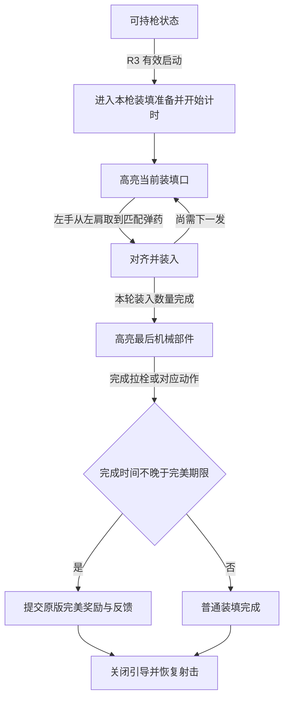

# GearsVR weapon 6 DoF Interactive Design

2026-10-22 The first draft,2026-10-25 Update, For 0.0.3 The player moves his hands and weapons freely with a hand controller, takes bullets from the body slot, loads them manually and throws them in real swing. Keep the original weapon difference, recoil power, ammunition and feedback on success, shoot injuries using the single-handed ratio below as the original benchmark, replacing the cut-off and second-time switch of bullets with VR actions.

This is the specification of requirements and implementation. The independent branch has been formally released. 0.0.3, the basic code for entering bridge, slot/arms show and filling services; private candidate to connect L 3 The response requests and the verification of limited driving, pre-action recovery and re-control of hands and body in a fixed Lancer/Marcus test site. Body take-off bullets, complete filling, other weapons and real injury settlement are still on line and cannot be considered as full functions.

By User 2026-10-25 The only immediate delivery of weapons identified is the “real grip input correct inventory/weapons exchange physical holding” in a common purchase scenario, re-applying existing candidates and certifying game behaviour as soon as possible. The bunkers maintain shared Native body/hand entrances, body/chip benchmarks and continuous updates; consume their stable versions, then complete free hands, original animation exchange and one Lancer master/sub-manufactory/authority shooting loop.

2026-10-26 Follow-up: Native 47+EP passed the original 40／6 Second master hand-held door, right-ready and small shift+10°Subsequent submissions; former 32 The new typed source, Local/FK and four roles Appleid evidence are available. Hand-off is also passed through normal exits. The current propulsion of the original gun component reads back to the rear shot/physical firing chain and remains unhandled by using it as a screen weapon, holding points, authoritative ray or full functionality.[Component Read Back Border](weapon-lancer-component-readback-20261026.md)And weapons progress.

The basis for sharing free hands includes the movement of each hand to their respective position/direction, world transformation of the same replicating benchmark, tracking failure and center/turning back together, and re-entry after the original animation has been taken over. The only owner in Native provides raw trace data selected by Scene at the same time and the ultimate pre-HD benchmark; weapons and bunkers use the same contract. Reading these data does not grant a skeleton writing permission, nor can they recapitulate the lost track or follow up validly.

The foundation must also be visible to the player, the role on the top and the personal arm, and cannot simply hand over a valid handle coordinates to the original arm. The same Native/XR and two actual samples entered by the fixed simulator indicate that the current default wrist target is beyond the original version, even though the first person claims that the camera has significantly reduced its deviation from the head of the role 47 The length of the arm in the original unit. Currently, two clear questions are left about whether the body benchmark is suitable for personal arm stretching, rather than positioning by frame; and the spacing of the model bone points cannot be directly marked as a player's height or physical unit. Actual continuous control, upper posture, arm accessibility and animation are passed together before cross-receiving weapons/docks that rely on these capabilities.

Common solver access now supports the provision of individual upper and lower arm ratios by callers, both defaulted 1. Save the schema 1 The arm stretch has been received in the source code for a common read-only hand-hand plan: four absolute target metres are estimated to be held on hold from the original frame reference and four lengths, less the expanses clearly marked as the exterior of the hands assumed by the bones; each time the required ratio is converted only with the original input segment, the handle moves do not change these four lengths. It does not change head, handle, IPD or world unit. Effective personal records require preserve, explicitly request an adaptive refused, and only reading diagnostics without record remain default 1. There are configurations for reading/module connections and continuous downer special cases that have been checked offline, while physical measurements of the artefacting armbone chain, upper locatorization and animation still await completion.

schema 1 The current estimate is that the control is being used to extend its maximum outward confluence of the wrist, possibly underestimating the arm length; this source cannot be called anatomy measurement for humans or modify a complete gripwrist map or stretch at present wrist distance in order to compensate for errors. Model/record/unit/mount version changes are re-bound and bad records or model mismatches do not follow old calibration. First measurements still need to be made through effective sampling and atomic preservation by starter, Native only reads the record of this launch and does not write player configurations.

The only executive end of Native is shared, with final postures in the order of body, arm and weapon. Priority is given to accessing a common solver at a temporary matrix that controls return from the original hand, then allowing the former Compose to generate official Local/Space and spread along the original chain; directly covering C 1 The array drafts retain only private authentication and there are unresolved recovery sources. The original PG hand path continues to be a historical candidate, without opening another normal Tick for writing permission or installing the second CallFunction Hook. Actual bone name/father chain and pure solver have been checked and final postage release, animation return and independent hands in the game remain to be verified.

Tracking data for internal use in Native uses independent CoreSnapshot and NatureSsessionKey without client registration; external V 1 Frame retains the original real registration check and all layouts. Both are used to repeat a payload check, save the same hand, final pre-HMD base, actual source/reference/continuity and original time as Scene selects. Candidate for release/ cache/internal getter and outer meshTick share of a snapshot at four nodes has been fulfilled,16 Group Return, New 26 Group 669 The item and the real Broker were suspended from registration.32 A host check passed. Nature owner has received the real entry; Core 2 Game sample verified by independent original, complete in four control records 1832 Byte Core, same, world_pose_mask=7, left and right Grip is active and position/rotation flags=15 The actual source is still the simulator 1. The data is valid without write permission, without updating the source time or changing Scene to MeshTick; the current evidence is only one-time gesture and does not prove continuous handbone movement.

Purchase of the editions of the Native 21 Read-only samples have been obtained with two Limb ⁇ SingleBone chains from Compose once.8(a) A record of the calculation/weight of the bar,4 The group's actual weight is both 1, independently decompose and phase association is passed. Record confirmation of R in the calculation output and weighting call 9 Points to different locations; subsequent access must bind the original calculation output and recheck its life and content. The existing sample does not have a weight return pose/scale header, cannot skip this check with zero fields or static parameter values, nor can it treat the matrix endpoint as final rendering/physical or writing permission.

Control to wrist using a visible grip-local structogram: horizontally preserved in metres, attitudeally preserved relative quarnon, generating the wrist target from the same UE world space and current unit multiplier. Current checked Marcus 115 The bone template is clearly marked as the right-hand configuration of the decigner_authored, and the unknown model continues to keep the original animations in its full reference frame/father-signed position. It allows the default handline to advance first, while the hand-to-hand alignment still requires a visual/head-and-face adjustment without impersonating the player's physical marking. Any current animated wrist and handle posture observed at the same time cannot be automatically considered physical alignment; arm-stand measurements, personal deviation saving and starter connections continue to be performed as required below.

Private adapter has sent the same locked Core data, current model/right hand association and default positioning to a shared arm/carf rotation mathematical module, which is re-engineered with the same full wrist target and does not read back into the bridge. Default configuration 699 Item, adapter 7 Group 603 The item offline check is passed, the latter contains a purchase of original left-hander Limb/ Single output matrix; real Core, current identity and grip remain host fixure. Actual Single output m 15 Microfloating is handled by a special calibration, and other analogues and non-rotation fields are kept at the original level; this is not a continuous hand-to-hand or write permission in the game, but remains the only active endline and actual validation for Native.

First real Core 2 The wrist target verification found that the camera/head origin was at a distance from the character skull.1.743 Rice, shoulder to wrist target left.1.445 m/right 1.265 The two arms are about equal.0.470 The actual proserve solves are unreachable; read-only planning is not a normal arm length and hand. Next steps are to match the physical FP status with the original head/shoulder coordinates to check the view point and body benchmark, then verify the normal arm length and continuous output without automatically marking any animated wrist stance. Independent roll tests are being run separately and no real time full rotation acceptance exists.

The PG hands and gun candidates previously retained the original four-channel IK, with increased end-world coverage of default closings and orderly recovery; fixed Lancer/Marcus scene verified hand application and restoration at initial posture. This is the historical experimental path.8 A posturing order, but a big stretch left the deal.4.11 cm deviation, recovery inspection not completed.

Recently acquired version AX Bureau completed 7 Apply/recover with hands, initial attitude accuracy and end field audit pass; old scripts await body receipt before moving order is sent, second take-over group 3 returns due to age input 100.4253 milliseconds are pre-existing 100 The msb is denied and no hand moving command is sent.4 The centimeters are moved and returned, no longer taking over the gun as a precondition for sending the first order. The original accuracy, time limits and failure recovery conditions remain in place, independent motion and animation restoration are still operational; the historical results of fields, audio recovery and self-owned process exit are maintained separately. Candidates have not yet been installed on ordinary starters, with changes made, scope of checks and initial failures being followed up.

One-handed. 0.7／1.0 The rules are only for shooting guns and their projectiles; hand-paint Bolo/Smoke maintains the original injury and effects. The latest private Lancer test is connected to the actual Native Common Registration/owner, Fire Executing Fields and Co-move Control Return values:4 Subsistence getter completed separately 12→8.4 or 20→14 It's...0.7 Multiply and clean. The main silo model from the game thread is armed, with the body RGrip/real co-manager track track not yet connected; this is not full weapon, projector or final enemy capture of blood, and writer remains subject to private testing and capacity restrictions. The rest are fully loaded, body recovery bullets, yellow guidance, body sensor saws and throwing, rifle ballistics/astronomy, sight mirrors, and head-to-head recognition continue to move as described below.[0.0.4 Progress of weapons](releases/0.0.4/PROGRESS.md)；[0.0.3 Follow-up progress](releases/0.0.3/PROGRESS.md)and[0.1.0 Progress](releases/0.1.0/PROGRESS.md)Previous records are maintained.

The following is marked as “collating default” for the completion of operational details; “optional recommendations” are not identified requirements.

## Connecting demand calibre to old scenarios

| Item | The rules to be followed |
| --- | --- |
| Shoulder-to-hand gun expression | Collapse "Right shoulder grabs left shoulder/right shoulder" as "Right hand grabs left shoulder to collect weapon 2 Right hand to right shoulder for weapon. 1” |
| Change the bullet entrance. | Harmonize the final designation of R 3;the example of a saw rifle in the “Push A Popup Box” by R 3 Execute, A preserve Xbox A game actions |
| Perfect change of time. | User confirmed: the deadline is the end of the original version of the weapon ' s perfect bullet-changing window, and completion before it is complete is perfect; no window needs to wait until the window begins |
| Right swing around. | Change to smooth or Snap to cover the left and right poaching of old schemes; existing stand-down targets above and below right swings are maintained, with a need to avoid tilting and trigger |
| L 3 With R 3 | (b) Remedialization and start filling, respectively;6 DoF mode can no longer be used by L 3＋R 3 Switch First/Third |
| Original | Check parts and actions with the current Reloaded weapon filling and animated shooting; user-designated VR determination rules take precedence, not describing unreconciled movements as original facts |

The old scheme of sorbenting, standing alone, pulling walls and flying pounces still appears.[Early interactive programmes](10-vr-interaction-design.md)This time, we don't count these capabilities as weapons. 6 DoF's completed pre-fix results do not remove their design objectives by changing the key. Left and right go-and-right moves require additional operations, which cannot be a single input with the shift.

## Handband tied.

With Quest 3 Example. Here's L/R for left/right trigger, LGrip/ RGrip key holding, L 3／R 3 Point the swing.

| Input | Acts of combat | Status constraints |
| --- | --- | --- |
| Left swing. | Move the person, keep the original moving speed and collision rules. | Remove normal walk-by startovers, glide and additional visual inertia |
| Right swing around. | Smooth Turn or Snap Turn | Starter settings mode; Snap angles smoothing set speeds; snaps only trigger once, reset after dead |
| Left trigger L | Opens/targets | Maintain the corresponding weapon-targeting status, with the direction of the weapon determined by hands; not automatically pull the gun to centre of focus |
| Right trigger R | Fire! | Trigger only when the current mechanical state allows; grenade throwing is shown in the reartext |
| Left hold LGrip | Taking bullets, grabs, grabs mechanical parts, auxiliary bearings. | Collapse default: hold hold and release; only one object or operation is used at the same time |
| Right hold RGrip | Grab a gun at the body slot/scratch it | Hold it on lock, no requirement to keep holding; normal cut-guns do not play original animation |
| L 3 | Recenter, returning. | Synchronize head, hand, gun and body slots without re-testing arm display |
| R 3 | Start loading; cartridges removed/emoved | Single-shot or other agency enters the corresponding filling preparation step and cannot force the creation of non-existent magazines |
| A、B、X、Y | Original actions for Xbox A, B, X, Y | The pick-up, ordinary near-war conditions are still determined by the original conditions;6 DoF Lancer is activated by hand, not by B directly bypassing the startup |

The menu, the plot selection etc. maintain the necessary navigation and confirmation input. Game entry must follow a state path, and the same key cannot take both the gun and trigger the original cut, starting with the sensory filling and automatically filling with the original timer.

Collapse default: RGrip is recoilable when carrying a gun in its counterpart body slot; other active weapon tanks are pressed directly, and the old gun goes back to the tank. The RGrip is erroneously pressed in the air without throwing away the weapon. RR is pressed again while firing and filling.3 No resets, and no repetitions of the popup component.

The inventory slot number of the original script has been checked:0 It's a gunpowder.1 It's a belt.2 It's the left shoulder.3 It's the right shoulder. VR body position to original inventory is joined by a pure logical map `body_slots.h`The left shoulder bullet is not mapped as a weapon.`WarPawn.IsSlotLeftShoulder/RightShoulder` Yes. `bIsMirrored` The original version is exchanged for the shoulder-looking position, so the actual model hanger still needs to be processed on an example-by-case basis; the current map does not trigger a game cut.

Original equipment chain by `InventoryManager.SetCurrentWeapon`、`ChangedWeapon`Weapons `WeaponPuttingDown`／`Active` The state and timers are maintained together with the timer to maintain stocks, copying, docking and firing times.`WarWeapon.TimeWeaponPutDown/TimeWeaponEquipping` Each of them calls a body position to take the gun outside the state of necessity and notification; if VR hides this attitude, it should be used only for the corresponding call in this VR slot switch, retaining the status quo and timer.`PlayBodyStanceByDuration` The existing shared VM/CallFunction view entrance has not yet proved safe to skip the main function of the constructed parameter, so that it is not possible to use the active name as a global shield.**Not written to animated inhibition Hook**; caller/callee and parameter consumption validation before joining the private candidate.

## Body slot and no ammunition feedback

| Hands and body area | Items removed | Number and basis of identity |
| --- | --- | --- |
| Left to left shoulder, press LGrip | One round of ammunition or a cartridge matching the current weapon in the right hand | Current weapons can be used as standby ammunition; type of filling is determined by weapon configuration |
| Right to left shoulder, press RGrip. | Weapons 2 | Original inventory slot 2 Current item (left shoulder) |
| Right hand to right shoulder, press RGrip | Weapons 1 | Original inventory slot 3 Current object (right shoulder) |
| Right to left pocket. Press RGrip. | Pistols. | Original inventory slot 0 Current item (holster) |
| Right to right pocket. Press RGrip. | A grenade. | Original inventory slot 1 Type of grenade available and remaining quantity (round belt) |

The left shoulder has both a bullet and a weapon. 2 The slots tie the original line of contents to the identity. When a new gun is recovered, the same slot points immediately to the new one and does not reproduce the old one.

When there is no ammunition for the munition, leave your hand empty and play a “No ammo” sound once.

Collate default: a gun that is already in possession but empty is still available for filling; if the gun is either inside or on standby, it is taken out and shown without ammunition.

When the original is in a state of prohibited possession or collection, the gun returns to its original slot and shows empty hands; it is not interpreted as abandoned.

Default closing candidate for access to the original person assistant and firing/target return: submitted only after a copy of the model has been proposed, with the original call and the same example, until the original action is successfully read back; restored and ended before the outside action takes over, leaving the old line permanently uncertified or foreigned. Recapturing the trigger edges during the shutdown period, holding the continuous hold on to the non-automatic fire, and clearly not having to press once more. The purchaser ' s external slot requests to be returned, outside True to stay past the old deadline and reset the hook with key.12 Failed to save and start field found; amend to add one by one Release return, most 1 Strict candidate/default segregation, seven pure checks and purchase of PIDs 18776 Key-held coupling is through: release with two keys, and BurstDelaying naturally returns to Active for temporary collection; continued extraction of non-automatic fire during pressure periods, release of new presses before recovery, dety Shutdown back to the original hanger and both entry points. Entered as MetaOperator Simulated; XR body chute, co-exist with armbone/gunwriter, shoulder agency and head show not yet accepted, and joint connection is ongoing. Both initial arena and old hand bone records are still non-zero Weapon, and no real zero weapon baseline has been obtained.[Body slot temporarily returned to original button](equipment-stow-trial-20261023.md)。

Add `tools/vr-common/weapon_equipment_model.h` (a) The state of the intersection between animated art as the identity to which the gun was placed: RGrip gives feedback only once in the empty weapon tank and does not generate objects;The grenade slots are treated as empty, even if they still have targets for weapons, provided that the game inventory confirms that the drop was zero.The available slots will submit the original inventory switch request, pending confirmation by the game that the weapon is a current gun and that it is not in right hand until after the end of its internal state;Once again, at the same original slot, following a request for a gun collection, release RGrip and take it off.The hands remain under VR control during the routine waiting period for the cut-off, and no original animation is played;The pick-up is done in a visible manner and the animation is completed by confirming handing over to the hands as the current weapon and slot of the game.The world/role change, the removal of weapons or the refusal to switch in their original form would remove the hang-up.It is currently a purely logical module validated by synthetic inventory snapshots, and the game linear inventory is read, real switchover, original toggle animation shield, sound effects, gun invisibleness and door control for shooting remain open;It cannot be claimed that the gun was taken in the game.

## Arm stretching measurements and body positioning

First entry 6 The measurement must be completed before the DoF mode. The starter provides the option of " remeasure arm displays " ; a valid record is used when it exists, and the user can remeasure at his or her own initiative.

1. Players wear a headline and naturally stretch their arms to both sides of the VR calibration interface before startup, with their hands around shoulder.
2. Press two holding keys at the same time. 2 seconds, the interface shows progress; this is an adjustable interactive parameter.
3. Only when the hands are tracked for effective and stable posture sampling, save control spacing, relative position of head to hand and current sit/position reference.
4. Shows the shoulder and trouser range after completion, allowing players to try and check for access and then save valid results to local user configuration. Measurement failed; cannot be overwhelmed by a failed sample when there is a valid record.

The control space is an estimate of the arms that can be spread interactively, and does not amount to a precise dissection of the shoulder width. Shoulder and pants are shown with arms, head-hand relative position and attitude estimation; it is optional to add the finer touch-to-touch slots so as to avoid requiring players to reach behind untraceable tracks.

The slot moves with a stable virtual body coordinates and cannot be rotated immediately because the player turns his head to look at the side. Bending, sitting, virtual station crouching and swinging must be accompanied by consistent renewal of body, hands and slots; three tracking devices cannot be described as having been directly measured in the direction of the waist.

Only the reference coordinates are updated and arm displays are kept to shift relative to slot position. The center and Snap turn to hand speed, automatic bullet plug-in, bolting or misthrow; the speed history of the drop must be re-established when the reference coordinates mutation.

## Free hands and bullet tracks.

When you fight in ordinary combat, your hands follow the six-degree freedom position and rotation of the controller. The right hand controls the handle position and basic posture of the gun. The left hand can freely pick up a bullet, operate a firearm or grab the sidekick of the gun. The deputy handshake and hand type refer to the original shot animation of the gun, which does not allow all weapons to be given the same general position.

The prototype of the stand-alone gun attitude mathematical model has been added: the right hand controller works with the weapon to determine its local posture; the left hand is involved in orientation when it holds the secondary handle and tracks the valid, arm-ranged and modified angles. The point and axis are from the local coordinates of the rifle-by-gun configuration and can be mapped into the game world using the same frozen back-to-back reference. It has not yet reached the original weapons grid or firing function; the respective handler, sub-handhold and gun-point coordinates need first to be validated by a corresponding animation/model.

When holding a gun, you can make up with the hand-held handle and the deputy hand-held point, so that the second hand can move on one hand. The arm can be used to connect the body with the hands; the grip, reach range and smoothing can only be used to improve the display, not to suddenly lose the controller ' s response or to keep the weapon behind for long periods of time.

The single-handed grip is determined by the control device that is effectively tracked and the rifle's deputy hand; the display limits of IK ' s arm cannot change the condition of the scratch or shooting injury. The visible palm must be aligned with the controller ' s target, while retaining arm connections and original recoiling power; at this stage, temporary grip ligation has not yet reached all reach gestures.

Players can use one hand or both with a gun at any time during combat, and can shoot normally in either way.2026-10-24 The user-identified rules for injury are as follows:

| The fire was effective at the moment. | Shot injury multiplier |
| --- | --- |
| Single hand: only the main hand holds a gun | He shot with his hands and conditions. 0.7 Double, the original baseline 70% |
| Hands: Master's armed, deputy has already finished holding the gun at its point of effectiveness. | Original baseline 1.0 Double, that's 100% |

2026-10-24 Users further confirm that the above multiplier is used only for player shooting, containing projectiles fired from firearms such as Boomshott, Torque Bow and their expected injuries. Hand-in-hand Bolo/Smoke grenades remain intact and effective and cannot be used because they are held or thrown by one hand 0.7 Double; rewriting of the grenade-throwing trajectory does not change this range.

Hands determine the holding status and tracking conditions of a valid sub-handhold using this weapon; after the deputy unties, exits from the effective handshake or loses effective tracing, subsequent fire is carried by single-handed 0.7 Double settlement. The deputy is taking the bullet, filling or operating other parts and determines whether it actually supports the holding of the gun effectively. The multiple rate uses a state snapshot of the firing moment, which is kept with the shot/jet; the delay continues to repeat the multiplier in the kill. All the shells of the same shotgun share this fire factor, and each injury package only applies one time.

The multiples are based on the same weapon, ammunition and hit-point original shooting injuries; the same condition is still covered by the original condition of the central position. The whole type injury checkes with the rules of the game rounded up when accessing. This is confirmed demand, and the actual damage entry is not yet connected; subsequent verification of the same condition is required for single hands/hands. 0.7 Proportion, and attribution of condition when firing in continuous, untied and delayed life.

Implementation status: The read-only return result of the default closure has completed the source code, and strict construction is being checked with local borders.2 Pressed/ loose already captured naturally 4 GetFireModeDamage Called a Second but all metadata are found in the Pawn Weapon field 512 Item reaches the maximum and the original four-bytes remain unknown. Only read-only single category fields are then modified to a limited extent 4096 entry, add 8 Category/42 Checks, strict complete construction and pre-processing of the closed probe. 4 I'm not sure.4 Back and forth, raw 4 This is the only read-only audit with complete metadata; return property path recorded on site as Core.FloadProperty, function parameter area 24 Bytes, returns offset 20,full field area 36 returns only layout records, not on the original Resault address; these parameters and natural queries still do not define actual type of injury package. Origin return type, Rsult ownership, real roll-out identity and 0.7 No damage modification has been certified and these observations cannot be considered multipliers.

The stored Gnasher script further indicates that the same fire will aggregate the bullet hits and then be settled against the hit object; it cannot be assumed that each shell will undergo an independent injury query. The multiplier rate should freeze from the actual firing and apply only once in the corresponding damage settlement. The current resource table identifies the type of floating point for the injury return properties, but does not provide a current operating buffer and complete call layout; this static information is still insufficient to directly rewrite the injury.

The subsequent evidence inventory is located in the immediate candidate chain. `FireAmmunition → InstantFire → ProcessInstantHit_Internal → GetFireModeDamage → 原整数转换 → TakeDamage`; the actual authority of single-shot identity and return buffer still needs to be read-only. `Init` Execute before the original launch function returns, the explosion can also be the settlement of multiple targets, and the associated root cannot hold a snapshot until the launch function returns, nor can it replace the one-time marking of the entire projector with the anti-duplication treatment of each actual injury package. These are the line boundary that has not changed the actual harm.

Further check the original script saved:`WarAI_Drone.CheckNearMiss` It'll be called. `GetFireModeDamage`, the result is used for an AID near-miss response. Therefore, it cannot be applied as a whole by just getting name; immediate impact needs to relate to actual settlement callers and firing status, retaining query syntax that does not belong to actual injury settlement. Adding a new default close direct caller monitor has completed strict construction, local checking and a buy-only run: original R 2 It's natural.5 I'm not sure.5 Context is from `WarWeapon.ProcessInstantHit_Internal`;result addresses equal to then recorded carler.locals+ at each pre/post 164, the current durable function metadata office is 4 Bytes `DamageDealt`,full type path `Core.FloatProperty`. This records the association of storage locations and is not equal to an identity or 0.7 Writing pass; no frama or locals content read after call. Backstage game viewer actually returns 1536×864, which is private 3840×2160 Press every side 0.4 The start-up plan, which continues to be silent and window-set; no XR/GPU target or header acceptance was received.

Existing GVE 6 Add default closing to the world position of right and left hand `GEARS_PLAYGROUND_FREE_HANDS_PROBE` Consumer: Keeps the same XR instrument in hand position, rotates and session/reference space/input/play generation, with a lined-only sample of current players and bones. Independent status machines keep another target when either hand fails to track, pick up/near war/fixed cut guns take over from the original animation and accept only new instruments after withdrawal; test for GVE coverage 6 Share memory actual transfers. 56756 It's... 160 All frame-reading probes get left and right handbones. `b_MF_Hand_L=11`Right hand. `b_MF_Hand_R=35`Role Bones Control Index Long 115 Animated control list 6 bars;no XR posture, writing and `apply_mask` Both. 0. Reply left behind `analysis/free-hands-probe-runtime-1022a.json`, audio and game processes are restored/out.

Follow-up purchase of only read-only editions `pawn_ik` Test verification of a four-control chain in the current players' right and left hands:`IKBone_*Hand → IKBoneRot_*Hand → IK_*Hand → IKRot_*Hand`Hang on to the wristbone. 11／35 The corresponding bone control list; the eight controls in WarPawn cache point to the current role grid and are in the current animated tree. The end of the chain is around `IKCtrl_*Hand` and `IKRotCtrl_*Hand` Receiving World Space Positions and Rotation Targets, respectively, current intensity, target strength and remaining hybrid time 0;twixtring `IKBone*` The controller may still be mixed with the original animation, but the left-hand sample is not stable. `analysis/pawn-ik-runtime-1022b.json`. This proves that the current example has a reuse access, but**It's not proof that the skull will continue to follow or compete with the original action.**. Open candidate remains fixed `ownership_proved=false`、`apply_mask=0`; original full pick-up start/cancellation, actual XR continuous drive, palm marking and header visibility are still to be completed; subsequent limited four channels for writing are as follows.

Independent `GEARS_FREE_HAND_POSE_OBSERVER` The default closing candidate can now use empty hands (currently empty) and hand-to-hand world gestures during fixed animation as read-only GVE when XR session focus, counterpart tracker and camera/player identity is valid 6 Frame release; the current PC ⁇ Pawn/World Link and Field Layout is still required to certify that an empty weapon does not trigger the intent of the equipment.`HandPosePublicationTest`、`EquipmentIntentBridgeTest`、`FreeHandControlTest`The default/notion native build is passed; the candidate has not been purchased or headlined, and XR loses focus without issuing a valid gesture. It solves the threshold of "must have had a gun" for the release end.**The game has not yet moved with the inside hands.**。

Follow-up Actual GVE 6 Private candidates to the original armbone have achieved frame-by-frame consumption, complete rigidity binding per hand and independent channel writing, recovery of non-tracking/original action, re-silent attachment with new baseline; strict compilation and four pure checks pass. 40872／53564 Done 43 The first person is a director of the National Institute for the Advancement of Women. 86 The most important difference is the location of a hand sample. `6.57e-5` Original unit, full rotation angle with maximum difference `0.02348°`; the former third person claimed that there was a marked left-hand bias in the Bureau, and temporary geometric bindings could not be considered an official handpoint. 8×8 The actual backbuffer failed to match the size of the source scene, original filed receipt was retained and did not restore dimensions contrary to read-only window rules. This is still a record of the handbone data chain at the fixed test field, which is open without the full GPU/Quest/heading. Start parameters, restore order, Native coexistence configuration, entry base recalculations and limitations are available [XR Hands Limited Test](hand-ik-xr-stream-trial-20261023.md)。

Default closed `GEARS_PLAYGROUND_HAND_IK_TRIAL` One pulse first proves that the original right hand World goal and strength can be written in a controlled manner, the next frame is zero and the original target is restored; but the pending motorized painting is also moving, one-time around `0.093` The unit shift cannot be attributed to IK. The old probe actually is `BoolProperty` It's... `ControlTickTag` When integer is read, corrected. The six window contests that are then closed by default complete at the two-basket purchase test field `S,+X,−X,−X,+X,S` sequence; four active windows give the approximate in both rows by natural Tick-like, no cross-reference and original five-fold noise threshold `±0.10` The original unit's right-hand bone output, which is faked to close to zero. The original target/strength field rolls back, the first small amount of the new Tick remains do not fall into full noise, and the second new Tick returns to natural mass levels. `inconclusive` See final and recalculated methods [Controlled IK control records](hand-ik-controlled-trial-20261022.md). This supports the continued development of**Short pulse output portal for the current example**still not able to enable double-handed XR continuous drive, let alone substitute for the capture/near war animation ownership and head-visibility certificate; default `apply_mask=0`。

The original script that has been saved gives the necessary boundary for free hand return: pick-up paths may be ahead `GrabPickup` Restock, start special action. 53／42; the normal end of movement exits a special action upon notification of the end of the counterpart body animation, and cancellation may be replaced by the next special move. `MeleeAttacking` State, logical end exits through that state; Lancer has an appointment after the close-up post. 0.2 The second body drops and the injury can be connected to the tattering. `SpecialMove=0`Close to the field. `Active` or `CanSwitchWeapons=true` It's just a necessary free-air condition. `ownership_proved` True. The official handover also records the start/end or cancellation of serial numbers for the same action, and the relevant number `BodyStanceNodes` Actual weight/target weight/residual mix of slots and current identity and stability of eight hand controllers; continued hands in the original version when borders or tanks are missed or reused.

Purchase of read-only observation PID 57480 A game has been taken, Longshot original `ServerUse` Pick 53 Requests for and requests for close combat`OnAnimEnd`／`MeleeAttacking` Status hooks, special actions and near-war Boolean changes, actual/target weight of body slots, eight controller identification strings on the same time line. Pick animated drawings `AR_Idle_Ready_Kickup` It's... `OnAnimEnd` Serial Nodes and People `Custom_FullBody` Same subpoint, move back on the 53 Zero has been reduced and the sub-point weight is zero; ordinary close-to-earth warfare requests maintenance 1.4 Two seconds running, and the chute playing. `AR_Melee_Smack_A`／`C`, the corresponding subnodes are reset to zero after two Endstates.19 The array reserve capacity for a active body slot is 42; private probes thus separate the reserved capacity ceiling from the activity tank ceiling, and then the maximum number of active slots.189 All the snapshots are in the slot. The reply is missing `analysis/hand-animation-probe-runtime-1022e.json`Endline clear. `ownership_proved=0 writes=0`These only prove the normal path of the Bureau: the internal calls of VM do not necessarily pass through hooks, cancellation, injury, other fixed movements and actual driving of XR hands remain unverified; official hand-to-hand handover continues to be tacitly closed.

CallFunction Watch Candidates for Purchase of Edition PID 59828 I got it. 44 Called internally, where 11 Sub-preliminary slots include accompanying slots 3／10／14 The original ownership door is now valid. `PlayCustomAnimByDuration` The photo is paired with a snapshot; the two entrances are independently restored, audio recovery and game exit. [Animated internal call logs](hand-animation-probe-20261022.md)。

2026-10-23 The default hand-off drive has been reused at the right and left two groups/turning end of the test site, save four sets of targets and strength, recover before PlayerTick, and restore the relevant original action portal immediately. 32 X/yaw target with hands and reverse, three other games complete the three-axis combination of targets and reverses for different right-and-right hands X/Y/Z, pitch/yaw/roll; each round 96 A matrix,32 Sub-recovery and 16 The next time you write, you can have your immediate close-up and recapture. Lancer will keep the zero weights after you have finished the saw waiting. `bPlaying=1` Logs and save scripts have been explained; candidates still require parent slots, subweights, original actions and new Tick stabilization conditions without changing the aerodynamic fields. The bone position of the 3rd axis is less than the target balance `6.25e-5` Full target angle difference in units, rotation segment is less than `0.022°`, the handbone response that supports the small synthetic target of the current example. The input remains a temporary bone world attitude benchmark; real handle to hand, Native and instrument entry into single VM owner, all fixed actions and final images remain to be verified. Detailed code ranges, restoration protocols and feedbacks are still pending. [IK test with consecutive hands](hand-ik-stream-trial-20261023.md)And open ownership and apply sign continues to be zero.

The ballistics must satisfy the following relationships:

- The actual launch starts at the current barrel exit, with the basic direction following the barrel axis; the original rules of random distribution, range and impact are maintained and the shooting injuries are settled by the above single-handed multiplier.
- The instant-debate weapon still uses the original hit mechanism, and the projectile weapon continues to generate its original projection. It cannot simply move the gun or trace light but allow the damage rays to continue from the camera.
- Guns approaching the wall cannot be fired from the other side of the barrier by pushing, receding or crossing the wall at the beginning; coveres from point to point also need to be addressed.
- The predominance changes only observation and projection; turning or looking up alone does not change the direction of the world at which weapons are directed.
- The star is kept at the intersection of the base line of the gun, and shows it in the same direction when there is no point; it is not the final point of impact after random dispersal.

The star should be seen correctly by the eyes and not fixed to the centre of the screen. When a weapon is aimed elsewhere, it can naturally leave sight; the motion of the projection caused by head movement is normal.

Keep the back-sleeve, serial dispersal and firing rhythm of the original weapon, distinguishing between recoil power that affects the actual trajectory and model decoration animation, avoiding duplication. Hands holding hands without default weakens the original value. The gun is repulsive, and cannot be rotated directly to HMD, making the player pass away. The original target for aids must check their reference direction if they are involved in computing, so it cannot aim at a re-throwing gun into the center.

Original script check found `WarPC.StartFire` The Snub's speed/delayed logic and Torque Bow are in the process of distributing a weapon. `EndFire` It can release the arrow, which means it cannot be repeated from frame to frame. `StartFire`And we can't always call when we track them down. `StopFire`VR right trigger to authenticate R 2 Enter a semantic layer access and re-load with the original mouse/hand handle source. Existing private observers can read only pre-dispersion and post-deposit values in the certified firing chain without extra call-in targeting functions; in addition to verified Hammerburst, special cases like Lancer, Snub, Longshot, Torque Bow and processing when you lose track of them are checked.

This read-only return value sample is completed in the same shared VM Hook: authenticate two functions in order `ReturnValue` Yes 12 Bytes `Rotator`and request `Engine.Weapon.InstantFire → WarWeapon.GetAdjustedAim → WarPawn.GetAdjustedAimFor` Direct parent frame matching. Entry R 8 Returning the expression destination address, RAX is not an angle value; no condition is read. A shot has not been taken in a retail game at this stage and it cannot be inferred from the return angle that the bullet was achieved.

The same monitor is now limited to the original version. `Engine.Weapon.InstantFire` Yeah. `CalcWeaponFire` Direct call point: The current process must reprove the type/disk of three local fields, call field points in bytes and size of local area. Only when the caller implements a stable frame and the code pointer is located at the first starting parameter will the original be read-only `StartTrace`Push it, push it. `PushedForwardStartTrace` and `EndTrace`This is for the subsequent gun.**Original radial candidate for collision query**,do not read `ImpactList`, the re-entry penetration or actual hit, without changing the launch starting point; still a buyout of the version is required to give back a true fire call.

The static review tightened the gun to the border: ordinary `InstantFire` It's... `WarPawn.GetAdjustedAimFor` Back in original `WarWeapon.GetAdjustedAim` I'm just gonna be here before you randomly spread it, but... `GetPushedForwardStartTraceLocation` It also changes the collision starting point, not just replacing the bullet flame or initial. `StartTrace`Gnasher goes. `Weap_Shotgun.CustomFire → FireAllPellets`and two close-range branches directly used `GetMuzzleLoc`/Standguns and `Instigator.GetViewRotation`, the certificate of six functions cannot be applied to a common rifle. `SetWeaponRecoil` Writing random recoil by stock manager `DeltaRecoil` And by `ProcessViewRotation` Add a perspective; the naked controller's axis can be de-captured if it is directly aimed. Next steps are to check the direction of a regular rifle and short-reading associate only original, starting/predation, opening point and rear-sitting state of the gun. `CalcWeaponFire`／`ProcessInstantHit` Revert; then certify the special paths of Hammerburg, Longshot and Gnasher. Static scripts match historical functions to a current retail version of firing back.

Hammerburst: Only once. `WarPC.ButtonPress('R2')`, no extra calls `PreButtonPress` Or frame by frame. `StartFire`Original controller `bFire` and `bHoldingButton_R2` Keep it as valid as you want. 1.2 within seconds `AmmoUsedCount` From 0 Increase to 15;only once called `WarPC.ButtonRelease('R2')` This results in zero holding.2 Semantic continuous firing does not mean that other guns or VR frames have passed. Backstage game processes, menu bridges and audio-protectors are completed; test returns remain neglected `analysis/playground-20261021/fire-semantic-1022a/`。

Next round is already in place. **Hammerburst, special.**R 2 Border adapter access to private candidates `Playground` Game thread: it reads the stereo frame and right hand input of the same sequence, session and space age, and only calls the original version when new presses/leaves are encountered `ButtonPress/Release('R2')`. Short frame failure continues 100 ms last frame of validity; this safety weapon, which has been pressed by adaptor when it is in excess of the validity period or exit from the input end, will be automatically released. The final candidate for segregation retail version simulation is continuously held up during a checkout. 1.2 Second consumption 15 The issue is:55 ms Fire remains in the reading frame slot, which is suspended when normal release occurs; release end of period again suspended and ammunition stopped 24 The hair, the controller is clear. Reactions are missing. `analysis/playground-20261021/vr-fire-bridge-1022f/`. This is a proof of the candidate to fire in a real game.**Not real machine handles.**, and no other enabled 11 VR weapons with a weapon/thrower, rifle-shot trajectory, physical hand or default trigger interact. Torque Bow untraceed untraceable paths remain disabled until verified.

Left triggers will be the original. `WarPC.ButtonPress/Release('L2')`The project is based on a separate purchase of the version of Hammerburst at the back-of-office test site.`bToggleTargeting=false` ♪ And then you press it once and for all `bPressingTargetingKey`、`bIsTargeting` Turn it real. Hold on. 0.35 Seconds are still real, two after one release; no additional dispatch required `PreButtonPress/Release`. In the test `FOVAngle` Hold on. 85, the Longshot cannot be assumed to have completed the real lens or zoom. Read only the memoirs ignored `analysis/playground-20261021/l2-semantic-1022a/`, the game exits, the bridge shutdown and eight audio sessions are checked.

The current candidate increase is only for the original version**Hold the open mirror.**Set the L 2 Side ownership; original switch-to-point does not exit after release, therefore `bToggleTargeting=true` . It's with R 2 Candidate shared matching XR frame and 100 ms expired doors, and the default DLL still does not include both. Offline covers the type of connection, share original input status, track expiration, set-up switch and weapons identity change. Try to run a separate retail-end collage for combined candidates, but this game is in 150 No available menu viewer was created in seconds, no XR input or access L was sent 2 The result of the bridge; the bridge is closed, audio-protected is closed and the test process is cleared by identity.**Could not close temporary folder: %s**, cannot be replaced by the results of a previous call made separately.

## Lancer Body Sensitivity Saw

When you hold Lancer in your right hand, the left hand moves with a trigger on the gun and follows LGrip, then you pull it back to the rope and the saw starts. After starting, your hands continue to follow the controller and your left hand can return to the front hand; the continuous rotation of the blade actually touches an enemy who can be executed by a chainsaw before it is handed over to the original execution. The first-hand animations, injuries, blood effects, sound effects and closing cleanup are performed by the game; during the animation, your hands are given to the original version, and the head appears still following his own tracking, returning to the current right pistol position and free left hand after completion.

The handle is highlighted during the sensory start, with a short-string rope reaching out to the left hand and then running feedback after the start. The handle is new VR actionable, which must fit into the model saw engine area and verify contact within the head; it cannot be placed by merely bone names. `b_AR_Chainsaw_Handle` Dismantling to "start the handle." The original bone is rigid. 685 Top Point/1,089 Noodle, reference network pattern about X 3.60–6.36、Y 20.07–33.49、Z 8.30–12.29 The static evidence is more consistent with the handles in front of the gun, but it has not yet been made visible to confirm. `analysis/weapon-partitions/Lancer-chainsaw-handle-audit/`;can not be issued directly as a new handle.

The static path of the original script is:`WarPC.PreButtonPress('B')` The government has been working on the issue of "Counter-War" in the United States.`Weap_AssaultRifleBase.MeleeAttacking.BeginState` (b) Entering the saw and setting up a forward enemy-seeking timer;`CheckForMeleeTarget` The first of these is the original hit and effective target rule.`AcquiredVictim` The VR connection must be ready for the original and the front-end enemy timer will be suspended during body arrest; otherwise, the execution will be broadcast early in front of the enemy alone.`b_AR_Chainsaw`／`b_AR_ChainsawEnd` The two-cosm poles can only be used for proofreading, not as cutting edges. Pass through and be right.**Same goal.**The independent geometry module has achieved the identity, time, direction, continuity door of the chain interlocking/capacitating and the initiation of a pull-off; it only sends “request to get the original on-line/victims/animation interface/rehabilitate” decisions, without having yet operated the game object.

Current `tools/vr-common/weapon_lancer_chainsaw.h` It's an offline modem: the first hold is only drawn near the trigger handle, at least 18 cm Relative process and 14 cm. Actual shift of left hand, at least 160 ms, direction and horizontal continuity are initiated; target contact is not replaced by a headline or front-line ray. Tests cover effective hand pulling, mobile gun impersonation, transient, masking, invalid targets, back/tracking breaks and failure to follow during the original execution still leave the animation with hands. Distance and zipping are only initial experience parameters that will be adjusted after Quest's handpointing, model visual checking and live machine testing.**The game is fit, the retrofitting is initiated, the original execution is handed over and head-over inspection is not completed.**。

For access to the handle, private GVE 6 Posture frame is now transmitted to world unit/m with XR 10–500, validity is reviewed by the issue and read end).`weapon_lancer_chainsaw_pose.h` Convert certified world positions of right and right hands, current weapons handler world anchors and pull axes into a sample of rice hand-strangling, and refuse to exceed 100 The synthesis test is based on a combination of the following: ms, world generation or frame with different identity of person/weapon. 100 and 200 Game units/m walk together 19 cm process, only one original request for a saw is made. The conversion has now been entered into the default closed private game route test path that needs to be visiblely activated; the current point of entry on the gun remains temporary location, as the handle and zip rope are not loaded and there is no real Quest pull sample.

Purchase of PID 51388 The original version of the key confirmation:`ButtonPress('B')` Duration `bDoingMeleeAttack=true`、`CurrentFireMode=2`、`SpecialMove=33`♪ The chainsaws run and `CheckForMeleeTarget` Timer present; keep the appointment after clearing the timer 0.45 (b) Seconds, the saw is still on hold and the timer has not been rebuilt;`ButtonRelease('B')` No enemy, no execution. The reflect bridge calls directly to the class method. `IsMeleeing` This test provides a operational boundary inhibited by the standby and enemy-seeking timers, but has not yet been safely measured to deliver actual sawsaw contact to the original version. `AcquiredVictim`。

Private `GEARS_PLAYGROUND_LANCER_CHAINSAW_HOLD_TEST` Buys a copy-based static test PID 39340 , the test entrance requests only one original version of B; press; engage 1.2 Seconds 9 All samples are observed in B. 2, while the automatic forward enemy-seeking timer is always closed and the victim is empty; return to idle after a definitive halt. 61196 Close private module group directly while still holding B. 0 Then the original version B, close-to-earth intent, saw chain and firing mode were all empty. Both games were out of their own and audio was restored; backlash was ignored `analysis/lancer-saw-hold-runtime-1022a.json` and `analysis/lancer-saw-shutdown-runtime-1022b.json`。**This only proves that the enemyless original is on standby, timer suppresses and exits.**; the actual left-hand stretch has not yet driven the entrance, with a sawing blade collision, execution of animated paintings and later hand 6 The DoF restoration and header effects are still waiting to be connected and validated, the default DLL is not enabled.

Another purchase version of the read-only reflector check (PID) 61168) Confirm the current Lancer `AcquiredVictim` Parameters are as 8 bytes, only arguments `VictimPawn` It's a deviation. 0 object references;`IsTargetValidForSpecialMeleeAttack` Receiving Object `P` , and returns the boolean value.`MeleeAttackImpact` This is a read-only, no call for execution or causing harm. Recall only ignores the default. `analysis/lancer-saw-api-runtime-1022c.json`, the own process exits and audio recovery.

Private read-only probes are the same to locate the original gun saw blade contact line. `PlayerTick` Then we'll take the original gun components and... `b_AR_Chainsaw`／`b_AR_ChainsawEnd` Two-bone matrix. Buy a PID. 53752 The ordinary armed and PID 36516 The original saws are working in different ways. 16 Frames; both bone index 1／2 The median number of the local two-axis of the gun `(0.008,34.127,5.651)` and `(0.008,56.562,4.476)` Original unit, centre approximately 22.466, maximum single group drift less than 0.001. The operation of the saw does not result in a detectable shift between these two axes and the gun. The enhanced probe is also at PID 52172 It's... 16 The frame-by-frame checks the original version B to hold, saw chain and person close-to-action positions, with the same axis position. The gun component is updated twice in a line of cross-reflection reading, without being used as proof of homogeneity; then it is sampled once in the game line.`tools/weapon-models/analyze_lancer_blade_bones.py` It's negligible. `analysis/lancer-saw-bones-runtime-1022e.json`、`analysis/lancer-saw-bones-held-runtime-1022f.json` and `analysis/lancer-saw-bones-held-runtime-1022g.json` Recalculate summary. Auto-process exit, audio recovery, Playground closing code for three active tests 0。**The axis is not the visible sawn-tooth edge or physical injury volume verified**; saw blade radius, enemy collisions, shielding and original victim handover still pending.

Further from the same source, Hashi `df356ff3dda45e060f87b5ed94c806d96bbfe36b74b21a0f1d2032596f9dcf4d` Lancer Lod.0 Original vertex/material partition inspection: saw chain fuzzy material located in the chamber of gun X-ray 0 Ring, range Y `26.30–75.86`Z Scope `-7.21–10.31`;drivebone `b_AR_Chainsaw`／`b_AR_ChainsawEnd` The geometry of the impact extends to Y-ray.66／76, and the two axes are only inside the ring. Ignore the directory `analysis/lancer-blade-geometry-1022/` Keep a 2-D audit chart coloured by bones and materials. Pure logic now replaces the original two-axis straight line of contact with a visible saw chain. 12 Snippets: Require future adapters to check the current original grid and frame of the gun `LocalToWorld`, the enemy capsule actually intersects and a request for access to the original target when both authoritative/saw/survival/target controller/both parties' eligibility/wall shield is met. The edge here is that audit coordinates are used and have not yet been calibrated with the purchase of the image and real handle; the current XR test adaptor does not fill in enemy contact or call `AcquiredVictim`Playground, six regular targets without Controller, original. `IsTargetValidForSpecialMeleeAttack` They would refuse to prove execution.

Purchase of a stand-alone silent sound test PID 61076 Original `Spawn` and `SpawnDefaultController()` Create an additional `Pawn_GeistLocust`No change to the standard six target. `Controller` Type of inheritance chain is `WarAI_Locust → WarAI_Drone`，`Controller.Pawn` and `Controller.MyWP` All back to the enemy; the scene was original. `WarPawn.IsValidMeleeTarget(target,true)` And Lancer `IsTargetValidForSpecialMeleeAttack(target)` All return true, and the second determination of conventional uncontrolled target returns false. Tests do not enter chainsaw waiting, no sawing contact, no call `AcquiredVictim`The enemy is in the original version. `Destroy` Clean up.`PlaygroundShutdown=0`, own game process exits and audio recovery; backfills will remain neglected `analysis/lancer-saw-target-runtime-1022m.json`Next step is to get the original gun matrix and the enemy's collision capsule at the frame of the game, confirm that the real sawsaw rings intersect with the capsule and that the path is not blocked by a wall, and then call on the same surviving enemy to obtain an original version and observe both sides' animation and natural exit.

The private connection that was launched by the synthetic hand has been approved: candidate for temporary handle point with current original gun assembly matrix `(6,26,10.65)` Original gun unit to the world and press the same GVE 6 Posturing/continuous pull-back status machine enters a simulation left hand. Buys a layout-set silent PID 32496 The only zipping is scheduled. 297 ms、18.81 Original unit (this test is set to 100 (m) submit original version B; then 9 The samples are original B, close-to-person and saw chain operations. Automatic forward enemy-seeking timers are closed without victims. After the stop, the original close-in, saw chain, mode is restored; own game exits, audio recovery, Playground closing codes 0. First PID coordination 41264 Original request triggered, but verification timed due to the missing status code of the adaptor in the synthesis path was repaired and finally confirmed `analysis/lancer-saw-gesture-runtime-1022i.json` Yes. This test**No real Quest handle read.**The temporary zipping is not shown on the gun; the current point is only for state contact and cannot be considered a formal handheld. The original qualification function is used only for pre-start determinations, which are maintained in the original form after startup. It can be seen as a handle/line, real hand pull, ssaw target contact, execution of both sides and animation. 6 The DoF recovery is still pending.

The original exit chain was then checked and the transfer of inputs from the saw execution was modified: `AcquiredVictim`Special action. 34 It started with a break-up, B. Maybe through. `ReleasedBButton → StopMeleeAttack → EndFire → MeleeAttackEnded` Forced exit from attack. Independence machines now lock their hands in the animated hands even if they are lost on execution frame; only when original attack exits will request a pine B and wait `bHoldingButton_B` We'll return it when we clear the area. 6 DoF. Private original input adapter also refuses to perform special actions 34 Release B while still active. This judgement is based on the saved UnrealScript exit path, which is a long-term solution for the user's memory.**No proof of retail operations/animation by both sides with enemy scenes**; the victim ' s death or the clearing of fields does not in itself amount to an animation, and subsequent records must be kept of natural terminations and terminations.

Add `GEARS_PLAYGROUND_LANCER_SAW_XR_PULL_TEST` Private build, call in the silent field after ownership; it updates the GVE at each game thread 6 The real world hand gesture, the current original gun matrix, the stock model armed with a gun and the state of near-war required that version B be kept on hold after the aforementioned continuous stretching and continued to suppress automatic forward enemy-seeking timers. Loss of postures, slicing guns or visible forms of Stop will clean up undecided B; if the original is executed, then the attack will be cleared when the attack has been terminated. 44484 Arm, about without any XR gestures 0.45 Seconds, we're still on standby. 2 Original version B, close combat, saw chain, enemy-seeking timers and victims are empty; stop post-state 8，`PlaygroundShutdown=0`, own game exits, audio recovery, echoes ignored `analysis/lancer-saw-xr-no-pose-runtime-1022k.json`. Last original B release door update, purchase PID 51708 We're getting it again at the enemyless test site. 9 Sample of original saw chain continuity, enemy timer shut-down, visible stop and lock code 0, the game exit and audio re-entry, which is ignored `analysis/lancer-saw-xr-final-hold-runtime-1022l.json`. Current path**No victim, no startup, no retail connection with real XR hand-pull**;and 15 The second test doordog and the default shut-down door are only for development, not for long final operation.

And the programmable ripping prototype without copying the original gun geometry `assets/weapon-6dof/lancer-starter.glb`: fixed plugs, T-hand handles and long lines of the left hand, three nodes, local +X is pull direction.704 triangle. The generator is `tools/weapon-models/build_lancer_starter.py`, definitive reconstruction check passed and local preview left behind `analysis/lancer-support-probe-20261022/lancer-starter-preview.png`. Assets are currently not connected to the game or located in their original gun; visibility within the head, holding range, length of pull rope and brightness remain to be checked.

## Physical Load and Yellow Guide

Each weapon has its own schedule, R.3 The loading operation for the gun is initiated. Current operational area displays bright yellow and moves to the next position immediately after completion; unrounded parts cannot be recorded as completed in advance.

The cartridges, single rounds of ammunition, filling and bolting use actual geometrical position and direction.

The existing stand-alone geometry adaptor is based on the local attitude of the gun-by-gun filling and the ammunition package, which first verifys that the munition is approaching the right axis from outside the mouth, then being aligned, continuously travelling and in place; cross-border, jump frame transient, world/turner and same duplicate submission are rejected. Filling services can give a single current orientation to “filler/breed/leverage” ("plug-in").

The end point is the last step to be verified by an animation. The gun is not embolised in empty space.

### Example of saw rifle

1. Player Press R 3, start counting, the cartridges are pulled down/emble and the wells display bright yellow.
2. Left hand to left shoulder, hold LGrip and remove a cartridge matching the gun; no ammo is shown empty-handedly without backup.
3. When you have successfully loaded, the handbox belongs to the weapon and cannot be repeated or re-inserted.
4. The wells of the magazines are high-lighted and the bolt or loaded parts confirmed by original animation show bright yellow.
5. Hold the component in your left hand, complete the required itinerary and necessary repositioning; direct closure and re-launch weapon.
6. Completing a perfect or ordinary set of actions, using the original equivalent rewards and feedback at the right time, allows the role to play successful lines according to the original voice rules, such as “rock and roll” mentioned by the user, without forcing each repetition of the same sentence.

The difference between the empty and non-empty structures must be checked by gun; it cannot be claimed that they are identical until verified.

### The shotgun rule.

User requests: load up, usually three rounds in advance; fill only the actual amount required if less than three rounds are needed. After each shooting, a manual cycle is required and one cannot be fired before it is completed. Players add Gnasher as a lever shotgun: hold the front end of the gun in his left hand and turn back on his right hand, and hold the handle down and turn back; it is not a pump rifle with a left hand pushing the wood. The yellow light should fall in the grip area, leaving the lower point to position. The loop must be recognized after hand-tracing is effective, the left hand does indeed maintain the front end, the right hand moves through the pressure and back. The final institutional action after the bullet is also checked against its original lever, which does not end with just touching the high spot.

The current pure logical identifier already has the sequence, position and tracking of the action; the original lever axis, rotation direction and maximum angle have been checked by the following purchase-end run matrix. The right hand is also marked for the physical contact point, the Quest controller to the palm and VR tolerance differences. The manual hand-handing gun cannot be counted through tests that are not connected to a game thread.

The separate geometry prototype of the hands has been completed: a point to stabilize the gun in front of the left hand during the lever movement, with the original model ' s leverage axis and**To be marked**The handle contact point is arc, checking the direction of the right hand position, and requesting an under-axis angle before handing it over to the above sequence identifier. The synthetic handle attitude test covers the full lower/back id, exit arc, tracking failure and headline independent movement. `b_Shotgun_Lever` The father's bones are... `b_Shotgun_Main`Father's local position is approximately `(0, 20.607, -2.925)` Original package units; the following sample further cross-checks the direction of the axis and the reaxis. VR actual holding points to unit still have to be marked, with prototype not active for game shooting.

The default is to interpret the word "three" as a maximum of three rounds, without changing the original bomb capacity to three. `M`This round of standby ammunition is available as `S`：

`本轮目标装入数 N = min(3, M, S)`

| Shortfalls and spare status of the gun | Current round operation |
| --- | --- |
| At least not 3 - Let's go. At least. 3 Let's go. | Take it from the left shoulder to the left. 1 Let's go. Load it. 3 - Let's go. - We'll finish the mechanical move. |
| Only missing 2 Issue or 1 Let's go. | Load corresponding 2 Issue or 1 You can finish your mechanical action when you're ready. |
| Missing 3 Foo, we'll have to wait. 1 Let's go. | Load 1 Allowed to do so. No other need for non-existent 2 Let's go. |
| Shortfall greater than 3 And there's a spare. | Current round 3 Release; start the next round when needing to continue reloading and load with ammunition retained |
| Shortfall 0 | No beginning of meaningless filling, no perfect reward. |
| Stand by as 0 And no retained ammunition. | No fill-ups generated, no ammunition hint played |

When the target number for this round is reached, the highlight is transferred from filling to mechanical components.

The cycle after shooting must be distinguished from the final mechanical action after a reload. If one qualified action addresses both current needs for circulation and loading, it only consumes once, without requiring the player to pull twice in vain. The “three rounds” and “each manual cycle” here are VR rules required by the user; they are fully consistent with Reloaded's original animation body, firing rhythm, and need to be checked by gun before being described as returning.

### Individual configuration of each gun

| Weapons/throwers | Current realization of borders | We have to check the difference between this motorized painting and our state. |
| --- | --- | --- |
| Lancer | Private candidates for general services, original stand-alone cartridges and insertion determination; official interactive waiting | Visible position of the cartridge well, strung-out course, air silo and tactical filling |
| Hammerburst | Specialized magazines/locks for reloading have been constructed; live guns are pending | The dot, thrust and mechanical process cannot be replicated in Lancer pending the identification of current gun examples |
| Gnasher | The pure logic of the dedicated round-to-load, up to three rounds and after-fire leverage cycle has been established; live guns are ready to be picked up | Front end support on left hand, right hand hand hand hand hand-shape and back to position; high-lighted handle/level after firing, point and filling port to be marked |
| Longshot | The mathematically independent eye-optic mirrors and the pure logic of single-shot physical reloading have been built; GPU rendering and live guns are interactive | The sequence of opening/repulsion/loading/locking shall be confirmed by current example and the aim corresponds to ballistics |
| Torque Bow | Specialized holding/Arrow Reconception and net logic of left shoulder supplementing arrows established; live guns awaiting delivery | The original cap may also be fired, but the un-firing exit must be checked first; the intricacies, institutions and sound are checked against the original. |
| Boomshot | Specialized authentication steps, inventory and original firing back logic established; live guns pending | The body, load and opening action are checked against the original example and cannot be assumed by animated orbit |
| Hammer of Dawn | Pure logic of target/inventive/irradiation and resource backdoor prohibition has been established; original call ABI and live gun are ready to take over | Conditions of use, instructions and rules on resources; no box is imposed when there are no conventional magazines, no normal change of ammunition is certified R 3 Close |
| Snub Pistol | Left-pants identity, cartridges constant, case-by-case plan for the air warehouse/silo step and bright pure logic; live guns ready to be picked up | The difference between the specific hand movements and the empty space of the original slider/right wing is to be measured, not by animated bone name |
| Boltok Pistol | The pure logic of left-pants identity, case-by-case structure and filling steps, inventory/original firing back was established; live guns are still available | The default grid generic bone name does not match the Snub animation orbit and cannot be applied to the Snub cartridge; capacity, bullet body and action sequence are subject to current instance authentication |
| Troika | Fixed axis, hand-held handles, live-up and down turret acoustic interface, double-gunhead and original resource/heat backlog pure logic established; ready to take up | Fixed weapons do not enter the body sink; no two-gun staggered, R 3 Mechanical services require current instance authentication |
| Bolo Grenade | Right-pants out, original fuse/bomb consumption and 3 kg Pure logic of first handing is established; live guns are pending | The release of the input, fuse attribution, original one-time generation/detonation and initial coverage of the entry must be checked; the original chain/explosive effects retained |
| Smoke Grenade | Independent smoke/ammunition/audio authentication, right-pants extraction, bullet-free tips, original fuses and 3 kg Initial speed pure logic established; live to be picked up | Original generation and ammunition consumption once each time, fuze interruption cannot be replaced; smoke launchers/sound/visibility remain in the original version |

Each weapon is recorded at least: main/sub-handhold, axle of the gun, type and size of filling, position and direction of entry, mechanical steps and itinerary, target number rules, original time parameters, original reward and audio entrances, shooting conditions, and recovery after interruption.

The list of overrides by item for this function has been corrected by the player to read as above 12 Seeds. The “coverage” here refers to the completion of interaction and acceptance according to their respective original equipment/ammunition/action rules, which cannot be declared in full by a generic gun step. Troika’s fixed mode, Hammer of Dawn’s conditions for use, and Bolo/Smoke mines’ fuse and delivery status are checked separately; unconfirmed details remain to be determined.

The multiple-weapons feeder review also confirmed that the current restrictions are distributed among the coordinates of the inventory, role bones, component identification and resources, and cannot be expanded only by a list of names. The initial frame binding can be reused as an example-by-case locational shift marking but not extrapolation from main/sub-handhold, gun-port axis or mechanical travel; these data still need to be verified by gun. Hammerburg is the smaller access area for the next common handheld weapon, with Troika using fixed core axes and drop branches respectively.

Longshot scopes have other optical replicating tasks. A simple magnification of the original eye image will magnify pixels and blur existing rendering, which does not represent remote target details; an independent vision that is aligned to the axis should be set up locally with a view and shown in the lens at appropriate resolution. `weapon_longshot_scope.h` A real point of sight for each independent camera, off-axis projection, limited visual focus, lens mask and eyebox doors are calculated with external projection authentication; synthesis geometry test 136 This is the basis of offline mathematics, with no lens size/multiplier purchasing a layout, GPU scene channel, pixel-by-pixel mask, actual gun-point alignment, performance and head-notation acceptance not completed; no close eyes HUD zooming is counted as sniper.

The original line is advanced in three steps. First, the mirror camera with the same frozen attitude is converted to an engine matrix that provides a view state and specific scene targets independent of the main image by actually entering the eyebox and reproducing the eye; then re-source existing raw family submission package to track the structure, distance consumption and destruction of the framer separately; and finally, the real scene results are visible on the gun lenses, closed depth mask, lens mask, and GPU production and reading dependencies. The stored original evidence supports reuse of existing delivery packages without re-informing the queues for call; first, the file file indicates only the order in which the GPS was completed.

Private offline candidate for independent view state has been completed: freezes the main image and four identities around scene before any contact returns, rejects empty values and cross-repealing, and constructs and output matching to use the same frozen snapshot. 30 scene/2,028 Check and have a factory OFF/ON check passed. The candidate is still ignoring the directory hold, default closing, without access to the currently frozen Native or assigning or owning the original state life cycle; real-right eye authentication, specific targets, renderer route and lenses are still waiting. As arranged by the user, game/simulator validation is pending 0.1.0 Issue and merge with branches.

The second offline component of the camera to its original matrix has also been completed. It receives a visible budget for the same frame of world coordinates, origin, unit, limited positive/reverse depth and precision, converts each eye independent camera into a flow matrix used for existing tectonic parameters, does not copy the main eye projection or uses the light axis as a launching line.84 scene/19,737 Check passed, Ham. 2,736 A projection of an independent world point; two parameter transmission checks using a local C++ receiver function without calling the game constructor. The original large coordinate accuracy and limited remote degradation have been reproduced by the actual old version, rejected by the amended version and the record of the failure of the previous review is kept. The revised version was passed independently and narrowly, but the code remains private only on the stage, without access to Native or receiving mirror images.

Follow-up private status added `build_eye` Single-eye conversion: the visible selection of the original left/right eye only validates and exports the eye's matrix, size, frame identity, depth and error; neither the other eye is tracked, outside the eyebox nor valid camera prevents it. The single eye shares a modified numerical path with the original pair.114 scene/22,204 Check passed, Ham. 3,040 Independent World Point and 143 Sub-comparison with the return value and full output achieved by the actual old pair; where 30 New scene by reality `scope::build_plan` Generates single-eye input. The parameter transfer is still only called to the local C++ receiver function. Astra and the coordinator review pass, the CRLF byte certificate for private reconstruction of patches failed and the corrected record retention was not applied to Native.

Private construction and recycling adapters for single source have also been completed offline narrow review: only one complete local rectangle is prepared, using an independent scope state, without the use of a master eye or a fake second eye. Freezing parameters before construction is done to check whether the original/current array capacity range of source is shared with output; unknown ownership is isolated, prerelease retesting and guarantees destroy/free run at most once. Strict CPU first runs. 30 scene/978 Check passed, all of which is synthesizing; this does not prove the actual original convulsor, array element/reference count or map payload. Real state/ complete family/specific object possession and life cycle, single view submission, GPU dependence and lens image still pending. Both offline components remain missing `analysis/`, is not enabled automatically by checking.

## Perfectly swapped and accounted for.

User has selected the rule " Complete original perfect window at or earlier " . The normal load time is recorded separately. `T_normal`, the original perfect window starting point `T_perfect_start` And the end. `T_perfect_end`, these three values cannot be mixed up in one time.

These periods are based on a zero starting point for the current round of valid filling, reading parameters that actually work in the current version, weapon and loading state. The total length of animation, the interval between historical successful keys and the name of fields cannot replace the original perfect cut-off line; if the parameter changes with the status, it cannot be written down by the name of the gun alone.

Only those that were kept under review at the beginning `WarfareGame.u` UnrealScript Declaration and Reverse Knowledge Bank, cannot reach the perfect window endpoint where the example actually works. Subsequently, Geter was called in a purchase version of Lancer, which, combined with matching original determinations, confirmed that the endpoint of the example is about `0.8 s`See below for details; other weapons and status must still be obtained on a case-by-case basis. The following table is only the default values, not the period during which the sensory bomb can be used directly;`AR_PossibleSuccessStartPoint` The first step in the process is to help the people of the country to find a way to get their own lives.`ReloadDuration` is the normal load time, and neither of them can be a separate ending. The default long window for the base class is `-1`Nor can they be directly involved in the calculation of deadlines.

Current `tools/weapon-models/audit_active_reload_defaults.py` The machine that matches Hash. `WarfareGame.u` And export SHA 256 Reread the visible attribute label, leave it in the ignored `analysis/active-reload-explicit-defaults-20261022.json`：`WarWeapon` Base Category `AR_SweetSpotDuration`、`AR_SuperSweetSpotDuration`、`AR_PreReactionWindowDuration` Estimation as `-1`The table below shows the six specific categories.**No visible overlay**These three; the default objects for the Boomer, Bow, Troika base categories only have attribute terminations. The missing label indicates that the object is not covered and cannot be interpreted as zero or from `ReloadDuration` Launch SuperSuccess finish. The declaration does not contain itself `GetActiveReloadValues` is separated from the final determination; it is recorded below from the later acquired original code and Lancer case output.

Original Saved `WarHUD.DrawActionReloadBar` Scripts further.**Show Layer**Two regions:`GetActiveReloadValues` Output `ActiveReloadStartTime + SuperSweetSpotDuration` It's the right-hand border of the perfect zone, and then it's added. `SweetSpotDuration` The user wants the previous candidate to be a physical cut-off, not to merge between the two. HUD is not yet a substitute for `DetermineActiveReloadSuccessOrFailure` The original comparison of the results is still subject to review. Three of the historical Lancer perfect results sample are still pending review. `AR_*Duration` The membership remains as full as the `-1`. The history memory is saved on ignored `analysis/runtime/active-reload37-candidate2.watch.json`, not a sample of the current retail version.

| Original weapons category | `AR_PossibleSuccessStartPoint` Default value | `ReloadDuration` Default value |
| --- | ---: | ---: |
| Lancer／`Weap_AssaultRifle` | 0.70 s | 2.50 s |
| Hammerburst／`Weap_LocustAssaultRifle` | 0.70 s | 2.50 s |
| Gnasher／`Weap_Shotgun` | 0.85 s | 3.00 s |
| Longshot／`Weap_SniperRifle` | 1.00 s | 3.00 s |
| Snub／`Weap_COGPistol` | 0.50 s | 2.00 s |
| Boltok／`Weap_LocustPistol` | 0.50 s | 2.00 s |
| Boomshot／`Weap_Boomer_base` | Not yet obtained | Not yet obtained |

The above table is a saved class default and script statement, which does not itself prove running time parameters or original determination functions. The perfect time of the gun-by-gun remains unconfigured until the current game example's access to values and difficulty index is validated.

To narrow down the original determination analysis, private Playground added read-only. `weapon_reload_native_probe`: Validation only on static self-held test sites and currently certified weapons `WarWeapon` The two original UFunction classes and whether the entrances are on the executive page of the current game image, then record the entry RVA, native index and parameter size. It does not require physical handle positions to call, rewrite or Hook either. The first wheel only completes private/default construction; even if RVA is subsequently acquired, it must still be compared with actual bytes, and history snapshots or disk protection bytes cannot be directly considered as this original function.

Purchase of PID 52656 The self-occupied silent testing field gives the actual entrance:`GetActiveReloadValues` - It's RVA. `0x3e7ffc`Parameters, parameters 16 bytes,`DetermineActiveReloadSuccessOrFailure` - It's RVA. `0x39bfcc`Parameters, parameters 0 bytes; native index for both UFunction 0, the entrance is on the current game map. The former header 256 Byte, full of the latter 47 Byte and History PID 16812 Run-time code bytes are consistent, Hash returns on neglected `analysis/weapon-reload-probe-20261022/native-entry-byte-check.json`These entrances are called packing layers: they are further compiled through the current weapon manifest. `0x638`／`0x630` Slot allocation. Another purchase of the PID-based test site 44876 Read only two false targets that validate the current Lancer example: Getter RVA `0x3e81b0`RVA `0x3e7d28`, every place in the row 4 KiB is consistent with the byte-by-line code while history runs, and backspeeching is ignored `analysis/weapon-reload-probe-20261022/native-virtual-byte-check.json`. This covers the main code blocks of both functions, and does not overwrite the end of Geter in other RVA; packing the remaining Geetter around 179 The bytes are not checked in this process. The current identification of retail code is not a real window output or perfect deadline for each gun, and cannot be directly rewarded.

In matching decision function master code blocks, original version calculates first `elapsed = WorldInfo.TimeSeconds - ReloadStartTime`, call Getter to get window start `start`Pre-reactive width, perfect width `super` And normal success width, and then... **`elapsed ≤ start + super`** Perfect; later in the ordinary success zone `start + super + sweet` The main code block for Getter indicates that the starting point is to `-1` Use of time `ReloadDuration × 0.5`;pre-reactions and common success widths `-1` Time is used. `0.25 s`;perfect widths `-1` Read the weapon's default object from time to time `ActiveReload_SuperSweetSpotDurations`, and index with the associated role byte. Getter's breakout tail is only historically uncoded and not compared to current retail processes, so these regression paths still need to be reviewed for export of current examples.

Purchased version verified by Hashi `WarfareGame.u` I'm not sure.`WarWeapon` , which contains three floating points: 0、1、2 About. `0.100`、`0.075`、`0.050 s`. Six LPGs and their three intermediate base classes are not visiblely covered. If these default values are followed, Lancer/ Hammerburst is the perfect finish list. `0.800／0.775／0.750 s`♪ Gnasher's ♪ `0.950／0.925／0.900 s`, Longshot is `1.100／1.075／1.050 s`,Snub/Boltok `0.600／0.575／0.550 s`, three per group by index,**No difficult name specific, and no game configuration written**. The array decodeable to run again is `tools/weapon-models/audit_active_reload_defaults.py`, the report is only ignored `analysis/weapon-reload-probe-20261022/`. Next, read the actual Geter four values and index from the current example, check the current weapon/problem and then pick up VR completion event and original award.

Then buy a private static test site PID 47308 Current Lancer instance, checked only by read-reflection of the same game range `ReloadDuration=2.5`, starting field approximation `0.7`, the remaining three width fields are `-1`;the default object array is in the instance `0.1／0.075／0.05`. The role index read in the original code is 0. Calculate with the above matching main and historical block, the example**Guide the candidate endpoint**About `0.800000012 s`. Fields replying to ignored `analysis/weapon-reload-probe-20261022/reload-window-instance-47308.json`; this time, the Getter has not actively called to get its four outputs and has not triggered the original award with VR action, so the number is used first for checking against the accepted game's perfect duration. Test components are closed, entrance restored, audio restored and the game is normally out of their passes; the entire VR session is still valid `incomplete`。

Then there's another home-grown version of Lancer (PID) 57472) By original `ForceReload`, the game thread is called twice through UFunction used by HUD `GetActiveReloadValues`After the original version, `0.201`／`0.463 s` Read it steady:`ActiveReloadStartTime≈0.699999988`、`PreReactionWindowDuration=0.25`、`SuperSweetSpotDuration≈0.1000000015`、`SweetSpotDuration=0.25 s`. Both outputs are the same, call before and after `bActiveReloadAttempted=false`, the original timer is then replaced by a single bullet.**Current Lancer Example**The perfect endpoint is raised from field to actual Getter output supported by the matching decision formula `≈0.799999990 s`;the user requires the early completion to be perfect for the original function `≤`, but no proof of the physical action trigger incentive operation. The rest of the gun, difficulty and player control must still be taken on a case-by-case basis, not allowed `0.8 s` Write to generic change of bullets. Recall remains on the ignored `analysis/lancer-reload-getter-runtime-1022a.json`；`PlaygroundShutdown=0`、11 Audio session resumed, private process exit checked.

- `t0`：R 3 The moment of acceptance by the current weapon and the formal start of filling in this round includes time-consuming ejection/opening and taking out of the bomb.
- `t1`: The final necessary mechanical action of this round is confirmed as completed; the mere receipt, insertion and incomplete loading of ammunition are not complete.
- `Δt = t1 - t0`. The prescribed number and all steps are completed and `Δt ≤ T_perfect_end` perfect time;in advance `T_perfect_start` You can also succeed. Original determination uses the equivalent number comparison at the right boundary of the window.
- After the deadline has passed, a normal filling is awarded; the time limit is compared with the same game clock and not determined by the frame rate shown.
- `T_normal` The timer for the original time series check, which is not filled as a body sensor, is completed automatically.

Time follows the game time and pause for original filling; menus are suspended without continuing to consume perfect time. Reading checkpoints, death, weapon removal or dramatic takeover will end current affairs and cannot be rewarded once again by restoring old times. Ordinary tracking loss cannot be used as a game suspension to increase loading time or to complete mechanical action with a quick change after recovery.

The perfect result must be connected to the actual reward, effect of ammunition, sound and role feedback in the original version, and only once. A voice or a modified HUD display cannot be considered successful; the number of results in different objects cannot be mixed. Overtime follows an ordinary completion path and maintains previously identified “without failure/crash punishment”.

The ammunition must be constant and the original inventory is the ultimate basis.

1. When the bullet is removed from the left shoulder, this real inventory is retained so that it cannot be removed again; no additional quantities are available in the gun before being inserted.
2. The half-pack, less than one box and one round of loads cannot be filled unconditionally.
3. After the cartridges have been dropped, the remaining bullets must be retained in accordance with clear rules and cannot be lost or added again.
4. Unplugged ammunition, sort out its tacit return to the stock and remove handheld; partially inserted in the gun is not refundable.
5. The cut-off or collection of a gun terminates the perfect determination of this round, releases undelivered reserves, and preserves the quantity loaded and unfinished mechanical state.
6. The existing original end timers, animation notices and new VR completion events must be coordinated with the same filling process to avoid automatic recharge, repeat detonating and duplicate rewards.

## Ammunition card on a weapon.

Removes the upper right corner weapon/active bullet bar. The small card on the right hand weapon keeps the current number of guns and the spare numbers. Other games interfaces do not disappear by removing the weapons area.

The card is set up to be held horizontally and horizontally, with the card being erected, facing the gun holder like a card inserted on it. The location of the card and its direction follow the local coordinates of the weapon, without turning into a fixed HUD or forcing each frame to look at the eye.

The cards are designed to avoid sightings, bolts and fillings. They can be read from the eyes. They are centred on two values: the inner/reserve value of the gun; the unloaded load shows a small status mark without re-inserting the perfect progress strip. Different types of guns can independently adjust the card position, size and inclination, with hand grenades showing the current available number.

Independent bomb card candidate with default closure: certified original gun `GetMagazineSize − AmmoUsedCount` and `SpareAmmoCount` (a) Separately drive the inside/reserve numbers of guns, with hand grenades only available;768×256 High-comparison texture attached to the fixed local attitude of the gun, OpenXR Quad, without automatic HMD rotation. It rejects wrong weapons, old papers, tracking or expired gun postures, guns collected, unmarked hangpoints and cards back to player; 3 Item `/W4 /WX` Test and default on OpenXR. The current lack of a genuine gun model with a device, a fast-printed ammunition bridge, a stand-by point, and independent authentication of the original HUD numbers and perfect strip drawings, makes it impossible to produce XR cycles or close the upper right corner of the HUD; CPU preview cannot replace header clarity and real GPU synthesis acceptance.

Yellow guides only mark the area where you need to operate at present. Unfinished filling port guides can be maintained when there is no backup ammunition, but clear feedback must be given that there is no munition and that players cannot mistakenly believe that shoulder-based fillings are also generated.

## - Drop the grenade.

**2026-11-08 User overwrite:** The fragmentation grenade keeps holding right Grip, unties Grip and throws it out, no longer prepared with a finger trigger; the point of the gun is held constant. Frag virtual weight changes to 2 kg, remove the original preview line. The following is the default of the old trigger and 3 kg is a historical scheme; current interactive and authentication see[The latest grenade rule.](frag-grip-release-20261108.md)。

**2026-11-09 The feeling confirms:** Maintaining direct hand-to-hand and chain movement according to user selection without increasing inertial drag;2 This preference is confirmed separately from the entity's head count.

Draws out the grenade from the right pair of pants, and removes the original parabolic preview. The actual throwing begins with the location and movement of the hand when it leaves holding, and cannot still follow the preset parabola as determined by the perspective.

To fit the "right hand hold" button, arrange defaults: RGrip removes and holds; presses the right trigger into the drop preparation and then waves it out. The player is not required to squeeze the right trigger throughout the holding period. The grenade release key here is full of details and can be adjusted separately; whether the original fuse is checked against actual hand grenade behaviour from the preparatory stage.

The initial speed is estimated based on a small active hand trajectory prior to release, and the filter frame tracks jumps in support of up-and-out, flat-and-off. The actual point of impact of the bullet is at the hand grenade position, which must be counted as holding the deviation; role-paced is synthesized according to consistent rules, and the roller and return pole cannot be mistook for acceleration of the drop.

The non-crash flight phase can be described as `p(t) = p0 + v0 × t + 0.5 × g × t²`, where length units are equal to `g` Use a confirmed game unit. Collision, rebound, fuse, explosive injury and quantity deductions in flight continue to be processed by the original grenade rules, with only one item being withheld for each actual projection generated. 0.7／1.0 Beyond the multiplier.

User-specified Mass As 3 kg, as a target parameter for virtual weight and hand-throwing. At the same hand speed, ideal gravity parabolics are not automatically shorter by mass; weight is expressed through acceleration response, velocity mapping and vibration feedback, which cannot be divided simply by 3. The controller cannot produce real 3 kg Load, hand-held parameters need to be adjusted in the light of their headline and visible hold drag cannot impede free hands.

Pure Maths `tools/vr-common/grenade_throw.h` From the same session/reference frame at most 140 The ms hand tracks are to be combined at the speed of hand. 3 The orbital sample can rotate the local deviation of each hand grenade point to the physical position, thus including a wringing of the wrist; it can fold the real flat speed of the role when turning into the world speed of the game. It will reject short history, staticity, tracking jumps and mid-turn changes; independent testing will pass. The game adapter will still have to measure the motion rate of the hand grenades and provide a role velocity, access the original collision/fuse and one-time stock deduction, and release the rule line by the right trigger above.

Empty stocks, trace lost, return, pause or automatic collection of guns cannot trigger a single drop.

## Picking up close combat and animation control

The hand is controlled by animated animation during the execution of the animation. When completed, the corresponding gun is handed over to the right hand and then the controller is driven.

Close warfare, execution and other acts that require a fixed action are repeated in the original animation and its timing of hit/harm. Free hand drives are suspended before start, recovered after completion; no more hand-stamping can be added to an animation. No new body-smuggling rules are added here.

| Control phase | Who drives the hands and weapons? | Exit Conditions |
| --- | --- | --- |
| Ordinary combat. | Controls and chandeliers | Enter mechanical operation, original fixed action or prohibited gun possession |
| Body-Message Filling | controller drive, current widget limit operation process | Complete, interrupted or lost ownership of weapons |
| Fixed actions such as pick-up/nearning | Original arms and weapons animation | End or cancel events in original |
| Guns/deaths/no control | Original game status determines the visible and holding status | Resynchronise the column after re-activation of role control |

HMD observation remains free when hand-held drawings are taken over; no pick, close-up or execution animation leads a roller head. The hand tie on the hand is smoothed at short intervals after an animation has ended, but the actual shooting posture must be synchronized with the current controller and cannot shoot another shot at an old animation gun.

Ordinary walk removes inertia and extra-scenes caused by the input smooth; ceases autonomous walking as soon as possible after a loose pole. Gravity, collision, thrust, bunkering and scripting are kept separate rules that do not allow for an overall zero role speed to be “de-motivated” or eliminate back seating power.

## Launcher Settings

| Settings | Behaviour |
| --- | --- |
| 6 DoF weapons interaction | Enter the control and body sensor filling mode; first person previews old shortcut keys to avoid in this mode |
| Arm stretch calibration. | Shows whether a valid record exists; first required |
| Remeasure arm stretch. | User selects to enter calibration process before starting game; saves after success |
| Turn to Mode | Smooth or Snap |
| Snap Angle | Adjustments; optional recommendations provided 15、30、45、60 degrees, initial selection 30 degrees |
| Smooth Turn Speed | Configure independently from Snap angle; an angle cannot be directly rotated |
| Right swing dead zone. | Reuse existing settings, process the trigger and turn to shake |
| Hand and slot fine-tuning | Optional Recommendations, Save to Local Personal Configuration |

The first calibration is conducted after the headline has been established and “pre-start” means that the desktop starter cannot forge measurements without acquiring control position. When the game is suspended, OpenXR sessions lose valid input, stop firing, inserting and throwing new shots; then re-establish the status of sync.

The development branch has closed the first calibration door to a starter candidate: the list is active with visibility `controller_input_observer`、`armspan_startup_calibration`The arm is shown and allowed to travel when the active log is not available. The record must be measured, recorded default re-used and can be automatically recalculated. Native has a hand-held XR subprocess before activation; read only the consumer authenticates the same document, process identification, tracking and freshness, requires that hands are open and two Grip hold for at least two consecutive seconds and receive at least two Grips 60 A new sample, then atom saves it, then cleans the subprocess and gives it to a normal session. The old record is kept before success is measured or saved; if successful feedback or process cleanup fails, the new record is maintained but this Native activates.

Desktop and header-specific/long-paced/store source code are now connected to the English setup in the starter. The headcard is independent VIEW-space UI; calibrated session does not read game windows or Native images, and does not count as a game stereo frame. Launcher displays channel transmission status by reading only, which does not grant measurement, tracking or saving permission, returning to waiting statements when it expires; tracking stops exceeding 100 milliseconds empty uncompleted long presses. After recording atoms, the starter requires a "Saved" card to actually enter successfully `xrEndFrame`, keep at least 0.6 The real process protocol, dynamic card GPU upload/readback, old static card, complete XR compiler and starter offline return is passed. The independent independent UI Bureau gets English notes, Chinese progress/storage, expired waiting list of Compostor intercepts and exact success saved back.8817 Layers Only 4 Uploaded, XR normalxit 0 The non-synthesis map of the simulator's superwide Fill preview is independently located and does not alter the geometry of the product card. The normal list of frozen items remains unenable; physical head readability, shoulder/pants pocket checking confirmation, complete chain to actual measurement of handbones and real machine acceptance are missing.

## Foundations and gaps achieved

Existing jobs can be reused, but resources cannot be exported or static call relationships considered as complete cross-checks and acceptances.

| Project Foundation | Reusable Contents | Part of this function that needs to be completed |
| --- | --- | --- |
| [First person preview and model](first-person-preview-20261021.md) | First person, point of view, weapon ash and partial operational evidence. | Hand-track drive, shake point, physical bone and mechanical component control, VR scale |
| [Ammunition resources and bomb-replacement entrance](ammo-and-physical-reload-20261021.md) | Resources such as Lancer, Hammerburst; common filling and successful feedback candidate portal | Complete ammunition model, gun-by-gun animation steps, original precision timing and unified munitions submission |
| [Aim and hit the chain.](weapon-aim-hit-chain.md) | The starting point of the shooting, basic direction, and candidate boundary for dispersal and collision | Consistency of final gun and actual firing lines, close wall block |
| [The original remodeled perfectly.](77-active-reload-startup-regression.md) | Sample methods for existing original results and ammunition transfers | Perfect range per gun; one successful key interval is not a common threshold |

Private 6 The DoF observation session is now able to use fresh documentation from the current process, and only logs entry/return and firing functions of six key weapon functions in existing VM calls. It is used to determine the next physical shot-shot point of access, which has not yet proved to cover any shot in the game; it is not altered by original ammunition, dispersal, injury or buffering results.

The complete unlaunched single-launching munitions of Gnasher and Boltok are still not identified in the existing survey. If a model needs to be completed, it should be identified as a new/modified resource.

The original weapon grid cannot be judged as a whole by the grey model used for viewing GLB: this export only retains the LoD 0 Triangle, loss of bones and mosaic. `SkeletalMesh` From Hash, bone level and Lod 0 After a skin check, Gnasher. `b_Shotgun_Lever` Association 1,192 vertex/1,260 A triangle that separates the inspection from the main subject without a cross-triangular ash model; Hammerburst, Longshot and Snub slider/chip can also be grouped by bone rigidity. Lancer has a whole gun. 36 A hybrid weight vertex, but they are part of the saw-and-mix effect zone; the cartridge itself is 120 A rigid vertex/156 A separate triangle link block. Longshot though `b_LS_Scope` and `b_LS_LensCap` Bones, current Lod 0 The motion bone is only a mass and bolt, and cannot claim that the mirror grid can move alone. 12 The root skeletal name does not represent the widget function, and must be combined with animate verification. `tools/weapon-models/audit_skeletal_bones.py`The conservative detachment tool is `tools/weapon-models/split_rigid_lod0.py`;full reporting and detaching check left behind in ObJ `analysis/weapon-bone-audit.json`、`analysis/weapon-partitions/`. These results do not yet prove the animation process or VR pick-up.

`tools/weapon-models/split_weighted_lod0.py` The real crossbone weight stitches can still be analysed, but Lancer magazines do not need to be cut at the mix weight.0 The section itself. `BoneMap` Recosted, original grid 13,397 In a triangle, the bullet-cracker bone corresponds. 156 Noodles, the rest. 13,241 Face, cross-border triangle of the magazine boundary **0**; there is only one connected block on the side of a cartridge. Tools keep surface area over side, export OBJ to ignore `analysis/weapon-partitions/Lancer-corrected/`. These OBJs do not have original UV/material, skin mask, collision and running connection to replace the in-player; priority should be given to checking existing independence `MagazineMesh` How to show with the account.

Add components for a truly independent and rigid load `tools/weapon-models/extract_rigid_bone_lod0.py`Source-by-source package Hashi, chunk bone map, top weight and triangle check only the original vertex of the assigned bones and logs references to source material slots. Target skeletons with mixed weight or triangle cross borders will be refused extraction by tools without misallocation of other parts. Lancer cartridge is exported after ignoring directories 120 Top Point/156 Noodles, Gnasher leverage. 1,192／1,260 Hammerburst cartridge 271／272 Snub cartridge 279／314 Longshot bolt 687／894 Boomshot cartridge 700／1,236 Hammer of Dawn triggers 164／156 Troika, two rotations. 488／600;Lancer Double Geometry Preview is also only stored in this directory.

Then we do the same original package of Hashi, rigid weight and source complementarities for Snub's other three activity bones: slider. `b_HG_Slide` Yes 511 Top Point/445 Face, flanks. `b_HG_Wing_L`、`b_HG_Wing_R` Each 53 Top Point/60 Noodles. Each face number of the remaining guns is exactly the same as that gun, Lod.0 It's... 3,045 Noodles, UV.0 And the legal line follows through with OBJ to save on neglected `analysis/weapon-partitions/snub-b_HG_*/`This means that they can be independently observed by the original bones, without requiring a single force to be cut into a whole pistol; while still operating, priority is given to driving the original skin-skin skeletal bone, and OBJ cannot directly release or replace the gun model.

Boltok's 11 One. `Object01`–`Object11` The bones are also exported individually by the original Hashi, full weight and triangle boundary.0 Checkable active parts and remaining gun bodies in /maritime/material cells, at neglected locations `analysis/weapon-partitions/boltok-verified-Object*/`。11 Total 2,417 Noodles.`alow_poly` Subject 4,325 Noodles, total just the same as Lod.0 It's... 6,742 Face; each single item is also compatible with the rest of the gun. It proves that static geometry is really appropriate, does not prove that these generic namings correspond to a bomb nest, lock or handle, and cannot replace OBJ directly in the game.

Boltok cannot copy Snub's slider/box program: Hash verified `Weap_LocustPistol.WeaponMesh` Default Object Reference `Geist_Pistol.Boltock_Pistol` Grid, but it's... `AnimSets` Point `COG_Pistol.COG_Pistol`The latter is the original version. `HG_Fire`、`AR_Reload`、`AR_Reload_Fail` Only `b_HG_*` Five tracks, with Boltok `alow_poly`／`Object01`–`Object11` This proves that the default resource binds cannot be used to assign a reloading action to Boltok's generic name component; it does not prove that animated collections have never been replaced while running. `Object*` . The original package contains `EjectClip`、`InsertClip`、`CockOpen`／`CockClose` Audio access is still subject to gradual comparison with visible institutions. `analysis/boltok-pistol-animation-audit-20261022.json`。

The nine first-ever exits. `*-uv/` OBJ **The sticker coordinates are invalid**: Tools were then offset from top 24 Start reading two floats, wrong UV 0 Second mass and UV 1 . The source-pack vertex and surface-method check is now offset 20 Read full UV 0 Offset 16 Decoding the code line and inverting the OBJ face order to conform to the original line; all nine components are ignored `analysis/weapon-partitions/uv-normal-fixed-20261022/` Redirect, top/front and source Hash not changed. Geometrically aligned to export method line on average 0.698–0.984. The old directory has a invalid statement that cannot be used to paste the map. The new metadata also preserves the original bone and parent local gestures, and is grouped up in groups**Static Reference Hub Candidate**; nine candidates each have a geometric radius of less than the center of the box that surrounds the corner of the box 0.43 Double. This geometric consistency is not yet a substitute for the validation of the game ' s running-time bone matrix, strung-link rotation axis or handle process. Nor are references to new UVs, legal lines and material slots equal to the fact that the maps have been accessed; these sources derive from the absence of monetic layers, animation, collisions and logic in the game, which do not allow access to open distribution packages.

The original version also provides an independent reference for Lancer/Hammerburst `MagazineMesh`Only the difference. 40／158 Face; the cartridges taken from the bones on the original gun are as follows: 156／272 The hand-held cartridge first checks the display, material and filling notice of the original component; if close observation is clearly simplified, then evaluates the results of a local high-level extraction to produce a valid running cover while ensuring that the gun's cartridge is hidden at the time of removal. Gnasher leverage, Longshot bolt and Torque Bow should move first on the bones and avoid adding a model for a grid white that “looks like a piece”.

Previous 218 The face "Box" preview is**Error split, withdrawn**. The script mistook the entire grid for a vertex bone that was shared in each section, and then it took the material. `BlurringBlades_Delta_MAT` Check: Lancer's main mass segment is used 8 Bones. `BoneMap`The fuzzy effect zone uses only two bones of a chainsaw. `BoneMap`; two paragraphs in one 12,721 A CPU/GPU vertex, which sequenced geometry corresponds to the bone effect. Previous 36 vertex of mixed weights,40 Linked triangles and 8 A crossbone triangle still exists, but it's all in the saw-effect section and can no longer be used as proof of a clipping. Old double colour preview and error derivative OBJ has been moved to an independent working tree ignorer directory `analysis/weapon-partitions/Lancer-weighted-invalid-20261022/` and mark invalid; static verification does not mean that the inside loading, material and animation of the game is complete.

The review also records the static reference posture, patrilineal bone and local coordinates of each bone, facilitating subsequent positioning of the lever axis, the cartridge position and the bolting. 48 Byte skeletal format, checked by the four-digit/level boundary of the routed model; coordinates remain original and cannot be used as a hand handle interactive radius. The split OBJ is used to see geometry only and does not override the original resource that the player has purchased for the game. If a model does not have an avulnerable component, it should be determined whether to create independent overlay components based on an animation and skin-tape verification, rather than simply modify the original grid with grey-mole look.

In Gnasher, the original lever has been carried by a rigid independent bone, giving priority to the case-by-case drive of the skeleton on the original skin-covered grid and allowing yellow tips to follow the lever; the physical cut-off grid is used only as a validation tool and does not replace game assets.`WeaponMesh.Animations` Directly points in script assets `AnimNodeSequence`, you have to check the sequence of the animation trees and updates while running. `SG_Chamber` Bones sampling without menu viewing in the backstage start, no leverage matrix; corresponding to ignore receipt `analysis/playground-20261021/gnasher-lever-1022a/` and `gnasher-lever-1022b/`. This does not change the static subsumables, nor does it prove that the run-time bones are controlled by VR.

Retails checked from the same source as Hashi `WarfareGame.u` Static reading of original animated orbit: Gnasher `SG_Chamber` Length field is 1.1667 seconds,35 Frame,`b_Shotgun_Root` and `b_Shotgun_Main` All of them. 1 A rotation key, and `b_Shotgun_Lever` Yes. 18 One. In the bag. `ACF_IntervalFixed32NoW` Compress data decode, leverage under animated parent local coordinates, key 0–6 Keep it in place, key 7 Round 24.02°,Class 8–9 Reached the target 32.40°,Class 10 Back to the appointment. 24.02°,Class 11–17 Return to original position; decoded symbol is local -X.`SG_Reload`、`SG_Reload_Fail`、`SG_Reload_Success` There's a difference between the leverage. 45、60、27 Rotate key, so that filling and post-shoot cycle are checked separately. Independent audit tool `tools/weapon-models/audit_animation_tracks.py` The derivative sample is only written to the neglected by the number of replicated orbits and selected orbits of AnimSet skeletal names `analysis/`. Decoding format reference [Original realization of a fixed version of UEVIewer](https://github.com/gildor2/UEViewer/blob/a0bfb468d42be831b126632fd8a0ae6b3614f981/Unreal/UnrealMesh/UnMeshTypes.h#L2224)This. 32.40° It is the static animation range, not the VR threshold that can be used without a handle; it is not supported by a reference skeleton or an animation four-dollar storage agreement, which differs from the world space direction, actual game play rate and perfect switch window.

Minimum run validation can be prefixed**The currently held Gnasher instance for the quarantine test subprocess**Up with original script `SetWeaponAnim('SG_Chamber')`、`FreezeWeaponAnim()`、`SetWeaponAnimPosition(位置)`, read the relative matrix of the main bone/lender and exit the subprocess after testing. The path uses a game ready to be played `AnimNodeSequence`, you can check the static key and actual leverage direction; it will take over the whole sequence and `SetPosition(..., false)` If you need to attach a single bone control to the other original animations, then verify that the original sequence is the first subpoint `AnimTree` and `SkelControlSingleBone`: This edition `Engine.Weapon.GetWeaponAnimNodeSeq` Scripts can address the structure, but the tree-by-case creation, life cycle,`bIgnoreControllers` The current Playground call occurred in the original location. `Tick/PlayerTick` Before this, cannot be used as an approved "animation and remodeling" portal; do not write directly `LocalAtoms`／`SpaceBases`。

I'm ready for this. `tools/playground/gnasher_sequence_probe.py`: only private, back-up and silent purchase process created by test starter received as original `GiveTo`/Equip to get the current Gnasher, run 35 A controlled sequence position and index the main bone and leverage matrix by the skeletal name at the time of running. The record only shows neglected entries `analysis/`;The probe will disable Playground and notify the test starter to close the subprocess. First measured at UE 3 The bridge is built before the name/object list is ready and failed; the probes are only retrying these two clear instantaneous head-over errors to a limited extent. 60 There is no game menu viewer in seconds, so there are no scavenging or bone samplings.`samples=[]`; private play sub-processes and audio-guards are all properly closed. These failures cannot be interpreted as being leveraged or inflexible. The problem of the old entry is later resolved by early reservation paths, see the next sample.

Follow-up PID 43448 Playground preset path to the same private test field in an earlier validated period and obtained from a real-held example of Gnasher `SG_Chamber` It's... 35 Gun formation/leverage matrix. Press UE 3 Line vector matrix is expected to rotate relatively in the body, with a maximum value of approximately **32.43°**(No.) 16 The frame is off the initial limit. 0.13°;rotation axis approximately local **−X**The point of the lever bone is about the size of the gun. `(0, 20.6, −2.92)` Original unit, with verified reference skeleton `(0, 20.607, −2.925)` Up, maximum drift relative to origin during sampling 0.08 Original unit.`tools/weapon-models/analyze_gnasher_runtime.py` Recalculates these numbers; complete matrices and summaries are ignored `analysis/weapon-reload-probe-20261022/`. This proves that the original example of leverage is independent bone movement, supporting modeling that does not decompose the original gun subject and drive it case by case; still has to verify handle grips, yellow rendering, post-shoot loop or real bullet swap incentives. The Playground entrance for this session is back through and silently restored but the VR session as a whole is returned `incomplete`, does not count VR/headmark acceptance.

Based on this operational matrix, the pure interactive candidate has already exceeded the date of the actual journey. 46° The next threshold should read 25.2° Done,40.1° Cross-rejection and generalization of the axis `+X` Renumber as original `−X`. Then buying a version of the PID 8720 The originals are ready for the gun, left hand, and IK is recovered. 24 Guns' main bone, lever and character armbone matrix: median number of the original point of the right handbone in the local part of the main bone of the gun `(-2.3163, -17.5396, -9.9111)`Left hand bone. `(8.5540, 25.9871, -9.7627)` Original units, maximum drifting range `0.092`／`0.297`Geometric tests are now using the hub and these.**The original bone.**Construct a simulation of the lower Circumcular, with an approximate angle from the right hand bone to the axis. 38.8 Original unit; it does not prove that the actual handle of the surface point is, let alone the Quest handle to hand. The original frame and computation summary are left in the ignored `analysis/gnasher-held-runtime-1022i.json`、`gnasher-held-summary-1022i.json`, available `tools/weapon-models/analyze_gnasher_grips.py` Recalculation. The identification time and tolerance margin remain VR candidate values, not pushed from the original perfect window or animation; actual post-shooting triggers, skeletal synchronization, high-lighted and original door opener controls also require game threading and head-checking.

The above-mentioned " Menu view window does not appear " is the old reply text and is not independently evidenced by the entry return code:`PlaygroundEnable=2` And I'll be there. `PlayerController.PlayerTick` Returns when no address is found.**The entrance is not ready, the specific conditions are not differentiated**; next time the results of the location of the visual and functional sites must be recorded separately.

Original Longshot `LS_Reload`／`LS_Reload_Fail` I'm not sure.`b_LS_Bolt` - Yeah, I'm all in. 50／160 A spin key, mirrors and mirrors are the only one in each sequence. 1 One. The bolt has reusable animated evidence, but it doesn't solve the vision of the lens and does not put Lod in the mirror.0 Inactive mirror bones become independent and dynamic geometry.

The same RTV covers Lancer, Hammerburst, Snub and Bolo:Lancer `AR_Reload` - Got a hit. 38 A smooth/rotate key, with a box and a button. 38 Rotation keys; these independent orbits are geometry consistent with re-checked rigid magazines, but still confirm when the original version hides the cartridge and shows handheld `MagazineMesh`Hammerburst's `HB_Reload` The lock on the clipped. 75 A rotating key, with only constants in the series; actual extraction of handheld cartridges is independent `MagazineMesh` and original display/stocking behaviour disposal. `HG_Fire` The slider has 6 A slide button, and a slider, cartridge and small pieces on both sides of the fill sequence. Bolo's `GR_Prepare` There are many sections of the middle chain. 40 A key, the flight sequence is also accompanied by a chain/bone action; the new parabola that is thrown from hand should not be lost. The above are animated orbital evidence in package, the animation length field does not equal to the original re-load window and there is no game inside to control acceptances.

The purchase of the identity is right. `MP_WarMachine.war` Medium, Torque Bow `Tension` On the bones of eight bow arms. 54 A spin button, with a bow-to-arms. 54 a horizontal key; it 48 A crossbone triangle must continue to be deformed by a skin-skin. Boomshot `AR_Reload` Jean. `Boomshot_Barrel` Pan 86 key,`AR_Fire_Boomshot` Pan 37 Keys, while the cartridge bones are not multikeyd in these sequences; physical load cannot be assumed to have been removed from hand by a original animation. From Troika `Spin` Let's have the left and right. 10 One rotation key, still handled separately by the fixed turret. The results of the orbital review in the three packages are also kept only on a negligible basis `analysis/`, the static data do not prove to be manageable at the time of running.

The four map packs that were located were then included with the same Hashi/bones/monsteripelled examination, and were also covered by the list. 12 The model of the package. Hammer of Dawn has a separate model. `Trigger` Bones; Boomshot has `Magazine` and `Barrel`; Troika has a shift, rotation and double-gun skeletal bone; Torque Bow's bow arm is made of multiple bones; Frag/Bolo and Smoke grenades have separate skeletal skeletal skeletons.12 In the middle of the session. 10 Current LOD of the file 0 But the geometry of the examination is not lost by bone rigidity. `analysis/weapon-partitions/` Export its subdivisions. Lancer's saw blurry section has 36 vertex of mixed weights,40 Linked triangles and 8 A crossbone triangle; Torque Bow does not have a mixed weight vertex, but does. 48 A crossbones triangle. Both.**Whole Grid**The data can only be found in the check grid of LoD.0, still does not prove the animated posture to be correct or that these bones can be controlled by existing VRs.

Previous limited package search unlocated Mulcher matching Ink Glenade grid; player has confirmed this is an inventory error, current round 6 The DDF scope excludes both and does not continue to search for, produce or accept models. Troika is a fixed turret that does not force the shoulder slots.

Based on the original grid/animation currently verified, model treatment is divided as follows; “mobility” refers only to static skin and orbital evidence, with inside controls still pending access:

| List items | Modeling Directions |
| --- | --- |
| Lancer | Original model cartridge rigidity group, with a tile-mixed section maintained; handheld magazines prioritized checking the display/stock of independent resources and not rigidly integrated guns |
| Hammerburst | Keep the original model and locks on activity at filling; handheld in conjunction with existing separate cartridge resources |
| Gnasher | Original leverage bone independent, rigid loads, priority case-by-case driver; a new programmable closed-mouth shotgun prototype has been created and hand grab points and filling ratio to be calibrated in the game |
| Longshot | Reuse original gun embolism; mirrors at present LOD 0 Inactive. The vision in the lens requires an independent replica. |
| Torque Bow | Multiple bow arms with their strength, transbone triangles with skinned skin and arrow-to-chips check. |
| Boomshot | Guns have original trajectories; cartridge bones are checked in serial constants and handheld ammunition pieces are checked separately |
| Hammer of Dawn | There's an independent trigger bone. The original action track is not checked with the hand scratches. |
| Snub Pistol | Reuse original slider, cartridge and side of small skeletal; smoothing of slider fire confirmed |
| Boltok Pistol | 12 Grid rigidity group for root generic skeletal; the default component points to Snub Five Animation Collection, which needs to verify the actual action-by-action control or overwhelming on runtime |
| Troika | The original double-rotationed items have a motion track, with fixed turret models and handshake points |
| Bolo Grenade | Keep the original multi-link skinned/activated and rewriting the delivery trajectory with chain vision |
| Smoke Grenade | Static grid/bones audit, original action track pending location. |

To confirm that the analysis is not a model specific to the old catalogue, this round includes a copy of the purchase work. `WarfareGame.u` and `MP_WarMachine.war` Read depressive to neglected temporary analysis files separately and complete with pre-existing analysis packages SHA 256 Contrast: both `91c0f56e9302db2b3991fc3d8646abc1eaff2b33b8b021ce8df436d8cd681d13`Both of them `55f40ca44051413fe6db19816f97b09849c5e104319d93e9d5d159cbe6fb2840`. The provisional copy is cleared after validation. This results support the retail identity of the corresponding grid in both packages; it does not mean that the game has been run, animated or headline interactively passed.

Mechanical components first examine the original bone, vertebrae weight and animation process, giving priority to the original avulnerable object driven by controlled bone transformation; yellow-guided following the component rather than lighting the whole gun. Parts that cannot be removed in an rigid manner (such as Lancer chainsaw Fuzzy Effect, Torque Bow bow arm) retain their original skin covering; Longshot mirrors are currently in the LOD 0 Not driven by a stand-alone bone, the lens vision and the possible cover should be designed separately. When doing so, you need to check the axis, collisions, cracks, maps, shadows and LOD. The original game packages, grey models and split derivatives remain neglected. `analysis/`, cannot be inserted directly into the public distribution package; the source of resources is checked separately from the licence at the end of the operation.

To test the "deposit of live pieces" and complete, nine verified rigid components can now be previewed for export activity parts and remaining guns. Each pair is exactly two OBJs over which the source is covered, UV 0, the legal line and the source cell grouping; this only demonstrates geometry of static reference positions, with the remaining gun body having a mixed weight still to be covered in its original form. Gnasher is leverage 1,260 And the rest. 5,060 Noodles; Lancer is a cartridge 156 And the rest. 13,241 Face. Actual VR should not simply copy the whole prototype twice: original `SetWeaponAmmoBoneDisplay` Pass. `AmmoControl` Controls on cartridges, which are used in the filling notices of Lancer, Hammerburst and Boomshot;`SetPawnAmmoAttachment` Will be independent `MagazineMesh` When you access the gun, take over a piece of it, a handheld and necessary ejection, then verify handle coordinates, time sequences and visibility; static OBJ cannot act as a direct game resource.

To ascertain the actual status of both originals, private game thread monitors will read only current weapons with a hand sample certified `MagazineMesh`Check component and `StaticMesh` Identity,`HiddenGame` And if it's hanging on the current role skeleton; without that component, it will be clearly recorded. Now, as in original, `FindSkelControl(AmmoControl)` The path only reads the bone controller on the gun. `ControlStrength`、`StrengthTarget` and `BoneScale`. The purchase of a regular armed Lancer sample does have an independent component, a resource name `Assault_Rifle_Magazine`，`HiddenGame=false`However, it was not hung on the bone;`AmmoControl` Existence, both strength/target/bone scaling 0. This is a non-removable game thread state, which does not provide a separate proof of the final image visibility or when it will be filled in. The probe does not call filling notices or controllers matter and does not change bones, stickers or inventories; the actual model transfer still requires matching the contents on the same loaded gun, handhelds and visible images.

Then complete a prototype Lancer reloading time line sampling at the purchase private testing site: the original gun was temporarily set to run out 1 Send it back and go. `ForceReload`, read only records 318 A game thread sample. `ReloadStartTime`Gun! `AmmoControl` And become 1 It's in the... `0.258–0.275 s`Independent `MagazineMesh` Hanging on to the bone of a character. `0.774–0.791 s`It's off and it's down at the same time as the re-entry of the gun. `1.479–1.500 s`Auto-time end, zero spent. `2.497–2.510 s`。`HiddenGame` Full-range false; original script `SetWeaponAmmoBoneDisplay` Use it. `AmmoControl` Hide the bone parts on the gun, and hand them to the left. The range is a sampling boundary between the two frames. 0.79 Seconds when VR takes the lead and does not see the final rendering of each frame. VR takes over the bone-repeated and independent cartridge resources on the rifle, but after actual player removes them from the shoulder, the stand-alone magazines must be played with the left hand controller instead of the original person's bones; the original version will also be blocked before completion of the phase. 2.5 Second automatic munition submission. `tools/weapon-models/analyze_lancer_reload_visual_runtime.py` The summary is left behind. `analysis/lancer-support-probe-20261022/`。

Private read-only probes read the original version back in the same game line to check the spatial references of the original cartridge `Magazine` Socket and gun assembly matrix. Buy the version Lancer waiting 16 Frame socket bound `b_AR_Magazine`relative position `(0, 0, -10.8802385)`;to the medium position of the gun in its local area `(0.007997, 28.145977, -6.484180)` Original unit, maximum drift `0.000182`. It is only the difference between the projected position of the static breakup reference core and the socket offset `0.000078`, indicating that the stand-by point corresponds to the geometry of this original package. `ForceReload` It's... 169 A spectrometer showing: post-start `0.271 s`,socket phase position first follow local Z beat protocol `+10.880`- Yeah, I'm sure. `0.738 s` Time distance beyond standby position `120` The original unit, then back to the approximate position. This time and `AmmoControl` The existing sampling area on the cartridge is close, but two are different from one frame to another and cannot be used as proof of cause or effect. The original socket follows the bulletbox's bone animation.**No real-time position drive of the bullet to insert a yellow cartridge well or entity into the decision directly in the switch**VR cartridge wells should fix a hanger from the frame reference system at the start of operation, then follow the whole gun. 6 DDF shift movement; the original cartridge bone and left hand stand alone `MagazineMesh` The above operating data and the following information are available on a case-by-case basis: `tools/weapon-models/analyze_lancer_socket_runtime.py` Only save summary in ignored `analysis/lancer-support-probe-20261022/`。**This socket isn't the hub of a magazine.**; it only proves that the original cartridge bone and asset references are consistent.

Buy another one of the originals with the same frame. `b_AR_Magazine` The bone matrix is also included in the sampling. 16 Frame complete. The central axis is the median point of the gun in its local part. `(0.007966, 28.146028, 4.396064)` Original unit, maximum drift `0.000230`, which is not the original package static reference axis `0.000026`It's higher than socket `10.880222` Original unit, pivotal to the unit orientation of socket `(-0.0000033, +0.0000060, -1.0000000)`. The original container geometry range of the Z is `[-6.950642, 4.325475]`: Bone axis near upper edge, socket close to lower edge. So Lancer's bullet well**Can not open message**It should be taken near the axis of the rim, and the original cartridge is going in a local direction from the gun. `−Z`; previously measured socket cannot be directly used as an insertion end. The bone position, hanger and direction are checked in this original gun grid, but the actual surface of the yellow area, the stand-alone handheld cartridges, the handler, the margin and the true penetration process have not yet been verified, and it is not possible to submit ammunition or trigger a perfect reloading based on axle data alone. The new frame matrix and summary remain only missing. `analysis/lancer-support-probe-20261022/`, the private test has been restored, the Hook and the Mute.

Top-line hanger entered private Lancer R 3 Switching bullets to keep adapters:`tools/vr-common/weapon_lancer_feed_anchor.h` Put the gun in local and outward. `−Z` Throw the original gun assembly matrix into the world and reject illegal, mirror or cut arrays; adaptor only remains in current gun grid `COGAssaultRifle` The purchase of the page is documented in a boundary test. 7 A stand-up position for the same gun grid, with original loads maintained as active 1, state of completion is specified 6 One-time settlement of original ammunition; Hook closed code 0 This is only a follow-up yellow guide and left hand-in-hand penetration.**No physical cartridge tracks verified and no hand-triggered filling completed**. Private feedback is ignored `analysis/lancer-support-probe-20261022/capture-49940-fixed-feed.json`;the official starter and the default DLL are not connected to the candidate.

The stand-up of the independent handheld magazine has also been sampled in the purchase of original versions of the reload: `Assault_Rifle_Magazine` When it's on the bone, read the static grid and character. `b_MF_Hand_L` The skeleton and gun matrix. 43 Frame, cover the reload and then we'll meet. `0.799–1.505 s`♪ of which no. ♪ 65–85 The sample is continuous. 21 The frame is almost rigid, left hand holding, about time. `0.889–1.206 s`;medial position of the original bullet-box component relative to the original left handbone `(19.036035, -5.566177, 0.139646)` Original unit, maximum drift `0.000227`, the matrix drifts in relative direction `0.0000019`. The offline summary records the complete three-axis orientation, checked by unit length, active and rounding.**The whole setup is not rigid.**: Take the pick-up/return time box and move it against the left hand.43 Maximum frame position deviation `8.147` Unit. Therefore, VR left hand can create a original handlist with a stable section, but cannot insert the whole original animation as a player into a track; it must be driven by players ' gestures and stand-alone magazines after the actual Quest handle and palm markings are set, determined by fixed gun positions and real proximity direction. `tools/weapon-models/analyze_lancer_magazine_grip_runtime.py` Summary only saved on ignored `analysis/lancer-support-probe-20261022/`; this is not yet an entity grab or head-over acceptance test.

The controllable boundary of the bomb timer is now being independently verified in the purchase: clear original `EndOfReloadTimer` Then beyond the usual end, the weapon remains. `Reloading`, the amount of ammunition consumed remains unchanged; accurately called `Reloading.EndOfReloadTimer` The original version of the ammunition is used to settle the item once and return to normal condition.5 Bridges are now delivered to R.3 Add session, space, input sub-institution and weapon identification; only Lancer test candidate moves the original completion time to 8 Second round bottom, the original completion function can still be called by subsequent entity action. The purchase version test entry is in 3.270 The seconds are clearly completed and the time is being spent. 1→0 Not yet a physical cartridge and bolt drive, much less an original perfect reward. The model continues to re-use the original bone on the gun and independence. `Assault_Rifle_Magazine`Only other parts of the gun that are not really independently driven enter the dismantling process; each new resource also checks the original weapon's appearance, animation and rear-seat power at launch. Next steps will be to mark the Lancer cartridge well, insert direction and trigger area for the bolt, reroute the capture/insertion/stamp sequence to the completed entry and then retake the reward after reading the original perfect window output.

Inventory reads private read-only links: Playground 's optional observer search weapon from the original four slots and press `WarWeapon.HasAnyAmmo` The human player rule checks the number of grenades left. It records only a game thread snapshot, which is passed through static construction; no model modems can be judged to be connected without a current run-off snapshot. 6 DoF modeling and the aerodynamical interface.

New private access subdivisions prove to be delayed at once 20 The second-in-the-story retail test is just Hook, ready, visual,`PlayerController` Category,`PlayerTick` neither the local player objects are located; observations 120 This sample only indicates that the initialization of the game did not reach the inventory search border, and cannot be used as evidence of a failure in stock reading or cross-checking of guns.

Original `WarInventoryManager.SetWeaponFromSlot` Re-scrutinizing the chute to trigger the original feedback when there is a target but no ammunition; only `HasAnyAmmo` Or the gun. `bCanSelectWithoutAmmo` It's only for real. `SetCurrentWeapon`Private `GEARS_PLAYGROUND_EQUIPMENT_SWITCH_TEST` Only accept slot numbers to call the original function after a review of game threads and private testing grounds. `GEARS_PLAYGROUND_EQUIPMENT_INTENT_TEST` Passing the certified XR frame to a bridge with its right hand holding the edge along the same process, time of creation and freshness limits; the game side will also review PC/Pawn/current weapon, original inventory and test site before it can be called to the slot. The spills, re-opening and expiry events of the bridge are discarded, static testing and candidate/default construction is passed.**Full slot**No alerts broadcast, so private adapters are changed from the original version of the weapon in the tank or current weapon `FireNoAmmoSound` Take the hint and call the original. `WeaponPlaySoundLocal`;no valid sound is recorded in state 9 The current purchase version of the test is not yet visible or in a snapshot of the inventory.**No real RGrip, no gun or tone evidence.**. The original animation is still running; the original gun is only registered on a status machine and there is no hidden model.

Stockshot by slot to original `HasAnyAmmo`, and read `bCanSelectWithoutAmmo`. A completely unloaded and fake gun will be released to the empty slot before it is remitted, avoiding a switch that will not be completed by launching the original version. 5 Seconds are out; the sign is true and can still be cut out in its original form. The gun that has been taken into your hand will be allowed to return to the slot even after the last round.`WeaponEquipmentModelTest` Covering these branches; signs within the actual game are still subject to a retail version of the back-up for reading, cutting and sound.

The left hand grabs the edge on the left shoulder and enters the same authentication bridge, but using a separate type of event is not mistaken for the first 5 A weapon slot. Private game thread adaptor checks the current gun and character identity, then press originals `SpareAmmoCount`／`HasInfiniteSpareAmmo` The test of the bridge unit, native/playground private construction and default Playground export quarantine pass; no actual game audio or object grab verification is available.

There is now a private connection to the hand-to-hand continuum.**Same XR ticket**Matches the grip of a hold, using this submission of frozen mid-point reference, video camera views actually used for eye generation and the ratio of the same world unit to switch right and left hand to the game world; HMD's real time towards the baseline of holding non-participating guns. The conversion results are accompanied by XR session/serial number, space generation, game world generation and original PC/Pawn/current weapon identity, which is transmitted into the game line through an independent “latest postposition” slot. Playground only rechecks characters, world and current weapons post-recording positions after setting up silent private testing sites and refuses to exceed post-weapon postures 100 ms or covered posture. Bridge protocol from GVE 2 Raise to GVE 3, the event ring queue is still independently saved and the old version cannot be misread. Pure test cover levels turn, lean/side-plug camera, smooth, invalid view does not change output, repeat consumption and grab events; native/Playground private candidate and default Playground build pass, with no postpoint probes being exported by default.**The gun was still not moving with him.**: The actual rendering of the current weapon must be confirmed in the purchase game `Mesh` The re-ordering sequence of the components, original animations and the de-handing of the handle to the grips are not taken over before the transformation of the components; nor is it proven that the rifle rays were following the handle.

Gnasher's leverage status is in**When you pick up a loaded gun,**You need to start it up; you don't have to wait for the player to change it manually. `ReloadModel::prime` Support has been given to initializing the current bombardy/replacement quantity from the original and requiring leverage cycles after the first shooting, but a perfect window will be rejected for physical filling when its end point is unknown and cannot be directly interactive as the final of the gun. `GnasherMechanicalInteraction` Limit each load to `min(3, 容量缺额, 备用弹数)`Each insertion is awaiting receipt of a confirmation from the original inventory, after which the actual firing back-end requires that the front end be held in the left hand and the right hand holding the handle and return to position; the original cycle is accepted, animation exited and tracking resumes before opening another fire. Ordinary physical filling is allowed without a reliable perfect cutoff point, but only with no perfect reward. Synthetic testing covers less than three rounds, post-launch cycle, time boundary and missed/mistake, while the real gun points, original inventory and leverage skeleton still need to be set by game route and headmark.

Gnasher, take it with your left hand.**Complete**The shotgun was not confirmed from the original resources checked, and therefore added `assets/weapon-6dof/gnasher-round.glb` Build script as original program prototype. `tools/weapon-models/build_gnasher_round.py` Based on the total size of measured shell (diameter) 33.7 mm, length 113.5 mm) Regeneration of seals, metal floors, primers and materials without copying empty vertes or paste. 544 A triangle, four simple materials that have not been loaded in the game; a posturing, shotguns' actual loading axis and size requires subsequent visibility/play calibration. Ignore that local inspection maps can be generated in the directory without disguise of the original shell as complete ammunition.

The private game line also adds the original gun component.**Read-only**Probe: Record current speed limits at identified hand postures `Weapon.Mesh` and the name of the component/resource, relative homogeneity,`LocalToWorld` Origin and absolute transformation/hidden signs, and against the existence of independence `WeaponMesh` Properties. This subsequent physical scene review will determine which example to control, avoiding misdirecting static split previews into active guns. The probe has been compiled and is restricted by the same private test field; since there are no new effective game views in this round, there are no component run readings, nor are the grids in the game packages changed or removed.

Lancer, the original gun model and hand candidate are now listed as private. `GEARS_PLAYGROUND_WEAPON_MESH_FOLLOW_TEST` Build: Lancer, XR right hand fresh, original gun only held at the test site `Weapon.Mesh` Readable Visible Resource Name `COGAssaultRifle` , the original relative transformation and absolute marking of the recording component; the initial frame from the original version `LocalToWorld` I'll ask for a temporary scratch with my right hand and then in the original. `PlayerTick` After the end of the period, pass the original `SetAbsolute`／`SetTranslation`／`SetRotation` Change**Same original gun component.**Cut, take, change in identity, move more attitude than you can. 100 ms or exits from the candidate requesting restoration of original component status, and failure to complete reject normal closure of private Hook. Now left hand is near the measured sub-cruising point**New Press** LGrip is involved in the rearrangement of the gun; holding a middle-handed candidate, losing track, breaking keys or leaving range will reject or release the sidekick. Independent pure testing covers no jumps, right hand rotation, hands-side tracks/lost tracking, illegal mirrors/inequitable arrays and abnormal distances. The temporary deviation is for control of components only.**Not a gun-by-hand or a handle.**; there is no sample of the handles that have been purchased to prove that the components are hand-held, recover successful, do not affect the original animation and recoil power, or access a ray or default starter.

Next hand support requires a distinction between "left hand by gun" and "left hand actually press LGrip." Private World Posture Bridge is now on the GVE.4: The XR ticket is brought from the same eye as the input generation and hand holding, which can only be attached to a valid tracking hand. The initial frame after the focal/interactive configuration change is used only as baseline and cannot be misrecognized as a new grip; Lancer's original gun model is returned when entering the sub-generation. The bridge has been tested and candidate built, but it is not possible to misread the previously held key as a new grab.**Not yet**The automatic insulation of left hand or driver's hand gun position is thus necessary; the initial shooting animation and gun model must be marked with Lancer sub-handhold and range of contact, otherwise any air fistshake will lock the gun in error.

Questioned Lancer Weapons `AR_Fire` Just... 9 A bone of a gun, no hand-held track; the socket that was counted is only `Muzzle`、`Magazine`No left hand side shake. The original animation tree exists to `b_MF_IK_Hand_L` IK, the character model and the actual. `b_MF_Hand_L` Bones. Buying a private post-mortem testing field, the original is normally armed with a gun and IK with a left hand, and then you can see that it's not possible to get out of the way.`tools/playground/lancer_support_probe.py` At each original of the game thread `PlayerTick` After reading the characters in sequence, IK/Little Bones Matrix and Unchanged Probes, Original Gun `LocalToWorld`♪ Get it ♪ 24 Frame.`tools/weapon-models/analyze_lancer_support_runtime.py` Press original UE 3 Line vector matrix to gun body local: number of places in the left hand `(8.556242, 43.525180, 0.165157)` Game original unit, maximum drift across frame `0.000231`;in the center of right hand about `(-2.322616, 0, 0)`The two hands are at a distance. `44.86` Unit. Static Lancer check grids for recent**Top Point**I'm gonna go to the left. `6.61` unit, which does not determine the surface point of contact or the real handle holding radius. The original matrix and results remain only missing `analysis/lancer-support-probe-20261022/`The test is completed with a post-prevalence probe, games and audio. The sample covers only the general armed positions in sight or shooting, and does not prove synchronizing the replaying of threads; the left hand exposure threshold is now private and the next step requires hand handles to handpoint and header/real gun modeling.

The original stand-alone cartridge has been checked for running-time loading/mobility: currently purchased version of Lancer `MagazineMesh` Point `Assault_Rifle_Magazine`, the reflection parameter is confirmed as `SetPawnAmmoAttachment(bAttach)`、`SetWeaponAmmoBoneDisplay(bShow)`Component `SetAbsolute`、`SetTranslation` and `SetRotation`. Separate components test to actually hang up, and horizontally 5 The independent branch is separate.**Default close, Lancer only** The original is returned when the holding, identity change or test is released. The test's specific simulation left track obtains a world-style image of four components from the acquisition site and stabilizes the slot shift. 8.644 Original units, relative hand-displaced not exceeding 0.0015 The original loading notice did occur and was re-posted. `AmmoControl` Target is hidden, loose and recovering. First one. `LocalToWorld` Reads may still be a matrix updated from the previous scene, which cannot be considered as proof of zero delay; Quest handle to celebratory markers, head visibility, physical insertion/stamping and actual ammunition transfer are still on line. `MagazineMesh`, no need to replace the whole gun model for Lancer cartridges; other guns are processed in the order of "source-tested cover of original bone-driven independent components" and check that OBJ does not enter the game or distribution package. Original reply is ignored `analysis/lancer-support-probe-20261022/`, the complete VR session is still not accepted.

Lancer cannot name the next mechanical part by simply saying "gun bolt": original package `AR_Reload` It's... `b_AR_Latch`、`b_AR_Receiver` - Yeah, I'm all in. 38 Rotating keys without a frame-by-frame shift; LATCH storage local gestures around 114.5°。`b_AR_Latch` It's... 298 A rigid vertex/276 The face can be from the Lod.0 Independent extraction check. Original core candidate is in the area of gun body. `(0.008,21.391,-7.540)`. This only proves that the original body is moving, has not yet confirmed its visible shape at the time of running, the surface to be gripped by hand or the correspondence with what the user calls a bolting action; it needs to align the original animation with the operating bone matrix, track and visible object, then fix yellow highlight and back-off processes. The source derivatives are only negligible. `analysis/weapon-partitions/Lancer-latch-uv/`- Can't just publish.

The subsequent purchase of the same prototype runs a probe that clearly distinguishes them from one original version. `ForceReload` It's... 321 In the matrix of a group of guns/taggeds/boxes, the buttons are rounded to the point +X. 114.5°Box around -X-Access 28.5°;the maximum change in the position of the two axes relative to the gun is approximately equal 0.00031／0.00027 Original unit. Cards are on 313–2,282 ms is in a more inclined position than 5° The stage, the receiver is about 360–2,266 ms; two pieces were opened together for most of the time in the original animation, rather than being pulled separately after the cartridge was plugged.`tools/playground/analyze_lancer_reload_bones.py` Revertable coordinates for ignoring original returns in directories,`analysis/lancer-reload-bone-motion-1022c.json` It still does not give the surfaces that you can touch, the direction of the player pull or the final yellow area on the body; VR actions can be designed individually according to user requirements, but driving the original model needs to explicitly address the animation while controlling the conflict between these two bones.

The current purchase of the Lancer animation is checked only by reading:`Weapon.Mesh.AnimTreeTemplate` Point to the original. `AT_COG_AssaultRifle`，`Weapon.Mesh.Animations` It's a stand-alone current. `AnimTree` There's only one example. `AnimNodeSequence` Subchain and `b_AR_Magazine → AmmoControl` Control chain, controller is not ignored globally. To allow left-hand action to overwrite card buttons/box rotation, give priority to this instance**And...**Two things that can be restored. `SkelControlSingleBone` chain of control, replaced by absolute rotation after the original animation calculation instead of superstising an angle at the original animation angle; retaining the original sequence with `AmmoControl`. This is a program to be validated, and it's not known how this version of the engine will be created/ attached safely and kept with GC for new controllers, which cannot be changed directly `LocalAtoms` Or use the check to overwhelm the gun. Freezing or dragging the whole animation will skip a notice, and it will not allow for natural synchronization of person action with original gun action. Replying is ignored `analysis/lancer-anim-tree-runtime-1022b.json`, no new controller or header proof.

Interface review confirmed `SkeletalMeshComponent` And then there's something else. `SkelControlIndex`、`RequiredBones` and `AnimTickArray` Waiting for the cache to run. Only insert new fingers into the array of trees, and even let `FindSkelControl` Finding it is not enough to prove that the bones are worth using it;`SetAnimTreeTemplate` You can also recreate the current tree and reset the sequence. 9 It's... `SkelControlIndex`Bones: 0–7 Original value is all `255`Bones. 8(Box) is `0`；`RequiredBones` Yes 0–8，`AnimTickArray` Just list the current tree and sequence, original `AmmoControl.SkelComponent` Point to the current gun model. This makes it impossible to assume that the card is buttoned. 7 The box. 5 Add `SkelControlListHead` The post-engine naturally requires value.`SetAnimTreeTemplate(NewTemplate)`、`UpdateAnimations()`、`SetSkelControlStrength(NewStrength, InBlendTime)` The real-time signature has been checked but not called. Engine creation, array expansion, index reconstruction and GC/exit recovery path must still prove that the private candidate is defaulting on closing; replying is ignored `analysis/lancer-anim-tree-runtime-1022c.json`。

Lancer, we still need to get through the original. `Reloading.EndOfReloadTimer` One time, clear the ammunition and go back. `Active`. Perfect feedback cannot be called in advance and alone: original `LocalActiveReloadSuccess(true)` Changed firing patterns and `PlayActiveReloadSuperSuccess` , and replace the end timer,`AbortWeaponReload` The physical plug-in and the complete mechanical journey document must be locked and then the current weapon is real in the same game line. `GetActiveReloadValues` Output determines whether or not to catch perfect**End of the line.**, the revalidation incentive is executed once with the final timer/ammunition. The eight-second end of the loop is only privately protected and will be automatically settled when an action is not completed, and it cannot be used for formal interaction. When the original animation continues to play, its notice is still heard as it was, without automatic alignment with the player's delayed hand actions; separate verification of ownership of the notification is required to preserve and synchronize the sound.

Lancer, the private candidate adds another one.**Observe only**. It calculates the depth of the arc, horizontal deviation and full orientation of the wellhead with the current frame of the original gun assembly projector fixed up along the cartridge well; it must be aligned from outside the well in excess of the remaining number before moving inside within the continuous, fresh frame of input. The center of the cartridge at the end of the original animation is approximately the line on the side of the candidates. 1.5 Horizontal 1.8 A game unit, so it's tentative. 4 Horizontal differences in units and 2.5 The unit is in place for private experiments only, and cannot replace the visible opening of a headline observation with Quest handpoint. Same serial numbers, failure to pursue, change of order, jump frame, transient, error, remote collisions are rejected. Pure mathematics tests and candidate/default shutdown construction pass; buy-out versions of isolation check not previously inserted into simulated left hand tracks without misreporting. Another purchase version of quarantine test uses depth from outside wells. 12 Present. 2.34 The trajectory of the project is precisely one-time candidate, with the originals back in hand and the original versions filled in a normal settlement. Both are only simulated tracks; the insertion does not trigger ammunition deductions, original settlements, high-profile bolts or perfect rewards.

The private gun model and hand test for the purchase confirmed it.**Same old Lancer component**Actual change: First, get VR equipment model to collect weapons through right hand in left shoulder slot 2 Use the game thread again 12 A composite right-hand attitude drive, a stable world matrix reaching relative starting point of X `+16` and `−8` Original units and moving with small angles, maximum position error `0.00977`, the original transformation resumes after disablement.`SetTranslation` Read it immediately after. `LocalToWorld` You get a frame matrix, and you test it for each position at least. 32 The world is only being tested for location; this doesn't prove that the same-mindedness is visible. 24 The frame evidence also gives the right hand a local ring to the gun. `(-2.322616,0,0)`The handbone is a relative shot. `+90°` Deviation; new `bind_mount` You can take this one and hold it.**Provided separately**The handle is calibrated to the palm, avoiding a temporary deviation of the front frame as an official touch point. The interface has not been used for actual XR input and the controller calibration, rendering time sequence, gun-shot rays and recoil remain to be verified. The buyback remains neglected. `analysis/lancer-support-probe-20261022/`, the default starter does not add this private candidate.

## Order of implementation and conditions for acceptance and inspection

1. Establish a coordination between hand entry, calibration, body slot and return/turn to ensure logical extraction and tracking stability.
2. A single-hand/hand gun, a gun and actual rays, close wall cover and recoil retention with one rifle.
3. Use Lancer to access complete physical filling, yellow guidance, ammunition accounting and original perfecting incentives; while removing conflicts where the original filling is automatically completed.
4. The Longshot, Gnasher and two types of pistols are expanded to other special weapons, cross-checked with each other without the use of “general rifle flow” as a cover.
5. Access to weapons and ammunition cards, animation takeovers, grenade throwing and routine walk-by inertia, covering battle conditions.
6. The necessary auto-certification is completed and the current default starter at that time is joined, while other jobs are consolidated for repair; headlights and game experience are centralized according to user arrangements.

| Receiving scene | Results to be observed |
| --- | --- |
| First calibration and restart | First request for effective measurement; next call; failure re-diagnosis does not overwrite valid configuration |
| Slot and Turn | 5 right-and-right hand/body areas are accurately grouped; shoulder slots are not transferred only by turning head |
| No stock and empty warehouse | No object generated and only hinted once; empty silos could still enter the correct load |
| One hand and two hands. | Both can be shot; left hand is ready to move away from the sub-share, right hand continues to control and back seating and dispersal are still in place; one hand hurts with both hands 0.7 Double. Hands in the original. 1.0 Double, freeze immediately and apply only once. |
| Injury range | Gunshot and use of weapons projectiles such as Boomshot/Torque Bow 0.7／1.0;hand-painting Bolo/Smoke maintains original injury and effects under the same conditions, without a gun bearing multiplier |
| Fire and head move. | The same firing was linked to the point of entry, final starting point, basic direction, dispersion and hit; headline only remains unchanged |
| Near wall | Guns cannot be shot from behind walls when the body/gun is blocked; visual, acoustic and consistent with the injury results |
| Change of rounds. | Perfect at or before the deadline, normal beyond the cut-off; timeout without automatic patches or cardboard |
| Original feedback successfully | More than just showing success, real rewards, ammunition effects and original feedback only start once. |
| Number of shotguns | Missing 1、2、3 Over 3 There are correct processes for each release and backup; the cycle after each is not skipping |
| Gnasher leverage | Left hand supports the front end, right hand holds hands and returns to position before allowing the next round; high-profile follow-through with leverage steps, pump action cannot be misjudged |
| Longshot Aimer | The vision in the lens is independent, visual and correct; the end-of-sight lens points are consistent with actual shot hits, both eyes are acceptable and performance is acceptable |
| All weapons covered. | above 12 Individually record original movements and state; fixed machine guns and Bolo/Smoke grenades retain their differences |
| Numbers constant and interrupted | Half a box, handheld, gun cut, gun collected, dead, graded without copying or swallowing ammunition, no reward |
| Mechanical Order | Error bullet, wrong direction, uncompleted process; yellow hint only indicates current step |
| Animated intersection | Picking up and close-to-earth battles were taken over by original animation, with the corresponding weapon back in hand; the head was visible as a constant free observation |
| Lancer chainsaw | The racer's insufficient process is not initiated; the saw blade does not actually reach or is blocked by a wall to obtain the victim; only one execution in its original form is triggered when an effective enemy is encountered, and hands are returned 6DoF |
| Turning back and turning back | (b) Not by mistake trigger filling/throwing, without creating a false hand speed;3／R 3 No more trigger preview transition |
| Grenade. | Do not show original preview lines; up, down, down and off to respond to real gestures; only one button |
| UI and Move | Gun-reading ammunition card with eyes; weapon UI/ Perfect strip removed; normal pine pole without extra slide |

Logical and simulator records the actual game call, GPU eye image pass and physical header experience separately. Autoplay tests are built using authorized real-form installation and tested back window testing to comply with observe-only, behind-windows and test silent voice requirements to protect current archives and settings.0.0.3 The combined test has been restored; the actual results and missing items per round are written to corresponding confirmations and progress, rather than receiving and inspection in lieu of the description of needs in this paper.

## Alternative Innovative

- **The first thing you do is give a light shock near the slot.** A light shock when hands touch a desirable area, and once more clear feedback is given when the real catch is made, helping players to find guns and ammunition without bowing their heads; distinguishing from non-munitions.
- **Yellow guides with a handline outline.** Not only does the bolts of a gun be lit, but it also shows a short pull direction or target position; the skilled mode retains only the high-profile parts.
- **Inserts a small range of aids.** The cartridges are brought in close to the correct direction and position, thus avoiding tracking errors that turn the action into a fine puzzle; each mechanical step still needs to be completed.
- **Playground fill exercise.** Use the existing testing ground to provide a double disk of gun-by-gun exercises, time-consuming filling and leaking steps.
- **Optional time for easy filling.** If the headline prototype shows that complete mechanical action is difficult to complete within the original version, an independent support multiplier can be provided; default still uses the user-identified original cut-off line, which needs to be clearly shown and not quietly relaxed.
- **Sitting on the slot and lefty hand program.** The front shoulder/ waist range can be saved separately; left-hand mirrors are a follow-up option and the default is still organized according to the right or right hand as this confirmation.
- **Keep ammunition cards in position by gun.** The cards are allowed to be moved to easier readable and non-stop positions, with special care for pistols, sniper guns and different angles of the gun.

The elements that need to be checked or finalized in the prototype before they are achieved focus on: perfect deadlines for each weapon's original version and animation steps, details of the break-off when a shotgun exceeds three missing rounds, the grenade release key, the recovery performance of empty magazines and uninserted ammunition, and the best position of the gun and ammunition cards.3 Filling the entrance is no longer a matter for confirmation.

---

## 中文

# GearsVR 武器 6DoF 交互设计

2026-10-22 初稿，2026-10-25 更新，面向 0.0.3 发布后的独立武器功能开发。玩家用双手控制器自由移动双手和武器，通过身体槽位取枪取弹、手动装填和真实挥手投掷完成战斗。保留原版武器差异、后坐力、弹药与成功反馈，射击伤害以原版为基准应用下文的单双手倍率，用 VR 动作替代切枪动画和二次按键换弹。

本文是需求与实施规格。独立分支已合并正式发布的 0.0.3，已有双手 OpenXR 输入桥、槽位／臂展和装填事务的基础代码；私有候选接通 L3 回中请求，并在固定 Lancer／Marcus 测试场中验证双手与枪体的有限驱动、动作前恢复和重新取得控制。身体取枪取弹、完整装填、其他武器与真实伤害结算仍待接线，不能把这些基础代码当作完整功能。

按用户在 2026-10-25 确认的执行调整，武器当前唯一近期交付是普通购买版场景中的“真实Grip输入→正确库存／武器切换→实际握持状态”，复用已有候选并尽早验证游戏行为。掩体会话维护共用Native身体／手部入口、身体／相机基准和连续更新；武器消费其稳定版本，随后完成自由双手、原版动画交还及一把Lancer的主握／副握／枪口／权威射击闭环。多枪种、复杂身体扩展及额外界面留到这一闭环之后，完整武器需求保留。

2026-10-26后续：Native47＋EP已通过原40／6秒主握提交门、right-ready与小移＋10°后继提交；前32条有新typed来源、Local／FK和四角色Applied证据，停手交还与正常退出通过。当前推进原枪组件读回及后继枪口／实际射击链，仍不把手部姿态通过当成屏幕武器、支撑握点、权威射线或全功能完成。详见[组件读回边界](weapon-lancer-component-readback-20261026.md)及武器PROGRESS。

共用自由双手基础包括左右手各自的位置／朝向、同一渲染基准的世界转换、追踪失效和回中／转向同步，以及原版动画接管后的重新跟手。由Native唯一owner提供同一次Scene选定的原始追踪数据和最终pre-HMD基准；武器和掩体使用同一契约。读取这些数据不授予骨架写入许可，也不能重盖输入时间或把已丢失的追踪续接成有效。实际手骨跟随与动画恢复验证先于依赖它们的握枪、身体取弹和掩体手部交互验收。

该基础还必须对齐玩家视点、角色上身和个人臂展，不能只把有效手柄坐标交给原版手臂。相同 Native／XR 和固定模拟器输入的两次实际样本表明，切换第一人称虽大幅缩短相机到角色头部的偏差，现有默认手腕目标仍超出原版约 47 原始单位的手臂长度。当前保留身体基准与个人臂展适配这两个明确问题，不以逐帧拉长手臂替代定位；模型骨点间距也不能直接当作玩家身高或物理单位标定。实际连续控制、上身姿态、手臂可达性和动画交还共同通过后，才进入依赖这些能力的武器／掩体手部交互验收。

共用求解入口现已支持由调用方提供个人上下臂比例，默认两者均为1。保存的schema1臂展已在源码中接到共用只读手部计划：从匹配骨架原始参考求肩宽和四段长度，扣除明确标为authoring假设的双手外伸量，估计并缓存四段绝对目标米长；每次仅以原始输入段长换算所需比例，手柄目标移动不改变这四个长度。它不改变头、手柄、IPD或世界单位。有效个人记录要求preserve，明确请求adaptive则拒绝，缺记录的只读诊断仍保持默认1。已有配置读取／模块接线及连续owner专门用例已通过离线检查，实际物理测量到渲染手骨的整链、上身定位和动画交还仍待完成。

schema1存的是双grip三维间距与相对头部平均高度，没有双手朝向或真实肩宽。当前估计采用控制器相对腕部最大向外共线延伸，可能低估臂长；保留这个来源，不能把它称为人体解剖测量，也不为补偿误差而修改完整grip→wrist映射或按当前腕距伸长。模型／记录／单位／mount版本变化重新绑定，坏记录或模型失配不沿用旧校准。首次测量仍须经过启动器的有效采样和原子保存，Native只读取本次启动的记录，不写玩家配置。

双方共用 Native 唯一执行端，按身体、手臂与武器顺序处理最终姿态。当前优先在原生手部控制返回的临时矩阵处接入共用求解器，再让原 Compose 生成正式 Local／Space 并沿原链传播；直接覆盖 C1 数组的草案仅保留私有验证，仍有未闭合的恢复来源问题。原 PG 手部路径继续作为历史候选，不另开 normal Tick 写入许可，也不安装第二个 CallFunction hook。实际骨名／父链及纯求解已通过限定检查，最终姿态发布、动画交还和游戏内独立跟手仍待验证。

供 Native 内部使用的追踪数据采用独立 CoreSnapshot 和不含客户端注册 cookie 的 NativeSessionKey；对外 V1 Frame 保留原真实注册校验与全部布局。两者复用同一份 payload 校验，保存同次 Scene 选定的双手、最终 pre-HMD base、实际来源／reference／continuity 和原始时间。发布／缓存／内部 getter 及 outer meshTick 内四节点共用一次快照的候选已实现，原16组回归、新26组669项及真实 Broker 注册中途暂停的32项 host 检查通过。Native owner已接到真实入口；Core2游戏样本通过独立原件核验，四个控制记录中的完整1832字节Core相同，world_pose_mask=7，左右grip均active且位置／旋转flags=15，实际来源仍是模拟器Source1。数据有效不授写入权限，不刷新来源时间，也不把Scene改名为meshTick；当前证据仅为单时刻姿态，不证明连续手骨运动。

购买版的 Native21 只读样本现已取得同一次 Compose 的两条 Limb→SingleBone 链、8条计算／权重记录，4组实际权重均为1，独立解析和阶段关联通过。记录确认计算输出与权重调用中的 R9 指向不同位置；后续接入必须绑定原计算输出并重新核对其寿命与内容。现有样本没有采到权重返回后的 pose／scale header，不能凭零字段或静态参数值跳过这项核对，也不能把矩阵端点相同当作最终渲染／物理或写入许可。

控制器到腕骨使用显式 grip-local 刚体定位：平移以米保存，姿态保存完整相对 quaternion，由同一 UE 世界空间的 grip 和当前单位倍率生成腕目标。当前已为核对过的 Marcus 115 骨模板制作明确标记为 designer_authored 的左右手默认配置，并以全部参考骨的姿态／父链签名选择，未知模型继续保留原动画。它使默认手部接线可以先推进，手掌朝向和控制器贴合仍须目视／头显调整，不冒充玩家实测标定。任意同时观测到的原版动画腕姿态和手柄姿态不能自动当作物理对齐；臂展测量、个人偏移保存与启动器接线继续按下文要求实施。

私有适配器已把同一次锁存的 Core 数据、当前模型／左右手关联和默认定位接到共用手臂／腕旋转数学模块，二者复用同一个完整腕目标，不重新读取桥接输入。默认配置699项、适配器7组603项离线检查通过，后者包含购买版原始左右手 Limb／Single 输出矩阵；真实 Core、当前身份与 grip 则仍为 host fixture。实际 Single 输出的 m15 微小浮点漂移由专用限定校验处理，其他仿射项及非旋转字段保持原始位；这不是游戏内连续跟手或写入许可，仍待 Native 唯一执行端接线与实际验证。

首次真实Core2腕目标核验发现，相机／头部原点与角色头骨相距约1.743米，肩到腕目标为左1.445米／右1.265米，而原两段臂长均约0.470米。实际preserve求解均为unreachable；只读adaptive规划成功不能算正常臂长跟手。下一步先以实际FP状态和原始头／肩坐标配对核对视点与身体基准，再验证正常臂长和持续输出，不从任意动画腕姿态自动标定。独立roll测试运行时已另行准备，尚无实时完整旋转验收。

此前 PG 双手与枪体候选保留了原四通道 IK，并增加默认关闭的末端世界位置覆盖及有序恢复；固定 Lancer／Marcus 场景曾验证初始姿态下的双手应用与恢复。这是历史实验路径。早先完整测试执行过8条姿态命令，但大幅伸手仍留下约4.11厘米偏差，尚未完成修复验收。

最近购买版 AX 局完成7次双手应用／恢复，初始姿态精度和末端字段审计通过；旧脚本先等待枪体 joint 收据才发送移动命令，第二次枪体接管的第三组回调因输入源龄100.4253毫秒被原100毫秒条件拒绝，最终没有发送手部移动命令。新的私有独立手部试验先验证左右手各4厘米平移及回位，不再把枪体接管作为发送第一条命令的前提。原精度、时效与故障恢复条件保持，独立运动和动画恢复尚待实际运行；字段、音频恢复和自有进程退出的历史结果分别保留。候选尚未安装到普通启动器，各次改动、检查范围和原始失败见后续进度。

单双手射击的 0.7／1.0 规则仅用于枪械射击及其投射物；手抛 Bolo／Smoke 保持原版伤害与效果。最新私有 Lancer 测试已接通实际 Native 共享登记／owner、开火执行作用域及同调用受控返回值：4次合格 getter 分别完成12→8.4或20→14的0.7倍写回和清理。主握来自游戏线程的同槽位模型拿枪，身体 RGrip／实际副握 mount 尚未接通；这不是全武器、投射物或最终敌人扣血验收，writer仍受私有测试与容量限制。其余全武器装填、身体取枪取弹、黄色引导、体感电锯与投掷、枪口弹道／准星、瞄准镜以及整局／头显验收继续按下文规格推进。最新跨模块验证与失败边界见[0.0.4 武器进度](releases/0.0.4/PROGRESS.md)；[0.0.3 后续进度](releases/0.0.3/PROGRESS.md)和[0.1.0 进度](releases/0.1.0/PROGRESS.md)保留此前记录。

下文标为“整理默认”的内容用于补齐操作细节；“可选建议”不属于已确认需求。原版各枪具体时长、机械部件行程和动画事件仍需逐枪核对。

## 需求口径与旧方案衔接

| 项目 | 本次采用的规则 |
| --- | --- |
| 肩部取枪表述 | 将“右肩膀抓左肩／右肩”整理为“右手抓左肩取武器 2，右手抓右肩取武器 1” |
| 换弹入口 | 统一采用最终指定的 R3；电锯步枪示例中的“按 A 弹出弹匣”由 R3 执行，A 保留 Xbox A 的游戏动作 |
| 完美换弹期限 | 用户已确认：以原版该武器完美换弹窗口结束时刻为期限，提前完成也算完美；无需等窗口开始 |
| 右摇杆左右 | 改为平滑或 Snap 转向，覆盖旧方案中的左右探身绑定；右摇杆上下的既有站蹲目标保留，需避免斜推同时触发 |
| L3 与 R3 | 分别为回中与开始装填；6DoF 模式不能再由 L3＋R3 切换第一／第三人称 |
| 原版还原 | 以本机 Reloaded 对应武器的装填和射击动画核对部件与动作；用户指定的 VR 判定规则优先，不将尚未核对的动作称为原版事实 |

旧方案中的吸附、独立站蹲、扒墙与飞扑内容仍见[早期交互方案](10-vr-interaction-design.md)。本次不把这些能力算作武器 6DoF 已完成的前提成果，也不因改键删除它们的设计目标。左右探身需要另配操作，不能与转向共占一个输入。

## 手柄绑定

以 Quest 3 为示例。这里的 L／R 分别指左／右扳机，LGrip／RGrip 指握持键，L3／R3 指摇杆按下。

| 输入 | 战斗行为 | 状态约束 |
| --- | --- | --- |
| 左摇杆 | 移动人物，保留原版移动速度与碰撞规则 | 去掉普通行走的启动拖延、松杆滑行和附加视点惯性 |
| 右摇杆左右 | 平滑转向或 Snap 转向 | 启动器设置模式；Snap 设置角度，平滑设置转速；一次拨杆只触发一次 Snap，回到死区后重置 |
| 左扳机 L | 开镜／瞄准 | 保留相应武器瞄准状态，武器方向仍由双手决定；不将枪自动拉到头显中心 |
| 右扳机 R | 枪械开火 | 仅在当前机械状态允许时触发；手雷的投掷操作见后文整理默认 |
| 左握持 LGrip | 取弹、抓物、抓机械部件、辅助持枪 | 整理默认：按住握持，松开释放；同一时刻只占用一个对象或操作 |
| 右握持 RGrip | 在身体槽位取枪／切枪 | 按一下锁定持有，不要求持续捏住；正常切枪不播放原版切换动画 |
| L3 | Recenter 回中 | 同步处理头、手、枪与身体槽位，不重新测臂展 |
| R3 | 开始装填；弹匣枪拔下／弹出弹匣 | 单发或其他机构进入对应装填准备步骤，不能强行生成不存在的弹匣 |
| A、B、X、Y | 对应 Xbox A、B、X、Y 的原版动作 | 拾取、普通近战等仍由原版条件决定；6DoF Lancer 电锯由手拉启动，不能同时由 B 直接绕过启动动作 |

菜单、剧情选择等界面保留必要的导航和确认输入。游戏输入必须按状态路由，同一次按键不能既取枪又触发原版切枪，既开始体感装填又让原版计时器自动补满。

整理默认：持枪时在其对应身体槽按 RGrip 可收回；在其他有效武器槽按下则直接切换，旧枪回原槽。在空中误按 RGrip 不把武器丢掉。射击与装填时再次按 R3 不重置计时，也不重复弹出部件。

原版脚本的库存槽位编号已核对：0 是枪套、1 是腰带、2 是左肩、3 是右肩。VR 身体位置到原版库存身份的纯逻辑映射已加入 `body_slots.h`，左肩取弹不映射为武器。`WarPawn.IsSlotLeftShoulder/RightShoulder` 在 `bIsMirrored` 时会交换原版可视肩位，因此实际模型挂点仍需逐实例处理；当前映射并未触发游戏切枪。

原版装备链由 `InventoryManager.SetCurrentWeapon`、`ChangedWeapon`、武器的 `WeaponPuttingDown`／`Active` 状态与计时器共同维护库存、复制、挂接和可开火时机。`WarWeapon.TimeWeaponPutDown/TimeWeaponEquipping` 各自在必要状态与通知之外调用一次身体取放枪姿态；VR 若隐藏这段姿态，应只针对本次 VR 槽位切换的对应调用，保留原状态和计时器。`PlayBodyStanceByDuration` 还被手雷重新装备、掩体等流程复用，不能按动画名称全局屏蔽。现有共享 VM/CallFunction 观察入口还未证明可以安全跳过已构建参数的函数正文，故**尚未写入动画抑制 Hook**；需先做只读 caller／callee 和参数消费验证，再加入私有候选。

## 身体槽位与无弹药反馈

| 手与身体区域 | 取出的物品 | 数量与身份依据 |
| --- | --- | --- |
| 左手到左肩，按 LGrip | 右手当前武器匹配的一发弹药或一个弹匣 | 当前武器可用备用弹药；装填件类型由武器配置决定 |
| 右手到左肩，按 RGrip | 武器 2 | 原版库存槽 2（左肩）的当前物品 |
| 右手到右肩，按 RGrip | 武器 1 | 原版库存槽 3（右肩）的当前物品 |
| 右手到左裤兜，按 RGrip | 手枪 | 原版库存槽 0（枪套）的当前物品 |
| 右手到右裤兜，按 RGrip | 一枚手雷 | 原版库存槽 1（腰带）的可用手雷种类与剩余数量 |

左肩同时有取弹与武器 2 两种含义，用左右手区分，不能只用位置决定。槽位绑定原版物品栏身份；换拾新枪后，同一槽位立即指向新枪，不能复制出旧枪。

没有对应备用弹药时，左手保持空手，播放一次“No ammo”提示音。手雷数量为零、武器槽没有物品时，同样给出无可取物品提示，不能生成假物体。英文提示统一拼写为“No ammo”，可配中文“没有弹药”。

整理默认：已拥有但空仓的枪仍可取出用于装填；若枪内和备用都为零，取出时播放无弹药提示。武器是否存在与弹药是否耗尽分别判断。提示按一次有效抓取触发，按住握持键不逐帧重复播放。

当原版进入禁止持枪或收枪状态时，枪回到它的原槽，双手显示空手；不把收枪解释成丢弃物品。恢复可持枪后，整理默认由玩家再从槽位取出，任务脚本强制装备或拾取完成的情况按原版最终物品栏状态处理。

默认关闭的暂收候选接入原版人物助手及射击／瞄准交还：先在模型副本提议，只有原调用及同实例 attachment 读回成功才提交；外部原动作接管前恢复并结束旧 lease，失去认证或出现 foreign 状态后永久撤销写权限。重新取枪封存停用期间的扳机边沿，持续按住不能自动开火，已经明确松开的玩家无需多按一次。购买版 Hammerburst 的外部槽请求已完成往返、外部 true 后越过旧 deadline 保持收起，以及 dirty Shutdown 先恢复再卸钩。随后持键收枪返回12的失败与启动字段发现失败均保留；修订加入逐手 Release 回执、最多1秒的原开火状态自然结束等待、最终提交前重验和外部／XR原子仲裁。严格候选／默认隔离、七项纯检查及购买版 PID18776 的持键联调通过：两键先释放，BurstDelaying自然回Active才暂收；持续按压期间取回不自动开火，松开后新按压才恢复，dirty Shutdown还原原挂点和两入口。输入为 MetaOperatorSimulated；XR身体槽命中、与手骨／枪体writer共存、肩部代理及头显尚未验收，联合接线正在进行。初始arena与旧手骨记录均仍有非零当前Weapon，真正零武器基线尚未取得。范围、恢复协议和当前证据见[身体槽暂收与原按键交还](equipment-stow-trial-20261023.md)。

新增 `tools/vr-common/weapon_equipment_model.h` 作为取放枪的身份与动画交接状态：RGrip 在空武器槽只给一次空槽反馈，不生成物品；手雷槽即使仍有武器对象，只要经游戏库存证实投掷数量为零也按空槽处理。点已有槽位会提交原版库存切换请求，待游戏确认该武器成为当前枪且内部装备状态结束后才进入右手持枪状态；再次在同一原槽点按提出收枪请求，松开 RGrip 不收枪。日常切枪等待期间双手仍归 VR 控制，不播放原版切换动画；拾取时才显式交给原版动画，动画结束后以游戏当前武器和槽位身份确认交还双手。世界／角色变化、武器被移除或原版拒绝切换会取消挂起状态。它目前是经合成库存快照验证的纯逻辑模块，游戏线程库存读取、真正的切换调用、原版切换动画屏蔽、音效、枪体显隐和射击门控仍待接入；不能据此声称已在游戏中取枪。

## 臂展测量与身体定位

首次进入 6DoF 模式前必须完成测量。启动器提供“重新测量臂展”选项；有效记录存在时默认复用，用户可主动重新测量。

1. 玩家戴好头显，在启动前的 VR 校准界面中将双臂自然伸向两侧，双手约与肩同高。
2. 同时长按两个握持键。建议初始稳定采样时长为 2 秒，界面显示进度；这是可调交互参数。
3. 仅在双手追踪有效、姿态稳定时采样，保存控制器间距、头与手的相对位置以及当前坐姿／站姿参考。
4. 完成后显示肩部和裤兜范围，让玩家试抓确认可达，再将有效结果保存到本地用户配置。测量失败可重试；已有有效记录时不能被失败样本覆盖。

控制器间距是可用于交互的臂展估计，不等于精确解剖肩宽。肩膀与裤兜用臂展、头手相对位置和姿态估计定位；可选增加逐个触摸槽位的微调，避免要求玩家伸到追踪不到的背后。

槽位随稳定的虚拟身体坐标移动，不能因为玩家转头看侧面就立刻绕头旋转。弯腰、坐姿、虚拟站蹲与摇杆转向必须一致地更新身体、双手和槽位；三个追踪设备不能被描述为已直接测得腰部朝向。

回中只更新参考坐标，保留臂展与槽位相对偏移。回中和 Snap 转向不能产生假的手部速度、自动插弹、拉栓或误投掷；投掷速度历史须在参考坐标突变时重新建立。

## 自由双手与枪口弹道

普通战斗时，双手分别跟随控制器的六自由度位置和旋转。右手控制枪的握把位置与基础姿态，左手可以自由取弹、操作枪械或抓住该枪的副握点。副握点与手型参考该枪原版射击动画，不能给所有武器使用同一个通用位置。

已加入独立枪体姿态数学原型：右手控制器与该武器握把局部姿态共同确定枪体；左手在已握住副握点且追踪有效、臂距及修正角合理时参与定向。枪口点和轴来自逐枪配置的局部坐标，并可用同一冻结回中参考映射到游戏世界。它尚未接入原版武器网格或开火函数；各枪握把、副握点与枪口坐标需先从对应动画／模型验证。

双手握枪时，以主手握把和副手握点共同确定姿态，副手松开即可单手继续操作。手臂可以用 IK 连接身体与双手；握点、可达范围与平滑只用于改善显示，不能让控制器突然失去响应或让武器长时间落后于手。

单双手抓握判定以有效追踪的控制器与该枪副握点为依据；角色手臂 IK 的显示限制不能自行改变这次抓握或射击伤害的状态。后续须使可见手掌与控制器目标对齐，同时保留手臂连接和原版后坐力；现阶段的临时 grip→原手骨绑定尚未满足全部伸手姿态。

玩家可以在战斗中随时采用单手或双手持枪，两种方式都可以正常射击。2026-10-24 用户确认的伤害规则如下：

| 开火瞬间的有效持枪状态 | 射击伤害倍率 |
| --- | --- |
| 单手：只有主手持枪 | 双手同条件射击伤害的 0.7 倍，即原版基准的 70% |
| 双手：主手持枪，副手已在该枪有效副握点完成抓握 | 原版基准的 1.0 倍，即 100% |

2026-10-24 用户进一步确认：上述倍率只用于玩家枪械射击，包含 Boomshot、Torque Bow 等枪械发射的投射物及其对应伤害。手抛 Bolo／Smoke 手雷保持原版伤害与效果，不能因手雷以单手持有或投掷而套用 0.7 倍；手雷投掷轨迹的重写不改变这一范围。

双手判定使用本武器的有效副握点抓握状态和追踪条件；副手松开、脱离有效握点或失去有效追踪后，后续射击按单手 0.7 倍结算。副手正在取弹、装填或操作其他部件时，按它实际是否仍有效辅助持枪判定。倍率使用开火瞬间的状态快照，随该发子弹／投射物保存；延迟命中沿用该倍率。同一发霰弹的所有弹丸共用这次开火倍率，每个伤害包只应用一次倍率。

倍率以相同武器、弹药和命中条件下的原版射击伤害为基准；命中部位等原版条件仍参与基准结算。整型伤害在接入时核对并沿用游戏既有舍入规则。此条是已确认需求，实际伤害入口尚未接线；后续须验证同条件单手／双手的 0.7 比例，以及连续射击、松开副手和延迟命中的开火时状态归属。

实施状态：默认关闭的只读返回结果探针已完成源码、严格构建与本地边界检查。购买版一次原版 R2 按下／松开已自然捕获 4 次 GetFireModeDamage 调用，但前后元数据均在 Pawn 的 Weapon 字段查找第 512 项达到上限，原始四字节保持未知。随后仅把只读的单类字段查找上限修正为有限 4096 项，新增 8 类／42 项检查、严格完整构建与关闭探针的预处理对比通过。修订读取器的购买版复测又自然捕获 4 次查询，4 对前后 raw4 及完整元数据均通过本次只读审计；现场返回属性路径记录为 Core.FloatProperty，函数参数区 24 字节、返回偏移 20、完整字段区 36。返回偏移仅作布局记录，不加到原 Result 地址上；这些参数和自然查询仍不能定义实际逐发伤害包。原生返回类型、Result 所有权、真实逐发身份及 0.7 伤害修改均未认证，不能将这些观察当作倍率生效。

已保存的 Gnasher 脚本进一步表明，同一次开火会汇总弹丸命中，再按命中对象结算；不能假定每颗弹丸各经过一次独立伤害查询。倍率应从实际开火开始冻结，并在相应伤害结算中只应用一次。现有资源表确认了伤害返回属性的浮点类型，却未提供当前运行时返回缓冲与完整调用布局；此静态信息仍不足以直接改写伤害。

后续已存证据盘点定位到瞬发候选链 `FireAmmunition → InstantFire → ProcessInstantHit_Internal → GetFireModeDamage → 原整数转换 → TakeDamage`；实际权威单发身份和返回缓冲仍需只读验证。投射物的 `Init` 在原发射函数返回前执行，爆炸也可对多个目标结算，不能等发射函数返回后才关联本发握持快照，也不能用整个投射物的一次性标志代替每个实际伤害包的防重复处理。这些是接线边界，尚未改变实际伤害。

进一步核对保存的原版脚本：`WarAI_Drone.CheckNearMiss` 也会调用 `GetFireModeDamage`，将结果用于 AI 的近失弹响应。因此不能仅按 getter 名称全局应用倍率；即时命中需要与实际结算调用者及开火状态关联，保留不属于实际伤害结算的查询语义。新增默认关闭的直接 caller 观察器已完成严格构建、本地检查和一次购买版只读运行：原版 R2 自然产生5次查询，5对上下文均来自 `WarWeapon.ProcessInstantHit_Internal`；原Result地址在每次pre／post均等于当时记录的caller.locals＋164，当前持久函数元数据该处为4字节的 `DamageDealt`，完整类型路径 `Core.FloatProperty`。这记录了存储位置关联，仍不等于逐发身份或0.7写入通过；没有读取已经结束调用的frame或locals内容。后台游戏视口实际返回1536×864，符合私有3840×2160按每边0.4的启动计划，继续静音和窗口置后；这次没有XR／GPU目标或头显验收。

现有 GVE6 左右手世界位姿新增默认关闭的 `GEARS_PLAYGROUND_FREE_HANDS_PROBE` 消费者：保留同一 XR 票据的双手位置、旋转和会话／参考空间／输入／游戏世界代次，游戏线程按当前玩家与骨骼身份做有界只读采样。独立状态机在任一手失追时保留另一手目标，拾取／近战／固定切枪由原动画接管，动作退出后只接受新票据；测试覆盖 GVE6 共享内存实际传输。自有购买版后台测试场 PID 56756 的 160 帧只读探针均取得左右手骨矩阵，左手 `b_MF_Hand_L=11`、右手 `b_MF_Hand_R=35`，角色骨骼控制索引长 115、动画控制列表 6 条；没有 XR 姿态，写入和 `apply_mask` 均为 0。回执留在忽略的 `analysis/free-hands-probe-runtime-1022a.json`，音频与游戏进程已恢复／退出。

后续购买版只读 `pawn_ik` 试验核实当前角色左右手各有一条四控制器链：`IKBone_*Hand → IKBoneRot_*Hand → IK_*Hand → IKRot_*Hand`，分别挂在手骨 11／35 对应的骨骼控制列表；WarPawn 缓存的八个控制器均指向当前角色网格并在当前动画树中。链尾的左右 `IKCtrl_*Hand` 与 `IKRotCtrl_*Hand` 分别接收世界空间位置与旋转目标，当前强度、目标强度和剩余混合时间均为 0；两侧链首 `IKBone*` 控制器仍可能由原版动画混合，左侧采样时尚未稳定。资料及私有回执位于忽略的 `analysis/pawn-ik-runtime-1022b.json`。这证明当前实例有复用入口，但**不证明头显可见手骨会持续跟随或与原版动作不会争用**。公开候选仍固定 `ownership_proved=false`、`apply_mask=0`；原版拾取完整起止／取消、实际 XR 持续驱动、掌心标定和头显可见性仍待完成；后续有限四通道写入试验见下文。

独立的 `GEARS_FREE_HAND_POSE_OBSERVER` 默认关闭候选现可在 XR 会话聚焦、对应手追踪和相机／玩家身份有效时，将空手（当前武器为空）以及固定动画期间的双手世界姿态作为只读 GVE6 帧发布；仍要求当前 PC↔Pawn／世界关联和字段布局认证，武器为空不会触发装备意图。动画接管期间只保留目标，退出后等待新票据才考虑交还。`HandPosePublicationTest`、`EquipmentIntentBridgeTest`、`FreeHandControlTest`、默认／候选 native 构建通过；候选未经过购买版或头显运行，XR 失焦时仍不发布有效姿态。它解决了发布端先前“必须已持枪”的门槛，**尚未让游戏内双手自由移动**。

后续实际 GVE6 到原手骨的私有候选已实现逐帧新票据消费、每手完整刚体绑定和独立通道写入，失追／原动作先恢复，重新安静后以新 baseline 绑定；严格编译及四项纯检查通过。购买版模拟器 PID 40872／53564 各完成 43 次手骨驱动和恢复，近战期间交还、退出后新票据接回。第一人称局的 86 个手样本位置残差最大 `6.57e-5` 原始单位、完整旋转角差最大 `0.02348°`；前一第三人称局有一次明显左手目标偏差，临时几何绑定不能当正式掌心握点。两局图像链因 8×8 实际 backbuffer 与源场景尺寸不匹配而失败，原始 failed receipt 保留，没有违反只读窗口规则恢复尺寸。这仍是固定测试场的手骨数据链记录，未通过整局 GPU／Quest／头显，公开手部所有权不解锁。启动参数、恢复顺序、Native 共存配置、入口基准复算和限制见 [XR 双手有限试验](hand-ik-xr-stream-trial-20261023.md)。

默认关闭的 `GEARS_PLAYGROUND_HAND_IK_TRIAL` 单脉冲先证明原右手 World 目标和强度可受控写入、下一帧归零并恢复原目标；但原待机动画也在移动，单次约 `0.093` 单位位移不能归因为 IK。旧探针把实际为 `BoolProperty` 的 `ControlTickTag` 当整数读取，已修正。随后默认关闭的六窗对照候选在两局购买版测试场取得完整 `S,+X,−X,−X,+X,S` 序列；按前后自然 Tick 夹取、同跨度无写入对照及原定五倍噪声阈值，四个活动窗口在两局都给出约 `±0.10` 原始单位的方向性右手骨输出，假操作接近零。原目标／强度字段均回滚，骨姿态首个新 Tick 的少量残差未全部落入噪声，第二个新 Tick 才全部回到自然量级。具体六窗数字、采集器保持的 `inconclusive` 终行及复算方法见 [受控 IK 对照记录](hand-ik-controlled-trial-20261022.md)。这支持继续开发**当前实例的短脉冲骨输出入口**，仍不能启用两手 XR 持续驱动，更不能替代拾取／近战动画所有权与头显可见性证明；默认 `apply_mask=0`。

已保存的原版脚本给出了自由手交还的必要边界：拾取路径可能先 `GrabPickup` 改库存，再启动特殊动作 53／42；动作正常结束经对应身体动画结束通知退出特殊动作，取消则可能替换为下一特殊动作。近战开始于武器 `MeleeAttacking` 状态，逻辑结束经该状态退出；Lancer 近战姿态结束后还有约 0.2 秒身体槽退混合，受伤也可能接入踉跄动作。因此 `SpecialMove=0`、近战布尔值清零、武器回 `Active` 或 `CanSwitchWeapons=true` 都只是必要空闲条件，不能单独把 `ownership_proved` 置真。正式交接还要记录同一次动作的开始／结束或取消序号、相关 `BodyStanceNodes` 槽的实际权重／目标权重／剩余混合以及八个手部控制器的当前身份和稳定性；错过边界或槽被复用时继续由原版持有双手。

购买版只读观察 PID 57480 已将一局 Longshot 原版 `ServerUse` 拾取 53 与普通近战的请求、`OnAnimEnd`／`MeleeAttacking` 状态钩子、特殊动作和近战布尔变化、身体槽实际／目标权重、八个控制器身份串在同一时间线上。拾取动画 `AR_Idle_Ready_Kickup` 的 `OnAnimEnd` 序列节点与人物 `Custom_FullBody` 子节点相同，返回时动作 53 已归零且该子节点权重为零；普通近战因请求维持约 1.4 秒连发两次，人物槽先后播放 `AR_Melee_Smack_A`／`C`，两次 EndState 后对应子节点权重归零。19 个活动身体槽的数组预留容量为 42；私有探针因此把预留容量上限与活动槽上限分开，189 个快照均读到槽。回执在忽略的 `analysis/hand-animation-probe-runtime-1022e.json`，终行明确 `ownership_proved=0 writes=0`。这些只证明该局的正常路径：VM 内部调用未必经过钩子，取消、受伤、其他固定动作以及 XR 双手实际驱动仍未验证；正式手部交接继续默认关闭。

后续默认关闭的 CallFunction 观察候选在购买版 PID 59828 补到了 44 对内部调用，其中 11 次原版槽播放包括伴随槽 3／10／14 的同子节点 Holster→Equip 复用。之前原所有权门会因缺边界拒绝的具体变化，现已与真实 `PlayCustomAnimByDuration` 前后快照配对；两入口独立还原、音频恢复和游戏退出通过。该只读观察本身不写骨，后续写入见下文；取消／处决及头显画面没有由本局证明，见 [内部动画调用记录](hand-animation-probe-20261022.md)。

2026-10-23 的默认关闭双手驱动已在购买版自有测试场复用左右两组位置／旋转链尾，先保存四组目标和强度、每次原 PlayerTick 前恢复，相关原动作入口可立即先恢复再转发。两局各完成 32 次双手 X／yaw 目标与反转，另三局完成不同左右手 X／Y／Z、pitch／yaw／roll 的三轴组合目标与反转；每局 96 份矩阵、32 次恢复及第 16 次写入后立即近战、结束后重获控制均通过。Lancer 结束电锯待机后的零权重子动画保留 `bPlaying=1` 已由日志和保存脚本解释；候选仍要求父槽、子三种权重、原动作和新 Tick 稳定条件，不改原动画字段。三轴三局的骨位置目标残差均小于 `6.25e-5` 单位、旋转段完整目标角差均小于 `0.022°`，支持当前实例小幅合成目标的手骨响应。输入仍是临时骨世界姿态基准；真实手柄到掌心、Native 同票据输入与单一 VM owner 集成、所有固定动作和最终画面仍待验证。详细代码范围、恢复协议与回执见 [双手连续 IK 试验](hand-ik-stream-trial-20261023.md)，公开所有权和 apply 标志继续为零。

弹道必须满足以下关系：

- 实际发射起点位于当前枪管出口，基础方向沿枪管轴线；保留原版每发随机散布、射程与命中规则，射击伤害按上述单双手倍率结算。
- 瞬时命中武器仍使用原版命中机制，投射物武器仍生成其原版投射物。不能只移动枪口火焰或曳光，却让伤害射线继续从摄像机发出。
- 枪口接近墙面时不能因起点前推、回缩或穿过墙体而从障碍物另一侧开火；从持枪点到枪口的遮挡也需处理。
- 头显只改变观察和投影；仅转头或抬头不能改变武器的世界瞄准方向。
- 准星保留在枪口基础瞄准线的场景交点，空旷无交点时沿同一方向显示；它不是逐发随机散布后的最终弹着点。

准星应能由双眼正确看到，位置不能固定在屏幕中心。武器瞄向别处时，准星可以自然离开视野；头动造成的投影移动属于正常表现。

保留原版武器后坐力、连射散布和射击节奏，并区分影响实际弹道的后坐力与模型装饰动画，避免重复叠加。双手握持不默认削弱原版数值。枪身与手部可表现反冲，不能把原版强制镜头旋转直接叠加到 HMD 追踪，使玩家被动甩头。原版瞄准辅助若参与运算，必须核对其参考方向，不能让它把枪口瞄准重新拉回头显中心。

原版脚本核对发现 `WarPC.StartFire` 的覆盖体为空，直接对它发调用不能证明会射击；有效下游涉及 Pawn、InventoryManager 和当前武器的状态分派。Snub 的射速／延迟逻辑以及 Torque Bow 在 `EndFire` 时可能释放箭矢，说明不能逐帧重复 `StartFire`，也不能在追踪丢失时一律调用 `StopFire`。VR 右扳机要在经过验证的原版 R2 输入语义层接入，并与原键鼠／手柄来源去重。现有私有观察器在认证的开火调用链里可只读记录散布前后瞄准返回值，不额外调用瞄准函数；除已验证的 Hammerburst 外，还需检查 Lancer、Snub、Longshot、Torque Bow 等特例及丢失追踪时的处理。

此只读返回值采样在同一个共享 VM Hook 中完成：逐次认证两个函数的 `ReturnValue` 为 12 字节 `Rotator`，并要求 `Engine.Weapon.InstantFire → WarWeapon.GetAdjustedAim → WarPawn.GetAdjustedAimFor` 直接父帧匹配。入口 R8 是返回表达式目的地址，RAX 不是角度值；任何条件不符都不读取。现阶段还未在零售版游戏里采到一枪，不能由返回角度推断已经实现枪口弹道。

同一观察器现还限定原版 `Engine.Weapon.InstantFire` 对 `CalcWeaponFire` 的直接调用点：当前进程必须重新证明三个局部字段的类型／偏移、调用点字节码内的字段指针及局部区大小。只有调用者执行帧稳定且代码指针位于首个起点参数处时，才只读复制原始 `StartTrace`、前推后的 `PushedForwardStartTrace` 和 `EndTrace`。这给后续枪口对照提供**原版传入碰撞查询的射线候选值**，不读取 `ImpactList`、递归穿透结果或实际命中，也没有改动发射起点；仍需一次购买版真实开火回执。

逐枪静态复核收紧了枪口改向边界：普通 `InstantFire` 的 `WarPawn.GetAdjustedAimFor` 返回位于原版 `WarWeapon.GetAdjustedAim` 随机散布之前，但 `GetPushedForwardStartTraceLocation` 还会改动碰撞起点，不能只替换枪口火焰或初始 `StartTrace`。Gnasher 则走 `Weap_Shotgun.CustomFire → FireAllPellets`，并有两个近距离分支直接使用 `GetMuzzleLoc`／回缩枪口及 `Instigator.GetViewRotation`，不能套用普通步枪的六函数观察证书。原版 `SetWeaponRecoil` 经库存管理器将随机后坐力写入 `DeltaRecoil` 并由 `ProcessViewRotation` 加到视角；裸控制器枪轴若直接覆盖瞄准，可能抹掉实际后坐力。下一步先对一发普通步枪和短连发只读关联原版散布前后方向、原起点／前推起点、枪口轴与后坐力状态，并核对 `CalcWeaponFire`／`ProcessInstantHit` 回执；之后分别认证 Hammerburst、Longshot 和 Gnasher 的特殊路径。静态脚本与历史函数匹配不是当前零售版开火回执。

已有一轮隔离的零售版测试场实测了 Hammerburst：只调用一次 `WarPC.ButtonPress('R2')`，不额外调用 `PreButtonPress` 或逐帧 `StartFire`，原版控制器 `bFire` 与 `bHoldingButton_R2` 随按下保持为有效，约 1.2 秒内 `AmmoUsedCount` 从 0 增至 15；只调用一次 `WarPC.ButtonRelease('R2')` 后两项按住状态均清零。此结果证明该枪在该次普通场景中可沿原版 R2 语义持续射击，不代表其他枪或 VR 帧桥已通过。后台游戏进程、菜单桥接和音频守护完成正常停止；测试回执保留在忽略的 `analysis/playground-20261021/fire-semantic-1022a/`。

下一轮已把 **Hammerburst 专用**的 R2 边沿适配器接入私有候选 `Playground` 游戏线程：它读取同一序列、会话和空间纪元的立体帧及右手输入，遇到新按下／松开边沿才调用原版 `ButtonPress/Release('R2')`。短暂取帧失败沿用仍在 100 ms 有效期内的最后一帧；超过有效期或输入发布端退出时，已由适配器按下的这把安全武器会自动松开。最终候选的隔离零售版模拟输入复测中，持续按住约 1.2 秒消耗 15 发，55 ms 读帧空档中仍保持开火，正常松开后停止；再次按住期间发布端退出，弹药停在 24 发、控制器开火状态清零。回执在忽略的 `analysis/playground-20261021/vr-fire-bridge-1022f/`。这是模拟输入到真实游戏开火的候选端到端证明，**不是真机手柄验收**，也没有启用其他 11 种武器／投掷物、枪口弹道、实体手部或默认启动器的 VR 武器交互。Torque Bow 松开发射的失追取消路径未核实前保持禁用。

左扳机沿用原版 `WarPC.ButtonPress/Release('L2')`：已在单独的购买版后台测试场对 Hammerburst 实测，`bToggleTargeting=false` 时一次按下使 `bPressingTargetingKey`、`bIsTargeting` 变为真，保持 0.35 秒仍为真，一次松开后两项复原；无需额外发送 `PreButtonPress/Release`。该测试里 `FOVAngle` 保持 85，不能据此认定 Longshot 的真实镜片或缩放已完成。只读回执在忽略的 `analysis/playground-20261021/l2-semantic-1022a/`，游戏退出、桥接 Shutdown 和八个音频会话恢复均已核对。

现有候选增加仅针对原版**按住开镜**设置的 L2 边沿所有权状态机；原版切换式瞄准在松开后不退出，故 `bToggleTargeting=true` 时拒绝候选按下。它与 R2 候选共用已匹配 XR 帧和 100 ms 过期门，默认 DLL 仍不包含两者。离线用例覆盖连按、共用原版输入状态、追踪过期、设置切换和武器身份变化。尝试对合并候选做一次隔离零售版联测，但本次游戏在 150 秒内没有创建可用的菜单视口，尚未发出任何 XR 输入或取得 L2 桥接结果；桥接关闭、音频守护结束、该测试进程按身份清理。因此仍须把合并候选视为**未运行验证**，不能以此前单独调用的结果替代。

## Lancer 体感电锯

右手持 Lancer 时，左手靠近枪上的启动拉柄并按 LGrip，沿拉绳方向做一次连续的手拉行程，电锯才启动。启动后双手继续跟随控制器，左手可回到前握点；持续旋转的锯刃实际碰到可被电锯处决的敌人才交给原版处决。原版双方动画、伤害、血效、音效和结束清理由游戏执行；动画期间双手交给原版，头显仍按自身追踪观察，结束后平顺回到当前右手枪姿与自由左手。收枪、切枪、死亡、失去右手追踪或会话变化取消尚未命中的启动状态，不会留下原版近战按键卡住。执行完一次处决后，下一次需要重新拉动启动。

体感启动期间突出显示拉柄，拉动时短拉绳随左手伸出，成功启动后改为运行反馈。拉柄是新的 VR 可操作件，须贴合原模型电锯发动机区域并在头显内验证触达；不能仅凭骨骼名把 `b_AR_Chainsaw_Handle` 拆成“启动拉柄”。该原骨刚性承载 685 顶点／1,089 面，参考网格局部约覆盖 X 3.60–6.36、Y 20.07–33.49、Z 8.30–12.29，静态证据更符合枪前端既有把手，但尚未做可见面确认。检查用提取物留在忽略的 `analysis/weapon-partitions/Lancer-chainsaw-handle-audit/`；不能直接作为新增拉柄发行。

原版脚本的静态路径是：`WarPC.PreButtonPress('B')` 设置近战意图，`Weap_AssaultRifleBase.MeleeAttacking.BeginState` 进入电锯待机并设前方寻敌计时器；`CheckForMeleeTarget` 使用原版命中与有效目标规则，`AcquiredVictim` 启动攻击者与受害者的特殊动作。VR 接线必须在手拉完成后才请求原版待机，并在体感持有期间停用原版前方寻敌计时器；否则仅靠面前有敌人就会提前播放处决。锯刃接触候选要从已核原枪网格的可见链环外缘与当前枪组件同帧矩阵建立，配合目标碰撞胶囊、遮挡和原版有效目标检查；`b_AR_Chainsaw`／`b_AR_ChainsawEnd` 两骨枢轴只可用于校对，不能作为切割边。通过后才对**同一个目标**调用原版受害者入口。独立几何模块已实现链环折线／胶囊相交候选和启动拉程的身份、时间、方向、连续性门；它只发出“请求原版待机／取得受害者／动画交接／恢复”决策，尚未操作游戏对象。执行前须验证原版状态入口、计时器清除、伤害结果和枪体运行矩阵，避免重复近战与重复伤害。

目前 `tools/vr-common/weapon_lancer_chainsaw.h` 是离线状态机：首次按握持只在启动柄附近进入拉动，至少 18 cm 相对行程及 14 cm 左手实际位移、至少 160 ms、方向及横向连续性才提出启动；目标接触不由头显中央或原版前向射线替代。测试覆盖有效手拉、移动枪体冒充手拉、瞬移、遮挡、无效目标、回中／追踪间断和原版处决期间失追仍让动画持有双手。距离与拉柄摆位只是初始体验参数，待 Quest 掌心标定、模型视觉核对和实机测试后调整。**游戏线程适配、启动件渲染、原版处决交接与头显验收尚未完成**。

为接入实际手柄，私有 GVE6 姿态帧现随 XR 同票据传递世界单位／米（10–500，有效性由发布端和读取端复核）。`weapon_lancer_chainsaw_pose.h` 将已认证的左右手世界位置、当前武器的启动柄世界锚点及拉动轴换成米制手拉样本，拒绝超过 100 ms、世界代次或人物／武器身份不匹配的帧。合成测试在 100 和 200 游戏单位／米各走完同一实际 19 cm 行程，均只提出一次原版电锯待机请求。该转换现已接入默认关闭、须显式启动的私有游戏线程试验路径；当前枪上点位仍是临时定位，可见拉柄与拉绳尚未加载，也没有真实 Quest 拉动样本。

购买版 PID 51388 的原版按键实测确认：`ButtonPress('B')` 持续时 `bDoingMeleeAttack=true`、`CurrentFireMode=2`、`SpecialMove=33`、电锯运转且 `CheckForMeleeTarget` 计时器在场；清除计时器后再保持约 0.45 秒，电锯待机仍持续且计时器未重建；`ButtonRelease('B')` 后近战、锯链与计时器复原。没有敌人，也没有触发处决。反射桥直接调用类方法 `IsMeleeing` 在这段状态仍返回 false，因此实际接线须核对原版状态字段／状态函数，不能用这个类方法证明是否在近战。该测试提供了待机和寻敌计时器抑制的运行边界，但尚未实测安全地把实际锯刃接触交给原版 `AcquiredVictim`。

私有 `GEARS_PLAYGROUND_LANCER_CHAINSAW_HOLD_TEST` 已把上述边界放到受身份约束的游戏线程适配器。购买版置后静音测试 PID 39340 中，测试入口只请求一次原版 B 按下；持续约 1.2 秒的 9 个样本均观察到 B 按住、人物近战、原版锯链运转、当前开火模式 2，而自动前方寻敌计时器始终关闭，受害者为空；明确停止后返回空闲。第二次 PID 61196 在仍按住 B 时直接关闭私有模组，关闭码 0，之后原版 B、近战意图、锯链和开火模式也全部为空闲。两次自有游戏进程均退出，音频恢复；回执仅在忽略的 `analysis/lancer-saw-hold-runtime-1022a.json` 和 `analysis/lancer-saw-shutdown-runtime-1022b.json`。**这仅证明无敌人场景的原版待机、计时器抑制及退出边界**；实际左手拉绳尚未驱动该入口，锯刃碰撞、双方处决动画、动画后手部 6DoF 恢复和头显效果仍待接线与验证，默认 DLL 未启用。

另一次购买版只读反射核对（PID 61168）确认当前 Lancer 的 `AcquiredVictim` 参数区为 8 字节，唯一参数 `VictimPawn` 是偏移 0 的对象引用；`IsTargetValidForSpecialMeleeAttack` 接收对象 `P` 并返回布尔值。`MeleeAttackImpact` 则含命中输出和伤害参数，属于原版前方寻敌流程，不能代替 VR 锯刃几何判定。脚本导出对参数类型有未解析占位，实际适配须以这次运行时签名为准；本次只读，没有调用处决或制造伤害。回执仅在忽略的 `analysis/lancer-saw-api-runtime-1022c.json`，自有进程退出且音频恢复。

为定位原枪锯刃的接触线，私有只读探针在同一 `PlayerTick` 后顺序采原版枪组件和 `b_AR_Chainsaw`／`b_AR_ChainsawEnd` 两骨的矩阵。购买版 PID 53752 的普通持枪与 PID 36516 的原版电锯运转状态各有 16 帧；两者的骨骼索引均为 1／2，枪体局部两枢轴中位数约 `(0.008,34.127,5.651)` 和 `(0.008,56.562,4.476)` 原始单位，中心距约 22.466，单组最大漂移小于 0.001。运行时电锯启动未使这两枢轴相对枪体发生可测位移。增强探针又在 PID 52172 的 16 帧里逐帧核对原版 B 按住、锯链运转及人物近战状态，同时得到同样的枢轴位置。首次尝试跨反射调用串行读取时枪组件在两次调用间更新，未作为同帧证据；后改为游戏线程一次采样。`tools/weapon-models/analyze_lancer_blade_bones.py` 可从忽略的 `analysis/lancer-saw-bones-runtime-1022e.json`、`analysis/lancer-saw-bones-held-runtime-1022f.json` 与 `analysis/lancer-saw-bones-held-runtime-1022g.json` 重算摘要。三次有效试验的自有进程退出、音频恢复、Playground 关闭码 0。**枢轴线不是已核实的可见锯齿边缘或物理伤害体积**；锯刃半径、敌方碰撞、遮挡和原版受害者移交仍待验证。

进一步从同一源哈希 `df356ff3dda45e060f87b5ed94c806d96bbfe36b74b21a0f1d2032596f9dcf4d` 的 Lancer LOD0 原始顶点／材质分区检查：锯链模糊材质是位于枪体局部 X≈0 的环，Y 范围 `26.30–75.86`、Z 范围 `-7.21–10.31`；驱动骨 `b_AR_Chainsaw`／`b_AR_ChainsawEnd` 影响的几何分别延伸到 Y≈66／76，而两枢轴仅在环内部。忽略目录 `analysis/lancer-blade-geometry-1022/` 保存按骨骼和材质着色的二维审计图。纯逻辑现将原先两枢轴直线接触候选换成沿可见锯链环的 12 点稀疏折线：要求未来适配器先核对当前原枪网格与同帧 `LocalToWorld`、敌方胶囊实际相交，且原版权威／持锯／存活／目标控制器／双方目标资格／墙体遮挡等门禁均满足时提出一次原版目标获取请求。这里的边缘点是审计用近似坐标，尚未以购买版画面和真实手柄姿态校准；当前 XR 试验适配器未填充敌人接触，也未调用 `AcquiredVictim`。Playground 常规六个靶子没有 Controller，原版 `IsTargetValidForSpecialMeleeAttack` 会拒绝，不能用它们证明处决。

购买版独立置后静音测试 PID 61076 已用原版 `Spawn` 与 `SpawnDefaultController()` 创建一名额外的 `Pawn_GeistLocust`，没有改动常规六靶。其 `Controller` 类型继承链为 `WarAI_Locust → WarAI_Drone`，`Controller.Pawn` 与 `Controller.MyWP` 都回指该敌人；该场景原版 `WarPawn.IsValidMeleeTarget(target,true)` 及 Lancer `IsTargetValidForSpecialMeleeAttack(target)` 均返回 true，而常规无控制器靶的后一判定返回 false。测试未进入电锯待机、没有锯刃接触、没有调用 `AcquiredVictim`；原版资格成立只是后续体感接触测试的必要条件。敌人经原版 `Destroy` 清理，`PlaygroundShutdown=0`，自有游戏进程退出且音频恢复；回执留在忽略的 `analysis/lancer-saw-target-runtime-1022m.json`。下一步须在游戏线程同帧取得原枪矩阵和该敌人碰撞胶囊，确认真实锯刃环与胶囊相交且路径未被墙挡，再对同一存活敌人调用一次原版获取并观察双方动画及自然退出。

合成手拉到原版启动的私有联调已通过：候选以当前原枪组件矩阵把临时拉柄点 `(6,26,10.65)` 原始枪体局部单位投到世界，并按同一 GVE6 姿态转换／连续拉程状态机输入模拟左手。购买版置后静音 PID 32496 的唯一拉程在约 297 ms、18.81 个原始单位（此试验设为 100 单位／米）时提出原版 B 启动；随后 9 个样本均为原版 B、人物近战和锯链运转，自动前方寻敌计时器关闭且没有受害者。停止后原版近战、锯链、模式均恢复；自有游戏退出、音频恢复、Playground 关闭码 0。第一次联调 PID 41264 已触发原版请求，但因合成路径漏发适配器状态码使验证超时，已修复并以最终回执 `analysis/lancer-saw-gesture-runtime-1022i.json` 为准。这个试验**没有读取真实 Quest 手柄**，临时拉柄也没有显示在枪上；当前点位仅供打通状态交接，不能当正式掌心握点。原版资格函数只用于启动前的判定，启动后以原版持续按住状态维持运行。可见拉柄／绳、真实手拉、锯刃目标接触、原版双方处决与动画后 6DoF 恢复仍待完成。

随后核对原版攻击退出链，修正了电锯处决的输入交接：在 `AcquiredVictim`／攻击特殊动作 34 刚开始时松开 B，可能经 `ReleasedBButton → StopMeleeAttack → EndFire → MeleeAttackEnded` 强制退出攻击。独立状态机现在即使在进入处决同帧失去 XR 追踪，也先锁住动画双手控制；只有原版攻击状态退出后才请求一次松 B，并等 `bHoldingButton_B` 确认清零后交还 6DoF。私有原版输入适配器也拒绝在特殊动作 34 仍活动时释放 B。此判断基于保存的 UnrealScript 退出路径，**尚无有敌人场景的零售运行／双方动画完播证明**；受害者死亡或字段清空本身不等于动画完播，后续须记录自然结束与中止来源。

新增 `GEARS_PLAYGROUND_LANCER_SAW_XR_PULL_TEST` 私有构建，须在自有置后静音测试场显式调用 Arm；它在每次游戏线程更新使用 GVE6 同票据的真实世界双手姿态、当前原枪矩阵、库存模型持枪身份和原版近战状态，经上述连续拉程才请求原版 B 待机，并继续抑制自动前方寻敌计时器。失去姿态、切枪或显式 Stop 会清理未命中的 B 保持；若原版已进入处决，则等攻击退出后再清理。购买版 PID 44484 在没有任何 XR 姿态的情况下显式 Arm，约 0.45 秒后仍是待命状态 2，原版 B、近战、锯链、寻敌计时器及受害者均为空；Stop 后状态 8，`PlaygroundShutdown=0`、自有游戏退出、音频恢复，回执在忽略的 `analysis/lancer-saw-xr-no-pose-runtime-1022k.json`。最后一次原版 B 释放门更新后，购买版 PID 51708 又在无敌人试验场取得 9 个原版锯链持续、寻敌计时器关闭的样本，显式停止与关闭码 0、自有游戏退出及音频恢复通过，回执在忽略的 `analysis/lancer-saw-xr-final-hold-runtime-1022l.json`。当前路径**不取得受害者、不渲染启动件，也未以真实 XR 手拉做零售版联调**；其 15 秒试验看门狗与默认关闭门禁只供开发，不能当最终操作时长。

另已做不复制原枪几何的程序化拉柄原型 `assets/weapon-6dof/lancer-starter.glb`：固定插座、跟左手移动的 T 形握柄、可拉长绳分别为三个节点，局部 +X 是拉动方向，704 个三角形。生成器为 `tools/weapon-models/build_lancer_starter.py`，确定性重建检查通过，本地预览留在忽略的 `analysis/lancer-support-probe-20261022/lancer-starter-preview.png`。资产目前没有接入游戏或定位到原枪；头显内的可见性、握持范围、拉绳长度与高亮仍待核对。

## 物理装填与黄色引导

每把武器有自己的步骤表，R3 启动的是该枪对应的装填操作。当前可操作部位显示亮黄色，完成后立即转移到下一部位；未轮到的部件不能提前记为完成。

弹匣、单发弹药、装填口和枪栓使用实际几何位置与方向判断。进入合理容差后允许短距离吸附到位，但必须有正确物品、动作顺序和插入／机械行程，不能仅凭手碰到一个大范围触发器就装弹。

现有独立几何适配器以逐枪装填口与弹药件的局部姿态为依据，先验证弹药从口外沿正确轴向接近，再验证对准、连续行程和到位；越界、跳帧瞬移、换世界／回中和同一件重复提交都拒绝。装填事务已可给出“装填口／枪栓／杠杆握把”的唯一当前引导部位。合成姿态测试通过，但逐枪原始网格尺寸、插入方向、动画时间、实体高亮渲染和原版库存提交还未接入，因此这些是判定原型而非游戏内可见黄色提示。

没有独立最终机械动作的武器，以经动画核实的最后必要步骤为结束点，不凭空给每把枪添加枪栓。超时只改变完成结果，不关闭引导、不自动完成、不触发原版主动换弹失败或卡壳。

### 电锯步枪示例

1. 玩家按 R3，开始计时，弹匣拔下／弹出，弹匣井显示亮黄色。
2. 左手伸向左肩，按住 LGrip 取出一个与该枪匹配的弹匣；无备用弹药则空手并播放“No ammo”。
3. 左手将弹匣对齐黄色弹匣井并插到位。成功装入后，手中弹匣归属于武器，不能继续复制或重复插入。
4. 弹匣井高亮关闭，枪栓或经原动画确认的上膛部件显示亮黄色。
5. 左手握住该部件，完成规定行程及必要的回位动作；引导关闭，武器恢复可射击。
6. 根据整套动作耗时判定完美或普通。完美时调用原版对应奖励与反馈，让角色按原版语音规则播放成功台词，例如用户提到的“Rock and roll”，不强制每次重复同一句。

弹匣插入、部件锁定与上膛的原版声音尽量复用。空仓和非空仓的机构差异必须逐枪核对；没有核实前，不能声称两者完全相同。

### 霰弹枪规则

用户要求：逐发装入，通常上三发后完成机构动作；如果需要补的弹药少于三发，则只装实际需要的数量。每次射击后还需要一次手动循环动作，完成前不能打下一发。玩家补充确认 Gnasher 是杠杆式霰弹枪：左手握住枪身前端作为支点，右手将握把向下掰并回位；它不是左手推拉前护木的泵动枪。射后黄色高亮应落在握把／杠杆运动区域，左手副握点可给较弱的定位提示。必须在双手追踪有效、左手确实保持前端支点、右手走完下压及回位行程后才承认循环。换弹后的最后机构动作也按其原版杠杆动画核对，不能仅让手碰一下高亮区即结束。

当前纯逻辑识别器已具备该动作的顺序、双手在位和追踪代次门控；原版杠杆枢轴、旋转方向和最大角度已由下述购买版运行矩阵核对。右手握把实际接触点、Quest 控制器到手掌的关系及 VR 容差还需标定。未经游戏线程接入的测试通过不能算游戏内已能手动掰枪。

现已补上独立的双手几何原型：杠杆动作期间让左手前握点稳定枪身，以原模型的杠杆枢轴和**待标定**手柄接触点为圆弧，检查右手位置的径向、轴向误差并求有符号下掰角，再交给上述顺序识别器。合成手柄姿态测试覆盖完整下掰／回位、离开圆弧、追踪失效和头显独立运动。原始网格参考骨架中 `b_Shotgun_Lever` 的父骨是 `b_Shotgun_Main`，父局部位置约 `(0, 20.607, -2.925)` 原始包单位；下述实例样本进一步核对了枢轴和转轴方向。VR 实际握点与单位比例仍须标定，原型未启用于游戏射击。

整理默认将“三发”解释为一轮最多补三发，不把原版弹容量改成三发。设枪内缺额为 `M`，本轮可用备用弹药为 `S`：

`本轮目标装入数 N = min(3, M, S)`

| 枪内缺额与备用情况 | 本轮操作 |
| --- | --- |
| 缺至少 3 发，备用至少 3 发 | 从左肩逐次取 1 发，装入 3 发，再完成机械动作 |
| 只缺 2 发或 1 发 | 装入对应的 2 发或 1 发后即可完成机械动作 |
| 缺 3 发，备用只有 1 发 | 装入 1 发后允许完成，不能要求不存在的另外 2 发 |
| 缺额大于 3 发且还有备用 | 本轮补 3 发；需要继续补弹时开始下一轮，已装入弹药保留 |
| 缺额为 0 | 不开始无意义装填，不发放完美奖励 |
| 备用为 0 且无手持保留弹药 | 不生成装填件，播放无弹药提示 |

达到本轮目标数量后，高亮由装填口转到机械部件。装填期间若原版事件合法改变可用弹药，目标只能按实际可完成数量调整；不能让玩家通过丢弹或反复启停缩短步骤刷完美奖励。

射击后的循环与换弹后的最后机械动作必须区分。若一次合格动作同时解决当前待循环和上膛需求，只消费一次，不要求玩家无意义地拉两次。这里的“三发”和“每发手动循环”是用户要求的 VR 规则；其与 Reloaded 的原版动画机构、射击节奏是否完全一致，需逐枪核对后再描述为还原。

### 各枪的独立配置

| 武器／投掷物 | 当前实现边界 | 必须从本机动画与状态核对的差异 |
| --- | --- | --- |
| Lancer | 通用事务、原独立弹匣跟手及插入判定均有私有候选；正式交互待接 | 弹匣井可见位置、枪栓行程，空仓与战术装填差异 |
| Hammerburst | 专用弹匣／闩锁换弹纯逻辑已建；实枪待接 | 握点、插入方向和机械行程不能照搬 Lancer，待当前枪实例标定 |
| Gnasher | 专用逐发换弹、最多三发及射后杠杆循环纯逻辑已建；实枪待接 | 左手前端支撑、右手握把下掰并回位；射后高亮握把／杠杆，握点与装填口待标定 |
| Longshot | 双眼独立瞄准镜数学与单发物理换弹纯逻辑已建；GPU 渲染和实枪交互待接 | 开膛／退壳／装入／闭锁顺序须按当前实例确认，瞄具与弹道对应 |
| Torque Bow | 专用蓄力／放箭回执及左肩补箭纯逻辑已建；实枪待接 | 原版持有上限也可能发箭，须先验证不发箭中止入口；蓄力、机构和声音按原版核对 |
| Boomshot | 专用认证步骤、库存与原版射击回执纯逻辑已建；实枪待接 | 弹体、装填数量与开闭动作按原版实例核对，不能由动画轨道猜定 |
| Hammer of Dawn | 原版目标／蓄力／照射与资源回执门禁的纯逻辑已建；原生调用 ABI 和实枪待接 | 使用条件、指示与资源规则；无常规弹匣时不强加弹匣，未认证普通换弹则 R3 关闭 |
| Snub Pistol | 左裤兜身份、弹匣守恒、逐实例空仓／半仓步骤计划及高亮纯逻辑已建；实枪待接 | 原版滑套／左右翼片的具体手部动作和空仓差异须实测，不能由动画骨名猜定 |
| Boltok Pistol | 左裤兜身份、逐实例机构与装填步骤、库存／原版射击回执纯逻辑已建；实枪待接 | 默认网格通用骨名与 Snub 动画轨道不匹配，不能套用 Snub 弹匣；容量、弹体和动作顺序待当前实例认证 |
| Troika | 固定枢轴、双手握把、上下炮塔动画交接、双枪口及原版资源／热量回执纯逻辑已建；实机待接 | 固定武器不进身体槽；不假定两枪口交替，R3 机械服务须当前实例认证 |
| Bolo Grenade | 右裤兜取出、原版引信／弹耗事务及 3 kg 手势初速的纯逻辑已建；实枪待接 | 必须核对释放输入、引信归属、原版一次性生成／扣弹和初速覆盖入口；保留原链条／爆炸效果 |
| Smoke Grenade | 独立烟雾类／弹药／音频认证、右裤兜取出、无弹提示、原版引信及 3 kg 手势初速纯逻辑已建；实机待接 | 原版生成与弹耗须各一次、引信中断不能重置；烟雾发射器／声音／可见性仍由原版负责 |

每把武器至少记录：主／副握点、枪口轴、装填件类型与尺寸、入口位置与方向、机械步骤及行程、目标数量规则、原版计时参数、原版奖励与音效入口、可射击条件，以及中断后的恢复方式。

本功能的逐件覆盖清单经玩家更正，共上表 12 种。这里的“覆盖”指按各自原版装备／弹药／动作规则完成交互与验收，不能用一个通用枪械步骤宣称全数完成。Troika 的固定方式、Hammer of Dawn 的使用条件，以及 Bolo／Smoke 两类手雷的引信和投掷状态都要单列核对；尚未确认的细节保持待测。

多武器接线复核还确认，当前限制分布在库存挂接、角色骨骼、组件身份与资源坐标中，不能只扩展枪名列表。首帧姿态绑定可复用为逐实例的位置偏移标定，但不能推导主／副握点、枪口轴或机械行程；这些数据仍需逐枪核验。Hammerburst 是下一种普通手持武器的较小接入范围，Troika 与两类手雷分别使用固定枢轴和投掷分支。

Longshot 瞄准镜另设光学渲染任务。单纯放大原有双眼画面会放大像素与已有渲染模糊，不能代表远处目标细节；应在瞄具局部建立与枪轴对齐的独立远景视图，并以合适的渲染分辨率显示在镜片内。专用 `weapon_longshot_scope.h` 已算出每眼独立相机、离轴投影、有限虚像焦面、镜筒遮挡与眼盒门禁，且可投影外部认证的真实瞄准线交点；合成几何测试 136 项通过。这是离线数学基础，镜片尺寸／倍率没有购买版标定，GPU 场景通道、逐像素遮挡、实际枪口对齐、性能和头显验收尚未完成；不把已有近眼 HUD 缩放算作狙击镜。

原生接线分三步推进。先把同一冻结姿态的瞄准镜相机转换为引擎矩阵，按实际进入眼盒且可渲染的眼睛提供独立于主画面的 view state 和专用场景目标；再复用现有原生 family 提交包装，单独追踪 scope renderer 的构造、异线程消费与销毁；最后将真实场景结果显示到枪上镜片，闭合深度遮挡、镜筒遮罩及 GPU 生产与读取依赖。已保存的原生证据支持复用现有提交包装，无需重建队列调用约定；先提交 scope 只表示调用顺序，不能据此认定 GPU 已完成。

独立 view state 的私有离线候选已完成：在任何 factory 回调前冻结主画面左右和 scope 左右四个身份，拒绝空值及交叉复用，构造和输出匹配使用同一冻结快照。新增 30 场景／2,028 检查与既有 factory OFF／ON 检查通过。该候选仍在忽略目录暂存，默认关闭，没有接入当前冻结 Native，也没有分配或拥有原生 state 的生命周期；真实主右眼认证、专用目标、renderer 路由与镜片仍待接。按用户安排，游戏／模拟器验证先等待 0.1.0 发布与分支合并。

相机到原生矩阵的第二个离线部件也已完成。它显式接收同一帧的世界坐标基、原点、单位、有限正向／反向深度和精度预算，把每眼独立相机转换为现有构造参数使用的行向量矩阵，不复制主眼投影，也不把光轴当成发射线。84 场景／19,737 检查通过，含 2,736 个独立世界点投影；两次参数传递检查使用本地 C++ 接收函数，没有调用游戏构造器。初版的大坐标精度误判和有限远面退化已由实际旧版调用复现，再由修正版拒绝，旧审查失败记录保留。修正版经独立窄审通过，但代码仍只在私有 stage，未接入 Native 或得到镜内画面。

后续私有 stage 已补上 `build_eye` 单眼转换：显式选择原始左／右眼，只验证并输出该眼的矩阵、尺寸、帧身份、深度和误差；另一眼未追踪、在眼盒外或没有有效 camera 都不阻断它。单眼与原 pair 共用已修正的数值路径，114 场景／22,204 检查通过，含 3,040 个独立世界点及 143 次与实际旧 pair 实现的返回值和全输出对照；其中 30 个新增场景由真实 `scope::build_plan` 生成单眼输入。参数传递仍只调用本地 C++ 接收函数。Astra 与协调者复核通过，补丁私有重建的 CRLF 字节证明失败及修正记录保留，代码未应用到 Native。

单 source 的私有构造与回收适配器也已完成离线窄审：只准备一个完整局部矩形的 source，使用独立 scope state，不借用主眼或伪造第二眼。构造前冻结参数，检查原／当前 source 的数组容量范围和 map 是否与输出共享；所有权不明则隔离，释放前重验并保证 destroy／free 最多尝试一次。严格 CPU 首编首跑 30 场景／978 检查通过，全部为合成回调；这不能证明实际原生析构器、数组元素／引用计数或 map payload 的析构语义。真实 state／完整 family／专用目标的拥有与生命周期、单 view 提交、GPU 依赖及镜片画面仍待接。两个离线部件均留在忽略的 `analysis/`，不会因检查通过自动启用。

## 完美换弹计时与弹药记账

用户已选定“原版完美窗口结束时刻或更早完成”的规则。分别记录普通装填时长 `T_normal`、原版完美窗口起点 `T_perfect_start` 和终点 `T_perfect_end`，不能将这三个值混为一个时间。

这些时长以本轮有效装填起点为零，读取当前版本、武器及装填状态实际生效的参数。动画总长度、历史一次成功按键间隔和字段名称本身都不能替代原版完美截止线；若参数随状态变化，不能只按枪名写死一个常数。

最初仅复核已保存的 `WarfareGame.u` UnrealScript 声明和逆向知识库，不能取得实例实际生效的完美窗口终点。后续已在一个购买版 Lancer 实例中实际调用 Getter，结合已匹配的原生判定，确认该实例终点约为 `0.8 s`，详见下文；其他武器和状态仍须逐实例取得。下表只是类默认值，不是体感换弹可直接使用的期限；`AR_PossibleSuccessStartPoint` 表示可能的成功起点，`ReloadDuration` 是普通装填时长，两者都不能单独冒充终点。基类相关窗口时长默认值为 `-1`，也不能直接参与期限计算。

现用 `tools/weapon-models/audit_active_reload_defaults.py` 对哈希匹配的本机 `WarfareGame.u` 和逐导出 SHA256 重新读取显式属性标签，结果留在忽略的 `analysis/active-reload-explicit-defaults-20261022.json`：`WarWeapon` 基类的 `AR_SweetSpotDuration`、`AR_SuperSweetSpotDuration`、`AR_PreReactionWindowDuration` 均显式为 `-1`，下表六个具体类都**没有显式覆盖**这三项；Boomer、Bow、Troika 基类默认对象只有属性终止符。缺失标签只表示该对象未覆盖，不能解释为零或从 `ReloadDuration` 推出 SuperSuccess 终点。声明本身不包含 `GetActiveReloadValues` 与最终判定的实现；下文将其与随后取得的原生代码和 Lancer 实例输出分开记录。

保存的原版 `WarHUD.DrawActionReloadBar` 脚本进一步给出**显示层**的两个区域：`GetActiveReloadValues` 输出的 `ActiveReloadStartTime + SuperSweetSpotDuration` 是完美区右边界，而再加 `SweetSpotDuration` 才是普通成功区右边界。用户要以前者作为体感截止候选，不能把两个区间合并。HUD 画法尚不能代替 `DetermineActiveReloadSuccessOrFailure` 的原生比较；严格／非严格边界、反应窗口修正和动态值来源仍需复核。历史 Lancer 完美结果样本里三个 `AR_*Duration` 成员仍全为 `-1`，证实不能在对象上直接读这些成员并计算。该历史回执保存在忽略的 `analysis/runtime/active-reload37-candidate2.watch.json`，不是本次零售版运行样本。

| 原版武器类 | `AR_PossibleSuccessStartPoint` 默认值 | `ReloadDuration` 默认值 |
| --- | ---: | ---: |
| Lancer／`Weap_AssaultRifle` | 0.70 s | 2.50 s |
| Hammerburst／`Weap_LocustAssaultRifle` | 0.70 s | 2.50 s |
| Gnasher／`Weap_Shotgun` | 0.85 s | 3.00 s |
| Longshot／`Weap_SniperRifle` | 1.00 s | 3.00 s |
| Snub／`Weap_COGPistol` | 0.50 s | 2.00 s |
| Boltok／`Weap_LocustPistol` | 0.50 s | 2.00 s |
| Boomshot／`Weap_Boomer_base` | 尚未取得 | 尚未取得 |

上述表格是已保存类默认值和脚本声明，本身不证明运行时参数或原版判定函数。逐枪完美期限保持未配置，直到当前游戏实例的取值和难度索引得到验证。

为缩小原生判定分析范围，私有 Playground 增加了只读 `weapon_reload_native_probe`：仅在置后静音的自有测试场和已认证的当前武器上，验证 `WarWeapon` 两个原生 UFunction 的所属类及入口是否位于当前游戏映像的可执行页，然后记录入口 RVA、native 索引和参数大小。它无需实体手柄位姿，不主动调用、改写或 Hook 两个装填函数。首轮只完成私有／默认构建；即使随后取得 RVA，仍须比对实际运行字节，不能把历史快照或磁盘保护字节直接当成本次原生函数体。

购买版 PID 52656 的自有置后静音测试场给出实际入口：`GetActiveReloadValues` 为 RVA `0x3e7ffc`、参数区 16 字节，`DetermineActiveReloadSuccessOrFailure` 为 RVA `0x39bfcc`、参数区 0 字节；两个 UFunction 的 native 索引均为 0，入口均落在当前游戏映像可执行页。前者首 256 字节、后者完整 47 字节与历史 PID 16812 的运行时代码节逐字节一致，哈希回执保存在忽略的 `analysis/weapon-reload-probe-20261022/native-entry-byte-check.json`。这些入口是调用包装层：有界反编译显示它们进一步分别经当前武器虚表的 `0x638`／`0x630` 槽分派。另一次购买版自有测试场 PID 44876 只读验证了当前 Lancer 实例的两个虚表目标：Getter RVA `0x3e81b0`、判定 RVA `0x3e7d28`，每处连续 4 KiB 均与历史运行时代码快照逐字节一致，回执在忽略的 `analysis/weapon-reload-probe-20261022/native-virtual-byte-check.json`。这覆盖两个函数的主代码块，不覆盖 Getter 位于其他 RVA 的尾块；包装 Getter 余下约 179 字节也未在本次进程核对。当前确认的是零售版代码身份，不是各枪真实窗口输出或完美期限，不能直接改奖励。

在已匹配的判定函数主代码块中，原版先计算 `elapsed = WorldInfo.TimeSeconds - ReloadStartTime`，调用 Getter 取得窗口起点 `start`、预反应宽度、完美宽度 `super` 和普通成功宽度，再以 **`elapsed ≤ start + super`** 判完美；较晚的普通成功区以 `start + super + sweet` 为界。Getter 的主代码块表明：起点显式为 `-1` 时使用 `ReloadDuration × 0.5`；预反应与普通成功宽度为 `-1` 时各用 `0.25 s`；完美宽度为 `-1` 时读取武器默认对象上的 `ActiveReload_SuperSweetSpotDurations`，并用关联角色的一字节状态索引。Getter 的分离尾块只在历史快照解码，尚未与当前零售进程比较，因此这些回退路径仍需当前实例输出复核。

已哈希核对的购买版 `WarfareGame.u` 中，`WarWeapon` 的该数组显式含三个浮点数：索引 0、1、2 分别约为 `0.100`、`0.075`、`0.050 s`。六把已定位枪及其三个中间基类均未显式覆盖它。若运行时沿用这些默认值，Lancer／Hammerburst 的完美终点候选为 `0.800／0.775／0.750 s`，Gnasher 为 `0.950／0.925／0.900 s`，Longshot 为 `1.100／1.075／1.050 s`，Snub／Boltok 为 `0.600／0.575／0.550 s`，每组三项按索引列出，**尚未对应具体难度名称，也未写入游戏配置**。可重跑的数组解码在 `tools/weapon-models/audit_active_reload_defaults.py`，报告仅在忽略的 `analysis/weapon-reload-probe-20261022/`。下一步从当前实例读取实际 Getter 四值及索引，核对当前武器／难度，再接 VR 完成事件与原版奖励。

随后购买版私有置后静音测试场 PID 47308 的当前 Lancer 实例，由同一游戏线程只读反射核对了 `ReloadDuration=2.5`、起点字段约 `0.7`、其余三个宽度字段均为 `-1`；默认对象数组在实例内为 `0.1／0.075／0.05`，原生代码所读角色索引为 0。依上述已匹配主块与历史尾块计算，该实例的**推导候选终点**约为 `0.800000012 s`。字段回执在忽略的 `analysis/weapon-reload-probe-20261022/reload-window-instance-47308.json`；本次仍没有主动调用 Getter 获取其四个输出，也没有以 VR 动作触发原版奖励，因此该数字先用于核对，不作为已验收的游戏内完美期限。测试组件关闭、入口还原、音频恢复与游戏正常退出各自通过；整段 VR 会话结果仍为 `incomplete`。

随后在另一自有购买版 Lancer 实例（PID 57472）按原版 `ForceReload`，游戏线程通过 HUD 使用的 UFunction 两次调用 `GetActiveReloadValues`，分别于原版开始后约 `0.201`／`0.463 s` 读得稳定四值：`ActiveReloadStartTime≈0.699999988`、`PreReactionWindowDuration=0.25`、`SuperSweetSpotDuration≈0.1000000015`、`SweetSpotDuration=0.25 s`。两次输出相同，调用前后 `bActiveReloadAttempted=false`，原版计时器随后自行完成换弹。这将上述**当前 Lancer 实例**的完美终点由字段推导提升为实际 Getter 输出与已匹配判定公式共同支持的 `≈0.799999990 s`；用户要求的提前完成也算完美对应原函数的 `≤`，但还没有物理动作触发奖励的运行证明。其余枪支、难度状态和玩家控制状态仍须逐实例获取，不能把 `0.8 s` 写死到通用换弹协议。回执留在忽略的 `analysis/lancer-reload-getter-runtime-1022a.json`；`PlaygroundShutdown=0`、11 个音频会话恢复、私有进程退出已核对。

- `t0`：R3 被当前武器接受并正式开始本轮装填的时刻，包含弹出／开膛与取弹耗时。
- `t1`：本轮最后必要机械动作被确认完成的时刻；仅拿到弹药、只插入而未完成上膛都不算完成。
- `Δt = t1 - t0`。规定数量和所有步骤均完成，且 `Δt ≤ T_perfect_end` 时判完美；提前于 `T_perfect_start` 也可成功。原生判定在窗口右边界使用包含等号的比较。
- 超过截止时间后完成，判普通装填；时间边界按同一游戏时钟比较，不由显示帧率决定。
- `T_normal` 用于原版时序核对，不作为体感装填的自动完成计时器。超过它但手未装完，武器仍保持未完成状态。

计时跟随用于原版装填的游戏时间与暂停规则；菜单暂停不继续消耗完美时间。读取检查点、死亡、武器被移除或剧情强制接管会结束当前事务，不能靠恢复旧时间戳再次领完美奖励。普通跟踪丢失不能被当作游戏暂停来增加装填时间，也不能用恢复后的瞬移完成机械动作。

完美结果必须接入原版实际奖励、弹药效果、声音与角色反馈，且只提交一次。不能只播放一句语音或改 HUD 显示就当作成功；不同对象中的结果枚举不能混用。超时走普通完成路径，保留先前已确认的“不加失败／卡壳惩罚”要求。

弹药必须守恒，原版库存是最终依据。实现上需要区分备用可用、手持保留、已经装入三个状态：

1. 从左肩取弹时，保留这份真实库存，使其不能再次被取出；未插入前不增加枪内可用数量。
2. 插入成功后只转移相应数量。半满弹匣、剩余不足一匣以及一发一发装入都不能无条件补满。
3. 弹匣弹出后，原有剩余子弹必须按明确规则保留，不能凭空丢失或重复增加。整理默认采用原版不丢弃剩弹的补弹行为。
4. 松开未插入的弹药，整理默认归还其保留库存并消除手持件；已插入部分保留在枪内，不能再退款。
5. 切枪或收枪终止本轮完美判定，释放未提交保留量，保存已装入数量及未完成机械状态。再次取出后可按该枪规则继续完成，不继承旧完美奖励机会。
6. 已有原版结束计时器、动画通知和新的 VR 完成事件必须由同一装填流程协调，避免自动补弹、重复扣弹和重复奖励。

## 武器上的弹药卡片

移除右上角武器／主动换弹条显示，用右手武器上的小卡片保留当前枪内数量和备用数量。其他游戏界面不因移除武器区而一起消失。

整理默认把卡片固定在握把前上方或机匣后上方：文字横向与枪身横向一致，卡片竖起，正面朝向持枪者，像插在枪上的一张卡。卡片位置和朝向都跟随武器局部坐标，不转成固定跟头的 HUD，也不每帧强行面向眼睛。

卡片要避开瞄具、拉栓和装填口，能从双眼阅读。以枪内／备用两个数值为核心；未完成上膛可显示小型状态标记，但不重新加入完美进度条。不同枪型可独立调整卡片位置、大小和倾角，手雷显示当前可用数量。收枪时卡片一起消失。

已实现默认关闭的独立弹数卡片候选：经认证的原枪 `GetMagazineSize − AmmoUsedCount` 和 `SpareAmmoCount` 分别驱动枪内／备用数字，手雷只读可用数；768×256 高对比纹理贴在固定枪体局部姿态对应的双眼 OpenXR Quad 上，不面向 HMD 自动转动。它拒绝错误武器、旧票据、追踪或枪体姿态过期、收枪、未标定挂点和背向玩家的卡片；候选 3 项 `/W4 /WX` 测试及默认 OpenXR 构建通过。当前仍缺同票据的真实枪模位姿和弹药快照桥、逐枪挂点，以及原 HUD 数字与完美条绘制归属的独立认证，所以候选不接生产 XR 循环，也暂不关闭右上角原 HUD；CPU 预览不能代替头显清晰度和真实 GPU 合成验收。

黄色引导仅标出当前需要操作的区域。没有备用弹药时可以保留未完成的装填口引导，但必须明确反馈无弹药，不能让玩家误以为肩部还能生成装填件。

## 手雷投掷

**2026-11-08 用户覆盖：** 破片手雷持续按住右 Grip 持有，松开 Grip 即投出，不再用食指扳机准备；枪械的点按握持不变。Frag 虚拟重量改为 2 kg，去掉原版预览线。下文旧扳机默认与 3 kg 为历史方案；当前交互和验证见[最新手雷规则](frag-grip-release-20261108.md)。

**2026-11-09 手感确认：** 按用户选择保持直接跟手和原链条运动，不增加惯性拖拽；2 kg 不用于缩放真实出手速度。此偏好确认与实体头显验收分别记录。

从右裤兜取出手雷，去掉原版抛物线预览。真实投掷以手离开持有状态时的位置和运动方向为起点，不能仍沿原版由视角决定的预设抛物线飞出。

为兼容“右手握持按一下即可”，整理默认采用：RGrip 取出并保持持有；按住右扳机进入投掷准备，挥手后松开右扳机投出。不要求玩家整个持有期间捏住 RGrip。此处的手雷释放键属于补齐细节，可单独调整；原版引信是否从准备阶段计时须按实际手雷行为核对。

根据释放前一小段有效手部轨迹估计初速度，过滤单帧追踪跳变，支持上抛、平抛和下手投。弹体实际出手点位于手中的手雷位置，需计入握持偏移；角色平移速度按一致规则合成，摇杆转向和回中不能被误当成投掷加速。

无碰撞的飞行阶段可表示为 `p(t) = p0 + v0 × t + 0.5 × g × t²`，其中长度单位与 `g` 使用经确认的游戏单位。飞行中的碰撞、反弹、引信、爆炸伤害与数量扣减继续由原版手雷规则处理，每次实际生成投射物只扣一枚。 Bolo／Smoke 的伤害与效果保持原版，明确排除在枪械单双手 0.7／1.0 倍率之外。

用户指定的质量为 3 kg，作为虚拟重量与投掷手感的目标参数。同一出手速度下，理想重力抛物线不因质量变大而自动变短；重量感可通过加速度响应、速度映射与震动反馈表达，不能简单把速度除以 3。控制器无法产生真实 3 kg 负载，手感参数需在头显中调整，不能让明显的持物拖滞妨碍自由双手。

纯数学实现 `tools/vr-common/grenade_throw.h` 现从同一会话／参考帧中至多 140 ms 的手部轨迹拟合出手速度，提供 3 kg 冲量及抛物线／游戏单位转换。轨迹采样可将每枚手雷握点到质心的局部偏移随手部姿态旋转，因此包含手腕甩动；转成游戏世界速度时可叠加角色真实平移速度。它会拒绝短历史、静止、追踪跳变和回中改变；独立测试通过。游戏适配器仍须量测各手雷偏移并提供角色速度，接入原版碰撞／引信与一次性库存扣减，按上面的右扳机释放规则接线。当前原版预览和投掷路径未改。

空库存、追踪丢失、回中、暂停或自动收枪都不能触发一次投掷。已进入原版有效引信状态的手雷仍遵守其计时，不靠收回或暂停某个 VR 局部状态刷新引信。

## 拾取近战与动画控制

拾取枪支继续使用原版拾取判定与动画。动画执行期间双手由动画控制；完成时根据原版最终写入的武器槽和武器身份，把对应枪交到右手，再恢复控制器驱动。不能在动画开始就提前把枪和弹药复制进库存。

近战、处决以及其他需要固定动作的行为同样复用原版动画及其命中／伤害时机。开始前暂停自由手部驱动，完成后恢复；不能在动画命中之外再加一次控制器挥手伤害。这里不新增体感挥砍规则。

| 控制阶段 | 双手与武器由谁驱动 | 退出条件 |
| --- | --- | --- |
| 普通战斗 | 控制器与握点约束 | 进入机械操作、原版固定动作或禁止持枪状态 |
| 体感装填 | 控制器驱动，当前部件限制操作行程 | 完成、中断或失去武器所有权 |
| 拾取／近战等固定动作 | 原版手臂与武器动画 | 原版结束或取消事件 |
| 剧情收枪／死亡／无控制权 | 原版游戏状态决定可见与持有状态 | 恢复角色控制后重新同步物品栏 |

双手被动画接管时，HMD 观察仍自由；不能让拾取、近战或处决动画带动玩家头部翻滚。动画结束后短暂平滑显示上的手部衔接，但实际射击姿态必须与当前控制器同步，不能用旧动画枪口开出下一枪。

普通行走取消输入平滑造成的惯性与附加镜头拖尾；松杆后尽快停止自主行走。重力、碰撞、受击推力、掩体动作与脚本位移分别保留自身规则，不能全局清零角色速度来“去惯性”，也不能由此删掉武器后坐力。

## 启动器设置

| 设置 | 行为 |
| --- | --- |
| 6DoF 武器交互 | 进入本套控制器与体感装填模式；第一人称预览旧快捷键在此模式避让 |
| 臂展校准状态 | 显示是否存在有效记录；首次必测 |
| 重新测量臂展 | 用户选中后在启动游戏前进入校准流程；成功后保存 |
| 转向模式 | 平滑或 Snap |
| Snap 角度 | 可调整；可选建议提供 15、30、45、60 度，初始选择 30 度 |
| 平滑转速 | 独立于 Snap 角度配置；不能把角度值直接当转速 |
| 右摇杆死区 | 复用现有设置，处理回中与转向触发去抖 |
| 手部与槽位微调 | 可选建议，保存到本地个人配置 |

首次校准需要在头显已建立追踪后进行，“启动前”指进入游戏战斗之前，不能让桌面启动器在未获得控制器位姿时伪造测量结果。游戏暂停、OpenXR 会话失去有效输入时，停止新的射击、插入和投掷动作；恢复后先同步状态。

开发分支已把首次校准门禁接到启动器候选：清单同时显式启用 `controller_input_observer`、`armspan_startup_calibration`、owned startup menu 及既有 crosshair／UI／anchor 能力时，才显示臂展行并允许此路径。缺少有效本机记录必须测量，已有记录默认复用并可主动重测。Native 激活前的自有 XR 子进程发布双手姿态；只读消费者验证同票据、进程身份、跟踪和新鲜度，要求双手张开且两个 Grip 连续按住两秒并收到至少 60 个新样本，然后原子保存，再清理子进程并交给普通会话。测量或保存成功前失败保留旧记录；保存成功后若反馈或子进程清理失败，则保留新记录但阻止本次 Native 激活。

桌面与头显专用说明／长按进度／保存提示的候选源码现已接通，跟随启动器中英文设置。头显卡片为独立 VIEW-space UI；校准子会话不读取游戏窗口或 Native 画面，不计为游戏立体帧。启动器通过只读显示通道发送状态，该通道不授予测量、追踪或保存权限，过期时回到等待说明；追踪停止超过100毫秒清空未完成长按。记录原子保存后，启动器要求对应“已保存”卡片实际进入成功的 `xrEndFrame`，再保持至少0.6秒后关闭子会话。真实跨进程协议、动态卡片GPU上传／读回、旧静态卡、完整XR编译和启动器离线回归已通过。后续独立的实际模拟器UI局取得英文说明、中文进度／保存、过期回等待的compositor截图和exact成功saved ack，8817层仅4次上传，XR正常exit0；该局用人工显示状态，没有Game、个人测量或保存，不能当完整首测流程。模拟器超宽Fill预览的非等比映射已独立定位，不改产品卡片几何补偿。冻结的普通清单仍未启用；物理头显可读性、肩／裤兜试抓确认、实际测量到手骨的完整链路及真机验收仍缺。

## 已有基础与实现缺口

已有工作可复用，但不能把资源导出或静态调用关系当作完整交互验收。

| 项目基础 | 可以复用的内容 | 本功能还需要完成的部分 |
| --- | --- | --- |
| [第一人称预览与模型](first-person-preview-20261021.md) | 第一人称视点、已有武器灰模与部分运行证据 | 双手追踪驱动、握点、实际骨骼与机械部件控制、VR 尺度 |
| [弹药资源与换弹入口](ammo-and-physical-reload-20261021.md) | Lancer、Hammerburst 弹匣等资源；普通装填与成功反馈候选入口 | 完整弹药模型、逐枪动画步骤、原生精确计时及统一弹药提交 |
| [瞄准与命中链](weapon-aim-hit-chain.md) | 射击起点、基础方向、散布与碰撞的候选边界 | 控制器驱动最终枪口及实际开火射线的一致性、近墙阻挡 |
| [原版完美换弹样本](77-active-reload-startup-regression.md) | 既有原版结果与弹药转移的采样方法 | 每枪完整完美区间；既有一次成功的按键间隔不能当通用阈值 |

私有 6DoF 观察会话现已能用当前进程的新鲜凭证，在现有 VM 调用边界只读记录六个关键武器函数的进入／返回和开火函数体祖先。它用于决定下一步实际枪口射线接入点，尚未在游戏中证明覆盖任何一枪；更没有改动原版弹药、散布、伤害或结果缓冲。

Gnasher 与 Boltok 的完整未发射单发弹药仍未在已有调查中确认。若需要补建模型，应明确其为新建／修改资源。逐枪调查先检索现有知识库，再用既有 IDA 工具链做有界核对；磁盘 EXE、历史运行时证据和脚本声明保持各自来源。

原版武器网格不能按查看用的灰模 GLB 判断为一整块：该导出只保留 LOD0 三角形，丢失了骨骼与蒙皮。对六件已定位的原始 `SkeletalMesh` 做来源哈希、骨骼层级和 LOD0 蒙皮核验后，Gnasher 的 `b_Shotgun_Lever` 关联 1,192 个顶点／1,260 个三角形，能与主体无交叉三角形地分出检查用灰模；Hammerburst 弹匣、Longshot 枪栓和 Snub 滑套／弹匣也可按骨骼刚性分组。Lancer 整枪有 36 个混合权重顶点，但它们属于电锯模糊特效区段；弹匣自身是 120 个刚性顶点／156 个三角形的独立连通块。Longshot 虽有 `b_LS_Scope` 和 `b_LS_LensCap` 骨骼，当前 LOD0 活动骨骼表只有主体与枪栓，不能声称镜体网格已可单独运动。Boltok 的 12 根骨骼名称不表达部件功能，需结合动画核验。审核脚本为 `tools/weapon-models/audit_skeletal_bones.py`，保守刚性拆分工具为 `tools/weapon-models/split_rigid_lod0.py`；完整报告与拆出的检查用 OBJ 留在忽略的 `analysis/weapon-bone-audit.json`、`analysis/weapon-partitions/`。这些结果尚不证明游戏动画行程或 VR 可抓取性。

`tools/weapon-models/split_weighted_lod0.py` 仍能分析真实的跨骨权重接缝，但 Lancer 弹匣并不需要在混合权重处裁切。按每个 LOD0 区段自己的 `BoneMap` 重算后，原网格 13,397 个三角形中，弹匣骨对应 156 面、其余 13,241 面，弹匣边界的跨界三角形为 **0**；弹匣侧只有一个连通块。工具逐面保持表面积，导出供检查的 OBJ 至忽略的 `analysis/weapon-partitions/Lancer-corrected/`。这些 OBJ 没有原版 UV／材质、蒙皮、碰撞及运行时挂接，不能直接替换游戏内资源；应优先核对原版已有的独立 `MagazineMesh` 如何显示与记账。

为真正独立且刚性承载的部件，新增 `tools/weapon-models/extract_rigid_bone_lod0.py`：逐源包哈希、chunk 骨骼映射、顶点权重与三角形检查后，只导出指定骨骼的原始顶点，并记录源材质槽引用。目标骨骼若有混合权重或三角形跨界，工具会拒绝提取，不会把其他部位错分进来。已在忽略目录导出 Lancer 弹匣 120 顶点／156 面、Gnasher 杠杆 1,192／1,260、Hammerburst 弹匣 271／272、Snub 弹匣 279／314、Longshot 枪栓 687／894、Boomshot 弹匣 700／1,236、Hammer of Dawn 扳机 164／156、Troika 两个旋转件各 488／600；Lancer 双角度几何预览也只保存在该目录。

随后对 Snub 的另外三根活动骨做相同的原包哈希、刚性权重和源面互补检查：滑套 `b_HG_Slide` 为 511 顶点／445 面，两侧翼片 `b_HG_Wing_L`、`b_HG_Wing_R` 各 53 顶点／60 面。每件与其余枪体的面数均恰好相加为该枪 LOD0 的 3,045 面，UV0 和法线随检查用 OBJ 保存于忽略的 `analysis/weapon-partitions/snub-b_HG_*/`。这说明它们可以按原骨骼归属独立观察，不要求把整支手枪强行切成单一刚体；运行时依然优先驱动原蒙皮骨骼，OBJ 不可直接发布或替换枪模。

Boltok 的 11 个 `Object01`–`Object11` 骨骼也已逐个按原包哈希、完整权重与三角形边界导出成 UV0／法线／材质槽仍可核对的检查用活动件与剩余枪体 OBJ，位于忽略的 `analysis/weapon-partitions/boltok-verified-Object*/`。11 件合计 2,417 面，`alow_poly` 主体 4,325 面，合计正好是原 LOD0 的 6,742 面；每件单独提取时与其余枪体也恰好互补。它证明静态几何确实可分，不证明这些通用命名件各自对应弹巢、闭锁或握把，也不能将 OBJ 直接替换进游戏。

Boltok 不能照抄 Snub 的滑套／弹匣方案：哈希核验的 `Weap_LocustPistol.WeaponMesh` 默认对象引用 `Geist_Pistol.Boltock_Pistol` 网格，却把 `AnimSets` 指向 `COG_Pistol.COG_Pistol`。后者的原版 `HG_Fire`、`AR_Reload`、`AR_Reload_Fail` 仅有 `b_HG_*` 五根轨道，与 Boltok 的 `alow_poly`／`Object01`–`Object11` 十二根骨骼没有同名项。这证明默认资源绑定不能用来给 Boltok 的通用命名部件指定换弹动作；不证明运行时从未替换动画集。物理换弹前需核对实际播放动画及 `Object*` 的空间动作，必要时为其制作逐件骨骼控制或独立覆盖件。原包有 `EjectClip`、`InsertClip`、`CockOpen`／`CockClose` 音效入口，仍需与可见机构逐步对照。静态轨道回执留在忽略的 `analysis/boltok-pistol-animation-audit-20261022.json`。

上述首次导出的九个 `*-uv/` OBJ **贴图坐标无效**：工具当时从顶点偏移 24 开始读两个浮点，错把 UV0 的第二分量与 UV1 的第一分量配成一组。源包顶点和表面法线核验后，现从偏移 20 读取完整 UV0、偏移 16 解码法线，并反转 OBJ 面顺序以与原法线一致；九个部件都在忽略的 `analysis/weapon-partitions/uv-normal-fixed-20261022/` 重导，顶点／面数和源哈希未变，几何面与导出法线平均对齐度为 0.698–0.984。旧目录有失效说明，不能用于贴图。新元数据还保留原骨骼父级及父局部姿态，并逐级组合得到**静态参考枢轴候选**；九件候选距各自几何包围盒中心均小于包围盒对角线的 0.43 倍。这个几何一致性尚不能代替游戏运行时骨矩阵、铰链旋转轴或手柄行程的核验。新 UV、法线与材质槽引用也不等于贴图已经接入；这些源衍生 OBJ 缺蒙皮层级、动画、碰撞与游戏内取放逻辑，不能进入公开发行包。

原版还提供可独立引用的 Lancer／Hammerburst `MagazineMesh`，分别只有 40／158 面；原枪上按骨骼提取的弹匣为 156／272 面。运行时手持弹匣先核对原组件的显示、材质与装填通知；若近距离观察发现明显简化，再评估用本地高细节提取结果制作合法的运行时覆盖件，并同时保证枪上弹匣在取出时隐藏。Gnasher 杠杆、Longshot 枪栓和 Torque Bow 弓臂则应先在原骨骼上运动，避免为“看起来连成一块”的网格平白增加一套模型。

先前的 218 面“弹匣”预览是**错误拆分，已撤回**。该脚本误把整件网格的活动骨骼表当作每个区段共用的顶点骨骼映射，于是把材质 `BlurringBlades_Delta_MAT` 的电锯模糊片面错认成弹匣。核对结果：Lancer 的主材质区段使用 8 骨 `BoneMap`，模糊特效区段仅使用电锯两骨 `BoneMap`；两段共 12,721 个 CPU／GPU 顶点，其序列化几何与骨骼影响逐个相符。之前的 36 个混合权重顶点、40 个关联三角形和 8 个跨骨三角形仍存在，但全部位于电锯特效区段，不能再作为弹匣接缝证据。旧的双色预览及错误派生 OBJ 已移到独立工作树忽略目录 `analysis/weapon-partitions/Lancer-weighted-invalid-20261022/` 并标记无效；静态核验并不等于游戏内装卸、材质和动画已经完成。

审核现还记录每根骨骼的静态参考姿态、父骨和局部坐标，方便以后定位杠杆枢轴、弹匣位置和枪栓行程。记录基于推断的 48 字节骨骼格式，并经过已定位模型的四元数／层级边界检查；坐标仍为原包单位，不能直接作为手柄交互半径。分拆出的 OBJ 只用于查看几何，不会覆盖玩家已购买游戏的原始资源。若某件模型确实没有可动部件，应按动画与蒙皮核验结果决定是否制作独立覆盖部件，而不是仅凭灰模外观直接修改原版网格。

对 Gnasher，原版杠杆已由独立骨骼刚性承载，优先在原始蒙皮网格上逐实例驱动该骨骼并让黄色提示跟随杠杆；实体切面网格只作为校验工具，不先替换游戏资产。`WeaponMesh.Animations` 在脚本资产中直接指向 `AnimNodeSequence`，要做附加骨骼控制还须核对运行时动画树和更新顺序。准备好的零售版 `SG_Chamber` 骨骼采样在这轮后台启动中未进入菜单视口，未取得杠杆矩阵；对应忽略回执为 `analysis/playground-20261021/gnasher-lever-1022a/` 和 `gnasher-lever-1022b/`。这不改变静态可分结论，也不证明运行时骨骼已受 VR 控制。

从同一来源哈希已核对的零售 `WarfareGame.u` 静态读取原版动画轨道：Gnasher 的 `SG_Chamber` 长度字段为 1.1667 秒、35 帧，`b_Shotgun_Root` 和 `b_Shotgun_Main` 各只有 1 个旋转键，而 `b_Shotgun_Lever` 有 18 个。按包内 `ACF_IntervalFixed32NoW` 压缩数据解码，杠杆在动画存储的父局部坐标下，键 0–6 保持原位，键 7 约转 24.02°，键 8–9 达到约 32.40°，键 10 回到约 24.02°，键 11–17 回到原位；解码的符号为局部 −X。`SG_Reload`、`SG_Reload_Fail`、`SG_Reload_Success` 的杠杆还分别有 45、60、27 个旋转键，因此装填与射后循环应分别核对。独立审计工具 `tools/weapon-models/audit_animation_tracks.py` 可按 AnimSet 骨骼名有界复现轨道数量及选定轨道采样，衍生采样只写入忽略的 `analysis/`。解码格式参照 [UEViewer 固定版本的原始实现](https://github.com/gildor2/UEViewer/blob/a0bfb468d42be831b126632fd8a0ae6b3614f981/Unreal/UnrealMesh/UnMeshTypes.h#L2224)。这 32.40° 是静态动画幅度，不是未经手柄标定即可使用的 VR 下掰阈值；参考骨架和动画四元数的存储约定不同，世界空间方向、游戏实际播放速率和完美换弹窗口也未由该数值证明。

最小运行验证可先在**隔离测试子进程当前持有的 Gnasher 实例**上调用原脚本 `SetWeaponAnim('SG_Chamber')`、`FreezeWeaponAnim()`、`SetWeaponAnimPosition(位置)`，读取主骨／杠杆的相对矩阵并在测试后退出该子进程。该路径使用游戏现成的 `AnimNodeSequence`，可以先核对静态键和实际杠杆方向；它会接管整个序列且 `SetPosition(..., false)` 不触发动画通知，不能直接充当完整换弹／音效方案。若后续需在其他原动画上附加单骨控制，再验证以原序列为第一个子节点的 `AnimTree` 与 `SkelControlSingleBone`：本版 `Engine.Weapon.GetWeaponAnimNodeSeq` 脚本能寻址该结构，但树的逐实例创建、生命周期、`bIgnoreControllers` 和更新时序均尚未证实。当前 Playground 调用发生在原 `Tick/PlayerTick` 之前，不能当成已验证的“动画更新后改骨骼”入口；不要直接写 `LocalAtoms`／`SpaceBases`。

为这一步准备了 `tools/playground/gnasher_sequence_probe.py`：仅接收已由测试启动器创建的私有、置后、静音购买版进程，按原版 `GiveTo`／装备流程拿到当前 Gnasher，运行 35 个受控序列位置，并按运行时骨骼名核对索引后记录主骨与杠杆矩阵。记录只写到忽略的 `analysis/`；探针会停用 Playground 并通知测试启动器关闭子进程。首次实测在 UE3 名称／对象表就绪前构建桥接而失败；探针现只对这两种明确的瞬时表头错误有限重试。第二次实测通过桥接建立，却在 60 秒内始终没有游戏菜单视口，因而未执行拾取或骨骼采样，`samples=[]`；私有游戏子进程和音频守护均正常收尾。不能把这两次失败解释为杠杆可动或不可动。旧入口未就绪问题后来通过早期预留路径解决，见下段新样本。

后续购买版 PID 43448 在已验证的早期 Playground 预留路径进入同一私有测试场，并从真实持有的 Gnasher 实例取得 `SG_Chamber` 的 35 组枪身／杠杆骨矩阵。按 UE3 行向量矩阵在枪身局部求相对旋转，最大值约 **32.43°**（第 16 帧），末帧离初始约 0.13°；旋转轴约为局部 **−X**。杠杆骨原点相对枪身约 `(0, 20.6, −2.92)` 原包单位，与已校验的参考骨架 `(0, 20.607, −2.925)` 对上，采样期间相对原点最大漂移约 0.08 原包单位。`tools/weapon-models/analyze_gnasher_runtime.py` 可重算这些数；完整矩阵与摘要仅在忽略的 `analysis/weapon-reload-probe-20261022/`。这证明原版实例杠杆确由独立骨骼运动，支持不拆原枪主体、逐实例驱动该骨骼的模型方案；仍未验证手柄握点、黄色渲染、射后循环接线或真实换弹奖励。该会话的 Playground 入口还原和静音恢复通过，但整体 VR 会话回执为 `incomplete`，不能算 VR／头显验收。

基于这份运行矩阵，纯交互候选已把原先超过实测行程的约 46° 下掰门槛改为 25.2° 完成、40.1° 越程拒绝，并把轴向由泛用 `+X` 改为原版 `−X`。随后在购买版 PID 8720 的原版待机持枪姿态、左手 IK 已恢复时采到 24 组枪主骨、杠杆与人物手骨矩阵：枪主骨局部的右手骨原点中位数为 `(-2.3163, -17.5396, -9.9111)`，左手骨为 `(8.5540, 25.9871, -9.7627)` 原始单位，跨帧最大漂移约 `0.092`／`0.297`。几何测试现在以实测枢轴和这些**手骨原点**构造模拟下掰圆弧，右手骨到枢轴的垂轴距离约 38.8 原始单位；它不证明实际握把表面接触点，更不等于 Quest 手柄到掌心的偏移。原始帧与计算摘要保留在忽略的 `analysis/gnasher-held-runtime-1022i.json`、`gnasher-held-summary-1022i.json`，可用 `tools/weapon-models/analyze_gnasher_grips.py` 重算。识别器时间和容差仍是 VR 候选值，不是从原版完美窗口或动画时长推得；实际射后扳动、骨骼同步、高亮及原版开火门控都还需要游戏线程和头显验证。

上述“菜单视口未出现”是旧回执文字，并未被入口返回码单独证明：`PlaygroundEnable=2` 也会在 `PlayerController.PlayerTick` 未寻址时返回。现将相关测试统一视为**入口未就绪，具体条件未区分**；下一次须分别记录视口和函数寻址结果。

Longshot 的原版 `LS_Reload`／`LS_Reload_Fail` 中，`b_LS_Bolt` 各有 50／160 个旋转键，镜盖与镜体在这两条序列中各仅 1 个。枪栓有可复用动画证据，但该证据没有解决镜片内远景渲染，也没有把 LOD0 不活动的镜体骨骼变成独立可动几何。

同一有界轨道审核还覆盖 Lancer、Hammerburst、Snub 和 Bolo：Lancer 的 `AR_Reload` 中弹匣有 38 个平移／旋转键，机匣与卡扣各有 38 个旋转键；这些独立轨道与重新核验的刚性弹匣几何一致，但仍要确认原版何时隐藏枪上弹匣、何时显示手持 `MagazineMesh`。Hammerburst 的 `HB_Reload` 中弹匣锁扣有 75 个旋转键，弹匣骨骼在该序列仅有常量键；实际取出手持弹匣要结合已有独立 `MagazineMesh` 和原版显示／库存行为处理。Snub 的 `HG_Fire` 中滑套有 6 个平移键，装填序列中滑套、弹匣及两侧小件分别活动。Bolo 的 `GR_Prepare` 中链条多节各有 40 个动作键，飞行序列另有链条／根骨动作；手势投掷的新抛物线不应把这条链子的视觉动作丢掉。以上均是包内动画轨道证据，动画长度字段不等于原版完美换弹窗口，且仍没有游戏内逐实例控制验收。

购买版身份已比对的 `MP_WarMachine.war` 中，Torque Bow 的 `Tension` 在八根弓臂骨骼上各有 54 个旋转键，首对弓臂各有 54 个平移键；它的 48 个跨骨骼三角形必须继续由原蒙皮处理张弓变形。Boomshot 的 `AR_Reload` 让 `Boomshot_Barrel` 平移 86 键，`AR_Fire_Boomshot` 平移 37 键，而弹匣骨骼在这些序列里没有多键运动；物理装弹不能直接假定原版动画已把弹匣取在手上。Troika 的 `Spin` 让左右旋转件各有 10 个旋转键，仍按固定炮塔单独处理。三个包内轨道审核结果也只保存在忽略的 `analysis/`，这些静态数据不证明运行时可控。

随后把已定位的四件地图包网格与两种手雷也纳入同一哈希／骨骼／蒙皮检查，共覆盖清单中的 12 件模型。Hammer of Dawn 有单独 `Trigger` 骨骼；Boomshot 有 `Magazine` 与 `Barrel`；Troika 有转向、旋转部件和双枪口骨骼；Torque Bow 的弓臂由多根骨骼构成；Frag/Bolo 与 Smoke 手雷各有分节链条骨骼。12 件中 10 件的当前 LOD0 可按骨骼刚性无损分出检查用几何，已在忽略的 `analysis/weapon-partitions/` 导出其可分部分。Lancer 的电锯模糊区段有 36 个混合权重顶点、40 个关联三角形及 8 个跨骨骼三角形；Torque Bow 虽没有混合权重顶点，但有 48 个跨骨骼三角形。两者的**整件网格**不能按每根骨骼直接切成无缝独立网格；Lancer 弹匣本身则可刚性分组。该统计仅限已核对网格的 LOD0，仍不证明动画姿态正确或这些骨骼能被现有 VR 控制。

此前的有限包检索未定位 Mulcher 与 Ink Grenade 对应网格；玩家已确认这是清单误记，本轮 6DoF 范围排除两者，不继续为它们查找、制作或验收模型。Troika 作为固定炮塔，不会强行塞进肩膀槽位。

按目前已核验的原始网格／动画，模型处理分工如下；“可动”只指静态蒙皮与轨道证据，游戏内控制仍待接入：

| 清单项 | 模型处理方向 |
| --- | --- |
| Lancer | 原枪模弹匣可刚性分组，电锯模糊区段保持蒙皮；手持弹匣优先核对已有独立资源的显示／库存，不硬切整枪 |
| Hammerburst | 保留原枪模和装填时活动的锁扣；结合已有独立弹匣资源做手持件 |
| Gnasher | 原杠杆骨骼独立、刚性承载，优先逐实例驱动；已新建一枚程序化封口霰弹原型，手部抓点和装填口比例待游戏内校准 |
| Longshot | 复用原枪栓骨骼；镜体在当前 LOD0 不活动，镜片内远景需要独立渲染方案 |
| Torque Bow | 多根弓臂随蓄力运动，跨骨三角形保留蒙皮，箭矢和抓点另核对 |
| Boomshot | 枪管有原装填平移轨道；弹匣骨骼在已查序列常量，手持弹药件另核对 |
| Hammer of Dawn | 有独立扳机骨骼，原动作轨道与手部抓点未核对 |
| Snub Pistol | 复用原滑套、弹匣和两侧小件骨骼；滑套开火平移已确认 |
| Boltok Pistol | 12 根通用命名骨骼的网格可刚性分组；默认组件却指向 Snub 五骨动画集，需验证运行时实际动作后逐件制作控制或覆盖件 |
| Troika | 原双旋转件有运动轨道，保留固定炮塔模型与双手握点 |
| Bolo Grenade | 保留原多节链条蒙皮／动作，重写投掷弹道时仍用链条视觉 |
| Smoke Grenade | 已有静态网格／骨骼审核，原动作轨道待定位 |

为了确认上述分析不是旧目录特有的模型，本轮把购买版工作副本中的 `WarfareGame.u` 和 `MP_WarMachine.war` 分别只读解压到忽略的临时分析文件，并与既存分析包做完整 SHA256 对照：前者双方均为 `91c0f56e9302db2b3991fc3d8646abc1eaff2b33b8b021ce8df436d8cd681d13`，后者双方均为 `55f40ca44051413fe6db19816f97b09849c5e104319d93e9d5d159cbe6fb2840`。临时副本校验后已清除。这个结果支持这两个包中相应网格的零售版身份；不表示游戏运行、动画行程或头显交互已通过。

机械件先检查原始骨骼、顶点权重与动画行程，优先用受控骨骼变换驱动原来的可动件；黄色引导跟随该部件而非照亮整枪。不能刚性拆开的部位（如 Lancer 电锯模糊效果、Torque Bow 弓臂）保留原蒙皮；Longshot 镜体在当前 LOD0 不受独立骨骼驱动，镜片内远景与可能需要的覆盖件应单独设计。确实要做独立件时，需逐枪核对枢轴、碰撞、缝隙、贴图、阴影和 LOD。原始游戏包、灰模和拆分衍生资源留在忽略的 `analysis/`，不能直接塞进公开发行包；最终运行时资源来源与许可另行核对。

为检验“拆出活动件后枪体是否完整”，九个已验证的刚性部件现在都能成对导出活动件与剩余枪体预览。每对的源面被两份 OBJ 恰好覆盖，UV0、法线与源材质槽分组保留；这只证明静态参考姿态下几何归属，剩余枪体若有混合权重仍须使用原版蒙皮。Gnasher 是杠杆 1,260 面加其余 5,060 面；Lancer 是弹匣 156 面加其余 13,241 面。实际 VR 不应简单把整支原模型复制两次：原版 `SetWeaponAmmoBoneDisplay` 通过 `AmmoControl` 控制枪上弹匣，Lancer、Hammerburst、Boomshot 的装填通知使用它；`SetPawnAmmoAttachment` 将独立 `MagazineMesh` 挂在左手套接点，部分武器还生成弹出的物理弹匣。接入时优先按原版状态接管一份枪上件、一份手持件及必要的弹出件，再验证手柄坐标、时序和可见性；静态 OBJ 不能直接充当游戏资源。

为查清两份原件的实际状态，私有游戏线程观察器随认证手部样本只读检查当前武器的 `MagazineMesh`：核对组件和 `StaticMesh` 身份、`HiddenGame` 以及它是否挂在当前角色骨架上；没有该组件也会明确记录。现在还按原版 `FindSkelControl(AmmoControl)` 路径只读记录枪上骨骼控制器的 `ControlStrength`、`StrengthTarget` 和 `BoneScale`。购买版普通持枪的 Lancer 样本中，独立组件确实存在，资源名 `Assault_Rifle_Magazine`，`HiddenGame=false`，但未挂在人物骨架；`AmmoControl` 存在，强度／目标／骨缩放均为 0。这是一次未换弹的游戏线程状态，不能单独证明最终画面可见性或装填中何时交接。探针不调用装填通知或控制器 setter，不更改骨骼、贴图或库存；实际模型交接仍需对同一次装填的枪上件、手持件和可见画面成对验证。

随后在购买版私有测试场完成一次原版 Lancer 换弹时间线采样：原枪临时设为已耗 1 发后走 `ForceReload`，只读记录 318 个游戏线程样本。相对 `ReloadStartTime`，枪上 `AmmoControl` 变为 1 落在 `0.258–0.275 s`，独立 `MagazineMesh` 挂到人物骨架在 `0.774–0.791 s`，其卸下与枪上控制器复位同时落在 `1.479–1.500 s`，自动计时结束、已耗弹量归零在 `2.497–2.510 s`。`HiddenGame` 全程为 false；原版脚本 `SetWeaponAmmoBoneDisplay` 用 `AmmoControl` 隐藏枪上骨骼件，独立件则按挂接状态交给人物左手。上述范围是两帧之间的采样边界，不能把约 0.79 秒当 VR 拿弹期限，也未目视确认每一帧的最终渲染。VR 接管应复用枪上骨骼显隐和独立弹匣资源，但实际玩家从肩部取出后，独立弹匣必须随左手控制器而不是沿原版人物手骨播放；阶段完成前还要阻止原版约 2.5 秒的自动弹药提交。逐帧原始数据及由 `tools/weapon-models/analyze_lancer_reload_visual_runtime.py` 得到的摘要留在忽略的 `analysis/lancer-support-probe-20261022/`。

为核对原版弹匣的空间参考，私有只读探针在同一次游戏线程回调内读取原版 `Magazine` socket 与枪组件矩阵。购买版 Lancer 待机 16 帧的 socket 均绑定 `b_AR_Magazine`，相对位置 `(0, 0, -10.8802385)`；投到枪体局部的中位位置约 `(0.007997, 28.145977, -6.484180)` 原始单位，最大漂移 `0.000182`。它与静态拆件参考骨枢轴加 socket 偏移的预测位置只差 `0.000078`，说明待机挂点与这份原包几何相符。另一局原版 `ForceReload` 的 169 个同帧样本显示：开始后约 `0.271 s`，socket 相对待机位置先沿局部 Z 跳动约 `+10.880`，约 `0.738 s` 时距待机位置超过 `120` 个原始单位，随后回到近似待机位。这个时间与 `AmmoControl` 隐藏枪上弹匣的既有采样区间接近，但两项来自不同运行，不能当成同一帧的因果证明。原版 socket 跟着弹匣骨骼动画走，**不得在换弹中直接用它的实时位置驱动黄色弹匣井或实体插入判定**。VR 弹匣井应在开始操作时从枪体参考系固定一个挂点，再随整枪 6DoF 变换移动；枪上原弹匣骨骼与左手独立 `MagazineMesh` 各按阶段处理显隐，避免出现两份弹匣。上述运行数据和 `tools/weapon-models/analyze_lancer_socket_runtime.py` 的摘要仅保存在忽略的 `analysis/lancer-support-probe-20261022/`。**这个 socket 不是弹匣井中心**；它的位置只证明原版弹匣骨骼和资产参考一致。

购买版另一局把同一帧的原版 `b_AR_Magazine` 骨矩阵也纳入采样，取得 16 帧完整回执。骨枢轴在枪体局部的中位点为 `(0.007966, 28.146028, 4.396064)` 原始单位，最大漂移 `0.000230`，与原包静态参考枢轴只差 `0.000026`。它比 socket 高 `10.880222` 原始单位，枢轴指向 socket 的单位方向约 `(-0.0000033, +0.0000060, -1.0000000)`。拆出的原版弹匣几何 Z 范围为 `[-6.950642, 4.325475]`：骨枢轴靠近上缘，socket 靠近下缘。故 Lancer 弹匣井的**候选固定挂点**应取上缘骨枢轴附近，原版弹匣从枪身伸出的方向为局部 `−Z`；之前测得的 socket 不得直接作为插入终点。骨骼位置、挂点和方向在这份原枪网格中已相互核对，但黄色区域的实际表面、独立手持弹匣的姿态、控制器握点、容差和真实插入行程尚未验证，不能仅凭轴向数据提交弹药或触发完美换弹。新同帧骨矩阵及摘要仍只存于忽略的 `analysis/lancer-support-probe-20261022/`，私有测试后游戏、Hook 和静音均已恢复。

上缘挂点已进入私有 Lancer R3 换弹保持适配器：`tools/vr-common/weapon_lancer_feed_anchor.h` 将该枪体局部点和外向 `−Z` 随原枪组件矩阵投到世界，拒绝非法、镜像或剪切矩阵；适配器只在当前枪网格仍为 `COGAssaultRifle` 且身份不变时持续更新固定挂点，不再从活动 socket 取目标。购买版有界测试记录 7 个同一枪网格的挂点姿态，原版装填保持启动状态为 1，明确完成状态为 6，原版弹药仍一次性结算；Hook 关闭码 0、入口还原和静音恢复均通过。这个状态仅为后续黄色引导与左手实体插入提供游戏世界参考，**目前没有实体弹匣轨迹验证，也没有以手势触发装填完成**。私有回执在忽略的 `analysis/lancer-support-probe-20261022/capture-49940-fixed-feed.json`；正式启动器与默认 DLL 未接入该候选。

独立手持弹匣的握持姿态也已在购买版原版换弹中采样：仅当 `Assault_Rifle_Magazine` 确实挂在人物骨架上时，同帧读取该静态网格、人物 `b_MF_Hand_L` 骨骼和枪体矩阵，共得 43 帧，覆盖换弹开始后约 `0.799–1.505 s`。其中第 65–85 号样本是连续 21 帧近似刚性的原版左手握持段，时间约 `0.889–1.206 s`；弹匣组件原点相对原版左手骨骼的中位位置 `(19.036035, -5.566177, 0.139646)` 原始单位，最大漂移 `0.000227`，相对方向的矩阵漂移 `0.0000019`。离线摘要记录完整三轴方向，经过单位长度、正交和行列式核对。**整段挂接并非刚性握持**：拿取／送回时弹匣相对左手移动，43 帧最大位置偏差约 `8.147` 单位。因此 VR 左手可借稳定段建立原版手型候选，却不能把整个原版回程动画当玩家插入轨迹；必须在实际 Quest 手柄与掌心标定后由玩家手势驱动独立弹匣，并以固定枪体挂点和真实接近方向判定。回执及 `tools/weapon-models/analyze_lancer_magazine_grip_runtime.py` 摘要仅存于忽略的 `analysis/lancer-support-probe-20261022/`；这仍不是实体抓握或头显渲染验收。

换弹计时器的可控边界现已在购买版单独核验：清除原版 `EndOfReloadTimer` 后越过通常结束时刻，武器仍为 `Reloading`，已耗弹量不变；精确调用 `Reloading.EndOfReloadTimer` 才由原版一次性结算弹药并返回正常状态。私有 GVE5 桥已给 R3 增加会话、空间、输入代次与武器身份票据；仅 Lancer 测试候选把原版完成计时移至 8 秒兜底，原始完成函数仍可由后续实体动作调用。购买版测试入口在 3.270 秒明确完成并观察到已耗 1→0，尚不是实体弹匣与枪栓驱动，更没有调用原版完美奖励。模型上继续复用原版枪上骨骼件和独立 `Assault_Rifle_Magazine`，只有确实无法独立驱动的其他枪部件才进入拆件流程；每件新资源还要核对原武器外观、动画和发射时后坐力。下一步需标定 Lancer 弹匣井、插入方向和枪栓触发区域，把抓取／插入／拉栓顺序接至该完成入口，并直接读取原版完美窗口输出后再接奖励。

库存读取已有私有只读接线：Playground 的可选观察器从原版四槽查询武器，并按 `WarWeapon.HasAnyAmmo` 的人类玩家规则核对手雷备用数量。它只记录游戏线程快照，且静态构建已通过；尚无购买版运行时快照，不能据此把模型状态机判为已接通。实际取枪还需要验证原版切枪时序、手部 6DoF 枪模与原动画姿态的交接。

新增的私有入口细分位码证明一次延后 20 秒注入的零售测试里仅 Hook 就绪，视口、`PlayerController` 类、`PlayerTick` 和本地玩家对象都未寻址；观察 120 秒后仍无库存快照。这个样本只能说明该次游戏初始化未到达库存查询边界，不能作为库存读取失败或取枪交互成功的证据。测试进程、桥接和音频均已收尾。

原版 `WarInventoryManager.SetWeaponFromSlot` 会重新按槽寻找武器，在该槽有武器对象但无弹药时触发原版反馈；仅当 `HasAnyAmmo` 或该枪 `bCanSelectWithoutAmmo` 为真时才转入 `SetCurrentWeapon`。私有 `GEARS_PLAYGROUND_EQUIPMENT_SWITCH_TEST` 仅接受槽位编号，在游戏线程及私有测试场身份复核后调用原函数。新增的私有 `GEARS_PLAYGROUND_EQUIPMENT_INTENT_TEST` 把已认证 XR 帧的右手抓握边沿经同进程、带进程创建时间和新鲜度限制的桥传给它；游戏侧还会复核 PC／Pawn／当前武器、原版库存及测试场，之后才可能调用切槽。桥的溢出、重放和过期事件会丢弃，静态测试及候选／默认构建通过。原函数对**完全空槽**不播提示，因此私有适配器改从该槽武器或当前武器的原版 `FireNoAmmoSound` 取提示，再调用原版 `WeaponPlaySoundLocal`；没有有效音源则记录状态 9，不凭空发声。当前购买版测试仍未到视口或库存快照，**没有真实 RGrip 切枪或提示音证据**。原版切换动画目前仍会运行；原槽收枪只有状态机记录而没有枪模显隐。

库存快照逐槽调用原版 `HasAnyAmmo`，并读取 `bCanSelectWithoutAmmo`。完全无弹且该标志为假的枪先走空槽反馈，避免发起原版不会完成的切换并等 5 秒超时；标志为真则依原版仍可切出。已拿在手中的枪即使打完最后一发，仍允许放回原槽。`WeaponEquipmentModelTest` 覆盖这些分支；实际游戏内的标志读取、切枪与声音仍需零售版运行回执。

左手在左肩的抓握边沿也进入同一认证桥，但使用独立事件种类，不会误当作第 5 个武器槽。私有游戏线程适配器检查当前枪和角色身份，再按原版 `SpareAmmoCount`／`HasInfiniteSpareAmmo` 判断是否能提供实体弹药：有则只记录可供给状态，尚不生成或扣除一发；无则尝试原版空仓音效。桥单元测试、native／Playground 私有构建及默认 Playground 导出隔离通过；尚未有实际游戏音频和握取物体验证。

双手连续姿态现在也有一条私有接线。native 只接受与当前双眼提交**同一 XR ticket**匹配的抓握姿态，使用这次提交已冻结的回中参考、实际用于双眼生成的游戏相机视图及同一世界单位比例把左右手转换到游戏世界；HMD 的实时朝向不参与枪的持有基准。转换结果带 XR 会话／序号、空间世代、游戏世界世代和原版 PC／Pawn／当前武器身份，通过独立的“最新姿态”槽传入游戏线程。Playground 仅在置后静音私有测试场重验人物、世界和当前武器后记录姿态，拒绝超过 100 毫秒或被覆盖的姿态。桥协议从 GVE2 升到 GVE3，事件环形队列仍独立保存，旧版本不能误读新布局。纯测试覆盖水平转向、俯仰／侧倾相机、平移、无效视图不改输出、重复消费及握取事件；native／Playground 私有候选和默认 Playground 构建通过，默认导出没有姿态探针。**此时枪模仍没有跟随手移动**：必须先在购买版游戏中确认当前武器实际渲染的 `Mesh` 组件、原版动画更新顺序及手柄到握把的逐枪偏移，之后才能接管组件变换；也未证明枪口射线已跟随手柄。

Gnasher 的杠杆状态在**拿起一把已装弹的枪时**就要初始化；不必等玩家先手动换弹。早期通用 `ReloadModel::prime` 已支持由原版当前弹仓／备用数量初始化并在第一次射击后要求杠杆循环，但完美窗口终点未知时会拒绝物理装填，不能直接作为这把枪的最终交互。新专用 `GnasherMechanicalInteraction` 把每轮装填限制为 `min(3, 容量缺额, 备用弹数)`，每发插入都等待原版库存提交回执，实际射击回执后要求左手扶前端、右手握把下掰并回位；原版循环接受、动画退出和追踪恢复后才能再次开火。未取得可靠完美截止点时仍允许普通物理装填，只不颁完美奖励。合成测试覆盖不足三发、射后循环、时间边界与失追／错序，实枪握点、原版库存和杠杆骨骼仍需游戏线程接线及头显标定。

Gnasher 左手要拿的**完整**霰弹没有从已查原版资源确认，因此新增 `assets/weapon-6dof/gnasher-round.glb` 作为原创程序化原型。构建脚本 `tools/weapon-models/build_gnasher_round.py` 只借鉴已量测空壳的整体尺寸（直径 33.7 mm、长度 113.5 mm），重新生成封口、金属底座、底火和材质，没有拷贝空壳顶点或贴图。它目前是 544 个三角形、四种简单材质，尚未被游戏加载；抓握姿态、霰弹实际入膛轴线和尺寸需要后续头显／游戏校准。忽略目录中可生成本地检查图，不将原版空壳伪装成完整弹药。

私有游戏线程还增加了原枪组件的**只读**探针：在已验明的手部姿态旁限速记录当前 `Weapon.Mesh` 的组件／资源名称、相对平移旋转、`LocalToWorld` 原点及绝对变换／显隐标志，并对照是否存在独立 `WeaponMesh` 属性。这样后续实际场景回执可以判断要控制哪一个原版实例，避免把静态拆分预览误作运行中的枪。探针已编译，受同一私有测试场限制；因本轮没有新的有效游戏视口，尚无组件运行读数，也没有改动或拆开游戏包中的网格。

Lancer 原枪模跟手候选现已写入私有 `GEARS_PLAYGROUND_WEAPON_MESH_FOLLOW_TEST` 构建：仅在测试场已持有 Lancer、XR 右手姿态新鲜、原枪 `Weapon.Mesh` 可读且可见、资源名为 `COGAssaultRifle` 时，记录组件原有相对变换和绝对标志；首帧从原版 `LocalToWorld` 与右手姿态求一次临时抓握偏移，以后在原版 `PlayerTick` 结束后通过原生 `SetAbsolute`／`SetTranslation`／`SetRotation` 改变**同一原枪组件**。切枪、收枪、世界身份变化、姿态超过 100 毫秒或退出候选时请求恢复原组件状态，恢复未完成则拒绝正常关闭私有 Hook。现在左手在实测副握点附近**新按** LGrip 才参与枪体朝向修正；握持中才进入候选、失去追踪、松键或离开范围都会拒绝或释放副握。独立纯测试覆盖首帧无跳位、右手平移旋转、双手边沿／丢失追踪、非法镜像／非均匀矩阵和异常距离。该临时偏移只供验证组件控制，**不是逐枪握把或手柄掌心标定**；尚无购买版手柄运行样本证明组件真的随手、恢复成功、原版动画及后坐力不受影响，也未接入射线或默认启动器。

下一步双手支撑需要区分“左手在枪旁”与“左手实际按住 LGrip”。私有世界姿态桥现升为 GVE4：从与双眼相同的 XR ticket 带入输入代次和两手握持按下状态，且握持状态只能附在有效追踪的手上。失焦／交互配置变更后的首帧只作基线，不能把之前按住的键误认成一次新抓握；Lancer 原枪模候选在输入代次变化时恢复组件。桥已通过单元测试和候选构建，但**尚未**据此自动吸附左手或驱动双手枪姿；必须先从原版射击动画及枪模标定 Lancer 副握点和接触范围，否则任意空中握拳会错误地锁住枪。

已查的 Lancer 武器 `AR_Fire` 只有 9 根枪械骨骼，没有人物掌心轨道；该枪模已盘点的 socket 只有 `Muzzle`、`Magazine`，均不能当左手副握点。人物原版动画树存在以 `b_MF_IK_Hand_L` 为目标的左手 IK，人物模型还有实际 `b_MF_Hand_L` 骨骼。购买版私有置后静音测试场中，原版正常持枪及左手 IK 稳定后，`tools/playground/lancer_support_probe.py` 于游戏线程每次原版 `PlayerTick` 结束后顺序读取人物 IK／左右手骨矩阵与未被探针改变的人物、原枪 `LocalToWorld`，取得 24 帧。`tools/weapon-models/analyze_lancer_support_runtime.py` 按原版 UE3 行向量矩阵投到枪体局部：左掌心中位数 `(8.556242, 43.525180, 0.165157)` 游戏原始单位，跨帧最大漂移 `0.000231`；右掌心中位数约 `(-2.322616, 0, 0)`，两掌心相距约 `44.86` 单位。静态 Lancer 检查网格最近**顶点**距左掌心约 `6.61` 单位，不能据此确定表面接触点或真实手柄握持半径。原始矩阵及结果只留在忽略的 `analysis/lancer-support-probe-20261022/`，测试后原生探针、游戏及音频已清理。该样本只覆盖普通持枪，没有瞄准或射击中的姿势，也不证明渲染线程同步；左手接触阈值暂为私有候选，下一步还需手柄到掌心标定和头显／实际枪模运动验证。

原版独立弹匣现已通过运行时装卸／移动核对：当前购买版 Lancer 的 `MagazineMesh` 指向 `Assault_Rifle_Magazine`，反射参数确认为 `SetPawnAmmoAttachment(bAttach)`、`SetWeaponAmmoBoneDisplay(bShow)`、组件 `SetAbsolute`、`SetTranslation` 和 `SetRotation`。单独的组件试验实际挂上、平移 5 个原始单位、卸下并恢复。独立分支另有**默认关闭、仅 Lancer** 的游戏线程候选：经过同一 XR 票据核对的左肩取弹可将原版独立件跟随左手，并在原版通知抢回弹匣或显示枪上弹匣时重新挂接／隐藏枪上件；松开握持、身份变化或关闭测试时恢复原件。测试专用的模拟左手轨迹在购买版自有测试场获得四个同一组件的世界姿态样本，稳定段位移 8.644 原始单位，相对手偏移漂移不超过 0.0015，原版装填通知的卸下确实发生且被候选再次挂接，枪上 `AmmoControl` 目标为隐藏，松握后恢复。首个 `LocalToWorld` 读数仍可能是上一场景更新的矩阵，不能将它当成零延迟渲染证明；Quest 握把到掌骨标定、头显可见性、物理插入／拉栓和实际弹药转移仍待接线。这里复用原版 `MagazineMesh`，不需要为了 Lancer 弹匣先替换整枪模型；其他枪按“独立原组件→原骨骼驱动→经来源核验的覆盖件”顺序处理，检查用 OBJ 不进入游戏或发行包。原始回执只在忽略的 `analysis/lancer-support-probe-20261022/`，完整 VR 会话仍未通过验收。

Lancer 的下一机械部位不能仅靠“枪栓”文字命名：原包 `AR_Reload` 的 `b_AR_Latch`、`b_AR_Receiver` 各有 38 个旋转键且没有逐帧平移；Latch 的存储局部姿态约转过 114.5°。`b_AR_Latch` 的 298 个刚性顶点／276 面可从 LOD0 独立抽取检查，原骨枢轴候选在枪身局部约 `(0.008,21.391,-7.540)`。这只证明原机构可动，尚未确认它在运行时的可见形状、手应抓的表面或与用户所说拉枪栓动作的对应关系；需把原版动画与运行骨矩阵、手轨和可见件对齐，再定黄色高亮和回位行程。导出的源衍生件只在忽略的 `analysis/weapon-partitions/Lancer-latch-uv/`，不能直接发布。

后续同帧购买版运行探针把两者区分清楚：一次原版 `ForceReload` 的 321 组枪体／卡扣／机匣矩阵中，卡扣相对枪体绕局部 +X 达到 114.5°，机匣绕 −X 达到 28.5°；两者枢轴位置相对枪体最大变化分别约 0.00031／0.00027 原始单位。卡扣约在 313–2,282 ms 处于偏转大于 5° 的阶段，机匣约为 360–2,266 ms；两件在原动画中大部分时间一起打开，而不是在弹匣插好之后才单独拉一次。`tools/playground/analyze_lancer_reload_bones.py` 对忽略目录内的原始回执进行可复算的坐标转换，`analysis/lancer-reload-bone-motion-1022c.json` 是这次摘要。它仍没有给出手能碰到的表面、玩家拉动的方向或枪体上最终黄色区域；VR 动作可以按用户要求单独设计，但驱动原模型时需明确处理原动画同时控制这两骨的冲突。

当前购买版 Lancer 的动画图又经只读核对：`Weapon.Mesh.AnimTreeTemplate` 指向原 `AT_COG_AssaultRifle`，`Weapon.Mesh.Animations` 是独立的当前 `AnimTree` 实例，只有一条 `AnimNodeSequence` 子链和 `b_AR_Magazine → AmmoControl` 控制链，控制器未被全局忽略。若要让左手动作覆盖卡扣／机匣旋转，优先在此实例上**另加**两条可恢复的 `SkelControlSingleBone` 控制链，以经原版动画计算后的绝对旋转替换，而不是在原动画角度上再叠加一层角度；保留原序列与 `AmmoControl`。这是待验证方案，尚不知此版引擎怎样安全创建／挂接并由 GC 保管新控制器，不能直接改 `LocalAtoms` 或拿检查用 OBJ 覆盖枪模。冻结或拖动整条原版动画会跳过通知，也无法让人物动作和原枪动作自然同步。回执在忽略的 `analysis/lancer-anim-tree-runtime-1022b.json`，尚无新控制器或头显画面证明。

接口审查又确认 `SkeletalMeshComponent` 另有 `SkelControlIndex`、`RequiredBones` 和 `AnimTickArray` 等运行缓存。仅把新指针塞入树的数组，甚至让 `FindSkelControl` 找到它，都不足以证明骨骼求值会使用它；`SetAnimTreeTemplate` 也可能重建当前树并重置序列。后续自有零售实例只读取得长度 9 的 `SkelControlIndex`：骨骼 0–7 的原始值全为 `255`，骨骼 8（弹匣）为 `0`；`RequiredBones` 为 0–8，`AnimTickArray` 正好列出当前树和序列，原 `AmmoControl.SkelComponent` 指向当前枪模。由此尤其不能假设给卡扣 7、机匣 5 追加 `SkelControlListHead` 后引擎自然会求值。`SetAnimTreeTemplate(NewTemplate)`、`UpdateAnimations()`、`SetSkelControlStrength(NewStrength, InBlendTime)` 的实时签名已核对但均未调用。引擎创建、数组扩容、索引重建及 GC／退出恢复路径仍须证明，私有候选保持默认关闭；回执在忽略的 `analysis/lancer-anim-tree-runtime-1022c.json`。

Lancer 完成换弹仍须通过原 `Reloading.EndOfReloadTimer` 一次结算弹药并回到 `Active`。完美反馈不能提前单独调用：原 `LocalActiveReloadSuccess(true)` 可改变射击模式并在 `PlayActiveReloadSuperSuccess` 中替换结束计时器，`AbortWeaponReload` 在部分模式下也可能结算弹药。物理插弹和完整机械行程的票据必须先锁定，随后在同一游戏线程事务内按当前武器的真实 `GetActiveReloadValues` 输出判定是否赶上完美**终点**，再验证奖励与最终计时器／弹药恰好执行一次。现有八秒兜底只是私有试验保护，会在未完成动作时自动结算，不能用于正式交互。原版动画继续播放时，其通知仍按原时间发声，不会自动与玩家延迟的手部动作对齐；要保留并同步音效还需单独验证通知所有权。

Lancer 私有候选又增加一个**仅观察**的插入行程检查。它以当前原枪组件矩阵投影固定的弹匣井上沿，以左手携带的原独立弹匣姿态计算井口轴向深度、横向偏差和完整朝向；须先从井外有余量的位置对准，再在连续、新鲜的输入帧中向内移动到位。原版动画末段的弹匣中心约距候选上沿轴向 1.5、横向 1.8 个游戏原始单位，因此暂定的 4 个单位横向容差及 2.5 个单位到位深度只供私有实验，不能代替头显中观察可见开口与 Quest 掌心标定。相同序号、失追、改纪元、跳帧、瞬移、错向、远处碰撞均拒绝。纯数学测试和候选／默认关闭构建通过；购买版隔离复测原有非插入模拟左手轨迹时没有误报。另一次购买版隔离测试使用从井外深度 12 到 2.34 的对准轨迹，得到恰好一次到位候选，松握后原件恢复，原版装填照常结算。两者都只是模拟手轨；插入结果不触发弹药扣减、原版结算、枪栓高亮或完美奖励。

购买版的私有枪模跟手试验又确认了**同一原 Lancer 组件**的实际变换：先让 VR 装备模型通过右手在左肩槽取武器 2，再用游戏线程的 12 个合成右手姿态驱动组件，稳定后的世界矩阵沿 X 达到相对起点约 `+16` 与 `−8` 原始单位并随小角度转动，最大位置误差 `0.00977`，停用后原变换恢复。`SetTranslation` 之后立即读 `LocalToWorld` 会得到上一帧矩阵，测试为每个位姿保留至少 32 ms 才验世界位置；这不证明头显看到的是同帧姿态。原版 24 帧持枪证据还给出右掌在枪体局部约 `(-2.322616,0,0)`、手骨方向相对枪约 `+90°` 偏航；新 `bind_mount` 可以接收这个逐枪握点及**单独提供**的手柄到掌心校准，避免把首帧临时偏移误作正式握点。该接口尚未用于实际 XR 输入，控制器校准、渲染时序、枪口射线和后坐力仍待验证。购买版回执留在忽略的 `analysis/lancer-support-probe-20261022/`，默认启动器没有加入这一私有候选。

## 实施顺序与验收条件

1. 建立双手输入、校准、身体槽位与回中／转向协调，先保证取放逻辑与追踪稳定。
2. 用一把步枪打通单手／双手持枪、枪口与实际射线、近墙遮挡和后坐力保留。
3. 用 Lancer 打通完整物理装填、黄色引导、弹药记账和原版完美奖励；同时移除原装填自动完成的冲突。
4. 扩展 Longshot、Gnasher、两类手枪与其他特殊武器，逐枪核对，不使用“通用步枪流程”冒充覆盖。
5. 接入武器弹药卡片、动画接管、手雷投掷与普通行走去惯性，覆盖战役状态切换。
6. 完成必要自动验证后合入当时最新默认启动器，保留其他工作已集成的修复；头显与游戏体验按用户安排集中验收。

| 验收场景 | 必须观察到的结果 |
| --- | --- |
| 首次校准与重启 | 首次要求有效测量；下次复用；失败重测不覆盖有效配置 |
| 槽位与转头 | 五种左右手／身体区域组合准确；仅转头不把肩部槽转走 |
| 无库存与空仓 | 无物品不生成对象且只提示一次；空仓枪仍可进入正确装填 |
| 单手与双手 | 两种持枪都能射击；左手可随时脱离副握点，右手继续控制，原版后坐力与散布仍在；同条件单手伤害为双手的 0.7 倍，双手为原版 1.0 倍，按开火瞬间状态冻结并只应用一次 |
| 伤害倍率范围 | 枪械射击与 Boomshot／Torque Bow 等枪械投射物采用 0.7／1.0；手抛 Bolo／Smoke 在相同条件下维持原版伤害与效果，不套用持枪倍率 |
| 开火与头动 | 同一次开火关联枪口、最终起点、基础方向、散布与命中；仅头动不改基础方向 |
| 近墙 | 枪身／枪口受阻时无法从墙后射出；视觉、准星与伤害结果一致 |
| 换弹时限 | 截止时刻或之前完成为完美，超过截止时刻为普通；超时不自动补弹或卡壳 |
| 原版成功反馈 | 不止显示成功，真实奖励、弹药效果和原版反馈只触发一次 |
| 霰弹数量 | 缺 1、2、3、超过 3 发及备用不足各有正确流程；每发后的循环不可跳过 |
| Gnasher 杠杆 | 左手支撑前端，右手握把下掰并回位才允许下一发；高亮跟随杠杆步骤，泵动手势不能误判 |
| Longshot 瞄准镜 | 镜片内远景有独立细节、视差和遮挡正确；镜内瞄点与实际枪口命中线一致，双眼使用与性能可接受 |
| 全武器覆盖 | 上述 12 种逐件记录原版动作和实现状态；固定机枪及 Bolo／Smoke 两类手雷保留各自差异 |
| 数量守恒与中断 | 半匣、丢手持件、切枪、收枪、死亡、读档不复制或吞掉弹药，不重复奖励 |
| 机械顺序 | 错弹、错方向、未走完行程不能完成；黄色提示只标当前步骤 |
| 动画交接 | 拾取与近战由原版动画接管，结束后对应武器回手；头显持续自由观察 |
| Lancer 电锯 | 拉柄不足行程不启动；锯刃未实际接触或被墙挡住不取得受害者；碰到有效敌人只触发一次原版处决，完成后双手回 6DoF |
| 回中与转向 | 不误触发装填／投掷，不产生虚假手速；L3／R3 不再触发预览切换 |
| 手雷 | 不显示原版预览线；上抛、平抛、下手投的初始轨迹响应真实手势；只扣一枚 |
| UI 与移动 | 双眼能读枪上弹药卡片；武器 UI／完美条已移除；普通松杆无额外滑行 |

逻辑与模拟器通过、实际游戏调用通过、GPU 双眼图像通过以及实体头显体验分别记录。自动游戏测试使用已授权的正版安装与经过检查的置后窗口测试构建，遵守 observe-only、behind-windows 和测试静音要求，保护当前存档与设置。0.0.3 合并后的测试已恢复；每轮实际结果和未通过项写入对应回执与进度，不以本文的需求描述代替验收。

## 可选创意

- **靠近槽位先给轻震。** 手碰到可取区域时一次轻震，真正抓到时再给一次清晰反馈，帮助玩家不低头也找到枪和弹药；与无弹药反馈区分。
- **黄色引导附带手势轮廓。** 不只点亮枪栓，还可显示很短的拉动方向或目标位置；熟练模式仅保留部件高亮。
- **小范围插入辅助。** 弹匣方向和位置接近正确后协助最后一小段插入，避免追踪误差让动作变成精细拼图；仍需要完成每个机械步骤。
- **Playground 装填练习。** 利用现有测试场提供逐枪练习、装填耗时与漏做步骤的复盘。练习提示不带回战役中的武器 UI，也不默认改变原版完美期限。
- **可选宽松装填时间。** 若头显原型显示完整机械动作很难在原版期限内完成，可提供独立的辅助倍率；默认仍使用用户确认的原版截止线，辅助模式需明确显示，不能悄悄放宽。
- **坐姿槽位与左利手方案。** 可单独保存更靠前的肩部／腰部范围；左利手镜像属于后续选项，默认仍按本次确认的左右手布局。
- **按枪保存弹药卡片位置。** 允许将卡片移到较易读且不挡瞄具的位置，尤其照顾手枪、狙击枪与不同持枪角度。

需要在实现前核对或原型中定案的内容集中在：各武器原版完美截止时间及动画步骤、霰弹超过三发缺额时的分轮细节、手雷释放键、空弹匣和未插入弹药的回收表现，以及各枪弹药卡片的最佳位置。已确认的完美时间口径、身体槽位、按一下持枪与 R3 装填入口不再作为待确认事项。
