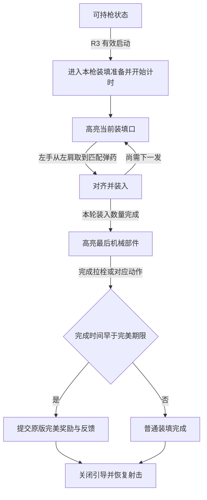

# GearsVR 武器 6DoF 交互设计

2026-10-22，面向 0.1.0 后续开发。玩家用双手控制器自由移动双手和武器，通过身体槽位取枪取弹、手动装填和真实挥手投掷完成战斗。保留原版武器差异、后坐力、伤害、弹药与成功反馈，用 VR 动作替代切枪动画和二次按键换弹。

本文是需求与实施规格。独立分支已开始实现双手 OpenXR 输入桥、槽位／臂展和装填事务的基础代码，当前仍是只读接入与离线验证，游戏内的新交互尚未完成。下文标为“整理默认”的内容用于补齐操作细节；“可选建议”不属于已确认需求。原版各枪具体时长、机械部件行程和动画事件仍需逐枪核对。开发状态见[0.1.0 进度](releases/0.1.0/PROGRESS.md)。

## 需求口径与旧方案衔接

| 项目 | 本次采用的规则 |
| --- | --- |
| 肩部取枪表述 | 将“右肩膀抓左肩／右肩”整理为“右手抓左肩取武器 2，右手抓右肩取武器 1” |
| 换弹入口 | 统一采用最终指定的 R3；电锯步枪示例中的“按 A 弹出弹匣”由 R3 执行，A 保留 Xbox A 的游戏动作 |
| 完美换弹期限 | 用户已确认：以原版该武器完美换弹窗口结束时刻为期限，提前完成也算完美；无需等窗口开始 |
| 右摇杆左右 | 改为平滑或 Snap 转向，覆盖旧方案中的左右探身绑定；右摇杆上下的既有站蹲目标保留，需避免斜推同时触发 |
| L3 与 R3 | 分别为回中与开始装填；6DoF 模式不能再由 L3＋R3 切换第一／第三人称 |
| 原版还原 | 以本机 Reloaded 对应武器的装填和射击动画核对部件与动作；用户指定的 VR 判定规则优先，不将尚未核对的动作称为原版事实 |

旧方案中的吸附、独立站蹲、扒墙与飞扑内容仍见[早期交互方案](10-vr-interaction-design.md)。本次不把这些能力算作武器 6DoF 已完成的前提成果，也不因改键删除它们的设计目标。左右探身需要另配操作，不能与转向共占一个输入。

## 手柄绑定

以 Quest 3 为示例。这里的 L／R 分别指左／右扳机，LGrip／RGrip 指握持键，L3／R3 指摇杆按下。

| 输入 | 战斗行为 | 状态约束 |
| --- | --- | --- |
| 左摇杆 | 移动人物，保留原版移动速度与碰撞规则 | 去掉普通行走的启动拖延、松杆滑行和附加视点惯性 |
| 右摇杆左右 | 平滑转向或 Snap 转向 | 启动器设置模式；Snap 设置角度，平滑设置转速；一次拨杆只触发一次 Snap，回到死区后重置 |
| 左扳机 L | 开镜／瞄准 | 保留相应武器瞄准状态，武器方向仍由双手决定；不将枪自动拉到头显中心 |
| 右扳机 R | 枪械开火 | 仅在当前机械状态允许时触发；手雷的投掷操作见后文整理默认 |
| 左握持 LGrip | 取弹、抓物、抓机械部件、辅助持枪 | 整理默认：按住握持，松开释放；同一时刻只占用一个对象或操作 |
| 右握持 RGrip | 在身体槽位取枪／切枪 | 按一下锁定持有，不要求持续捏住；正常切枪不播放原版切换动画 |
| L3 | Recenter 回中 | 同步处理头、手、枪与身体槽位，不重新测臂展 |
| R3 | 开始装填；弹匣枪拔下／弹出弹匣 | 单发或其他机构进入对应装填准备步骤，不能强行生成不存在的弹匣 |
| A、B、X、Y | 对应 Xbox A、B、X、Y 的原版动作 | 拾取、近战等仍由原版动作条件决定；由 VR 接管的动作必须拦截重复输入 |

菜单、剧情选择等界面保留必要的导航和确认输入。游戏输入必须按状态路由，同一次按键不能既取枪又触发原版切枪，既开始体感装填又让原版计时器自动补满。

整理默认：持枪时在其对应身体槽按 RGrip 可收回；在其他有效武器槽按下则直接切换，旧枪回原槽。在空中误按 RGrip 不把武器丢掉。射击与装填时再次按 R3 不重置计时，也不重复弹出部件。

## 身体槽位与无弹药反馈

| 手与身体区域 | 取出的物品 | 数量与身份依据 |
| --- | --- | --- |
| 左手到左肩，按 LGrip | 右手当前武器匹配的一发弹药或一个弹匣 | 当前武器可用备用弹药；装填件类型由武器配置决定 |
| 右手到左肩，按 RGrip | 武器 2 | 原版武器槽 2 的当前物品 |
| 右手到右肩，按 RGrip | 武器 1 | 原版武器槽 1 的当前物品 |
| 右手到左裤兜，按 RGrip | 手枪 | 原版手枪槽当前物品 |
| 右手到右裤兜，按 RGrip | 一枚手雷 | 当前可用手雷种类与剩余数量 |

左肩同时有取弹与武器 2 两种含义，用左右手区分，不能只用位置决定。槽位绑定原版物品栏身份；换拾新枪后，同一槽位立即指向新枪，不能复制出旧枪。

没有对应备用弹药时，左手保持空手，播放一次“No ammo”提示音。手雷数量为零、武器槽没有物品时，同样给出无可取物品提示，不能生成假物体。英文提示统一拼写为“No ammo”，可配中文“没有弹药”。

整理默认：已拥有但空仓的枪仍可取出用于装填；若枪内和备用都为零，取出时播放无弹药提示。武器是否存在与弹药是否耗尽分别判断。提示按一次有效抓取触发，按住握持键不逐帧重复播放。

当原版进入禁止持枪或收枪状态时，枪回到它的原槽，双手显示空手；不把收枪解释成丢弃物品。恢复可持枪后，整理默认由玩家再从槽位取出，任务脚本强制装备或拾取完成的情况按原版最终物品栏状态处理。

## 臂展测量与身体定位

首次进入 6DoF 模式前必须完成测量。启动器提供“重新测量臂展”选项；有效记录存在时默认复用，用户可主动重新测量。

1. 玩家戴好头显，在启动前的 VR 校准界面中将双臂自然伸向两侧，双手约与肩同高。
2. 同时长按两个握持键。建议初始稳定采样时长为 2 秒，界面显示进度；这是可调交互参数。
3. 仅在双手追踪有效、姿态稳定时采样，保存控制器间距、头与手的相对位置以及当前坐姿／站姿参考。
4. 完成后显示肩部和裤兜范围，让玩家试抓确认可达，再将有效结果保存到本地用户配置。测量失败可重试；已有有效记录时不能被失败样本覆盖。

控制器间距是可用于交互的臂展估计，不等于精确解剖肩宽。肩膀与裤兜用臂展、头手相对位置和姿态估计定位；可选增加逐个触摸槽位的微调，避免要求玩家伸到追踪不到的背后。

槽位随稳定的虚拟身体坐标移动，不能因为玩家转头看侧面就立刻绕头旋转。弯腰、坐姿、虚拟站蹲与摇杆转向必须一致地更新身体、双手和槽位；三个追踪设备不能被描述为已直接测得腰部朝向。

回中只更新参考坐标，保留臂展与槽位相对偏移。回中和 Snap 转向不能产生假的手部速度、自动插弹、拉栓或误投掷；投掷速度历史须在参考坐标突变时重新建立。

## 自由双手与枪口弹道

普通战斗时，双手分别跟随控制器的六自由度位置和旋转。右手控制枪的握把位置与基础姿态，左手可以自由取弹、操作枪械或抓住该枪的副握点。副握点与手型参考该枪原版射击动画，不能给所有武器使用同一个通用位置。

已加入独立枪体姿态数学原型：右手控制器与该武器握把局部姿态共同确定枪体；左手在已握住副握点且追踪有效、臂距及修正角合理时参与定向。枪口点和轴来自逐枪配置的局部坐标，并可用同一冻结回中参考映射到游戏世界。它尚未接入原版武器网格或开火函数；各枪握把、副握点与枪口坐标需先从对应动画／模型验证。

双手握枪时，以主手握把和副手握点共同确定姿态，副手松开即可单手继续操作。手臂可以用 IK 连接身体与双手；握点、可达范围与平滑只用于改善显示，不能让控制器突然失去响应或让武器长时间落后于手。

弹道必须满足以下关系：

- 实际发射起点位于当前枪管出口，基础方向沿枪管轴线；同时保留原版每发随机散布、射程、命中与伤害规则。
- 瞬时命中武器仍使用原版命中机制，投射物武器仍生成其原版投射物。不能只移动枪口火焰或曳光，却让伤害射线继续从摄像机发出。
- 枪口接近墙面时不能因起点前推、回缩或穿过墙体而从障碍物另一侧开火；从持枪点到枪口的遮挡也需处理。
- 头显只改变观察和投影；仅转头或抬头不能改变武器的世界瞄准方向。
- 准星保留在枪口基础瞄准线的场景交点，空旷无交点时沿同一方向显示；它不是逐发随机散布后的最终弹着点。

准星应能由双眼正确看到，位置不能固定在屏幕中心。武器瞄向别处时，准星可以自然离开视野；头动造成的投影移动属于正常表现。

保留原版武器后坐力、连射散布和射击节奏，并区分影响实际弹道的后坐力与模型装饰动画，避免重复叠加。双手握持不默认削弱原版数值。枪身与手部可表现反冲，不能把原版强制镜头旋转直接叠加到 HMD 追踪，使玩家被动甩头。原版瞄准辅助若参与运算，必须核对其参考方向，不能让它把枪口瞄准重新拉回头显中心。

原版脚本核对发现 `WarPC.StartFire` 的覆盖体为空，直接对它发调用不能证明会射击；有效下游涉及 Pawn、InventoryManager 和当前武器的状态分派。Snub 的射速／延迟逻辑以及 Torque Bow 在 `EndFire` 时可能释放箭矢，说明不能逐帧重复 `StartFire`，也不能在追踪丢失时一律调用 `StopFire`。VR 右扳机要在经过验证的原版 R2 输入语义层接入，并与原键鼠／手柄来源去重。现有私有观察器只记录意图与开火调用祖先，不注入输入；除已验证的 Hammerburst 外，还需检查 Lancer、Snub、Longshot、Torque Bow 等特例及丢失追踪时的处理。

已有一轮隔离的零售版测试场实测了 Hammerburst：只调用一次 `WarPC.ButtonPress('R2')`，不额外调用 `PreButtonPress` 或逐帧 `StartFire`，原版控制器 `bFire` 与 `bHoldingButton_R2` 随按下保持为有效，约 1.2 秒内 `AmmoUsedCount` 从 0 增至 15；只调用一次 `WarPC.ButtonRelease('R2')` 后两项按住状态均清零。此结果证明该枪在该次普通场景中可沿原版 R2 语义持续射击，不代表其他枪或 VR 帧桥已通过。后台游戏进程、菜单桥接和音频守护完成正常停止；测试回执保留在忽略的 `analysis/playground-20261021/fire-semantic-1022a/`。

下一轮已把 **Hammerburst 专用**的 R2 边沿适配器接入私有候选 `Playground` 游戏线程：它读取同一序列、会话和空间纪元的立体帧及右手输入，遇到新按下／松开边沿才调用原版 `ButtonPress/Release('R2')`。短暂取帧失败沿用仍在 100 ms 有效期内的最后一帧；超过有效期或输入发布端退出时，已由适配器按下的这把安全武器会自动松开。最终候选的隔离零售版模拟输入复测中，持续按住约 1.2 秒消耗 15 发，55 ms 读帧空档中仍保持开火，正常松开后停止；再次按住期间发布端退出，弹药停在 24 发、控制器开火状态清零。回执在忽略的 `analysis/playground-20261021/vr-fire-bridge-1022f/`。这是模拟输入到真实游戏开火的候选端到端证明，**不是真机手柄验收**，也没有启用其他 13 种武器、枪口弹道、实体手部或默认启动器的 VR 武器交互。Torque Bow 松开发射的失追取消路径未核实前保持禁用。

左扳机沿用原版 `WarPC.ButtonPress/Release('L2')`：已在单独的购买版后台测试场对 Hammerburst 实测，`bToggleTargeting=false` 时一次按下使 `bPressingTargetingKey`、`bIsTargeting` 变为真，保持 0.35 秒仍为真，一次松开后两项复原；无需额外发送 `PreButtonPress/Release`。该测试里 `FOVAngle` 保持 85，不能据此认定 Longshot 的真实镜片或缩放已完成。只读回执在忽略的 `analysis/playground-20261021/l2-semantic-1022a/`，游戏退出、桥接 Shutdown 和八个音频会话恢复均已核对。

现有候选增加仅针对原版**按住开镜**设置的 L2 边沿所有权状态机；原版切换式瞄准在松开后不退出，故 `bToggleTargeting=true` 时拒绝候选按下。它与 R2 候选共用已匹配 XR 帧和 100 ms 过期门，默认 DLL 仍不包含两者。离线用例覆盖连按、共用原版输入状态、追踪过期、设置切换和武器身份变化。尝试对合并候选做一次隔离零售版联测，但本次游戏在 150 秒内没有创建可用的菜单视口，尚未发出任何 XR 输入或取得 L2 桥接结果；桥接关闭、音频守护结束、该测试进程按身份清理。因此仍须把合并候选视为**未运行验证**，不能以此前单独调用的结果替代。

## 物理装填与黄色引导

每把武器有自己的步骤表，R3 启动的是该枪对应的装填操作。当前可操作部位显示亮黄色，完成后立即转移到下一部位；未轮到的部件不能提前记为完成。

弹匣、单发弹药、装填口和枪栓使用实际几何位置与方向判断。进入合理容差后允许短距离吸附到位，但必须有正确物品、动作顺序和插入／机械行程，不能仅凭手碰到一个大范围触发器就装弹。

现有独立几何适配器以逐枪装填口与弹药件的局部姿态为依据，先验证弹药从口外沿正确轴向接近，再验证对准、连续行程和到位；越界、跳帧瞬移、换世界／回中和同一件重复提交都拒绝。装填事务已可给出“装填口／枪栓／杠杆握把”的唯一当前引导部位。合成姿态测试通过，但逐枪原始网格尺寸、插入方向、动画时间、实体高亮渲染和原版库存提交还未接入，因此这些是判定原型而非游戏内可见黄色提示。

没有独立最终机械动作的武器，以经动画核实的最后必要步骤为结束点，不凭空给每把枪添加枪栓。超时只改变完成结果，不关闭引导、不自动完成、不触发原版主动换弹失败或卡壳。

### 电锯步枪示例

1. 玩家按 R3，开始计时，弹匣拔下／弹出，弹匣井显示亮黄色。
2. 左手伸向左肩，按住 LGrip 取出一个与该枪匹配的弹匣；无备用弹药则空手并播放“No ammo”。
3. 左手将弹匣对齐黄色弹匣井并插到位。成功装入后，手中弹匣归属于武器，不能继续复制或重复插入。
4. 弹匣井高亮关闭，枪栓或经原动画确认的上膛部件显示亮黄色。
5. 左手握住该部件，完成规定行程及必要的回位动作；引导关闭，武器恢复可射击。
6. 根据整套动作耗时判定完美或普通。完美时调用原版对应奖励与反馈，让角色按原版语音规则播放成功台词，例如用户提到的“Rock and roll”，不强制每次重复同一句。

弹匣插入、部件锁定与上膛的原版声音尽量复用。空仓和非空仓的机构差异必须逐枪核对；没有核实前，不能声称两者完全相同。

### 霰弹枪规则

用户要求：逐发装入，通常上三发后完成机构动作；如果需要补的弹药少于三发，则只装实际需要的数量。每次射击后还需要一次手动循环动作，完成前不能打下一发。玩家补充确认 Gnasher 是杠杆式霰弹枪：左手握住枪身前端作为支点，右手将握把向下掰并回位；它不是左手推拉前护木的泵动枪。射后黄色高亮应落在握把／杠杆运动区域，左手副握点可给较弱的定位提示。必须在双手追踪有效、左手确实保持前端支点、右手走完下压及回位行程后才承认循环。换弹后的最后机构动作也按其原版杠杆动画核对，不能仅让手碰一下高亮区即结束。

当前纯逻辑识别器已具备该动作的顺序、双手在位和追踪代次门控；实际杠杆枢轴、握把角度及行程阈值还需从原版枪模／动画求出并与控制器姿态关联。未经这一接入的测试通过不能算游戏内已能手动掰枪。

现已补上独立的双手几何原型：杠杆动作期间让左手前握点稳定枪身，以原模型的杠杆枢轴和手柄接触点为圆弧，检查右手位置的径向、轴向误差并求有符号下掰角，再交给上述顺序识别器。合成手柄姿态测试覆盖完整下掰／回位、离开圆弧、追踪失效和头显独立运动。原始网格参考骨架中 `b_Shotgun_Lever` 的父骨是 `b_Shotgun_Main`，父局部位置约 `(0, 20.607, -2.925)` 原始包单位；这只是静态参考姿态，尚未标定 VR 米制坐标、转轴方向和动画的实际行程，因此原型未启用于游戏射击。

整理默认将“三发”解释为一轮最多补三发，不把原版弹容量改成三发。设枪内缺额为 `M`，本轮可用备用弹药为 `S`：

`本轮目标装入数 N = min(3, M, S)`

| 枪内缺额与备用情况 | 本轮操作 |
| --- | --- |
| 缺至少 3 发，备用至少 3 发 | 从左肩逐次取 1 发，装入 3 发，再完成机械动作 |
| 只缺 2 发或 1 发 | 装入对应的 2 发或 1 发后即可完成机械动作 |
| 缺 3 发，备用只有 1 发 | 装入 1 发后允许完成，不能要求不存在的另外 2 发 |
| 缺额大于 3 发且还有备用 | 本轮补 3 发；需要继续补弹时开始下一轮，已装入弹药保留 |
| 缺额为 0 | 不开始无意义装填，不发放完美奖励 |
| 备用为 0 且无手持保留弹药 | 不生成装填件，播放无弹药提示 |

达到本轮目标数量后，高亮由装填口转到机械部件。装填期间若原版事件合法改变可用弹药，目标只能按实际可完成数量调整；不能让玩家通过丢弹或反复启停缩短步骤刷完美奖励。

射击后的循环与换弹后的最后机械动作必须区分。若一次合格动作同时解决当前待循环和上膛需求，只消费一次，不要求玩家无意义地拉两次。这里的“三发”和“每发手动循环”是用户要求的 VR 规则；其与 Reloaded 的原版动画机构、射击节奏是否完全一致，需逐枪核对后再描述为还原。

### 各枪的独立配置

| 武器／投掷物 | 当前实现边界 | 必须从本机动画与状态核对的差异 |
| --- | --- | --- |
| Lancer | 已有通用弹匣事务原型；实枪交互待接 | 弹匣井、枪栓位置，空仓与战术装填差异 |
| Hammerburst | 待逐枪接入 | 握点、插入方向和机械行程不能照搬 Lancer |
| Gnasher | 已有最多三发、杠杆动作与双手几何的纯逻辑原型；实枪待接 | 左手前端支撑、右手握把下掰并回位；射后高亮握把／杠杆 |
| Longshot | 待逐枪接入；独立瞄准镜渲染待建 | 单发开膛／装入／闭锁顺序，瞄具与弹道对应 |
| Torque Bow | 待逐枪接入 | 蓄力、弹体、上弹机构和声音按原版核对 |
| Boomshot | 待逐枪接入 | 弹体、装填数量与动作按原版核对 |
| Hammer of Dawn | 待逐枪接入 | 使用条件、指示与资源规则；无常规弹匣时不强加弹匣 |
| Mulcher | 待逐枪接入 | 重武器持有姿态、弹药及收放条件 |
| Snub Pistol | 待逐枪接入 | 手枪槽身份、弹匣与空仓机构动作 |
| Boltok Pistol | 待逐枪接入 | 装填数量与原版机构动作，不能套用步枪弹匣 |
| Troika | 待逐枪接入 | 固定武器交互与原版动画，不直接塞进身体槽 |
| Bolo Grenade | 待逐枪接入 | 引信、投出与爆炸规则，实际释放轨迹替换 |
| Smoke Grenade | 待逐枪接入 | 引信、数量、烟雾效果和投掷反馈 |
| Ink Grenade | 待逐枪接入 | 引信、数量、特殊效果和投掷反馈 |

每把武器至少记录：主／副握点、枪口轴、装填件类型与尺寸、入口位置与方向、机械步骤及行程、目标数量规则、原版计时参数、原版奖励与音效入口、可射击条件，以及中断后的恢复方式。

本功能的逐件覆盖清单由玩家确认，共上表 14 种。这里的“覆盖”指按各自原版装备／弹药／动作规则完成交互与验收，不能用一个通用枪械步骤宣称全数完成。Mulcher、Troika 的持有或固定方式，Hammer of Dawn 的使用条件，以及三类手雷的引信和投掷状态都要单列核对；尚未确认的细节保持待测。

Longshot 瞄准镜另设光学渲染任务。单纯放大原有双眼画面会放大像素与已有渲染模糊，不能代表远处目标细节；应在瞄具局部建立与枪轴对齐的独立远景视图，并以合适的渲染分辨率显示在镜片内。需要同时处理视差、瞄具边缘遮挡、非瞄准眼、景深感受、延迟和性能，核对镜内目标与枪口真实命中线的关系。此项暂为渲染设计与验收要求，尚未实现；不把已有近眼 HUD 缩放算作狙击镜。

## 完美换弹计时与弹药记账

用户已选定“原版完美窗口结束前完成”的规则。分别记录普通装填时长 `T_normal`、原版完美窗口起点 `T_perfect_start` 和终点 `T_perfect_end`，不能将这三个值混为一个时间。

这些时长以本轮有效装填起点为零，读取当前版本、武器及装填状态实际生效的参数。动画总长度、历史一次成功按键间隔和字段名称本身都不能替代原版完美截止线；若参数随状态变化，不能只按枪名写死一个常数。

- `t0`：R3 被当前武器接受并正式开始本轮装填的时刻，包含弹出／开膛与取弹耗时。
- `t1`：本轮最后必要机械动作被确认完成的时刻；仅拿到弹药、只插入而未完成上膛都不算完成。
- `Δt = t1 - t0`。规定数量和所有步骤均完成，且 `Δt < T_perfect_end` 时判完美；提前于 `T_perfect_start` 也可成功。
- 到达或超过截止时间后完成，判普通装填；时间边界按同一游戏时钟比较，不由显示帧率决定。
- `T_normal` 用于原版时序核对，不作为体感装填的自动完成计时器。超过它但手未装完，武器仍保持未完成状态。

计时跟随用于原版装填的游戏时间与暂停规则；菜单暂停不继续消耗完美时间。读取检查点、死亡、武器被移除或剧情强制接管会结束当前事务，不能靠恢复旧时间戳再次领完美奖励。普通跟踪丢失不能被当作游戏暂停来增加装填时间，也不能用恢复后的瞬移完成机械动作。

完美结果必须接入原版实际奖励、弹药效果、声音与角色反馈，且只提交一次。不能只播放一句语音或改 HUD 显示就当作成功；不同对象中的结果枚举不能混用。超时走普通完成路径，保留先前已确认的“不加失败／卡壳惩罚”要求。

弹药必须守恒，原版库存是最终依据。实现上需要区分备用可用、手持保留、已经装入三个状态：

1. 从左肩取弹时，保留这份真实库存，使其不能再次被取出；未插入前不增加枪内可用数量。
2. 插入成功后只转移相应数量。半满弹匣、剩余不足一匣以及一发一发装入都不能无条件补满。
3. 弹匣弹出后，原有剩余子弹必须按明确规则保留，不能凭空丢失或重复增加。整理默认采用原版不丢弃剩弹的补弹行为。
4. 松开未插入的弹药，整理默认归还其保留库存并消除手持件；已插入部分保留在枪内，不能再退款。
5. 切枪或收枪终止本轮完美判定，释放未提交保留量，保存已装入数量及未完成机械状态。再次取出后可按该枪规则继续完成，不继承旧完美奖励机会。
6. 已有原版结束计时器、动画通知和新的 VR 完成事件必须由同一装填流程协调，避免自动补弹、重复扣弹和重复奖励。

## 武器上的弹药卡片

移除右上角武器／主动换弹条显示，用右手武器上的小卡片保留当前枪内数量和备用数量。其他游戏界面不因移除武器区而一起消失。

整理默认把卡片固定在握把前上方或机匣后上方：文字横向与枪身横向一致，卡片竖起，正面朝向持枪者，像插在枪上的一张卡。卡片位置和朝向都跟随武器局部坐标，不转成固定跟头的 HUD，也不每帧强行面向眼睛。

卡片要避开瞄具、拉栓和装填口，能从双眼阅读。以枪内／备用两个数值为核心；未完成上膛可显示小型状态标记，但不重新加入完美进度条。不同枪型可独立调整卡片位置、大小和倾角，手雷显示当前可用数量。收枪时卡片一起消失。

黄色引导仅标出当前需要操作的区域。没有备用弹药时可以保留未完成的装填口引导，但必须明确反馈无弹药，不能让玩家误以为肩部还能生成装填件。

## 手雷投掷

从右裤兜取出手雷，去掉原版抛物线预览。真实投掷以手离开持有状态时的位置和运动方向为起点，不能仍沿原版由视角决定的预设抛物线飞出。

为兼容“右手握持按一下即可”，整理默认采用：RGrip 取出并保持持有；按住右扳机进入投掷准备，挥手后松开右扳机投出。不要求玩家整个持有期间捏住 RGrip。此处的手雷释放键属于补齐细节，可单独调整；原版引信是否从准备阶段计时须按实际手雷行为核对。

根据释放前一小段有效手部轨迹估计初速度，过滤单帧追踪跳变，支持上抛、平抛和下手投。弹体实际出手点位于手中的手雷位置，需计入握持偏移；角色平移速度按一致规则合成，摇杆转向和回中不能被误当成投掷加速。

无碰撞的飞行阶段可表示为 `p(t) = p0 + v0 × t + 0.5 × g × t²`，其中长度单位与 `g` 使用经确认的游戏单位。飞行中的碰撞、反弹、引信、爆炸伤害与数量扣减继续由原版手雷规则处理，每次实际生成投射物只扣一枚。

用户指定的质量为 3 kg，作为虚拟重量与投掷手感的目标参数。同一出手速度下，理想重力抛物线不因质量变大而自动变短；重量感可通过加速度响应、速度映射与震动反馈表达，不能简单把速度除以 3。控制器无法产生真实 3 kg 负载，手感参数需在头显中调整，不能让明显的持物拖滞妨碍自由双手。

空库存、追踪丢失、回中、暂停或自动收枪都不能触发一次投掷。已进入原版有效引信状态的手雷仍遵守其计时，不靠收回或暂停某个 VR 局部状态刷新引信。

## 拾取近战与动画控制

拾取枪支继续使用原版拾取判定与动画。动画执行期间双手由动画控制；完成时根据原版最终写入的武器槽和武器身份，把对应枪交到右手，再恢复控制器驱动。不能在动画开始就提前把枪和弹药复制进库存。

近战、处决以及其他需要固定动作的行为同样复用原版动画及其命中／伤害时机。开始前暂停自由手部驱动，完成后恢复；不能在动画命中之外再加一次控制器挥手伤害。这里不新增体感挥砍规则。

| 控制阶段 | 双手与武器由谁驱动 | 退出条件 |
| --- | --- | --- |
| 普通战斗 | 控制器与握点约束 | 进入机械操作、原版固定动作或禁止持枪状态 |
| 体感装填 | 控制器驱动，当前部件限制操作行程 | 完成、中断或失去武器所有权 |
| 拾取／近战等固定动作 | 原版手臂与武器动画 | 原版结束或取消事件 |
| 剧情收枪／死亡／无控制权 | 原版游戏状态决定可见与持有状态 | 恢复角色控制后重新同步物品栏 |

双手被动画接管时，HMD 观察仍自由；不能让拾取、近战或处决动画带动玩家头部翻滚。动画结束后短暂平滑显示上的手部衔接，但实际射击姿态必须与当前控制器同步，不能用旧动画枪口开出下一枪。

普通行走取消输入平滑造成的惯性与附加镜头拖尾；松杆后尽快停止自主行走。重力、碰撞、受击推力、掩体动作与脚本位移分别保留自身规则，不能全局清零角色速度来“去惯性”，也不能由此删掉武器后坐力。

## 启动器设置

| 设置 | 行为 |
| --- | --- |
| 6DoF 武器交互 | 进入本套控制器与体感装填模式；第一人称预览旧快捷键在此模式避让 |
| 臂展校准状态 | 显示是否存在有效记录；首次必测 |
| 重新测量臂展 | 用户选中后在启动游戏前进入校准流程；成功后保存 |
| 转向模式 | 平滑或 Snap |
| Snap 角度 | 可调整；可选建议提供 15、30、45、60 度，初始选择 30 度 |
| 平滑转速 | 独立于 Snap 角度配置；不能把角度值直接当转速 |
| 右摇杆死区 | 复用现有设置，处理回中与转向触发去抖 |
| 手部与槽位微调 | 可选建议，保存到本地个人配置 |

首次校准需要在头显已建立追踪后进行，“启动前”指进入游戏战斗之前，不能让桌面启动器在未获得控制器位姿时伪造测量结果。游戏暂停、OpenXR 会话失去有效输入时，停止新的射击、插入和投掷动作；恢复后先同步状态。

## 已有基础与实现缺口

已有工作可复用，但不能把资源导出或静态调用关系当作完整交互验收。

| 项目基础 | 可以复用的内容 | 本功能还需要完成的部分 |
| --- | --- | --- |
| [第一人称预览与模型](first-person-preview-20261021.md) | 第一人称视点、已有武器灰模与部分运行证据 | 双手追踪驱动、握点、实际骨骼与机械部件控制、VR 尺度 |
| [弹药资源与换弹入口](ammo-and-physical-reload-20261021.md) | Lancer、Hammerburst 弹匣等资源；普通装填与成功反馈候选入口 | 完整弹药模型、逐枪动画步骤、原生精确计时及统一弹药提交 |
| [瞄准与命中链](weapon-aim-hit-chain.md) | 射击起点、基础方向、散布与碰撞的候选边界 | 控制器驱动最终枪口及实际开火射线的一致性、近墙阻挡 |
| [原版完美换弹样本](77-active-reload-startup-regression.md) | 既有原版结果与弹药转移的采样方法 | 每枪完整完美区间；既有一次成功的按键间隔不能当通用阈值 |

私有 6DoF 观察会话现已能用当前进程的新鲜凭证，在现有 VM 调用边界只读记录六个关键武器函数的进入／返回和开火函数体祖先。它用于决定下一步实际枪口射线接入点，尚未在游戏中证明覆盖任何一枪；更没有改动原版弹药、散布、伤害或结果缓冲。

Gnasher 与 Boltok 的完整未发射单发弹药仍未在已有调查中确认。若需要补建模型，应明确其为新建／修改资源。逐枪调查先检索现有知识库，再用既有 IDA 工具链做有界核对；磁盘 EXE、历史运行时证据和脚本声明保持各自来源。

原版武器网格不能按查看用的灰模 GLB 判断为一整块：该导出只保留 LOD0 三角形，丢失了骨骼与蒙皮。对六件已定位的原始 `SkeletalMesh` 做来源哈希、骨骼层级和 LOD0 蒙皮核验后，Gnasher 的 `b_Shotgun_Lever` 关联 1,192 个顶点／1,260 个三角形，能与主体无交叉三角形地分出检查用灰模；Hammerburst 弹匣、Longshot 枪栓和 Snub 滑套／弹匣也可按骨骼刚性分组。Lancer 的弹匣与主体交界有 36 个混合权重顶点，自动完整刚性拆分会被拒绝，须处理过渡区。Longshot 虽有 `b_LS_Scope` 和 `b_LS_LensCap` 骨骼，当前 LOD0 活动骨骼表只有主体与枪栓，不能声称镜体网格已可单独运动。Boltok 的 12 根骨骼名称不表达部件功能，需结合动画核验。审核脚本为 `tools/weapon-models/audit_skeletal_bones.py`，保守刚性拆分工具为 `tools/weapon-models/split_rigid_lod0.py`；完整报告与拆出的检查用 OBJ 留在忽略的 `analysis/weapon-bone-audit.json`、`analysis/weapon-partitions/`。这些结果尚不证明游戏动画行程或 VR 可抓取性。

审核现还记录每根骨骼的静态参考姿态、父骨和局部坐标，方便以后定位杠杆枢轴、弹匣位置和枪栓行程。记录基于推断的 48 字节骨骼格式，并经过已定位模型的四元数／层级边界检查；坐标仍为原包单位，不能直接作为手柄交互半径。分拆出的 OBJ 只用于查看几何，不会覆盖玩家已购买游戏的原始资源。若某件模型确实没有可动部件，应按动画与蒙皮核验结果决定是否制作独立覆盖部件，而不是仅凭灰模外观直接修改原版网格。

对 Gnasher，原版杠杆已由独立骨骼刚性承载，优先在原始蒙皮网格上逐实例驱动该骨骼并让黄色提示跟随杠杆；实体切面网格只作为校验工具，不先替换游戏资产。`WeaponMesh.Animations` 在脚本资产中直接指向 `AnimNodeSequence`，要做附加骨骼控制还须核对运行时动画树和更新顺序。准备好的零售版 `SG_Chamber` 骨骼采样在这轮后台启动中未进入菜单视口，未取得杠杆矩阵；对应忽略回执为 `analysis/playground-20261021/gnasher-lever-1022a/` 和 `gnasher-lever-1022b/`。这不改变静态可分结论，也不证明运行时骨骼已受 VR 控制。

从同一来源哈希已核对的零售 `WarfareGame.u` 静态读取原版动画轨道：Gnasher 的 `SG_Chamber` 长度字段为 1.1667 秒、35 帧，`b_Shotgun_Root` 和 `b_Shotgun_Main` 各只有 1 个旋转键，而 `b_Shotgun_Lever` 有 18 个。按包内 `ACF_IntervalFixed32NoW` 压缩数据解码，杠杆在动画存储的父局部坐标下，键 0–6 保持原位，键 7 约转 24.02°，键 8–9 达到约 32.40°，键 10 回到约 24.02°，键 11–17 回到原位；解码的符号为局部 −X。`SG_Reload`、`SG_Reload_Fail`、`SG_Reload_Success` 的杠杆还分别有 45、60、27 个旋转键，因此装填与射后循环应分别核对。独立审计工具 `tools/weapon-models/audit_animation_tracks.py` 可按 AnimSet 骨骼名有界复现轨道数量及选定轨道采样，衍生采样只写入忽略的 `analysis/`。解码格式参照 [UEViewer 固定版本的原始实现](https://github.com/gildor2/UEViewer/blob/a0bfb468d42be831b126632fd8a0ae6b3614f981/Unreal/UnrealMesh/UnMeshTypes.h#L2224)。这 32.40° 是静态动画幅度，不是未经手柄标定即可使用的 VR 下掰阈值；参考骨架和动画四元数的存储约定不同，世界空间方向、游戏实际播放速率和完美换弹窗口也未由该数值证明。

Longshot 的原版 `LS_Reload`／`LS_Reload_Fail` 中，`b_LS_Bolt` 各有 50／160 个旋转键，镜盖与镜体在这两条序列中各仅 1 个。枪栓有可复用动画证据，但该证据没有解决镜片内远景渲染，也没有把 LOD0 不活动的镜体骨骼变成独立可动几何。

同一有界轨道审核还覆盖 Lancer、Hammerburst、Snub 和 Bolo：Lancer 的 `AR_Reload` 中弹匣有 38 个平移／旋转键，机匣与卡扣各有 38 个旋转键；这表明原版已把多个装填部位作为不同动画轨道，不能因弹匣与主体的 36 个混合蒙皮顶点就硬裁成两块。Hammerburst 的 `HB_Reload` 中弹匣锁扣有 75 个旋转键，弹匣骨骼在该序列仅有常量键；实际取出手持弹匣要结合已有独立 `MagazineMesh` 和原版显示／库存行为处理。Snub 的 `HG_Fire` 中滑套有 6 个平移键，装填序列中滑套、弹匣及两侧小件分别活动。Bolo 的 `GR_Prepare` 中链条多节各有 40 个动作键，飞行序列另有链条／根骨动作；手势投掷的新抛物线不应把这条链子的视觉动作丢掉。以上均是包内动画轨道证据，动画长度字段不等于原版完美换弹窗口，且仍没有游戏内逐实例控制验收。

购买版身份已比对的 `MP_WarMachine.war` 中，Torque Bow 的 `Tension` 在八根弓臂骨骼上各有 54 个旋转键，首对弓臂各有 54 个平移键；它的 48 个跨骨骼三角形必须继续由原蒙皮处理张弓变形。Boomshot 的 `AR_Reload` 让 `Boomshot_Barrel` 平移 86 键，`AR_Fire_Boomshot` 平移 37 键，而弹匣骨骼在这些序列里没有多键运动；物理装弹不能直接假定原版动画已把弹匣取在手上。Troika 的 `Spin` 让左右旋转件各有 10 个旋转键，仍按固定炮塔单独处理。三个包内轨道审核结果也只保存在忽略的 `analysis/`，这些静态数据不证明运行时可控。

随后把已定位的四件地图包网格与两种手雷也纳入同一哈希／骨骼／蒙皮检查，共覆盖清单中的 12 件模型。Hammer of Dawn 有单独 `Trigger` 骨骼；Boomshot 有 `Magazine` 与 `Barrel`；Troika 有转向、旋转部件和双枪口骨骼；Torque Bow 的弓臂由多根骨骼构成；Frag/Bolo 与 Smoke 手雷各有分节链条骨骼。12 件中 10 件的当前 LOD0 可按骨骼刚性无损分出检查用几何，已在忽略的 `analysis/weapon-partitions/` 导出其可分部分。Lancer 有 36 个混合权重顶点、40 个关联三角形及 8 个跨骨骼三角形；Torque Bow 虽没有混合权重顶点，但有 48 个跨骨骼三角形。两者不能把每个骨骼直接切成无缝独立网格，需保留原蒙皮或专门处理接缝。该统计仅限已核对网格的 LOD0，仍不证明动画姿态正确或这些骨骼能被现有 VR 控制。

Mulcher 与 Ink Grenade 尚未在当前 `WarfareGame.u` 和先前选取的三个地图包中定位到对应网格；这不是断言游戏没有它们。应继续按购买版已安装内容的包清单查找，并先确认游戏版本实际提供相应武器，再决定拆件方案。Troika 作为固定炮塔，不会强行塞进肩膀槽位。

为了确认上述分析不是旧目录特有的模型，本轮把购买版工作副本中的 `WarfareGame.u` 和 `MP_WarMachine.war` 分别只读解压到忽略的临时分析文件，并与既存分析包做完整 SHA256 对照：前者双方均为 `91c0f56e9302db2b3991fc3d8646abc1eaff2b33b8b021ce8df436d8cd681d13`，后者双方均为 `55f40ca44051413fe6db19816f97b09849c5e104319d93e9d5d159cbe6fb2840`。临时副本校验后已清除。这个结果支持这两个包中相应网格的零售版身份；不表示游戏运行、动画行程或头显交互已通过。

机械件先检查原始骨骼、顶点权重与动画行程，优先用受控骨骼变换驱动原来的可动件；黄色引导跟随该部件而非照亮整枪。不能刚性拆开的部位（如 Lancer 混合权重边界、Longshot 独立镜体）需要在本地工作副本中按蒙皮／材质边界处理、补封切口或补做部件，并逐枪检查枢轴、碰撞、缝隙、贴图、阴影和 LOD。原始游戏包、灰模和拆分衍生资源留在忽略的 `analysis/`，不能直接塞进公开发行包；最终运行时资源来源与许可另行核对。

## 实施顺序与验收条件

1. 建立双手输入、校准、身体槽位与回中／转向协调，先保证取放逻辑与追踪稳定。
2. 用一把步枪打通单手／双手持枪、枪口与实际射线、近墙遮挡和后坐力保留。
3. 用 Lancer 打通完整物理装填、黄色引导、弹药记账和原版完美奖励；同时移除原装填自动完成的冲突。
4. 扩展 Longshot、Gnasher、两类手枪与其他特殊武器，逐枪核对，不使用“通用步枪流程”冒充覆盖。
5. 接入武器弹药卡片、动画接管、手雷投掷与普通行走去惯性，覆盖战役状态切换。
6. 完成必要自动验证后合入当时最新默认启动器，保留其他工作已集成的修复；头显与游戏体验按用户安排集中验收。

| 验收场景 | 必须观察到的结果 |
| --- | --- |
| 首次校准与重启 | 首次要求有效测量；下次复用；失败重测不覆盖有效配置 |
| 槽位与转头 | 五种左右手／身体区域组合准确；仅转头不把肩部槽转走 |
| 无库存与空仓 | 无物品不生成对象且只提示一次；空仓枪仍可进入正确装填 |
| 单手与双手 | 左手可随时脱离副握点，右手继续控制；原版后坐力和散布仍在 |
| 开火与头动 | 同一次开火关联枪口、最终起点、基础方向、散布与命中；仅头动不改基础方向 |
| 近墙 | 枪身／枪口受阻时无法从墙后射出；视觉、准星与伤害结果一致 |
| 换弹时限 | 截止前完成为完美，边界及超时为普通；超时不自动补弹或卡壳 |
| 原版成功反馈 | 不止显示成功，真实奖励、弹药效果和原版反馈只触发一次 |
| 霰弹数量 | 缺 1、2、3、超过 3 发及备用不足各有正确流程；每发后的循环不可跳过 |
| Gnasher 杠杆 | 左手支撑前端，右手握把下掰并回位才允许下一发；高亮跟随杠杆步骤，泵动手势不能误判 |
| Longshot 瞄准镜 | 镜片内远景有独立细节、视差和遮挡正确；镜内瞄点与实际枪口命中线一致，双眼使用与性能可接受 |
| 全武器覆盖 | 上述 14 种逐件记录原版动作和实现状态；重武器、固定机枪及三类手雷保留各自差异 |
| 数量守恒与中断 | 半匣、丢手持件、切枪、收枪、死亡、读档不复制或吞掉弹药，不重复奖励 |
| 机械顺序 | 错弹、错方向、未走完行程不能完成；黄色提示只标当前步骤 |
| 动画交接 | 拾取与近战由原版动画接管，结束后对应武器回手；头显持续自由观察 |
| 回中与转向 | 不误触发装填／投掷，不产生虚假手速；L3／R3 不再触发预览切换 |
| 手雷 | 不显示原版预览线；上抛、平抛、下手投的初始轨迹响应真实手势；只扣一枚 |
| UI 与移动 | 双眼能读枪上弹药卡片；武器 UI／完美条已移除；普通松杆无额外滑行 |

逻辑与模拟器通过、实际游戏调用通过、GPU 双眼图像通过以及实体头显体验分别记录。后续自动游戏测试使用已授权的正版工作副本与经过检查的置后窗口测试构建，遵守 observe-only、behind-windows 和测试静音要求，保护当前存档与设置；本次文档整理不启动游戏测试。

## 可选创意

- **靠近槽位先给轻震。** 手碰到可取区域时一次轻震，真正抓到时再给一次清晰反馈，帮助玩家不低头也找到枪和弹药；与无弹药反馈区分。
- **黄色引导附带手势轮廓。** 不只点亮枪栓，还可显示很短的拉动方向或目标位置；熟练模式仅保留部件高亮。
- **小范围插入辅助。** 弹匣方向和位置接近正确后协助最后一小段插入，避免追踪误差让动作变成精细拼图；仍需要完成每个机械步骤。
- **Playground 装填练习。** 利用现有测试场提供逐枪练习、装填耗时与漏做步骤的复盘。练习提示不带回战役中的武器 UI，也不默认改变原版完美期限。
- **可选宽松装填时间。** 若头显原型显示完整机械动作很难在原版期限内完成，可提供独立的辅助倍率；默认仍使用用户确认的原版截止线，辅助模式需明确显示，不能悄悄放宽。
- **坐姿槽位与左利手方案。** 可单独保存更靠前的肩部／腰部范围；左利手镜像属于后续选项，默认仍按本次确认的左右手布局。
- **按枪保存弹药卡片位置。** 允许将卡片移到较易读且不挡瞄具的位置，尤其照顾手枪、狙击枪与不同持枪角度。

需要在实现前核对或原型中定案的内容集中在：各武器原版完美截止时间及动画步骤、霰弹超过三发缺额时的分轮细节、手雷释放键、空弹匣和未插入弹药的回收表现，以及各枪弹药卡片的最佳位置。已确认的完美时间口径、身体槽位、按一下持枪与 R3 装填入口不再作为待确认事项。
