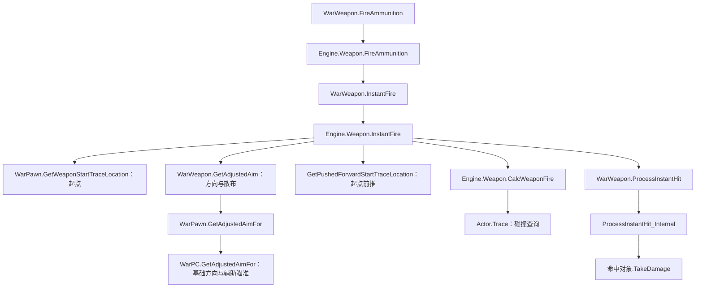

# Current rifle position, hit chain and right hand access

This is the main record of this text.2026-10-16 historical reconciliation; latest 6 The status of the DIF private connection is shown in the end section. The PID, address and configuration in the text are only for the current session.

2026-10-16. The current player weapon code relationship, the current process reflect identity and candidate access borders have been confirmed; no full call track of a real fire has yet been recorded, nor weapons Hook or access controller installed.

This cycle is re-enacted by the existing knowledge base and pseudocodes, which only complement the offline bytes of selected functions token export and current process read-only check. Original inversion add 0, IDA database not opened. All original scripts, address certificates, bytes and item-by-line comparisons are saved in ignored `analysis/weapon-chain/`。

## Current strength of weapons and evidence

PID 35456 Confirms by the current player 's two-way relationship with Weapon.Instigator `WarfareGame.Weap_AssaultRifle`. The chain of inheritance is `Weap_AssaultRifle → Weap_AssaultRifleBase → WarWeapon → Engine.Weapon`. The following public shooting methods are not covered by the rifles and fathers that were consulted; the method in the relevant state has been counted but is not considered as currently being implemented.

Current object extraction: Main firing mode 0♪ Weapon FireTypes `[0,0,0]`, FiringStatsArray `WeaponFiring / Reloading / MeleeAttacking`;bInstantHit, bIsAutomatic, bClitSideInstanthit is true, bUsePreModCameraRotForaiming is false and the gun is named Muzzle.0，Weapon.Role=3，GRI.WeaponStartTraceOption=2, bDisableMagnesm=false. These are the values at sampling and cannot be used in other processes or weapons.

31 Total of Related Functions 3292 Operating code/native number for a token, and 135 The direct call is made to the target, the false name and the Trace call record, which are not different from the current process script structure. Direct call is made to verify that the UObject identity has been detected, and false call is made by a name and loaded inheritance relationship. There is no claim to validate each constant, all attribute references, actual assignment in the current state or the order of execution for one fire.

Native `Actor.Trace` Reaction entrance, original number 277 All two known chunks of the release slot and historical code functions are identical, in common 2059 bytes. Shared script execution portal already exists 5 Bytejects to rewrite and there is a loaded VR DLL; the entry is not called original bytes, nor is it superimposed on the second standalone Hook.

## Confirmed Chain

Main Fire Mode Configuration Selection `WeaponFiring`. A script already indicates the state of Beginstate fire, and RefireCheckTime continues firing when ShouldRefire permits. The core path of the current weapon is as follows: an arrow indicates a verified code relationship and does not mean that these calls have been observed in this round:

`InstantFire` CalcWeaponFire fills in the target, position, method, ray orientation and HitInfo, with penetrating/transmitting portal to branches. The injury internal function selects the type of harm, calls GetFirre ModeDamage, then calls the TakeDamage of the object in the command. The client's instructions are still covered by the original code and no determination is made on the Internet.

The source of the aim is not always a role-direction. WarPawn.GetBaseAimRotation uses role Rotation in a given state, otherwise it enters Engineering.Pahn.GetBaseAimROTation; one branch of the latter calls Controller.GetPlayerViewPoint. WarPC also has modified the former camera rotation branch, which currently has a switch on the weapon. WarWeapon.GetAdjustedaim adds firing error after obtaining base/aided targeting results; it cannot be used to extract samples to avoid additional consumption at random.

The starting point is independent: WarPawn.GetWeaponStartTraceLocation combines first person, camera start, gun entry and masking judgement; GetPulledInMuzzleLocation contains a retortion of the gun mouth. Current WebtonStartTraceOffice=2, the subsequent GetPushedForwardStartTraceLocation may continue to move forward. Replace only the starting value of the previous entry return does not guarantee that the final ray is sent from the same coordinates.

A text is being corrected: GetAdjustedCameraShotStart `GetWeaponStartTraceLocation()`, in the actual byte code is a direct call **Engine.Pawn.GetWeaponStartTraceLocation**, does not revert to WarPawn. The call relationship cannot be restored by using only a back-editing text.

## Access Options for Right Hand controllers

| Border | Conclusions | Conditions to be retained |
| --- | --- | --- |
| WarPawn. GetAdjustedAimFor | This is the first candidate for the restricted orientation prototype. This is before WarWeapon's random spread; using right-hand direction will overwrite the original auxiliary aim result | Current player, current gun and range of call for this firing; original call is executed up to once; no HUD query, AI, other weapons or other calls are affected |
| WarPawn. GetBaseAimRotation Return value | Programs to retain auxiliary targeting could be studied but whether their target selection is still confirmed with the camera | Current bUsePreModCameraRotForAiming=false cannot be extended to other weapons; also need to check the direction source of GetFrictionTarget |
| WarWeapon.GetMuzzleLoc and WarPawn.GetWeaponStartTraceLocation | Current reflection metadata have been obtained for the target and the candidate boundary from which the shooting started | Retractions, push and wall cover must be addressed simultaneously; a model gun posture requires another animation/mounted point to write the path |
| CalcWeaponFire / Actor.Trace | Suitable to observe final input rays and return collision results | Also used for HUD and other queries, must relate to actual InstantFire call, not replace Trace in a global way |

Recommended prototype from **WarPawn. GetAdjustedAimFor in range of fire to return to the border** Right-hand direction. The "access point" here is specific UFunction and return type, but the back intercept operation has not yet been verified. It cannot be used directly as a C++ function with an independent machine code entry. Detour: These script functions share the executioner.

Current reflection confirms that the function W is 8 Byte Object Reference, StartFireLoc Yes 12 Byte Victor, return value is 12 Byte Rotator. The specific parameter area is reserved for local reports; they are not Pawn object members offsets, nor can they replace the actual Rsult/out argument ABI validation. Each game starts must re-declassify and the current stack address is forbidden.

The right-hand cover can be followed by a re-use of the dissemination, range, collision and injury codes. The full position will also require the gun, model and final impact starting point; this round does not complete the "directive access points found" 6 DoF armed already.

## Clear scope for subsequent operation validation

This round does not fire on sampling, modify game data, inject new DLLs, change existing VRs to build or stop the current session. The current shared implementer has been rewritten so that the next experiment should be integrated into the same controlled Hook owner and validated in a new build/new session, without which another Hook cannot be folded directly.

The minimum record of the next step should relate to a return value for the current rifle’s Instant Fire: Record the return value for GetAdjusted AimFor, increase the spread-back value for GetAdjusted Aim, the Impact returned from Start/End, CalcWeaponFire and the same hit information received by ProcessInstanthill. HUD track not related to firing range is evidence. First look at original behavior, then do directional control; separate gun locks are detected when you take over.

## Local evidence and reuse

- `analysis/weapon-chain/source-artifacts.json`: Engineering/WarfareGame Original Source Hashi, recalculated.
- `analysis/weapon-chain/20261016-35456-v2/live.json`Current player/gun, inheritance relationship,79 Reflecting metadata, field layout and script caches for selected/associated functions.
- `analysis/weapon-chain/token-live-comparison-v2.json`：31 Function numeric node structure and item by item of current process; history/current Hash of Trade Code chunks.
- `analysis/weapon-chain/warfare-tokens.jsonl`、`engine-tokens.jsonl`、`warfare-new.jsonl`、`engine-new.jsonl`: Offline token of the selected function. The first two also contain package import entries, and the comparator expressly excludes index< =0, the inappropriate cost package function.
- `analysis/weapon-chain/inspect_live.py`、`verify_tokens.py`、`ExportTokens.cs`: This round has only read-read collection/check scripts; re-use requires updating of the Visible PID/outer directory, and historical scripts cannot automatically select a new process.

The first token comparison misused UElib NativeFunctionToken uninitialized OpCode field; amended to NativeItem. ByteToken all passed after it was passed. The initial version is more reserved and explicitly made v 2 Replace. AmmoCount does not reflect in the object, and tools are missing; no ammunition count conclusions have been drawn from this round.

## 2026-10-26 - Lancer's subsequent target of the consumer boundary.

The latest EB private run has proven to be the original target of R.2 Pressed/actively unoffended/auto-owned cutout and spent ammunition, and the existing Native CallFunction owner did accept and complete the subscription call; these were not distributed records. The EB saves native-status without the old Waapon_call_row numerical line, which cannot be linked from registration count, six function configuration or depletion of the JetAdjusted AimFor, eventually Start/End/Impact.0 The gun-held connection is still being verified, except for the restarting or modification of Hook here.

The main owner only carries the current source/identity and right wrist. Currently, weapon_lancer_wrist_mount is clearly static as a forwarding relationship, not hanging point flat/complete gun Pose, which does not allow control positions to be used as guns. Original production observe still clearly indicates that track_known=false, with the existing shot packet demanding that the known dispatch-by-show freeze Grip; query ready will not automatically fill Webpon Mount, hand support or shoot for permission to write.

KB and its saved scripts continue to support static relationships of “Pawn Foundation/Auxiliary Aiming Upon Return, Additional Shooting Error by WarWeapon.GetAdjustedaim”, but export still contains type/native token undefunct tags, not current returns ABI certificates. An initial call-backed pre-and-observation cannot be converted into an additional call for GetAdjustedAim to sample to avoid further consumption of random status; retention of dissemination is not equal to having proven maintenance of all cameras or back seating power.

The minimum shooting record after the master connects should be directed at return, physical/retardation/pre-start and final collision from the existing CallFunction owner-associated actual Lancer Instant Fire, directly embedded two levels. Results buffer and Caleb Frame must be certified separately, HUD, AI and other calls not mixed; original values obtained first, then comparison of right-hand cover, original distribution and rear-seat power. There is no new raw back-compilation, IDA conversation, radio modification or headline conclusion. analysis/lancer-aim-prerequisites-20261026ed/source-evidence.json。

---

## 中文

# 当前步枪的瞄准、命中链与右手接入位置

本文主体记录2026-10-16的历史核对；最新6DoF私有接线状态见末节。文中的PID、地址与配置只属于当时会话。

2026-10-16。已确认当前玩家武器的代码关系、当前进程反射身份和候选接入边界；尚未记录一次真实开火的完整调用轨迹，也没有安装武器 Hook 或接入控制器。

本轮复用现有知识库和伪代码，只补充选定函数的离线字节码 token 导出及当前进程只读核对。原生反编译新增数为 0，未打开 IDA 数据库。所有原始脚本、地址证书、字节和逐项比较保存在被忽略的 `analysis/weapon-chain/`。

## 当前武器与证据强度

PID 35456 中通过当前玩家的 Pawn.Weapon 与 Weapon.Instigator 双向关系确认 `WarfareGame.Weap_AssaultRifle`。继承链为 `Weap_AssaultRifle → Weap_AssaultRifleBase → WarWeapon → Engine.Weapon`。查询到的步枪类及父类没有覆盖下列公共射击方法；已盘点相关状态中的方法，但没有把状态声明当成当前正在执行的状态。

当前对象取值：主开火模式 0，WeaponFireTypes 为 `[0,0,0]`，FiringStatesArray 为 `WeaponFiring / Reloading / MeleeAttacking`；bInstantHit、bIsAutomatic、bClientSideInstantHit 为 true，bUsePreModCameraRotForAiming 为 false，枪口挂点名为 Muzzle。WorldInfo.NetMode=0，Weapon.Role=3，GRI.WeaponStartTraceOption=2，bDisableMagnetism=false。这些是采样时的值，不能用于其他进程或武器。

31 个相关函数共 3292 个 token 的操作码/原生编号，以及 135 条直接调用目标、虚调用名称和 Trace 调用记录，与当前进程脚本结构核对无差异。直接调用验证了解析后的 UObject 身份，虚调用验证的是名称及已加载继承关系。没有宣称验证了每个常量、所有属性引用、当前状态的实际分派或一次开火的执行顺序。

原生 `Actor.Trace` 的反射入口、原生编号 277 的分发表槽及历史代码函数的全部两个已知 chunks 一致，共 2059 字节。共享脚本执行入口已有 5 字节跳转改写，同时存在已加载的 VR DLL；不把该入口称为原版字节，也不在其上叠加第二个独立 Hook。

## 已确认的代码链

主开火模式配置选择 `WeaponFiring`。已有脚本显示该状态的 BeginState 开火，RefireCheckTimer 在 ShouldRefire 允许时继续开火。当前武器对应的核心路径如下，箭头表示已核对的代码关系，不表示本轮观察到了这些调用：

`InstantFire` 用起点、GetAdjustedAim 的返回方向和射程构造射线，经过起点前推后调用 CalcWeaponFire，再逐项处理 ImpactList。CalcWeaponFire 填充命中对象、位置、法线、射线方向及 HitInfo，并有穿透/传送门递归分支。伤害内部函数选择伤害类型、调用 GetFireModeDamage，再调用命中对象的 TakeDamage。客户端命中上报及权限判断仍由原代码负责；没有因此确认联网裁决。

瞄准方向的来源并不始终是角色朝向。WarPawn.GetBaseAimRotation 在特定状态使用角色 Rotation，否则进入 Engine.Pawn.GetBaseAimRotation；后者的一个分支调用 Controller.GetPlayerViewPoint。WarPC 还存在修改前相机旋转分支，当前武器该开关为 false。WarWeapon.GetAdjustedAim 在取得基础/辅助瞄准结果后追加射击误差；不能额外调用它来采样，以免额外消耗随机状态。

起点有独立处理：WarPawn.GetWeaponStartTraceLocation 综合第一人称、相机起点、枪口和遮挡判断；GetPulledInMuzzleLocation 包含枪口回缩。当前 WeaponStartTraceOption=2，后续 GetPushedForwardStartTraceLocation 可能继续前推起点。仅替换前面的起点返回值不能保证最终射线从同一个坐标发出。

已纠正一处文本歧义：GetAdjustedCameraShotStart 导出文本里的 `GetWeaponStartTraceLocation()`，在实际字节码中是直接调用 **Engine.Pawn.GetWeaponStartTraceLocation**，并非再次递归调用 WarPawn 同名覆盖。不得仅按反编译文本恢复调用关系。

## 右手控制器的接入选择

| 边界 | 结论 | 必须保留的条件 |
| --- | --- | --- |
| WarPawn.GetAdjustedAimFor 的 Rotator 返回值 | 首个受限方向原型的候选点。此处在 WarWeapon 的随机散布之前；使用右手方向会覆盖原辅助瞄准结果 | 当前玩家、当前枪及本次开火调用范围匹配；原调用最多执行一次；不得影响 HUD 查询、AI、其他武器或其他调用 |
| WarPawn.GetBaseAimRotation 的返回值 | 可研究保留辅助瞄准的方案，但其目标选择是否仍跟随相机尚未确认 | 当前 bUsePreModCameraRotForAiming=false 不能推广到其他武器；还需核对 GetFrictionTarget 的方向来源 |
| WarWeapon.GetMuzzleLoc 与 WarPawn.GetWeaponStartTraceLocation | 枪口和射击起点的候选边界，均已取得当前反射元数据 | 必须同时处理回缩、起点前推和墙体遮挡；枪模型姿态需要另一条动画/挂点写入路径 |
| CalcWeaponFire / Actor.Trace | 适合观察最终输入射线和返回碰撞结果 | 同样会用于 HUD 等查询，必须关联实际 InstantFire 调用，不能全局替换 Trace |

推荐原型从 **开火范围内的 WarPawn.GetAdjustedAimFor 返回边界** 接右手方向。这里的“接入点”已到具体 UFunction 和返回类型，但尚未验证该返回拦截的运行实现。不能直接把它当作拥有独立机器码入口的 C++ 函数来 Detour：这些脚本函数共享执行器。

当前反射确认该函数 W 参数是 8 字节对象引用，StartFireLoc 是 12 字节 Vector，返回值是 12 字节 Rotator。具体参数区偏移保留于本地报告；它们不是 Pawn 对象成员偏移，也不能代替实际 Result/out 参数 ABI 验证。每次游戏启动必须重新解析身份，禁止复用本次堆地址。

右手方向覆盖后仍可复用散布、射程、碰撞和伤害代码。完整位置跟随还需要枪口、模型和最终碰撞起点一致；本轮没有把“方向接入点已找到”写成完整 6DoF 持枪已经可用。

## 后续运行验证的明确范围

本轮没有开火采样、修改游戏数据、注入新 DLL、改变现有 VR 构建或停止当前会话。当前共享执行器已有改写，因此下一次实验应集成到同一受控 Hook 所有者，并在新构建/新会话中验证，不能把另一个 Hook 直接叠上去。

下一步的最小记录应关联一次当前步枪的 InstantFire：记录 GetAdjustedAimFor 返回值、增加散布后的 GetAdjustedAim 返回值、起点前推后的 Start/End、CalcWeaponFire 返回的 Impact，以及 ProcessInstantHit 收到的同一命中信息。未关联开火范围的 HUD trace 不算证据。先观察原版行为，再做方向覆盖对照；接位置时另测枪口遮挡。

## 本地证据与复用

- `analysis/weapon-chain/source-artifacts.json`：Engine/WarfareGame 原始来源哈希，已重新计算核验。
- `analysis/weapon-chain/20261016-35456-v2/live.json`：当前玩家/枪、继承关系、79 个选定/关联函数的反射元数据、字段布局与脚本缓存哈希。
- `analysis/weapon-chain/token-live-comparison-v2.json`：31 函数字节码结构与当前进程的逐项核验；Trace 代码 chunks 的历史/当前哈希。
- `analysis/weapon-chain/warfare-tokens.jsonl`、`engine-tokens.jsonl`、`warfare-new.jsonl`、`engine-new.jsonl`：选定函数的离线 token。前两份还含包导入条目，比较器明确排除 index<=0，不当成本包函数。
- `analysis/weapon-chain/inspect_live.py`、`verify_tokens.py`、`ExportTokens.cs`：本轮有界只读采集/核对脚本；复用时需更新显式 PID/输出目录，历史脚本不能自动选一个新进程。

首次 token 对比误用了 UELib NativeFunctionToken 未初始化的 OpCode 字段；修正为 NativeItem.ByteToken 后全部通过。初版比较保留且已明确被 v2 取代。AmmoCount 不在该对象的反射字段中，工具如实记录缺失；本轮没有得出弹药计数结论。

## 2026-10-26 — Lancer后继瞄准消费端的证据边界

最新EB私有实跑已证明原版瞄准下的R2按下／主动松开／自有停止交还与耗弹，现有Native CallFunction所有者也确实接受并完成了订阅调用；这些不是逐发记录。EB保存的native-status没有旧weapon_call_row数值行，不能从注册计数、六函数配置或耗弹推导GetAdjustedAimFor、最终Start／End／Impact已经关联。主握PG query已交付Native消费者，实际C0持枪接线仍在验证，不在此重复启动或修改Hook。

主握Response只携带当前来源／身份和右腕标定。当前weapon_lancer_wrist_mount明确只有静态朝向关系，不是挂点平移／完整枪体Pose，更不能据此把控制器位置当成枪口。原生产observe仍明确mount_known=false，现有shot packet又要求已知的逐发冻结Grip；query ready不会自动补齐WeaponMount、双手支撑或射击写入权限。后续需明确这条独立数据链，不能为了取到packet而把未知Grip标为single或two。

KB及已保存脚本继续支持“Pawn基础／辅助瞄准返回之后，由WarWeapon.GetAdjustedAim追加射击误差”的静态关系，但导出仍含类型／native token未解析标记，不是当前返回ABI证明。一次原调用的前后观察不能变成额外调用GetAdjustedAim来采样，以免再消耗随机状态；保留散布也不等于已证明保留所有相机或骨骼后坐力。

主握接通后的最小射击记录应从现有CallFunction所有者关联实际Lancer InstantFire、直接嵌套的两级瞄准返回、物理／回缩／前推起点及最终碰撞。结果缓冲和caller Frame须分别认证，HUD、AI及其他调用不混入；先取得原版数值，再比较右手方向覆盖、原版散布及后坐力。当前没有新增原生反编译、IDA会话、射线修改或头显结论。保存证据与源码哈希位于ignored analysis/lancer-aim-prerequisites-20261026ed/source-evidence.json。
